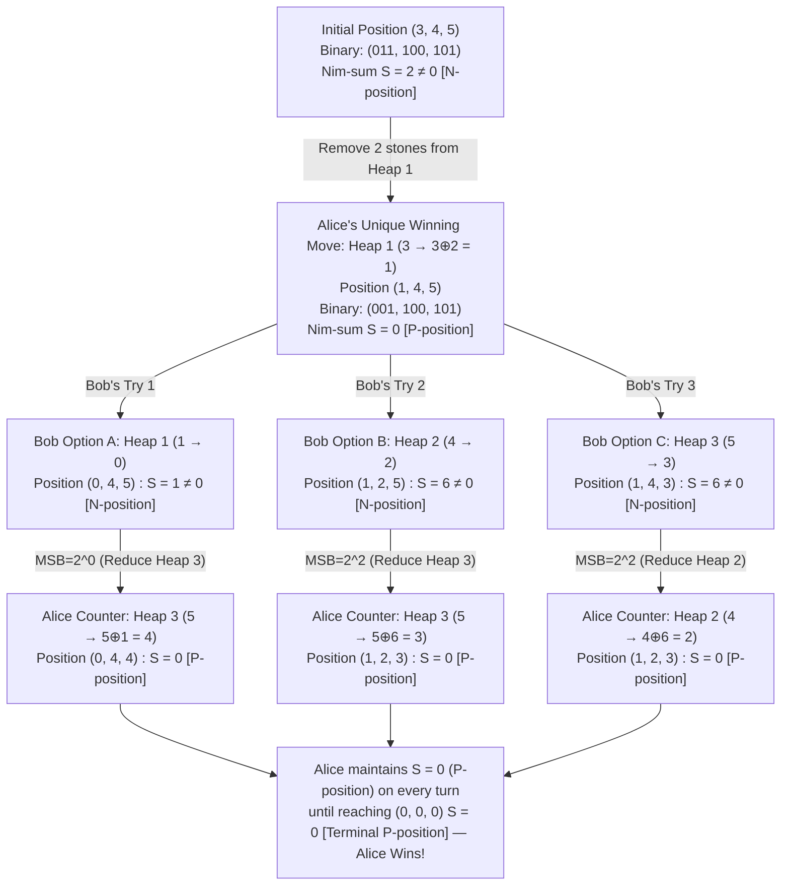
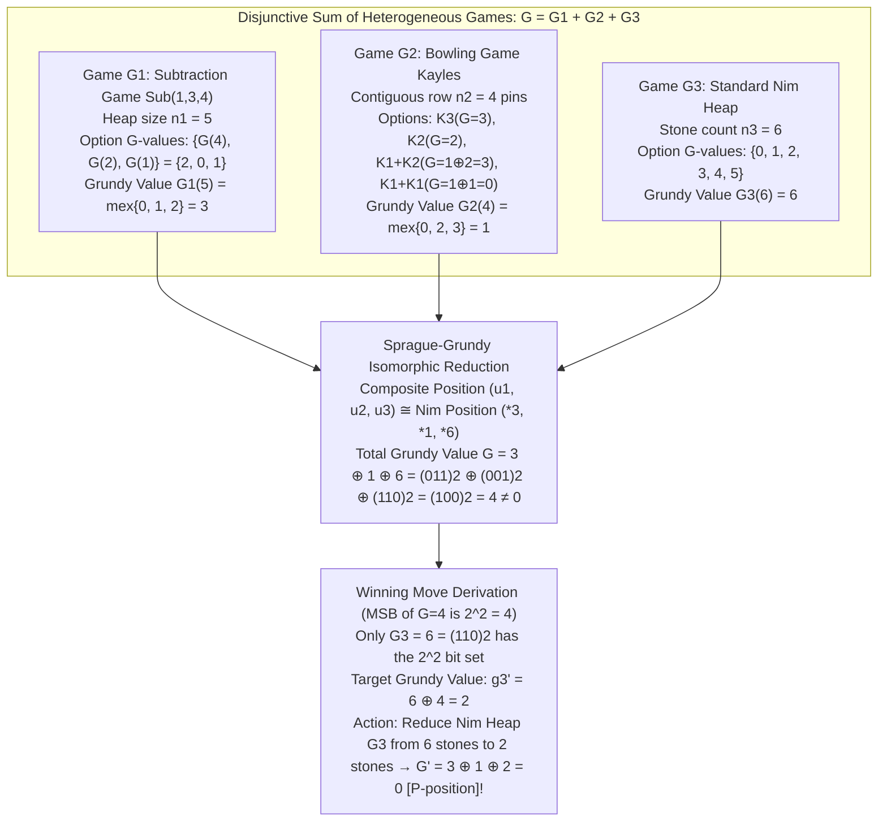

Imagine three heaps of stones on a table containing <strong>3, 4, and 5 stones</strong> respectively. Two players—say, Alice (First Player) and Bob (Second Player)—take turns making moves. On each turn, a player must choose <strong>strictly one heap</strong> and remove at least one stone from it (ranging from a single stone up to the entire heap). Under the standard rule, <strong>the player who takes the very last stone wins the game</strong>.

At first glance, this looks like a tactical battle of wits requiring deep lookahead across a branching game tree. Yet from the standpoint of mathematics, there is zero room for psychology, guesswork, or luck. Merely glancing at the initial configuration $(3, 4, 5)$ is enough to deduce—within a couple of seconds of mental arithmetic—that Alice has a guaranteed forced win, and that her <em>unique</em> winning opening move is to remove $2$ stones from the heap of $3$, leaving $(1, 4, 5)$.

Even more astonishing is <em>how</em> that calculation is performed. By writing the heap sizes in base $2$ (binary) and adding them column by column without carries—an operation known in computer science as <strong>bitwise exclusive OR (XOR, $\oplus$)</strong> and in mathematics as the <strong>Nim-sum</strong>—one can instantly determine the winner and the optimal move whether there are three heaps of five stones or a hundred heaps of a billion stones each.

Why does a simple parlor game of removing stones inevitably give rise to bitwise XOR over the finite field $\mathbb{F}_2$? And even more remarkably, why can virtually <em>any</em> deterministic, impartial two-player game—whether players remove restricted numbers of stones, knock down bowling pins that split rows into independent fragments, or sever edges of a grounded graph—be reduced isomorphically to a single heap of Nim?

In this article, we undertake a rigorous journey through <strong>Combinatorial Game Theory (CGT)</strong>. Starting from the axiomatic classification of game states into $\mathcal{P}$-positions and $\mathcal{N}$-positions via backward induction on Directed Acyclic Graphs (DAGs), we prove Charles Leonard Bouton's landmark 1901 theorem for Nim, formulate the Minimum Excluded value ($\text{mex}$) and Grundy values (nimbers), prove the celebrated <strong>Sprague-Grundy Theorem (1935/1939)</strong>, apply it to Subtraction Games, Kayles, and Green Hackenbush, and finally examine how reversing the winning condition to <strong>Misère Play</strong> (where taking the last stone <em>loses</em>) alters the endgame strategy and exposes the frontier of modern research into Misère Quotients.

---

## 1. The Framework of Combinatorial Game Theory and Impartial Games

In mathematics, the phrase "Game Theory" refers to two distinct disciplines. The first is <strong>Classical (Economic) Game Theory</strong>, pioneered by John von Neumann, Oskar Morgenstern, and John Nash, which analyzes games with simultaneous moves, hidden information, payoff matrices, mixed probabilistic strategies, and Nash equilibria (such as Poker, the Prisoner's Dilemma, or market auctions).

The second discipline is <strong>Combinatorial Game Theory (CGT)</strong>, which studies sequential, two-player games of pure strategy with <strong>perfect information and no element of chance</strong>. Within CGT, stone-taking games belong to the foundational class of <strong>Impartial Combinatorial Games</strong>, defined rigorously by five axioms:

1. <strong>Two Players Moving Alternately</strong>: Two players alternates turns. Passing is not allowed; a player must make a legal move whenever one is available.
2. <strong>Perfect Information</strong>: The complete state of the game is public knowledge to both players at every moment. There is no hidden state.
3. <strong>Determinism</strong>: There are no dice, coin flips, or random state transitions. Choosing a move deterministically transitions the game to a specific successor position.
4. <strong>Impartiality</strong>: From any game position $u$, <strong>the set of legal moves $\text{Opt}(u)$ depends solely on the position $u$ itself, and not on whose turn it is to move</strong>.
   - <em>Contrast with Partisan Games</em>: In Chess (where White moves only white pieces and Black moves only black pieces), Go, Checkers, or Domineering (where Left places vertical dominoes and Right places horizontal dominoes), the legal moves from a board state depend on the identity of the player. Such games are called <strong>Partisan Games</strong>, and their algebraic structure gives rise to John Horton Conway's <strong>Surreal Numbers</strong> $\{L \mid R\}$. In an <strong>Impartial Game</strong>, the stones have no color or ownership; both players operate under identical rules on the exact same heaps.
5. <strong>Finite Termination (The Ending Condition)</strong>: Every sequence of legal moves must terminate in a finite number of steps. Equivalently, the game graph $G = (V, E)$—whose vertices $V$ are game positions and whose directed edges $E$ represent legal moves $(u, v)$—contains no infinite paths and is therefore a well-founded <strong>Directed Acyclic Graph (DAG)</strong>.

### 1.1 Normal Play vs. Misère Play Conventions

Because the game must terminate in finitely many moves, play inevitably reaches a <strong>terminal position</strong> $t \in V$ from which no legal moves exist ($\text{Opt}(t) = \emptyset$). There are two opposite conventions for declaring the winner at this point:

- <strong>Normal Play Convention</strong>: <strong>The first player unable to move loses</strong>; equivalently, <strong>the last player to make a legal move wins</strong>. This is the canonical convention of Combinatorial Game Theory, under which the algebraic theory of Grundy values and the Sprague-Grundy Theorem holds in full generality.
- <strong>Misère Play Convention</strong>: <strong>The first player unable to move wins</strong>; equivalently, <strong>the last player forced to make a move (taking the last stone) loses</strong>. While common in casual parlor variations, Misère play destroys many of the algebraic symmetries of Normal play, as we shall dissect in Section 6.

Throughout Sections 2 through 5, we operate strictly under the <strong>Normal Play Convention</strong> (last player to move wins).

---

## 2. Backward Induction and the Partition into $\mathcal{P}$-Positions and $\mathcal{N}$-Positions

In casual conversation, calling a game state a "winning position" or "losing position" is dangerously ambiguous: winning for whom? The player who started the game, the player who just moved, or the player about to move? To eliminate this ambiguity, Combinatorial Game Theory classifies every position $u \in V$ into one of two invariant outcome classes:

- <strong>$\mathcal{P}$-position (Previous Player Wins)</strong>: A position that secures a forced win for the <strong>Previous player</strong> (the player who just moved to create position $u$). Consequently, the player whose turn it is to move <em>from</em> $u$ is guaranteed to lose against optimal play.
- <strong>$\mathcal{N}$-position (Next Player Wins)</strong>: A position that secures a forced win for the <strong>Next player</strong> (the player whose turn it is to move from $u$). By selecting the right move, the current player can force a win.

### 2.1 Recursive Axioms and the Fundamental Partition Theorem

Under the Normal Play Convention on a finite DAG $G = (V, E)$, let $\text{Opt}(u) = \{v \in V : (u, v) \in E\}$ denote the set of all options (immediate successor positions) reachable from $u$ in a single legal move. The classes $\mathcal{P}$ and $\mathcal{N}$ are uniquely determined by <strong>backward induction</strong> from the terminal vertices via three rules:

1. <strong>Terminal Rule</strong>: Every terminal position $t \in V$ (where $\text{Opt}(t) = \emptyset$) is a <strong>$\mathcal{P}$-position</strong>. (The player whose turn it is has no moves and immediately loses; the previous player who moved into $t$ has just made the last move and won.)
2. <strong>$\mathcal{N}$-Position Rule (Existence of a Winning Move)</strong>: A position $u \in V$ is an <strong>$\mathcal{N}$-position</strong> if and only if <strong>at least one</strong> of its options is a $\mathcal{P}$-position:
   $$u \in \mathcal{N} \iff \exists v \in \text{Opt}(u) \text{ such that } v \in \mathcal{P}$$
3. <strong>$\mathcal{P}$-Position Rule (All Moves Lead to $\mathcal{N}$)</strong>: A position $u \in V$ is a <strong>$\mathcal{P}$-position</strong> if and only if <strong>every</strong> option of $u$ is an $\mathcal{N}$-position (note that if $\text{Opt}(u) = \emptyset$, this universal quantifier holds vacuously, subsuming Rule 1):
   $$u \in \mathcal{P} \iff \forall v \in \text{Opt}(u), \; v \in \mathcal{N}$$

> [!IMPORTANT]
> <strong>Theorem 2.1 (Fundamental Partition of Finite Impartial Games / Zermelo's Theorem for Impartial DAGs)</strong>
> For any finite impartial game $G = (V, E)$, the vertex set $V$ is partitioned uniquely into $\mathcal{P}$ and $\mathcal{N}$ ($\mathcal{P} \cap \mathcal{N} = \emptyset$ and $\mathcal{P} \cup \mathcal{N} = V$). Draws are impossible: the first player has a winning strategy if and only if the initial position $u_0 \in \mathcal{N}$, and the second player has a winning strategy if and only if $u_0 \in \mathcal{P}$.

<strong>Proof.</strong> Because $G = (V, E)$ satisfies the finite termination condition, every vertex $u \in V$ has a well-defined finite height $\text{height}(u)$, defined as the length of the longest directed path from $u$ to a terminal vertex. We proceed by strong induction on $\text{height}(u) = h$:
- <em>Base Case ($h = 0$)</em>: If $\text{height}(u) = 0$, then $\text{Opt}(u) = \emptyset$, so by Rule 1 (and vacuously Rule 3), $u \in \mathcal{P}$ and $u \notin \mathcal{N}$.
- <em>Inductive Step ($h > 0$)</em>: Suppose every vertex $v$ with $\text{height}(v) < h$ belongs to exactly one of $\mathcal{P}$ or $\mathcal{N}$. For a vertex $u$ of height $h$, every option $v \in \text{Opt}(u)$ satisfies $\text{height}(v) \le h - 1 < h$, so its classification into $\mathcal{P}$ or $\mathcal{N}$ is uniquely determined by the induction hypothesis. By the law of the excluded middle, either $\text{Opt}(u)$ contains at least one element of $\mathcal{P}$ (placing $u \in \mathcal{N}$ by Rule 2) or every element of $\text{Opt}(u)$ lies in $V \setminus \mathcal{P} = \mathcal{N}$ (placing $u \in \mathcal{P}$ by Rule 3). These two conditions are mutually exclusive and collectively exhaustive. $\blacksquare$

This theorem crystallizes the nature of optimal play in any impartial game: <strong>a winning strategy consists of repeatedly moving from an $\mathcal{N}$-position to a $\mathcal{P}$-position, while an opponent trapped in a $\mathcal{P}$-position is doomed to hand back an $\mathcal{N}$-position on every turn until a terminal $\mathcal{P}$-position is reached.</strong>

### 2.2 Warm-Up: Single-Heap Subtraction (Bachet's Game) and Combinatorial Explosion

Before tackling multi-heap Nim, let us apply backward induction to the simplest stone-taking game: <strong>Bachet's Game</strong> (single-heap subtraction). Suppose there is a single pile of $n$ stones, and on each turn a player may remove between $1$ and $m$ stones ($1 \le r \le m$). The player who takes the last stone wins.

Fixing $m = 3$ (players may take $1, 2,$ or $3$ stones), let us label $n = 0, 1, 2, \dots$ from the bottom up:
- $n = 0$: Terminal position ($\text{Opt}(0) = \emptyset$), so $0 \in \mathcal{P}$.
- $n = 1, 2, 3$: From each of these states, the current player can remove all $1, 2,$ or $3$ stones to reach $0 \in \mathcal{P}$. Since an option in $\mathcal{P}$ exists, $1, 2, 3 \in \mathcal{N}$.
- $n = 4$: Removing $1, 2,$ or $3$ stones leaves $3, 2,$ or $1$ stones respectively. All three options belong to $\mathcal{N}$; none reaches $0 \in \mathcal{P}$. By Rule 3, $4 \in \mathcal{P}$.
- $n = 5, 6, 7$: Taking $1, 2,$ or $3$ stones respectively reduces the pile to $4 \in \mathcal{P}$. Thus $5, 6, 7 \in \mathcal{N}$.
- $n = 8$: Every legal move leads to $7, 6,$ or $5 \in \mathcal{N}$. Thus $8 \in \mathcal{P}$.

By straightforward induction, for any maximum removal limit $m \ge 1$, the $\mathcal{P}$-positions are precisely the multiples of $m + 1$:
$$n \in \mathcal{P} \iff n \equiv 0 \pmod{m+1}, \qquad n \in \mathcal{N} \iff n \not\equiv 0 \pmod{m+1}$$
From any $\mathcal{N}$-position $n$, the unique winning move is to remove $r = n \bmod (m+1)$ stones, restoring the pile size to a multiple of $m+1$. Whenever the opponent subsequently removes $s \in \{1, \dots, m\}$ stones, the winning player replies by removing $(m + 1 - s)$ stones, maintaining the invariant $n \equiv 0 \pmod{m+1}$ all the way down to $0$.

Why can we not simply apply raw backward induction to every impartial game? Because of <strong>combinatorial state-space explosion</strong>. In a single heap of size $n$, there are only $n + 1$ states. In a game with $k$ heaps of sizes $(n_1, n_2, \dots, n_k)$, the number of vertices in the game graph is $|V| = \prod_{i=1}^{k} (n_i + 1)$. If $k = 10$ and each heap has $10^9$ stones, the DAG has $\approx 10^{90}$ vertices—far exceeding the number of atoms in the observable universe. Brute-force graph traversal is utterly hopeless; we need an algebraic invariant that bypasses the game graph entirely.

---

## 3. Nim and Bouton's Theorem (1901): The Exact Bitwise XOR Solution

### 3.1 Formal Rules of Nim and the Nim-Sum ($\oplus$)

Let us define the game of <strong>Nim</strong> formally:
- A position is a $k$-tuple of non-negative integers $\mathbf{n} = (n_1, n_2, \dots, n_k) \in (\mathbb{Z}_{\ge 0})^k$, representing the number of stones in each of the $k$ heaps.
- A legal move consists of selecting <strong>strictly one heap</strong> $i \in \{1, \dots, k\}$ with $n_i > 0$ and reducing its size to $n_i'$, where $0 \le n_i' < n_i$.
- Under Normal Play, the terminal position is $\mathbf{0} = (0, 0, \dots, 0)$, and the player who takes the last stone to create $(0, 0, \dots, 0)$ wins.

In 1901, Charles Leonard Bouton, a professor of mathematics at Harvard University, published his seminal paper <em>"Nim, A Game with a Complete Mathematical Theory"</em> in the <em>Annals of Mathematics</em>. Bouton discovered that the $\mathcal{P}$-positions of Nim are completely governed by an operation he called the <strong>Nim-sum</strong>—known today as <strong>bitwise exclusive OR (XOR, $\oplus$)</strong>.

Given two non-negative integers $x, y \in \mathbb{Z}_{\ge 0}$ written in base $2$ (binary):
$$x = \sum_{j=0}^{B} x_j 2^j, \qquad y = \sum_{j=0}^{B} y_j 2^j \quad (x_j, y_j \in \{0, 1\})$$
their Nim-sum $x \oplus y$ is obtained by adding their binary digits at each bit position $j$ modulo $2$ (addition without carries):
$$x \oplus y = \sum_{j=0}^{B} \big((x_j + y_j) \bmod 2\big) 2^j$$

Algebraically, $(\mathbb{Z}_{\ge 0}, \oplus)$ forms an infinite abelian group (isomorphic to the direct sum $\bigoplus_{j=0}^{\infty} \mathbb{F}_2$ of copies of the finite field of two elements) satisfying four foundational properties:
1. <strong>Associativity and Commutativity</strong>: $(x \oplus y) \oplus z = x \oplus (y \oplus z)$ and $x \oplus y = y \oplus x$.
2. <strong>Identity Element ($0$)</strong>: $x \oplus 0 = x$ for all $x \in \mathbb{Z}_{\ge 0}$.
3. <strong>Self-Inverse Property (Involution)</strong>: Every element is its own additive inverse under XOR, because $1 \oplus 1 = 0$ and $0 \oplus 0 = 0$ at every bit position:
   $$x \oplus x = 0$$
4. <strong>Cancellation Law</strong>: Adding $x$ to both sides via $\oplus$ yields:
   $$x \oplus y = x \oplus z \iff y = z, \qquad \text{and in particular } x \oplus y = 0 \iff x = y$$

### 3.2 Statement and Rigorous Proof of Bouton's Theorem

> [!IMPORTANT]
> <strong>Theorem 3.1 (Bouton's Theorem, 1901)</strong>
> In normal-play Nim, let $S = n_1 \oplus n_2 \oplus \dots \oplus n_k$ be the Nim-sum of the position $(n_1, n_2, \dots, n_k)$. Then:
> $$(n_1, n_2, \dots, n_k) \in \mathcal{P} \iff n_1 \oplus n_2 \oplus \dots \oplus n_k = 0$$
> Conversely, $(n_1, n_2, \dots, n_k) \in \mathcal{N}$ if and only if $S = n_1 \oplus n_2 \oplus \dots \oplus n_k \ne 0$.

<strong>Proof.</strong> Let $\mathcal{P}^* = \{\mathbf{n} \in (\mathbb{Z}_{\ge 0})^k : n_1 \oplus \dots \oplus n_k = 0\}$ and $\mathcal{N}^* = \{\mathbf{n} \in (\mathbb{Z}_{\ge 0})^k : n_1 \oplus \dots \oplus n_k \ne 0\}$. By Theorem 2.1 (the uniqueness of the $\mathcal{P}/\mathcal{N}$ partition), to prove that $\mathcal{P}^* = \mathcal{P}$ and $\mathcal{N}^* = \mathcal{N}$, it suffices to verify the terminal condition and prove two core lemmas corresponding to Rules 2 and 3.

1. <strong>Terminal Condition</strong>: The sole terminal position is $(0, 0, \dots, 0)$, whose Nim-sum is $0 \oplus 0 \oplus \dots \oplus 0 = 0$. Thus $(0, 0, \dots, 0) \in \mathcal{P}^*$.

2. <strong>Lemma 1 (Every legal move from $S = 0$ leads to $S' \ne 0$)</strong>:
   Suppose the current position $(n_1, \dots, n_k)$ lies in $\mathcal{P}^*$, so $S = n_1 \oplus \dots \oplus n_k = 0$. Any legal move selects a single heap $i$ and reduces its size from $n_i$ to $n_i'$ with $0 \le n_i' < n_i$. Using the self-inverse property $n_i \oplus n_i = 0$, the Nim-sum $S'$ of the resulting position is:
   $$S' = n_1 \oplus \dots \oplus n_i' \oplus \dots \oplus n_k = (n_1 \oplus \dots \oplus n_i \oplus \dots \oplus n_k) \oplus n_i \oplus n_i' = S \oplus n_i \oplus n_i'$$
   Since $S = 0$, this simplifies to:
   $$S' = 0 \oplus n_i \oplus n_i' = n_i \oplus n_i'$$
   Because a legal move must strictly decrease the heap size ($n_i' < n_i$, so $n_i' \ne n_i$), the cancellation law guarantees that $n_i \oplus n_i' \ne 0$. Hence <strong>$S' \ne 0$</strong>: no move from a zero Nim-sum position can ever produce another zero Nim-sum position.

3. <strong>Lemma 2 (From any position with $S \ne 0$, there exists a legal move to $S' = 0$)</strong>:
   Suppose the current position $(n_1, \dots, n_k)$ lies in $\mathcal{N}^*$, so $S = n_1 \oplus \dots \oplus n_k > 0$.
   Let $d$ be the bit index of the <strong>most significant bit (MSB)</strong> of $S$—that is, the highest power of two $2^d$ appearing with coefficient $1$ in the binary expansion of $S$ (so bit $d$ of $S$ is $1$, and all bits $j > d$ of $S$ are $0$).
   
   Because the $d$-th bit of $S = n_1 \oplus n_2 \oplus \dots \oplus n_k$ equals $1$, an odd number of the heap sizes $n_1, \dots, n_k$ (and therefore <strong>at least one heap $n_i$</strong>) must also have a $1$ at bit position $d$.
   
   Choose any such heap $n_i$ whose $d$-th bit is $1$, and define its target size $n_i'$ by:
   $$n_i' = n_i \oplus S$$
   We verify two facts about this move $n_i \to n_i'$:
   - <strong>(a) The resulting Nim-sum is zero ($S' = 0$)</strong>:
     $$S' = n_1 \oplus \dots \oplus n_i' \oplus \dots \oplus n_k = S \oplus n_i \oplus n_i' = S \oplus n_i \oplus (n_i \oplus S) = (S \oplus S) \oplus (n_i \oplus n_i) = 0 \oplus 0 = 0$$
   - <strong>(b) The move is strictly legal ($0 \le n_i' < n_i$)</strong>:
     Compare the binary representations of $n_i$ and $n_i' = n_i \oplus S$ from the highest bit downward:
     - For every bit position $j > d$, the $j$-th bit of $S$ is $0$ (by definition of $d$ as the MSB of $S$). Thus, bit $j$ of $n_i' = n_i \oplus S$ is identical to bit $j$ of $n_i$ ($b_{i,j} \oplus 0 = b_{i,j}$).
     - At bit position $j = d$, bit $d$ of $n_i$ is $1$ (by our choice of heap $i$) and bit $d$ of $S$ is $1$. Therefore, bit $d$ of $n_i' = n_i \oplus S$ flips from $1$ down to <strong>$1 \oplus 1 = 0$</strong>! This single bit flip reduces the value of $n_i$ by $2^d$.
     - Across all lower bit positions $0 \le j < d$, even if every single bit of $n_i$ were $0$ and flipped to $1$ in $n_i'$, the maximum possible increase from all lower bits combined is $\sum_{j=0}^{d-1} 2^j = 2^d - 1 < 2^d$.
     
     Consequently, $0 \le n_i' < n_i$ holds strictly. Removing $(n_i - n_i')$ stones from heap $i$ is a completely legal move that places the game into $\mathcal{P}^*$.

Combining the terminal check with Lemmas 1 and 2 establishes $\mathcal{P}^* = \mathcal{P}$ and $\mathcal{N}^* = \mathcal{N}$. $\blacksquare$

### 3.3 Complete Walkthrough of the Classic $(3, 4, 5)$ Game

Let us apply Bouton's algorithm step by step to our opening puzzle $(n_1, n_2, n_3) = (3, 4, 5)$:

| Heap / Variable | Decimal | $2^2 = 4$ bit ($j=2$) | $2^1 = 2$ bit ($j=1$) | $2^0 = 1$ bit ($j=0$) | Binary |
| :--- | :---: | :---: | :---: | :---: | :---: |
| Heap 1 ($n_1$) | $3$ | $0$ | $\mathbf{1}$ | $1$ | $(011)_2$ |
| Heap 2 ($n_2$) | $4$ | $1$ | $0$ | $0$ | $(100)_2$ |
| Heap 3 ($n_3$) | $5$ | $1$ | $0$ | $1$ | $(101)_2$ |
| <strong>Nim-sum $S = n_1 \oplus n_2 \oplus n_3$</strong> | <strong>$2$</strong> | $0 \oplus 1 \oplus 1 = \mathbf{0}$ | $1 \oplus 0 \oplus 0 = \mathbf{1}$ | $1 \oplus 0 \oplus 1 = \mathbf{0}$ | <strong>$(010)_2$</strong> |

1. <strong>Outcome Evaluation</strong>: Because $S = 3 \oplus 4 \oplus 5 = (010)_2 = 2 \ne 0$, the starting position $(3, 4, 5)$ is an <strong>$\mathcal{N}$-position</strong> (First Player Alice has a forced win).
2. <strong>Locating the MSB</strong>: The most significant $1$-bit of $S = (010)_2 = 2$ is at bit index $d = 1$ (the $2^1 = 2$ column).
3. <strong>Selecting the Target Heap</strong>: Inspecting the $2^1$ column across the three heaps, only Heap 1 ($n_1 = 3 = (0\mathbf{1}1)_2$) has a $1$ in that column!
   - Notice what would happen if Alice tried to apply the formula $n_i' = n_i \oplus S$ to Heap 2 ($n_2 = 4$) or Heap 3 ($n_3 = 5$): she would get $4 \oplus 2 = 6 > 4$ and $5 \oplus 2 = 7 > 5$, which would require <em>adding</em> stones to the heap (an illegal move!).
   - This illustrates vividly why Lemma 2 requires choosing a heap whose bit at the MSB of $S$ is $1$.
4. <strong>Executing the Winning Move</strong>: Alice chooses Heap 1 ($n_1 = 3$) and reduces it to:
   $$n_1' = 3 \oplus 2 = (011)_2 \oplus (010)_2 = (001)_2 = 1$$
   Removing $2$ stones from the heap of $3$ leaves <strong>$(1, 4, 5)$</strong>, whose Nim-sum is $1 \oplus 4 \oplus 5 = (001)_2 \oplus (100)_2 \oplus (101)_2 = 0$.

The Mermaid diagram below traces how Alice's opening move $(3, 4, 5) \to (1, 4, 5)$ traps Bob in a $\mathcal{P}$-position, and how every possible reply by Bob is immediately countered back to $S = 0$.



Two $\mathcal{P}$-positions in the diagram above deserve special recognition:
- <strong>Equal Pair $(0, n, n)$</strong>: Since $n \oplus n = 0$, any two-heap position with equal sizes is a $\mathcal{P}$-position. The winning strategy is pure symmetry mirroring (often called the <em>Tweedledum and Tweedledee strategy</em>): whatever Bob removes from one heap, Alice removes the exact same number from the other heap.
- <strong>The Minimal Non-Trivial Triple $(1, 2, 3)$</strong>: Since $1 \oplus 2 \oplus 3 = (01)_2 \oplus (10)_2 \oplus (11)_2 = 0$, any move from $(1, 2, 3)$ can be immediately reduced to an equal pair $(0, 1, 1)$, $(0, 2, 2)$, or $(0, 3, 3)$.

---

## 4. Disjunctive Sums of Games and the Sprague-Grundy Theorem (1935/1939)

Bouton's Theorem completely solves Nim. But what about thousands of other impartial games where moves are restricted by geometric, graph-theoretic, or arithmetic constraints? In the 1930s, Roland Sprague (1935) and Patrick Michael Grundy (1939) independently discovered a breathtaking unification: <strong>under the Normal Play Convention, every finite impartial game is strategically isomorphic to a single Nim heap of a specific size</strong>.

### 4.1 The Minimum Excluded Value ($\text{mex}$) and Grundy Values (Nimbers)

To assign an equivalent Nim-heap size to an arbitrary game position, we first define a fundamental operation on finite subsets of non-negative integers.

> [!NOTE]
> <strong>Definition 4.1 (Minimum Excluded Value: $\text{mex}$)</strong>
> For any finite subset $A \subset \mathbb{Z}_{\ge 0} = \{0, 1, 2, 3, \dots\}$, the <strong>minimum excluded value</strong> $\text{mex}(A)$ is the smallest non-negative integer that does not belong to $A$:
> $$\text{mex}(A) = \min(\mathbb{Z}_{\ge 0} \setminus A)$$

For example:
- $\text{mex}(\emptyset) = 0$ (since $0 \notin \emptyset$, $0$ is the smallest missing non-negative integer).
- $\text{mex}(\{0, 1, 2\}) = 3$.
- $\text{mex}(\{1, 2, 4, 9\}) = 0$ (no matter how large the elements of $A$ are, if $0 \notin A$, then $\text{mex}(A) = 0$).
- $\text{mex}(\{0, 2, 3, 5\}) = 1$.

Using $\text{mex}$, we recursively assign a non-negative integer $\mathcal{G}(u)$ to every vertex $u \in V$ of a finite impartial game $G = (V, E)$. This integer is called the <strong>Grundy value</strong> (also known as the <strong>Nim-value</strong> or <strong>nimber</strong>) of $u$.

> [!NOTE]
> <strong>Definition 4.2 (Grundy Value / Nim-Value $\mathcal{G}(u)$)</strong>
> For any position $u \in V$ of a finite impartial game $G = (V, E)$, its Grundy value $\mathcal{G}(u) \in \mathbb{Z}_{\ge 0}$ is defined recursively by:
> $$\mathcal{G}(u) = \text{mex}\{\mathcal{G}(v) : v \in \text{Opt}(u)\}$$
> In particular, if $t \in V$ is a terminal position ($\text{Opt}(t) = \emptyset$), then $\mathcal{G}(t) = \text{mex}(\emptyset) = 0$.

Notice how $\mathcal{G}(u)$ immediately recovers the $\mathcal{P}/\mathcal{N}$ partition from Section 2:
- By definition of $\text{mex}$, $\mathcal{G}(u) = 0$ if and only if $0 \notin \{\mathcal{G}(v) : v \in \text{Opt}(u)\}$, meaning every option $v \in \text{Opt}(u)$ has $\mathcal{G}(v) > 0$.
- Conversely, $\mathcal{G}(u) > 0$ if and only if $0 \in \{\mathcal{G}(v) : v \in \text{Opt}(u)\}$, meaning there exists at least one option $v \in \text{Opt}(u)$ with $\mathcal{G}(v) = 0$.

By structural induction on the DAG, this matches the recursive definition of $\mathcal{P}$ and $\mathcal{N}$ identically:
$$u \in \mathcal{P} \iff \mathcal{G}(u) = 0, \qquad u \in \mathcal{N} \iff \mathcal{G}(u) > 0$$

Moreover, if we denote a single Nim heap of $n$ stones by $*n$, its options are $\{*0, *1, \dots, *(n-1)\}$, so by induction:
$$\mathcal{G}(*n) = \text{mex}\{0, 1, 2, \dots, n-1\} = n$$
Thus, a single Nim heap of size $n$ has Grundy value $n$.

### 4.2 Why Exact Grundy Values Matter: The Disjunctive Sum of Games

If $\mathcal{G}(u) = 0$ versus $\mathcal{G}(u) > 0$ already tells us whether a single game is a $\mathcal{P}$-position or an $\mathcal{N}$-position, why do we care whether $\mathcal{G}(u)$ equals $1$, $2$, or $7$? Because in Combinatorial Game Theory, games rarely live in isolation—they either start as multiple parallel components or split into multiple components during play, forming a <strong>disjunctive sum</strong>.

> [!NOTE]
> <strong>Definition 4.3 (Disjunctive Sum of Impartial Games: $G_1 + G_2 + \dots + G_k$)</strong>
> Given $k$ independent finite impartial games $G_1 = (V_1, E_1), \dots, G_k = (V_k, E_k)$, their <strong>disjunctive sum</strong> $G = G_1 + G_2 + \dots + G_k$ is the composite game played as follows:
> - A position in $G$ is a tuple $\mathbf{u} = (u_1, u_2, \dots, u_k) \in V_1 \times V_2 \times \dots \times V_k$.
> - On each turn, a player chooses <strong>strictly one component game $G_i$</strong> and makes a legal move $u_i \to u_i' \in \text{Opt}_{G_i}(u_i)$ within that component, leaving all other components $u_j$ ($j \ne i$) untouched.
> - The composite game ends when every component reaches a terminal position ($\text{Opt}_{G_i}(u_i) = \emptyset$ for all $i$). Under Normal Play, the last player to move wins.

Observe that $k$-heap Nim $\text{Nim}(n_1, n_2, \dots, n_k)$ is literally the disjunctive sum of $k$ single-heap Nim games: $*n_1 + *n_2 + \dots + *n_k$. The Sprague-Grundy Theorem states that <em>every</em> disjunctive sum of impartial games obeys the exact same XOR law!

### 4.3 The Sprague-Grundy Theorem and Its Complete Proof

> [!IMPORTANT]
> <strong>Theorem 4.1 (The Sprague-Grundy Theorem, Sprague 1935 / Grundy 1939)</strong>
> Let $G_1 = (V_1, E_1)$ and $G_2 = (V_2, E_2)$ be any two finite impartial games played under the Normal Play Convention. For any composite position $(u_1, u_2)$ in the disjunctive sum $G_1 + G_2$, its Grundy value is the Nim-sum (bitwise XOR) of the individual Grundy values:
> $$\mathcal{G}_{G_1 + G_2}(u_1, u_2) = \mathcal{G}_{G_1}(u_1) \oplus \mathcal{G}_{G_2}(u_2)$$
> By induction, for any finite collection of $k$ impartial games $G_1 + G_2 + \dots + G_k$:
> $$\mathcal{G}(u_1, u_2, \dots, u_k) = \mathcal{G}(u_1) \oplus \mathcal{G}(u_2) \oplus \dots \oplus \mathcal{G}(u_k)$$
> Consequently, every finite impartial game position $u$ is strategically isomorphic to a single Nim heap $* \mathcal{G}(u)$ of size $\mathcal{G}(u)$.

<strong>Proof.</strong> It suffices to prove the theorem for two games $G_1 + G_2$; the $k$-game formula follows immediately by induction on $k$ using the associativity of $\oplus$. We proceed by structural induction on $\text{height}(u_1) + \text{height}(u_2)$.

Let $g_1 = \mathcal{G}(u_1)$, $g_2 = \mathcal{G}(u_2)$, and set $s = g_1 \oplus g_2$. By Definition 4.3, the set of options from $(u_1, u_2)$ in $G_1 + G_2$ is:
$$\text{Opt}(u_1, u_2) = \{(u_1', u_2) : u_1' \in \text{Opt}(u_1)\} \cup \{(u_1, u_2') : u_2' \in \text{Opt}(u_2)\}$$
By the induction hypothesis, every option has Grundy value $\mathcal{G}(u_1', u_2) = \mathcal{G}(u_1') \oplus g_2$ or $\mathcal{G}(u_1, u_2') = g_1 \oplus \mathcal{G}(u_2')$. To prove that $\mathcal{G}(u_1, u_2) = \text{mex}\{\mathcal{G}(\mathbf{v}) : \mathbf{v} \in \text{Opt}(u_1, u_2)\} = s$, we must establish two claims corresponding to the definition of $\text{mex}$:

1. <strong>Claim 1 (Exclusion: No option of $(u_1, u_2)$ has Grundy value $s$)</strong>:
   Consider any move in the first component $(u_1, u_2) \to (u_1', u_2)$ with $u_1' \in \text{Opt}(u_1)$. Because $g_1 = \mathcal{G}(u_1) = \text{mex}\{\mathcal{G}(u_1') : u_1' \in \text{Opt}(u_1)\}$, the value $g_1$ is excluded from the Grundy values of the options of $u_1$; hence $\mathcal{G}(u_1') \ne g_1$. By the cancellation law of XOR:
   $$\mathcal{G}(u_1', u_2) = \mathcal{G}(u_1') \oplus g_2 \ne g_1 \oplus g_2 = s$$
   By identical reasoning, for any move in the second component $(u_1, u_2) \to (u_1, u_2')$, we have $\mathcal{G}(u_2') \ne g_2$, and hence $\mathcal{G}(u_1, u_2') = g_1 \oplus \mathcal{G}(u_2') \ne s$. Thus $s$ never appears among the Grundy values of $\text{Opt}(u_1, u_2)$.

2. <strong>Claim 2 (Minimality / Completeness: Every integer $t$ with $0 \le t < s$ is the Grundy value of at least one option of $(u_1, u_2)$)</strong>:
   Let $t$ be an arbitrary integer satisfying $0 \le t < s = g_1 \oplus g_2$. Since $t < s$, let $d$ be the most significant bit (MSB) position at which the binary expansions of $s$ and $t$ differ (i.e., the MSB of $s \oplus t > 0$). Because $t < s$, bit $d$ of $s$ must be $1$ while bit $d$ of $t$ is $0$ (and all bits $j > d$ of $s$ and $t$ agree, so bit $j$ of $s \oplus t$ is $0$ for $j > d$ and $1$ for $j = d$).
   
   Since bit $d$ of $s = g_1 \oplus g_2$ is $1$, exactly one of $g_1$ or $g_2$ has a $1$ at bit position $d$. Without loss of generality, suppose <strong>bit $d$ of $g_1$ is $1$</strong>. Define the target Grundy value:
   $$g_1' = g_1 \oplus (s \oplus t) = (g_1 \oplus g_1 \oplus g_2) \oplus t = t \oplus g_2$$
   By the exact same MSB comparison used in Lemma 2 of Bouton's Theorem: for all bits $j > d$, $g_1'$ agrees with $g_1$; at bit $j = d$, bit $d$ of $g_1$ is $1$ and bit $d$ of $s \oplus t$ is $1$, so bit $d$ of $g_1'$ drops to $1 \oplus 1 = 0$. Therefore:
   $$0 \le g_1' < g_1$$
   Now invoke the definition of $g_1 = \mathcal{G}(u_1) = \text{mex}\{\mathcal{G}(u_1') : u_1' \in \text{Opt}(u_1)\}$: because $g_1$ is the <em>minimum</em> excluded value, <strong>every non-negative integer strictly smaller than $g_1$ must be attained by at least one option $u_1' \in \text{Opt}(u_1)$</strong>! Since $0 \le g_1' < g_1$, there exists an option $u_1' \in \text{Opt}(u_1)$ such that $\mathcal{G}(u_1') = g_1' = t \oplus g_2$. By the induction hypothesis, moving to $(u_1', u_2)$ produces the Grundy value:
   $$\mathcal{G}(u_1', u_2) = \mathcal{G}(u_1') \oplus g_2 = (t \oplus g_2) \oplus g_2 = t \oplus (g_2 \oplus g_2) = t \oplus 0 = t$$
   Thus every integer $0 \le t < s$ is achieved by a legal move from $(u_1, u_2)$.

Combining Claims 1 and 2 proves that $\text{mex}\{\mathcal{G}(\mathbf{v}) : \mathbf{v} \in \text{Opt}(u_1, u_2)\} = s = g_1 \oplus g_2$. $\blacksquare$

### 4.4 The "Poker Nim" Insight: Why Grundy-Increasing Moves Are Harmless

Look closely at how general impartial games differ from pure Nim. In a Nim heap $*g_1$, every move reduces the size of the heap to some $g_1' < g_1$. In a general impartial game position $u_1$ with $\mathcal{G}(u_1) = g_1$, however, $u_1$ may also possess options $w_1 \in \text{Opt}(u_1)$ whose Grundy values are <strong>strictly larger</strong> than $g_1$ ($\mathcal{G}(w_1) > g_1$). For instance, if the options of $u_1$ have Grundy values $\{0, 1, 5\}$, then $\mathcal{G}(u_1) = \text{mex}\{0, 1, 5\} = 2$, even though moving to the option with Grundy value $5$ <em>increases</em> the Grundy value from $2$ to $5$!

Why does this ability to "increase the Nim heap size" (analogous to <strong>Poker Nim</strong>, where a player can either remove stones or add reserve stones to a heap) not invalidate the isomorphism to ordinary Nim?
Because if your opponent moves from $u_1$ (with $\mathcal{G}(u_1) = 2$) to $w_1$ (with $\mathcal{G}(w_1) = 5 > 2$), the very definition of $\mathcal{G}(w_1) = 5 = \text{mex}\{\dots\}$ guarantees that $w_1$ has options attaining every Grundy value in $\{0, 1, 2, 3, 4\}$—in particular, $w_1$ <em>must</em> have an option $u_1'' \in \text{Opt}(w_1)$ with $\mathcal{G}(u_1'') = 2$! Thus, you can immediately neutralize the opponent's Grundy-increasing move by reverting the component's Grundy value back to $2$, and the finite termination condition of the DAG prevents the opponent from stalling forever.

The Mermaid diagram below illustrates how a heterogeneous composite game $G = G_1 + G_2 + G_3$ decomposes via the Sprague-Grundy Theorem.



---

## 5. Classic Applications: Subtraction Games, Kayles, and Green Hackenbush

Let us see how the Sprague-Grundy machinery solves three celebrated classes of impartial games.

### 5.1 Multi-Heap Subtraction Games $\text{Sub}(S)$

In a <strong>Subtraction Game $\text{Sub}(S)$</strong>, a move consists of removing $r \in S$ stones from any single heap, where $S \subset \mathbb{Z}_{>0}$ is a fixed finite set of allowed removal sizes.
Consider the subtraction set <strong>$S = \{1, 3, 4\}$</strong> (a player may remove $1$, $3$, or $4$ stones from a heap, but removing $2$ stones is forbidden). For a single heap of $n$ stones, the Grundy value satisfies:
$$\mathcal{G}(n) = \text{mex}\{\mathcal{G}(n - r) : r \in \{1, 3, 4\} \text{ and } n - r \ge 0\}$$

Computing $\mathcal{G}(n)$ sequentially from $n = 0$:
- $\mathcal{G}(0) = \text{mex}(\emptyset) = \mathbf{0}$
- $\mathcal{G}(1) = \text{mex}\{\mathcal{G}(0)\} = \text{mex}\{0\} = \mathbf{1}$
- $\mathcal{G}(2) = \text{mex}\{\mathcal{G}(1)\} = \text{mex}\{1\} = \mathbf{0}$ (Since taking $2$ stones is illegal, the only move from $2$ is to $1$, which has Grundy value $1$; thus $0$ is missing, making $n = 2$ a non-trivial $\mathcal{P}$-position!)
- $\mathcal{G}(3) = \text{mex}\{\mathcal{G}(2), \mathcal{G}(0)\} = \text{mex}\{0, 0\} = \mathbf{1}$
- $\mathcal{G}(4) = \text{mex}\{\mathcal{G}(3), \mathcal{G}(1), \mathcal{G}(0)\} = \text{mex}\{1, 1, 0\} = \mathbf{2}$
- $\mathcal{G}(5) = \text{mex}\{\mathcal{G}(4), \mathcal{G}(2), \mathcal{G}(1)\} = \text{mex}\{2, 0, 1\} = \mathbf{3}$
- $\mathcal{G}(6) = \text{mex}\{\mathcal{G}(5), \mathcal{G}(3), \mathcal{G}(2)\} = \text{mex}\{3, 1, 0\} = \mathbf{2}$
- $\mathcal{G}(7) = \text{mex}\{\mathcal{G}(6), \mathcal{G}(4), \mathcal{G}(3)\} = \text{mex}\{2, 2, 1\} = \mathbf{0}$

Tabulating the results reveals a clean <strong>periodic sequence of period $p = 7$</strong> repeating $(0, 1, 0, 1, 2, 3, 2)$ indefinitely:

| Stones $n$ | $0$ | $1$ | $2$ | $3$ | $4$ | $5$ | $6$ | $7$ | $8$ | $9$ | $10$ | $11$ | $12$ | $13$ | $14$ |
| :--- | :---: | :---: | :---: | :---: | :---: | :---: | :---: | :---: | :---: | :---: | :---: | :---: | :---: | :---: | :---: |
| <strong>$\mathcal{G}(n)$</strong> | <strong>$0$</strong> | <strong>$1$</strong> | <strong>$0$</strong> | <strong>$1$</strong> | <strong>$2$</strong> | <strong>$3$</strong> | <strong>$2$</strong> | <strong>$0$</strong> | $1$ | $0$ | $1$ | $2$ | $3$ | $2$ | $0$ |
| Single-Heap Class | $\mathcal{P}$ | $\mathcal{N}$ | $\mathcal{P}$ | $\mathcal{N}$ | $\mathcal{N}$ | $\mathcal{N}$ | $\mathcal{N}$ | $\mathcal{P}$ | $\mathcal{N}$ | $\mathcal{P}$ | $\mathcal{N}$ | $\mathcal{N}$ | $\mathcal{N}$ | $\mathcal{N}$ | $\mathcal{P}$ |

By the Pigeonhole Principle, for <em>any</em> finite subtraction set $S$ with maximum element $m = \max S$, each $\mathcal{G}(n)$ is determined exclusively by the preceding $m$-tuple $(\mathcal{G}(n-1), \dots, \mathcal{G}(n-m)) \in \{0, 1, \dots, |S|\}^m$, guaranteeing that <strong>every finite subtraction game has an eventually periodic Grundy sequence</strong>.

With this period-$7$ table in hand, we can solve a $3$-heap game $(10, 15, 20)$ under $S = \{1, 3, 4\}$ effortlessly:
- $10 \equiv 3 \pmod 7 \implies \mathcal{G}(10) = \mathcal{G}(3) = 1$
- $15 \equiv 1 \pmod 7 \implies \mathcal{G}(15) = \mathcal{G}(1) = 1$
- $20 \equiv 6 \pmod 7 \implies \mathcal{G}(20) = \mathcal{G}(6) = 2$
- Composite Grundy value: $\mathcal{G}(10, 15, 20) = 1 \oplus 1 \oplus 2 = 2 \ne 0$ ($\mathcal{N}$-position).
- To reach a $\mathcal{P}$-position, we must change the third heap's Grundy value from $2$ to $2 \oplus 2 = 0$. Checking the legal moves from $20$ ($19, 17, 16$), we see $16 \equiv 2 \pmod 7 \implies \mathcal{G}(16) = 0$. Thus, <strong>removing $4$ stones from the heap of $20$ to leave $(10, 15, 16)$</strong> is the winning move!

### 5.2 Games That Split into Subgames: Kayles and Octal Games

The true power of the Sprague-Grundy Theorem shines when a single move <strong>splits one connected component into two independent components</strong>. The quintessential example is <strong>Kayles</strong>, introduced independently by Henry Ernest Dudeney (1908) and Sam Loyd.

#### Rules of Kayles
A row of $n$ bowling pins is set up in a line. On each turn, a player throws a ball that knocks down either <strong>$1$ pin</strong> or <strong>$2$ adjacent pins</strong>. Once a gap is created, pins on opposite sides of a gap are no longer adjacent and cannot be knocked down together. The last player to knock down a pin wins.

#### Splitting Recurrence via Sprague-Grundy
Let $K_n$ denote a contiguous row of $n$ pins. When a player knocks down $1$ or $2$ adjacent pins from the interior of $K_n$, the remaining pins are partitioned into a left contiguous block of $a$ pins ($K_a$) and a right contiguous block of $b$ pins ($K_b$), where $a + b = n - 1$ (if $1$ pin was removed) or $a + b = n - 2$ (if $2$ adjacent pins were removed), with $a, b \ge 0$.

Because no future move can bridge the gap between $K_a$ and $K_b$, the resulting position is the <strong>disjunctive sum $K_a + K_b$</strong>! By the Sprague-Grundy Theorem, its Grundy value is $\mathcal{G}(K_a + K_b) = \mathcal{G}(a) \oplus \mathcal{G}(b)$. Therefore, we obtain a closed recurrence in a single integer variable $n$:
$$\mathcal{G}(n) = \text{mex}\Big( \big\{\mathcal{G}(a) \oplus \mathcal{G}(n - 1 - a) : 0 \le a \le n-1\big\} \cup \big\{\mathcal{G}(a) \oplus \mathcal{G}(n - 2 - a) : 0 \le a \le n-2\big\} \Big)$$

Evaluating the first several values:
- $\mathcal{G}(0) = 0$
- $\mathcal{G}(1) = \text{mex}\{\mathcal{G}(0) \oplus \mathcal{G}(0)\} = \text{mex}\{0\} = 1$
- $\mathcal{G}(2) = \text{mex}\{\mathcal{G}(0)\oplus\mathcal{G}(1), \; \mathcal{G}(0)\oplus\mathcal{G}(0)\} = \text{mex}\{1, 0\} = 2$
- $\mathcal{G}(3) = \text{mex}\{\mathcal{G}(0)\oplus\mathcal{G}(2), \; \mathcal{G}(1)\oplus\mathcal{G}(1), \; \mathcal{G}(0)\oplus\mathcal{G}(1)\} = \text{mex}\{2, 0, 1\} = 3$
- $\mathcal{G}(4) = \text{mex}\{\mathcal{G}(0)\oplus\mathcal{G}(3), \; \mathcal{G}(1)\oplus\mathcal{G}(2), \; \mathcal{G}(0)\oplus\mathcal{G}(2), \; \mathcal{G}(1)\oplus\mathcal{G}(1)\} = \text{mex}\{3, 3, 2, 0\} = \mathbf{1}$
- $\mathcal{G}(5) = \text{mex}\{1, 2, 0, 3, 3\} = \mathbf{4}$

In 1956, Richard K. Guy and Cedric A. B. Smith classified such take-and-break games using <strong>Octal Game codes</strong> (in which Kayles is denoted $\mathbf{0.77}$) and proved that the Grundy sequence of Kayles becomes strictly periodic with <strong>period $12$ starting at $n = 72$</strong>. Whether <em>every</em> finite octal game has an eventually periodic Grundy sequence remains one of the most famous unsolved conjectures in Combinatorial Game Theory (Guy's Periodicity Conjecture).

### 5.3 Green Hackenbush and the Colon Principle

In <strong>Green Hackenbush</strong> (featured prominently in Berlekamp, Conway, and Guy's <em>Winning Ways for your Mathematical Plays</em>), players take turns severing green edges of a graph rooted to a "ground" line; any edges that lose their path to the ground vanish immediately.
- A simple stalk of $n$ edges connected in series to the ground is isomorphic to the Nim heap $*n$ ($\mathcal{G} = n$).
- For arbitrary trees rooted on the ground, the <strong>Colon Principle</strong> states that when multiple branches $T_1, \dots, T_m$ meet at a single vertex, they can be replaced by a single stalk of length $\mathcal{G}(T_1) \oplus \dots \oplus \mathcal{G}(T_m)$ without changing the Grundy value of the graph. And for general graphs containing cycles, the <strong>Fusion Principle</strong> contracts cycles into single vertices with parity loops ($*1$ for odd cycles, $*0$ for even cycles), allowing any Green Hackenbush graph to be reduced to a single Nim heap in polynomial time!

---

## 6. How Changing One Rule Changes Everything: Misère Play Nim and Its Limits

What happens if we keep the rules of Nim identical, except that <strong>the player forced to take the last stone loses</strong> (the <strong>Misère Play Convention</strong>)?

### 6.1 The Naive Fallacy vs. Bouton's Endgame Modification

A common beginner's trap is to assume that Misère Nim simply swaps $\mathcal{P}$-positions and $\mathcal{N}$-positions (i.e., trying to leave $S \ne 0$ instead of $S = 0$). Lemma 1 of Section 3 immediately refutes this: from $S = 0$, <em>every</em> move leads to $S \ne 0$, whereas from $S \ne 0$, moves exist to both $S = 0$ and $S \ne 0$. Thus $S = 0$ is the only controllable invariant during the main body of the game!

In his 1901 paper, Bouton proved that the winning strategy for Misère Nim is <strong>identical to Normal Nim until the game reaches a critical endgame transition</strong>:

1. <strong>The Trivial Endgame (All heaps have size $\le 1$, i.e., $\max_i n_i \le 1$)</strong>:
   When every remaining non-empty heap contains only $1$ stone, neither player has any strategic choice: each turn removes exactly one heap of size $1$.
   - In <strong>Normal Play</strong>, you want an <strong>even</strong> number of $1$-heaps ($S = 0$) so that you take the last stone.
   - In <strong>Misère Play</strong>, you want to leave your opponent with an <strong>odd</strong> number of $1$-heaps ($S = 1$) so that your opponent is forced to take the first, third, ..., and very last stone!

2. <strong>The Normal Phase (At least two heaps have size $\ge 2$)</strong>:
   As long as two or more heaps contain $\ge 2$ stones, play <strong>exactly as in Normal Nim</strong>: always move to make the Nim-sum $S = 0$. Because a state with $S = 0$ and at least two heaps of size $\ge 2$ has at least two heaps sharing a $1$ in some bit position $j \ge 1$, your opponent (who can only alter a single heap on their turn) <strong>can never jump directly from such a $S = 0$ state to a state where all heaps have size $\le 1$</strong>!

3. <strong>The Transition Moment (Exactly one heap has size $n_i \ge 2$, and all other heaps have size $\le 1$)</strong>:
   Eventually, after you repeatedly hand your opponent $S = 0$ states, your opponent will be forced to reduce the second-to-last large heap to size $1$ or $0$. Now it is your turn, and <strong>exactly one heap $n_i \ge 2$ remains alongside some number of heaps of size $1$</strong>.
   Notice that you have complete freedom to reduce this single large heap $n_i \ge 2$ to <strong>either $0$ stones or $1$ stone</strong>! You simply choose whichever of $n_i' \in \{0, 1\}$ leaves an <strong>odd total number of heaps of size $1$</strong> (making the new Nim-sum $S' = 1$). From that moment on, every remaining heap has size $1$, and your opponent is locked into taking the last stone!

> [!IMPORTANT]
> <strong>Theorem 6.1 (Bouton's Theorem for Misère Nim, 1901)</strong>
> In Misère Nim (where the last player to move loses), a position $(n_1, n_2, \dots, n_k)$ is a $\mathcal{P}$-position (second-player win) if and only if:
> 1. <strong>When $\max_i n_i \le 1$ (all heaps have size $0$ or $1$)</strong>: The Nim-sum is <strong>$S = n_1 \oplus \dots \oplus n_k = 1$</strong> (an odd number of heaps of size $1$).
> 2. <strong>When $\max_i n_i \ge 2$ (at least one heap has $\ge 2$ stones)</strong>: The Nim-sum is <strong>$S = n_1 \oplus \dots \oplus n_k = 0$</strong> (identical to Normal Nim!).

| Feature | Normal Play Nim | Misère Play Nim |
| :--- | :--- | :--- |
| <strong>Terminal Condition</strong> | Last player to move <strong>wins</strong> | Last player to move <strong>loses</strong> |
| <strong>$\mathcal{P}$-Position when $\max n_i \ge 2$</strong> | $n_1 \oplus n_2 \oplus \dots \oplus n_k = 0$ | $n_1 \oplus n_2 \oplus \dots \oplus n_k = 0$ (<strong>Identical</strong>) |
| <strong>$\mathcal{P}$-Position when $\max n_i \le 1$</strong> | $S = 0$ (even number of $1$-heaps) | $S = 1$ (<strong>odd number of $1$-heaps</strong>) |
| <strong>Optimal Move at $(n_1 \ge 2, 1, \dots, 1)$</strong> | Reduce $n_1 \to 0$ or $1$ to leave <strong>even</strong> $1$-heaps | Reduce $n_1 \to 0$ or $1$ to leave <strong>odd</strong> $1$-heaps |
| <strong>General Impartial Game Theory</strong> | <strong>Sprague-Grundy Theorem holds universally</strong> | Sprague-Grundy fails; requires <strong>Misère Quotients</strong> |

### 6.2 Why General Misère Impartial Games Break the Sprague-Grundy Theorem

Why does Bouton's simple endgame adjustment work for Nim, yet fail catastrophically for general impartial games like Misère Kayles?
In Nim, every heap of size $n_i \ge 2$ has options to <strong>both</strong> $*0$ and $*1$, allowing the player at the transition moment to choose the parity of the remaining $1$-heaps at will. In a general impartial game, however, a position $u$ with $\mathcal{G}(u) \ge 2$ might transition only to positions that lack this dual flexibility, or two games with the same normal Grundy value may behave completely differently when added to other games under Misère play.

Conway classified games that retain Nim-like Misère behavior as <strong>Tame Games</strong> and those that diverge as <strong>Wild Games</strong> (analyzed via Grundy-like pairs called <strong>Genus</strong> $\mathcal{G}^{\mathcal{G}_-}$). More recently, Thane Plambeck and Aaron N. Siegel (2005–2013) revolutionized the field by developing <strong>Misère Quotients</strong>, replacing the universal Nimber group $(\mathbb{Z}_{\ge 0}, \oplus)$ with localized commutative monoids tailored to specific game rulesets.

---

## 7. Algorithmic Implementation and Complexity Analysis

### 7.1 Complexity Reduction Across Methods

For $k$ components of maximum size $N = \max_i n_i$, Combinatorial Game Theory transforms an intractable exponential problem into an $O(k)$ bitwise calculation:

| Algorithmic Approach | Time Complexity | Space Complexity | Feasibility for $k=10, N=10^9$ |
| :--- | :--- | :--- | :--- |
| <strong>1. Naive Game-Tree DFS</strong> | $O\big((kN)^{\sum n_i}\big)$ | $O(\sum n_i)$ | Utterly impossible |
| <strong>2. Full-State DAG Backward Induction</strong> | $O\big(k N \prod_{i=1}^k (n_i + 1)\big)$ | $O\big(\prod_{i=1}^k (n_i + 1)\big)$ | Impossible ($\approx 10^{90}$ states) |
| <strong>3. Sprague-Grundy Decomposition + Component DP</strong> | $O\big(\sum_{i=1}^k n_i^2\big)$ or $O(kN|S|)$ | $O(N)$ | Fast for $N \le 10^6$ (turns $\prod N_i$ into $\sum N_i$) |
| <strong>4. Closed-Form Bouton XOR / Periodic Grundy Lookup</strong> | <strong>$O(k \log N)$ ($O(k)$ word ops)</strong> | <strong>$O(1)$</strong> | <strong>Instantaneous (nanoseconds)</strong> |

### 7.2 Complete Python Solver: Normal/Misère Nim, Subtraction Games, and Kayles

```python
from functools import lru_cache
from typing import List, Optional, Set, Tuple


def mex(values: Set[int]) -> int:
    """Return the Minimum Excluded non-negative integer of a set."""
    m = 0
    while m in values:
        m += 1
    return m


def find_optimal_nim_move(
    heaps: List[int], misere: bool = False
) -> Optional[Tuple[int, int, int]]:
    """
    Find a winning move (heap_index, old_size, new_size) in Normal Play (misere=False)
    or Misere Play (misere=True) Nim. Returns None if the position is a P-position.
    """
    nim_sum = 0
    for h in heaps:
        nim_sum ^= h

    large_heaps = [i for i, h in enumerate(heaps) if h >= 2]
    ones_count = sum(1 for h in heaps if h == 1)

    # Misere Play endgame phase transition
    if misere:
        # Case 1: All heaps have size <= 1
        if len(large_heaps) == 0:
            if ones_count % 2 == 1:
                return None  # Odd number of 1-heaps is a P-position in Misere Nim
            for i, h in enumerate(heaps):
                if h == 1:
                    return (i, 1, 0)  # Leave an odd number of 1-heaps

        # Case 2: Exactly one heap has size >= 2 (Transition Moment — always N-position)
        if len(large_heaps) == 1:
            idx = large_heaps[0]
            # Leave an odd total number of heaps of size 1
            target_size = 1 if (ones_count % 2 == 0) else 0
            return (idx, heaps[idx], target_size)

    # Normal Play (or Misere Play when >= 2 heaps have size >= 2)
    if nim_sum == 0:
        return None  # P-position: every move leads to nim_sum != 0

    for i, h in enumerate(heaps):
        target = h ^ nim_sum
        if target < h:
            return (i, h, target)

    return None


@lru_cache(maxsize=None)
def grundy_subtraction(n: int, allowed_moves: Tuple[int, ...]) -> int:
    """Compute the Grundy value G(n) for a Subtraction Game Sub(S)."""
    options = {
        grundy_subtraction(n - r, allowed_moves)
        for r in allowed_moves
        if n - r >= 0
    }
    return mex(options)


@lru_cache(maxsize=None)
def grundy_kayles(n: int) -> int:
    """Compute the Grundy value G(n) for a contiguous row of n pins in Kayles."""
    if n <= 0:
        return 0
    options: Set[int] = set()
    # Knock down 1 pin, splitting into (a, n - 1 - a)
    for a in range(n):
        options.add(grundy_kayles(a) ^ grundy_kayles(n - 1 - a))
    # Knock down 2 adjacent pins, splitting into (a, n - 2 - a)
    for a in range(n - 1):
        options.add(grundy_kayles(a) ^ grundy_kayles(n - 2 - a))
    return mex(options)


if __name__ == "__main__":
    # 1. Classic Normal Nim (3, 4, 5)
    print("Normal Nim (3, 4, 5):", find_optimal_nim_move([3, 4, 5], misere=False))
    # -> (0, 3, 1): Reduce heap 0 from 3 to 1

    # 2. Misere Nim Endgame Transition (4, 1, 1)
    print("Misere Nim (4, 1, 1):", find_optimal_nim_move([4, 1, 1], misere=True))
    # -> (0, 4, 1): Reduce heap 0 from 4 to 1, leaving (1, 1, 1) [three 1-heaps]

    # 3. Subtraction Game S = {1, 3, 4} Grundy sequence (0..13)
    print("Sub(1,3,4) Grundy:", [grundy_subtraction(n, (1, 3, 4)) for n in range(14)])
    # -> [0, 1, 0, 1, 2, 3, 2, 0, 1, 0, 1, 2, 3, 2]

    # 4. Kayles Grundy sequence (0..10)
    print("Kayles Grundy:", [grundy_kayles(n) for n in range(11)])
    # -> [0, 1, 2, 3, 1, 4, 3, 2, 1, 4, 2]
```

---

## 8. Conclusion: The Algebraic Horizon of Combinatorial Game Theory

What begins as a simple pastime of removing stones from piles unfolds into one of the most elegant chapters in discrete mathematics:

1. <strong>Backward Induction and $\mathcal{P}/\mathcal{N}$ Duality</strong>: Every finite impartial game on a DAG partitions uniquely into $\mathcal{P}$-positions (where the previous player wins and all moves lead to $\mathcal{N}$) and $\mathcal{N}$-positions (where the next player wins by moving to $\mathcal{P}$).
2. <strong>Bouton's Theorem and $\mathbb{F}_2$ Linear Algebra</strong>: The Nim-sum $S = n_1 \oplus \dots \oplus n_k$ governs Nim because bitwise XOR satisfies the self-inverse property ($S = 0 \implies S' \ne 0$) and the MSB dominance property ($S \ne 0 \implies \exists n_i' = n_i \oplus S < n_i$ with $S' = 0$).
3. <strong>The Sprague-Grundy Universal Isomorphism</strong>: Via the minimum excluded value $\text{mex}$, every finite normal-play impartial game position $u$ reduces to a single Nim heap $* \mathcal{G}(u)$, turning the Cartesian product of independent games into the bitwise XOR of their Grundy values.
4. <strong>Misère Play and Structural Boundaries</strong>: Reversing the terminal condition in Nim requires only a surgical endgame adjustment when a single heap of size $\ge 2$ remains, while general Misère impartial games transcend Sprague-Grundy theory and lead to Conway's Genus theory and Plambeck-Siegel Misère Quotients.

Beyond game playing, Conway showed that equipping the non-negative integers (and ordinal numbers $\mathbf{On}_2$) with Nim-addition $\oplus$ and recursively defined <strong>Nim-multiplication $\otimes$</strong> constructs an algebraically closed field of characteristic $2$. Moreover, Conway and Neil Sloane proved that greedy <strong>Lexicographic Error-Correcting Codes (Lexicodes)</strong> in coding theory are directly isomorphic to the set of $\mathcal{P}$-positions of impartial games. In discovering how to win a stone-taking game, mathematics uncovered a deep bridge connecting binary arithmetic, abstract algebra, graph theory, and information theory.
