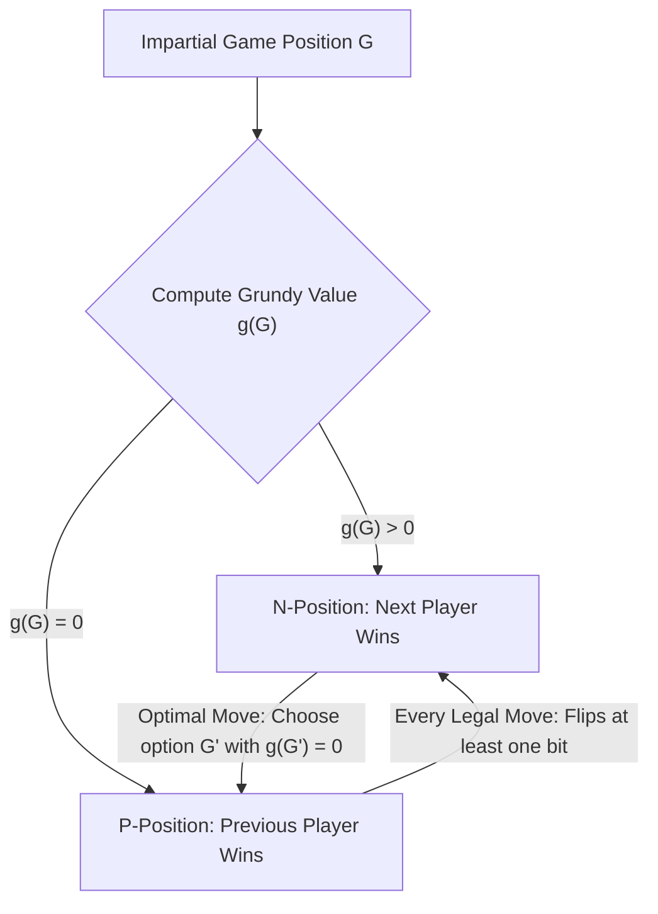
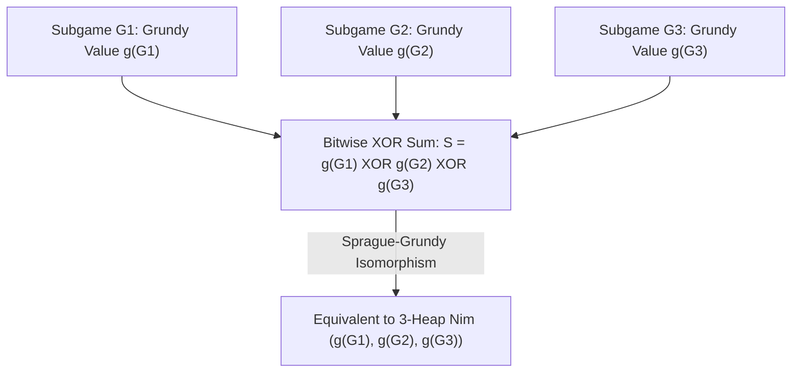

## Introducción: La necesidad absoluta tras reglas simples — Juegos combinatorios imparciales

Sobre una mesa hay tres montones de piedras con $3$, $4$ y $5$ piedras respectivamente. Dos jugadores se turnan; en cada turno, un jugador elige cualquier montón y retira al menos una piedra (pudiendo llevarse el montón entero). Quien se lleva la última piedra gana la partida. Este es el legendario <strong>juego del Nim</strong>, inmortalizado en el cine por Alain Resnais en *El año pasado en Marienbad*. A simple vista parece un duelo psicológico de cálculo mental, pero ante los ojos de las matemáticas el resultado está decidido al $100\,\%$ desde antes del primer movimiento: si el primer jugador conoce el invariante algebraico oculto en la representación binaria, puede forzar la victoria sin importar qué haga su oponente.

En la matemática moderna, esta familia de juegos se denomina <strong>juegos combinatorios imparciales (Impartial Combinatorial Games)</strong> y cumple cinco axiomas: (1) dos jugadores mueven alternativamente; (2) <strong>información perfecta</strong> (sin cartas ocultas ni incertidumbre); (3) <strong>determinismo</strong> (sin dados ni azar); (4) <strong>imparcialidad</strong>, lo que significa que desde cualquier posición dada el conjunto de jugadas legales disponibles es exactamente el mismo para ambos jugadores (a diferencia de los *juegos partisanos* como el ajedrez o el go, donde cada jugador solo mueve sus propias piezas); y (5) <strong>terminación finita</strong>, garantizando que toda partida concluye en un número finito de pasos sobre un grafo acíclico dirigido (DAG). Bajo la regla estándar —la <strong>convención de juego normal (Normal Play Convention)</strong>—, pierde el primer jugador que se queda sin movimientos legales (es decir, gana quien realiza la última jugada).

Por inducción hacia atrás (teorema de Zermelo), todas las posiciones de un juego imparcial se dividen de forma única en dos clases disjuntas: <strong>posiciones $\mathcal{P}$ (Previous-player winning, perdedoras para el jugador en turno)</strong> y <strong>posiciones $\mathcal{N}$ (Next-player winning, ganadoras para el jugador en turno)</strong>. Su definición recursiva es impecable: todas las posiciones terminales sin movimientos son posiciones $\mathcal{P}$; una posición es $\mathcal{N}$ si existe al menos un movimiento legal hacia una posición $\mathcal{P}$; y es una posición $\mathcal{P}$ si <strong>todos</strong> sus movimientos legales conducen inevitablemente a posiciones $\mathcal{N}$.

---

## 1. El desciframiento de Charles Bouton (1901): El XOR binario (Nim-sum) y los dos lemas de invariancia

Cuando hay muchos montones con millones de piedras, la inducción hacia atrás directa sobre el grafo de estados sufre una explosión exponencial. En 1901, el matemático de Harvard <strong>Charles Leonard Bouton</strong> publicó un artículo histórico que resolvió por completo el juego del Nim. Descubrió que la clave consiste en expresar el tamaño de cada montón en base $2$ y calcular su <strong>suma OR exclusiva bit a bit (XOR, llamada suma Nim o Nim-sum)</strong>.

Para una posición $(n_1, n_2, \dots, n_k)$, definimos la suma Nim como $S = n_1 \oplus n_2 \oplus \dots \oplus n_k$. La operación $\oplus$ equivale a la suma binaria sin acarreo sobre el cuerpo finito $\mathbb{F}_2 = 	ext{GF}(2)$ (conmutativa, asociativa y con $x \oplus x = 0$). El teorema de Bouton establece: <strong>Una posición de Nim $(n_1, \dots, n_k)$ es perdedora (posición $\mathcal{P}$) si y solo si su suma Nim es $S = 0$, y es ganadora (posición $\mathcal{N}$) si y solo si $S 
eq 0$.</strong>

La demostración descansa en dos elegantes lemas algebraicos:
Primero: <strong>Desde cualquier posición con $S = 0$, todo movimiento legal conduce necesariamente a $S' 
eq 0$.</strong> Si el jugador reduce el montón $i$ de $n_i$ a $n_i' < n_i$, las representaciones binarias de $n_i$ y $n_i'$ difieren en al menos un bit, por lo que $n_i \oplus n_i' 
eq 0$. La nueva suma Nim es $S' = S \oplus n_i \oplus n_i' = 0 \oplus (n_i \oplus n_i') 
eq 0$. Así, quien recibe $S=0$ está obligado a entregar una posición ganadora $S' 
eq 0$ a su rival.
Segundo: <strong>Desde cualquier posición con $S 
eq 0$, siempre existe al menos un movimiento legal que produce $S' = 0$.</strong> Observemos el <strong>bit más significativo (Most Significant Bit, MSB)</strong> con valor $1$ en la escritura binaria de $S 
eq 0$, situado en la columna $d$. Como el bit $d$ de $S$ es $1$, debe existir un número impar (y por tanto al menos uno) de montones $n_i$ cuyo bit en la columna $d$ también sea $1$. Elegimos ese montón $n_i$ y fijamos su nuevo tamaño en $n_i' = n_i \oplus S$. Como tanto $n_i$ como $S$ tienen un $1$ en el bit $d$, al hacer XOR ese bit pasa a ser $0$ en $n_i'$, mientras que todos los bits más altos permanecen idénticos. ¡Por consiguiente, se cumple estrictamente que $n_i' < n_i$! Retirar $n_i - (n_i \oplus S)$ piedras es una jugada legal y deja una nueva suma Nim $S' = S \oplus n_i \oplus n_i' = S \oplus n_i \oplus (n_i \oplus S) = 0$. En el ejemplo inicial $(3, 4, 5)$, tenemos $S = 3 \oplus 4 \oplus 5 = 2 = (010)_2 
eq 0$. El bit más alto está en el peso $2$, presente en $n_1 = 3 = (011)_2$. El primer jugador reduce el primer montón a $n_1' = 3 \oplus 2 = 1$, dejando $(1, 4, 5)$ con $1 \oplus 4 \oplus 5 = 0$ y asegurándose la victoria.

$$
S = n_1 \oplus n_2 \oplus \dots \oplus n_k = \bigoplus_{i=1}^k n_i
$$

$$
\begin{aligned}
n_1 = 3 &= (011)_2 \\
n_2 = 4 &= (100)_2 \\
n_3 = 5 &= (101)_2 \\
\hline
S = 3 \oplus 4 \oplus 5 &= (010)_2 = 2 \neq 0 \quad (\mathcal{N}\text{-position})
\end{aligned}
$$

$$
n_1' = n_1 \oplus S = 3 \oplus 2 = (011)_2 \oplus (010)_2 = (001)_2 = 1 < 3 \implies (1, 4, 5) \text{ has } 1 \oplus 4 \oplus 5 = 0 \quad (\mathcal{P}\text{-position})
$$

---

## 2. El teorema de Sprague-Grundy (1935/1939): Todo juego imparcial es isomorfo al Nim

Más de treinta años después de Bouton, Roland Sprague (1935) y Patrick Michael Grundy (1939) descubrieron de manera independiente un teorema universal asombroso: <strong>no solo el Nim, sino absolutamente cualquier juego combinatorio imparcial finito bajo convención normal es matemáticamente isomorfo a un único montón de Nim de cierto tamaño.</strong>

Para construir este isomorfismo se introducen el <strong>valor mínimo excluido (Minimum Excluded Value, $	ext{mex}$)</strong> y el <strong>número de Grundy (Grundy Value o Nimber)</strong>. Para cualquier subconjunto finito de enteros no negativos $A \subset \mathbb{N}_0$, $	ext{mex}(A)$ es el menor entero no negativo que no pertenece a $A$ (por ejemplo, $	ext{mex}(\emptyset) = 0$, $	ext{mex}(\{0, 1, 3\}) = 2$). Para cualquier posición $u$ del grafo del juego, su número de Grundy $\mathcal{G}(u)$ se define recursivamente como el $	ext{mex}$ de los números de Grundy de todas las posiciones sucesoras $v$ alcanzables en un movimiento.
De inmediato se deducen dos propiedades clave: (1) $\mathcal{G}(u) = 0$ si y solo si ningún sucesor tiene valor $0$, es decir, $u$ es una posición $\mathcal{P}$; (2) si $\mathcal{G}(u) = g > 0$, entonces para todo entero $m$ con $0 \le m < g$ existe al menos un sucesor $v$ tal que $\mathcal{G}(v) = m$. ¡Esto replica exactamente el comportamiento de un montón de Nim de tamaño $g$!

Más aún, cuando combinamos varios juegos imparciales independientes $G_1, G_2, \dots, G_k$ en una <strong>suma disyuntiva</strong> $G = G_1 + G_2 + \dots + G_k$ (en cada turno el jugador elige uno de los subjuegos y realiza en él una jugada legal hasta que todos terminan), el <strong>teorema de Sprague-Grundy</strong> demuestra que el número de Grundy del juego compuesto es exactamente la suma XOR bit a bit de los números de Grundy de cada subjuego: $\mathcal{G}(G_1 + \dots + G_k) = \mathcal{G}(G_1) \oplus \dots \oplus \mathcal{G}(G_k)$. Incluso si un subjuego permite moverse a un estado con un número de Grundy *mayor* (equivalente a añadir piedras a un montón), el adversario siempre puede neutralizar esa jugada devolviéndolo inmediatamente a su valor anterior. Así, cualquier juego complejo de grafos o particiones se reduce a calcular valores $	ext{mex}$ y aplicar XOR.

$$
\text{mex}(A) = \min \{ m \in \mathbb{N}_0 \mid m \notin A \}, \qquad \mathcal{G}(u) = \text{mex}\big\{ \mathcal{G}(v) \;\big|\; u \to v \big\}
$$

$$
\mathcal{G}(u) = 0 \iff u \in \mathcal{P}\text{-position}, \qquad \mathcal{G}(u) > 0 \iff u \in \mathcal{N}\text{-position}
$$

---

## 3. Aplicaciones clásicas y la trampa de la convención Misère

El teorema de Sprague-Grundy nos permite diseccionar innumerables juegos:
- <strong>Juegos de sustracción (Subtraction Games, juego de Bachet)</strong>: Solo se permite retirar de $1$ a $m$ piedras por turno. Se obtiene periódicamente $\mathcal{G}(n) = n mod (m+1)$, siendo perdedora toda posición múltiplo de $m+1$.
- <strong>Juegos de división: Kayles y el ajedrez de Dawson</strong>: En el juego de bolos *Kayles*, hay $n$ bolos en fila y cada lanzamiento derriba $1$ bolo o $2$ bolos adyacentes. Lo fascinante es que derribar bolos en medio de la fila divide la fila original en <strong>dos subfilas independientes</strong> de tamaños $a$ y $b$. Por el teorema de Sprague-Grundy, la posición resultante equivale a la suma disyuntiva de ambas subfilas y su valor de Grundy es directamente $\mathcal{G}(a) \oplus \mathcal{G}(b)$. Mediante programación dinámica en $O(n^2)$ se calcula toda la sucesión (que se vuelve estrictamente periódica de período $12$ a partir de $n \ge 72$).
- <strong>Convención Misère (Misère Play — quien toma la última piedra pierde)</strong>: ¿Qué ocurre si invertimos la condición de victoria para que pierda quien tome la última piedra? Muchos principiantes creen erróneamente que basta con intercambiar $\mathcal{P}$ y $\mathcal{N}$. Bouton demostró la regla exacta del <strong>Nim Misère</strong>: mientras queden al menos dos montones de tamaño mayor que $1$, se juega <strong>exactamente igual que en el Nim normal</strong> (manteniendo $S = 0$). Solo en el preciso movimiento que dejaría por primera vez <strong>todos los montones restantes de tamaño $1$</strong> se modifica la jugada para dejar un <strong>número impar de montones de tamaño $1$</strong> (es decir, $S = 1$). Sin embargo, para juegos imparciales generales bajo regla Misère, el teorema de Sprague-Grundy colapsa por completo; recién en el siglo XXI Thane Plambeck y Aaron Siegel desarrollaron los <strong>cocientes Misère (Misère Quotients)</strong> basados en monoides conmutativos para domar esta complejidad.

| Tipo de juego / Concepto | Estructura matemática / Invariante | Condición ganadora (posición $\mathcal{N}$) | Complejidad y estatus teórico |
| :--- | :--- | :--- | :--- |
| <strong>Nim estándar (Normal Play)</strong> | Suma XOR bit a bit $S = igoplus_{i=1}^k n_i$ | $S 
eq 0$ | $O(k)$ operaciones de bits; base de todo juego imparcial |
| <strong>Juego de sustracción $S=\{1,\dots,m\}$</strong> | Función de Grundy modular $\mathcal{G}(n) = n mod (m+1)$ | $n 
ot\equiv 0 \pmod{m+1}$ | $O(1)$; sucesión $	ext{mex}$ periódica |
| <strong>Juego de Kayles (división)</strong> | $	ext{mex}\{\mathcal{G}(a) \oplus \mathcal{G}(b)\}$ | $\mathcal{G}(n) 
eq 0$ (período $12$ desde $n \ge 72$) | $O(n^2)$ por DP u $O(1)$ por periodicidad |
| <strong>Suma disyuntiva de juegos imparciales</strong> | Teorema de Sprague-Grundy $\mathcal{G}(\sum G_i) = igoplus \mathcal{G}(G_i)$ | $igoplus_{i=1}^k \mathcal{G}(G_i) 
eq 0$ | Isomorfo al Nim y a espacios sobre $\mathbb{F}_2$ |
| <strong>Nim Misère (última jugada pierde)</strong> | Inversión de paridad solo en el final de montones de $1$ | $S 
eq 0$ si $\exists n_i > 1$; $S = 0$ si todos $n_i = 1$ | Juegos Misère generales requieren Cocientes Misère |

$$
\mathcal{G}(G_1 + G_2 + \dots + G_k) = \mathcal{G}(G_1) \oplus \mathcal{G}(G_2) \oplus \dots \oplus \mathcal{G}(G_k)
$$

$$
\mathcal{G}(\text{Kayles}(n)) = \text{mex}\Big\{ \mathcal{G}(a) \oplus \mathcal{G}(b) \;\Big|\; a + b = n - 1 \text{ or } a + b = n - 2 \Big\}
$$
