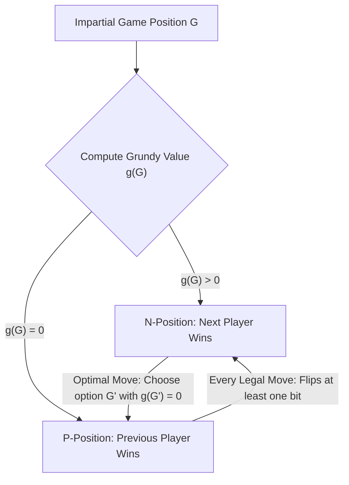
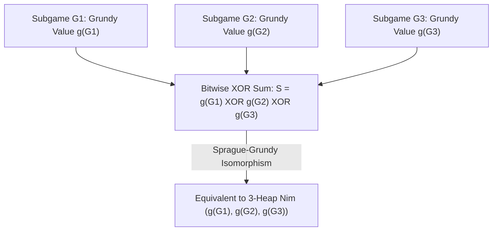

## Introduction : La nécessité absolue derrière des règles simples — Jeux combinatoires impartiaux

Sur une table reposent trois tas de pierres contenant respectivement $3$, $4$ et $5$ pierres. Deux joueurs jouent à tour de rôle ; à chaque tour, un joueur choisit un seul tas et en retire au moins une pierre (et éventuellement le tas entier). Celui qui prend la dernière pierre remporte la partie. C'est le célèbre <strong>jeu de Nim</strong>, immortalisé au cinéma par Alain Resnais dans *L'Année dernière à Marienbad*. En apparence, il s'agit d'un duel psychologique et tactique ; mais aux yeux du mathématicien, l'issue est scellée à $100\,\%$ dès la première seconde : si le premier joueur connaît l'invariant algébrique caché dans l'écriture binaire des nombres, il dispose d'une stratégie gagnante infaillible quelle que soit la défense du second joueur.

En mathématiques modernes, ce type de jeu est appelé un <strong>jeu combinatoire impartial (Impartial Combinatorial Game)</strong>. Il obéit à cinq axiomes fondamentaux : (1) deux joueurs jouent alternativement ; (2) l'<strong>information est parfaite</strong> (aucun élément caché) ; (3) le jeu est <strong>déterministe</strong> (aucun hasard ni dé) ; (4) le jeu est <strong>impartial</strong>, c'est-à-dire que depuis n'importe quelle position donnée, l'ensemble des coups légaux autorisés est strictement identique pour les deux joueurs (contrairement aux *jeux partisans* comme les échecs ou le go, où chaque joueur ne manipule que ses propres pièces) ; et (5) la <strong>terminaison est finie</strong>, garantissant que toute partie s'achève en un nombre fini de coups sur un graphe orienté acyclique (DAG). Sous la règle standard — dite <strong>convention de jeu normal (Normal Play Convention)</strong> — le premier joueur incapable de jouer perd la partie (autrement dit, celui qui effectue le dernier coup gagne).

Par récurrence rétrograde (théorème de Zermelo), toutes les positions d'un jeu impartial se répartissent de manière unique en deux classes disjointes : les <strong>$\mathcal{P}$-positions (Previous-player winning, positions perdantes pour le joueur dont c'est le tour)</strong> et les <strong>$\mathcal{N}$-positions (Next-player winning, positions gagnantes pour le joueur dont c'est le tour)</strong>. Leur définition récursive est d'une clarté absolue : toutes les positions terminales sont des $\mathcal{P}$-positions ; une position est une $\mathcal{N}$-position s'il existe au moins un coup légal menant à une $\mathcal{P}$-position ; et elle est une $\mathcal{P}$-position si <strong>tous</strong> les coups légaux mènent inévitablement à des $\mathcal{N}$-positions.

---

## 1. Le décryptage de Charles Bouton (1901) : Le OU exclusif binaire (Nim-sum) et les deux lemmes d'invariance

Lorsque le nombre de tas et de pierres devient grand, l'induction rétrograde directe sur le graphe d'états subit une explosion exponentielle. En 1901, le mathématicien de Harvard <strong>Charles Leonard Bouton</strong> publia un article historique résolvant intégralement le jeu de Nim. Il démontra que la clé réside dans la décomposition binaire de la taille de chaque tas et le calcul de leur <strong>somme par OU exclusif bit à bit (XOR, appelée somme de Nim ou Nim-sum)</strong>.

Pour une position $(n_1, n_2, \dots, n_k)$, on définit la somme de Nim par $S = n_1 \oplus n_2 \oplus \dots \oplus n_k$. L'opération $\oplus$ correspond à l'addition binaire sans retenue sur le corps fini $\mathbb{F}_2 = 	ext{GF}(2)$ (associative, commutative et vérifiant $x \oplus x = 0$). Le théorème de Bouton affirme : <strong>Une position de Nim $(n_1, \dots, n_k)$ est une position perdante ($\mathcal{P}$-position) si et seulement si sa somme de Nim vaut $S = 0$, et une position gagnante ($\mathcal{N}$-position) si et seulement si $S 
eq 0$.</strong>

La démonstration repose sur deux lemmes algébriques d'une grande élégance :
Premièrement, <strong>à partir d'une position où $S = 0$, tout coup légal conduit nécessairement à $S' 
eq 0$</strong>. Si le joueur réduit le tas $i$ de $n_i$ à $n_i' < n_i$, les écritures binaires de $n_i$ et $n_i'$ diffèrent sur au moins un bit, donc $n_i \oplus n_i' 
eq 0$. La nouvelle somme de Nim vaut alors $S' = S \oplus n_i \oplus n_i' = 0 \oplus (n_i \oplus n_i') 
eq 0$. Le joueur qui reçoit $S=0$ est donc condamné à offrir une position $S' 
eq 0$ à son adversaire.
Deuxièmement, <strong>à partir d'une position où $S 
eq 0$, il existe toujours au moins un coup légal permettant d'atteindre $S' = 0$</strong>. Considérons le <strong>bit de poids fort (Most Significant Bit, MSB)</strong> égal à $1$ dans l'écriture binaire de $S 
eq 0$, situé au rang $d$. Puisque le bit de rang $d$ de $S$ vaut $1$, il existe nécessairement un nombre impair (donc au moins un) de tas $n_i$ dont le bit de rang $d$ vaut également $1$. En choisissant ce tas $n_i$ et en posant $n_i' = n_i \oplus S$, le bit de rang $d$ passe de $1$ à $0$ tandis que tous les bits de rang supérieur à $d$ restent inchangés. On a donc strictement $n_i' < n_i$ ! Ce retrait de $n_i - (n_i \oplus S)$ pierres est un coup parfaitement légal, et la nouvelle somme de Nim devient $S' = S \oplus n_i \oplus n_i' = S \oplus n_i \oplus (n_i \oplus S) = 0$. Dans l'exemple initial $(3, 4, 5)$, on a $S = 3 \oplus 4 \oplus 5 = 2 = (010)_2 
eq 0$. Le bit de poids fort est au rang de valeur $2$, présent dans $n_1 = 3 = (011)_2$. Le premier joueur remplace donc $n_1=3$ par $n_1' = 3 \oplus 2 = 1$, laissant $(1, 4, 5)$ où $1 \oplus 4 \oplus 5 = 0$, ce qui lui garantit la victoire !

$$
S = n_1 \oplus n_2 \oplus \dots \oplus n_k = \bigoplus_{i=1}^k n_i
$$

$$
\begin{aligned}
n_1 = 3 &= (011)_2 \\
n_2 = 4 &= (100)_2 \\
n_3 = 5 &= (101)_2 \\
\hline
S = 3 \oplus 4 \oplus 5 &= (010)_2 = 2 \neq 0 \quad (\mathcal{N}\text{-position})
\end{aligned}
$$

$$
n_1' = n_1 \oplus S = 3 \oplus 2 = (011)_2 \oplus (010)_2 = (001)_2 = 1 < 3 \implies (1, 4, 5) \text{ has } 1 \oplus 4 \oplus 5 = 0 \quad (\mathcal{P}\text{-position})
$$

---

## 2. Le théorème de Sprague-Grundy (1935/1939) : Tout jeu impartial est isomorphe à Nim

Plus de trente ans après Bouton, Roland Sprague (1935) et Patrick Michael Grundy (1939) découvrirent indépendamment un théorème universel stupéfiant : <strong>non seulement le jeu de Nim, mais absolument tout jeu combinatoire impartial fini sous convention normale est mathématiquement isomorphe à un unique tas de Nim d'une certaine taille !</strong>

Pour construire cet isomorphisme, on introduit la <strong>valeur minimale exclue (Minimum Excluded Value, $	ext{mex}$)</strong> et le <strong>nombre de Grundy (Grundy Value ou Nimber)</strong>. Pour tout sous-ensemble fini d'entiers naturels $A \subset \mathbb{N}_0$, $	ext{mex}(A)$ désigne le plus petit entier naturel n'appartenant pas à $A$ (par exemple $	ext{mex}(\emptyset) = 0$, $	ext{mex}(\{0, 1, 3\}) = 2$). Pour toute position $u$ du graphe de jeu, son nombre de Grundy $\mathcal{G}(u)$ est défini récursivement comme le $	ext{mex}$ de l'ensemble des nombres de Grundy de toutes les positions suivantes $v$ accessibles en un coup.
Deux propriétés fondamentales en découlent immédiatement : (1) $\mathcal{G}(u) = 0$ si et seulement si aucun successeur n'a pour valeur $0$, c'est-à-dire que $u$ est une $\mathcal{P}$-position ; (2) si $\mathcal{G}(u) = g > 0$, alors pour tout entier $m$ tel que $0 \le m < g$, il existe au moins un successeur $v$ vérifiant $\mathcal{G}(v) = m$. C'est exactement le comportement d'un tas de Nim de taille $g$ !

Mieux encore, lorsqu'on combine plusieurs jeux impartiaux indépendants $G_1, G_2, \dots, G_k$ en une <strong>somme disjonctive</strong> $G = G_1 + G_2 + \dots + G_k$ (à chaque tour, le joueur choisit l'un des sous-jeux et y effectue un coup légal jusqu'à ce que tous soient terminés), le <strong>théorème de Sprague-Grundy</strong> démontre que le nombre de Grundy du jeu composé est exactement la somme XOR bit à bit des nombres de Grundy des sous-jeux : $\mathcal{G}(G_1 + \dots + G_k) = \mathcal{G}(G_1) \oplus \dots \oplus \mathcal{G}(G_k)$. Même si un sous-jeu permet de passer à un état dont le nombre de Grundy est *supérieur* (ce qui reviendrait à ajouter des pierres à un tas de Nim), l'adversaire peut toujours annuler immédiatement cet ajout en ramenant ce sous-jeu à sa valeur précédente. Ainsi, tout jeu impartial complexe se réduit au calcul de valeurs $	ext{mex}$ et d'un simple XOR !

$$
\text{mex}(A) = \min \{ m \in \mathbb{N}_0 \mid m \notin A \}, \qquad \mathcal{G}(u) = \text{mex}\big\{ \mathcal{G}(v) \;\big|\; u \to v \big\}
$$

$$
\mathcal{G}(u) = 0 \iff u \in \mathcal{P}\text{-position}, \qquad \mathcal{G}(u) > 0 \iff u \in \mathcal{N}\text{-position}
$$

---

## 3. Applications classiques et le piège de la convention Misère (Qui prend perd)

Le théorème de Sprague-Grundy permet de résoudre une multitude de jeux complexes :
- <strong>Jeux de soustraction (Subtraction Games, jeu de Bachet)</strong> : On ne peut retirer que $1$ à $m$ pierres par tour. On obtient périodiquement $\mathcal{G}(n) = n mod (m+1)$ ; la position est perdante si et seulement si $n$ est un multiple de $m+1$.
- <strong>Jeux de division : le jeu de Kayles et les échecs de Dawson</strong> : Aux quilles de *Kayles*, $n$ quilles sont alignées et chaque lancer abat soit $1$ quille, soit $2$ quilles adjacentes. La beauté mathématique apparaît lorsqu'on abat des quilles au milieu de la rangée : celle-ci se scinde en <strong>deux sous-rangées indépendantes</strong> de tailles $a$ et $b$ ! Par le théorème de Sprague-Grundy, la position résultante est la somme disjonctive des deux sous-rangées, et sa valeur de Grundy vaut directement $\mathcal{G}(a) \oplus \mathcal{G}(b)$. Par programmation dynamique en $O(n^2)$, on détermine toute la suite des valeurs de Grundy (qui devient strictement périodique de période $12$ dès $n \ge 72$).
- <strong>La convention Misère (Misère Play — celui qui prend la dernière pierre perd)</strong> : Que se passe-t-il si le dernier joueur à jouer perd ? Beaucoup croient à tort qu'il suffit d'inverser les positions $\mathcal{P}$ et $\mathcal{N}$. Bouton a prouvé la règle exacte du <strong>Nim Misère</strong> : tant qu'il reste au moins deux tas de taille strictement supérieure à $1$, on joue <strong>exactement comme au Nim normal</strong> (en maintenant $S = 0$). Ce n'est qu'au moment précis où votre coup va laisser <strong>uniquement des tas de taille $1$</strong> qu'il faut modifier son coup afin de laisser un <strong>nombre impair de tas de taille $1$</strong> (soit $S = 1$) ! Toutefois, pour les jeux impartiaux généraux en mode Misère, le théorème de Sprague-Grundy s'effondre complètement ; il a fallu attendre le début du XXIe siècle et les travaux de Thane Plambeck et Aaron Siegel sur les <strong>quotients misère (Misère Quotients)</strong> pour analyser algébriquement ces jeux via des monoïdes commutatifs.

| Type de jeu / Concept | Structure mathématique / Invariant | Condition de gain ($\mathcal{N}$-position) | Complexité & Statut théorique |
| :--- | :--- | :--- | :--- |
| <strong>Nim standard (Normal Play)</strong> | Somme XOR bit à bit $S = igoplus_{i=1}^k n_i$ | $S 
eq 0$ | $O(k)$ opérations binaires ; socle des jeux impartiaux |
| <strong>Jeu de soustraction $S=\{1,\dots,m\}$</strong> | Fonction de Grundy périodique $\mathcal{G}(n) = n mod (m+1)$ | $n 
ot\equiv 0 \pmod{m+1}$ | $O(1)$ ; suite $	ext{mex}$ périodique |
| <strong>Jeu de Kayles (division)</strong> | $	ext{mex}\{\mathcal{G}(a) \oplus \mathcal{G}(b)\}$ | $\mathcal{G}(n) 
eq 0$ (période $12$ dès $n \ge 72$) | $O(n^2)$ par DP ou $O(1)$ via périodicité |
| <strong>Somme disjonctive de jeux impartiaux</strong> | Théorème de Sprague-Grundy $\mathcal{G}(\sum G_i) = igoplus \mathcal{G}(G_i)$ | $igoplus_{i=1}^k \mathcal{G}(G_i) 
eq 0$ | Isomorphe à Nim et aux espaces vectoriels sur $\mathbb{F}_2$ |
| <strong>Nim Misère (Qui prend perd)</strong> | Inversion de parité uniquement en finale de tas de taille $1$ | $S 
eq 0$ si $\exists n_i > 1$ ; $S = 0$ si tous $n_i = 1$ | Les jeux Misère généraux requièrent les Quotients Misère |

$$
\mathcal{G}(G_1 + G_2 + \dots + G_k) = \mathcal{G}(G_1) \oplus \mathcal{G}(G_2) \oplus \dots \oplus \mathcal{G}(G_k)
$$

$$
\mathcal{G}(\text{Kayles}(n)) = \text{mex}\Big\{ \mathcal{G}(a) \oplus \mathcal{G}(b) \;\Big|\; a + b = n - 1 \text{ or } a + b = n - 2 \Big\}
$$
