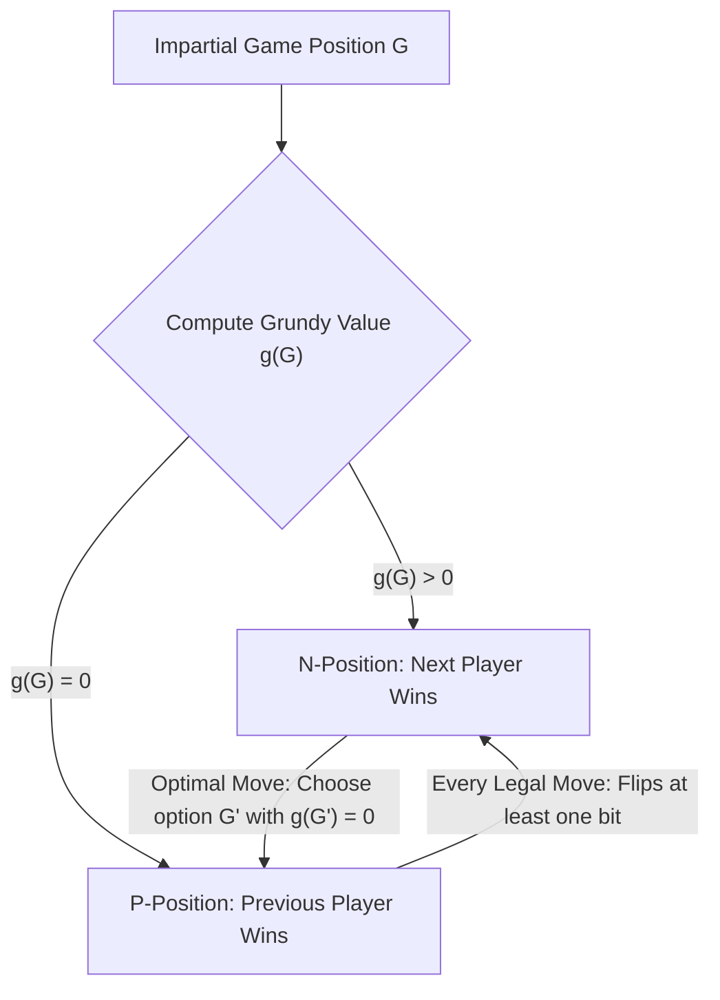
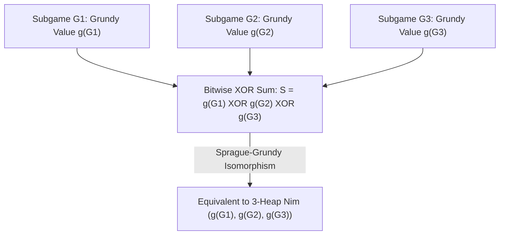

## प्रस्तावना: सरल नियमों के पीछे छिपी पूर्ण अनिवार्यता — निष्पक्ष कॉम्बिनेटरियल खेल

एक मेज पर पत्थरों के तीन ढेर रखे हैं जिनमें क्रमशः $3$, $4$ और $5$ पत्थर हैं। दो खिलाड़ी बारी-बारी से चलते हैं; प्रत्येक चाल में एक खिलाड़ी किसी भी एक ढेर को चुनता है और उसमें से कम से कम एक पत्थर (या पूरा ढेर) हटा लेता है। जो खिलाड़ी आखिरी पत्थर उठाता है, वह जीत जाता है। यही विश्व-प्रसिद्ध <strong>निम (Nim)</strong> का खेल है, जिसे एलेन रेस्ने की क्लासिक फिल्म *लास्ट ईयर एट मारिएनबैड* में अमर कर दिया गया था। ऊपर से देखने पर यह मनोवैज्ञानिक दांव-पेंच और गणना का खेल लगता है, लेकिन गणितज्ञों की नज़र में खेल की पहली चाल चलने से पहले ही विजेता $100\,\%$ तय हो चुका होता है: यदि पहले खिलाड़ी को बाइनरी संख्याओं के बिटवाइज़ संचालन में छिपे बीजगणितीय अपरिवर्तनीय (algebraic invariant) का ज्ञान है, तो दूसरा खिलाड़ी चाहे कुछ भी कर ले, पहला खिलाड़ी निश्चित रूप से जीतेगा।

आधुनिक गणित में इस प्रकार के खेलों को <strong>निष्पक्ष कॉम्बिनेटरियल खेल (Impartial Combinatorial Games)</strong> कहा जाता है। ये पाँच मूलभूत स्वयंसिद्धों (axioms) का पालन करते हैं: (1) दो खिलाड़ी बारी-बारी से चाल चलते हैं; (2) <strong>पूर्ण जानकारी (Perfect Information)</strong>, अर्थात कोई छिपा हुआ पत्ता या जानकारी नहीं होती; (3) <strong>नियतिवादी (Deterministic)</strong>, अर्थात पासा फेंकने जैसी कोई प्रायिकता या संयोग नहीं होता; (4) <strong>निष्पक्षता (Impartiality)</strong>, जिसका अर्थ है कि किसी भी दी गई स्थिति में दोनों खिलाड़ियों के लिए उपलब्ध वैध चालों का समुच्चय बिल्कुल समान होता है (शतरंज या गो जैसे *पक्षपाती खेलों / Partisan Games* के विपरीत, जहाँ प्रत्येक खिलाड़ी केवल अपने रंग के मोहरे ही चल सकता है); और (5) <strong>परिमित समाप्ति (Finite Termination)</strong>, जो सुनिश्चित करती है कि खेल एक निर्देशित अचक्रीय ग्राफ (DAG) पर परिमित चालों में समाप्त होगा। मानक नियम — <strong>सामान्य खेल परिपाटी (Normal Play Convention)</strong> — के तहत वह खिलाड़ी हारता है जिसके पास कोई वैध चाल नहीं बचती (अर्थात अंतिम चाल चलने वाला खिलाड़ी जीतता है)।

पश्चगामी आगमन (backward induction / ज़र्मेलो प्रमेय) द्वारा निष्पक्ष खेल की सभी स्थितियों को दो असंयुक्त वर्गों में विशिष्ट रूप से विभाजित किया जा सकता है: <strong>$\mathcal{P}$-स्थितियाँ (Previous-player winning, पिछली चाल चलने वाले के लिए विजयी / वर्तमान खिलाड़ी के लिए हार की स्थिति)</strong> और <strong>$\mathcal{N}$-स्थितियाँ (Next-player winning, वर्तमान चाल चलने वाले खिलाड़ी के लिए जीत की स्थिति)</strong>। इनकी पुनरावर्ती परिभाषा अत्यंत स्पष्ट है: सभी अंतिम स्थितियाँ (जहाँ कोई चाल संभव न हो) $\mathcal{P}$-स्थितियाँ हैं; कोई स्थिति $\mathcal{N}$-स्थिति है यदि वहाँ से कम से कम एक वैध चाल किसी $\mathcal{P}$-स्थिति तक ले जाती है; और वह $\mathcal{P}$-स्थिति है यदि वहाँ से <strong>सभी</strong> वैध चालें केवल $\mathcal{N}$-स्थितियों की ओर ही ले जाती हैं।

---

## 1. चार्ल्स बूटन की खोज (1901): बिटवाइज़ XOR (निम-योग) और दो अपरिवर्तनीय प्रमेयिकाएँ

जब ढेरों की संख्या बहुत अधिक हो और प्रत्येक ढेर में लाखों पत्थर हों, तो स्टेट ग्राफ पर सीधा पश्चगामी आगमन घातीय विस्फोट (exponential explosion) पैदा करता है। 1901 में हार्वर्ड विश्वविद्यालय के गणितज्ञ <strong>चार्ल्स लियोनार्ड बूटन (Charles Leonard Bouton)</strong> ने एक ऐतिहासिक शोधपत्र प्रकाशित किया जिसने निम खेल को पूरी तरह हल कर दिया। उन्होंने पाया कि इसका रहस्य प्रत्येक ढेर के आकार को द्विआधारी (binary) रूप में लिखने और उनका <strong>बिटवाइज़ एक्सक्लूसिव ऑर योग (Bitwise XOR, जिसे निम-योग या Nim-sum कहा जाता है)</strong> निकालने में छिपा है।

किसी स्थिति $(n_1, n_2, \dots, n_k)$ के लिए निम-योग $S = n_1 \oplus n_2 \oplus \dots \oplus n_k$ के रूप में परिभाषित किया जाता है। संक्रिया $\oplus$ परिमित क्षेत्र $\mathbb{F}_2 = 	ext{GF}(2)$ पर बिना हासिल (carry) वाला बाइनरी जोड़ है (जो क्रमविनिमेय, साहचर्य है और $x \oplus x = 0$ को संतुष्ट करता है)। बूटन का प्रमेय कहता है: <strong>एक निम स्थिति $(n_1, \dots, n_k)$ हार की स्थिति ($\mathcal{P}$-स्थिति) है यदि और केवल यदि उसका निम-योग $S = 0$ हो, और जीत की स्थिति ($\mathcal{N}$-स्थिति) है यदि और केवल यदि $S 
eq 0$ हो।</strong>

इसका प्रमाण दो सुरुचिपूर्ण बीजगणितीय प्रमेयिकाओं (lemmas) पर आधारित है:
पहला: <strong>$S = 0$ वाली किसी भी स्थिति से चली गई प्रत्येक वैध चाल अनिवार्य रूप से $S' 
eq 0$ की ओर ले जाती है।</strong> यदि खिलाड़ी $i$-वें ढेर को $n_i$ से घटाकर $n_i' < n_i$ करता है, तो $n_i$ और $n_i'$ के बाइनरी रूप कम से कम एक बिट में भिन्न होंगे, इसलिए $n_i \oplus n_i' 
eq 0$। नया निम-योग $S' = S \oplus n_i \oplus n_i' = 0 \oplus (n_i \oplus n_i') 
eq 0$ होगा। अतः $S=0$ प्राप्त करने वाला खिलाड़ी अपने प्रतिद्वंद्वी को $S' 
eq 0$ की विजयी स्थिति सौंपने के लिए विवश है।
दूसरा: <strong>$S 
eq 0$ वाली किसी भी स्थिति से हमेशा कम से कम एक ऐसी वैध चाल मौजूद होती है जो $S' = 0$ बना देती है।</strong> शून्येतर संख्या $S$ के बाइनरी रूप में <strong>सबसे महत्वपूर्ण बिट (Most Significant Bit, MSB)</strong> को देखें जहाँ $1$ है, मान लें कि वह $d$-वें स्थान पर है। चूँकि $S$ का $d$-वाँ बिट $1$ है, इसलिए $n_1, \dots, n_k$ में से विषम संख्या में (अर्थात कम से कम एक) ढेर $n_i$ ऐसा अवश्य होगा जिसका $d$-वाँ बिट भी $1$ हो। उस ढेर $n_i$ को चुनें और पत्थरों की नई संख्या $n_i' = n_i \oplus S$ निर्धारित करें। चूँकि $n_i$ और $S$ दोनों के $d$-वें बिट पर $1$ है, XOR करने के बाद $n_i'$ का $d$-वाँ बिट $1$ से घटकर $0$ हो जाता है जबकि उससे उच्च स्थान के सभी बिट अपरिवर्तित रहते हैं। फलस्वरूप कड़ाई से $n_i' < n_i$ सिद्ध होता है! $n_i - (n_i \oplus S)$ पत्थर हटाना एक पूर्णतः वैध चाल है, और नया निम-योग $S' = S \oplus n_i \oplus n_i' = S \oplus n_i \oplus (n_i \oplus S) = 0$ हो जाता है। प्रारंभिक उदाहरण $(3, 4, 5)$ में $S = 3 \oplus 4 \oplus 5 = 2 = (010)_2 
eq 0$ है। उच्चतम बिट का मान $2$ है जो $n_1 = 3 = (011)_2$ में मौजूद है। पहला खिलाड़ी पहले ढेर को घटाकर $n_1' = 3 \oplus 2 = 1$ कर देता है, जिससे $(1, 4, 5)$ बचता है जहाँ $1 \oplus 4 \oplus 5 = 0$ है और उसकी जीत पक्की हो जाती है!

$$
S = n_1 \oplus n_2 \oplus \dots \oplus n_k = \bigoplus_{i=1}^k n_i
$$

$$
\begin{aligned}
n_1 = 3 &= (011)_2 \\
n_2 = 4 &= (100)_2 \\
n_3 = 5 &= (101)_2 \\
\hline
S = 3 \oplus 4 \oplus 5 &= (010)_2 = 2 \neq 0 \quad (\mathcal{N}\text{-position})
\end{aligned}
$$

$$
n_1' = n_1 \oplus S = 3 \oplus 2 = (011)_2 \oplus (010)_2 = (001)_2 = 1 < 3 \implies (1, 4, 5) \text{ has } 1 \oplus 4 \oplus 5 = 0 \quad (\mathcal{P}\text{-position})
$$

---

## 2. स्प्राग-ग्रंडी प्रमेय (1935/1939): प्रत्येक निष्पक्ष खेल निम के समरूप (Isomorphic) है

बूटन के तीन दशक बाद, रोलैंड स्प्राग (Roland Sprague, 1935) और पैट्रिक माइकल ग्रंडी (Patrick Michael Grundy, 1939) ने स्वतंत्र रूप से एक सार्वभौमिक प्रमेय की खोज की जिसने विविक्त गणित को चकित कर दिया: <strong>केवल निम ही नहीं, बल्कि सामान्य खेल परिपाटी के अंतर्गत कोई भी परिमित निष्पक्ष कॉम्बिनेटरियल खेल गणितीय संरचना में किसी निश्चित आकार के एकल निम ढेर के पूर्णतः समरूप (isomorphic) होता है!</strong>

इस समरूपता को स्थापित करने के लिए हम <strong>न्यूनतम बहिष्कृत मान (Minimum Excluded Value, $	ext{mex}$)</strong> और <strong>ग्रंडी संख्या (Grundy Value या Nimber)</strong> को परिभाषित करते हैं। ऋणेतर पूर्णांकों के किसी भी परिमित उपसमुच्चय $A \subset \mathbb{N}_0$ के लिए, $	ext{mex}(A)$ वह सबसे छोटा ऋणेतर पूर्णांक है जो $A$ में नहीं है (जैसे $	ext{mex}(\emptyset) = 0$, $	ext{mex}(\{0, 1, 3\}) = 2$)। खेल ग्राफ की किसी भी स्थिति $u$ के लिए, उसकी ग्रंडी संख्या $\mathcal{G}(u)$ को एक चाल में पहुँचने योग्य सभी अनुवर्ती स्थितियों $v$ की ग्रंडी संख्याओं के समुच्चय के $	ext{mex}$ के रूप में पुनरावर्ती रूप से परिभाषित किया जाता है।
इससे तुरंत दो मुख्य गुण निकलते हैं: (1) $\mathcal{G}(u) = 0$ तभी होता है जब किसी भी अनुवर्ती स्थिति का मान $0$ न हो, अर्थात $u$ एक $\mathcal{P}$-स्थिति है; (2) यदि $\mathcal{G}(u) = g > 0$, तो $0 \le m < g$ को संतुष्ट करने वाले प्रत्येक पूर्णांक $m$ के लिए कम से कम एक अनुवर्ती स्थिति $v$ ऐसी अवश्य होती है कि $\mathcal{G}(v) = m$। यह हूबहू $g$ पत्थरों वाले एकल निम ढेर जैसा व्यवहार है!

इसके अलावा, जब हम कई स्वतंत्र निष्पक्ष खेलों $G_1, G_2, \dots, G_k$ को एक <strong>वियोजक योग (Disjunctive Sum)</strong> $G = G_1 + G_2 + \dots + G_k$ में जोड़ते हैं (प्रत्येक चाल में खिलाड़ी किसी एक उप-खेल को चुनकर उसमें चाल चलता है जब तक सभी समाप्त न हो जाएँ), तो <strong>स्प्राग-ग्रंडी प्रमेय</strong> सिद्ध करता है कि संयुक्त खेल की ग्रंडी संख्या सभी उप-खेलों की ग्रंडी संख्याओं के बिटवाइज़ XOR योग के बराबर होती है: $\mathcal{G}(G_1 + \dots + G_k) = \mathcal{G}(G_1) \oplus \dots \oplus \mathcal{G}(G_k)$! इस प्रकार कोई भी जटिल ग्राफ या विभाजन खेल केवल $	ext{mex}$ और XOR की गणना में सिमट जाता है।

$$
\text{mex}(A) = \min \{ m \in \mathbb{N}_0 \mid m \notin A \}, \qquad \mathcal{G}(u) = \text{mex}\big\{ \mathcal{G}(v) \;\big|\; u \to v \big\}
$$

$$
\mathcal{G}(u) = 0 \iff u \in \mathcal{P}\text{-position}, \qquad \mathcal{G}(u) > 0 \iff u \in \mathcal{N}\text{-position}
$$

---

## 3. क्लासिक अनुप्रयोग और मिज़ेरे नियम (Misère Play) का जाल

स्प्राग-ग्रंडी प्रमेय हमें अनगिनत जटिल खेलों को हल करने का अचूक अस्त्र प्रदान करता है:
- <strong>घटाव खेल (Subtraction Games, बाशे का खेल)</strong>: हर चाल में केवल $1$ से $m$ तक पत्थर ही निकाले जा सकते हैं। यहाँ आवर्ती रूप से $\mathcal{G}(n) = n mod (m+1)$ प्राप्त होता है, और स्थिति तभी हारने वाली होती है जब $n$, $m+1$ का गुणज हो।
- <strong>विभाजन खेल: केल्स (Kayles) और डॉसन शतरंज</strong>: बॉलिंग पिन के खेल *Kayles* में $n$ पिन एक कतार में खड़े होते हैं और हर गेंद या तो $1$ पिन या $2$ सटे हुए पिन गिरा सकती है। जादुई बात तब होती है जब कतार के बीच से पिन गिराए जाते हैं: मूल कतार $a$ और $b$ लंबाई की <strong>दो स्वतंत्र उप-कतारों</strong> में बँट जाती है! स्प्राग-ग्रंडी प्रमेय के अनुसार नई स्थिति दोनों उप-कतारों के वियोजक योग के तुल्य है और उसकी ग्रंडी संख्या सीधे $\mathcal{G}(a) \oplus \mathcal{G}(b)$ होती है। डायनेमिक प्रोग्रामिंग द्वारा $O(n^2)$ समय में पूरा अनुक्रम निकाला जा सकता है (जो $n \ge 72$ के बाद आवर्त $12$ के साथ पूर्णतः आवर्ती हो जाता है)।
- <strong>मिज़ेरे खेल परिपाटी (Misère Play — आखिरी पत्थर उठाने वाला हारता है)</strong>: यदि नियम उलट दिया जाए कि आखिरी पत्थर उठाने वाला खिलाड़ी हारेगा, तो क्या होगा? कई नौसिखिए गलती से सोचते हैं कि बस $\mathcal{P}$ और $\mathcal{N}$ को पलट देना काफी है। बूटन ने <strong>मिज़ेरे निम (Misère Nim)</strong> का सटीक नियम सिद्ध किया: जब तक $1$ से बड़े आकार के कम से कम दो ढेर मौजूद हैं, <strong>बिल्कुल सामान्य निम की तरह खेलें</strong> ($S = 0$ बनाए रखें)। केवल उस सटीक चाल पर जो पहली बार <strong>सभी शेष ढेरों का आकार $1$</strong> छोड़ने वाली हो, अपनी चाल को इस प्रकार बदलें कि <strong>$1$ आकार वाले ढेरों की विषम संख्या</strong> बचे (अर्थात $S = 1$)! किंतु सामान्य निष्पक्ष खेलों में मिज़ेरे नियम के तहत स्प्राग-ग्रंडी प्रमेय पूरी तरह ध्वस्त हो जाता है; 21वीं सदी की शुरुआत में थेन प्लैम्बेक और एरॉन सीगल ने क्रमविनिमेय मोनोइड्स पर आधारित <strong>मिज़ेरे भागफल (Misère Quotients)</strong> सिद्धांत विकसित करके ही इस जटिलता को साधा।

| खेल का प्रकार / अवधारणा | गणितीय संरचना / अपरिवर्तनीय | जीतने की शर्त ($\mathcal{N}$-स्थिति) | जटिलता और सैद्धांतिक स्थिति |
| :--- | :--- | :--- | :--- |
| <strong>मानक निम (Normal Play Nim)</strong> | बिटवाइज़ XOR निम-योग $S = igoplus_{i=1}^k n_i$ | $S 
eq 0$ | $O(k)$ बिट संक्रियाएँ; सभी निष्पक्ष खेलों की नींव |
| <strong>घटाव खेल $S=\{1,\dots,m\}$</strong> | मॉड्यूलर ग्रंडी फलन $\mathcal{G}(n) = n mod (m+1)$ | $n 
ot\equiv 0 \pmod{m+1}$ | $O(1)$; आवर्ती $	ext{mex}$ अनुक्रम |
| <strong>केल्स खेल (Kayles, विभाजन)</strong> | $	ext{mex}\{\mathcal{G}(a) \oplus \mathcal{G}(b)\}$ | $\mathcal{G}(n) 
eq 0$ ($n \ge 72$ से आवर्त $12$) | $O(n^2)$ DP या आवर्तिता से $O(1)$ |
| <strong>निष्पक्ष खेलों का वियोजक योग</strong> | स्प्राग-ग्रंडी प्रमेय $\mathcal{G}(\sum G_i) = igoplus \mathcal{G}(G_i)$ | $igoplus_{i=1}^k \mathcal{G}(G_i) 
eq 0$ | निम और $\mathbb{F}_2$ सदिश समष्टि के समरूप |
| <strong>मिज़ेरे निम (अंतिम चाल हारती है)</strong> | केवल $1$-आकार के एंडगेम में सम-विषम उत्क्रमण | $S 
eq 0$ यदि $\exists n_i > 1$; $S = 0$ यदि सभी $n_i = 1$ | सामान्य मिज़ेरे खेलों हेतु Misère Quotients आवश्यक |

$$
\mathcal{G}(G_1 + G_2 + \dots + G_k) = \mathcal{G}(G_1) \oplus \mathcal{G}(G_2) \oplus \dots \oplus \mathcal{G}(G_k)
$$

$$
\mathcal{G}(\text{Kayles}(n)) = \text{mex}\Big\{ \mathcal{G}(a) \oplus \mathcal{G}(b) \;\Big|\; a + b = n - 1 \text{ or } a + b = n - 2 \Big\}
$$
