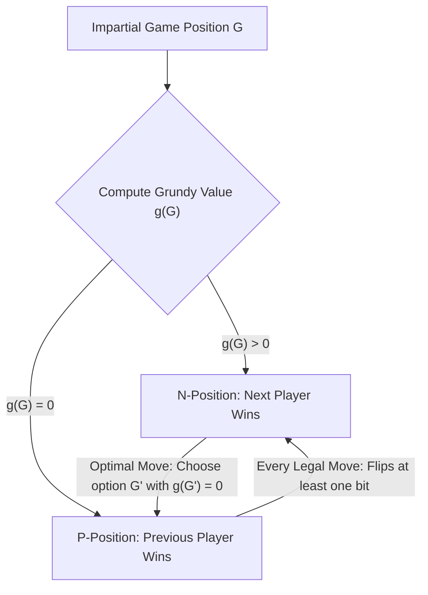
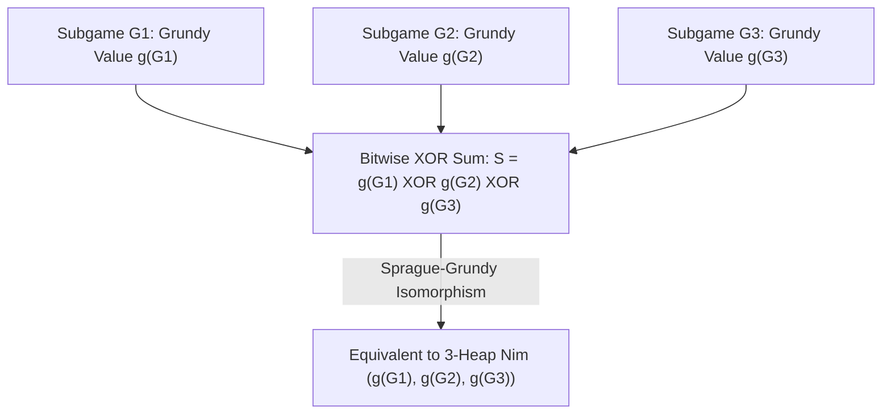

## Pendahuluan: Kepastian Mutlak di Balik Aturan Sederhana — Permainan Kombinatorial Imparsial

Di atas meja terdapat tiga tumpukan batu yang masing-masing berisi $3$, $4$, dan $5$ batu. Dua pemain bergiliran melangkah; pada setiap giliran, seorang pemain memilih satu tumpukan bebas dan mengambil minimal satu batu (boleh juga mengambil seluruh tumpukan). Pemain yang mengambil batu terakhir dinyatakan menang. Inilah <strong>permainan Nim</strong> yang legendaris dan diabadikan dalam film klasik karya Alain Resnais, *Last Year at Marienbad*. Sekilas permainan ini tampak seperti adu psikologi dan tebak-tebakan taktis; namun di mata matematikawan, pemenangnya sudah terkunci $100\,\%$ bahkan sebelum langkah pertama dimulai: selama pemain pertama memahami invarian aljabar yang tersembunyi di balik representasi biner, ia pasti menang apa pun langkah balasan lawan.

Dalam matematika modern, kelas permainan ini disebut <strong>permainan kombinatorial imparsial (Impartial Combinatorial Games)</strong> dan memenuhi lima aksioma: (1) dua pemain melangkah secara bergantian; (2) <strong>informasi sempurna (Perfect Information)</strong> tanpa kartu tersembunyi; (3) <strong>deterministik</strong> tanpa dadu atau faktor kebetulan; (4) <strong>imparsialitas</strong>, artinya dari posisi mana pun himpunan langkah sah yang tersedia persis sama bagi kedua pemain (berbeda dengan *permainan partisan* seperti catur atau go, di mana tiap pemain hanya boleh menggerakkan buah miliknya sendiri); serta (5) <strong>terminasi berhingga</strong>, yang menjamin permainan pasti berakhir dalam jumlah langkah berhingga pada graf asiklik berarah (DAG). Di bawah aturan standar — <strong>konvensi permainan normal (Normal Play Convention)</strong> — pemain pertama yang kehabisan langkah sah dinyatakan kalah (ekuivalen dengan pemain yang melakukan langkah terakhir menang).

Melalui induksi mundur (Teorema Zermelo), seluruh posisi dalam permainan imparsial terbagi secara tunggal menjadi dua kelas saling lepas: <strong>posisi-$\mathcal{P}$ (Previous-player winning, posisi kalah bagi pemain yang sedang mendapat giliran jalan)</strong> dan <strong>posisi-$\mathcal{N}$ (Next-player winning, posisi menang bagi pemain yang sedang mendapat giliran jalan)</strong>. Definisi rekursifnya sangat jernih: semua posisi terminal tanpa langkah adalah posisi-$\mathcal{P}$; suatu posisi adalah posisi-$\mathcal{N}$ jika terdapat setidaknya satu langkah sah menuju posisi-$\mathcal{P}$; dan suatu posisi adalah posisi-$\mathcal{P}$ jika <strong>semua</strong> langkah sah darinya selalu berujung pada posisi-$\mathcal{N}$.

---

## 1. Terobosan Charles Bouton (1901): XOR Biner (Nim-sum) dan Dua Lema Invariansi

Jika terdapat banyak tumpukan dengan jutaan batu, induksi mundur langsung pada graf status akan mengalami ledakan eksponensial. Pada tahun 1901, matematikawan Universitas Harvard <strong>Charles Leonard Bouton</strong> menerbitkan makalah bersejarah yang memecahkan permainan Nim secara tuntas. Ia menemukan bahwa kuncinya adalah menuliskan ukuran setiap tumpukan dalam bilangan biner lalu menghitung <strong>jumlah XOR bit-demi-bit (Bitwise XOR, disebut jumlah Nim atau Nim-sum)</strong>.

Untuk posisi $(n_1, n_2, \dots, n_k)$, jumlah Nim didefinisikan sebagai $S = n_1 \oplus n_2 \oplus \dots \oplus n_k$. Operasi $\oplus$ adalah penjumlahan biner tanpa simpanan (carry-less addition) di atas medan hingga $\mathbb{F}_2 = 	ext{GF}(2)$ (komutatif, asosiatif, dan memenuhi $x \oplus x = 0$). Teorema Bouton menyatakan: <strong>Suatu posisi Nim $(n_1, \dots, n_k)$ adalah posisi kalah (posisi-$\mathcal{P}$) jika dan hanya jika jumlah Nim-nya $S = 0$, dan merupakan posisi menang (posisi-$\mathcal{N}$) jika dan hanya jika $S 
eq 0$.</strong>

Pembuktiannya bertumpu pada dua lema aljabar yang sangat elegan:
Pertama: <strong>Dari posisi mana pun dengan $S = 0$, setiap langkah sah pasti menghasilkan $S' 
eq 0$.</strong> Jika pemain mengurangi tumpukan ke-$i$ dari $n_i$ menjadi $n_i' < n_i$, representasi biner $n_i$ dan $n_i'$ pasti berbeda setidaknya pada satu bit, sehingga $n_i \oplus n_i' 
eq 0$. Jumlah Nim yang baru adalah $S' = S \oplus n_i \oplus n_i' = 0 \oplus (n_i \oplus n_i') 
eq 0$. Artinya, pemain yang menerima kondisi $S=0$ terpaksa menyerahkan posisi menang $S' 
eq 0$ kepada lawannya.
Kedua: <strong>Dari posisi mana pun dengan $S 
eq 0$, selalu ada setidaknya satu langkah sah yang menghasilkan $S' = 0$.</strong> Perhatikan <strong>bit paling signifikan (Most Significant Bit, MSB)</strong> yang bernilai $1$ pada representasi biner $S 
eq 0$, misalkan pada kolom ke-$d$. Karena bit ke-$d$ dari $S$ bernilai $1$, pasti terdapat sejumlah ganjil (minimal satu) tumpukan $n_i$ yang bit ke-$d$-nya juga bernilai $1$. Pilih tumpukan $n_i$ tersebut dan tetapkan ukuran barunya menjadi $n_i' = n_i \oplus S$. Karena baik $n_i$ maupun $S$ memiliki bit $1$ di kolom $d$, hasil XOR mengubah bit ke-$d$ pada $n_i'$ menjadi $0$, sedangkan semua bit yang lebih tinggi tidak berubah. Maka berlaku tegas $n_i' < n_i$! Mengambil $n_i - (n_i \oplus S)$ batu adalah langkah sah, dan jumlah Nim baru menjadi $S' = S \oplus n_i \oplus n_i' = S \oplus n_i \oplus (n_i \oplus S) = 0$. Pada contoh awal $(3, 4, 5)$, kita punya $S = 3 \oplus 4 \oplus 5 = 2 = (010)_2 
eq 0$. Bit tertinggi bernilai $2$, yang dimiliki oleh $n_1 = 3 = (011)_2$. Pemain pertama mengubah tumpukan pertama menjadi $n_1' = 3 \oplus 2 = 1$, menyisakan $(1, 4, 5)$ dengan $1 \oplus 4 \oplus 5 = 0$ dan mengunci kemenangan!

$$
S = n_1 \oplus n_2 \oplus \dots \oplus n_k = \bigoplus_{i=1}^k n_i
$$

$$
\begin{aligned}
n_1 = 3 &= (011)_2 \\
n_2 = 4 &= (100)_2 \\
n_3 = 5 &= (101)_2 \\
\hline
S = 3 \oplus 4 \oplus 5 &= (010)_2 = 2 \neq 0 \quad (\mathcal{N}\text{-position})
\end{aligned}
$$

$$
n_1' = n_1 \oplus S = 3 \oplus 2 = (011)_2 \oplus (010)_2 = (001)_2 = 1 < 3 \implies (1, 4, 5) \text{ has } 1 \oplus 4 \oplus 5 = 0 \quad (\mathcal{P}\text{-position})
$$

---

## 2. Teorema Sprague-Grundy (1935/1939): Setiap Permainan Imparsial Isomorfik dengan Nim

Lebih dari tiga dekade setelah Bouton, Roland Sprague (1935) dan Patrick Michael Grundy (1939) secara independen menemukan teorema universal yang mengguncang matematika diskrit: <strong>bukan hanya Nim, melainkan setiap permainan kombinatorial imparsial berhingga di bawah konvensi normal secara matematis isomorfik dengan satu tumpukan Nim berukuran tertentu!</strong>

Untuk membangun isomorfisme ini, kita memperkenalkan <strong>nilai minimum yang dikecualikan (Minimum Excluded Value, $	ext{mex}$)</strong> dan <strong>bilangan Grundy (Grundy Value atau Nimber)</strong>. Untuk himpunan bagian berhingga bilangan bulat tak-negatif $A \subset \mathbb{N}_0$, $	ext{mex}(A)$ adalah bilangan bulat tak-negatif terkecil yang tidak ada di $A$ (misalnya $	ext{mex}(\emptyset) = 0$, $	ext{mex}(\{0, 1, 3\}) = 2$). Untuk setiap posisi $u$ pada graf permainan, bilangan Grundy $\mathcal{G}(u)$ didefinisikan secara rekursif sebagai $	ext{mex}$ dari himpunan bilangan Grundy seluruh posisi penerus $v$ yang dapat dicapai dalam satu langkah.
Dua sifat fundamental langsung terlihat: (1) $\mathcal{G}(u) = 0$ jika dan hanya jika tidak ada penerus bernilai $0$, yakni $u$ adalah posisi-$\mathcal{P}$; (2) jika $\mathcal{G}(u) = g > 0$, maka untuk setiap bilangan bulat $m$ dengan $0 \le m < g$ terdapat setidaknya satu penerus $v$ dengan $\mathcal{G}(v) = m$. Ini persis perilaku satu tumpukan Nim berisi $g$ batu!

Lebih jauh lagi, ketika kita menggabungkan beberapa permainan imparsial independen $G_1, G_2, \dots, G_k$ menjadi <strong>jumlah disjungtif (Disjunctive Sum)</strong> $G = G_1 + G_2 + \dots + G_k$ (setiap giliran pemain memilih salah satu sub-permainan dan melangkah di sana hingga semuanya berakhir), <strong>Teorema Sprague-Grundy</strong> membuktikan bahwa bilangan Grundy permainan gabungan sama persis dengan XOR bit-demi-bit dari bilangan Grundy masing-masing sub-permainan: $\mathcal{G}(G_1 + \dots + G_k) = \mathcal{G}(G_1) \oplus \dots \oplus \mathcal{G}(G_k)$. Bahkan jika suatu sub-permainan mengizinkan langkah menuju bilangan Grundy yang *lebih besar* (setara dengan menambah batu ke tumpukan), lawan selalu dapat langsung menetralkannya kembali ke nilai semula. Dengan demikian, permainan graf atau pembagian serumit apa pun dapat direduksi menjadi perhitungan $	ext{mex}$ dan XOR!

$$
\text{mex}(A) = \min \{ m \in \mathbb{N}_0 \mid m \notin A \}, \qquad \mathcal{G}(u) = \text{mex}\big\{ \mathcal{G}(v) \;\big|\; u \to v \big\}
$$

$$
\mathcal{G}(u) = 0 \iff u \in \mathcal{P}\text{-position}, \qquad \mathcal{G}(u) > 0 \iff u \in \mathcal{N}\text{-position}
$$

---

## 3. Aplikasi Klasik dan Jebakan Konvensi Misère

Teorema Sprague-Grundy memberi kita pisau bedah untuk membedah berbagai permainan:
- <strong>Permainan Pengurangan (Subtraction Games, permainan Bachet)</strong>: setiap giliran hanya boleh mengambil $1$ sampai $m$ batu. Diperoleh secara periodik $\mathcal{G}(n) = n mod (m+1)$, sehingga posisi kalah terjadi tepat ketika $n$ kelipatan $m+1$.
- <strong>Permainan Pembelahan: Kayles dan Catur Dawson</strong>: dalam permainan boling *Kayles*, terdapat $n$ pin berjajar dan setiap lemparan merobohkan $1$ pin atau $2$ pin bersebelahan. Hal menarik terjadi saat pin di tengah barisan dirobohkan: barisan awal terbelah menjadi <strong>dua sub-barisan independen</strong> berukuran $a$ dan $b$! Berdasarkan Teorema Sprague-Grundy, posisi baru ekuivalen dengan jumlah disjungtif kedua sub-barisan sehingga nilai Grundy-nya langsung $\mathcal{G}(a) \oplus \mathcal{G}(b)$. Dengan pemrograman dinamis $O(n^2)$, seluruh barisan nilai Grundy dapat dihitung (dan bersifat periodik murni dengan periode $12$ mulai $n \ge 72$).
- <strong>Konvensi Misère (Misère Play — pengambil batu terakhir kalah)</strong>: bagaimana jika aturan dibalik sehingga pemain yang mengambil batu terakhir kalah? Banyak pemula keliru mengira cukup membalik posisi $\mathcal{P}$ dan $\mathcal{N}$. Bouton membuktikan aturan eksak <strong>Misère Nim</strong>: selama masih ada minimal dua tumpukan berukuran lebih dari $1$, bermainlah <strong>persis seperti Nim normal</strong> (pertahankan $S = 0$). Hanya pada langkah tepat yang untuk pertama kalinya akan menyisakan <strong>semua tumpukan berukuran $1$</strong>, ubahlah langkah agar menyisakan <strong>jumlah ganjil tumpukan berukuran $1$</strong> (yakni $S = 1$)! Namun, untuk permainan imparsial umum di bawah aturan Misère, Teorema Sprague-Grundy runtuh sepenuhnya; baru pada awal abad ke-21 Thane Plambeck dan Aaron Siegel mengembangkan teori <strong>kuosien Misère (Misère Quotients)</strong> berbasis monoid komutatif untuk memetakan struktur aljabarnya.

| Jenis Permainan / Konsep | Struktur Matematika / Invarian | Syarat Menang (Posisi-$\mathcal{N}$) | Kompleksitas & Status Teoretis |
| :--- | :--- | :--- | :--- |
| <strong>Nim Standar (Normal Play)</strong> | Jumlah XOR bit-demi-bit $S = igoplus_{i=1}^k n_i$ | $S 
eq 0$ | $O(k)$ operasi bit; fondasi seluruh permainan imparsial |
| <strong>Permainan Pengurangan $S=\{1,\dots,m\}$</strong> | Fungsi Grundy modular $\mathcal{G}(n) = n mod (m+1)$ | $n 
ot\equiv 0 \pmod{m+1}$ | $O(1)$; barisan $	ext{mex}$ periodik |
| <strong>Permainan Kayles (pembelahan)</strong> | $	ext{mex}\{\mathcal{G}(a) \oplus \mathcal{G}(b)\}$ | $\mathcal{G}(n) 
eq 0$ (periode $12$ mulai $n \ge 72$) | $O(n^2)$ via DP atau $O(1)$ via periodisitas |
| <strong>Jumlah Disjungtif Permainan Imparsial</strong> | Teorema Sprague-Grundy $\mathcal{G}(\sum G_i) = igoplus \mathcal{G}(G_i)$ | $igoplus_{i=1}^k \mathcal{G}(G_i) 
eq 0$ | Isomorfik dengan Nim dan ruang vektor atas $\mathbb{F}_2$ |
| <strong>Misère Nim (langkah terakhir kalah)</strong> | Pembalikan paritas hanya pada endgame tumpukan $1$ | $S 
eq 0$ jika $\exists n_i > 1$; $S = 0$ jika semua $n_i = 1$ | Permainan Misère umum memerlukan Misère Quotients |

$$
\mathcal{G}(G_1 + G_2 + \dots + G_k) = \mathcal{G}(G_1) \oplus \mathcal{G}(G_2) \oplus \dots \oplus \mathcal{G}(G_k)
$$

$$
\mathcal{G}(\text{Kayles}(n)) = \text{mex}\Big\{ \mathcal{G}(a) \oplus \mathcal{G}(b) \;\Big|\; a + b = n - 1 \text{ or } a + b = n - 2 \Big\}
$$
