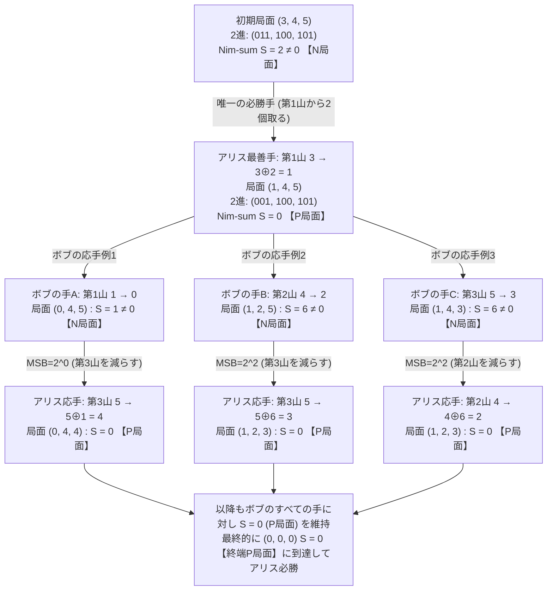
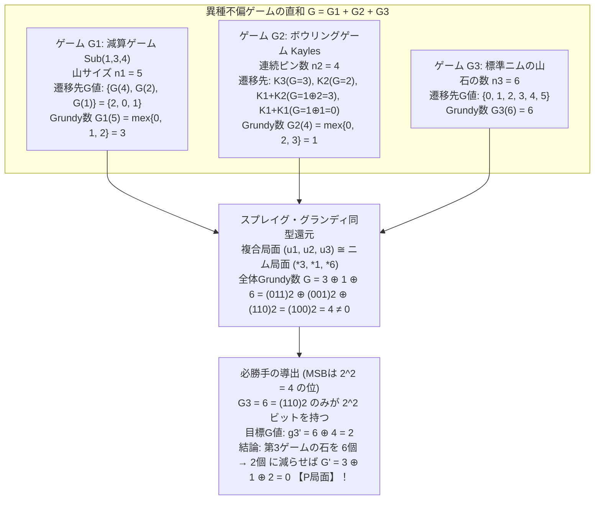

机の上に3つの石の山があり、それぞれ <strong>3個、4個、5個</strong> の石が積まれているとしよう。2人のプレイヤー（先手アリスと後手ボブ）が交互に手番を回し、1回の手番では「どれか1つの山を選び、その山から1個以上の好きな数の石を取り除く（山ごとすべて取り除いてもよい）」という操作を行う。そして、<strong>最後の1個の石を取ったプレイヤーを勝ち</strong>とする。

一見すると、手番ごとに相手の出方を伺う心理戦や、膨大な枝分かれを先読みする探索が必要なゲームに見える。しかし数学の視点に立つと、このゲームには偶然や心理の入り込む余地は一切ない。開始直後の $(3, 4, 5)$ という配置を見た瞬間に、「先手のアリスに必勝法が存在し、しかも初手で取るべき唯一の手は『3個の山から2個取って $(1, 4, 5)$ にすること』である」と、わずか数秒の暗算で断定できるのである。

さらに驚くべきは、その計算方法だ。石の数を2進数に変換し、繰り上がりを無視して桁ごとに足し合わせる<strong>排他的論理和（Bitwise XOR, $\oplus$）</strong>を計算するだけで、山が100個あろうと、各山に10億個の石が積まれていようと、勝敗の帰趨と最善手が瞬時に導き出される。

なぜ「石を取り除く」という素朴な減算のプロセスから、コンピュータ科学の根幹をなす「2進数の排他的論理和（XOR）」が必然的に立ち現れるのだろうか。さらに、1回に取れる石の数に制限があるゲームや、ボウリングのピンを倒して列を分断するゲームなど、一見ニムとは全く異なるルールを持つ無数のゲームが、なぜすべて「ニムの1つの山」へと数学的に同型還元（Isomorphic Reduction）されてしまうのか。

本稿では、離散数学とアルゴリズム理論の交差点にそびえる<strong>組合せゲーム理論（Combinatorial Game Theory: CGT）</strong>の基礎から核心までを徹底的に掘り下げる。後ろ向き帰納法による勝ち局面・負け局面の公理的分類から出発し、チャールズ・レナード・ブートン（Charles Leonard Bouton）による1901年のニム完全解の証明、最小除外数（$\text{mex}$）とグランディ数（Grundy Value / Nimber）、そして1930年代にロランド・スプレイグ（Roland Sprague）とパトリック・マイケル・グランディ（Patrick Michael Grundy）が独立に確立した<strong>スプレイグ・グランディの定理（Sprague-Grundy Theorem）</strong>の完全証明と応用、さらには「最後の石を取った者が負け」というルール変更（逆形プレイ / Misère Play）がもたらす劇的な構造変化までを、一本の論理的ストーリーとして解き明かしていく。

---

## 1. 組合せゲーム理論（CGT）の枠組みと不偏ゲームの定義

数学において「ゲーム理論」という言葉は、大きく2つの異なる体系を指す。1つはジョン・フォン・ノイマン（John von Neumann）やジョン・ナッシュ（John Nash）らが構築した<strong>古典的・経済学的ゲーム理論（Classical Game Theory）</strong>であり、そこではじゃんけんやポーカー、囚人のジレンマ、市場競争のように「同時手番」「非公開情報（不完全情報）」「確率的混合戦略」「ナッシュ均衡」が主役となる。

これに対し、チェス、囲碁、将棋、オセロ、そして石取りゲームのように、<strong>2人のプレイヤーが盤面のすべての情報を共有しながら交互に手を指し進める確定的なゲーム</strong>を純粋な代数的・組合せ論的対象として研究する分野が、<strong>組合せゲーム理論（Combinatorial Game Theory: CGT）</strong>である。

### 1.1 不偏ゲーム（Impartial Games）の公理的条件

組合せゲーム理論が扱うゲームの中でも、本稿の主役である石取りゲーム（Nim）が属するクラスは<strong>不偏ゲーム（公平ゲーム / Impartial Combinatorial Games）</strong>と呼ばれる。厳密には、以下の5つの公理を満たすゲームとして定義される。

1. <strong>二人交互手番（Two-Player Sequential Play）</strong>：2人のプレイヤー（先手と後手）が交互に1手ずつ合法手を選択する。パスは認められない。
2. <strong>完全情報（Perfect Information）</strong>：ゲームの現在の状態（局面）は両プレイヤーに完全に公開されており、伏せられたカードや見えない石のような隠匿情報は存在しない。
3. <strong>確定性（Determinism）</strong>：サイコロやルーレットのような確率的要素（偶然手番）は一切介在せず、ある局面から選んだ手によって次の局面が一意に定まる。
4. <strong>不偏性（Impartiality）</strong>：任意の局面 $u$ において、<strong>選択可能な合法手の集合 $\text{Opt}(u)$ は現在の局面 $u$ のみに依存し、手番がどちらのプレイヤーであるかには依存しない</strong>。
   - ※対照的に、チェス（白番は白駒のみ、黒番は黒駒のみを動かせる）や囲碁（黒番は黒石、白番は白石を打つ）のように、手番プレイヤーによって合法手が異なるゲームは<strong>非不偏ゲーム（党派ゲーム / Partisan Games）</strong>と呼ばれ、ジョン・ホートン・コンウェイ（John Horton Conway）の<strong>超現実数（Surreal Numbers）</strong>の理論によって解析される。不偏ゲームでは、盤上の石には「先手の石」「後手の石」という区別が存在せず、両者が同じ石の山に対して同じルールで操作を行う。
5. <strong>有限終了条件（Finite Termination / Ending Condition）</strong>：どのような合法手の列を選んでも、ゲームは必ず有限手数のうちに終了する（無限ループや無限降下鎖が存在しない）。したがって、局面を頂点集合 $V$、合法手による遷移を有向辺集合 $E$ とするゲームグラフ $G = (V, E)$ は、<strong>有限の深さを持つ有向非巡回グラフ（DAG: Directed Acyclic Graph）</strong>をなす。

### 1.2 正規プレイ規約（Normal Play）と逆形プレイ規約（Misère Play）

有限終了条件により、ゲームを進めると必ず「これ以上いかなる合法手も打てない終端局面（Terminal Position: $\text{Opt}(u) = \emptyset$）」に到達する。このとき、勝敗を決める規約には正反対の2通りが存在する。

- <strong>正規プレイ規約（Normal Play Convention）</strong>：<strong>自分の手番で合法手がなくなったプレイヤーを「負け」とする</strong>。言い換えれば、<strong>最後の合法手を指した（最後の石を取った）プレイヤーが「勝ち」</strong>となる。組合せゲーム理論における標準の規約であり、最も美しい代数構造（スプレイグ・グランディ理論）が成立するのはこの正規プレイ規約の下である。
- <strong>逆形プレイ規約（ミゼール・プレイ規約 / Misère Play Convention）</strong>：<strong>自分の手番で合法手がなくなったプレイヤーを「勝ち」とする</strong>。すなわち、<strong>最後の合法手を指すこと（最後の石を取ること）を強いられたプレイヤーが「負け」</strong>となる。日常の遊びとしての石取りゲームやトランプのババ抜きなどではこちらのルールが採用されることも多いが、数学的には正規プレイとは比較にならないほど複雑な挙動を示す（第6節で詳述する）。

特に断りがない限り、第2節から第5節まではすべて<strong>正規プレイ規約（最後の石を取った者が勝ち）</strong>を前提として議論を進める。

---

## 2. 後ろ向き帰納法と局面の二分割：$\mathcal{P}$局面と$\mathcal{N}$局面

不偏ゲームにおいて、「この局面は勝ち局面である」「負け局面である」という日常表現はしばしば混乱を招く。「誰にとっての勝ちか（先手か、後手か、それともこれから手番を迎える側か）」が曖昧だからである。そのため組合せゲーム理論では、現在の局面 $u \in V$ がどちらのプレイヤーに必勝をもたらすかを、以下の2つの不変クラスによって厳密に分類する。

- <strong>$\mathcal{P}$-position（Previous player wins / 後手必勝局面・直前手番必勝局面）</strong>：
  その局面を<strong>作った直前のプレイヤー（Previous player）</strong>に必勝法がある局面。逆に言えば、<strong>これからその局面に直面して手を指さなければならないプレイヤー（現在の手番プレイヤー）は、相手が最善を尽くす限りどのように指しても必ず負ける</strong>局面である。
- <strong>$\mathcal{N}$-position（Next player wins / 先手必勝局面・次手番必勝局面）</strong>：
  その局面から<strong>次に手を指すプレイヤー（Next player / 現在の手番プレイヤー）</strong>に必勝法がある局面。適切な1手を選ぶことで、相手に$\mathcal{P}$-positionを押し付けることができる局面である。

### 2.1 $\mathcal{P}$局面と$\mathcal{N}$局面の再帰的公理と一意分割定理

正規プレイ規約の下で、ゲームグラフ $G = (V, E)$ のすべての頂点（局面）$u \in V$ は、終端局面からの<strong>後ろ向き帰納法（Backward Induction）</strong>によって、以下の3規則で完全に特徴づけられる。ここで $\text{Opt}(u) = \{v \in V : (u, v) \in E\}$ は局面 $u$ から1手で遷移できる全選択肢（Options）の集合を表す。

1. <strong>終端条件（Terminal Rule）</strong>：合法手が1つも存在しないすべての終端局面 $t \in V$（$\text{Opt}(t) = \emptyset$）は、<strong>$\mathcal{P}$-position</strong>である。（なぜなら、これから手番を迎えるプレイヤーは手を指せず即座に敗北し、直前に手を指して $t$ を作ったプレイヤーが勝利しているからである。）
2. <strong>$\mathcal{N}$局面の条件（Winning Move Existence）</strong>：ある局面 $u \in V$ が <strong>$\mathcal{N}$-position</strong> であるための必要十分条件は、遷移先の中に<strong>少なくとも1つの $\mathcal{P}$-position が存在すること</strong>である：
   $$u \in \mathcal{N} \iff \exists v \in \text{Opt}(u) \text{ s.t. } v \in \mathcal{P}$$
3. <strong>$\mathcal{P}$局面の条件（No Escape Rule）</strong>：ある局面 $u \in V$ が <strong>$\mathcal{P}$-position</strong> であるための必要十分条件は、遷移先の<strong>すべての局面が $\mathcal{N}$-position であること</strong>である（$\text{Opt}(u) = \emptyset$ の場合は空虚な真（vacuously true）として成立する）：
   $$u \in \mathcal{P} \iff \forall v \in \text{Opt}(u), \; v \in \mathcal{N}$$

> [!IMPORTANT]
> <strong>定理2.1（有限不偏ゲームの決定性と二分割定理 / ツェルメロの定理の不偏版）</strong>
> 有限終了条件を満たす任意の不偏ゲーム $G = (V, E)$ において、すべての局面 $u \in V$ は $\mathcal{P}$ と $\mathcal{N}$ の<strong>ちょうど一方</strong>に属する（$\mathcal{P} \cap \mathcal{N} = \emptyset$ かつ $\mathcal{P} \cup \mathcal{N} = V$）。引き分けは原理的に存在せず、初期局面 $u_0 \in \mathcal{N}$ ならば先手必勝、$u_0 \in \mathcal{P}$ ならば後手必勝となる。

<strong>【証明】</strong> ゲームグラフ $G = (V, E)$ は有限長のパスしか持たないDAGであるため、各頂点 $u \in V$ に対して「$u$ から終端局面に至る最長パスの長さ（高さ $\text{height}(u)$）」が非負整数として一意に定義できる。
- 基底段階：$\text{height}(u) = 0$ のとき、$\text{Opt}(u) = \emptyset$ であるから、規則3（および規則1）により $u \in \mathcal{P}$ かつ $u \notin \mathcal{N}$ が一意に定まる。
- 帰納段階：$\text{height}(u) = h > 0$ とし、高さが $h$ 未満のすべての頂点 $v$ について $v \in \mathcal{P}$ または $v \in \mathcal{N}$ のちょうど一方が定まっていると仮定する。任意の遷移先 $v \in \text{Opt}(u)$ は $\text{height}(v) \le h - 1 < h$ を満たすため、帰納法の仮定より各 $v$ の所属は確定している。論理命題「$\exists v \in \text{Opt}(u), v \in \mathcal{P}$」とその否定「$\forall v \in \text{Opt}(u), v \notin \mathcal{P} \iff \forall v \in \text{Opt}(u), v \in \mathcal{N}$」は排中律により真偽がちょうど一方のみ成立するため、$u$ も $\mathcal{N}$ と $\mathcal{P}$ のちょうど一方に属する。$\blacksquare$

この定理が教える必勝戦略の本質は極めて明快である。<strong>「$\mathcal{N}$局面にいるプレイヤーは、常に$\mathcal{P}$局面への遷移手を選び続けることで勝利できる。逆に$\mathcal{P}$局面に落とされたプレイヤーは、どの手を指しても相手に$\mathcal{N}$局面を渡すことしかできない」</strong>のだ。

### 2.2 ウォームアップ：1山減算ゲーム（バシェのゲーム）の周期性

複数山のニムに進む前に、1つの山だけを使う最も古典的な石取りゲーム（<strong>バシェのゲーム / Bachet's Game</strong>）をこの $\mathcal{P}/\mathcal{N}$ 分類で解いておこう。
1つの山に $n$ 個の石があり、1回の手番で <strong>$1$個以上 $m$個以下</strong>（例えば $m = 3$ なら $1, 2, 3$ 個のいずれか）の石を取れるとする。最後の石を取った者が勝ちである。

終端局面 $n = 0$ から順に $\mathcal{P}$ と $\mathcal{N}$ を決定してみよう（$m = 3$ とする）：
- $n = 0$：取れる石がない終端局面なので <strong>$\mathcal{P}$</strong>。
- $n = 1, 2, 3$：それぞれ1個、2個、3個すべてを取り去ることで、一発で $n = 0 \in \mathcal{P}$ に遷移できる。よってすべて <strong>$\mathcal{N}$</strong>。
- $n = 4$：$1, 2, 3$ 個のいずれを取っても、残る石の数は $3, 2, 1$ であり、これらはすべて $\mathcal{N}$ である（$0 \in \mathcal{P}$ には届かない）。すべての遷移先が $\mathcal{N}$ であるため、定義より $n = 4$ は <strong>$\mathcal{P}$</strong> となる。
- $n = 5, 6, 7$：それぞれ $1, 2, 3$ 個取ることで、相手に $n = 4 \in \mathcal{P}$ を押し付けることができる。よってすべて <strong>$\mathcal{N}$</strong>。
- $n = 8$：どの手を選んでも $7, 6, 5 \in \mathcal{N}$ にしか行けないため、再び <strong>$\mathcal{P}$</strong>。

帰納的に、任意の1回の上限 $m$ に対して、以下の完全な周期構造が得られる：
$$n \in \mathcal{P} \iff n \equiv 0 \pmod{m+1}, \qquad n \in \mathcal{N} \iff n \not\equiv 0 \pmod{m+1}$$
もし $m = 3$ で最初に $n = 21$ 個の石があれば、$21 = 4 \times 5 + 1 \equiv 1 \pmod 4 \ne 0$ なので先手必勝（$\mathcal{N}$局面）であり、先手は初手で $1$ 個取って $20$ 個（$4$の倍数）にし、以降は後手が $r$ 個（$1 \le r \le 3$）取るたびに自分は $(4 - r)$ 個取り返して常に $4$ の倍数を維持すれば、確実に最後の石を取ることができる。

しかし、この素朴な後ろ向き帰納法には致命的な計算量の壁がある。山が1つなら状態数は $O(n)$ だが、山が $k$ 個あり、それぞれの石の数が $(n_1, n_2, \dots, n_k)$ である場合、状態空間のサイズ $|V| = \prod_{i=1}^{k} (n_i + 1)$ は $k$ に関して指数関数的に爆発する。例えば10個の山にそれぞれ $10^9$ 個の石があるとき、状態数は $10^{90}$（宇宙の全原子数を超える規模）となり、ゲームグラフを愚直に探索することは絶対に不可能である。この指数爆発を「2進数の代数構造」によって一刀両断したのが、1901年のブートンの定理であった。

---

## 3. ニム（Nim）とブートンの定理（Bouton's Theorem, 1901）

### 3.1 ニムの厳密なルールとニム和（Nim-sum / 排他的論理和 $\oplus$）

<strong>ニム（Nim）</strong>のルールを数理的に定式化しよう。
- 局面は $k$ 個の非負整数の組 $\mathbf{n} = (n_1, n_2, \dots, n_k) \in (\mathbb{Z}_{\ge 0})^k$ で表される（$n_i$ は第 $i$ 番目の山の石の個数）。
- 1回の手番における合法手は、石が1個以上残っている山 $i \in \{1, \dots, k\}$（$n_i > 0$）を<strong>ただ1つ</strong>選び、その山の石の数を $n_i'$（ただし $0 \le n_i' < n_i$）へと厳密に減らすことである（1つの山から何個でも取れるし、$n_i' = 0$ にして山を消滅させてもよいが、複数の山から同時に取ることはできない）。
- 正規プレイ規約の下で、すべての山が空になった終端局面 $\mathbf{0} = (0, 0, \dots, 0)$ を作ったプレイヤー（最後の石を取ったプレイヤー）が勝利する。

1901年、ハーバード大学の数学者チャールズ・レナード・ブートン（Charles Leonard Bouton）は、論文 *"Nim, A Game with a Complete Mathematical Theory"*（*Annals of Mathematics* 誌）において、このゲームの全局面における $\mathcal{P}/\mathcal{N}$ 判定法と必勝アルゴリズムを完全に解明した。その鍵となる演算が、非負整数間の<strong>ニム和（Nim-sum）</strong>、すなわち現代の情報科学における<strong>ビット単位の排他的論理和（Bitwise XOR: $\oplus$）</strong>である。

任意の非負整数 $x, y \in \mathbb{Z}_{\ge 0}$ を2進展開（Binary Representation）し、
$$x = \sum_{j=0}^{B} x_j 2^j, \qquad y = \sum_{j=0}^{B} y_j 2^j \quad (x_j, y_j \in \{0, 1\})$$
と表すとき、それらのニム和 $x \oplus y$ は、各ビット桁 $j$ ごとに<strong>繰り上がりのない2進加算（法 $2$ での和）</strong>を行うことで定義される：
$$x \oplus y = \sum_{j=0}^{B} \big((x_j + y_j) \bmod 2\big) 2^j$$

ニム和 $\oplus$ は、非負整数集合 $\mathbb{Z}_{\ge 0}$ の上に極めて美しい<strong>可換群（アーベル群 / さらに言えば有限体 $\mathbb{F}_2$ 上のベクトル空間）</strong>の構造を誘導する。以降の証明で決定的な役割を果たす4つの基本性質を確認しておこう：

1. <strong>結合法則と交換法則（Associativity & Commutativity）</strong>：
   $$(x \oplus y) \oplus z = x \oplus (y \oplus z), \qquad x \oplus y = y \oplus x$$
2. <strong>単位元の存在（Identity Element）</strong>：すべての $x \ge 0$ に対して $0$ が単位元となる：
   $$x \oplus 0 = x$$
3. <strong>自己逆元性（Self-Inverse / Involution Property）</strong>：任意の数を自分自身とXORするとすべてのビットが $1 \oplus 1 = 0$ となり消滅する（すべての元が自分自身の逆元である）：
   $$x \oplus x = 0$$
4. <strong>消去法則（Cancellation Law）</strong>：自己逆元性より、両辺に左から $x$ をXORすることで以下が直ちに従う：
   $$x \oplus y = x \oplus z \iff y = z, \qquad x \oplus y = 0 \iff x = y$$

### 3.2 ブートンの定理とその完全証明

> [!IMPORTANT]
> <strong>定理3.1（ブートンの定理 / Bouton's Theorem, 1901）</strong>
> 正規プレイのニムにおいて、局面 $(n_1, n_2, \dots, n_k)$ のニム和を
> $$S = n_1 \oplus n_2 \oplus \dots \oplus n_k$$
> とおく。このとき、局面 $(n_1, n_2, \dots, n_k)$ が後手必勝局面（$\mathcal{P}$-position）であるための必要十分条件は、そのニム和が $0$ となることである：
> $$(n_1, n_2, \dots, n_k) \in \mathcal{P} \iff n_1 \oplus n_2 \oplus \dots \oplus n_k = 0$$
> 逆に、先手必勝局面（$\mathcal{N}$-position）であるための必要十分条件は $n_1 \oplus n_2 \oplus \dots \oplus n_k \ne 0$ である。

<strong>【証明】</strong> 第2節で示した $\mathcal{P}$ 局面と $\mathcal{N}$ 局面の特徴づけ（一意分割定理2.1）により、条件「$S = 0$ を満たす全局面」を集合 $\mathcal{P}^*$、「$S \ne 0$ を満たす全局面」を集合 $\mathcal{N}^*$ とおいたとき、以下の3つの命題を示せば $\mathcal{P}^* = \mathcal{P}$ かつ $\mathcal{N}^* = \mathcal{N}$ が完全に証明される。

1. <strong>終端局面の整合性</strong>：唯一の終端局面は $\mathbf{0} = (0, 0, \dots, 0)$ であり、そのニム和は $S = 0 \oplus 0 \oplus \dots \oplus 0 = 0$ であるから、確かに $\mathbf{0} \in \mathcal{P}^*$ を満たす。

2. <strong>補題1（$\mathcal{P}^*$ から $\mathcal{P}^*$ への遷移不可能性：$S = 0 \implies S' \ne 0$）</strong>：
   現在の局面 $(n_1, \dots, n_k)$ が $S = n_1 \oplus \dots \oplus n_k = 0$ を満たすと仮定する。手番プレイヤーが任意の第 $i$ 山を選び、石の数を $n_i$ から $n_i'$（$0 \le n_i' < n_i$）へと減らしたとする。遷移後の新しいニム和 $S'$ は、自己逆元性 $n_i \oplus n_i = 0$ を用いると次のように計算できる：
   $$S' = n_1 \oplus \dots \oplus n_i' \oplus \dots \oplus n_k = (n_1 \oplus \dots \oplus n_i \oplus \dots \oplus n_k) \oplus n_i \oplus n_i' = S \oplus n_i \oplus n_i'$$
   いま仮定より $S = 0$ であるから、
   $$S' = 0 \oplus n_i \oplus n_i' = n_i \oplus n_i'$$
   ところが、合法手の条件より $n_i' < n_i$（すなわち $n_i' \ne n_i$）であるため、消去法則（性質4）により $n_i \oplus n_i' \ne 0$ である。したがって <strong>$S' \ne 0$</strong> となり、ニム和 $0$ の局面からどのような合法手を指しても、遷移先は必ずニム和が非ゼロの局面（$\mathcal{N}^*$）になる。

3. <strong>補題2（$\mathcal{N}^*$ から $\mathcal{P}^*$ への必勝遷移手の存在：$S \ne 0 \implies \exists n_i' < n_i \text{ s.t. } S' = 0$）</strong>：
   現在の局面 $(n_1, \dots, n_k)$ が $S = n_1 \oplus \dots \oplus n_k \ne 0$ を満たすと仮定する。
   $S > 0$ を2進表記したとき、<strong>ビットが $1$ になっている最も上位の桁（最上位ビット / MSB: Most Significant Bit）</strong>のインデックスを $d$ とする（すなわち $2^d \le S < 2^{d+1}$ であり、$S$ の $2^d$ の位のビットは $1$、$j > d$ なるすべての $2^j$ の位のビットは $0$ である）。
   
   ここで、$S = n_1 \oplus n_2 \oplus \dots \oplus n_k$ の第 $d$ ビットが $1$ であるという事実に注目しよう。排他的論理和の定義より、ある桁のXOR結果が $1$ になるためには、<strong>$n_1, n_2, \dots, n_k$ のうち第 $d$ ビットが $1$ であるものが奇数個（したがって少なくとも1つ）存在しなければならない</strong>。
   
   そのような第 $d$ ビットが $1$ である山 $n_i$ を1つ選び、その山の変更後の石の数 $n_i'$ を次式で定義する：
   $$n_i' = n_i \oplus S$$
   この変更が「ニム和を $0$ にする合法手（$0 \le n_i' < n_i$）」であることを、以下の2点から確認する：
   - <strong>(a) 遷移後のニム和が $0$ になること</strong>：
     $$S' = n_1 \oplus \dots \oplus n_i' \oplus \dots \oplus n_k = S \oplus n_i \oplus n_i' = S \oplus n_i \oplus (n_i \oplus S) = (S \oplus S) \oplus (n_i \oplus n_i) = 0 \oplus 0 = 0$$
   - <strong>(b) 石の数が厳密に減少すること（$0 \le n_i' < n_i$）</strong>：
     $n_i$ と $n_i' = n_i \oplus S$ の2進表記を上位桁から順に比較する。
     - $j > d$ のすべての桁において、$S$ の第 $j$ ビットは $0$ である（$d$ が $S$ の最上位ビットであるため）。ゆえに $n_i' = n_i \oplus S$ の第 $j$ ビットは $n_i$ の第 $j$ ビットと完全に一致する（$b_{i,j} \oplus 0 = b_{i,j}$）。
     - $j = d$ の桁において、選び方より $n_i$ の第 $d$ ビットは $1$ であり、$S$ の第 $d$ ビットも $1$ である。したがって、$n_i' = n_i \oplus S$ の第 $d$ ビットは <strong>$1 \oplus 1 = 0$</strong> へと変化する！つまり、この桁だけで値は $2^d$ 減少する。
     - $j < d$ の下位桁においては、$n_i'$ のビットが $0$ から $1$ に増えることもあり得るが、たとえ $0$ から $d-1$ までのすべての下位ビットが $0 \to 1$ に増えたとしても、その増加分の総和は最大で $\sum_{j=0}^{d-1} 2^j = 2^d - 1 < 2^d$ に過ぎない。
     
     したがって、第 $d$ ビットにおける $2^d$ の減少が下位ビットのいかなる変動よりも厳密に大きいため、必ず <strong>$0 \le n_i' < n_i$</strong> が成り立つ！

以上より、$\mathcal{P}^* = \mathcal{P}$ および $\mathcal{N}^* = \mathcal{N}$ が示され、ブートンの定理が完全に証明された。$\blacksquare$

### 3.3 古典例 $(3, 4, 5)$ の完全解析とゲーム木の構造

冒頭で挙げた3山のニム $(3, 4, 5)$ に対して、ブートンの定理の必勝アルゴリズムを具体的に適用してみよう。

| 山の番号 / 変数 | 10進数 | $2^2 = 4$ の位 ($j=2$) | $2^1 = 2$ の位 ($j=1$) | $2^0 = 1$ の位 ($j=0$) | 2進表記 |
| :--- | :---: | :---: | :---: | :---: | :---: |
| 第1山 $n_1$ | $3$ | $0$ | $\mathbf{1}$ | $1$ | $(011)_2$ |
| 第2山 $n_2$ | $4$ | $1$ | $0$ | $0$ | $(100)_2$ |
| 第3山 $n_3$ | $5$ | $1$ | $0$ | $1$ | $(101)_2$ |
| <strong>ニム和 $S = n_1 \oplus n_2 \oplus n_3$</strong> | <strong>$2$</strong> | $0 \oplus 1 \oplus 1 = \mathbf{0}$ | $1 \oplus 0 \oplus 0 = \mathbf{1}$ | $1 \oplus 0 \oplus 1 = \mathbf{0}$ | <strong>$(010)_2$</strong> |

1. <strong>勝敗判定</strong>：ニム和は $S = 3 \oplus 4 \oplus 5 = (010)_2 = 2 \ne 0$ であるため、初期局面 $(3, 4, 5)$ は <strong>$\mathcal{N}$-position（先手必勝）</strong>である。
2. <strong>最上位ビット（MSB）の特定</strong>：$S = (010)_2 = 2$ の最上位の $1$ ビットは、<strong>$2^1 = 2$ の位（$d = 1$）</strong>にある。
3. <strong>操作すべき山の選択</strong>：各山の $2^1$ の位（中央のビット）を見ると、第1山 $n_1 = 3 = (0\mathbf{1}1)_2$ だけが $1$ を持っており、第2山 $4 = (1\mathbf{0}0)_2$ と第3山 $5 = (1\mathbf{0}1)_2$ は $0$ である。
   - もし誤って第2山（$n_2 = 4$）でニム和を $0$ にしようとして $n_2' = 4 \oplus 2 = (100)_2 \oplus (010)_2 = (110)_2 = 6$ を計算すると、$6 > 4$ となり「石を2個増やす（違法手）」ことになってしまう。第3山でも $5 \oplus 2 = 7 > 5$ で同様に増やすことになる。
   - <strong>$S$ の最上位ビットが $1$ である山を選ぶという補題2の条件こそが、$n_i' = n_i \oplus S < n_i$（石が確実に減る）を保証する決定的な鍵</strong>なのである。
4. <strong>最善手の決定</strong>：第1山（$n_1 = 3$）を選び、残す石の数を
   $$n_1' = 3 \oplus 2 = (011)_2 \oplus (010)_2 = (001)_2 = 1$$
   とする。すなわち、<strong>「3個の山から2個を取り除き、$(1, 4, 5)$ にする」</strong>のが唯一無二の必勝手である。実際、遷移後のニム和は $1 \oplus 4 \oplus 5 = (001)_2 \oplus (100)_2 \oplus (101)_2 = (000)_2 = 0$ となり、後手ボブに $\mathcal{P}$局面 $(1, 4, 5)$ を突きつけることができる。

以下のMermaid図は、初期局面 $(3, 4, 5)$ から先手アリスが必勝手 $(1, 4, 5)$ を指し、後手ボブがどの山をどう減らしても、アリスが常に $S = 0$ の $\mathcal{P}$局面へと引き戻して勝利に至る遷移構造を示している。



特に図中の $\mathcal{P}$局面 <strong>$(0, 4, 4)$</strong> と <strong>$(1, 2, 3)$</strong> は、ニムの実戦において極めて重要な意味を持つ。
- <strong>2山の対称形 $(0, n, n)$</strong>：残りの山がちょうど2つで石の数が等しいとき、$n \oplus n = 0$ より常に $\mathcal{P}$局面である。相手が一方の山から何個取っても、もう一方の山から同じ個数を取り返す「真似っこ戦略（Tweedledum and Tweedledee Strategy / 対称戦略）」だけで自動的に勝利できる。
- <strong>最小の3山非自明$\mathcal{P}$局面 $(1, 2, 3)$</strong>：$1 \oplus 2 \oplus 3 = (01)_2 \oplus (10)_2 \oplus (11)_2 = 0$。どの山から何個取っても、残りは必ず $(0, n, n)$ の形に還元されてしまう「蟻地獄」の局面である。

---

## 4. ゲームの直和とスプレイグ・グランディの定理（Sprague-Grundy Theorem）

ブートンの定理によってニムは完全に解決された。しかし、世の中にはニム以外にも無数の不偏ゲームが存在する。「1回に取れる石の数が $\{1, 3, 4\}$ 個に制限されている石取りゲーム」「チェス盤上の複数のナイトを左や上へ動かしていき、動かせなくなった方が負けるゲーム」「グラフの辺を切って地面から切り離すゲーム」などである。

1935年にロランド・スプレイグ（Roland Sprague）、1939年にパトリック・マイケル・グランディ（Patrick Michael Grundy）がそれぞれ独立に発見した<strong>スプレイグ・グランディの定理（Sprague-Grundy Theorem）</strong>は、驚くべき事実を明らかにした。<strong>「正規プレイ規約を満たすあらゆる有限不偏ゲームは、実はただ1つのニムの山と完全に等価（同型）である」</strong>というのである。

### 4.1 最小除外数（$\text{mex}$）とグランディ数（Grundy Value / Nimber）

この普遍的な還元を実現するため、まず自然数（非負整数）の部分集合に対する基本演算を定義する。

> [!NOTE]
> <strong>定義4.1（最小除外数 / Minimum Excluded Value: $\text{mex}$）</strong>
> 非負整数全体の集合 $\mathbb{Z}_{\ge 0} = \{0, 1, 2, 3, \dots\}$ の任意の有限部分集合 $A \subset \mathbb{Z}_{\ge 0}$ に対して、<strong>$A$ に含まれない最小の非負整数</strong>を $\text{mex}(A)$ と定義する：
> $$\text{mex}(A) = \min(\mathbb{Z}_{\ge 0} \setminus A)$$

具体例を確認しよう：
- $\text{mex}(\emptyset) = 0$（空集合には $0$ すら含まれないため、除外されている最小の非負整数は $0$ である）。
- $\text{mex}(\{0, 1, 2\}) = 3$（$0, 1, 2$ がすべて揃っているため、最小の欠番は $3$）。
- $\text{mex}(\{1, 2, 4, 5\}) = 0$（いかに大きな数が含まれていても、$0$ が欠けていれば必ず $\text{mex}$ は $0$ になる）。
- $\text{mex}(\{0, 2, 3, 7\}) = 1$（$0$ はあるが $1$ が欠けているため $\text{mex}$ は $1$）。

この $\text{mex}$ 関数を用いて、任意の有限不偏ゲーム $G = (V, E)$ の各局面 $u \in V$ に非負整数 $\mathcal{G}(u) \in \mathbb{Z}_{\ge 0}$ を割り当てる。これを<strong>グランディ数（Grundy Value / ニム数 Nim-value / ニムバー Nimber）</strong>と呼ぶ。

> [!NOTE]
> <strong>定義4.2（グランディ数 / Grundy Value $\mathcal{G}(u)$）</strong>
> 有限不偏ゲーム $G = (V, E)$ の任意の局面 $u \in V$ に対し、そのグランディ数 $\mathcal{G}(u)$ を終端局面からの後ろ向き帰納法により次式で再帰的に定義する：
> $$\mathcal{G}(u) = \text{mex}\{\mathcal{G}(v) : v \in \text{Opt}(u)\}$$
> 特に、合法手が存在しない終端局面 $t$（$\text{Opt}(t) = \emptyset$）においては、$\mathcal{G}(t) = \text{mex}(\emptyset) = 0$ である。

まず、グランディ数 $\mathcal{G}(u)$ が第2節の $\mathcal{P}/\mathcal{N}$ 分類を完全に包含していることを確認しよう。
- $\mathcal{G}(u) = 0$ となるのは、$\text{mex}$ の定義より「遷移先 $\text{Opt}(u)$ の中にグランディ数 $0$ を持つ局面が1つも存在しない（$\forall v \in \text{Opt}(u), \mathcal{G}(v) > 0$）」とき、かつそのときに限る。
- $\mathcal{G}(u) > 0$ となるのは、「遷移先 $\text{Opt}(u)$ の中に少なくとも1つグランディ数 $0$ を持つ局面が存在する（$\exists v \in \text{Opt}(u), \mathcal{G}(v) = 0$）」とき、かつそのときに限る。

これは第2節で見た $\mathcal{P}$ 局面と $\mathcal{N}$ 局面の再帰的公理と完全に一致している！したがって、すべての局面 $u \in V$ について以下が成り立つ：
$$u \in \mathcal{P} \iff \mathcal{G}(u) = 0, \qquad u \in \mathcal{N} \iff \mathcal{G}(u) > 0$$

また、石が $n$ 個ある<strong>単一のニムの山（以下 $*n$ と表記する）</strong>のグランディ数を計算すると、$*n$ からは $*0, *1, \dots, *(n-1)$ のすべての山へ1手で遷移できるため、数学的帰納法により直ちに
$$\mathcal{G}(*n) = \text{mex}\{0, 1, 2, \dots, n-1\} = n$$
となる。すなわち、「石が $n$ 個のニムの山 $*n$ のグランディ数は $n$ そのもの」である。

### 4.2 なぜ単なる2値（$0$ か非ゼロか）ではなく具体的な整数値 $\mathcal{G}(u)$ が必要なのか？ — ゲームの直和

ここで自然な疑問が湧く。「勝敗判定だけが目的ならば、$\mathcal{G}(u) = 0$（負け局面）か $\mathcal{G}(u) > 0$（勝ち局面）かの1ビット情報（真理値）さえ分かれば十分ではないか？なぜわざわざ $\mathcal{G}(u) = 1, 2, 3, \dots$ という詳細な整数値を区別して計算するのか？」

その答えこそが、複数の独立したゲームを同時に並べてプレイする<strong>ゲームの直和（Disjunctive Sum of Games）</strong>にある。

> [!NOTE]
> <strong>定義4.3（不偏ゲームの直和 / Disjunctive Sum $G_1 + G_2 + \dots + G_k$）</strong>
> $k$ 個の独立な有限不偏ゲーム $G_1, G_2, \dots, G_k$ が与えられたとき、それらの<strong>直和（Disjunctive Sum）</strong> $G = G_1 + G_2 + \dots + G_k$ とは、以下のルールで行われる複合ゲームである：
> - 複合ゲームの局面は、各成分ゲームの局面の組 $\mathbf{u} = (u_1, u_2, \dots, u_k) \in V_1 \times V_2 \times \dots \times V_k$ で表される。
> - 手番プレイヤーは、まだ終端局面に達していない成分ゲーム $G_i$ を<strong>ただ1つだけ選び</strong>、その $G_i$ の中で合法手 $u_i \to u_i' \in \text{Opt}_{G_i}(u_i)$ を1手指す。他のすべての成分ゲームの局面 $u_j$（$j \ne i$）はそのまま変化しない。
> - すべての成分ゲームが終端局面に達し、どの $G_i$ でも合法手が指せなくなった時点で複合ゲーム全体の終端となり、正規プレイ規約に従い最後に手を指したプレイヤーが勝利する。

気づかれただろうか。第3節で扱った「$k$ 山のニム $\text{Nim}(n_1, n_2, \dots, n_k)$」とは、実は<strong>「単一のニムの山 $*n_1, *n_2, \dots, *n_k$ の直和 $*n_1 + *n_2 + \dots + *n_k$」</strong>に他ならないのである！
単一の山 $*n$ だけを見れば、$n \ge 1$ はすべて「先手が全部取って勝てる $\mathcal{N}$局面」でしかない。しかし、それらを複数並べて直和 $*3 + *4 + *5$ を作った途端に、各山の具体的な石の数 $3, 4, 5$ の2進ビット構造が相互作用し、複合ゲーム全体の勝敗を決定する。これと全く同じ現象が、<strong>あらゆる不偏ゲームの直和</strong>においてグランディ数 $\mathcal{G}(u_i)$ を介して起きることを保証するのが、スプレイグ・グランディの定理である。

### 4.3 スプレイグ・グランディの定理と完全証明

> [!IMPORTANT]
> <strong>定理4.1（スプレイグ・グランディの定理 / Sprague-Grundy Theorem, 1935/1939）</strong>
> 任意の2つの有限不偏ゲーム $G_1 = (V_1, E_1)$ と $G_2 = (V_2, E_2)$ の直和 $G = G_1 + G_2$ において、複合局面 $(u_1, u_2) \in V_1 \times V_2$ のグランディ数は、各成分局面のグランディ数の<strong>ニム和（ビット単位の排他的論理和 $\oplus$）</strong>に等しい：
> $$\mathcal{G}_{G_1 + G_2}(u_1, u_2) = \mathcal{G}_{G_1}(u_1) \oplus \mathcal{G}_{G_2}(u_2)$$
> 一般に、$k$ 個の独立な不偏ゲームの直和 $G = G_1 + G_2 + \dots + G_k$ において、
> $$\mathcal{G}(u_1, u_2, \dots, u_k) = \mathcal{G}(u_1) \oplus \mathcal{G}(u_2) \oplus \dots \oplus \mathcal{G}(u_k)$$
> が成り立つ。したがって、複合局面 $(u_1, \dots, u_k)$ が $\mathcal{P}$局面（後手必勝）であるための必要十分条件は $\mathcal{G}(u_1) \oplus \dots \oplus \mathcal{G}(u_k) = 0$ であり、各成分局面 $u_i$ は石の数が $\mathcal{G}(u_i)$ 個である単一のニムの山 $* \mathcal{G}(u_i)$ と完全に同型である。

<strong>【証明】</strong> $k$ 個の直和は2個の直和に対する帰納法で直ちに従うため、2つのゲーム $G_1, G_2$ の複合局面 $\mathbf{u} = (u_1, u_2)$ について $\mathcal{G}(u_1, u_2) = \mathcal{G}(u_1) \oplus \mathcal{G}(u_2)$ を、ゲームの残り最長手数 $\text{height}(u_1) + \text{height}(u_2)$ に関する整礎帰納法（構造的帰納法）によって証明する。

簡単のため $g_1 = \mathcal{G}(u_1)$、$g_2 = \mathcal{G}(u_2)$ とおき、それらのニム和を $s = g_1 \oplus g_2$ とおく。
直和ゲームの定義より、複合局面 $(u_1, u_2)$ から1手で遷移できる選択肢全体の集合 $\text{Opt}(u_1, u_2)$ は、
$$\text{Opt}(u_1, u_2) = \{(u_1', u_2) : u_1' \in \text{Opt}(u_1)\} \cup \{(u_1, u_2') : u_2' \in \text{Opt}(u_2)\}$$
であり、これらすべての遷移先については帰納法の仮定が適用できるため、
$$\mathcal{G}(u_1', u_2) = \mathcal{G}(u_1') \oplus g_2, \qquad \mathcal{G}(u_1, u_2') = g_1 \oplus \mathcal{G}(u_2')$$
が成り立っている。
定義より $\mathcal{G}(u_1, u_2) = \text{mex}\{\mathcal{G}(\mathbf{v}) : \mathbf{v} \in \text{Opt}(u_1, u_2)\}$ が $s = g_1 \oplus g_2$ に一致することを示すには、$\text{mex}$ の定義に従い、以下の<strong>2つの主張（除外性と最小性）</strong>を証明すればよい。

1. <strong>主張1（除外性：どの遷移先 $\mathbf{v} \in \text{Opt}(u_1, u_2)$ のグランディ数も $s$ にはならない）</strong>：
   手番プレイヤーが第1ゲーム $G_1$ を動かして $(u_1', u_2)$（$u_1' \in \text{Opt}(u_1)$）に遷移したとする。
   $g_1 = \mathcal{G}(u_1) = \text{mex}\{\mathcal{G}(u_1') : u_1' \in \text{Opt}(u_1)\}$ の定義により、$u_1$ のいかなる遷移先 $u_1'$ もグランディ数として $g_1$ 自身を取ることはできない：
   $$\mathcal{G}(u_1') \ne g_1$$
   したがって、XORの消去法則により、
   $$\mathcal{G}(u_1', u_2) = \mathcal{G}(u_1') \oplus g_2 \ne g_1 \oplus g_2 = s$$
   全く対称な議論により、第2ゲーム $G_2$ を動かした遷移先 $(u_1, u_2')$ についても $\mathcal{G}(u_2') \ne g_2$ より $\mathcal{G}(u_1, u_2') = g_1 \oplus \mathcal{G}(u_2') \ne s$ となる。ゆえに、遷移先のグランディ数の集合に $s$ は決して含まれない。

2. <strong>主張2（最小性 / 網羅性：$0 \le t < s$ を満たす任意の非負整数 $t$ は、ある遷移先 $\mathbf{v} \in \text{Opt}(u_1, u_2)$ のグランディ数として必ず実現される）</strong>：
   $0 \le t < s = g_1 \oplus g_2$ を満たす任意の整数 $t$ をとる。
   $t < s$ であるから、$t$ と $s$ の2進表記を上位桁から比較したとき、両者が初めて異なる最上位の桁 $d$（すなわち $s \oplus t > 0$ の最上位ビット MSB）において、<strong>$s$ の第 $d$ ビットは $1$ であり、$t$ の第 $d$ ビットは $0$ である</strong>（そして $j > d$ のすべての桁では $s$ と $t$ のビットは一致するため、$s \oplus t$ の第 $j$ ビットは $0$、第 $d$ ビットは $1 \oplus 0 = 1$ である）。
   
   いま $s = g_1 \oplus g_2$ の第 $d$ ビットが $1$ であるから、$g_1$ と $g_2$ のうちちょうど一方の第 $d$ ビットが $1$ である。対称性より一般性を失わず、<strong>$g_1$ の第 $d$ ビットが $1$</strong> であるとしよう。
   ここで、目標とする新しいグランディ数 $g_1'$ を次式で定める：
   $$g_1' = g_1 \oplus (s \oplus t) = (g_1 \oplus g_1 \oplus g_2) \oplus t = t \oplus g_2$$
   ブートンの定理の補題2と全く同じ2進ビット比較により、$j > d$ では $s \oplus t$ のビットが $0$ なので $g_1'$ と $g_1$ のビットは一致し、$j = d$ では $g_1$ のビットが $1$、$s \oplus t$ のビットが $1$ なので $g_1'$ の第 $d$ ビットは $1 \oplus 1 = 0$ へと減少する。したがって、
   $$0 \le g_1' < g_1$$
   が厳密に成り立つ！
   ここで再び $g_1 = \mathcal{G}(u_1) = \text{mex}\{\mathcal{G}(u_1') : u_1' \in \text{Opt}(u_1)\}$ の定義を思い出そう。最小除外数が $g_1$ であるということは、<strong>$0$ から $g_1 - 1$ までのすべての非負整数が、ある選択肢 $u_1' \in \text{Opt}(u_1)$ のグランディ数として漏れなく出現している</strong>ことを意味する！
   いま $0 \le g_1' < g_1$ であるから、$\mathcal{G}(u_1') = g_1' = t \oplus g_2$ を満たす合法手 $u_1' \in \text{Opt}(u_1)$ が必ず少なくとも1つ存在する。この手を選んで $(u_1', u_2)$ に遷移すれば、帰納法の仮定よりそのグランディ数は
   $$\mathcal{G}(u_1', u_2) = \mathcal{G}(u_1') \oplus g_2 = (t \oplus g_2) \oplus g_2 = t \oplus (g_2 \oplus g_2) = t \oplus 0 = t$$
   となり、任意の $0 \le t < s$ が確実に達成される。

主張1と主張2より、遷移先のグランディ数の集合は $\{0, 1, \dots, s-1\}$ をすべて含み、かつ $s$ を含まないため、その最小除外数は厳密に $\mathcal{G}(u_1, u_2) = s = g_1 \oplus g_2$ である。$\blacksquare$

### 4.4 「グランディ数が増える遷移」はどう処理されるのか？（ポーカー・ニムの直観）

スプレイグ・グランディの定理の証明には、極めて深い洞察が隠されている。
通常のニムの山 $*g_1$ では、石を減らすことしかできないため、遷移先は $0, 1, \dots, g_1 - 1$ のみに限られる。ところが、一般の不偏ゲームの局面 $u_1$（$\mathcal{G}(u_1) = g_1$）では、$\text{mex}$ が $g_1$ でありさえすればよいため、例えば遷移先のグランディ数集合が $\{0, 1, \dots, g_1 - 1, \mathbf{g_1 + 3}, \mathbf{g_1 + 10}\}$ のように、<strong>現在のグランディ数 $g_1$ より大きなグランディ数へ遷移する手</strong>が含まれていることが頻繁にある（例えば $g_1 = 2$ で、遷移先のグランディ数が $\{0, 1, 5\}$ のとき、$\text{mex}\{0, 1, 5\} = 2$ である）。

これはニムの言葉で言えば、プレイヤーが<strong>「山から石を取るだけでなく、手持ちの予備の石を山に付け足して石を増やすことも許されるゲーム（ポーカー・ニム / Poker Nim）」</strong>に相当する。なぜ「石を増やせる可能性」がゲームの勝敗構造や等価性を一切壊さないのだろうか？

理由は明快である。もし相手が局面 $u_1$（$\mathcal{G}(u_1) = 2$）から、グランディ数が増える遷移先 $w_1$（$\mathcal{G}(w_1) = 5 > 2$）へ逃げたとしよう。すると、$\mathcal{G}(w_1) = 5 = \text{mex}\{\dots\}$ の定義そのものによって、<strong>$w_1$ からは $0, 1, 2, 3, 4$ のすべてのグランディ数への遷移手が必ず存在する</strong>。特に、元の値である $2 < 5$ へ戻す遷移手 $w_1 \to u_1''$（$\mathcal{G}(u_1'') = 2$）が100%確実に存在するのだ！
つまり、相手がどれほどグランディ数を増やす手を打とうとも、こちらは直後の手番で<strong>増えた分をそっくりそのまま削り取って元のグランディ数 $g_1$ に引き戻す（Neutralize / 中和する）</strong>ことができ、有限終了条件（DAG構造）により相手はこの「増やす手」を無限に繰り返すこともできない。これが、いかなる複雑な不偏ゲームも単なるニムの山 $*g_1$ と完全に同型になる本質的な理由である。

以下のMermaid図は、異種の3つの不偏ゲーム $G_1, G_2, G_3$ の直和ゲームが、スプレイグ・グランディの定理によって単一のニム和へと集約される全体像を示している。



---

## 5. 具体的なゲームへの応用：減算ゲーム・ケイルズ・ハッケンブッシュ

スプレイグ・グランディの定理の威力を実感するため、代表的な3つの不偏ゲームに対して実際にグランディ数列を計算し、複合ゲームの必勝法を導出しよう。

### 5.1 制限付き減算ゲーム（Subtraction Games $\text{Sub}(S)$）

1回の手番で山から取り除ける石の個数の集合（減算集合 / Subtraction Set）があらかじめ有限集合 $S \subset \mathbb{Z}_{>0}$ に制限されているゲームを<strong>減算ゲーム $\text{Sub}(S)$</strong> と呼ぶ。
具体例として、<strong>$S = \{1, 3, 4\}$</strong>（1回に取れる石は $1$個、$3$個、または $4$個のいずれかのみ。$2$個取ることは禁止！）というルールを考えよう。

石が $n$ 個ある1つの山のグランディ数 $\mathcal{G}(n)$ は、漸化式
$$\mathcal{G}(n) = \text{mex}\{\mathcal{G}(n - r) : r \in S \text{ かつ } n - r \ge 0\}$$
によって $n = 0$ から順番にボトムアップ（動的計画法）で計算できる：

- $n = 0$：取れる手がないため $\mathcal{G}(0) = \text{mex}(\emptyset) = \mathbf{0}$。
- $n = 1$：$1$個取って $0$ にする手のみ可能。$\mathcal{G}(1) = \text{mex}\{\mathcal{G}(0)\} = \text{mex}\{0\} = \mathbf{1}$。
- $n = 2$：$1$個取って $1$ にする手のみ可能（$2$個取りは禁止！）。$\mathcal{G}(2) = \text{mex}\{\mathcal{G}(1)\} = \text{mex}\{1\} = \mathbf{0}$。
  （※早くも非自明な $\mathcal{P}$局面が現れた！石が2個の山を渡されたプレイヤーは1個取るしかなく、次の手番で相手に最後の1個を取られて必ず負ける。）
- $n = 3$：$1$個取る（残り$2$）か、$3$個取る（残り$0$）が可能。$\mathcal{G}(3) = \text{mex}\{\mathcal{G}(2), \mathcal{G}(0)\} = \text{mex}\{0, 0\} = \mathbf{1}$。
- $n = 4$：$1, 3, 4$個取って残り $3, 1, 0$ にできる。$\mathcal{G}(4) = \text{mex}\{\mathcal{G}(3), \mathcal{G}(1), \mathcal{G}(0)\} = \text{mex}\{1, 1, 0\} = \mathbf{2}$。
- $n = 5$：残り $4, 2, 1$ にできる。$\mathcal{G}(5) = \text{mex}\{\mathcal{G}(4), \mathcal{G}(2), \mathcal{G}(1)\} = \text{mex}\{2, 0, 1\} = \mathbf{3}$。
- $n = 6$：残り $5, 3, 2$ にできる。$\mathcal{G}(6) = \text{mex}\{\mathcal{G}(5), \mathcal{G}(3), \mathcal{G}(2)\} = \text{mex}\{3, 1, 0\} = \mathbf{2}$。
- $n = 7$：残り $6, 4, 3$ にできる。$\mathcal{G}(7) = \text{mex}\{\mathcal{G}(6), \mathcal{G}(4), \mathcal{G}(3)\} = \text{mex}\{2, 2, 1\} = \mathbf{0}$。

これを表にまとめると、驚くほど美しい<strong>周期 $p = 7$ の完全な周期数列</strong>が浮かび上がる。

| 石の数 $n$ | $0$ | $1$ | $2$ | $3$ | $4$ | $5$ | $6$ | $7$ | $8$ | $9$ | $10$ | $11$ | $12$ | $13$ | $14$ |
| :--- | :---: | :---: | :---: | :---: | :---: | :---: | :---: | :---: | :---: | :---: | :---: | :---: | :---: | :---: | :---: |
| <strong>$\mathcal{G}(n)$</strong> | <strong>$0$</strong> | <strong>$1$</strong> | <strong>$0$</strong> | <strong>$1$</strong> | <strong>$2$</strong> | <strong>$3$</strong> | <strong>$2$</strong> | <strong>$0$</strong> | $1$ | $0$ | $1$ | $2$ | $3$ | $2$ | $0$ |
| 1山での勝敗 | $\mathcal{P}$ | $\mathcal{N}$ | $\mathcal{P}$ | $\mathcal{N}$ | $\mathcal{N}$ | $\mathcal{N}$ | $\mathcal{N}$ | $\mathcal{P}$ | $\mathcal{N}$ | $\mathcal{P}$ | $\mathcal{N}$ | $\mathcal{N}$ | $\mathcal{N}$ | $\mathcal{N}$ | $\mathcal{P}$ |

一般に、減算集合 $S$ が有限集合（最大元を $m = \max S$ とする）であるとき、$\mathcal{G}(n)$ は直前の $m$ 個の値 $(\mathcal{G}(n-1), \dots, \mathcal{G}(n-m)) \in \{0, 1, \dots, |S|\}^m$ のみによって一意に決定されるため、鳩ノ巣原理（Pigeonhole Principle）により<strong>すべての有限減算ゲームのグランディ数列は必ずある時点から周期的（Eventually Periodic）になる</strong>。

この周期表 $(0, 1, 0, 1, 2, 3, 2)$ さえ手元にあれば、例えば $S = \{1, 3, 4\}$ ルールで<strong>3つの山 $(10, 15, 20)$</strong> が与えられた複合ゲームも一瞬で解ける：
- $10 \equiv 3 \pmod 7 \implies \mathcal{G}(10) = \mathcal{G}(3) = 1$
- $15 \equiv 1 \pmod 7 \implies \mathcal{G}(15) = \mathcal{G}(1) = 1$
- $20 \equiv 6 \pmod 7 \implies \mathcal{G}(20) = \mathcal{G}(6) = 2$
- 全体のグランディ数は $\mathcal{G}(10, 15, 20) = 1 \oplus 1 \oplus 2 = 2 \ne 0$（先手必勝！）。
- 最善手は、グランディ数 $2$ を持つ第3山（$20$個）をグランディ数 $2 \oplus 2 = 0$ の状態へ遷移させることである。$20$ から $1, 3, 4$ 個引いた候補 $19, 17, 16$ のうち、$16 \equiv 2 \pmod 7$ が $\mathcal{G}(16) = \mathcal{G}(2) = 0$ を満たすため、<strong>「20個の山から4個取って $(10, 15, 16)$ にする」</strong>のが必勝手となる！

### 5.2 局面が分裂するゲーム：ケイルズ（Kayles）と8進ゲーム（Octal Games）

スプレイグ・グランディの定理が真に劇的な威力を発揮するのは、<strong>「1回の手番によって、1つのゲームが2つの独立な部分ゲームへと分裂（Split）する」</strong>タイプのゲームである。その代表格が、イギリスのパズル作家ヘンリー・アーネスト・デュードニー（Henry Ernest Dudeney, 1908）とサム・ロイド（Sam Loyd）が考案した<strong>ケイルズ（Kayles / ボウリングのピン倒しゲーム）</strong>である。

#### ケイルズのルール
一列に $n$ 本のボウリングのピンが等間隔で並んでいる。プレイヤーは交互にボールを投げ、<strong>「任意の1本のピン」または「互いに隣接する2本のピン」</strong>を倒して取り除く。一度ピンが取り除かれて隙間が空くと、その隙間をまたいで左右のピンを同時に倒すことはできない。最後のピンを倒したプレイヤーが勝ちである。

#### 分裂による漸化式の導出
最初、隙間なく連続して並んだ $n$ 本のピンの列を $K_n$ と表そう。
もしプレイヤーが列の端ではなく<strong>中央付近から1本または隣接する2本のピンを倒すと、残されたピンは左側の連続する $a$ 本の列 $K_a$ と、右側の連続する $b$ 本の列 $K_b$ という、互いに干渉しない2つの独立なケイルズへと分裂する</strong>！
（ここで1本倒した場合は $a + b = n - 1$、2本倒した場合は $a + b = n - 2$ であり、$a, b \ge 0$ である。）

分裂した後の状態は、まさに2つの独立ゲームの直和 $K_a + K_b$ そのものである！したがって、スプレイグ・グランディの定理により、分裂後の複合局面のグランディ数は <strong>$\mathcal{G}(K_a + K_b) = \mathcal{G}(a) \oplus \mathcal{G}(b)$</strong> で与えられる。これにより、状態空間を分割パターンの組み合わせに広げることなく、単一の連続ピン数 $n$ に関する1次元配列の漸化式として $\mathcal{G}(n)$ を計算できる：

$$\mathcal{G}(n) = \text{mex}\Big( \big\{\mathcal{G}(a) \oplus \mathcal{G}(n - 1 - a) : 0 \le a \le n-1\big\} \cup \big\{\mathcal{G}(a) \oplus \mathcal{G}(n - 2 - a) : 0 \le a \le n-2\big\} \Big)$$

実際に $n = 0$ から $n = 8$ までを手計算で追ってみよう：
- $\mathcal{G}(0) = 0$
- $\mathcal{G}(1) = \text{mex}\{\mathcal{G}(0) \oplus \mathcal{G}(0)\} = \text{mex}\{0\} = 1$
- $\mathcal{G}(2) = \text{mex}\{\mathcal{G}(0)\oplus\mathcal{G}(1), \; \mathcal{G}(0)\oplus\mathcal{G}(0)\} = \text{mex}\{1, 0\} = 2$
- $\mathcal{G}(3) = \text{mex}\{\mathcal{G}(0)\oplus\mathcal{G}(2), \; \mathcal{G}(1)\oplus\mathcal{G}(1), \; \mathcal{G}(0)\oplus\mathcal{G}(1)\} = \text{mex}\{2, 0, 1\} = 3$
- $\mathcal{G}(4) = \text{mex}\{\mathcal{G}(0)\oplus\mathcal{G}(3), \; \mathcal{G}(1)\oplus\mathcal{G}(2), \; \mathcal{G}(0)\oplus\mathcal{G}(2), \; \mathcal{G}(1)\oplus\mathcal{G}(1)\} = \text{mex}\{3, 1\oplus 2=3, 2, 0\} = \text{mex}\{0, 2, 3\} = \mathbf{1}$
- $\mathcal{G}(5) = \text{mex}\{\mathcal{G}(0)\oplus\mathcal{G}(4)=1, \; \mathcal{G}(1)\oplus\mathcal{G}(3)=2, \; \mathcal{G}(2)\oplus\mathcal{G}(2)=0, \; \mathcal{G}(0)\oplus\mathcal{G}(3)=3, \; \mathcal{G}(1)\oplus\mathcal{G}(2)=3\} = \text{mex}\{0, 1, 2, 3\} = \mathbf{4}$

このようにして計算を続けると、リチャード・ガイ（Richard K. Guy）とセドリック・スミス（Cedric A. B. Smith）が1956年に証明した通り、ケイルズのグランディ数列は $n = 72$ 以降、<strong>周期 $12$（$(4, 1, 2, 8, 1, 4, 7, 2, 1, 8, 2, 7)$ の繰り返し）で完全に周期的になる</strong>ことが分かっている。また、初手で中央の1本（$n$ が奇数）または2本（$n$ が偶数）を倒して左右対称な $(K_a, K_a)$ を作れば $\mathcal{G}(a) \oplus \mathcal{G}(a) = 0$ となるため、<strong>単一列のケイルズ $K_n$ はすべての $n \ge 1$ において先手必勝（$\mathcal{G}(n) > 0$）</strong>であることも即座に理解できる。

### 5.3 緑のハッケンブッシュ（Green Hackenbush）とコロン原理

もう1つ、コンウェイらが『Winning Ways for your Mathematical Plays』で導入した視覚的に美しいグラフゲームが<strong>緑のハッケンブッシュ（Green Hackenbush）</strong>である。
地面（Ground）に接地した頂点を持つグラフ（木や一般グラフ）があり、すべての辺は緑色に塗られている。各手番でプレイヤーは緑の辺を1本選んで切断する。このとき、<strong>切断された辺だけでなく、地面への経路を失って宙に浮いたすべての部分グラフも同時に消滅する</strong>。最後の辺を切った者が勝ちである。

- 長さ $n$ の1本の道（地面から真っ直ぐ伸びた竹のようなパスグラフ $P_n$）は、どの高さの辺を切っても残りの長さを $0, 1, \dots, n-1$ の任意の値に減らせるため、石が $n$ 個のニムの山 $*n$ と完全に同型である（$\mathcal{G}(P_n) = n$）。
- 一般の木グラフ（Tree）に対しては、<strong>コロン原理（Colon Principle）</strong>が成り立つ。すなわち、ある頂点 $v$ から上に複数の枝 $T_1, T_2, \dots, T_m$ が分岐しているとき、それらの枝全体を「長さ $\mathcal{G}(T_1) \oplus \mathcal{G}(T_2) \oplus \dots \oplus \mathcal{G}(T_m)$ の1本の直線状の茎（ニムの山）」に置き換えても、グラフ全体のグランディ数は一切変わらない！葉から根（地面）に向かって再帰的にXORと $+1$（下の茎を1本通るごとにグランディ数が $+1$ される）を繰り返すだけで、いかに複雑な樹木グラフも一瞬で1つのニム数へと縮約されるのである。

---

## 6. ルール変更による劇的な違い：逆形プレイ（Misère Play Nim）と理論の限界

ここまで一貫して「最後の石を取ったプレイヤーが勝ち（正規プレイ規約）」を扱ってきた。では、ルールブックの最後の一文だけを書き換えて、<strong>「最後の石を取らされたプレイヤーが負け（逆形プレイ規約 / Misère Play Nim）」</strong>としたら、必勝法はどう変わるだろうか？

### 6.1 素朴な直観の罠と終盤の位相転換

初心者が最も陥りやすい誤解は、「正規プレイで $S = 0$ が必勝（相手に渡すべき局面）だったのだから、勝ち負けが逆転する逆形プレイでは $S \ne 0$ を相手に渡し続ければよいのではないか？」という推測である。
しかし、第3節の補題1を思い出してほしい。<strong>$S = 0$ の局面からは、どのような手を指しても必ず $S \ne 0$ に行ってしまうが、逆に $S \ne 0$ の局面からは $S \ne 0$ に行く手も $S = 0$ に行く手も両方存在する</strong>。つまり、$S = 0$ という条件だけが「相手が絶対に維持できず、自分だけが毎回回復できる不変量（Invariant）」なのであり、$S \ne 0$ を相手に強制し続けることは代数的に不可能なのである。

ブートンは1901年の原論文において、正規プレイだけでなくこの<strong>逆形ニム（Misère Nim）</strong>の完全解も同時に与えている。その核心は、各山の石の数が <strong>$2$個以上である山（大きな山）</strong>と、<strong>$1$個しかない山（サイズ $1$ の山）</strong>の役割の違いにある。

1. <strong>すべてがサイズ $1$ の山になった終盤（$\max_i n_i \le 1$）</strong>：
   もし盤面に石が $1$ 個の山しか残っていなければ（例えば $(1, 1, 1)$ や $(1, 1, 0, 1)$）、もはやプレイヤーに選択の自由はない。毎手番ごとに「どれか1つの山から $1$ 個取って消す」ことしかできず、手数は自動的に1つずつ減っていく。
   - <strong>正規プレイ</strong>では、最後の石を取りたいため、相手に<strong>偶数個</strong>のサイズ $1$ の山（すなわち $1 \oplus 1 \oplus \dots \oplus 1 = 0$）を渡せば勝てる。
   - <strong>逆形プレイ</strong>では、最後の1個を相手に押し付けたいため、相手に<strong>奇数個</strong>のサイズ $1$ の山（すなわち $1 \oplus 1 \oplus \dots \oplus 1 = 1 \ne 0$）を渡せば勝てる！

2. <strong>サイズ $2$ 以上の山が2つ以上残っている序盤・中盤</strong>：
   サイズ $2$ 以上の山が少なくとも2つある間は、<strong>正規プレイと全く同じ戦略（常にニム和 $S = 0$ にして相手に渡す）</strong>をそのまま実行する！
   なぜなら、$S = 0$ の状態では最上位ビット（$2^1$ 以上のビット）が必ずペアで打ち消し合っているため、相手が1回の手番で1つの山しか操作できない以上、<strong>「サイズ $2$ 以上の山が2つ以上ある $S = 0$ の局面」から、相手が一発で「すべての山がサイズ $1$ 以下の局面」へと飛び移ることは絶対に不可能</strong>だからである。

3. <strong>運命の転換点（サイズ $2$ 以上の山が「ちょうど1つだけ」になった瞬間）</strong>：
   あなたがずっと $S = 0$ を維持し続けると、いつの日か相手は「2つあったサイズ $\ge 2$ の山のうち一方を $1$ 個または $0$ 個に減らす」手を指さざるを得なくなる。
   すると、あなたの手番に回ってきた局面は、<strong>「サイズ $2$ 以上の山 $n_i \ge 2$ がただ1つだけ存在し、他の山はすべて $1$ 個または $0$ 個である」</strong>という形（例えば $(4, 1, 1)$ や $(3, 1, 1, 1)$）になる。
   この局面において、唯一の大きな山 $n_i \ge 2$ をあなたは<strong>「$0$ 個に減らす（全部取る）」ことも「$1$ 個に減らす（$1$ 個残す）」ことも自由に選べる</strong>！
   したがって、残りのサイズ $1$ の山の個数を見て、<strong>操作後のサイズ $1$ の山の総数が「奇数個（ニム和 $S' = 1$）」になるように、$n_i$ を $0$ または $1$ に減らせばよい</strong>のである！

> [!IMPORTANT]
> <strong>定理6.1（逆形ニムの完全必勝条件 / Bouton's Theorem for Misère Nim）</strong>
> 最後の石を取った者が負けとなる逆形ニム（Misère Nim）において、局面 $(n_1, n_2, \dots, n_k)$ が後手必勝局面（$\mathcal{P}$-position）であるための必要十分条件は、以下の2つのケースに分類される：
> 1. <strong>すべての山の石が $1$ 個以下（$\max_i n_i \le 1$）のとき</strong>：ニム和が <strong>$S = n_1 \oplus \dots \oplus n_k = 1$</strong> であること（サイズ $1$ の山が奇数個）。
> 2. <strong>少なくとも1つの山に $2$ 個以上の石がある（$\max_i n_i \ge 2$）とき</strong>：ニム和が <strong>$S = n_1 \oplus \dots \oplus n_k = 0$</strong> であること（正規プレイと完全に同一！）。

| 比較項目 | 正規プレイ・ニム（Normal Play Nim） | 逆形プレイ・ニム（Misère Play Nim） |
| :--- | :--- | :--- |
| <strong>終端での勝敗規約</strong> | 最後の石を取ったプレイヤーが<strong>勝ち</strong> | 最後の石を取ったプレイヤーが<strong>負け</strong> |
| <strong>序・中盤の $\mathcal{P}$局面条件</strong>（$\max n_i \ge 2$） | $n_1 \oplus n_2 \oplus \dots \oplus n_k = 0$ | $n_1 \oplus n_2 \oplus \dots \oplus n_k = 0$（<strong>正規と同じ</strong>） |
| <strong>終盤の $\mathcal{P}$局面条件</strong>（$\max n_i \le 1$） | $n_1 \oplus \dots \oplus n_k = 0$（$1$の山が偶数個） | $n_1 \oplus \dots \oplus n_k = 1$（<strong>$1$の山が奇数個</strong>） |
| <strong>転換点 $(n_1 \ge 2, 1, 1, \dots, 1)$ での最善手</strong> | $1$の山が<strong>偶数個</strong>になるよう $n_1 \to 0$ または $1$ | $1$の山が<strong>奇数個</strong>になるよう $n_1 \to 0$ または $1$ |
| <strong>一般不偏ゲームへの拡張性</strong> | スプレイグ・グランディの定理が<strong>完全に成立</strong> | 一般には成立せず、<strong>ミゼール商（Misère Quotients）</strong>が必要 |

### 6.2 なぜ一般の逆形不偏ゲームではスプレイグ・グランディ理論が崩壊するのか？

「ニムの逆形プレイがこれほど簡単な終盤修正だけで解けるなら、ケイルズや一般の不偏ゲームの逆形プレイも、グランディ数の定義を少し修正するだけで解けるのではないか？」と思われるかもしれない。しかし、ここに組合せゲーム理論最大の落とし穴がある。

逆形ニムが「終盤の1手だけの修正」で完璧に機能した理由は、ニムの大きな山 $n_i \ge 2$ が<strong>「常に1手で $0$（グランディ数 $0$）にも $1$（グランディ数 $1$）にも遷移できる」</strong>という特別な性質を持っていたからである。
ところが、一般の不偏ゲーム（例えばケイルズや制限付き減算ゲーム）では、ある局面 $u$ の遷移先が「グランディ数 $0$ には行けるが $1$ には行けない」あるいはその逆であることが頻繁に起こる。その結果、2つのゲーム $G$ と $H$ が単独では全く同じ勝敗やグランディ数を持っていたとしても、第三のゲーム $K$ と直和を作った瞬間に $G + K$ と $H + K$ の勝敗が食い違うという現象が発生し、<strong>「すべてのゲームが単一のニムの山と同型になる」というスプレイグ・グランディの定理が根底から崩壊してしまう</strong>のである。

コンウェイは、逆形プレイでもニムの山と同じように振る舞う行儀の良いゲームを<strong>従順なゲーム（Tame Games）</strong>、そうでないゲームを<strong>野生のゲーム（Wild Games）</strong>と分類し、正規グランディ数 $\mathcal{G}^+(u)$ と逆形グランディ数 $\mathcal{G}^-(u)$ の対を用いる<strong>種数理論（Genus Theory）</strong>を構築した。さらに2005年から2013年にかけて、セイン・プランベック（Thane Plambeck）とアーロン・シーゲル（Aaron N. Siegel）は、一般の逆形不偏ゲームの直和を解析するために、XOR群 $(\mathbb{Z}_{\ge 0}, \oplus)$ を有限生成可換モノイドへと一般化した<strong>ミゼール商理論（Misère Quotients）</strong>を打ち立て、1世紀にわたる未解決問題にブレークスルーをもたらしている。

---

## 7. アルゴリズム的実装と計算量：指数爆発から $O(k)$ ビット演算へ

組合せゲーム理論がもたらす計算量（Computational Complexity）の削減効果を整理し、Pythonによる実用的なソルバーを実装しよう。

### 7.1 アプローチ別の時間・空間計算量比較

$k$ 個の山のサイズを $(n_1, n_2, \dots, n_k)$ とし、$N = \max_i n_i$ とおいたときの各手法の計算量は以下の通り劇的に改善される。

| 解析手法 | 時間計算量 | 空間計算量 | $k=10, N=10^9$ での実行可能性 |
| :--- | :--- | :--- | :--- |
| <strong>1. ゲーム木の単純深さ優先探索（DFS）</strong> | $O\big((kN)^{\sum n_i}\big)$ | $O(\sum n_i)$ | 完全に不可能（宇宙の寿命を超える） |
| <strong>2. 複合局面DAG上の動的計画法（DP）</strong> | $O\big(k N \prod_{i=1}^k (n_i + 1)\big)$ | $O\big(\prod_{i=1}^k (n_i + 1)\big)$ | 不可能（状態数 $10^{90}$） |
| <strong>3. スプレイグ・グランディ分解＋成分別DP</strong> | $O\big(\sum_{i=1}^k n_i^2\big)$ または $O(kN|S|)$ | $O(N)$ | $N \le 10^6$ なら高速動作（直積を直和へ分解！） |
| <strong>4. ブートンのXOR公式 / 周期グランディ表</strong> | <strong>$O(k \log N)$ （ワード演算で $O(k)$）</strong> | <strong>$O(1)$</strong> | <strong>数ナノ秒〜数マイクロ秒で瞬時に完了！</strong> |

スプレイグ・グランディの定理は、複合ゲームの状態空間の<strong>直積（Cartesian Product: $\prod N_i$）を、独立な成分ごとの計算の和（Sum: $\sum N_i$）とXOR演算へと因数分解するアルゴリズム的変換器</strong>として機能しているのである。

### 7.2 Pythonによる完全実装（正規・逆形ニム最善手探索 ＆ ケイルズ/減算ゲームGrundy計算）

以下に、正規プレイおよび逆形プレイのニムにおける最善手を $O(k)$ で導出する関数と、$\text{mex}$ とメモ化を用いて減算ゲームやケイルズのグランディ数を計算するPythonコードを示す。

```python
from functools import lru_cache
from typing import List, Optional, Set, Tuple


def mex(values: Set[int]) -> int:
    """非負整数の集合に対する最小除外数 (Minimum Excluded Value) を返す。"""
    m = 0
    while m in values:
        m += 1
    return m


def find_optimal_nim_move(
    heaps: List[int], misere: bool = False
) -> Optional[Tuple[int, int, int]]:
    """
    正規プレイ (misere=False) または逆形プレイ (misere=True) のニムにおいて、
    現在の局面 heaps から必勝となる1手 (山のインデックス, 元の石数, 変更後の石数) を返す。
    現在の局面が P-position (後手必勝・必勝手なし) の場合は None を返す。
    """
    nim_sum = 0
    for h in heaps:
        nim_sum ^= h

    large_heaps = [i for i, h in enumerate(heaps) if h >= 2]
    ones_count = sum(1 for h in heaps if h == 1)

    # 逆形プレイ (Misère Play) における終盤・転換点の特別処理
    if misere:
        # ケース1: すべての山が 1個以下 (max_i n_i <= 1)
        if len(large_heaps) == 0:
            if ones_count % 2 == 1:
                return None  # 奇数個の1は P-position (必敗)
            for i, h in enumerate(heaps):
                if h == 1:
                    return (i, 1, 0)  # 1個取って奇数個の1を残す

        # ケース2: サイズ2以上の山が「ちょうど1つだけ」の転換点 (必ず N-position)
        if len(large_heaps) == 1:
            idx = large_heaps[0]
            # 残りのサイズ1の山が偶数個なら、この山を1個にして合計を奇数個にする
            # 残りのサイズ1の山が奇数個なら、この山を0個にして合計を奇数個のままにする
            target_size = 1 if (ones_count % 2 == 0) else 0
            return (idx, heaps[idx], target_size)

    # 正規プレイ、または逆形プレイでサイズ2以上の山が2つ以上ある通常フェーズ
    if nim_sum == 0:
        return None  # P-position (どのように指しても S' != 0 となる)

    for i, h in enumerate(heaps):
        target = h ^ nim_sum
        if target < h:
            return (i, h, target)

    return None


@lru_cache(maxsize=None)
def grundy_subtraction(n: int, allowed_moves: Tuple[int, ...]) -> int:
    """減算ゲーム Sub(S) における石数 n のグランディ数を再帰+メモ化で計算する。"""
    options = {
        grundy_subtraction(n - r, allowed_moves)
        for r in allowed_moves
        if n - r >= 0
    }
    return mex(options)


@lru_cache(maxsize=None)
def grundy_kayles(n: int) -> int:
    """ボウリングゲーム Kayles における連続ピン数 n のグランディ数を計算する。"""
    if n <= 0:
        return 0
    options: Set[int] = set()
    # 1本倒して (a, n - 1 - a) に分裂させる手
    for a in range(n):
        options.add(grundy_kayles(a) ^ grundy_kayles(n - 1 - a))
    # 隣接する2本を倒して (a, n - 2 - a) に分裂させる手
    for a in range(n - 1):
        options.add(grundy_kayles(a) ^ grundy_kayles(n - 2 - a))
    return mex(options)


if __name__ == "__main__":
    # 1. 古典ニム (3, 4, 5) の検証
    move_normal = find_optimal_nim_move([3, 4, 5], misere=False)
    print(f"Normal Nim (3, 4, 5) optimal move: {move_normal}")
    # -> (0, 3, 1) : 第0山(3個)を1個に減らす

    # 2. 逆形ニムの転換点 (4, 1, 1) の検証
    move_misere = find_optimal_nim_move([4, 1, 1], misere=True)
    print(f"Misere Nim (4, 1, 1) optimal move: {move_misere}")
    # -> (0, 4, 1) : 第0山(4個)を1個に減らし、(1, 1, 1) と奇数個の1を残す

    # 3. 減算ゲーム S = {1, 3, 4} のグランディ数列 (n = 0..13)
    sub_seq = [grundy_subtraction(n, (1, 3, 4)) for n in range(14)]
    print(f"Subtraction Game {1,3,4} Grundy (0..13): {sub_seq}")
    # -> [0, 1, 0, 1, 2, 3, 2, 0, 1, 0, 1, 2, 3, 2]

    # 4. ケイルズ (Kayles) のグランディ数列 (n = 0..10)
    kayles_seq = [grundy_kayles(n) for n in range(11)]
    print(f"Kayles Grundy (0..10): {kayles_seq}")
    # -> [0, 1, 2, 3, 1, 4, 3, 2, 1, 4, 2]
```

---

## 8. まとめ：石取りゲームが切り拓く代数的・情報科学的視座

「いくつかの山から交互に石を取り合う」という、人類が古代から親しんできた素朴な遊びは、組合せゲーム理論というレンズを通すことで、驚くほど精緻な数学的構造を露わにした。本稿で辿った論理の道筋を総括しよう。

1. <strong>後ろ向き帰納法と $\mathcal{P}/\mathcal{N}$ の二分割</strong>：有限非巡回グラフ（DAG）上の不偏ゲームでは、すべての局面が「直前の手番が勝つ $\mathcal{P}$局面」と「次の手番が勝つ $\mathcal{N}$局面」に一意に分割され、必勝法とは「常に $\mathcal{P}$局面へと遷移し続けること」に帰着する。
2. <strong>ブートンの定理と排他的論理和（XOR）の必然性</strong>：ニムにおいて $\mathcal{P}$局面が $n_1 \oplus \dots \oplus n_k = 0$ と完全に一致するのは、XOR演算が持つ「自己逆元性（$S=0$ から1つの山を変えると必ず $S' \ne 0$ になる）」と「最上位ビット（MSB）の支配性（$S \ne 0$ のMSBを持つ山を $n_i \oplus S$ に変えれば必ず石が減りつつ $S'=0$ に戻る）」という2つの代数的性質によるものである。
3. <strong>スプレイグ・グランディの定理による普遍的同型還元</strong>：最小除外数 $\text{mex}$ によって定義されるグランディ数 $\mathcal{G}(u)$ を導入することで、減算ゲームやケイルズのように複雑なルールや局面の分裂を伴うあらゆる正規プレイ不偏ゲームが、石の数 $\mathcal{G}(u)$ の単一のニムの山と同型になり、独立なゲームの直和がグランディ数のXORへと完全に分解される。
4. <strong>ルール変更（逆形プレイ）が示す境界線</strong>：最後の石を取ると負けになる逆形ニムでは、「サイズ $2$ 以上の山が最後の1つになる転換点」でサイズ $1$ の山を奇数個残すという絶妙な修正で解決できる一方、一般の不偏ゲームの逆形プレイではスプレイグ・グランディの同型性が破れ、現代的なミゼール商モノイドの理論へと接続していく。

さらに視野を広げれば、コンウェイはグランディ数（ニム数 / Nimbers）の集合 $\mathbb{Z}_{\ge 0}$ の上に、ニム和 $\oplus$ だけでなく<strong>ニム積（Nim-multiplication $\otimes$）</strong>と呼ばれる乗法を定義し、非負整数全体が標数 $2$ の<strong>代数的に閉じた体（Field of Characteristic 2）</strong>をなすこと、さらにはそれが順序数全体 $\mathbf{On}_2$ へと拡張されることを証明した。また、コンウェイとニール・スローン（Neil Sloane）は、辞書式順序で最小距離を満たす誤り訂正符号（<strong>辞書式符号 / Lexicodes</strong>）を生成する貪欲アルゴリズムが、実は不偏ゲームの $\mathcal{P}$局面を計算するグランディ数アルゴリズムと完全に一致することを発見している。

目の前の石の山を2進数に分解し、排他的論理和の均衡を見抜くこと。そこには、複雑な組合せ的爆発の中から不変量（Invariant）と同型性（Isomorphism）を抽出し、問題を最も単純な標準形へと還元するという、数学とアルゴリズム理論の最も純粋な美学が結晶化しているのである。
