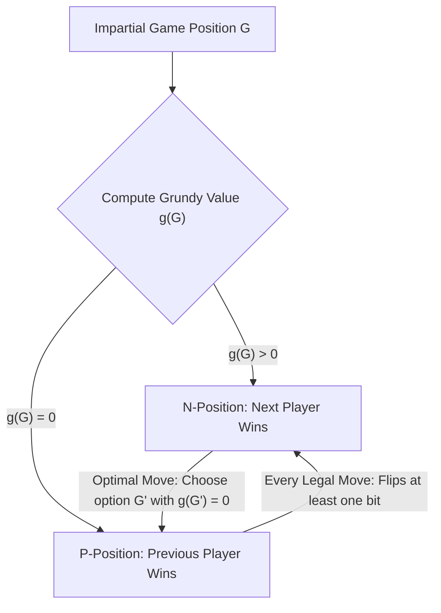
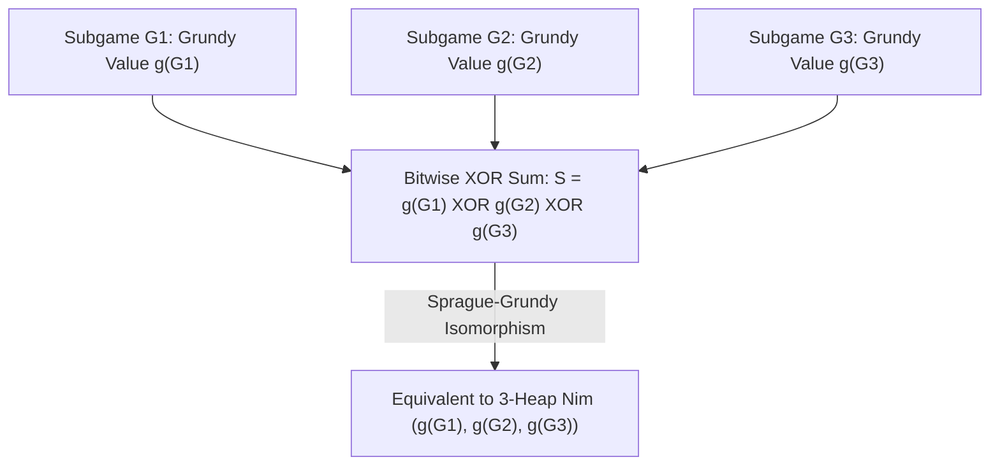

## 서론: 단순한 규칙 뒤에 숨겨진 절대적 필연성 — 공평 조합 게임과 체르멜로 정리

테이블 위에 각각 $3$개, $4$개, $5$개의 돌이 쌓인 세 무더기가 놓여 있습니다. 두 명의 플레이어가 번갈아 가며 임의의 한 무더기를 골라 최소 $1$개 이상의 돌을 가져갑니다(한 무더기 전체를 다 가져가도 됩니다). 마지막 돌을 가져가는 사람이 승리합니다. 이것이 바로 수백 년 동안 전해 내려오며 알랭 레네 감독의 영화 《지난해 마리앙바드에서》로 유명해진 <strong>님(Nim) 게임</strong>입니다. 겉보기에 이 게임은 심리전과 수읽기를 겨루는 두뇌 싸움처럼 보이지만, 수학자의 눈에는 게임이 시작되는 첫 순간부터 이미 승패가 $100\%$ 결정되어 있습니다. 선공 플레이어가 이진수 비트 연산 속에 숨겨진 대수적 불변량만 알고 있다면, 후공이 어떤 수를 두더라도 선공이 반드시 승리합니다.

현대 수학에서 이러한 게임은 <strong>공평 조합 게임(Impartial Combinatorial Games)</strong>이라고 불립니다. 이는 다섯 가지 핵심 공리를 만족합니다. (1) 두 플레이어가 교대로 수를 둔다. (2) <strong>완전 정보(Perfect Information)</strong>: 숨겨진 패나 보이지 않는 정보가 전혀 없다. (3) <strong>결정론적(Deterministic)</strong>: 주사위나 카드 섞기 같은 확률적 우연 요소가 없다. (4) <strong>공평성(Impartiality)</strong>: 어떤 국면에서든 두 플레이어가 선택할 수 있는 합법적인 이동의 집합이 완전히 동일하다(백과 흑이 각자 자신의 말만 움직일 수 있는 체스나 바둑 같은 편파적 게임 Partisan Games과 구별됨). (5) <strong>유한 종료 조건(Finite Termination)</strong>: 게임은 반드시 유한 번의 수 안에 종료되며 무한 루프에 빠지지 않는다. 표준 규칙인 <strong>정상 플레이 규약(Normal Play Convention)</strong>에서는 더 이상 합법적인 수를 둘 수 없는 플레이어가 패배합니다(즉 마지막 수를 둔 플레이어가 승리합니다).

방향성 비순환 그래프(DAG) 위에서의 체르멜로 정리(Zermelo's Theorem)와 역진 귀납법에 의해, 공평 조합 게임의 모든 국면은 상호 배타적인 두 집합으로 유일하게 분할됩니다. 바로 <strong>$\mathcal{P}$-국면(Previous-player winning position, 직전 플레이어 필승 / 현재 차례 플레이어 필패)</strong>과 <strong>$\mathcal{N}$-국면(Next-player winning position, 현재 차례 플레이어 필승)</strong>입니다. 그 재귀적 정의는 매우 명쾌합니다. 더 이상 움직일 수 없는 모든 종료 상태는 $\mathcal{P}$-국면이며, 적어도 하나의 $\mathcal{P}$-국면으로 이동할 수 있는 수가 존재하면 $\mathcal{N}$-국면이고, <strong>모든</strong> 합법적인 이동이 $\mathcal{N}$-국면으로만 이어진다면 그 상태는 $\mathcal{P}$-국면입니다.

---

## 1. 찰스 부턴의 해독(1901): 이진 배타적 논리합(Nim-sum)과 두 가지 불변량 보조정리

만약 돌무더기가 수십 개이고 각 무더기에 수백만 개의 돌이 있다면, 상태 그래프에서 직접 역진 귀납법을 수행하는 것은 지수적 폭발을 일으킵니다. 1901년 하버드 대학교의 수학자 <strong>찰스 레너드 부턴(Charles Leonard Bouton)</strong>은 임의의 무더기 수와 돌 개수를 가진 님 게임을 완벽히 해결하는 역사적인 논문을 발표했습니다. 그는 님 게임의 승패를 가르는 열쇠가 각 무더기의 돌 개수를 이진수로 변환한 뒤 <strong>비트 배타적 논리합(Bitwise XOR, 일명 님 합 Nim-sum)</strong>을 계산하는 것임을 밝혀냈습니다.

현재 국면을 $(n_1, n_2, \dots, n_k)$라 할 때, 님 합을 $S = n_1 \oplus n_2 \oplus \dots \oplus n_k$로 정의합니다. 비트 XOR 연산 $\oplus$는 본질적으로 유한체 $\mathbb{F}_2 = 	ext{GF}(2)$ 위에서 자리올림(carry)이 없는 이진 덧셈입니다(교환법칙과 결합법칙이 성립하며 모든 수에 대해 $x \oplus x = 0$). 부턴의 정리는 다음과 같이 선언합니다. <strong>님 국면 $(n_1, \dots, n_k)$가 필패 국면($\mathcal{P}$-국면)일 필요충분조건은 님 합 $S = 0$인 것이며, 필승 국면($\mathcal{N}$-국면)일 필요충분조건은 $S 
eq 0$인 것이다.</strong>

왜 이 단순한 XOR 공식이 $\mathcal{P}$-국면과 $\mathcal{N}$-국면을 완벽하게 특징지을까요? 증명은 두 가지 우아한 대수적 보조정리로 완성됩니다.
첫째, <strong>$S = 0$인 상태에서 출발하면, 어떤 합법적인 수를 두더라도 반드시 $S' 
eq 0$이 된다.</strong> 현재 $S = n_1 \oplus \dots \oplus n_k = 0$이고 플레이어가 $i$번째 무더기의 돌을 $n_i$에서 $n_i' < n_i$로 줄였다고 가정합시다. $n_i' 
eq n_i$이므로 이진수 표현에서 적어도 한 비트가 다르며, 따라서 $n_i \oplus n_i' 
eq 0$입니다. 새로운 국면의 님 합은 $S' = S \oplus n_i \oplus n_i' = 0 \oplus (n_i \oplus n_i') 
eq 0$이 됩니다. 즉 $S=0$에 처한 플레이어는 어떤 수를 두더라도 상대방에게 $S' 
eq 0$이라는 필승권을 넘겨줄 수밖에 없습니다.
둘째, <strong>$S 
eq 0$인 상태에서 출발하면, $S' = 0$을 만드는 합법적인 수가 반드시 적어도 하나 존재한다.</strong> $0$이 아닌 수 $S$의 이진수 표현에서 <strong>가장 높은 자리의 $1$ 비트(Most Significant Bit, MSB)</strong>를 관찰하여 그 위치를 $d$번째 비트라고 합시다. $S$의 $d$번째 비트가 $1$이라는 것은, XOR 연산에 참여한 $n_1, \dots, n_k$ 중 $d$번째 비트가 $1$인 무더기가 홀수 개(즉 최소 하나 이상) 존재한다는 뜻입니다. 그러한 무더기 $n_i$를 하나 골라 목표 개수를 $n_i' = n_i \oplus S$로 설정합니다. $n_i$와 $S$ 모두 최상위 비트 $d$에서 $1$을 가지므로, XOR 연산 후 $n_i'$의 $d$번째 비트는 $0$으로 바뀌고 $d$보다 높은 자리의 비트들은 전혀 변하지 않습니다. 따라서 엄밀하게 $n_i' < n_i$가 성립합니다! 이는 완전히 합법적인 돌 제거 연산($n_i - (n_i \oplus S)$개의 돌을 가져감)이며, 이동 후의 새로운 님 합은 $S' = S \oplus n_i \oplus n_i' = S \oplus n_i \oplus (n_i \oplus S) = 0$이 됩니다. 서론의 $(3, 4, 5)$ 예시를 보면 $S = 3 \oplus 4 \oplus 5 = 2 = (010)_2 
eq 0$이고 최상위 $1$ 비트는 두 번째 자리(가중치 $2$)에 있습니다. 첫 번째 무더기 $n_1 = 3 = (011)_2$이 해당 비트가 $1$이므로 $n_1' = 3 \oplus 2 = 1$로 만듭니다. 즉 첫 무더기에서 돌 $2$개를 가져가 $(1, 4, 5)$를 만들면 $1 \oplus 4 \oplus 5 = 0$이 되어 선공이 완벽한 승리를 거둡니다!

$$
S = n_1 \oplus n_2 \oplus \dots \oplus n_k = \bigoplus_{i=1}^k n_i
$$

$$
\begin{aligned}
n_1 = 3 &= (011)_2 \\
n_2 = 4 &= (100)_2 \\
n_3 = 5 &= (101)_2 \\
\hline
S = 3 \oplus 4 \oplus 5 &= (010)_2 = 2 \neq 0 \quad (\mathcal{N}\text{-position})
\end{aligned}
$$

$$
n_1' = n_1 \oplus S = 3 \oplus 2 = (011)_2 \oplus (010)_2 = (001)_2 = 1 < 3 \implies (1, 4, 5) \text{ has } 1 \oplus 4 \oplus 5 = 0 \quad (\mathcal{P}\text{-position})
$$

---

## 2. 스프라그-그런디 정리(1935/1939): 모든 공평 게임은 님과 동형이다

부턴이 님 게임을 해결한 지 30여 년 후, 롤란트 슈프라그(Roland Sprague, 1935)와 패트릭 그런디(Patrick Michael Grundy, 1939)는 서로 독립적으로 이산수학계를 뒤흔든 보편 정리를 발견했습니다. <strong>단순히 님 게임뿐만 아니라, 정상 플레이 규약을 따르는 모든 유한 공평 조합 게임은 수학적 구조상 특정 크기의 단일 님 돌무더기와 완벽하게 동형(isomorphic)이다!</strong>

이 동형 사상을 구축하기 위해 우리는 <strong>최소 제외값(Minimum Excluded Value, $	ext{mex}$)</strong>과 <strong>그런디 수(Grundy Value, 일명 님 수 Nimber)</strong>를 도입합니다. 음이 아닌 정수의 유한 부분집합 $A \subset \mathbb{N}_0$에 대해 $	ext{mex}(A)$는 $A$에 속하지 않는 가장 작은 음이 아닌 정수로 정의됩니다(예: $	ext{mex}(\emptyset) = 0$, $	ext{mex}(\{0, 1, 3\}) = 2$, $	ext{mex}(\{1, 2\}) = 0$). 게임 그래프의 임의의 국면 $u$에 대해, 그런디 수 $\mathcal{G}(u)$는 한 수로 도달 가능한 모든 후속 국면 $v$들의 그런디 수 집합의 $	ext{mex}$로 재귀 정의됩니다.
$	ext{mex}$의 정의로부터 즉시 두 가지 핵심 성질이 도출됩니다. (1) $\mathcal{G}(u) = 0$일 필요충분조건은 그런디 수가 $0$인 후속 국면이 하나도 없는 것, 즉 $u$가 필패 국면($\mathcal{P}$-국면)인 것입니다. (2) 만약 $\mathcal{G}(u) = g > 0$이라면, $0 \le m < g$를 만족하는 모든 정수 $m$에 대해 $\mathcal{G}(v) = m$인 후속 국면 $v$가 반드시 적어도 하나 존재합니다! 이는 정확히 돌이 $g$개 들어 있는 단일 님 무더기의 성질(돌 $g$개에서 한 수 만에 $0, 1, \dots, g-1$개로 줄일 수 있음)과 일치합니다.

나아가 서로 독립적인 여러 공평 게임 $G_1, G_2, \dots, G_k$를 결합하여 하나의 <strong>합집합 게임(Disjunctive Sum)</strong> $G = G_1 + G_2 + \dots + G_k$(플레이어는 매 턴마다 부분 게임 중 하나를 골라 한 수를 두며, 모든 부분 게임에서 더 이상 둘 수가 없을 때 종료됨)를 만들 때, <strong>스프라그-그런디 정리(Sprague-Grundy Theorem)</strong>는 복합 국면의 그런디 수가 각 부분 게임의 그런디 수들의 비트 XOR 합과 정확히 같음을 증명합니다!
비록 어떤 부분 게임에서 더 큰 그런디 수를 가진 상태로의 이동(님 무더기에 돌을 추가하는 것에 해당)이 가능하더라도, 상대방은 언제나 그 추가분을 원래 크기로 즉시 되돌릴 수 있기 때문에 승패 구조에는 아무런 영향을 주지 못합니다. 따라서 아무리 복잡한 그래프 게임이나 보드 게임이라도 각 독립 구성요소의 $\mathcal{G}$ 값만 계산하면 즉시 표준 님 게임의 XOR 연산으로 환원됩니다!

$$
\text{mex}(A) = \min \{ m \in \mathbb{N}_0 \mid m \notin A \}, \qquad \mathcal{G}(u) = \text{mex}\big\{ \mathcal{G}(v) \;\big|\; u \to v \big\}
$$

$$
\mathcal{G}(u) = 0 \iff u \in \mathcal{P}\text{-position}, \qquad \mathcal{G}(u) > 0 \iff u \in \mathcal{N}\text{-position}
$$

---

## 3. 고전 게임 응용과 미제르 규칙(Misère Play)의 함정

스프라그-그런디 정리는 수많은 복합 게임을 해부하는 강력한 메스를 제공합니다.
- <strong>뺄셈 게임(Subtraction Games, 바스 게임 Bash Game 등)</strong>: 한 번에 $1$개부터 $m$개까지의 돌만 가져갈 수 있는 게임입니다. 직접 계산하면 $\mathcal{G}(n) = n mod (m+1)$이 되며, $n$이 $m+1$의 배수일 때만 선공이 필패합니다.
- <strong>분할 게임: 케일스 볼링(Kayles)과 도슨 체스(Dawson's Chess)</strong>: 일렬로 세워진 $n$개의 볼링핀 중 한 번에 $1$개 또는 인접한 $2$개의 핀을 쓰러뜨릴 수 있습니다. 놀라운 점은 줄의 중간에서 핀을 쓰러뜨리면 원래의 한 줄이 좌우의 <strong>서로 간섭하지 않는 두 개의 독립된 부분 줄</strong> $a$와 $b$로 분할된다는 것입니다! 스프라그-그런디 정리에 의해 분할된 국면은 두 독립 부분 게임의 합과 동치이므로, 그 그런디 수는 곧바로 $\mathcal{G}(a) \oplus \mathcal{G}(b)$로 계산됩니다. 동적 계획법(DP)을 통해 $O(n^2)$ 시간 안에 임의 길이의 케일스 게임 필승법을 구할 수 있습니다.
- <strong>미제르 플레이 규약(Misère Play Convention, 마지막 돌을 가져가는 사람이 패배)</strong>: 만약 규칙을 뒤집어 마지막 돌을 가져가는 사람이 진다고 하면 어떻게 될까요? 많은 입문자들이 단순히 $\mathcal{P}$와 $\mathcal{N}$을 반전시키면 된다고 착각하지만 이는 치명적인 오류입니다! 부턴은 <strong>미제르 님(Misère Nim)</strong>의 정확한 수정 법칙을 증명했습니다. 아직 크기가 $1$보다 큰 돌무더기가 두 개 이상 남아 있는 동안에는 정상 님과 <strong>완전히 동일하게</strong> 플레이합니다(여전히 $S = 0$을 유지). 오직 자신의 수로 인해 <strong>남은 모든 무더기의 크기가 $1$이 되는 순간</strong>에만 $S=0$ 대신 크기가 $1$인 무더기가 <strong>홀수 개</strong> 남도록(즉 모든 무더기가 $1$인 엔드게임에서 $S=1$이 되도록) 가져가는 개수를 조절하면 됩니다! 그러나 일반적인 공평 게임에서는 미제르 규칙이 스프라그-그런디 정리의 보편성을 완전히 파괴합니다. 21세기 초 테인 플램벡(Thane Plambeck)과 에런 시걸(Aaron Siegel)이 <strong>미제르 몫 모노이드(Misère Quotients)</strong> 이론을 정립하고서야 비로소 미제르 게임 대수학의 심오한 구조가 밝혀지기 시작했습니다.

| 게임 유형 / 개념 | 핵심 수학적 구조 / 판별식 | 선공 필승 조건 ($\mathcal{N}$-국면) | 시간 복잡도 / 이론적 위상 |
| :--- | :--- | :--- | :--- |
| <strong>표준 님 (Normal Play Nim)</strong> | 비트 XOR 님 합 $S = igoplus_{i=1}^k n_i$ | $S 
eq 0$ | $O(k)$ 비트 연산, 모든 공평 게임의 토대 |
| <strong>뺄셈 게임 $S=\{1,\dots,m\}$</strong> | 모듈러 주기 그런디 함수 $\mathcal{G}(n) = n mod (m+1)$ | $n 
ot\equiv 0 \pmod{m+1}$ | $O(1)$, 주기적 $	ext{mex}$ 수열 |
| <strong>케일스 게임 (Kayles, 분할 게임)</strong> | $	ext{mex}\{\mathcal{G}(a) \oplus \mathcal{G}(b)\}$ | $\mathcal{G}(n) 
eq 0$ ($n \ge 72$부터 주기 $12$) | $O(n^2)$ DP 또는 최종 주기성 활용 $O(1)$ |
| <strong>일반 정상 공평 게임의 합</strong> | 스프라그-그런디 정리 $\mathcal{G}(\sum G_i) = igoplus \mathcal{G}(G_i)$ | $igoplus_{i=1}^k \mathcal{G}(G_i) 
eq 0$ | 단일 님 무더기 및 표수 2 유한체 $\mathbb{F}_2$와 동형 |
| <strong>미제르 님 (Misère Play Nim)</strong> | 엔드게임 단계에서만 홀짝성 반전 | $n_i > 1$ 존재 시 $S 
eq 0$; 모두 $1$일 때 $S = 0$(짝수 개) | 일반 미제르 게임은 Misère Quotients 가환 모노이드 필요 |

$$
\mathcal{G}(G_1 + G_2 + \dots + G_k) = \mathcal{G}(G_1) \oplus \mathcal{G}(G_2) \oplus \dots \oplus \mathcal{G}(G_k)
$$

$$
\mathcal{G}(\text{Kayles}(n)) = \text{mex}\Big\{ \mathcal{G}(a) \oplus \mathcal{G}(b) \;\Big|\; a + b = n - 1 \text{ or } a + b = n - 2 \Big\}
$$
