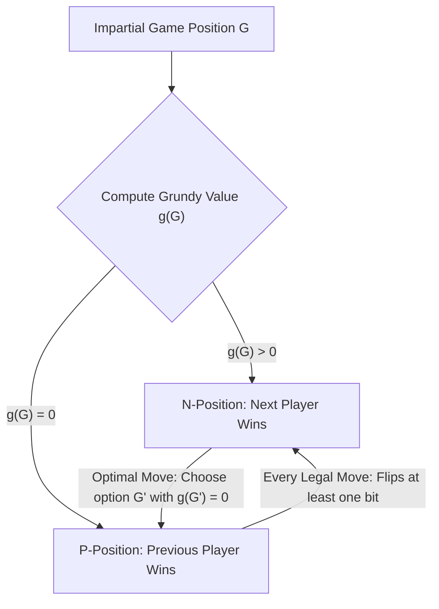
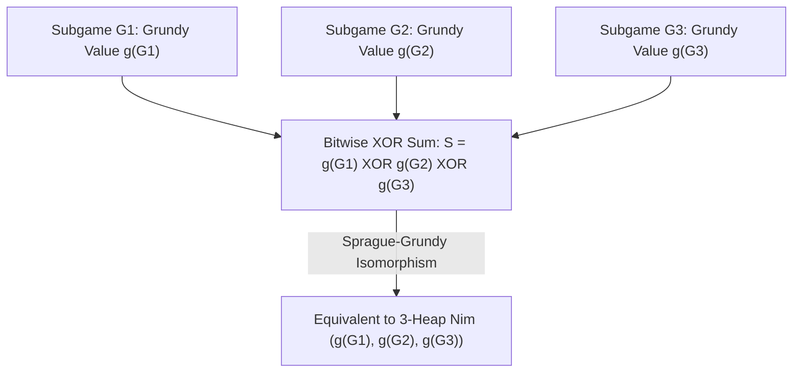

## Introdução: A Necessidade Absoluta por Trás de Regras Simples — Jogos Combinatórios Imparciais

Sobre uma mesa estão três pilhas de pedras com $3$, $4$ e $5$ pedras, respectivamente. Dois jogadores jogam alternadamente; em cada turno, um jogador escolhe qualquer pilha e retira pelo menos uma pedra (podendo retirar a pilha inteira). Quem retirar a última pedra vence a partida. Este é o clássico <strong>jogo de Nim</strong>, imortalizado no cinema por Alain Resnais em *O Ano Passado em Marienbad*. À primeira vista, parece uma disputa psicológica de cálculo mental; mas, aos olhos da matemática, o vencedor já está $100\,\%$ determinado antes mesmo do primeiro lance: se o primeiro jogador dominar o invariante algébrico oculto na representação binária, ele forçará a vitória independentemente do que o segundo jogador faça.

Na matemática moderna, essa classe de jogos é chamada de <strong>jogos combinatórios imparciais (Impartial Combinatorial Games)</strong> e obedece a cinco axiomas: (1) dois jogadores movem-se alternadamente; (2) <strong>informação perfeita</strong> (sem cartas ocultas); (3) <strong>determinismo</strong> (sem dados ou sorte); (4) <strong>imparcialidade</strong>, significando que, a partir de qualquer posição, o conjunto de movimentos legais disponíveis é exatamente o mesmo para ambos os jogadores (diferentemente de *jogos partidários* como xadrez ou go, onde cada jogador só move suas próprias peças); e (5) <strong>terminação finita</strong>, garantindo que toda partida termina em um número finito de lances sobre um grafo acíclico dirigido (DAG). Sob a regra padrão — a <strong>convenção de jogo normal (Normal Play Convention)</strong> —, perde o primeiro jogador que não puder realizar um movimento legal (ou seja, vence quem faz o último lance).

Por indução reversa (Teorema de Zermelo), todas as posições de um jogo imparcial dividem-se de forma única em duas classes disjuntas: <strong>posições $\mathcal{P}$ (Previous-player winning, perdedoras para o jogador da vez)</strong> e <strong>posições $\mathcal{N}$ (Next-player winning, vencedoras para o jogador da vez)</strong>. Sua definição recursiva é cristalina: todas as posições terminais sem movimentos são posições $\mathcal{P}$; uma posição é $\mathcal{N}$ se existe pelo menos um lance legal que leve a uma posição $\mathcal{P}$; e é uma posição $\mathcal{P}$ se <strong>todos</strong> os lances legais levam inevitavelmente a posições $\mathcal{N}$.

---

## 1. A Decifração de Charles Bouton (1901): O XOR Binário (Nim-sum) e os Dois Lemas de Invariância

Quando há muitas pilhas com milhões de pedras, a indução reversa direta no grafo de estados sofre uma explosão exponencial. Em 1901, o matemático de Harvard <strong>Charles Leonard Bouton</strong> publicou um artigo histórico resolvendo completamente o jogo de Nim. Ele descobriu que o segredo está em escrever o tamanho de cada pilha em binário e calcular sua <strong>soma OU exclusivo bit a bit (XOR, chamada soma de Nim ou Nim-sum)</strong>.

Para uma posição $(n_1, n_2, \dots, n_k)$, definimos a soma de Nim como $S = n_1 \oplus n_2 \oplus \dots \oplus n_k$. A operação $\oplus$ equivale à adição binária sem vai-um sobre o corpo finito $\mathbb{F}_2 = 	ext{GF}(2)$ (comutativa, associativa e satisfazendo $x \oplus x = 0$). O Teorema de Bouton afirma: <strong>Uma posição de Nim $(n_1, \dots, n_k)$ é perdedora (posição $\mathcal{P}$) se e somente se sua soma de Nim for $S = 0$, e é vencedora (posição $\mathcal{N}$) se e somente se $S 
eq 0$.</strong>

A prova baseia-se em dois elegantes lemas algébricos:
Primeiro: <strong>A partir de qualquer posição com $S = 0$, todo movimento legal leva necessariamente a $S' 
eq 0$.</strong> Se o jogador reduz a pilha $i$ de $n_i$ para $n_i' < n_i$, as representações binárias de $n_i$ e $n_i'$ diferem em pelo menos um bit, logo $n_i \oplus n_i' 
eq 0$. A nova soma de Nim é $S' = S \oplus n_i \oplus n_i' = 0 \oplus (n_i \oplus n_i') 
eq 0$. Assim, quem recebe $S=0$ é forçado a entregar uma posição vencedora $S' 
eq 0$ ao adversário.
Segundo: <strong>A partir de qualquer posição com $S 
eq 0$, sempre existe pelo menos um movimento legal que resulta em $S' = 0$.</strong> Observemos o <strong>bit mais significativo (Most Significant Bit, MSB)</strong> igual a $1$ na escrita binária de $S 
eq 0$, localizado na coluna $d$. Como o bit $d$ de $S$ é $1$, deve haver um número ímpar (portanto, pelo menos uma) de pilhas $n_i$ cujo bit na coluna $d$ também seja $1$. Escolhendo essa pilha $n_i$ e definindo seu novo tamanho como $n_i' = n_i \oplus S$, o bit na coluna $d$ muda de $1$ para $0$, enquanto todos os bits mais significativos permanecem inalterados. Portanto, vale estritamente $n_i' < n_i$! Retirar $n_i - (n_i \oplus S)$ pedras é um lance perfeitamente legal e produz a nova soma de Nim $S' = S \oplus n_i \oplus n_i' = S \oplus n_i \oplus (n_i \oplus S) = 0$. No exemplo inicial $(3, 4, 5)$, temos $S = 3 \oplus 4 \oplus 5 = 2 = (010)_2 
eq 0$. O bit mais significativo tem peso $2$, presente em $n_1 = 3 = (011)_2$. O primeiro jogador reduz a primeira pilha para $n_1' = 3 \oplus 2 = 1$, deixando $(1, 4, 5)$ com $1 \oplus 4 \oplus 5 = 0$ e garantindo a vitória!

$$
S = n_1 \oplus n_2 \oplus \dots \oplus n_k = \bigoplus_{i=1}^k n_i
$$

$$
\begin{aligned}
n_1 = 3 &= (011)_2 \\
n_2 = 4 &= (100)_2 \\
n_3 = 5 &= (101)_2 \\
\hline
S = 3 \oplus 4 \oplus 5 &= (010)_2 = 2 \neq 0 \quad (\mathcal{N}\text{-position})
\end{aligned}
$$

$$
n_1' = n_1 \oplus S = 3 \oplus 2 = (011)_2 \oplus (010)_2 = (001)_2 = 1 < 3 \implies (1, 4, 5) \text{ has } 1 \oplus 4 \oplus 5 = 0 \quad (\mathcal{P}\text{-position})
$$

---

## 2. O Teorema de Sprague-Grundy (1935/1939): Todo Jogo Imparcial é Isomorfo ao Nim

Mais de trinta anos após Bouton, Roland Sprague (1935) e Patrick Michael Grundy (1939) descobriram independentemente um teorema universal extraordinário: <strong>não apenas o Nim, mas absolutamente qualquer jogo combinatório imparcial finito sob convenção normal é matematicamente isomorfo a uma única pilha de Nim de determinado tamanho!</strong>

Para construir esse isomorfismo, introduzimos o <strong>valor mínimo excluído (Minimum Excluded Value, $	ext{mex}$)</strong> e o <strong>número de Grundy (Grundy Value ou Nimber)</strong>. Para qualquer subconjunto finito de inteiros não negativos $A \subset \mathbb{N}_0$, $	ext{mex}(A)$ é o menor inteiro não negativo que não pertence a $A$ (por exemplo, $	ext{mex}(\emptyset) = 0$, $	ext{mex}(\{0, 1, 3\}) = 2$). Para qualquer posição $u$ do grafo do jogo, seu número de Grundy $\mathcal{G}(u)$ é definido recursivamente como o $	ext{mex}$ dos números de Grundy de todas as posições sucessoras $v$ alcançáveis em um lance.
Duas propriedades fundamentais decorrem imediatamente: (1) $\mathcal{G}(u) = 0$ se e somente se nenhum sucessor tiver valor $0$, isto é, $u$ é uma posição $\mathcal{P}$; (2) se $\mathcal{G}(u) = g > 0$, então para todo inteiro $m$ com $0 \le m < g$ existe pelo menos um sucessor $v$ tal que $\mathcal{G}(v) = m$. Isso reproduz exatamente o comportamento de uma pilha de Nim com $g$ pedras!

Além disso, quando combinamos vários jogos imparciais independentes $G_1, G_2, \dots, G_k$ em uma <strong>soma disjuntiva</strong> $G = G_1 + G_2 + \dots + G_k$ (em cada turno o jogador escolhe um dos subjogos e faz nele um movimento legal até que todos terminem), o <strong>Teorema de Sprague-Grundy</strong> prova que o número de Grundy do jogo composto é exatamente a soma XOR bit a bit dos números de Grundy de cada subjogo: $\mathcal{G}(G_1 + \dots + G_k) = \mathcal{G}(G_1) \oplus \dots \oplus \mathcal{G}(G_k)$. Mesmo que um subjogo permita transitar para um estado com número de Grundy *maior* (equivalente a adicionar pedras a uma pilha), o oponente sempre pode neutralizar esse acréscimo retornando-o imediatamente ao valor anterior. Assim, qualquer jogo complexo de grafos ou divisão reduz-se ao cálculo de valores $	ext{mex}$ e aplicação de XOR.

$$
\text{mex}(A) = \min \{ m \in \mathbb{N}_0 \mid m \notin A \}, \qquad \mathcal{G}(u) = \text{mex}\big\{ \mathcal{G}(v) \;\big|\; u \to v \big\}
$$

$$
\mathcal{G}(u) = 0 \iff u \in \mathcal{P}\text{-position}, \qquad \mathcal{G}(u) > 0 \iff u \in \mathcal{N}\text{-position}
$$

---

## 3. Aplicações Clássicas e a Armadilha da Convenção Misère

O Teorema de Sprague-Grundy fornece um bisturi poderoso para dissecar inúmeros jogos:
- <strong>Jogos de subtração (Subtraction Games, jogo de Bachet)</strong>: Só é permitido retirar de $1$ a $m$ pedras por turno. Obtém-se periodicamente $\mathcal{G}(n) = n mod (m+1)$, sendo perdedora toda posição múltipla de $m+1$.
- <strong>Jogos de divisão: Kayles e o Xadrez de Dawson</strong>: No jogo de boliche *Kayles*, há $n$ pinos em fila e cada arremesso derruba $1$ pino ou $2$ pinos adjacentes. O aspecto fascinante é que derrubar pinos no meio da fila divide a fila original em <strong>duas subfilas independentes</strong> de tamanhos $a$ e $b$! Pelo Teorema de Sprague-Grundy, a posição resultante equivale à soma disjuntiva das duas subfilas, e seu valor de Grundy é dado diretamente por $\mathcal{G}(a) \oplus \mathcal{G}(b)$. Via programação dinâmica em $O(n^2)$, calcula-se toda a sequência (que se torna estritamente periódica de período $12$ a partir de $n \ge 72$).
- <strong>Convenção Misère (Misère Play — quem retira a última pedra perde)</strong>: O que acontece se invertermos a regra para que perca quem retirar a última pedra? Muitos iniciantes acreditam erroneamente que basta inverter $\mathcal{P}$ e $\mathcal{N}$. Bouton provou a regra exata do <strong>Nim Misère</strong>: enquanto restarem pelo menos duas pilhas de tamanho maior que $1$, joga-se <strong>exatamente como no Nim normal</strong> (mantendo $S = 0$). Apenas no exato movimento que deixaria pela primeira vez <strong>todas as pilhas restantes com tamanho $1$</strong> é que se altera a jogada para deixar um <strong>número ímpar de pilhas de tamanho $1$</strong> (isto é, $S = 1$)! Contudo, para jogos imparciais gerais sob a regra Misère, o Teorema de Sprague-Grundy entra em colapso total; somente no século XXI Thane Plambeck e Aaron Siegel desenvolveram a teoria dos <strong>quocientes Misère (Misère Quotients)</strong> baseada em monoides comutativos para analisar algebricamente esses jogos.

| Tipo de Jogo / Conceito | Estrutura Matemática / Invariante | Condição Vencedora (Posição $\mathcal{N}$) | Complexidade e Status Teórico |
| :--- | :--- | :--- | :--- |
| <strong>Nim Padrão (Normal Play)</strong> | Soma XOR bit a bit $S = igoplus_{i=1}^k n_i$ | $S 
eq 0$ | $O(k)$ operações de bits; base de todo jogo imparcial |
| <strong>Jogo de Subtração $S=\{1,\dots,m\}$</strong> | Função de Grundy modular $\mathcal{G}(n) = n mod (m+1)$ | $n 
ot\equiv 0 \pmod{m+1}$ | $O(1)$; sequência $	ext{mex}$ periódica |
| <strong>Jogo de Kayles (divisão)</strong> | $	ext{mex}\{\mathcal{G}(a) \oplus \mathcal{G}(b)\}$ | $\mathcal{G}(n) 
eq 0$ (período $12$ a partir de $n \ge 72$) | $O(n^2)$ por DP ou $O(1)$ por periodicidade |
| <strong>Soma Disjuntiva de Jogos Imparciais</strong> | Teorema de Sprague-Grundy $\mathcal{G}(\sum G_i) = igoplus \mathcal{G}(G_i)$ | $igoplus_{i=1}^k \mathcal{G}(G_i) 
eq 0$ | Isomorfo ao Nim e a espaços sobre $\mathbb{F}_2$ |
| <strong>Nim Misère (último lance perde)</strong> | Inversão de paridade apenas no final de pilhas de tamanho $1$ | $S 
eq 0$ se $\exists n_i > 1$; $S = 0$ se todos $n_i = 1$ | Jogos Misère gerais exigem Quocientes Misère |

$$
\mathcal{G}(G_1 + G_2 + \dots + G_k) = \mathcal{G}(G_1) \oplus \mathcal{G}(G_2) \oplus \dots \oplus \mathcal{G}(G_k)
$$

$$
\mathcal{G}(\text{Kayles}(n)) = \text{mex}\Big\{ \mathcal{G}(a) \oplus \mathcal{G}(b) \;\Big|\; a + b = n - 1 \text{ or } a + b = n - 2 \Big\}
$$
