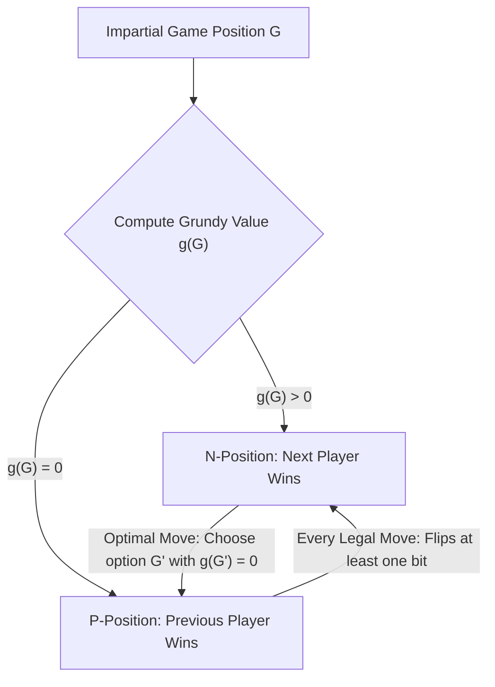
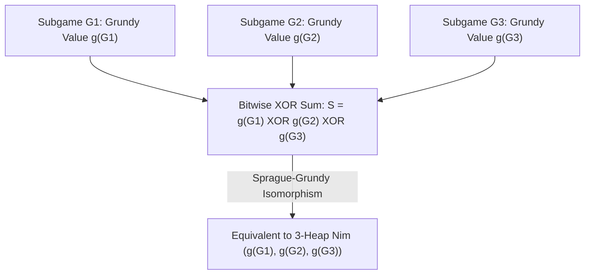

## Введение: Абсолютная предопределенность за простыми правилами — Беспристрастные комбинаторные игры

На столе лежат три кучки камней: в первой — $3$ камня, во второй — $4$, в третьей — $5$. Два игрока ходят по очереди; за один ход разрешается выбрать любую одну кучку и взять из неё хотя бы один камень (можно забрать и всю кучку целиком). Побеждает тот, кто заберёт последний камень. Это знаменитая игра <strong>Ним (Nim)</strong>, прославленная в кинематографе фильмом Алена Рене «В прошлом году в Мариенбаде». На первый взгляд кажется, что это психологическая дуэль и состязание в расчёте вариантов, но с точки зрения математики исход партии предрешён на $100\,\%$ ещё до первого хода: если первый игрок знает алгебраический инвариант, скрытый в двоичной записи чисел, он гарантированно выиграет при любых ответных действиях соперника.

В современной математике такой класс игр называется <strong>беспристрастными комбинаторными играми (Impartial Combinatorial Games)</strong> и удовлетворяет пяти аксиомам: (1) два игрока делают ходы поочерёдно; (2) <strong>полная информация (Perfect Information)</strong> без скрытых карт; (3) <strong>детерминированность</strong> без кубиков и случайности; (4) <strong>беспристрастность (Impartiality)</strong>, означающая, что в любой позиции множество допустимых ходов абсолютно одинаково для обоих игроков (в отличие от *пристрастных игр* вроде шахмат или го, где каждый двигает только фигуры своего цвета); и (5) <strong>конечность партии</strong>, гарантирующая завершение за конечное число шагов на направленном ациклическом графе (DAG). При стандартном правиле — <strong>нормальном соглашении об игре (Normal Play Convention)</strong> — проигрывает тот, кто не может сделать очередной ход (то есть выигрывает игрок, сделавший последний ход).

По обратной индукции (теорема Цермело) все позиции беспристрастной игры единственным образом разбиваются на два непересекающихся класса: <strong>$\mathcal{P}$-позиции (Previous-player winning — выигрышные для только что сходившего игрока, то есть проигрышные для того, чья очередь ходить)</strong> и <strong>$\mathcal{N}$-позиции (Next-player winning — выигрышные для игрока, чья очередь ходить)</strong>. Их рекурсивное определение безупречно: все терминальные позиции без ходов являются $\mathcal{P}$-позициями; позиция является $\mathcal{N}$-позицией, если из неё существует хотя бы один допустимый ход в некоторую $\mathcal{P}$-позицию; и позиция является $\mathcal{P}$-позицией, если <strong>все</strong> допустимые ходы из неё ведут исключительно в $\mathcal{N}$-позиции.

---

## 1. Открытие Чарльза Бутона (1901): Побитовый XOR (Ним-сумма) и две леммы об инварианте

Когда кучек много, а камней в них миллионы, прямой обход графа состояний с обратной индукцией приводит к экспоненциальному взрыву. В 1901 году математик Гарвардского университета <strong>Чарльз Леонард Бутон (Charles Leonard Bouton)</strong> опубликовал фундаментальную статью, полностью решившую игру Ним для любого числа кучек. Он обнаружил, что ключ к победе — записать размеры всех кучек в двоичной системе счисления и вычислить их <strong>побитовое исключающее ИЛИ (XOR, называемое ним-суммой или Nim-sum)</strong>.

Для позиции $(n_1, n_2, \dots, n_k)$ ним-сумма определяется как $S = n_1 \oplus n_2 \oplus \dots \oplus n_k$. Операция $\oplus$ представляет собой поразрядное двоичное сложение без переноса над конечным полем $\mathbb{F}_2 = 	ext{GF}(2)$ (коммутативное, ассоциативное и удовлетворяющее тождеству $x \oplus x = 0$). Теорема Бутона гласит: <strong>Позиция Ним $(n_1, \dots, n_k)$ является проигрышной ($\mathcal{P}$-позицией) тогда и только тогда, когда её ним-сумма равна $S = 0$, и выигрышной ($\mathcal{N}$-позицией) тогда и только тогда, когда $S 
eq 0$.</strong>

Доказательство опирается на две изящные алгебраические леммы:
Во-первых, <strong>из позиции с $S = 0$ любой допустимый ход неизбежно ведёт к $S' 
eq 0$</strong>. Если игрок уменьшает $i$-ю кучку с $n_i$ до $n_i' < n_i$, двоичные записи $n_i$ и $n_i'$ различаются хотя бы в одном разряде, поэтому $n_i \oplus n_i' 
eq 0$. Новая ним-сумма равна $S' = S \oplus n_i \oplus n_i' = 0 \oplus (n_i \oplus n_i') 
eq 0$. Следовательно, игрок в состоянии $S=0$ при любом ходе вынужден передать сопернику выигрышную позицию $S' 
eq 0$.
Во-вторых, <strong>из любой позиции с $S 
eq 0$ всегда существует хотя бы один допустимый ход, дающий $S' = 0$</strong>. Рассмотрим <strong>старший единичный бит (Most Significant Bit, MSB)</strong> числа $S 
eq 0$, находящийся в разряде $d$. Поскольку $d$-й бит числа $S$ равен $1$, среди чисел $n_1, \dots, n_k$ обязательно найдётся нечётное количество (а значит, хотя бы одна) кучек $n_i$, у которых в разряде $d$ также стоит $1$. Выберем такую кучку $n_i$ и положим новое число камней в ней равным $n_i' = n_i \oplus S$. Так как и у $n_i$, и у $S$ в разряде $d$ стоит $1$, после операции XOR этот бит в $n_i'$ превратится в $0$, а все более старшие биты останутся неизменными. Значит, строго выполняется неравенство $n_i' < n_i$! Взятие $n_i - (n_i \oplus S)$ камней является полностью корректным ходом, а новая ним-сумма становится равной $S' = S \oplus n_i \oplus n_i' = S \oplus n_i \oplus (n_i \oplus S) = 0$. В начальном примере $(3, 4, 5)$ имеем $S = 3 \oplus 4 \oplus 5 = 2 = (010)_2 
eq 0$. Старший единичный бит имеет вес $2$ и присутствует в $n_1 = 3 = (011)_2$. Первый игрок уменьшает первую кучку до $n_1' = 3 \oplus 2 = 1$, оставляя позицию $(1, 4, 5)$ с ним-суммой $1 \oplus 4 \oplus 5 = 0$ и обеспечивая себе победу!

$$
S = n_1 \oplus n_2 \oplus \dots \oplus n_k = \bigoplus_{i=1}^k n_i
$$

$$
\begin{aligned}
n_1 = 3 &= (011)_2 \\
n_2 = 4 &= (100)_2 \\
n_3 = 5 &= (101)_2 \\
\hline
S = 3 \oplus 4 \oplus 5 &= (010)_2 = 2 \neq 0 \quad (\mathcal{N}\text{-position})
\end{aligned}
$$

$$
n_1' = n_1 \oplus S = 3 \oplus 2 = (011)_2 \oplus (010)_2 = (001)_2 = 1 < 3 \implies (1, 4, 5) \text{ has } 1 \oplus 4 \oplus 5 = 0 \quad (\mathcal{P}\text{-position})
$$

---

## 2. Теорема Шпрага — Гранди (1935/1939): Любая беспристрастная игра изоморфна Ниму

Спустя три с лишним десятилетия после работы Бутона Роланд Шпраг (Roland Sprague, 1935) и Патрик Майкл Гранди (Patrick Michael Grundy, 1939) независимо друг от друга открыли поразительную универсальную теорему: <strong>не только сам Ним, но и абсолютно любая конечная беспристрастная комбинаторная игра при нормальном соглашении математически изоморфна одной-единственной кучке Ним некоторого размера!</strong>

Для построения этого изоморфизма вводятся <strong>минимальное исключённое значение (Minimum Excluded Value, $	ext{mex}$)</strong> и <strong>число Гранди (Grundy Value, или нимбер Nimber)</strong>. Для любого конечного подмножества неотрицательных целых чисел $A \subset \mathbb{N}_0$ величина $	ext{mex}(A)$ определяется как наименьшее неотрицательное целое число, не принадлежащее $A$ (например, $	ext{mex}(\emptyset) = 0$, $	ext{mex}(\{0, 1, 3\}) = 2$). Для произвольной вершины $u$ игрового графа её число Гранди $\mathcal{G}(u)$ рекурсивно определяется как $	ext{mex}$ от множества чисел Гранди всех позиций $v$, достижимых из $u$ за один ход.
Отсюда мгновенно следуют два ключевых свойства: (1) $\mathcal{G}(u) = 0$ тогда и только тогда, когда ни один из последователей не имеет значения $0$, то есть $u$ — проигрышная $\mathcal{P}$-позиция; (2) если $\mathcal{G}(u) = g > 0$, то для любого целого $m$ из диапазона $0 \le m < g$ существует хотя бы один ход в позицию $v$ с $\mathcal{G}(v) = m$. Это в точности повторяет поведение одной кучки Ним из $g$ камней!

Более того, когда мы объединяем несколько независимых беспристрастных игр $G_1, G_2, \dots, G_k$ в <strong>дизъюнктивную сумму</strong> $G = G_1 + G_2 + \dots + G_k$ (на каждом ходу игрок выбирает ровно одну из под-игр и делает в ней ход, пока все под-игры не завершатся), <strong>теорема Шпрага — Гранди</strong> доказывает, что число Гранди составной игры в точности равно побитовой XOR-сумме чисел Гранди отдельных компонент: $\mathcal{G}(G_1 + \dots + G_k) = \mathcal{G}(G_1) \oplus \dots \oplus \mathcal{G}(G_k)$. Даже если в какой-то под-игре возможен ход, *увеличивающий* число Гранди (аналог добавления камней в кучку), соперник всегда может нейтрализовать это добавление ответным ходом, вернув прежнее значение. Таким образом, любая сложнейшая игра на графах сводится к вычислению функции $	ext{mex}$ и операции XOR!

$$
\text{mex}(A) = \min \{ m \in \mathbb{N}_0 \mid m \notin A \}, \qquad \mathcal{G}(u) = \text{mex}\big\{ \mathcal{G}(v) \;\big|\; u \to v \big\}
$$

$$
\mathcal{G}(u) = 0 \iff u \in \mathcal{P}\text{-position}, \qquad \mathcal{G}(u) > 0 \iff u \in \mathcal{N}\text{-position}
$$

---

## 3. Классические приложения и ловушка игры в поддавки (Misère Play)

Теорема Шпрага — Гранди даёт мощный инструмент для анализа множества игр:
- <strong>Вычитательные игры (Subtraction Games, игра Баше)</strong>: за один ход можно брать от $1$ до $m$ камней. Здесь периодически выполняется $\mathcal{G}(n) = n mod (m+1)$, и позиция проигрышна тогда и только тогда, когда $n$ делится на $m+1$.
- <strong>Игры с разделением: Кейлс (Kayles) и шахматы Доусона</strong>: в игре в кегли *Kayles* в ряд стоят $n$ кеглей, и за один бросок можно сбить либо $1$ кеглю, либо $2$ стоящие вплотную кегли. Самое интересное происходит, когда кегли выбивают из середины ряда: исходный ряд распадается на <strong>два независимых под-ряда</strong> длины $a$ и $b$! По теореме Шпрага — Гранди получившаяся позиция эквивалентна дизъюнктивной сумме двух под-рядов, и её функция Гранди равна $\mathcal{G}(a) \oplus \mathcal{G}(b)$. С помощью динамического программирования за время $O(n^2)$ вычисляется вся последовательность (которая начиная с $n \ge 72$ становится строго периодической с периодом $12$).
- <strong>Поддавки / Миere-игры (Misère Play — взявший последний камень проигрывает)</strong>: что изменится, если последний ход приносит поражение? Многие новички ошибочно полагают, что достаточно просто поменять местами $\mathcal{P}$ и $\mathcal{N}$. Бутон доказал точное правило для <strong>Ним в поддавки (Misère Nim)</strong>: пока на столе остаётся хотя бы две кучки размера больше $1$, нужно играть <strong>точно так же, как в обычный Ним</strong> (поддерживая $S = 0$). И только в тот единственный момент, когда ваш ход впервые оставит на столе <strong>исключительно кучки размера $1$</strong>, следует изменить ход так, чтобы оставить <strong>нечётное число единичных кучек</strong> (то есть $S = 1$)! Однако для общих беспристрастных игр в поддавки теорема Шпрага — Гранди полностью рушится; лишь в начале XXI века Тейн Пламбек и Аарон Сигел создали теорию <strong>мизерных факторов (Misère Quotients)</strong> на базе коммутативных моноидов для алгебраической классификации таких игр.

| Тип игры / Концепция | Математическая структура / Инвариант | Условие выигрыша ($\mathcal{N}$-позиция) | Сложность и теоретический статус |
| :--- | :--- | :--- | :--- |
| <strong>Стандартный Ним (Normal Play)</strong> | Побитовая XOR ним-сумма $S = igoplus_{i=1}^k n_i$ | $S 
eq 0$ | $O(k)$ битовых операций; фундамент всех беспристрастных игр |
| <strong>Вычитательная игра $S=\{1,\dots,m\}$</strong> | Модулярная функция Гранди $\mathcal{G}(n) = n mod (m+1)$ | $n 
ot\equiv 0 \pmod{m+1}$ | $O(1)$; периодическая последовательность $	ext{mex}$ |
| <strong>Игра Кейлс (разделение ряда)</strong> | $	ext{mex}\{\mathcal{G}(a) \oplus \mathcal{G}(b)\}$ | $\mathcal{G}(n) 
eq 0$ (период $12$ при $n \ge 72$) | $O(n^2)$ ДП или $O(1)$ за счёт периодичности |
| <strong>Дизъюнктивная сумма игр</strong> | Теорема Шпрага — Гранди $\mathcal{G}(\sum G_i) = igoplus \mathcal{G}(G_i)$ | $igoplus_{i=1}^k \mathcal{G}(G_i) 
eq 0$ | Изоморфна Ниму и векторным пространствам над $\mathbb{F}_2$ |
| <strong>Ним в поддавки (Misère Nim)</strong> | Инверсия чётности только в эндшпиле из единиц | $S 
eq 0$ если $\exists n_i > 1$; $S = 0$ если все $n_i = 1$ | Общие поддавки требуют аппарата Misère Quotients |

$$
\mathcal{G}(G_1 + G_2 + \dots + G_k) = \mathcal{G}(G_1) \oplus \mathcal{G}(G_2) \oplus \dots \oplus \mathcal{G}(G_k)
$$

$$
\mathcal{G}(\text{Kayles}(n)) = \text{mex}\Big\{ \mathcal{G}(a) \oplus \mathcal{G}(b) \;\Big|\; a + b = n - 1 \text{ or } a + b = n - 2 \Big\}
$$
