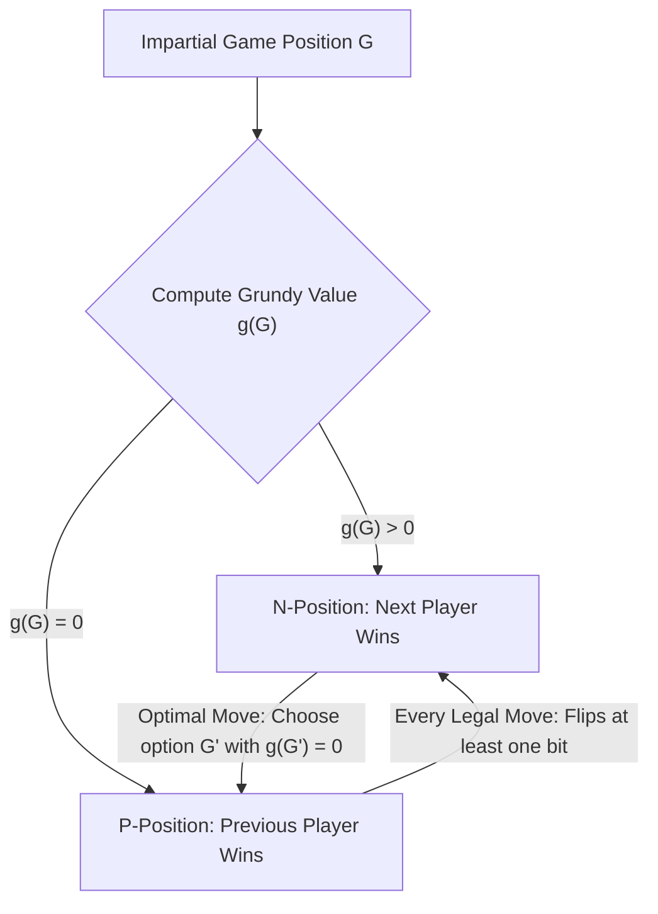
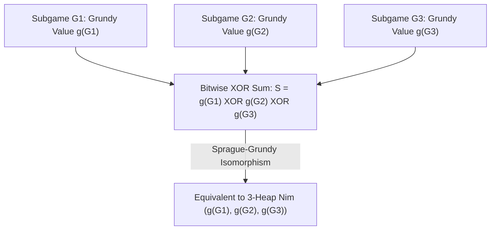

## 引言：简单规则背后的绝对必然性——公平组合博弈与策梅洛定理

桌面上放着三堆石子，数量分别为 $3$ 颗、$4$ 颗和 $5$ 颗。两名玩家轮流行动，每次可以选择任意一堆，从中拿走至少 $1$ 颗石子（也可以把整堆拿光）。拿走最后一颗石子的人获胜。这就是流传数百年、在阿伦·雷乃的电影《去年在马里昂巴德》中闻名遐迩的<strong>尼姆游戏（Nim）</strong>。表面上看，这似乎是一个考验心理博弈与算力的智力游戏；但在数学家的眼中，从游戏开始的第一秒起，胜负就已经被完全锁死：只要先手玩家掌握了隐藏在二进制位运算中的代数不变量，无论后手玩家如何挣扎，先手都能以 $100\%$ 的概率获胜。

在现代数学中，这类游戏被称为<strong>公平组合博弈（Impartial Combinatorial Games）</strong>。它满足五个核心公理：(1) 两名玩家轮流行动；(2) <strong>完全信息（Perfect Information）</strong>，不存在隐藏手牌或视野盲区；(3) <strong>确定性（Deterministic）</strong>，没有任何掷骰子或洗牌等随机因素；(4) <strong>公平性（Impartiality）</strong>，在任意给定局面下，两名玩家所允许的合法移动集合完全相同（这与国际象棋或围棋等偏党博弈 Partisan Games 不同，在象棋中白方只能走白子、黑方只能走黑子）；(5) <strong>有限终止条件（Finite Termination）</strong>，游戏必然在有限步内结束，不会陷入无限循环。在标准规则——即<strong>正规博弈约定（Normal Play Convention）</strong>——下，无法进行合法移动的玩家判负（等价于走出最后一步的玩家获胜）。

根据策梅洛定理（Zermelo's Theorem）在有向无环图（DAG）上的逆向归纳法，公平组合博弈中的所有局面都可以被唯一且不相交地划分为两类：<strong>$\mathcal{P}$-局面（Previous-player winning position，前手必胜态／当前玩家必败态）</strong>与<strong>$\mathcal{N}$-局面（Next-player winning position，后继行动者必胜态／当前玩家必胜态）</strong>。它们的递归定义极其优美：所有终局状态（无路可走的状态）都是 $\mathcal{P}$-局面；如果一个局面至少存在一步合法移动能够到达某个 $\mathcal{P}$-局面，则它是 $\mathcal{N}$-局面；如果一个局面的<strong>所有</strong>合法移动都只能到达 $\mathcal{N}$-局面，则它是 $\mathcal{P}$-局面。

---

## 1. 查尔斯·布顿的破译（1901）：二进制异或（Nim-sum）与两大守恒引理

如果堆数很多、每堆石子有上百万颗，在状态图上直接做逆向归纳会产生指数级爆炸。1901年，哈佛大学数学家<strong>查尔斯·伦纳德·布顿（Charles Leonard Bouton）</strong>发表了里程碑式的论文，彻底解决了任意堆数、任意石子数的尼姆游戏。他发现，决定尼姆游戏生死的钥匙，是将每一堆石子的数量写成二进制，并计算它们的<strong>按位异或和（Bitwise XOR，又称尼姆和 Nim-sum）</strong>。

设当前局面为 $(n_1, n_2, \dots, n_k)$，定义尼姆和 $S = n_1 \oplus n_2 \oplus \dots \oplus n_k$。按位异或 $\oplus$ 实质上是在二元有限域 $\mathbb{F}_2 = 	ext{GF}(2)$ 上不进位的二进制加法（满足交换律、结合律，且任何数与自身异或为零：$x \oplus x = 0$）。布顿定理断言：<strong>一个尼姆局面 $(n_1, \dots, n_k)$ 是必败态（$\mathcal{P}$-局面），当且仅当其尼姆和 $S = 0$；它是必胜态（$\mathcal{N}$-局面），当且仅当 $S 
eq 0$。</strong>

为什么这个简单的异或公式能够完美刻画 $\mathcal{P}$-局面与 $\mathcal{N}$-局面？证明仅需两条优雅的代数引理：
第一，<strong>从 $S = 0$ 出发，任何合法移动必然导致 $S' 
eq 0$</strong>。假设当前 $S = n_1 \oplus \dots \oplus n_k = 0$，玩家将第 $i$ 堆石子从 $n_i$ 减少到 $n_i' < n_i$。由于 $n_i' 
eq n_i$，它们在二进制表示下至少有一位不同，因此 $n_i \oplus n_i' 
eq 0$。新局面的尼姆和为 $S' = S \oplus n_i \oplus n_i' = 0 \oplus (n_i \oplus n_i') 
eq 0$。这意味着处于 $S=0$ 的玩家无论怎么走，都会被迫将 $S' 
eq 0$ 的必胜权交还给对手。
第二，<strong>从 $S 
eq 0$ 出发，必然存在至少一步合法移动使得 $S' = 0$</strong>。观察非零数 $S$ 的二进制表示中<strong>最高位的 $1$（Most Significant Bit, MSB）</strong>，设其位于第 $d$ 位。因为 $S$ 的第 $d$ 位是 $1$，在参与异或的 $n_1, \dots, n_k$ 中，必定有奇数个（从而至少有一个）堆 $n_i$ 在第 $d$ 位上也是 $1$。选中这个 $n_i$，令目标数量为 $n_i' = n_i \oplus S$。由于 $n_i$ 与 $S$ 在最高非零位 $d$ 上同为 $1$，异或后 $n_i'$ 的第 $d$ 位变成了 $0$，而高于 $d$ 的位保持不变，因此严格满足 $n_i' < n_i$！这是一个完全合法的拿取操作（拿走 $n_i - (n_i \oplus S)$ 颗石子），且移动后的新尼姆和为 $S' = S \oplus n_i \oplus n_i' = S \oplus n_i \oplus (n_i \oplus S) = 0$。以开篇的 $(3, 4, 5)$ 为例：$S = 3 \oplus 4 \oplus 5 = 2 = (010)_2 
eq 0$，最高位 $1$ 在第二位（权值 $2$）。检查三堆石子，$n_1 = 3 = (011)_2$ 在该位为 $1$，于是令 $n_1' = 3 \oplus 2 = 1$，即从第一堆拿走 $2$ 颗石子，留下 $(1, 4, 5)$，此时 $1 \oplus 4 \oplus 5 = 0$，先手稳操胜券！

$$
S = n_1 \oplus n_2 \oplus \dots \oplus n_k = \bigoplus_{i=1}^k n_i
$$

$$
\begin{aligned}
n_1 = 3 &= (011)_2 \\
n_2 = 4 &= (100)_2 \\
n_3 = 5 &= (101)_2 \\
\hline
S = 3 \oplus 4 \oplus 5 &= (010)_2 = 2 \neq 0 \quad (\mathcal{N}\text{-position})
\end{aligned}
$$

$$
n_1' = n_1 \oplus S = 3 \oplus 2 = (011)_2 \oplus (010)_2 = (001)_2 = 1 < 3 \implies (1, 4, 5) \text{ has } 1 \oplus 4 \oplus 5 = 0 \quad (\mathcal{P}\text{-position})
$$

---

## 2. 斯普拉格-格兰迪定理（1935/1939）：万物皆尼姆（Everything is Nim）

布顿解决尼姆游戏三十多年后，罗兰·斯普拉格（Roland Sprague, 1935）与帕特里克·格兰迪（Patrick Michael Grundy, 1939）各自独立地发现了一个震撼整个离散数学界的普适定理：<strong>不仅是尼姆游戏，宇宙中任何一个满足正规博弈约定的有限公平组合博弈，在数学结构上都完全同构于一堆特定大小的尼姆石子！</strong>

为了建立这一同构，我们需要引入<strong>最小排除值（Minimum Excluded Value, $	ext{mex}$）</strong>与<strong>格兰迪数（Grundy Value，又称尼姆数 Nimber）</strong>。对于非负整数的有限子集 $A \subset \mathbb{N}_0$，$	ext{mex}(A)$ 定义为不属于 $A$ 的最小非负整数（例如 $	ext{mex}(\emptyset) = 0$，$	ext{mex}(\{0, 1, 3\}) = 2$，$	ext{mex}(\{1, 2\}) = 0$）。对于博弈图中的任意局面 $u$，其格兰迪数 $\mathcal{G}(u)$ 递归定义为所有一步可达后继局面 $v$ 的格兰迪数集合的 $	ext{mex}$。
由 $	ext{mex}$ 的定义立即得出两条关键性质：(1) $\mathcal{G}(u) = 0$ 当且仅当没有任何后继局面的格兰迪数为 $0$，即 $u$ 是必败态（$\mathcal{P}$-局面）；(2) 若 $\mathcal{G}(u) = g > 0$，则对于任意满足 $0 \le m < g$ 的整数 $m$，都必然存在至少一个后继局面 $v$ 使得 $\mathcal{G}(v) = m$！这岂不正是含 $g$ 颗石子的单堆尼姆游戏的性质吗（从 $g$ 颗石子可以一步变成 $0, 1, \dots, g-1$ 颗石子）？

更进一步，当我们把多个相互独立的公平博弈 $G_1, G_2, \dots, G_k$ 组合成一个<strong>析取和博弈（Disjunctive Sum）</strong> $G = G_1 + G_2 + \dots + G_k$（玩家每回合任选其中一个子博弈走一步，所有子博弈都无路可走时游戏结束）时，<strong>斯普拉格-格兰迪定理（Sprague-Grundy Theorem）</strong>证明了：复合局面的格兰迪数恰好等于各个独立子博弈格兰迪数的按位异或！
这意味着，即便一个子博弈允许在减少规模的同时“增加”到某个更大的格兰迪数（相当于在尼姆堆上加石子），对手也总是可以立刻将它还原回原来的数值（相当于抵消加石子的动作）。因此，任何复杂的图博弈、分割博弈或棋盘博弈，只要算出每个独立组件的 $\mathcal{G}$ 值，就能瞬间化约为标准的尼姆异或求和！

$$
\text{mex}(A) = \min \{ m \in \mathbb{N}_0 \mid m \notin A \}, \qquad \mathcal{G}(u) = \text{mex}\big\{ \mathcal{G}(v) \;\big|\; u \to v \big\}
$$

$$
\mathcal{G}(u) = 0 \iff u \in \mathcal{P}\text{-position}, \qquad \mathcal{G}(u) > 0 \iff u \in \mathcal{N}\text{-position}
$$

---

## 3. 经典博弈应用与反常规则（Misère Play）的陷阱

斯普拉格-格兰迪定理赋予了我们解剖无数复杂游戏的手术刀：
- <strong>减法博弈（Subtraction Games, 如巴什博弈 Bash Game）</strong>：每次只能拿走 $1$ 到 $m$ 颗石子。直接计算可知 $\mathcal{G}(n) = n mod (m+1)$，当且仅当 $n$ 是 $m+1$ 的倍数时先手必败。
- <strong>分裂博弈：凯尔斯保龄球（Kayles）与道森象棋（Dawson's Chess）</strong>：一排 $n$ 个保龄球瓶，每次可以击倒 $1$ 个或相邻的 $2$ 个球瓶。奇妙之处在于，从中间击倒球瓶会将原本的一排分裂成左右<strong>两个互不干扰的子排</strong> $a$ 和 $b$！根据斯普拉格-格兰迪定理，分裂后的局面等价于两个独立子博弈的析取和，其格兰迪数直接由 $\mathcal{G}(a) \oplus \mathcal{G}(b)$ 给出。通过动态规划递推，我们可以轻松在 $O(n^2)$ 时间内算出任意长度凯尔斯博弈的必胜策略。
- <strong>反常博弈约定（Misère Play Convention，拿走最后一颗石子者输）</strong>：如果把规则倒过来，让拿走最后一颗石子的人判负，会发生什么？许多初学者误以为只需把 $\mathcal{P}$ 和 $\mathcal{N}$ 简单反转即可，这是致命的错误！布顿证明了<strong>反常尼姆（Misère Nim）</strong>的精确修正法则：只要场面上还有至少两堆石子的数量大于 $1$，你的走法与正规尼姆<strong>完全相同</strong>（依然保持 $S = 0$）；唯有当你的走法将使场面上<strong>所有剩余堆的大小都变成 $1$</strong> 时，你不能再追求 $S=0$，而必须调整拿取数量，使得场面上留下<strong>奇数个大小为 $1$ 的堆</strong>（即在全 $1$ 残局中令 $S=1$）！然而，对于一般的公平博弈，反常规则彻底摧毁了斯普拉格-格兰迪定理的普适性——不同游戏在反常规则下不再能简单缩约为单个整数，直到 21 世纪初普兰贝克（Thane Plambeck）与西格尔（Aaron Siegel）提出<strong>反常商幺半群（Misère Quotients）</strong>理论，才揭开了反常博弈代数的冰山一角。

| 博弈类型 / 概念 | 核心数学结构 / 判据 | 先手必胜条件（$\mathcal{N}$-局面） | 时间复杂度 / 理论地位 |
| :--- | :--- | :--- | :--- |
| <strong>标准尼姆（Normal Play Nim）</strong> | 按位异或尼姆和 $S = igoplus_{i=1}^k n_i$ | $S 
eq 0$ | $O(k)$ 位运算，一切公平博弈的基石 |
| <strong>减法博弈 $S=\{1,\dots,m\}$</strong> | 模周期格兰迪函数 $\mathcal{G}(n) = n mod (m+1)$ | $n 
ot\equiv 0 \pmod{m+1}$ | $O(1)$，周期性 $	ext{mex}$ 序列 |
| <strong>凯尔斯博弈（Kayles, 分裂博弈）</strong> | $	ext{mex}\{\mathcal{G}(a) \oplus \mathcal{G}(b)\}$ | $\mathcal{G}(n) 
eq 0$（$n \ge 72$ 起呈现周期 $12$） | $O(n^2)$ DP 或利用最终周期性 $O(1)$ |
| <strong>一般正规公平博弈析取和</strong> | 斯普拉格-格兰迪定理 $\mathcal{G}(\sum G_i) = igoplus \mathcal{G}(G_i)$ | $igoplus_{i=1}^k \mathcal{G}(G_i) 
eq 0$ | 完美同构于单堆尼姆与有限域 $\mathbb{F}_2$ 特征2域 |
| <strong>反常尼姆（Misère Play Nim）</strong> | 残局阶段反转奇偶性 | 若存在 $n_i > 1$ 则 $S 
eq 0$；若全为 $1$ 则 $S = 0$（偶数堆） | 一般反常博弈需用 Misère Quotients 交换幺半群 |

$$
\mathcal{G}(G_1 + G_2 + \dots + G_k) = \mathcal{G}(G_1) \oplus \mathcal{G}(G_2) \oplus \dots \oplus \mathcal{G}(G_k)
$$

$$
\mathcal{G}(\text{Kayles}(n)) = \text{mex}\Big\{ \mathcal{G}(a) \oplus \mathcal{G}(b) \;\Big|\; a + b = n - 1 \text{ or } a + b = n - 2 \Big\}
$$
