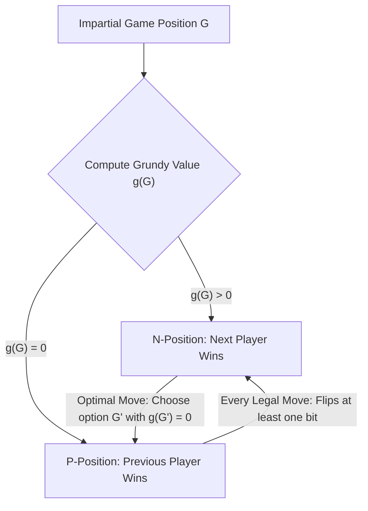
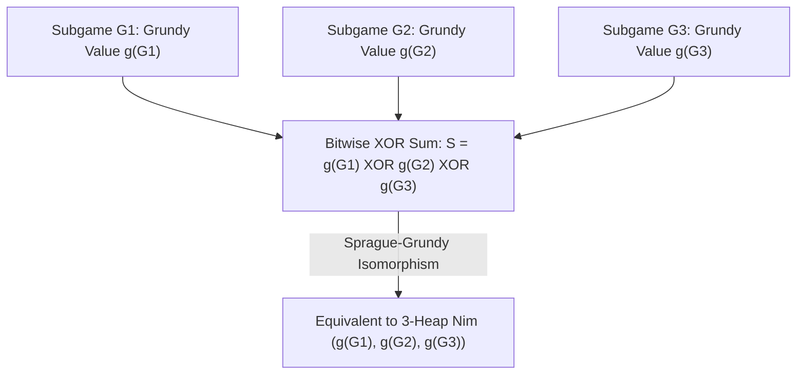

## 引言：簡單規則背後的絕對必然性——公平組合賽局與策梅洛定理

桌面上放著三堆石子，數量分別為 $3$ 顆、$4$ 顆和 $5$ 顆。兩名玩家輪流行動，每次可以選擇任意一堆，從中拿走至少 $1$ 顆石子（也可以把整堆拿光）。拿走最後一顆石子的人獲勝。這就是流傳數百年、在亞倫·雷奈的電影《去年在馬倫巴》中聞名遐邇的<strong>尼姆遊戲（Nim）</strong>。表面上看，這似乎是一個考驗心理博弈與算力的智力遊戲；但在數學家的眼中，從遊戲開始的第一秒起，勝負就已經被完全鎖死：只要先手玩家掌握了隱藏在二進位位元運算中的代數不變量，無論後手玩家如何掙扎，先手都能以 $100\%$ 的機率獲勝。

在現代數學中，這類遊戲被稱為<strong>公平組合賽局（Impartial Combinatorial Games）</strong>。它滿足五個核心公理：(1) 兩名玩家輪流行動；(2) <strong>完全資訊（Perfect Information）</strong>，不存在隱藏手牌或視野盲區；(3) <strong>確定性（Deterministic）</strong>，沒有任何擲骰子或洗牌等隨機因素；(4) <strong>公平性（Impartiality）</strong>，在任意給定局面下，兩名玩家所允許的合法移動集合完全相同（這與西洋棋或圍棋等偏黨賽局 Partisan Games 不同，在西洋棋中白方只能走白子、黑方只能走黑子）；(5) <strong>有限終止條件（Finite Termination）</strong>，遊戲必然在有限步內結束，不會陷入無限循環。在標準規則——即<strong>正規賽局約定（Normal Play Convention）</strong>——下，無法進行合法移動的玩家判負（等價於走出最後一步的玩家獲勝）。

根據策梅洛定理（Zermelo's Theorem）在有向無環圖（DAG）上的逆向歸納法，公平組合賽局中的所有局面都可以被唯一且不相交地劃分為兩類：<strong>$\mathcal{P}$-局面（Previous-player winning position，前手必勝態／當前玩家必敗態）</strong>與<strong>$\mathcal{N}$-局面（Next-player winning position，後繼行動者必勝態／當前玩家必勝態）</strong>。它們的遞迴定義極其優美：所有終局狀態（無路可走的狀態）都是 $\mathcal{P}$-局面；如果一個局面至少存在一步合法移動能夠到達某個 $\mathcal{P}$-局面，則它是 $\mathcal{N}$-局面；如果一個局面的<strong>所有</strong>合法移動都只能到達 $\mathcal{N}$-局面，則它是 $\mathcal{P}$-局面。

---

## 1. 查爾斯·布頓的破譯（1901）：二進位互斥或（Nim-sum）與兩大守恆引理

如果堆數很多、每堆石子有上百萬顆，在狀態圖上直接做逆向歸納會產生指數級爆炸。1901年，哈佛大學數學家<strong>查爾斯·倫納德·布頓（Charles Leonard Bouton）</strong>發表了里程碑式的論文，徹底解決了任意堆數、任意石子數的尼姆遊戲。他發現，決定尼姆遊戲生死的鑰匙，是將每一堆石子的數量寫成二進位，並計算它們的<strong>按位元互斥或和（Bitwise XOR，又稱尼姆和 Nim-sum）</strong>。

設當前局面為 $(n_1, n_2, \dots, n_k)$，定義尼姆和 $S = n_1 \oplus n_2 \oplus \dots \oplus n_k$。按位元互斥或 $\oplus$ 實質上是在二元有限體 $\mathbb{F}_2 = 	ext{GF}(2)$ 上不進位的二進位加法（滿足交換律、結合律，且任何數與自身互斥或為零：$x \oplus x = 0$）。布頓定理斷言：<strong>一個尼姆局面 $(n_1, \dots, n_k)$ 是必敗態（$\mathcal{P}$-局面），當且僅當其尼姆和 $S = 0$；它是必勝態（$\mathcal{N}$-局面），當且僅當 $S 
eq 0$。</strong>

為什麼這個簡單的互斥或公式能夠完美刻畫 $\mathcal{P}$-局面與 $\mathcal{N}$-局面？證明僅需兩條優雅的代數引理：
第一，<strong>從 $S = 0$ 出發，任何合法移動必然導致 $S' 
eq 0$</strong>。假設當前 $S = n_1 \oplus \dots \oplus n_k = 0$，玩家將第 $i$ 堆石子從 $n_i$ 減少到 $n_i' < n_i$。由於 $n_i' 
eq n_i$，它們在二進位表示下至少有一位不同，因此 $n_i \oplus n_i' 
eq 0$。新局面的尼姆和為 $S' = S \oplus n_i \oplus n_i' = 0 \oplus (n_i \oplus n_i') 
eq 0$。這意味著處於 $S=0$ 的玩家無論怎麼走，都會被迫將 $S' 
eq 0$ 的必勝權交還給對手。
第二，<strong>從 $S 
eq 0$ 出發，必然存在至少一步合法移動使得 $S' = 0$</strong>。觀察非零數 $S$ 的二進位表示中<strong>最高位的 $1$（Most Significant Bit, MSB）</strong>，設其位於第 $d$ 位。因為 $S$ 的第 $d$ 位是 $1$，在參與互斥或的 $n_1, \dots, n_k$ 中，必定有奇數個（從而至少有一個）堆 $n_i$ 在第 $d$ 位上也是 $1$。選中這個 $n_i$，令目標數量為 $n_i' = n_i \oplus S$。由於 $n_i$ 與 $S$ 在最高非零位 $d$ 上同為 $1$，互斥或後 $n_i'$ 的第 $d$ 位變成了 $0$，而高於 $d$ 的位保持不變，因此嚴格滿足 $n_i' < n_i$！這是一個完全合法的拿取操作（拿走 $n_i - (n_i \oplus S)$ 顆石子），且移動後的新尼姆和為 $S' = S \oplus n_i \oplus n_i' = S \oplus n_i \oplus (n_i \oplus S) = 0$。以開篇的 $(3, 4, 5)$ 為例：$S = 3 \oplus 4 \oplus 5 = 2 = (010)_2 
eq 0$，最高位 $1$ 在第二位（權值 $2$）。檢查三堆石子，$n_1 = 3 = (011)_2$ 在該位為 $1$，於是令 $n_1' = 3 \oplus 2 = 1$，即從第一堆拿走 $2$ 顆石子，留下 $(1, 4, 5)$，此時 $1 \oplus 4 \oplus 5 = 0$，先手穩操勝券！

$$
S = n_1 \oplus n_2 \oplus \dots \oplus n_k = \bigoplus_{i=1}^k n_i
$$

$$
\begin{aligned}
n_1 = 3 &= (011)_2 \\
n_2 = 4 &= (100)_2 \\
n_3 = 5 &= (101)_2 \\
\hline
S = 3 \oplus 4 \oplus 5 &= (010)_2 = 2 \neq 0 \quad (\mathcal{N}\text{-position})
\end{aligned}
$$

$$
n_1' = n_1 \oplus S = 3 \oplus 2 = (011)_2 \oplus (010)_2 = (001)_2 = 1 < 3 \implies (1, 4, 5) \text{ has } 1 \oplus 4 \oplus 5 = 0 \quad (\mathcal{P}\text{-position})
$$

---

## 2. 斯普拉格-格蘭迪定理（1935/1939）：萬物皆尼姆（Everything is Nim）

布頓解決尼姆遊戲三十多年後，羅蘭·斯普拉格（Roland Sprague, 1935）與派翠克·格蘭迪（Patrick Michael Grundy, 1939）各自獨立地發現了一個震撼整個離散數學界的普適定理：<strong>不僅是尼姆遊戲，宇宙中任何一個滿足正規賽局約定的有限公平組合賽局，在數學結構上都完全同構於一堆特定大小的尼姆石子！</strong>

為了建立這一同構，我們需要引入<strong>最小排除值（Minimum Excluded Value, $	ext{mex}$）</strong>與<strong>格蘭迪數（Grundy Value，又稱尼姆數 Nimber）</strong>。對於非負整數的有限子集 $A \subset \mathbb{N}_0$，$	ext{mex}(A)$ 定義為不屬於 $A$ 的最小非負整數（例如 $	ext{mex}(\emptyset) = 0$，$	ext{mex}(\{0, 1, 3\}) = 2$，$	ext{mex}(\{1, 2\}) = 0$）。對於賽局圖中的任意局面 $u$，其格蘭迪數 $\mathcal{G}(u)$ 遞迴定義為所有一步可達後繼局面 $v$ 的格蘭迪數集合的 $	ext{mex}$。
由 $	ext{mex}$ 的定義立即得出兩條關鍵性質：(1) $\mathcal{G}(u) = 0$ 當且僅當沒有任何後繼局面的格蘭迪數為 $0$，即 $u$ 是必敗態（$\mathcal{P}$-局面）；(2) 若 $\mathcal{G}(u) = g > 0$，則對於任意滿足 $0 \le m < g$ 的整數 $m$，都必然存在至少一個後繼局面 $v$ 使得 $\mathcal{G}(v) = m$！這豈不正是含 $g$ 顆石子的單堆尼姆遊戲的性質嗎（從 $g$ 顆石子可以一步變成 $0, 1, \dots, g-1$ 顆石子）？

更進一步，當我們把多個相互獨立的公平賽局 $G_1, G_2, \dots, G_k$ 組合成一個<strong>析取和賽局（Disjunctive Sum）</strong> $G = G_1 + G_2 + \dots + G_k$（玩家每回合任選其中一個子賽局走一步，所有子賽局都無路可走時遊戲結束）時，<strong>斯普拉格-格蘭迪定理（Sprague-Grundy Theorem）</strong>證明了：複合局面的格蘭迪數恰好等於各個獨立子賽局格蘭迪數的按位元互斥或！
這意味著，即便一個子賽局允許在減少規模的同時「增加」到某個更大的格蘭迪數（相當於在尼姆堆上加石子），對手也總是可以立刻將它還原回原來的數值（相當於抵消加石子的動作）。因此，任何複雜的圖賽局、分割賽局或棋盤賽局，只要算出每個獨立組件的 $\mathcal{G}$ 值，就能瞬間化約為標準的尼姆互斥或求和！

$$
\text{mex}(A) = \min \{ m \in \mathbb{N}_0 \mid m \notin A \}, \qquad \mathcal{G}(u) = \text{mex}\big\{ \mathcal{G}(v) \;\big|\; u \to v \big\}
$$

$$
\mathcal{G}(u) = 0 \iff u \in \mathcal{P}\text{-position}, \qquad \mathcal{G}(u) > 0 \iff u \in \mathcal{N}\text{-position}
$$

---

## 3. 經典賽局應用與反常規則（Misère Play）的陷阱

斯普拉格-格蘭迪定理賦予了我們解剖無數複雜遊戲的手術刀：
- <strong>減法賽局（Subtraction Games, 如巴什賽局 Bash Game）</strong>：每次只能拿走 $1$ 到 $m$ 顆石子。直接計算可知 $\mathcal{G}(n) = n mod (m+1)$，當且僅當 $n$ 是 $m+1$ 的倍數時先手必敗。
- <strong>分裂賽局：凱爾斯保齡球（Kayles）與道森西洋棋（Dawson's Chess）</strong>：一排 $n$ 個保齡球瓶，每次可以擊倒 $1$ 個或相鄰的 $2$ 個球瓶。奇妙之處在於，從中間擊倒球瓶會將原本的一排分裂成左右<strong>兩個互不干擾的子排</strong> $a$ 和 $b$！根據斯普拉格-格蘭迪定理，分裂後的局面等價於兩個獨立子賽局的析取和，其格蘭迪數直接由 $\mathcal{G}(a) \oplus \mathcal{G}(b)$ 給出。透過動態規劃遞推，我們可以輕鬆在 $O(n^2)$ 時間內算出任意長度凱爾斯賽局的必勝策略。
- <strong>反常賽局約定（Misère Play Convention，拿走最後一顆石子者輸）</strong>：如果把規則倒過來，讓拿走最後一顆石子的人判負，會發生什麼？許多初學者誤以為只需把 $\mathcal{P}$ 和 $\mathcal{N}$ 簡單反轉即可，這是致命的錯誤！布頓證明了<strong>反常尼姆（Misère Nim）</strong>的精確修正法則：只要場面上還有至少兩堆石子的數量大於 $1$，你的走法與正規尼姆<strong>完全相同</strong>（依然保持 $S = 0$）；唯有當你的走法將使場面上<strong>所有剩餘堆的大小都變成 $1$</strong> 時，你不能再追求 $S=0$，而必須調整拿取數量，使得場面上留下<strong>奇數個大小為 $1$ 的堆</strong>（即在全 $1$ 殘局中令 $S=1$）！然而，對於一般的公平賽局，反常規則徹底摧毀了斯普拉格-格蘭迪定理的普適性——不同遊戲在反常規則下不再能簡單縮約為單個整數，直到 21 世紀初普蘭貝克（Thane Plambeck）與西格爾（Aaron Siegel）提出<strong>反常商幺半群（Misère Quotients）</strong>理論，才揭開了反常賽局代數的冰山一角。

| 賽局類型 / 概念 | 核心數學結構 / 判據 | 先手必勝條件（$\mathcal{N}$-局面） | 時間複雜度 / 理論地位 |
| :--- | :--- | :--- | :--- |
| <strong>標準尼姆（Normal Play Nim）</strong> | 按位元互斥或尼姆和 $S = igoplus_{i=1}^k n_i$ | $S 
eq 0$ | $O(k)$ 位元運算，一切公平賽局的基石 |
| <strong>減法賽局 $S=\{1,\dots,m\}$</strong> | 模週期格蘭迪函數 $\mathcal{G}(n) = n mod (m+1)$ | $n 
ot\equiv 0 \pmod{m+1}$ | $O(1)$，週期性 $	ext{mex}$ 序列 |
| <strong>凱爾斯賽局（Kayles, 分裂賽局）</strong> | $	ext{mex}\{\mathcal{G}(a) \oplus \mathcal{G}(b)\}$ | $\mathcal{G}(n) 
eq 0$（$n \ge 72$ 起呈現週期 $12$） | $O(n^2)$ DP 或利用最終週期性 $O(1)$ |
| <strong>一般正規公平賽局析取和</strong> | 斯普拉格-格蘭迪定理 $\mathcal{G}(\sum G_i) = igoplus \mathcal{G}(G_i)$ | $igoplus_{i=1}^k \mathcal{G}(G_i) 
eq 0$ | 完美同構於單堆尼姆與有限體 $\mathbb{F}_2$ 特徵2體 |
| <strong>反常尼姆（Misère Play Nim）</strong> | 殘局階段反轉奇偶性 | 若存在 $n_i > 1$ 則 $S 
eq 0$；若全為 $1$ 則 $S = 0$（偶數堆） | 一般反常賽局需用 Misère Quotients 交換幺半群 |

$$
\mathcal{G}(G_1 + G_2 + \dots + G_k) = \mathcal{G}(G_1) \oplus \mathcal{G}(G_2) \oplus \dots \oplus \mathcal{G}(G_k)
$$

$$
\mathcal{G}(\text{Kayles}(n)) = \text{mex}\Big\{ \mathcal{G}(a) \oplus \mathcal{G}(b) \;\Big|\; a + b = n - 1 \text{ or } a + b = n - 2 \Big\}
$$
