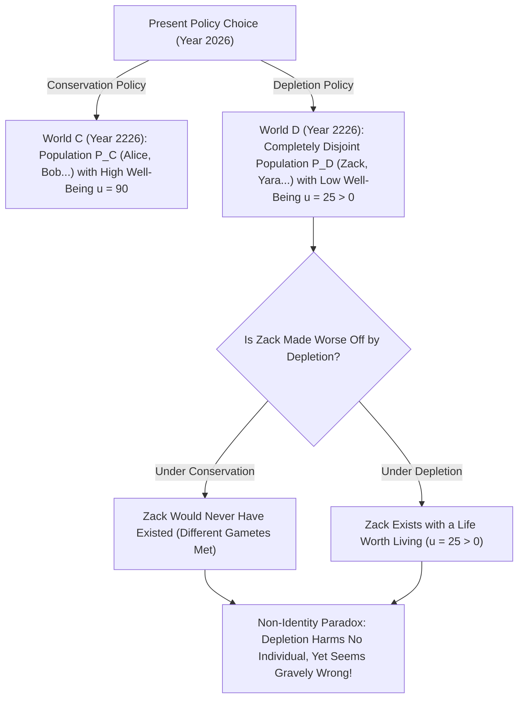
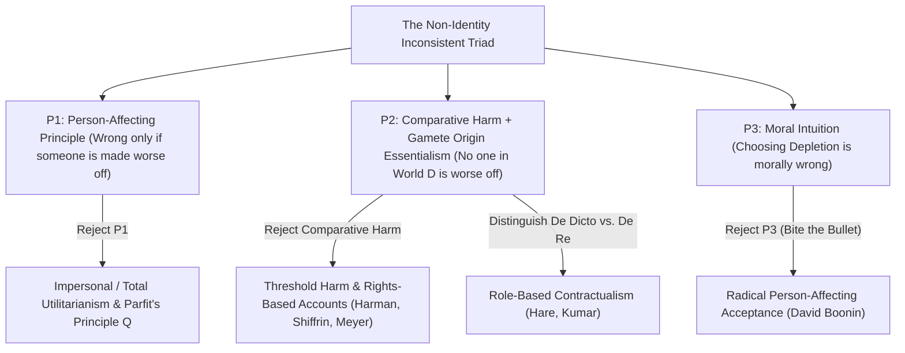

## مقدمة: هل تقوم مسؤوليتنا تجاه الأجيال القادمة على وهم منطقي؟

لنفترض أن جيلنا يواجه خياراً حاسماً بين سياستين عالميتين للطاقة والمناخ: <strong>«سياسة الحفاظ (Conservation)»</strong> و<strong>«سياسة الاستنزاف (Depletion)»</strong>. إذا اخترنا بأنانية سياسة الاستنزاف، فسننعم خلال العقود الثلاثة القادمة بمستوى معيشي أعلى قليلاً بفضل حرق الوقود الأحفوري الرخيص؛ لكن بعد مئتي عام ستتدهور البيئة الحيوية للأرض بشدة، وسيعاني سكان عام 2226 من انخفاض حاد في جودة الحياة (مع بقاء حياتهم في مجملها جديرة بأن تُعاش، أي $u > 0$).

يكاد الجميع يجمعون بداهةً على أن اختيار الاستنزاف خطيئة أخلاقية كبرى لأنه <strong>يلحق الضرر بالأجيال القادمة</strong>. غير أن فيلسوف أكسفورد <strong>ديريك بارفيت (Derek Parfit, 1942–2017)</strong> برهن في الفصل السادس عشر من رائعته <strong>*«الأسباب والأشخاص» (Reasons and Persons, 1984)</strong>* على أن هذه الشكوى البديهية تقوم على وهم منطقي وبيولوجي عميق: فلو أننا اخترنا سياسة الحفاظ بدلاً من الاستنزاف، <strong>لَما وُلد أصلاً أيّ فرد من الأفراد المحددين الذين يعيشون في عام 2226 في عالم الاستنزاف</strong>! وإذا كان هؤلاء المواطنون يدينون بوجودهم ذاته لسياسة الاستنزاف وكانت حياتهم جديرة بالعيش، فكيف يمكن أن تكون سياسة الاستنزاف قد «أضرت» بهم أو جعلت حالهم أسوأ؟ هذه هي <strong>مشكلة عدم الهوية (The Non-Identity Problem)</strong> الشهيرة.

---

## 1. فرضية الاعتماد على الزمن وماهوية المنشأ: لماذا تغيّر السياسات هويّة مَن يوجد؟

لماذا يؤدي قرار اقتصادي أو بيئي كلي إلى تغيير الهوية الشخصية لسكان المستقبل؟ يكمن الجواب في التقاء بيولوجيا التكاثر مع ميتافيزيقا <strong>ماهوية المنشأ المشيجي (Gamete Origin Essentialism)</strong> التي صاغها سول كريبكي في كتابه *التسمية والضرورة* (1972).
ينشأ كل إنسان محدد من اتحاد <strong>حيوان منوي واحد محدد</strong> (من بين $100$ إلى $300	ext{ مليون}$) مع <strong>بويضة واحدة محددة</strong>. فإذا حدث الحمل لدى الزوجين قبل أو بعد موعده الفعلي ببضع دقائق أو بشهر واحد فقط، فإن حيواناً منوياً مختلفاً تماماً سيخصب البويضة. الطفل الذي سيولد عندئذٍ لن يشترك معك إلا في $50\,\%$ من الحمض النووي كحد أقصى — أي سيكون أخاك أو أختك، لكنه <strong>لن يكون أنت أبداً</strong>!

صاغ بارفيت هذه الحقيقة في <strong>فرضية الاعتماد على الزمن (Time-Dependence Claim)</strong>: *«لو لم يُحمل بأي شخص معين خلال الشهر الذي حُمل به فعلياً، لما وُجد هذا الشخص في الواقع أبداً»*.
ولنتتبع الآن أثر الفراشة لسياسة الطاقة العالمية عبر قرنين من الزمن (سبعة إلى ثمانية أجيال) — تغير المصانع، ومواعيد القطارات، وهجرة الشباب، ولقاءات الزواج: إن مجموعة البشر الأحياء في عام 2226 تحت سياسة الاستنزاف $P(w_D)$ ومجموعة الأحياء تحت سياسة الحفاظ $P(w_C)$ <strong>تقاطعهما خالٍ تماماً ($P(w_D) \cap P(w_C) = \emptyset$)</strong>!

وقد جلّى بارفيت هذه المفارقة بمثالين آخرين شهيرين: عندما تقرر <strong>فتاة في الرابعة عشرة من عمرها</strong> إنجاب طفل (بيلي) الآن بدلاً من الانتظار حتى سن الرابعة والعشرين، فإنها لا تجعل حال *بيلي* أسوأ — لأنها لو انتظرت لسن 24 لأنجبت طفلاً آخر مختلفاً تماماً. وبالمثل، إذا أُلغي <strong>برنامج الفحص الطبي قبل الحمل</strong> (الذي ينصح النساء بتأجيل الحمل شهرين عند الإصابة بعدوى مؤقتة)، فإن الألف طفل الذين يولدون بإعاقة لم يصبح أيّ واحد منهم «أسوأ حالاً» بسبب الإلغاء، لأن تأجيل الحمل شهرين كان سيأتي بألف طفل آخرين مختلفين تماماً!

$$
\text{Counterfactual Harm Condition:} \quad \text{Harm}(A, p) \iff u\big(p, w(A)\big) < u\big(p, w(\neg A)\big)
$$

$$
\text{Non-Identity Condition:} \quad P\big(w(\text{Depletion})\big) \cap P\big(w(\text{Conservation})\big) = \emptyset, \qquad \forall p \in P\big(w(\text{Depletion})\big),\; u(p) > 0
$$

---

## 2. البنية المنطقية: الثلاثية المتناقضة لمشكلة عدم الهوية

تحصر مشكلة عدم الهوية ثلاثاً من أعمق قناعاتنا الأخلاقية في <strong>ثلاثية متناقضة منطقياً (Inconsistent Triad)</strong>:
1. <strong>المقدمة P1: المبدأ المؤثر في الأشخاص (Person-Affecting Principle)</strong>: وفق شعار يان نارفيسون وديريك بارفيت: *«ما هو سيئ يجب أن يكون سيئاً لشخص ما»*. لا يكون الفعل خاطئاً أخلاقياً إلا إذا وُجد شخص محدد $p$ يلحق به الضرر أو يسوء حاله بسببه.
2. <strong>المقدمة P2: المفهوم المقارن المضاد للواقع للضرر + عدم الهوية</strong>: يضر الفعل $A$ بالشخص $p$ إذا وفقط إذا كانت رفاهية $p$ في العالم مع $A$ أقل من رفاهيته في العالم البديل بدون $A$: $u(p, w(A)) < u(p, w(
eg A))$. وبما أنه لا يوجد أي فرد $p \in P(w_D)$ في العالم $w_C$، وبما أن الحياة الجديرة بالعيش ($u > 0$) ليست أسوأ من العدم، فإن <strong>الاستنزاف لا يضر بأي فرد على الإطلاق</strong>.
3. <strong>المقدمة P3: الخطأ الأخلاقي للاستنزاف (و«رؤية عدم الفرق» / No-Difference View)</strong>: إن اختيار الاستنزاف (أو إلغاء الفحص قبل الحمل) خطأ أخلاقي جسيم.

وبما أن $(P_1 \land P_2) \implies 
eg P_3$، فلا بد لأي نظرية أخلاقية متسقة أن تتخلى عن إحدى هذه المقدمات الثلاث أو تعدلها!

---

## 3. المخارج الفلسفية الخمسة وتطبيقاتها في اقتصاد المناخ وتحرير الجينات CRISPR

تبلورت خمس استراتيجيات كبرى لحل مشكلة عدم الهوية:
1. <strong>المخرج 1 (رفض P1): الأخلاق غير الشخصية و«مبدأ Q» لبارفيت</strong>: يرى بارفيت أنه عند تساوي عدد السكان يكون العالم ذو جودة الحياة الأقل أسوأ أخلاقياً حتى لو اختلف الأشخاص. لكن عند تغير حجم السكان (البحث عن «النظرية X»)، يقود هذا المبدأ مباشرة إلى <strong>«النتيجة المنفّرة (Repugnant Conclusion)»</strong> (انظر المقال #17).
2. <strong>المخرج 2 (تعديل P2a): ضرر العتبة (Threshold Harm) والحقوق (ماير، هارمان، شيفرين)</strong>: يرى لوكاس ماير وإليزابيث هارمان أن الشخص يتضرر متى تسببنا في وجوده <strong>دون عتبة معيارية للكرامة الإنسانية $u_{	ext{thresh}}$</strong>. نقطة الضعف: إذا خفّض الاستنزاف رفاهية المستقبل من «مزدهرة جداً ($u=95$)» إلى «متوسطة فوق العتبة ($u=50 > u_{	ext{thresh}}$)»، فإن نظرية العتبة تعتبر ذلك مباحاً تماماً!
3. <strong>المخرج 3 (تعديل P2b): الواجبات *De Dicto* مقابل *De Re* والتعاقدية (كاسبار هير، راهول كومار)</strong>: واجباتنا الأخلاقية لا تتوجه إلى فرد جيني محدد (*de re*)، بل إلى <strong>الدور أو المنصب المعياري (*Office* / *de dicto*)</strong> لـ«طفلي المستقبلي» أو «مواطن القرن الثالث والعشرين».
4. <strong>المخرج 4: أخلاق الفضيلة (هيرستهاوس)</strong>: الاستنزاف خطأ لأنه يعبر عن رذائل الجشع وقصر النظر.
5. <strong>المخرج 5 (رفض P3): «عضّ الرصاصة» (Biting the Bullet، ديفيد بونين 2014)</strong>: يجادل بونين بأن جميع المحاولات تفشل وعلينا قبول النتيجة الصادمة: سياسة الاستنزاف وإنجاب فتاة الـ14 عاماً <strong>ليست خاطئة أخلاقياً على الإطلاق</strong> طالما أن حياة المولودين جديرة بالعيش!

وعملياً تحسم هذه المشكلة ثلاثة نقاشات معاصرة كبرى: (1) <strong>معدل الخصم الاجتماعي في اقتصاد تغير المناخ ($r = \delta + \eta g$)</strong> (سجال نوردهاوس وتقرير ستيرن حول $\delta = 0$)؛ و(2) <strong>أخلاقيات الإنجاب الحيوية</strong> (تعديل الجينات بـ CRISPR لجنين قائم يعالج *نفس* الطفل، بينما التشخيص الوراثي قبل الانغراس PGD يستبدل جنيناً بـ*شخص آخر*)؛ و(3) <strong>التعويضات التاريخية</strong> (المبنية على إخلال الدولة المستمر بواجبات العدالة التوزيعية تجاه كل جيل جديد).

| الاستراتيجية / الفيلسوف | المقدمة المرفوضة | الآلية المحورية | هل تدين الاستنزاف فوق العتبة؟ | التكلفة النظرية الرئيسية |
| :--- | :--- | :--- | :--- | :--- |
| <strong>المبدأ غير الشخصي $Q$ (Parfit 1984)</strong> | يرفض P1 (المبدأ الشخصي) | يقارن مجموع/جودة الرفاهية بين العوالم الممكنة | <strong>نعم</strong> ($u=90 \succ u=50$) | يؤدي إلى *النتيجة المنفرة* عند تغير عدد السكان |
| <strong>ضرر العتبة والحقوق (Meyer, Harman)</strong> | يعدّل P2 (الضرر المقارن) | الضرر = الوجود تحت عتبة الكرامة $u_{	ext{thresh}}$ | <strong>لا</strong> (يفشل إذا كان $u=50 > u_{	ext{thresh}}$) | يبيح تدهوراً هائلاً طالما بقي فوق العتبة |
| <strong>التعاقدية *De Dicto* (Hare, Kumar)</strong> | يعدّل P2 (مرجع الإحالة) | الواجبات تجاه *الأدوار/المناصب* («مواطن المستقبل») | <strong>نعم</strong> (ينتهك التوقعات المشروعة للدور) | لماذا يتعلق الحق الأخلاقي بوصف لغوي مجرد؟ |
| <strong>أخلاق الفضيلة (Hursthouse)</strong> | يرفض P1 (العواقبية) | يقيّم سمات شخصية الفاعل (الجشع مقابل الرعاية) | <strong>نعم</strong> | يحوّل الخطأ إلى *روح الفاعل* بدلاً من الضحايا |
| <strong>القبول الجذري (David Boonin 2014)</strong> | يرفض P3 (الحدس الأخلاقي) | يقرّ بإباحة الاستنزاف والحالة B أخلاقياً | لا ينطبق (ينفي الخطأ) | يصطدم بشدة مع الإجماع حول العدالة المناخية |

$$
\text{Social Discount Rate (Ramsey Formula):} \quad r = \delta + \eta g
$$

$$
W_{\text{impersonal}}(w) = \sum_{p \in P(w)} u(p), \qquad \text{De Dicto Duty:} \quad \text{Obligation}\big(\text{Office}(\text{Future Child})\big) \neq \text{Obligation}(p_{\text{specific}})
$$
