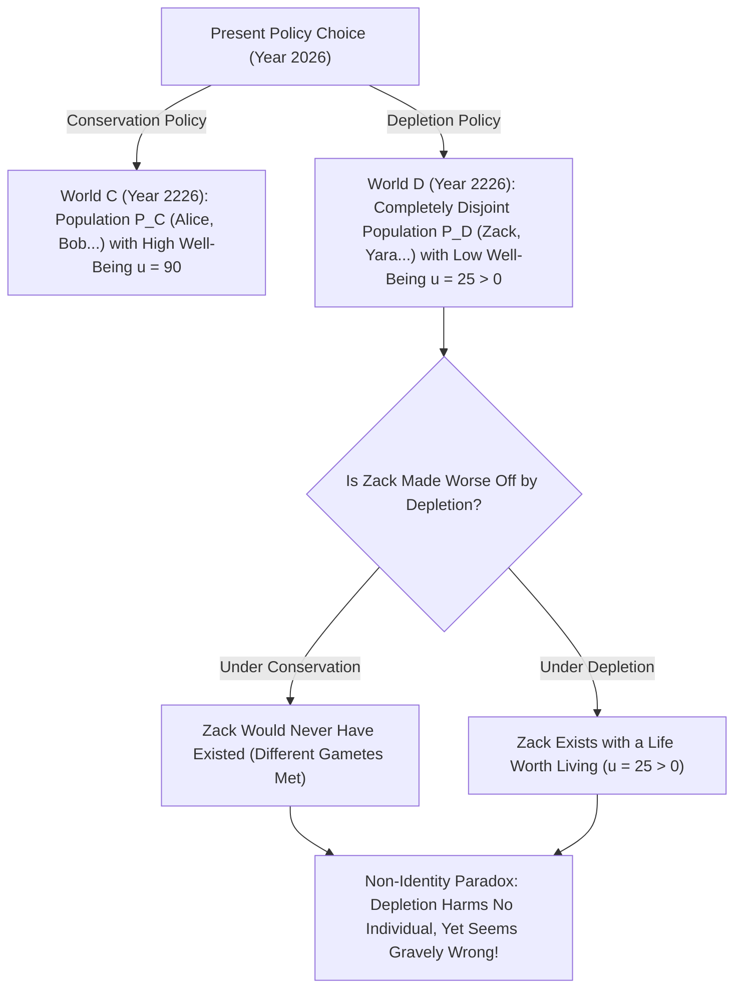
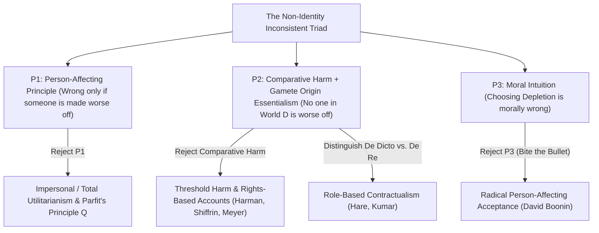

## Einleitung: Ruht unsere Verantwortung für künftige Generationen auf einer Illusion?

Stellen wir uns vor, unsere Generation steht vor der Wahl zwischen zwei globalen Klima- und Ressourcenpolitiken: <strong>„Bewahrung (Conservation)“</strong> und <strong>„Raubbau (Depletion)“</strong>. Wählen wir den Raubbau, genießen wir in den nächsten dreißig Jahren durch billige fossile Energie einen leicht höheren Lebensstandard; doch in zweihundert Jahren wird die Biosphäre schwer geschädigt sein, sodass die Menschen im Jahr 2226 unter einer drastisch geringeren Lebensqualität leiden werden (wobei ihr Leben insgesamt dennoch lebenswert bleibt, d. h. $u > 0$).

Fast jeder Mensch teilt die tiefe moralische Überzeugung, dass die Raubbau-Politik schweres Unrecht ist, weil sie <strong>künftigen Generationen schadet</strong>. Doch in Kapitel 16 seines Meisterwerks <strong>*Reasons and Persons</strong>* (1984) bewies der Oxforder Philosoph <strong>Derek Parfit</strong> (1942–2017), dass diese scheinbar selbstverständliche Anklage auf einer logischen und biologischen Illusion beruht: Hätten wir die Bewahrungspolitik statt des Raubbaus gewählt, wäre im Jahr 2226 <strong>kein einziger der konkreten Menschen, die in der Raubbau-Welt leben, überhaupt jemals geboren worden</strong>! Wenn diese Menschen ihre bloße Existenz der Raubbau-Politik verdanken und ihr Leben lebenswert ist — wie kann der Raubbau ihnen dann geschadet oder sie schlechter gestellt haben? Dies ist das berühmte <strong>Nicht-Identitätsproblem (The Non-Identity Problem)</strong>.

---

## 1. Die Zeitabhängigkeitsthese und der Ursprungsessentialismus: Warum Politik bestimmt, wer existiert

Warum verändert eine wirtschafts- oder umweltpolitische Entscheidung die Identität künftiger Menschen? Die Antwort liegt im Zusammenspiel von Reproduktionsbiologie und Saul Kripkes Metaphysik des <strong>Ursprungsessentialismus (Gamete Origin Essentialism)</strong> (*Naming and Necessity*, 1972).
Jeder Mensch entsteht aus der Verschmelzung <strong>eines spezifischen Spermiums</strong> (aus rund $100	ext{–}300	ext{ Millionen}$ pro Ejakulation) und <strong>einer spezifischen Eizelle</strong>. Zeugt ein Paar ein Kind auch nur wenige Minuten oder gar einen Monat früher oder später, befruchtet ein völlig anderes Spermium die Eizelle. Das daraus entstehende Kind teilt höchstens $50\,\%$ Ihrer DNA — es wäre Ihr Bruder oder Ihre Schwester, aber <strong>niemals Sie selbst</strong>!

Parfit formulierte dies als <strong>Zeitabhängigkeitsthese (Time-Dependence Claim)</strong>: *„Wäre irgendeine bestimmte Person nicht innerhalb eines Monats um den Zeitpunkt herum gezeugt worden, zu dem sie tatsächlich gezeugt wurde, hätte sie niemals existiert.“*
Verfolgt man nun den Schmetterlingseffekt einer globalen Energiepolitik über zweihundert Jahre (sieben bis acht Generationen) — veränderte Arbeitsplätze, Zugfahrpläne, Umzüge und Begegnungen —, so ist die Konsequenz absolut: Die Menge der Menschen im Jahr 2226 unter Raubbau $P(w_D)$ und die Menge der Menschen unter Bewahrung $P(w_C)$ sind <strong>vollständig disjunkt ($P(w_D) \cap P(w_C) = \emptyset$)</strong>!

Parfit verdeutlichte dies an zwei weiteren Fallbeispielen: Wenn ein <strong>14-jähriges Mädchen</strong> beschließt, sofort ein Kind (Billy) zu bekommen, statt bis 24 zu warten, stellt sie *Billy* dadurch nicht schlechter — denn mit 24 hätte sie ein ganz anderes Kind geboren. Und wenn ein Staat ein <strong>Präkonzeptions-Screening-Programm</strong> streicht (das Frauen geraten hätte, eine Schwangerschaft bei einer vorübergehenden Infektion um zwei Monate zu verschieben), ist keines der $1.000$ behindert geborenen Kinder dadurch „schlechter gestellt“, da bei einer Verschiebung um zwei Monate völlig andere Kinder entstanden wären!

$$
\text{Counterfactual Harm Condition:} \quad \text{Harm}(A, p) \iff u\big(p, w(A)\big) < u\big(p, w(\neg A)\big)
$$

$$
\text{Non-Identity Condition:} \quad P\big(w(\text{Depletion})\big) \cap P\big(w(\text{Conservation})\big) = \emptyset, \qquad \forall p \in P\big(w(\text{Depletion})\big),\; u(p) > 0
$$

---

## 2. Die logische Struktur: Das inkonsistente Trilemma des Nicht-Identitätsproblems

Das Nicht-Identitätsproblem führt drei unserer stärksten moralischen Grundsätze in ein logisch widersprüchliches <strong>inkonsistentes Trilemma (Inconsistent Triad)</strong>:
1. <strong>Prämisse P1: Das personenbezogene Prinzip (Person-Affecting Principle)</strong>: Nach Jan Narveson gilt: *„Was schlecht ist, muss für jemanden schlecht sein.“* Eine Handlung kann nur dann moralisch falsch sein, wenn es mindestens eine konkrete Person $p$ gibt, die durch die Handlung geschädigt oder schlechter gestellt wird.
2. <strong>Prämisse P2: Kontrafaktisch-komparativer Schadensbegriff + Nicht-Identität</strong>: Eine Handlung $A$ schädigt eine Person $p$ genau dann, wenn es $p$ in der Welt mit $A$ schlechter geht als in der kontrafaktischen Welt ohne $A$: $u(p, w(A)) < u(p, w(
eg A))$. Da jedoch kein Bewohner $p \in P(w_D)$ in der Bewahrungswelt $w_C$ existiert und ein lebenswertes Leben ($u > 0$) nicht schlechter ist als Nicht-Existenz, <strong>wird durch den Raubbau kein einziges Individuum geschädigt</strong>.
3. <strong>Prämisse P3: Moralische Verwerflichkeit des Raubbaus (und die „Kein-Unterschied-Ansicht“ / No-Difference View)</strong>: Die Wahl des Raubbaus (oder die Streichung des Präkonzeptions-Programms) ist moralisch schwer verwerflich.

Da $(P_1 \land P_2) \implies 
eg P_3$ gilt, muss jede konsistente Ethik mindestens eine dieser drei Prämissen aufgeben!

---

## 3. Fünf philosophische Auswege und ihre Bedeutung für Klimaökonomik und CRISPR

In den letzten vierzig Jahren wurden fünf Hauptstrategien zur Lösung des Nicht-Identitätsproblems entwickelt:
1. <strong>Ausweg 1 (Verwerfung von P1): Unpersönliche Ethik und Parfits „Prinzip Q (Same-Number Quality Claim)“</strong>: Parfit plädiert dafür, das enge personenbezogene Prinzip durch ein unpersönliches Prinzip zu ersetzen: Wenn in zwei möglichen Welten gleich viele Menschen leben, ist die Welt mit der geringeren Lebensqualität moralisch schlechter — selbst wenn dort ganz andere Individuen leben. Variiert jedoch auch die Bevölkerungsgröße (Parfits Suche nach „Theorie X“), droht sofort die <strong>„Abstoßende Schlussfolgerung (Repugnant Conclusion)“</strong> (siehe Artikel #17).
2. <strong>Ausweg 2 (Modifikation von P2a): Schwellenwert-Schaden (Threshold Harm) und Rechte (Meyer, Harman, Shiffrin)</strong>: Lukas Meyer und Elizabeth Harman argumentieren, dass eine Person auch ohne kontrafaktischen Vergleich geschädigt wird, sobald man bewirkt, dass sie <strong>unterhalb eines normativen menschenwürdigen Schwellenwerts $u_{	ext{thresh}}$</strong> existiert. Schwäche: Senkt der Raubbau das Wohl zukünftiger Menschen von „herausragend ($u=95$)“ auf „gerade noch über der Schwelle ($u=50 > u_{	ext{thresh}}$)“, wäre dies laut Schwellenwert-Theorie völlig erlaubt!
3. <strong>Ausweg 3 (Modifikation von P2b): *De-dicto*- vs. *De-re*-Pflichten und Kontraktualismus (Caspar Hare, Rahul Kumar)</strong>: Moralische Pflichten richten sich nicht an ein spezifisches genetisches Individuum (*de re*), sondern an die normative <strong>Rolle oder Position (*Office* / *de dicto*)</strong> „mein künftiges Kind“ bzw. „die Bürger des 23. Jahrhunderts“.
4. <strong>Ausweg 4: Tugendethik (Hursthouse)</strong>: Raubbau ist falsch, weil er Laster wie Gier und Kurzsichtigkeit ausdrückt.
5. <strong>Ausweg 5 (Verwerfung von P3): „In den sauren Apfel beißen“ (David Boonin 2014)</strong>: Boonin argumentiert, dass alle Rettungsversuche scheitern und wir akzeptieren müssen, dass Raubbau und die Geburt mit 14 Jahren moralisch <strong>nicht falsch sind</strong>, solange das Leben der Geborenen lebenswert ist!

Praktische Relevanz besitzt das Problem heute in drei Schlüsselbereichen: (1) <strong>Soziale Diskontrate in der Klimaökonomik ($r = \delta + \eta g$)</strong> (Streit zwischen Nordhaus und dem Stern-Report über $\delta = 0$); (2) <strong>Fortpflanzungsmedizin</strong> (CRISPR-Genkorrektur am selben Embryo vs. Präimplantationsdiagnostik PID als Selektion eines *anderen* Embryos); und (3) <strong>Historische Gerechtigkeit und Reparationen</strong> (Entschädigungspflichten beruhen auf dem fortdauernden staatlichen Unrecht gegenüber jeder neu geborenen Generation).

| Lösungsansatz / Philosoph | Aufgegebene Prämisse | Kernmechanismus | Verurteilt Raubbau oberhalb der Schwelle? | Hauptproblem / Theoretischer Preis |
| :--- | :--- | :--- | :--- | :--- |
| <strong>Unpersönliches Prinzip $Q$ (Parfit 1984)</strong> | Verwirft P1 (Personenbezug) | Vergleicht Gesamtqualität/-summe des Wohls zwischen Welten | <strong>Ja</strong> ($u=90 \succ u=50$) | Führt bei variabler Bevölkerung zur *Repugnant Conclusion* |
| <strong>Schwellenwert-Schaden (Meyer, Harman)</strong> | Modifiziert P2 (Komparativer Schaden) | Schaden = Existenz unterhalb der Würdeschwelle $u_{	ext{thresh}}$ | <strong>Nein</strong> (versagt falls $u=50 > u_{	ext{thresh}}$) | Erlaubt massiven Wohlstandsverlust oberhalb der Schwelle |
| <strong>*De-dicto*-Kontraktualismus (Hare, Kumar)</strong> | Modifiziert P2 (Referenzobjekt) | Pflichten gelten gegenüber sozialen Rollen/Ämtern (*de dicto*) | <strong>Ja</strong> (verletzt Rollenerwartung) | Warum sollten Rollen statt konkreter Personen Träger von Rechten sein? |
| <strong>Tugendethik (Hursthouse)</strong> | Verwirft P1 (Folgenethik) | Bewertet Charakterzüge der Handelnden (Rücksichtslosigkeit) | <strong>Ja</strong> | Macht das Unrecht zu einer Frage der *eigenen Tugend* statt der Opfer |
| <strong>Radikale Akzeptanz (David Boonin 2014)</strong> | Verwirft P3 (Moralische Intuition) | Akzeptiert Raubbau & Programm B als moralisch erlaubt | Entfällt (bestreitet das Unrecht) | Widerspricht fundamentalen Intuitionen zu Klimagerechtigkeit |

$$
\text{Social Discount Rate (Ramsey Formula):} \quad r = \delta + \eta g
$$

$$
W_{\text{impersonal}}(w) = \sum_{p \in P(w)} u(p), \qquad \text{De Dicto Duty:} \quad \text{Obligation}\big(\text{Office}(\text{Future Child})\big) \neq \text{Obligation}(p_{\text{specific}})
$$
