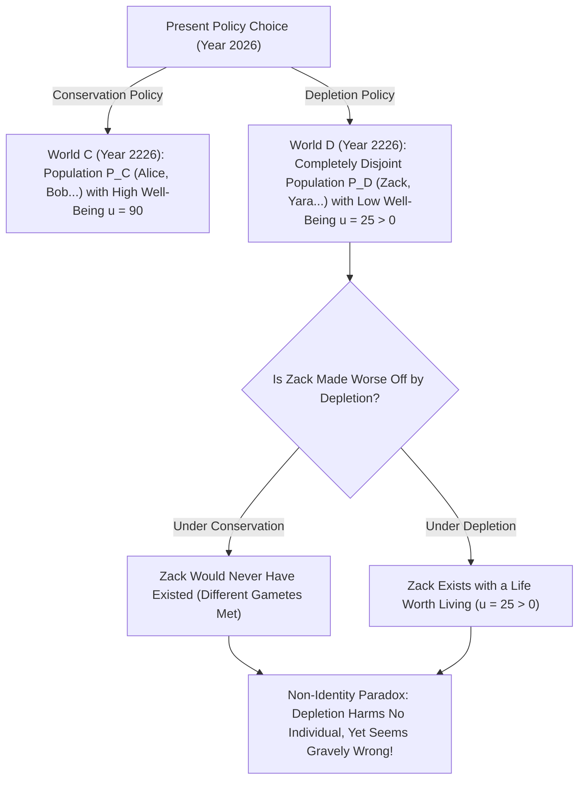
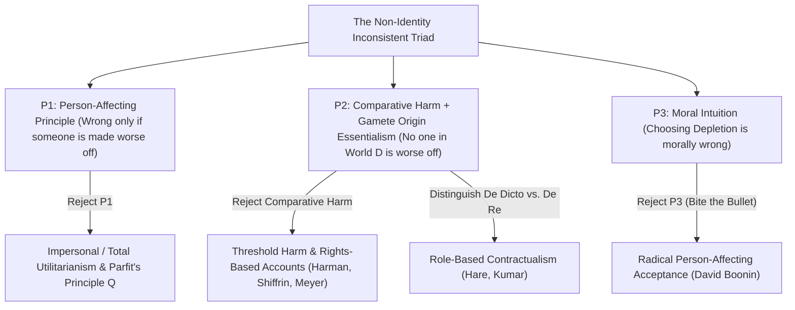

## Introduction: A Paradox at the Heart of Our Responsibility to the Future

Suppose our generation faces a fundamental choice between two global climate and resource policies—call them <strong>Conservation</strong> and <strong>Depletion</strong>. If we choose Depletion, our standard of living over the next three decades will be slightly higher because we burn cheap fossil fuels and exhaust rare minerals without restraint. However, two hundred years from now, the global biosphere will be severely degraded: sea levels will have risen by several meters, arable land will have shrunk, and people living in the 23rd century will endure a significantly lower quality of life than they would have enjoyed under Conservation. Even under Depletion, however, their lives will still be unambiguously *worth living*—they will love, create art, and prefer existence to non-existence.

Almost everyone shares the bedrock moral conviction that choosing Depletion is gravely wrong because it <strong>harms future generations</strong>. We picture the citizens of the year 2226 shaking their fists at us and saying: *"Had you chosen Conservation instead of Depletion, our lives would have been so much better! You wronged us!"*

In Chapter 16 of his monumental 1984 masterpiece <strong>*Reasons and Persons</strong>*, the Oxford philosopher <strong>Derek Parfit</strong> (1942–2017) proved that this seemingly undeniable complaint rests on a profound logical and biological illusion. Because of the extreme sensitivity of human reproduction to the timing of conception, had we chosen Conservation instead of Depletion, <strong>not a single one of the specific individuals living in the year 2226 under Depletion would ever have been born at all</strong>. If those citizens owe their very existence to the Depletion policy, and if their lives are worth living, how can Depletion have harmed them or made them worse off?

This is the <strong>Non-Identity Problem</strong>—arguably the most formidable puzzle in modern normative ethics, population axiology, climate economics, and bioethics. In this comprehensive article, we dissect the biological and metaphysical foundations of the Non-Identity Problem, formalize its inconsistent triad, analyze Parfit's canonical thought experiments, and evaluate the five major philosophical strategies for rescuing our moral duties to the future.

---

## 1. The Time-Dependence Claim and Origin Essentialism: Why Policy Changes Who Exists

### 1.1 Saul Kripke's Origin Essentialism and the Biology of Conception
Why does changing an economic or environmental policy alter the identity of future people? The answer lies in the intersection of reproductive biology and Saul Kripke's metaphysics of <strong>Origin Essentialism (Gamete Essentialism)</strong>, formulated in *Naming and Necessity* (1972).

Each human being originates from the fusion of one specific spermatozoon (out of roughly $100\text{–}300\text{ million}$ released in a single ejaculation) and one specific ovum (ovulated during a specific monthly cycle). If a couple conceives a child even <strong>one minute earlier or later</strong>—or certainly one month earlier or later—a completely different spermatozoon fertilizes the ovum (or a different ovum is fertilized).

Now ask: if your parents had conceived a child two months later than they conceived you, would *you* have been born two months younger? Clearly not! A child conceived from a different sperm and egg shares at most $50\%$ of your autosomal DNA—the exact same genetic relationship as a <strong>full sibling</strong>. You would not have existed at all; instead, your brother or sister would have been born in your place.

### 1.2 Parfit's Time-Dependence Claim (TDC)
Parfit formalized this biological fact as the <strong>Time-Dependence Claim (TDC)</strong>:

> <strong>"If any particular person had not been conceived within a month of the time when he was in fact conceived, he would in fact never have existed."</strong>

Now trace the causal ripples of a macro-policy like Conservation versus Depletion. Switching from oil and coal to renewable energy immediately alters which factories open or close, which trains run on which schedules, where engineers relocate for work, and how much electricity costs on a rainy Tuesday evening. Within weeks, millions of daily human schedules shift by seconds or hours; within years, people meet different partners in different cities. After two centuries (roughly seven to eight human generations), the compounding butterfly effect of conception timing is absolute:

$$
P\big(w(\text{Depletion})\big) \cap P\big(w(\text{Conservation})\big) = \emptyset
$$

That is, the set of people alive in 2226 in the Depletion world, $P(w_D)$, and the set of people alive in 2226 in the Conservation world, $P(w_C)$, have <strong>zero overlap</strong>.

---

## 2. Parfit's Three Canonical Thought Experiments

To isolate the Non-Identity Problem from the sheer scale of global politics, Parfit constructed three surgical thought experiments ranging from individual procreative choices to public health policy.

### 2.1 Case 1: The 14-Year-Old Girl
A 14-year-old girl decides to have a child now. Because she is so young, she cannot give the child a good start in life; the child will suffer significant early hardship, though his life will still be well worth living. Everyone advises her: *"Wait until you are 24! That will be much better for your child."* She refuses and conceives a son, <strong>Billy</strong>, at age 14.

Did she make *Billy* worse off by having him at 14 rather than waiting until 24? No! Had she waited ten years until age 24, a completely different ovum and spermatozoon would have united, producing a different child (*Julie*). For Billy himself, the only alternative to being born to a 14-year-old mother was <strong>never existing at all</strong>.

### 2.2 Case 2: The Risky Medical Program (Preconception vs. Prenatal Testing)
Consider a society choosing which of two medical programs to cancel due to budget constraints (adapted by Parfit from Thomas Schwartz and Gregory Kavka):
- <strong>Program A (Pregnancy Testing)</strong>: 1,000 pregnant women have a rare asymptomatic condition $J$ that causes a severe physical handicap in the developing fetus unless treated with a simple pill during pregnancy. If we cancel Program A, 1,000 children are born with the handicap.
- <strong>Program B (Preconception Testing)</strong>: 1,000 women who intend to conceive this month have a temporary condition $K$. If they conceive while having $K$, their child will be born with the *exact same* physical handicap as in Program A; if they simply wait two months for $K$ to clear, they will conceive a completely healthy child. If we cancel Program B, 1,000 children are born with the handicap.

In terms of tangible outcome, canceling Program A and canceling Program B look <strong>morally identical</strong>: either way, there will be 1,000 extra handicapped children next year instead of 1,000 healthy children! Yet notice the shocking asymmetry under our ordinary concept of harm:
- If we cancel Program A, the 1,000 handicapped children are <strong>genuinely harmed (made worse off)</strong>, because the *very same fetuses* were already conceived and would have been healthy had their mothers received the pill.
- If we cancel Program B, <strong>not a single one of the 1,000 handicapped children is made worse off</strong>, because had their mothers waited two months, those 1,000 individuals would never have been conceived!

### 2.3 Case 3: Depletion vs. Conservation (or the Risky Energy Policy)
In Parfit's macro-scale case, a society chooses to bury nuclear waste in a site known to suffer seismic instability after 300 years, or chooses Depletion over Conservation. When the catastrophe strikes 300 years later and kills or sickens thousands of young adults, every single victim owes their existence to the industrial economic trajectory triggered by that energy policy three centuries earlier.

---

## 3. Formalizing the Non-Identity Problem: The Inconsistent Triad

We can formalize the Non-Identity Problem as a strict logical contradiction (an <strong>inconsistent triad</strong>) among three deeply held philosophical principles:

1. <strong>Premise 1: The Person-Affecting Intuition (The "Worse-Off" Restriction)</strong>
   Formulated famously by philosopher Jan Narveson (1967) in the slogan *"We are in favor of making people happy, not of making happy people"*—or in Parfit's words, <strong>"what is bad must be bad for someone."</strong> Formally, an action $A$ can be morally wrong (all else equal) *only if* there exists some individual person $p$ such that $A$ harms $p$ or makes $p$ worse off.
2. <strong>Premise 2: The Counterfactual Comparative Account of Harm (Feinberg 1984) + Non-Identity</strong>
   An act $A$ harms or makes person $p$ worse off if and only if $p$'s lifetime well-being in the world where $A$ occurs is strictly lower than $p$'s well-being in the counterfactual world where $A$ had not occurred:

$$
\text{Counterfactual Harm Condition:} \quad \text{Harm}(A, p) \iff u\big(p, w(A)\big) < u\big(p, w(\neg A)\big)
$$

$$
\text{Non-Identity Condition:} \quad P\big(w(\text{Depletion})\big) \cap P\big(w(\text{Conservation})\big) = \emptyset, \qquad \forall p \in P\big(w(\text{Depletion})\big),\; u(p) > 0
$$

   Because no person $p \in P(w_D)$ exists in $w_C$, and because having a life worth living ($u(p) > 0$) is not worse than never existing, <strong>no individual is harmed or made worse off by Depletion</strong>.
3. <strong>Premise 3: The Moral Wrongness of Depletion (and the No-Difference View)</strong>
   Choosing Depletion over Conservation (or canceling Preconception Program B) is morally wrong, and canceling Program B is *just as bad* as canceling Program A (Parfit's <strong>No-Difference View</strong>).

Because $(P_1 \land P_2) \implies \neg P_3$, any coherent ethical theory must reject or modify at least one of these three premises!

---

## 4. Five Philosophical Escape Routes: How Can We Rescue Future Generations?

Over the past four decades, ethicists have developed five major strategies to resolve the Non-Identity Problem. Each carries profound insights—and steep theoretical costs.

### 4.1 Strategy 1: Reject Premise 1 — Impersonal Ethics and Parfit's "Same-Number Quality Claim ($Q$)"
Parfit himself argued that we must abandon the narrow Person-Affecting Principle ($P_1$) and embrace an <strong>impersonal component</strong> in morality. For choices where the *same number* of people will live regardless of which policy we pick, Parfit proposed the <strong>Same-Number Quality Claim (Principle $Q$)</strong>:

> <strong>"If in either of two possible outcomes the same number of people would ever live, it would be worse if those who live are worse off, or have a lower quality of life, than those who would have lived."</strong>

Under Principle $Q$ (or classical Total/Average Utilitarianism), we do not compare Zack's life in $w_D$ against Zack's non-existence in $w_C$; instead, we compare the aggregate well-being of population $P(w_D)$ against the aggregate well-being of population $P(w_C)$:

$$
W_{\text{impersonal}}(w_C) = \sum_{p \in P(w_C)} u(p) > \sum_{q \in P(w_D)} u(q) = W_{\text{impersonal}}(w_D)
$$

- <strong>Strength</strong>: Cleanly explains the No-Difference View (Program A and Program B produce the exact same distribution of well-being) and condemns Depletion.
- <strong>Weakness</strong>: Principle $Q$ only works when population sizes are identical ($|P(w_C)| = |P(w_D)|$). In reality, Depletion and Conservation will produce *different* population sizes! And when we generalize Principle $Q$ to variable populations (Parfit's search for <strong>"Theory X"</strong>), we walk straight into the jaws of the <strong>Repugnant Conclusion</strong> (Post #17).

### 4.2 Strategy 2: Reject Premise 2a — Non-Comparative / Threshold Harm and Rights Violations
Philosophers <strong>Elizabeth Harman</strong> (2004), <strong>Seana Shiffrin</strong> (1999), <strong>Hanser</strong>, and <strong>Lukas Meyer</strong> (2003) argue that we can keep the Person-Affecting intuition ($P_1$) by rejecting the *counterfactual comparative* definition of harm ($P_2$).
- <strong>Threshold Harm (Lukas Meyer)</strong>: A person is harmed whenever an agent's action causes them to exist in a state that falls below a <strong>normative threshold of decency or sufficiency</strong> $u_{\text{thresh}}$, even if that person could not have existed in any better state!
- <strong>Non-Comparative Harm & Bad States (Harman, Shiffrin)</strong>: Causing someone to experience severe pain, bodily damage, or disease is a *pro tanto* non-comparative harm, and conferring the unrequested benefit of "existence" does not automatically cancel out the moral wrong of inflicting that damage (just as throwing a gold bar at a stranger's head to save them from bankruptcy still wrongs them by breaking their skull).
- <strong>Weakness</strong>: What if Depletion reduces future well-being from a "wonderful flourishing life" ($u = 95$) to a "decent, comfortable life" ($u = 50$) that is still *above* the human-rights threshold $u_{\text{thresh}} = 30$? Threshold accounts mysteriously imply that such a massive destruction of human potential is completely permissible!

### 4.3 Strategy 3: Reject Premise 2b — *De Dicto* vs. *De Re* Obligations and Contractualism
Philosophers <strong>Caspar Hare</strong> (2007) and <strong>Rahul Kumar</strong> (2003, drawing on T.M. Scanlon's contractualism) distinguish between two ways of referring to a person:
- <strong>*De Re* ("Of the Specific Thing")</strong>: Referring to a specific genetic individual across possible worlds (e.g., *Billy* born from gamete pair $\#4829$).
- <strong>*De Dicto* ("Of the Role / Office")</strong>: Referring to whoever occupies a normative role or office (e.g., *"my firstborn child"* or *"the citizens of the 23rd century"*).

When the 14-year-old girl decides to wait until 24, she improves the well-being of *"her child"* (*de dicto*), just as a safety officer improves the health of *"the next factory manager"* (*de dicto*) even if the safety regulation indirectly changes who gets hired for the job!

$$
\text{Social Discount Rate (Ramsey Formula):} \quad r = \delta + \eta g
$$

$$
W_{\text{impersonal}}(w) = \sum_{p \in P(w)} u(p), \qquad \text{De Dicto Duty:} \quad \text{Obligation}\big(\text{Office}(\text{Future Child})\big) \neq \text{Obligation}(p_{\text{specific}})
$$

### 4.4 Strategy 4: Group-Centered and Wide Person-Affecting Views
Alternatively, one can hold that while Depletion does not wrong any *individual* atomistically, it wrongs a <strong>collective group</strong> (such as "Humanity" or "the Nation") whose identity persists across different member sets, or violates parental/civic <strong>virtues of care and non-exploitation</strong> (Rosalind Hursthouse).

### 4.5 Strategy 5: Reject Premise 3 — "Biting the Bullet" (David Boonin)
In his provocative book *The Non-Identity Problem and the Ethics of Future People* (2014), philosopher <strong>David Boonin</strong> argues that every attempt to overturn Premises 1 and 2 fails or generates worse paradoxes. Therefore, we must <strong>bite the bullet</strong> and accept the shocking conclusion $\neg P_3$: as long as the people born under Depletion (or to the 14-year-old girl, or after canceling Preconception Program B) have lives well worth living and are not harmed compared to any alternative open to *them*, <strong>those actions are not morally wrong at all!</strong> According to Boonin, our gut revulsion against Depletion is merely a cognitive illusion caused by conflating Non-Identity cases (Program B) with Same-Individual cases (Program A).

---

## 5. Practical Stakes: Climate Economics, CRISPR Gene Editing, and Historical Reparations

The Non-Identity Problem is not an armchair parlor game; it sits at the center of three high-stakes real-world debates:

1. <strong>Climate Change Economics and the Social Discount Rate</strong>: In William Nordhaus's DICE model vs. Nicholas Stern's *Stern Review* (2006), the entire valuation of carbon mitigation hinges on the <strong>pure rate of time preference $\delta$</strong> in Ramsey's formula $r = \delta + \eta g$. If one adopts a narrow Person-Affecting view or discounts future generations because they are "different people," catastrophic warming centuries hence looks deceptively cheap today; only an impartial/impersonal ethical weight ($\delta \approx 0$) justifies aggressive decarbonization.
2. <strong>Reproductive Bioethics: Preimplantation Genetic Diagnosis (PGD) vs. CRISPR Gene Editing</strong>: When a fertility clinic uses <strong>CRISPR</strong> to repair a mutation in a single existing embryo, it benefits *that specific child* (*same-individual therapy*). When the clinic uses <strong>PGD</strong> to select Embryo #2 instead of Embryo #1, it does not cure Embryo #1—it brings a *different person* into existence! As Julian Savulescu's principle of *Procreative Beneficence* highlights, regulating embryo selection under traditional "harm to the child" statutes fails straight into the Non-Identity Problem.
3. <strong>Historical Injustice and Reparations</strong>: Critics sometimes argue that descendants of historical atrocities (such as colonial dispossession or slavery) cannot claim to have been harmed by those historical events because, had the atrocity never occurred, their ancestors would never have met and the present descendants would never have been born. Philosophers like <strong>George Sher</strong> and <strong>Bernard Boxill</strong> show how the Non-Identity Problem is bypassed here: the compensable wrong is not the ancient act of conception, but the *ongoing post-birth failure* of the state to rectify unjust transfers and provide equal rights to existing citizens at every generation!

---

## 6. Comparative Matrix of Solutions to the Non-Identity Problem

| Solution / Philosopher | Premise Rejected | Core Mechanism | Handles High-Above-Threshold Depletion? | Main Theoretical Cost |
| :--- | :--- | :--- | :--- | :--- |
| <strong>Impersonal / Principle $Q$ (Derek Parfit 1984)</strong> | Rejects $P_1$ (Person-Affecting) | Compares aggregate quality/quantity of lives across worlds | <strong>Yes</strong> ($u=90 \succ u=50$) | Leads to the Repugnant Conclusion when population size varies |
| <strong>Threshold / Non-Comparative Harm (Meyer, Harman, Shiffrin)</strong> | Rejects $P_2$ (Comparative Harm) | Harm = falling below normative threshold $u_{\text{thresh}}$ or inflicting bad state | <strong>No</strong> (fails if $u=50 > u_{\text{thresh}}$) | Arbitrary threshold boundary; struggles with sub-optimal benefits |
| <strong>*De Dicto* / Role Contractualism (Caspar Hare, Rahul Kumar)</strong> | Modifies $P_2$ (Individual Reference) | Duties owed to *offices/roles* ("my child", "future citizen") | <strong>Yes</strong> (violates role expectation) | Why should moral standing attach to linguistic descriptions/roles? |
| <strong>Virtue Ethics / Parental Love (Hursthouse, Wasserman)</strong> | Rejects $P_1$ (Act-Consequentialism) | Evaluates agent's character traits (irresponsibility, greed) | <strong>Yes</strong> | Makes wrongness about the *agent's soul* rather than the *victims* |
| <strong>Bullet-Biting Acceptance (David Boonin 2014)</strong> | Rejects $P_3$ (Moral Intuition) | Accepts that Depletion & Program B are morally permissible | N/A (denies it is wrong) | Violates deep moral consensus on climate & public health |
