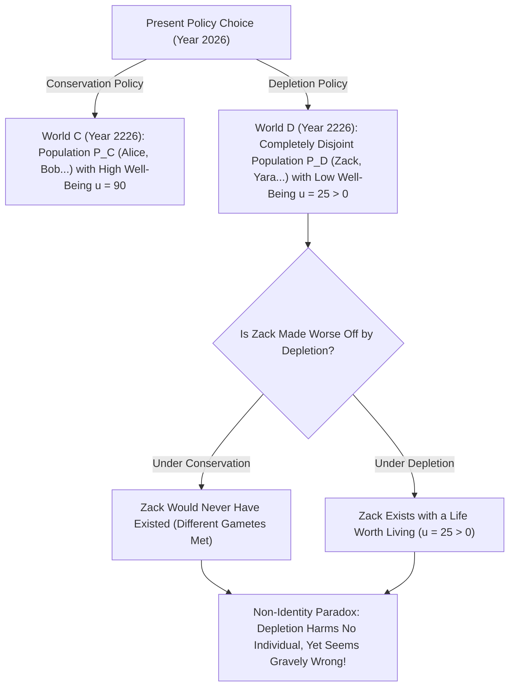
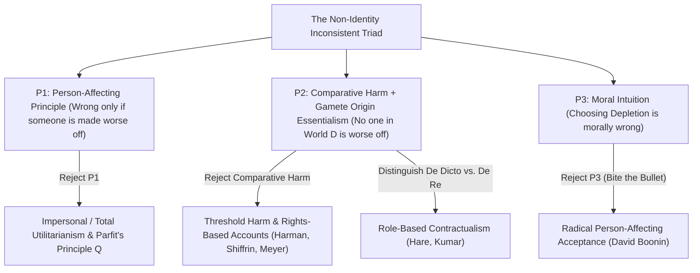

## Introducción: ¿Descansa nuestra responsabilidad hacia el futuro sobre una ilusión?

Supongamos que nuestra generación debe elegir entre dos políticas globales de energía y clima: <strong>«Conservación»</strong> y <strong>«Agotamiento (Depletion)»</strong>. Si elegimos egoístamente el Agotamiento, disfrutaremos durante treinta años de un nivel de vida ligeramente superior quemando combustibles fósiles baratos; pero dentro de doscientos años la biosfera estará gravemente degradada y los habitantes del año 2226 sufrirán una calidad de vida mucho menor (aunque sus vidas seguirán siendo dignas de ser vividas, es decir, $u > 0$).

Casi todo el mundo comparte la convicción moral de que elegir el Agotamiento es gravemente injusto porque <strong>perjudica a las generaciones futuras</strong>. Sin embargo, en el capítulo 16 de su obra maestra <strong>*Reasons and Persons</strong>* (1984), el filósofo de Oxford <strong>Derek Parfit</strong> (1942–2017) demostró que esta queja aparentemente obvia descansa sobre una ilusión lógica y biológica: si hubiéramos elegido la Conservación en lugar del Agotamiento, <strong>ni uno solo de los individuos concretos que vivirán en el año 2226 bajo el Agotamiento habría nacido jamás</strong>. Si esos ciudadanos deben su propia existencia a la política de Agotamiento y sus vidas valen la pena, ¿cómo puede haberles perjudicado o empeorado su situación dicha política? Este es el célebre <strong>problema de la no identidad (*The Non-Identity Problem*)</strong>.

---

## 1. La dependencia temporal y el esencialismo del origen: Por qué la política cambia quién existe

¿Por qué una decisión macroeconómica o ambiental altera la identidad misma de las personas futuras? La respuesta reside en la combinación de la biología reproductiva y el <strong>esencialismo del origen (*Gamete Origin Essentialism*)</strong> formulado por Saul Kripke en *El nombrar y la necesidad* (1972).
Cada ser humano procede de la fusión de <strong>un espermatozoide específico</strong> (entre $100$ y $300	ext{ millones}$) y <strong>un óvulo específico</strong>. Si una pareja concibe un hijo tan solo unos minutos o un mes antes o después, un espermatozoide completamente distinto fecundará el óvulo. El niño resultante compartiría a lo sumo el $50\,\%$ de tu ADN: sería tu hermano o hermana, ¡pero <strong>jamás tú mismo</strong>!

Parfit formuló esto como la <strong>tesis de la dependencia temporal (*Time-Dependence Claim*)</strong>: *«Si cualquier persona concreta no hubiera sido concebida dentro del mes en que de hecho fue concebida, nunca habría existido»*.
Sigamos ahora el efecto mariposa de una política energética global a lo largo de dos siglos (siete u ocho generaciones) —cambios de empleo, horarios de transporte, mudanzas y matrimonios—: el conjunto de personas vivas en 2226 bajo el Agotamiento $P(w_D)$ y el conjunto de personas vivas bajo la Conservación $P(w_C)$ tienen una <strong>intersección estrictamente vacía ($P(w_D) \cap P(w_C) = \emptyset$)</strong>.

Parfit ilustró esta paradoja con otros dos casos célebres: cuando una <strong>niña de 14 años</strong> decide tener un hijo (Billy) ahora en vez de esperar a los 24 años, no empeora la situación de *Billy*, pues a los 24 habría concebido a otro niño distinto. Del mismo modo, si se cancela un <strong>programa médico de detección preconcepcional</strong> (que aconsejaba posponer el embarazo dos meses ante una infección temporal), ninguno de los $1.000$ niños nacidos con discapacidad resulta «empeorado» por la cancelación, ya que esperar dos meses habría traído al mundo a $1.000$ niños completamente diferentes.

$$
\text{Counterfactual Harm Condition:} \quad \text{Harm}(A, p) \iff u\big(p, w(A)\big) < u\big(p, w(\neg A)\big)
$$

$$
\text{Non-Identity Condition:} \quad P\big(w(\text{Depletion})\big) \cap P\big(w(\text{Conservation})\big) = \emptyset, \qquad \forall p \in P\big(w(\text{Depletion})\big),\; u(p) > 0
$$

---

## 2. La estructura lógica: El trilema inconsistente del problema de la no identidad

El problema de la no identidad encierra tres de nuestras convicciones morales más profundas en un <strong>trilema inconsistente (*Inconsistent Triad*)</strong>:
1. <strong>Premisa P1: El principio centrado en la persona (*Person-Affecting Principle*)</strong>: Según el lema de Jan Narveson y Derek Parfit, *«lo que es malo debe ser malo para alguien»*. Una acción solo puede ser moralmente incorrecta si existe algún individuo concreto $p$ al que dañe o deje en peor situación.
2. <strong>Premisa P2: Noción comparativa contrafáctica del daño + No identidad</strong>: Un acto $A$ daña a una persona $p$ si y solo si el bienestar de $p$ en el mundo con $A$ es menor que su bienestar en el mundo contrafáctico sin $A$: $u(p, w(A)) < u(p, w(
eg A))$. Como ningún habitante $p \in P(w_D)$ existe en $w_C$, y tener una vida digna de ser vivida ($u > 0$) no es peor que no existir jamás, <strong>el Agotamiento no daña ni empeora a ningún individuo</strong>.
3. <strong>Premisa P3: Inmoralidad del Agotamiento (y la «tesis de la no diferencia» / *No-Difference View*)</strong>: Elegir el Agotamiento (o cancelar el programa preconcepcional) es gravemente inmoral.

Dado que $(P_1 \land P_2) \implies 
eg P_3$, toda teoría ética coherente debe rechazar o modificar al menos una de estas tres premisas.

---

## 3. Cinco salidas filosóficas y su impacto en la economía climática y CRISPR

Se han desarrollado cinco grandes estrategias para resolver el problema de la no identidad:
1. <strong>Salida 1 (Rechazo de P1): Ética impersonal y el «Principio Q» de Parfit</strong>: Parfit sostiene que, a igual número de personas, el mundo con menor calidad de vida es moralmente peor aunque vivan individuos distintos. Pero cuando varía el tamaño de la población (la búsqueda de la «Teoría X»), este enfoque desemboca en la <strong>«Conclusión repugnante (*Repugnant Conclusion*)»</strong> (véase el artículo #17).
2. <strong>Salida 2 (Modificación de P2a): Daño de umbral (*Threshold Harm*) y derechos (Meyer, Harman, Shiffrin)</strong>: Lukas Meyer y Elizabeth Harman sostienen que se daña a alguien cuando se le hace existir <strong>por debajo de un umbral normativo de dignidad $u_{	ext{thresh}}$</strong>. Debilidad: si el Agotamiento solo reduce el bienestar futuro de «excelente ($u=95$)» a «aceptable por encima del umbral ($u=50 > u_{	ext{thresh}}$)», ¡la teoría del umbral lo declara totalmente permisible!
3. <strong>Salida 3 (Modificación de P2b): Obligaciones *de dicto* vs. *de re* y contractualismo (Caspar Hare, Rahul Kumar)</strong>: Nuestros deberes morales no se deben a un individuo genético específico (*de re*), sino al <strong>rol u oficio normativo (*Office* / *de dicto*)</strong> de «mi futuro hijo» o «ciudadano del siglo XXIII».
4. <strong>Salida 4: Ética de las virtudes (Hursthouse)</strong>: El Agotamiento es incorrecto porque expresa vicios como la codicia y la irresponsabilidad.
5. <strong>Salida 5 (Rechazo de P3): «Morder la bala» (*Biting the Bullet*, David Boonin 2014)</strong>: Boonin argumenta que todos los intentos de refutación fracasan y debemos aceptar que el Agotamiento <strong>no es moralmente incorrecto</strong> mientras las vidas futuras merezcan ser vividas.

En la práctica, este problema resulta decisivo en tres debates actuales: (1) <strong>la tasa social de descuento en la economía del cambio climático ($r = \delta + \eta g$)</strong> (Nordhaus frente al Informe Stern sobre $\delta = 0$); (2) <strong>la bioética reproductiva</strong> (la edición genética CRISPR en un embrión existente beneficia a *ese* individuo, mientras que la selección embrionaria DGP sustituye un individuo por *otro*); y (3) <strong>las reparaciones históricas</strong> (basadas en la injusticia distributiva continua del Estado hacia cada nueva generación).

| Estrategia / Filósofo | Premisa rechazada | Mecanismo central | ¿Condena el Agotamiento sobre el umbral? | Coste teórico principal |
| :--- | :--- | :--- | :--- | :--- |
| <strong>Principio impersonal $Q$ (Parfit 1984)</strong> | Rechaza P1 (centrado en la persona) | Compara el bienestar agregado entre mundos posibles | <strong>Sí</strong> ($u=90 \succ u=50$) | Conduce a la *Conclusión repugnante* con población variable |
| <strong>Daño de umbral y derechos (Meyer, Harman)</strong> | Modifica P2 (daño comparativo) | Daño = existir bajo el umbral de dignidad $u_{	ext{thresh}}$ | <strong>No</strong> (falla si $u=50 > u_{	ext{thresh}}$) | Permite gran degradación por encima del umbral |
| <strong>Contractualismo *de dicto* (Hare, Kumar)</strong> | Modifica P2 (objeto de referencia) | Deberes hacia *roles/cargos* («futuro ciudadano») | <strong>Sí</strong> (viola expectativas legítimas del rol) | ¿Por qué atribuir estatus moral a descripciones lingüísticas? |
| <strong>Ética de las virtudes (Hursthouse)</strong> | Rechaza P1 (consecuencialismo) | Evalúa el carácter del agente (egoísmo vs. cuidado) | <strong>Sí</strong> | Centra la falta en *el alma del agente* y no en las víctimas |
| <strong>Aceptación radical (David Boonin 2014)</strong> | Rechaza P3 (intuición moral) | Acepta que el Agotamiento y el caso B son permisibles | N/A (niega la falta moral) | Choca frontalmente con el consenso sobre justicia climática |

$$
\text{Social Discount Rate (Ramsey Formula):} \quad r = \delta + \eta g
$$

$$
W_{\text{impersonal}}(w) = \sum_{p \in P(w)} u(p), \qquad \text{De Dicto Duty:} \quad \text{Obligation}\big(\text{Office}(\text{Future Child})\big) \neq \text{Obligation}(p_{\text{specific}})
$$
