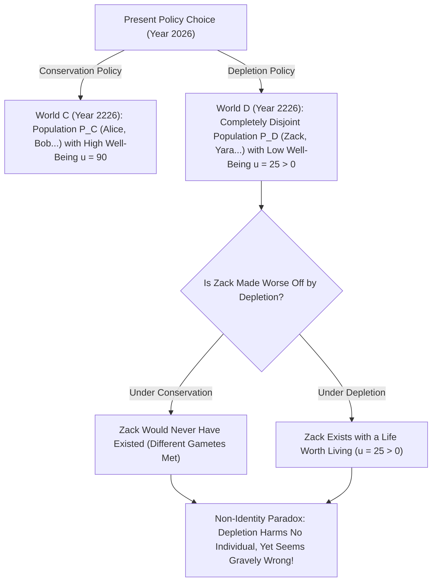
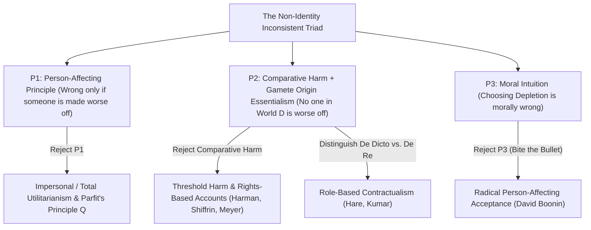

## Introduction : Notre responsabilité envers les générations futures repose-t-elle sur une illusion ?

Supposons que notre génération doive choisir entre deux politiques mondiales en matière d'énergie et de climat : la <strong>« Conservation »</strong> et l'<strong>« Épuisement (Depletion) »</strong>. Si nous choisissons égoïstement l'Épuisement, notre niveau de vie sera légèrement supérieur pendant trente ans grâce aux énergies fossiles bon marché ; mais dans deux cents ans, la biosphère sera gravement dégradée et les habitants de l'an 2226 subiront une qualité de vie nettement inférieure (tout en ayant néanmoins une vie qui vaut la peine d'être vécue, soit $u > 0$).

Presque tout le monde partage la conviction morale profonde que choisir l'Épuisement est gravement injuste parce que cela <strong>nuit aux générations futures</strong>. Pourtant, au chapitre 16 de son chef-d'œuvre <strong>*Reasons and Persons</strong>* (1984), le philosophe d'Oxford <strong>Derek Parfit</strong> (1942–2017) a démontré que cette plainte apparemment évidente repose sur une illusion logique et biologique : si nous avions choisi la Conservation plutôt que l'Épuisement, <strong>pas un seul des individus précis vivant en 2226 dans le monde de l'Épuisement ne serait jamais venu au monde</strong> ! Dès lors que ces citoyens doivent leur existence même à la politique d'Épuisement et que leur vie vaut la peine d'être vécue, comment cette politique aurait-elle pu leur nuire ou détériorer leur sort ? Tel est le célèbre <strong>problème de la non-identité (*The Non-Identity Problem*)</strong>.

---

## 1. Dépendance temporelle et essentialisme de l'origine : Pourquoi la politique change qui existe

Pourquoi un choix macroéconomique ou écologique modifie-t-il l'identité même des personnes futures ? La réponse tient à la rencontre entre la biologie de la reproduction et l'<strong>essentialisme de l'origine (*Gamete Origin Essentialism*)</strong> formulé par Saul Kripke dans *La Logique des noms propres* (1972).
Chaque être humain résulte de la fusion d'<strong>un spermatozoïde spécifique</strong> (parmi $100$ à $300	ext{ millions}$) et d'<strong>un ovule spécifique</strong>. Si un couple conçoit un enfant ne serait-ce que quelques minutes ou un mois plus tôt ou plus tard, c'est un tout autre spermatozoïde qui féconde l'ovule. L'enfant qui en naîtrait partagerait au plus $50\,\%$ de votre ADN — ce serait votre frère ou votre sœur, mais <strong>jamais vous-même</strong> !

Parfit a résumé ce fait sous le nom de <strong>thèse de la dépendance temporelle (*Time-Dependence Claim*)</strong> : *« Si une personne particulière n'avait pas été conçue dans le mois où elle l'a effectivement été, elle n'aurait en fait jamais existé. »*
Suivons maintenant l'effet papillon d'une politique énergétique mondiale sur deux siècles (sept à huit générations) — horaires de train modifiés, mutations professionnelles, rencontres différentes : l'ensemble des personnes vivant en 2226 sous l'Épuisement $P(w_D)$ et l'ensemble des personnes vivant sous la Conservation $P(w_C)$ ont une <strong>intersection strictement vide ($P(w_D) \cap P(w_C) = \emptyset$)</strong> !

Parfit a illustré ce mécanisme par deux autres cas célèbres : lorsqu'une <strong>adolescente de 14 ans</strong> décide d'avoir un enfant (Billy) immédiatement plutôt que d'attendre ses 24 ans, elle ne rend pas le sort de *Billy* pire — car à 24 ans, elle aurait donné naissance à un tout autre enfant. De même, si l'on supprime un <strong>programme de dépistage préconceptionnel</strong> (qui conseillait aux femmes atteintes d'une infection temporaire de différer leur grossesse de deux mois), aucun des $1\,000$ enfants nés avec un handicap n'est « rendu pire » par cette suppression, puisque deux mois plus tard, ce sont $1\,000$ autres enfants qui auraient été conçus !

$$
\text{Counterfactual Harm Condition:} \quad \text{Harm}(A, p) \iff u\big(p, w(A)\big) < u\big(p, w(\neg A)\big)
$$

$$
\text{Non-Identity Condition:} \quad P\big(w(\text{Depletion})\big) \cap P\big(w(\text{Conservation})\big) = \emptyset, \qquad \forall p \in P\big(w(\text{Depletion})\big),\; u(p) > 0
$$

---

## 2. La structure logique : Le trilemme incohérent du problème de la non-identité

Le problème de la non-identité enferme trois de nos intuitions morales les plus fondamentales dans un <strong>trilemme incohérent (*Inconsistent Triad*)</strong> :
1. <strong>Prémisse P1 : Le principe centré sur la personne (*Person-Affecting Principle*)</strong> : Selon l'adage de Jan Narveson et Derek Parfit, *« ce qui est mauvais doit être mauvais pour quelqu'un »*. Une action ne peut être moralement répréhensible que s'il existe une personne particulière $p$ qu'elle lèse ou dont elle empire le sort.
2. <strong>Prémisse P2 : Conception comparative contrefactuelle du tort + Non-identité</strong> : Une action $A$ nuit à une personne $p$ si et seulement si le bien-être de $p$ dans le monde où $A$ a lieu est inférieur à son bien-être dans le monde contrefactuel sans $A$ : $u(p, w(A)) < u(p, w(
eg A))$. Or, aucun habitant $p \in P(w_D)$ n'existe dans le monde $w_C$, et avoir une vie digne d'être vécue ($u > 0$) n'est pas pire que le néant. Donc <strong>l'Épuisement ne nuit à aucun individu</strong>.
3. <strong>Prémisse P3 : Condamnation morale de l'Épuisement (et « thèse de l'absence de différence » / *No-Difference View*)</strong> : Choisir l'Épuisement (ou supprimer le dépistage préconceptionnel) est une faute morale grave.

Puisque $(P_1 \land P_2) \implies 
eg P_3$, toute éthique cohérente doit abandonner ou réviser au moins l'une de ces trois prémisses !

---

## 3. Cinq issues philosophiques et leurs enjeux pour l'économie du climat et CRISPR

Cinq grandes stratégies ont été élaborées pour résoudre le problème de la non-identité :
1. <strong>Issue 1 (Rejet de P1) : Éthique impersonnelle et « Principe Q » de Parfit</strong> : Parfit soutient qu'à nombre égal d'individus, le monde où la qualité de vie moyenne/totale est plus basse est moralement pire, même si les individus sont différents. Mais dès que la taille de la population varie (la quête de la « Théorie X »), ce principe mène tout droit à la <strong>« Conclusion répugnante (*Repugnant Conclusion*) »</strong> (voir l'article #17).
2. <strong>Issue 2 (Révision de P2a) : Tort-seuil (*Threshold Harm*) et droits (Meyer, Harman, Shiffrin)</strong> : Lukas Meyer et Elizabeth Harman affirment qu'on lèse une personne dès lors qu'on la fait exister <strong>en dessous d'un seuil normatif de dignité $u_{	ext{thresh}}$</strong>, sans besoin de comparaison contrefactuelle. Limite : si l'Épuisement fait seulement chuter le bien-être futur de « très élevé ($u=95$) » à « moyen mais supérieur au seuil ($u=50 > u_{	ext{thresh}}$) », cette théorie le juge parfaitement permis !
3. <strong>Issue 3 (Révision de P2b) : Obligations *de dicto* vs. *de re* et contractualisme (Caspar Hare, Rahul Kumar)</strong> : Nos devoirs moraux ne visent pas tel individu génétique (*de re*), mais le <strong>rôle ou statut normatif (*Office* / *de dicto*)</strong> de « mon futur enfant » ou de « citoyen du XXIIIe siècle ».
4. <strong>Issue 4 : Éthique des vertus (Hursthouse)</strong> : L'Épuisement est condamnable car il manifeste l'avidité et l'irresponsabilité des agents présents.
5. <strong>Issue 5 (Rejet de P3) : « Avaler la couleuvre » (*Biting the Bullet*, David Boonin 2014)</strong> : Boonin soutient que toutes les tentatives de réfutation échouent et qu'il faut accepter que l'Épuisement n'a <strong>rien de moralement répréhensible</strong> tant que les générations futures ont une vie qui vaut la peine d'être vécue !

Ces débats ont un impact direct sur trois enjeux contemporains majeurs : (1) <strong>le taux d'actualisation social en économie du climat ($r = \delta + \eta g$)</strong> (la controverse Nordhaus vs. Stern sur $\delta = 0$) ; (2) <strong>la bioéthique de la reproduction</strong> (la thérapie génique CRISPR sur un embryon existant améliore le sort de *cet* individu, tandis que le diagnostic préimplantatoire DPI sélectionne un *autre* individu) ; et (3) <strong>les réparations historiques</strong> (fondées sur le manquement continu de l'État envers chaque nouvelle génération de citoyens).

| Stratégie / Philosophe | Prémisse rejetée | Mécanisme central | Condamne l'Épuisement au-dessus du seuil ? | Coût théorique principal |
| :--- | :--- | :--- | :--- | :--- |
| <strong>Principe impersonnel $Q$ (Parfit 1984)</strong> | Rejette P1 (centré sur la personne) | Compare le bien-être global entre mondes possibles | <strong>Oui</strong> ($u=90 \succ u=50$) | Conduit à la *Conclusion répugnante* à population variable |
| <strong>Tort-seuil & Droits (Meyer, Harman)</strong> | Modifie P2 (tort comparatif) | Tort = existence sous le seuil de dignité $u_{	ext{thresh}}$ | <strong>Non</strong> (échoue si $u=50 > u_{	ext{thresh}}$) | Permet une forte dégradation au-dessus du seuil |
| <strong>Contractualisme *de dicto* (Hare, Kumar)</strong> | Modifie P2 (objet de référence) | Devoirs envers des *rôles/statuts* (« citoyen futur ») | <strong>Oui</strong> (viole l'attente légitime du rôle) | Pourquoi attacher le statut moral à une description abstraite ? |
| <strong>Éthique des vertus (Hursthouse)</strong> | Rejette P1 (conséquentialisme) | Évalue le caractère vicieux ou vertueux de l'agent | <strong>Oui</strong> | Déplace la faute vers *l'âme de l'agent* plutôt que vers les victimes |
| <strong>Acceptation radicale (David Boonin 2014)</strong> | Rejette P3 (intuition morale) | Admet que l'Épuisement et le cas B sont moralement permis | N/A (nie la faute morale) | Heurte de plein fouet le consensus sur la justice climatique |

$$
\text{Social Discount Rate (Ramsey Formula):} \quad r = \delta + \eta g
$$

$$
W_{\text{impersonal}}(w) = \sum_{p \in P(w)} u(p), \qquad \text{De Dicto Duty:} \quad \text{Obligation}\big(\text{Office}(\text{Future Child})\big) \neq \text{Obligation}(p_{\text{specific}})
$$
