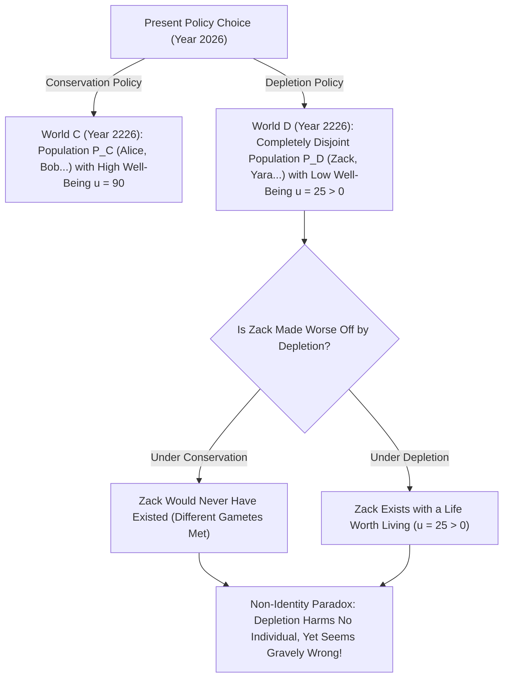
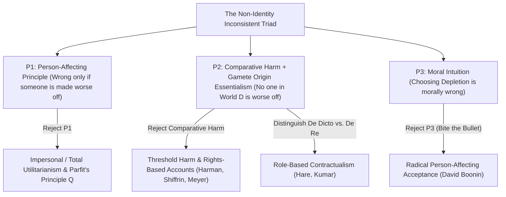

## प्रस्तावना: क्या भावी पीढ़ियों के प्रति हमारा नैतिक दायित्व एक भ्रम पर टिका है?

मान लीजिए कि हमारी पीढ़ी को दो वैश्विक ऊर्जा और जलवायु नीतियों में से एक को चुनना है: <strong>‘संरक्षण नीति (Conservation)’</strong> और <strong>‘दोहन नीति (Depletion)’</strong>। यदि हम स्वार्थवश दोहन नीति चुनते हैं, तो अगले तीस वर्षों तक सस्ते जीवाश्म ईंधन जलाकर हम थोड़ा अधिक आरामदायक जीवन जी सकेंगे; किंतु दो सौ वर्ष बाद पृथ्वी का जीवमंडल बुरी तरह क्षतिग्रस्त हो जाएगा और सन् 2226 में रहने वाले लोगों के जीवन की गुणवत्ता बहुत गिर जाएगी (यद्यपि उनका जीवन फिर भी जीने योग्य रहेगा, अर्थात $u > 0$)।

लगभग हर व्यक्ति का नैतिक अंतर्ज्ञान कहता है कि दोहन नीति चुनना घोर अनैतिक है क्योंकि यह <strong>भावी पीढ़ियों को नुकसान (harm) पहुँचाती है</strong>। किंतु ऑक्सफोर्ड के महान दार्शनिक <strong>डेरेक पारफिट (Derek Parfit, 1942–2017)</strong> ने अपनी 1984 की कालजयी कृति <strong>*Reasons and Persons</strong>* (*कारण और व्यक्ति*) के अध्याय 16 में सिद्ध किया कि यह सहज शिकायत एक गहरे तार्किक और जैविक भ्रम पर आधारित है: यदि हमने दोहन के बजाय संरक्षण नीति को चुना होता, तो सन् 2226 में ‘दोहन वाली दुनिया’ में रहने वाले अरबों विशिष्ट व्यक्तियों में से <strong>एक भी व्यक्ति का जन्म कभी हुआ ही नहीं होता</strong>! यदि वे नागरिक अपने अस्तित्व के लिए ही दोहन नीति के ऋणी हैं और उनका जीवन जीने योग्य है, तो दोहन नीति ने उन्हें ‘नुकसान’ कैसे पहुँचाया या उनकी स्थिति बदतर कैसे की? यही आधुनिक नीतिशास्त्र की सबसे प्रसिद्ध पहेली — <strong>गैर-पहचान समस्या (The Non-Identity Problem)</strong> है।

---

## 1. समय-निर्भरता दावा और उत्पत्ति अनिवार्यतावाद: नीतियाँ यह कैसे बदल देती हैं कि कौन अस्तित्व में आएगा?

कोई आर्थिक या पर्यावरणीय नीति भविष्य में पैदा होने वाले लोगों की पहचान (identity) को पूरी तरह कैसे बदल देती है? इसका उत्तर प्रजनन जीवविज्ञान और सॉल क्रिप्की (Saul Kripke) द्वारा *Naming and Necessity* (1972) में प्रतिपादित <strong>उत्पत्ति अनिवार्यतावाद (Gamete Origin Essentialism)</strong> के संगम में निहित है।
प्रत्येक विशिष्ट मनुष्य <strong>एक विशिष्ट शुक्राणु</strong> ($10	ext{–}30	ext{ करोड़}$ में से एक) और <strong>एक विशिष्ट अंडाणु</strong> के मिलन से बनता है। यदि माता-पिता के गर्भधारण का समय कुछ मिनट या एक महीना भी आगे-पीछे हो जाए, तो अंडाणु को एक बिल्कुल अलग शुक्राणु निषेचित करेगा। उससे पैदा होने वाला बच्चा आपके साथ अधिकतम $50\,\%$ डीएनए साझा करेगा — वह आपका भाई या बहन होगा, किंतु <strong>कभी भी आप स्वयं नहीं होंगे</strong>!

पारफिट ने इसे <strong>समय-निर्भरता दावा (Time-Dependence Claim)</strong> के रूप में सूत्रबद्ध किया: *“यदि किसी विशिष्ट व्यक्ति का गर्भधारण उस समय के एक महीने के भीतर न हुआ होता जब वह वास्तव में हुआ था, तो वह व्यक्ति वास्तव में कभी अस्तित्व में ही नहीं आता।”*
अब दो शताब्दियों (सात से आठ पीढ़ियों) में वैश्विक ऊर्जा नीति के तितली प्रभाव (butterfly effect) पर विचार करें — कौन से कारखाने खुलते हैं, ट्रेन की समय-सारणी क्या है, युवा किस शहर में नौकरी करते हैं और किस शाम किससे मिलते हैं: सन् 2226 में दोहन संसार $w_D$ में जीवित लोगों के समुच्चय $P(w_D)$ और संरक्षण संसार $w_C$ में जीवित लोगों के समुच्चय $P(w_C)$ का <strong>प्रतिच्छेदन पूर्णतः रिक्त ($P(w_D) \cap P(w_C) = \emptyset$)</strong> है!

पारफिट ने इसे दो अन्य प्रसिद्ध उदाहरणों से स्पष्ट किया: जब एक <strong>14 वर्षीय किशोरी</strong> 24 वर्ष की होने तक प्रतीक्षा करने के बजाय अभी बच्चा (बिली) पैदा करने का निर्णय लेती है, तो वह *बिली* की स्थिति को बदतर नहीं बनाती — क्योंकि 24 वर्ष की आयु में उसने किसी बिल्कुल अलग बच्चे को जन्म दिया होता। इसी प्रकार, यदि <strong>गर्भधारण-पूर्व जाँच कार्यक्रम (Preconception Testing)</strong> रद्द कर दिया जाए (जो महिलाओं को अस्थायी संक्रमण के दौरान गर्भधारण दो महीने टालने की सलाह देता था), तो विकलांग पैदा हुए $1,000$ बच्चों में से किसी एक की भी स्थिति कार्यक्रम रद्द होने से ‘बदतर’ नहीं हुई, क्योंकि दो महीने रुकने पर $1,000$ बिल्कुल अलग बच्चे पैदा होते!

$$
\text{Counterfactual Harm Condition:} \quad \text{Harm}(A, p) \iff u\big(p, w(A)\big) < u\big(p, w(\neg A)\big)
$$

$$
\text{Non-Identity Condition:} \quad P\big(w(\text{Depletion})\big) \cap P\big(w(\text{Conservation})\big) = \emptyset, \qquad \forall p \in P\big(w(\text{Depletion})\big),\; u(p) > 0
$$

---

## 2. तार्किक संरचना: गैर-पहचान समस्या की असंगत त्रयी (Inconsistent Triad)

गैर-पहचान समस्या हमारे तीन सबसे मजबूत नैतिक सिद्धांतों को एक तार्किक विरोधाभास — <strong>असंगत त्रयी (Inconsistent Triad)</strong> — में फँसा देती है:
1. <strong>आधारवाक्य P1: व्यक्ति-प्रभावी सिद्धांत (Person-Affecting Principle)</strong>: जन नार्वेसन और पारफिट के शब्दों में, *“जो बुरा है, वह किसी व्यक्ति के लिए बुरा होना चाहिए।”* कोई कार्य नैतिक रूप से तभी गलत हो सकता है जब कोई विशिष्ट व्यक्ति $p$ हो जिसे उस कार्य से नुकसान पहुँचा हो या जिसकी स्थिति बदतर हुई हो।
2. <strong>आधारवाक्य P2: नुकसान की प्रति-तथ्यात्मक तुलनात्मक परिभाषा + गैर-पहचान</strong>: कार्य $A$ व्यक्ति $p$ को तभी नुकसान पहुँचाता है जब $A$ वाली दुनिया में $p$ का कल्याण $A$ के बिना वाली प्रति-तथ्यात्मक दुनिया से कम हो: $u(p, w(A)) < u(p, w(
eg A))$। चूँकि $p \in P(w_D)$ का कोई भी व्यक्ति दुनिया $w_C$ में मौजूद ही नहीं है, और जीने योग्य जीवन ($u > 0$) अनस्तित्व से बदतर नहीं है, इसलिए <strong>दोहन नीति किसी भी व्यक्ति को नुकसान नहीं पहुँचाती</strong>।
3. <strong>आधारवाक्य P3: दोहन नीति की अनैतिकता (तथा ‘अंतर-हीनता दृष्टिकोण’ / No-Difference View)</strong>: दोहन नीति चुनना (या गर्भधारण-पूर्व जाँच रद्द करना) गंभीर रूप से अनैतिक है।

चूँकि $(P_1 \land P_2) \implies 
eg P_3$, इसलिए किसी भी सुसंगत नीतिशास्त्र को इन तीन आधारवाक्यों में से कम से कम एक को त्यागना या संशोधित करना ही होगा!

---

## 3. पाँच दार्शनिक समाधान और जलवायु अर्थशास्त्र व CRISPR जीन एडिटिंग पर उनका प्रभाव

गैर-पहचान समस्या को हल करने के लिए पाँच प्रमुख दार्शनिक मार्ग विकसित किए गए हैं:
1. <strong>मार्ग 1 (P1 का त्याग): अवैयक्तिक नीतिशास्त्र और पारफिट का ‘समान-संख्या गुणवत्ता सिद्धांत Q (Principle Q)’</strong>: पारफिट का तर्क है कि यदि दो संभावित दुनियाओं में लोगों की संख्या समान है, तो कम जीवन-गुणवत्ता वाली दुनिया नैतिक रूप से बदतर है, भले ही वहाँ अलग व्यक्ति रहते हों। किंतु जब जनसंख्या का आकार बदलता है (‘सिद्धांत X’ की खोज), तो यह दृष्टिकोण सीधे <strong>‘घृणित निष्कर्ष (Repugnant Conclusion)’</strong> (देखें लेख #17) की ओर ले जाता है।
2. <strong>मार्ग 2 (P2a में संशोधन): देहलीज नुकसान (Threshold Harm) और अधिकार (मेयर, हरमन, शिफरिन)</strong>: लुकास मेयर और एलिजाबेथ हरमन मानते हैं कि किसी व्यक्ति को तब नुकसान पहुँचता है जब हमारा कार्य उसे <strong>मानवीय गरिमा की न्यूनतम देहलीज $u_{	ext{thresh}}$ से नीचे</strong> के जीवन में जन्म लेने के लिए बाध्य करता है। कमजोरी: यदि दोहन नीति भविष्य के कल्याण को ‘अत्यंत समृद्ध ($u=95$)’ से घटाकर ‘देहलीज से ऊपर सामान्य ($u=50 > u_{	ext{thresh}}$)’ कर दे, तो देहलीज सिद्धांत इसे पूरी तरह वैध ठहराता है!
3. <strong>मार्ग 3 (P2b में संशोधन): *De Dicto* बनाम *De Re* कर्तव्य और संविदावाद (कैस्पर हेयर, राहुल कुमार)</strong>: हमारे नैतिक कर्तव्य किसी विशिष्ट आनुवंशिक व्यक्ति (*de re*) के प्रति नहीं, बल्कि ‘मेरे भावी बच्चे’ या ‘23वीं सदी के नागरिक’ की <strong>मानकीय भूमिका/पद (*Office* / *de dicto*)</strong> के प्रति होते हैं।
4. <strong>मार्ग 4: सद्गुण नीतिशास्त्र (हर्स्टहाउस)</strong>: दोहन नीति गलत है क्योंकि यह लालच और गैर-जिम्मेदारी के दुर्गुण को दर्शाती है।
5. <strong>मार्ग 5 (P3 का त्याग): ‘गोली चबाना’ (Biting the Bullet, डेविड बूनिन 2014)</strong>: बूनिन तर्क देते हैं कि सभी समाधान विफल हैं और हमें स्वीकार करना चाहिए कि जब तक भावी पीढ़ियों का जीवन जीने योग्य है, दोहन नीति नैतिक रूप से <strong>बिल्कुल गलत नहीं है</strong>!

व्यावहारिक रूप से यह समस्या आज तीन बड़े क्षेत्रों की नीति तय करती है: (1) <strong>जलवायु परिवर्तन अर्थशास्त्र में सामाजिक बट्टा दर (Social Discount Rate $r = \delta + \eta g$)</strong> (नॉर्डहॉस बनाम स्टर्न रिपोर्ट का $\delta = 0$ विवाद); (2) <strong>प्रजनन जैव-नीतिशास्त्र</strong> (मौजूदा भ्रूण में CRISPR जीन सुधार *उसी* बच्चे का उपचार है, जबकि PGD द्वारा स्वस्थ भ्रूण का चयन *दूसरे व्यक्ति* को जन्म देना है); और (3) <strong>ऐतिहासिक अन्याय और क्षतिपूर्ति</strong> (राज्य द्वारा प्रत्येक नई पीढ़ी के नागरिकों के प्रति न्यायपूर्ण वितरण में निरंतर विफलता)।

| समाधान मार्ग / दार्शनिक | त्यागा गया आधारवाक्य | मुख्य सैद्धांतिक तंत्र | क्या देहलीज से ऊपर दोहन की निंदा करता है? | मुख्य सैद्धांतिक कीमत / सीमा |
| :--- | :--- | :--- | :--- | :--- |
| <strong>अवैयक्तिक सिद्धांत $Q$ (Parfit 1984)</strong> | P1 का त्याग (व्यक्ति-प्रभावी) | संभावित दुनियाओं के कुल कल्याण की तुलना करता है | <strong>हाँ</strong> ($u=90 \succ u=50$) | परिवर्ती जनसंख्या में *घृणित निष्कर्ष* को जन्म देता है |
| <strong>देहलीज नुकसान व अधिकार (Meyer, Harman)</strong> | P2 में संशोधन (तुलनात्मक नुकसान) | नुकसान = गरिमा देहलीज $u_{	ext{thresh}}$ से नीचे अस्तित्व | <strong>नहीं</strong> ($u=50 > u_{	ext{thresh}}$ होने पर विफल) | देहलीज से ऊपर भारी पतन को अनुमति दे देता है |
| <strong>*De Dicto* संविदावाद (Hare, Kumar)</strong> | P2 में संशोधन (संदर्भ वस्तु) | कर्तव्य *भूमिका/पद* (‘भावी नागरिक’) के प्रति हैं | <strong>हाँ</strong> (भूमिका की वैध अपेक्षा का उल्लंघन) | नैतिक दर्जा मूर्त व्यक्ति के बजाय अमूर्त पद से क्यों जुड़े? |
| <strong>सद्गुण नीतिशास्त्र (Hursthouse)</strong> | P1 का त्याग (परिणामवाद) | कर्ता के चरित्र (लालच बनाम देखभाल) का मूल्यांकन | <strong>हाँ</strong> | दोष का केंद्र पीड़ितों के बजाय *कर्ता की आत्मा* बन जाता है |
| <strong>उग्र स्वीकारोक्ति (David Boonin 2014)</strong> | P3 का त्याग (नैतिक अंतर्ज्ञान) | दोहन नीति और केस B को नैतिक रूप से वैध मानता है | लागू नहीं (गलती से इनकार) | जलवायु न्याय और लोक स्वास्थ्य की सर्वसम्मति के विरुद्ध |

$$
\text{Social Discount Rate (Ramsey Formula):} \quad r = \delta + \eta g
$$

$$
W_{\text{impersonal}}(w) = \sum_{p \in P(w)} u(p), \qquad \text{De Dicto Duty:} \quad \text{Obligation}\big(\text{Office}(\text{Future Child})\big) \neq \text{Obligation}(p_{\text{specific}})
$$
