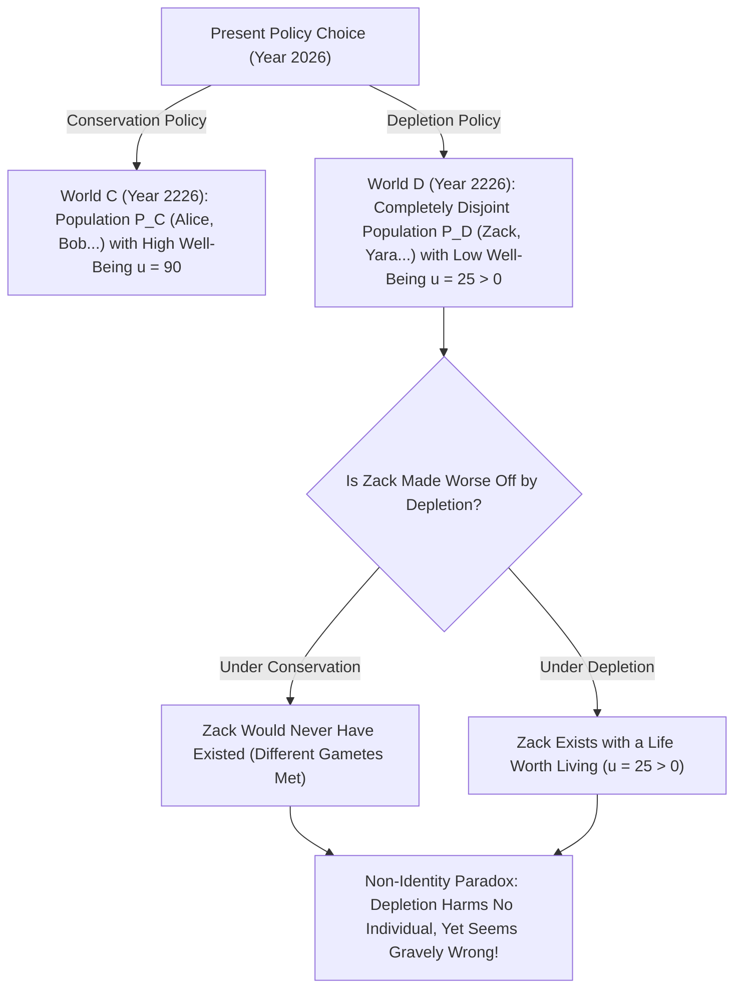
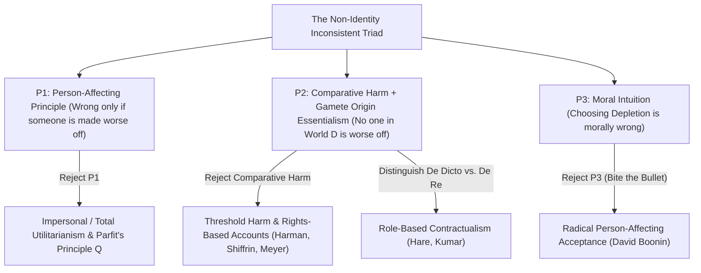

## Pendahuluan: Apakah Tanggung Jawab Kita terhadap Generasi Masa Depan Berdiri di Atas Ilusi?

Bayangkan generasi kita harus memilih satu dari dua kebijakan energi dan iklim global: <strong>“Konservasi (Conservation)”</strong> dan <strong>“Pengurasan (Depletion)”</strong>. Jika kita secara egois memilih Pengurasan, standar hidup kita selama tiga dekade ke depan akan sedikit lebih tinggi berkat bahan bakar fosil murah; namun dua ratus tahun lagi biosfer Bumi akan rusak parah dan penduduk tahun 2226 akan mengalami kualitas hidup yang jauh lebih rendah (meskipun hidup mereka secara keseluruhan masih layak dijalani, yakni $u > 0$).

Hampir setiap orang memiliki intuisi moral yang kuat bahwa memilih Pengurasan adalah kesalahan besar karena <strong>merugikan generasi masa depan</strong>. Namun, dalam Bab 16 mahakaryanya <strong>*Reasons and Persons</strong>* (1984), filsuf Oxford <strong>Derek Parfit</strong> (1942–2017) membuktikan bahwa keluhan yang tampak jelas ini berdiri di atas ilusi logis dan biologis: seandainya kita memilih Konservasi alih-alih Pengurasan, <strong>tak satu pun dari individu spesifik yang hidup pada tahun 2226 di dunia Pengurasan akan pernah dilahirkan sama sekali</strong>! Jika warga masa depan itu berutang keberadaan mereka pada kebijakan Pengurasan dan hidup mereka layak dijalani, bagaimana mungkin kebijakan Pengurasan telah “merugikan” atau memperburuk keadaan mereka? Inilah <strong>Masalah Non-Identitas (*The Non-Identity Problem*)</strong> yang legendaris.

---

## 1. Klaim Ketergantungan Waktu & Esensialisme Asal-Usul: Mengapa Kebijakan Mengubah Siapa yang Ada

Mengapa sebuah kebijakan ekonomi atau lingkungan mengubah identitas orang-orang di masa depan? Jawabannya terletak pada perpaduan biologi reproduksi dan <strong>Esensialisme Asal-Usul (*Gamete Origin Essentialism*)</strong> yang dirumuskan Saul Kripke dalam *Naming and Necessity* (1972).
Setiap manusia berasal dari peleburan <strong>satu sperma spesifik</strong> (dari sekitar $100	ext{–}300	ext{ juta}$ sperma) dan <strong>satu sel telur spesifik</strong>. Jika sepasang suami-istri melakukan pembuahan beberapa menit atau satu bulan lebih cepat atau lebih lambat saja, sperma yang sama sekali berbeda akan membuahi sel telur. Anak yang lahir dari sana paling banyak berbagi $50\,\%$ DNA Anda — ia adalah saudara kandung Anda, tetapi <strong>sama sekali bukan diri Anda</strong>!

Parfit merumuskan fakta ini sebagai <strong>Klaim Ketergantungan Waktu (*Time-Dependence Claim*)</strong>: *“Jika seseorang tidak dikandung dalam rentang satu bulan dari waktu ketika ia 실제로 dikandung, ia sesungguhnya tidak akan pernah ada.”*
Sekarang ikuti efek kupu-kupu dari kebijakan energi global selama dua abad (tujuh hingga delapan generasi) — perubahan pabrik, jadwal kereta, perpindahan kerja, dan pertemuan pasangan: himpunan manusia yang hidup pada tahun 2226 di bawah Pengurasan $P(w_D)$ dan himpunan manusia di bawah Konservasi $P(w_C)$ memiliki <strong>irisan yang benar-benar kosong ($P(w_D) \cap P(w_C) = \emptyset$)</strong>!

Parfit mempertajam paradoks ini lewat dua kasus terkenal lainnya: ketika seorang <strong>gadis 14 tahun</strong> memutuskan melahirkan anak (Billy) sekarang alih-alih menunggu hingga usia 24 tahun, ia tidak membuat keadaan *Billy* lebih buruk — sebab pada usia 24 tahun ia akan melahirkan anak yang sama sekali berbeda. Demikian pula, jika pemerintah membatalkan <strong>program skrining prakonsepsi</strong> (yang menyarankan wanita menunda kehamilan dua bulan saat terinfeksi sementara), tak satu pun dari $1.000$ anak yang lahir cacat dibuat “lebih buruk” oleh pembatalan tersebut, karena penundaan dua bulan akan melahirkan $1.000$ anak yang berbeda sama sekali!

$$
\text{Counterfactual Harm Condition:} \quad \text{Harm}(A, p) \iff u\big(p, w(A)\big) < u\big(p, w(\neg A)\big)
$$

$$
\text{Non-Identity Condition:} \quad P\big(w(\text{Depletion})\big) \cap P\big(w(\text{Conservation})\big) = \emptyset, \qquad \forall p \in P\big(w(\text{Depletion})\big),\; u(p) > 0
$$

---

## 2. Struktur Logis: Trilema Tak-Konsisten Masalah Non-Identitas

Masalah Non-Identitas menjebak tiga intuisi moral terdalam kita ke dalam <strong>trilema tak-konsisten (*Inconsistent Triad*)</strong>:
1. <strong>Premis P1: Prinsip Memengaruhi-Orang (*Person-Affecting Principle*)</strong>:Sebagaimana slogan Jan Narveson dan Derek Parfit, *“apa yang buruk haruslah buruk bagi seseorang”*. Suatu tindakan hanya bisa salah secara moral jika ada individu spesifik $p$ yang dirugikan atau diperburuk keadaannya oleh tindakan tersebut.
2. <strong>Premis P2: Definisi Kerugian Komparatif Kontrafaktual + Non-Identitas</strong>: Tindakan $A$ merugikan individu $p$ jika dan hanya jika kesejahteraan $p$ di dunia dengan $A$ lebih rendah daripada kesejahteraannya di dunia kontrafaktual tanpa $A$: $u(p, w(A)) < u(p, w(
eg A))$. Karena tak seorang pun warga $p \in P(w_D)$ ada di dunia $w_C$, dan memiliki hidup yang layak ($u > 0$) tidak lebih buruk daripada ketiadaan, <strong>kebijakan Pengurasan tidak merugikan satu individu pun</strong>.
3. <strong>Premis P3: Kesalahan Moral Pengurasan (dan “Pandangan Tanpa-Perbedaan” / *No-Difference View*)</strong>: Memilih Pengurasan (atau membatalkan skrining prakonsepsi) adalah salah secara moral.

Karena $(P_1 \land P_2) \implies 
eg P_3$, setiap teori etika yang koheren wajib menolak atau merevisi setidaknya satu dari ketiga premis ini!

---

## 3. Lima Jalan Keluar Filosofis dan Dampaknya pada Ekonomi Iklim & CRISPR

Lima strategi utama telah dikembangkan untuk memecahkan Masalah Non-Identitas:
1. <strong>Jalan 1 (Menolak P1): Etika Impersonal dan “Prinsip Q” Parfit</strong>: Parfit berargumen bahwa pada jumlah populasi yang sama, dunia dengan kualitas hidup lebih rendah secara moral lebih buruk meskipun dihuni individu berbeda. Namun saat jumlah populasi berubah (pencarian “Teori X”), pendekatan ini langsung terjerumus ke dalam <strong>“Kesimpulan Menjijikkan (*Repugnant Conclusion*)”</strong> (lihat artikel #17).
2. <strong>Jalan 2 (Merevisi P2a): Kerugian Ambang Batas (*Threshold Harm*) & Hak (Meyer, Harman, Shiffrin)</strong>: Lukas Meyer dan Elizabeth Harman menyatakan seseorang dirugikan jika tindakan kita menyebabkan ia hidup <strong>di bawah ambang batas martabat normatif $u_{	ext{thresh}}$</strong>. Kelemahan: jika Pengurasan hanya menurunkan kesejahteraan masa depan dari “sangat makmur ($u=95$)” menjadi “cukup di atas ambang ($u=50 > u_{	ext{thresh}}$)”, teori ambang batas menganggapnya sepenuhnya boleh!
3. <strong>Jalan 3 (Merevisi P2b): Kewajiban *De Dicto* vs. *De Re* & Kontraktualisme (Caspar Hare, Rahul Kumar)</strong>: Kewajiban moral kita tidak ditujukan pada individu genetik spesifik (*de re*), melainkan pada <strong>peran atau jabatan normatif (*Office* / *de dicto*)</strong> seperti “anak masa depanku” atau “warga abad ke-23”.
4. <strong>Jalan 4: Etika Kebajikan (Hursthouse)</strong>: Pengurasan salah karena mencerminkan sifat serakah dan tidak bertanggung jawab.
5. <strong>Jalan 5 (Menolak P3): “Menggigit Peluru” (*Biting the Bullet*, David Boonin 2014)</strong>: Boonin berpendapat semua upaya bantahan gagal sehingga kita harus menerima bahwa kebijakan Pengurasan <strong>sama sekali tidak salah secara moral</strong> selama hidup generasi mendatang masih layak dijalani!

Secara praktis, masalah ini menentukan arah kebijakan di tiga bidang utama: (1) <strong>laju diskonto sosial dalam ekonomi perubahan iklim ($r = \delta + \eta g$)</strong> (perdebatan Nordhaus vs. Laporan Stern mengenai $\delta = 0$); (2) <strong>bioetika reproduksi</strong> (penyuntingan gen CRISPR pada embrio yang ada mengobati *individu tersebut*, sedangkan seleksi embrio PGD menggantinya dengan *individu lain*); dan (3) <strong>reparasi ketidakadilan sejarah</strong> (didasarkan pada kegagalan berkelanjutan negara memenuhi hak warga baru di setiap generasi).

| Strategi / Filsuf | Premis yang Ditolak | Mekanisme Inti | Mengutuk Pengurasan di Atas Ambang? | Biaya Teoretis Utama |
| :--- | :--- | :--- | :--- | :--- |
| <strong>Prinsip Impersonal $Q$ (Parfit 1984)</strong> | Menolak P1 (*Person-Affecting*) | Membandingkan total kesejahteraan antar dunia | <strong>Ya</strong> ($u=90 \succ u=50$) | Memicu *Repugnant Conclusion* saat populasi berubah |
| <strong>Kerugian Ambang & Hak (Meyer, Harman)</strong> | Merevisi P2 (kerugian komparatif) | Rugi = hidup di bawah ambang martabat $u_{	ext{thresh}}$ | <strong>Tidak</strong> (gagal jika $u=50 > u_{	ext{thresh}}$) | Mengizinkan degradasi besar di atas ambang batas |
| <strong>Kontraktualisme *De Dicto* (Hare, Kumar)</strong> | Merevisi P2 (objek rujukan) | Kewajiban terhadap *peran/jabatan* (“warga masa depan”) | <strong>Ya</strong> (melanggar ekspektasi sah peran) | Mengapa status moral melekat pada deskripsi bahasa? |
| <strong>Etika Kebajikan (Hursthouse)</strong> | Menolak P1 (konsekuensialisme) | Menilai karakter agen (serakah vs. peduli) | <strong>Ya</strong> | Menggeser fokus kesalahan ke *jiwa agen*, bukan korban |
| <strong>Penerimaan Radikal (David Boonin 2014)</strong> | Menolak P3 (intuisi moral) | Menerima bahwa Pengurasan & kasus B boleh secara moral | N/A (menyangkal kesalahan) | Bertabrakan keras dengan konsensus keadilan iklim |

$$
\text{Social Discount Rate (Ramsey Formula):} \quad r = \delta + \eta g
$$

$$
W_{\text{impersonal}}(w) = \sum_{p \in P(w)} u(p), \qquad \text{De Dicto Duty:} \quad \text{Obligation}\big(\text{Office}(\text{Future Child})\big) \neq \text{Obligation}(p_{\text{specific}})
$$
