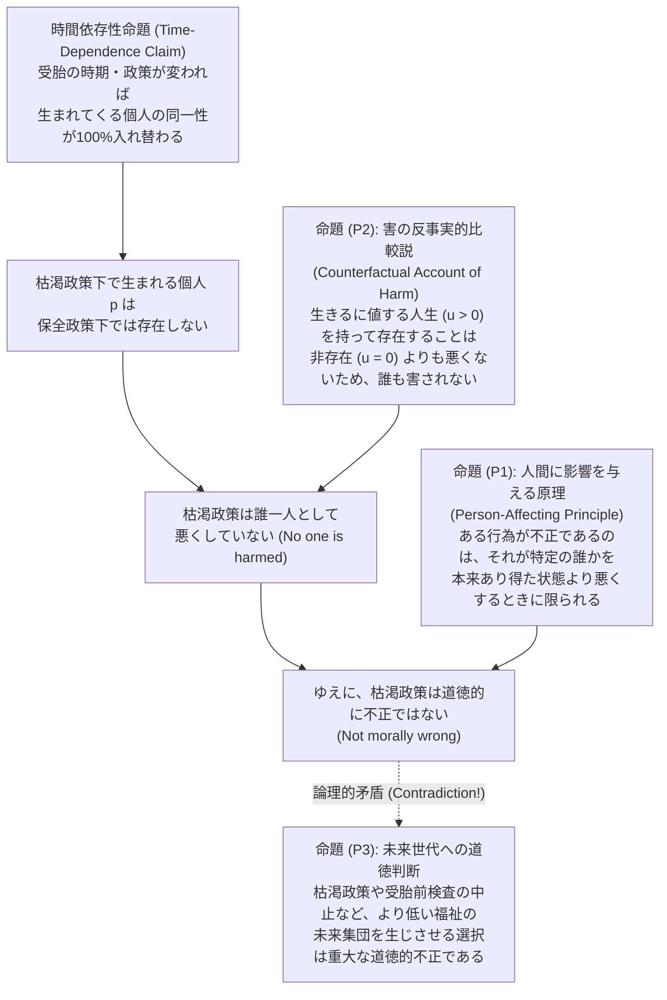
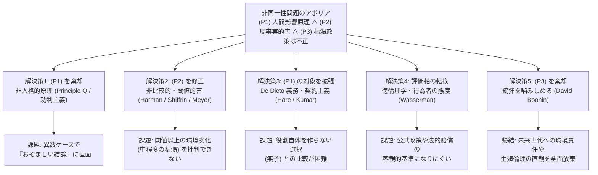

## はじめに：誰も傷つけない「破滅的選択」という逆説

私たちが気候変動対策の遅れを批判するとき、あるいは放射性廃棄物の最終処分場問題や巨額の公的債務、さらには生殖医療における受精卵の選別やゲノム編集の是非を議論するとき、そこにはほとんど自明視されている一つの道徳的前提がある。それは、<strong>「私たちが今ここで無責任な選択をすれば、未来に生まれてくる世代の人々を傷つけ、彼らの権利や利益を損なうことになる」</strong>という確信である。

近代以降の西洋道徳哲学および法理論の根幹を支えてきたのは、ジョン・スチュアート・ミルの「他者危害原則（Harm Principle）」にせよ、ロック的な自然権論やカント的な人格の尊重にせよ、<strong>「ある行為が道徳的に不正（wrong）であるのは、その行為が誰か特定の他者に害悪（harm）を与え、その人を本来あり得た状態よりも悪くするからである」</strong>という直観であった。被害者が一人も存在しない行為、すなわち誰の人生も以前より悪化させず、誰の権利も侵害しない行為を「重大な道徳的悪」と呼ぶことは、迷信か権威主義的タブーの遺物にすぎないと考えられてきたのである。

ところが1984年、オックスフォード大学の哲学者<strong>デレク・パーフィット（Derek Parfit, 1942–2017）</strong>は、20世紀後半の英語圏倫理学における最高傑作と評される大著『理由と人格（*Reasons and Persons*）』の第4部・第16章において、この「被害者なき不正は存在しない」という私たちの最も強固な道徳的常識を根底から粉砕する思考実験を突きつけた。それが<strong>「非同一性問題（The Non-Identity Problem）」</strong>である。

パーフィットが明らかにした戦慄すべき事実はこうである。私たちがマクロな環境・エネルギー政策を変更したり、個人の出産タイミングを変えたりするとき、その選択は単に「未来に生きる人々の生活環境（福祉のレベル）」を変えるだけではない。それは同時に、<strong>「そもそも未来において誰が受胎され、誰がこの世に生まれてくるか（個人の数値的・遺伝的同一性）」そのものを完全に書き換えてしまう</strong>のである。

もし私たちが現在、目先の利益を優先して地球環境を破壊する政策（枯渇政策）を選び、200年後の世界を過酷な気候と資源不足に陥れたとしよう。200年後にその過酷な世界で生まれ、苦しみながら生きる人々は、私たちの選択を呪うかもしれない。しかし、もし私たちが今日、環境を守る賢明な政策（保全政策）を選んでいたならば、産業構造も交通網も人々の職住環境も結婚や帰宅のタイミングもすべてが変化していたため、<strong>枯渇政策の下で200年後に生きるはずだった特定の人々は、文字通り誰一人として受精・誕生していなかった</strong>のである。そして、彼らが過酷な環境下であってもなお「生まれてこなかったよりはマシだ（生きるに値する人生である）」と感じている限り、私たちの環境破壊は、200年後の世界の<strong>誰一人に対しても、その人の状態を「別の選択がなされていた場合よりも悪くした」ことにはならない</strong>。

誰も傷つけていないにもかかわらず、なぜその選択はこれほどまでに深い道徳的悪なのか？あるいは逆に、誰も傷つけていないのであれば、未来世代に対する私たちの環境破壊や無謀な生殖選択は、実は道徳的に許容される「無害な行為」なのか？

本稿では、パーフィットの『理由と人格』を起点として現代の人口倫理学（Population Ethics）および世代間倫理（Intergenerational Ethics）の中心課題となった「非同一性問題」について、その形而上学的基礎である「時間依存性命題」、3つの標準的思考実験、形式論理的な「不整合な三つ組（Inconsistent Triad）」の構造を厳密に定式化する。その上で、このアポリアを打破するために現代哲学が切り拓いてきた5つの主要な解決アプローチとその限界を徹底検証し、最後に気候変動経済学、CRISPRゲノム編集と着床前診断（PGD）、そして歴史的不正義に対する世代間賠償という3つの現代的論点への決定的なインプリケーションを明らかにする。

---

## 1. 時間依存性命題と起源の本質主義（The Time-Dependence Claim & Origin Essentialism）

非同一性問題の論理エンジンを駆動させているのは、人間存在の生物学的・形而上学的な起源に関する極めてシンプルな事実である。パーフィットはこれを<strong>「時間依存性命題（The Time-Dependence Claim: TDC）」</strong>と名付けた。

> <strong>時間依存性命題（TDC）</strong>：もしある特定の人物 $p$ が、実際に受胎（conceive）された時点から数ヶ月、数日、あるいは数時間でも異なるタイミングで受胎されていたならば、実際には $p$ という人物は決して存在しておらず、代わりに全く別の人物 $q$（$p \neq q$）が生まれていたはずである。

なぜ受胎のタイミングがわずかにずれるだけで、「同じ人間が別のタイミングで生まれる」のではなく、「その人間は永久に存在しなくなり、別人が生まれる」という帰結になるのだろうか。ここには、様相形而上学（Modal Metaphysics）における<strong>ソール・クリプキ（Saul Kripke）</strong>の議論が深く関わっている。

### 1.1 クリプキの「起源の必然性（Origin Essentialism）」

クリプキは1972年の講演録『名指しと必然性（*Naming and Necessity*）』において、ある個体 $x$ が「まさにその個体 $x$ である」ための必然的条件（本質的性質）として、その個体の物質的・生物学的起源を挙げた。これを<strong>起源の本質主義（Origin Essentialism）</strong>、特に人間や生物に関しては<strong>配偶子起源の必然性（Gamete Origin Necessity）</strong>と呼ぶ。

たとえば、英国女王エリザベス2世という特定の人物を考えよう。クリプキによれば、エリザベス2世が「王女ではなく庶民として育つ可能世界」や「全く異なる性格や職業を持つ可能世界」は論理的に思考可能（形而上学的に可能）である。しかし、<strong>「エリザベス2世が、ジョージ6世とエリザベス王妃のあの特定の精子 $s_0$ と特定の卵子 $o_0$ 以外の受精卵から誕生する可能世界」は形而上学的に不可能である</strong>。もし別の両親から、あるいは同じ両親であっても別の日に受精した別の精子 $s_1$ と卵子 $o_1$ から生まれた子どもが後にエリザベスという名で呼ばれ、英国女王の座に就いたとしても、その人物は実際のエリザベス2世とは<strong>数値的に異なる別人（numerically distinct person）</strong>であり、実際のエリザベス2世はその可能世界には存在しないのである。

これを集合と様相論理の記法で表せば、任意の人間個体 $p$ に対して、その起源となった特定の精子 $s(p)$ と特定の卵子 $o(p)$ のペア $\langle s(p), o(p) \rangle$ は、個体 $p$ が存在するための必要条件である。

$$\forall w \in \mathcal{W}, \quad \text{Exists}(p, w) \implies \text{Origin}(p, w) = \langle s(p), o(p) \rangle$$

ここで $\mathcal{W}$ はすべての形而上学的可能世界の集合を表す。すなわち、配偶子の組み合わせが変われば、誕生する個体の同一性（Identity）は必然的に不連続となる。

### 1.2 生殖生物学と政策波及のバタフライ効果

この形而上学的原理に、人間の生殖生物学の基本事実を重ね合わせると、時間依存性命題の威力は劇的なものとなる。

1. <strong>月経周期と卵子の交代</strong>：人間の女性において排卵される卵子は、約1ヶ月周期で毎回異なる卵胞から選出される。したがって、受胎が1ヶ月ずれれば、受精する卵子 $o$ は100%確実に別の卵子へと入れ替わる。
2. <strong>数億個の精子による競争とカオス的感受性</strong>：仮に同じ排卵周期内の同じ卵子であったとしても、1回の射精には約1億〜3億個の精子が含まれており、そのうち受精に到達するのはただ1個である。どの精子が卵子に到達するかは、交接のタイミングが数分ずれたか、体温や体位がわずかに異なったかというミクロな流体力学的・熱力学的揺らぎに完全に依存している。

さらに重要なのは、個人の受胎タイミングが社会全体のマクロな政策選択に対して極度の<strong>カオス的感受性（バタフライ効果）</strong>を持つという点である。

いま、ある政府が「化石燃料への課税を強化し、再生可能エネルギーと公共交通機関へ大規模投資を行う」という政策転換を決定したとしよう。その瞬間から、建設現場やオフィスで働く何百万人もの労働者の残業時間や通勤経路が変わり、週末のドライブの予定が変わり、カフェや職場で誰と誰が出会うかが変わり、夫婦が夜に寝室へ入る時刻が数分〜数時間単位で変化する。その結果、政策変更からわずか数ヶ月後には、その社会で受精する精子の組み合わせは激変する。さらにその子どもたちが成長して次の世代をもうける頃には、誰と誰が結婚するかというペアリング自体が総入れ替えとなる。

結果として、<strong>ある大規模な社会政策が選択されてから約150年〜200年（5〜7世代）が経過した時点では、地球上に生きている数十億人の人間は、もし別の政策が選ばれていた場合に生きていたはずの数十億人と、文字通り「一人たりとも重ならない（100%別人である）」</strong>という事態が成立するのである。

---

## 2. パーフィットの3つの標準的思考実験

この「時間依存性命題」が私たちの道徳的推論をいかに機能不全に陥れるかを具体的に示すため、パーフィット（および先行するトマス・シュワルツやグレゴリー・カフカ）は、ミクロな個人選択からマクロな地球環境政策に至る3つの鮮やかな思考実験を提示した。

### 2.1 思考実験1：14歳の少女（The 14-Year-Old Girl）

ある14歳の少女が、今すぐ子どもを産むことを決意したとする。少女はまだ若すぎ、経済的にも精神的にも未熟であるため、今彼女が産む子どもは幼少期に多くの困難や不利な養育環境（不安定な家庭、貧困、不十分な教育など）を経験することになるだろう。ただし、それでもなお、その子どもの人生は全体として見れば「生まれてこなかった方がよかった」というほど悲惨なものではなく、<strong>十分に生きるに値する人生（a life worth living, 生涯福祉 $u > 0$）</strong>になると予想される。

周囲の大人たちは少女を説得し、「その子のためを思うなら、あと数年待って大人になってから産みなさい。そうすれば子どもにずっと良い人生を与えられるから」と忠告する。しかし少女は忠告を無視し、14歳で子ども $A$ を出産した。

さて、少女の選択は道徳的に批判されるべきだろうか？私たちの直観は強く「イエス（彼女は数年間待つべきだった）」と告げる。しかし、大人たちの忠告——「その子のためを思うなら（for the sake of your child）」——は論理的に成立しているだろうか？

もし少女が忠告に従ってあと5年待ってから出産していたら、受精するのは5年後の別の卵子と別の精子であり、生まれていたのは別の子ども $B$（$A \neq B$）であった。現在14歳の少女から生まれた子ども $A$ は、少女が14歳で妊娠したからこそこの世に存在し得たのであり、もし少女が5年待っていれば、子ども $A$ は「より良い環境で生まれていた」のではなく、<strong>そもそも永遠に存在していなかった</strong>のである。

子ども $A$ 自身の視点に立ってみよう。子ども $A$ にとって利用可能だった可能世界は、「14歳の未熟な母のもとで苦労しつつも生きるに値する人生を送る（$u(A) = 50$）」か、「決して生まれてこない（非存在、$u = 0$）」かの二択しかなかった。「20歳の成熟した母のもとで裕福に育つ子ども $A$（$u(A) = 90$）」という可能世界は、形而上学的に存在しない。したがって、少女が14歳で出産したことは、子ども $A$ を悪くしたどころか、子ども $A$ に存在という唯一のチャンスを与えたことになる。では、少女は一体<strong>誰に対して</strong>悪いことをしたのだろうか？

### 2.2 思考実験2：枯渇政策と保全政策（Depletion vs. Conservation Policy）

個人の選択から、人類全体の未来を左右する環境・資源政策へとスケールを拡大しよう。私たちが現在、次の2つの長期政策の分岐点に立っているとする。

* <strong>保全政策（Conservation）</strong>：現在の私たちが資源消費と温室効果ガス排出をわずかに抑制する。その結果、今後300年間にわたって、地球環境は安定し、未来世代は極めて高い生活の質（たとえば福祉水準 $u = 100$）を享受し続ける。
* <strong>枯渇政策（Depletion）</strong>：現在の私たちが資源を浪費し、目先の快適さと経済成長を最大化する。今後100年間は生活水準が少し高まるが、そのツケとして200年後以降の地球環境は深刻に劣化し、当時の人々の生活の質は大幅に低下する（たとえば福祉水準 $u = 40$）。ただし、$u = 40$ の生活であっても、飢餓や絶え間ない拷問のような極限状態ではなく、人々は日常のささやかな喜びを見出しながら「生まれてきてよかった（生きるに値する、$u > 0$）」と思って生きている。

いま、私たちが利己的に<strong>枯渇政策</strong>を選択したとしよう。200年後（2226年）の世界には、劣化した環境の下で $u = 40$ の生活を送る人々（集合 $P_{\text{dep}}$）が存在している。もし私たちが<strong>保全政策</strong>を選んでいれば、2226年の世界には豊かな環境の下で $u = 100$ の生活を送る人々（集合 $P_{\text{cons}}$）が存在していたはずである。

ところが、第1節で見た「時間依存性命題」により、200年の歳月を経た二つの政策世界の間では、個人の入れ替わりが完全に完了している。すなわち、

$$P_{\text{dep}} \cap P_{\text{cons}} = \emptyset$$

枯渇政策の下で2226年に生きている任意の個人 $p \in P_{\text{dep}}$ にとって、もし私たちが2026年に保全政策を選んでいたならば、$p$ は「豊かな環境で暮らせていた」のではなく、<strong>そもそもこの世に生まれていなかった</strong>のである。そして $p$ の現在の福祉 $u(p) = 40 > 0$ が生きるに値するものである以上、枯渇政策は2226年に生きる<strong>誰一人に対しても損害を与えていない（worse off にしていない）</strong>。もし「誰かを悪くしない限り不正ではない」という原則が正しいなら、枯渇政策を選ぶことは道徳的に全く問題がないことになってしまう！

### 2.3 思考実験3：リスクのある医療プログラム——受胎前検査と出生前検査の非対称性

この逆説が単なる「遠い未来の話」ではなく、私たちの道徳判断の内部に深刻な自己矛盾を引き起こすことを決定的に示すのが、2つの医療プログラムを比較する思考実験である（グレゴリー・カフカやパーフィットが定式化した事例）。

ある国で、以下の2つの医療スクリーニング・プログラムが計画されているとする。

1. <strong>プログラムA（出生前検査：Prenatal Testing）</strong>：現在すでに妊娠している女性たちがまれな疾患 $J$ に罹患しているかを検査する。もし妊婦が疾患 $J$ を持っていれば、簡単な投薬治療によって胎児が重度の障害（福祉水準 $u = 50$、ただし生きるに値する）を持って生まれるのを防ぎ、完全に健康な状態（$u = 100$）で出産させることができる。
2. <strong>プログラムB（受胎前検査：Preconception Testing）</strong>：これから妊娠を計画している女性たちが一時的な感染症 $K$ に罹患しているかを検査する。感染症 $K$ は治療できないが、2ヶ月で自然治癒する。もし現在 $K$ に感染している女性がそのまま今月妊娠すれば、生まれてくる子どもは重度の障害（疾患 $J$ による障害と全く同じ症状、$u = 50$）を持つことになる。しかし、検査で陽性と判明した女性が<strong>「2ヶ月間だけ妊娠を延期」</strong>すれば、完治した後に妊娠することで、完全に健康な子ども（$u = 100$）を産むことができる。

いま、政府が予算削減のために<strong>プログラムAとプログラムBの両方を中止した</strong>としよう。その結果、プログラムAの中止によって1,000人の障害を持つ子ども（集団 $A$）が生まれ、プログラムBの中止によって同じく1,000人の障害を持つ子ども（集団 $B$）が生まれた。どちらのケースでも、生じた障害の重さも、苦しむ子どもの数（1,000人）も、節約された予算額も完全に同一である。

さて、プログラムAの中止とプログラムBの中止の間に、道徳的な悪質さの違いはあるだろうか？

* <strong>プログラムAの中止（同一性ケース）</strong>：検査が行われていたとしても、すでに受胎していた胎児 $a_1, \dots, a_{1000}$ と<strong>同一の子どもたち</strong>が生まれていた。政府がプログラムAを中止したせいで、まさにその子どもたち $a_i$ の状態が $u = 100$ から $u = 50$ へと悪化した。したがって、ここには明確な1,000人の被害者が存在する。
* <strong>プログラムBの中止（非同一性ケース）</strong>：もしプログラムBが実施され、陽性の女性たちが妊娠を2ヶ月延期していたならば、実際に生まれた子どもたち $b_1, \dots, b_{1000}$ は<strong>誰一人として生まれておらず</strong>、2ヶ月後の別の卵子と精子から全く別の健康な子どもたち $c_1, \dots, c_{1000}$ が生まれていた。したがって、プログラムBの中止によって生まれた子ども $b_i$ にとっては、政府が検査を中止したおかげで自分は存在できた（$u = 50 > 0$）のであり、誰も以前より悪い状態にされていない。

もし私たちが「誰か特定の個人を悪くする行為だけが悪い」と考えるならば、<strong>プログラムAの中止は1,000人の子どもを傷つけた重大な犯罪だが、プログラムBの中止は誰一人傷つけていない無害な決定である</strong>と結論せざるを得ない。しかし、私たちの圧倒的な道徳的直観は、<strong>「プログラムAの中止とプログラムBの中止は、全く同じだけ道徳的に悪質である」</strong>と叫ぶ。パーフィットはこの直観を<strong>「違いを生まないという見解（The No-Difference View）」</strong>と呼び、従来の個人中心的な道徳理論がこの見解を説明できないことを徹底的に暴き出したのである。

---

## 3. 非同一性問題の論理構造：不整合な三つ組（The Inconsistent Triad）

以上の思考実験が突きつけている哲学的危機を、分析倫理学の厳密な論理構造として整理しよう。非同一性問題とは、私たちが普段それぞれ独立に「正しい」と信じている<strong>3つの基本的な道徳命題（P1, P2, P3）が、時間依存性命題（TDC）の下で論理的矛盾（Inconsistent Triad：不整合な三つ組）を引き起こす</strong>という問題である。

それぞれの命題の正確な定式化を確認しておこう。

### 3.1 命題 (P1)：人間に影響を与える原理（The Person-Affecting Principle）

1967年、哲学者<strong>ヤン・ナーヴェソン（Jan Narveson）</strong>は功利主義と人口問題を論じた画期的論文において、次のような有名なスローガンを提唱した。

> <strong>「私たちは人々を幸せにすることには賛成だが、幸せな人々を作ることには中立である（We are in favor of making people happy, but neutral about making happy people.）」</strong>

つまり、道徳とは「すでに存在している（あるいはどの選択をとっても確実に存在することになる）具体的な人間たち」の福祉や権利を守るためにあるのであって、「幸福という抽象的な性質の総量を宇宙の中に増やすため」にあるのではない。これを<strong>「人間に影響を与える直観（Person-Affecting Intuition）」</strong>、あるいは<strong>「狭義の人間影響原理（Narrow Person-Affecting Principle）」</strong>と呼ぶ。

形式的に記述すれば、行為 $\alpha$ が選択されたときに存在する人々の集合を $\mathcal{P}(\alpha)$、代替行為 $\beta$ が選択されたときに存在する人々の集合を $\mathcal{P}(\beta)$ とするとき、行為 $\alpha$ が $\beta$ との比較において道徳的に不正（$\text{Wrong}(\alpha, \beta)$）であるための必要条件は、$\alpha$ によって存在するある特定の個人 $p$ が、$\beta$ が選ばれていた場合よりも悪い状態に置かれることである。

$$\text{Wrong}(\alpha, \beta) \implies \exists p \in \mathcal{P}(\alpha), \quad \text{WorseOff}(p, \alpha, \beta)$$

### 3.2 命題 (P2)：害の反事実的比較説（Counterfactual Comparative Account of Harm）

では、ある個人 $p$ が行為 $\alpha$ によって「害された（harmed）」あるいは「より悪い状態にされた（worse off）」とはどういう意味か。法哲学者<strong>ジョエル・ファインバーグ（Joel Feinberg）</strong>が1984年の著書『他者への害（*Harm to Others*）』で定式化した標準的な定義が<strong>「害の反事実的比較説（Counterfactual Comparative Account of Harm）」</strong>である。

> <strong>反事実的比較説</strong>：行為 $\alpha$ が個人 $p$ を害する（悪くする）のは、もし行為 $\alpha$ がなされず代替行為 $\beta$ がなされていたならば $p$ が享受していたであろう福祉水準 $u_{\beta}(p)$ よりも、行為 $\alpha$ の下での $p$ の実際の福祉水準 $u_{\alpha}(p)$ が低い場合に限られる。
> $$\text{Harmed}(p, \alpha, \beta) \iff u_{\alpha}(p) < u_{\beta}(p)$$

ここで、非同一性ケース（$p \in \mathcal{P}(\alpha)$ だが $p \notin \mathcal{P}(\beta)$ の場合）にこの定義を適用するとどうなるか。代替行為 $\beta$（たとえば保全政策）の下では、個人 $p$ はそもそも存在しない（Never Exists）。そして、行為 $\alpha$（枯渇政策）の下での $p$ の人生が「生きるに値する人生（$u_{\alpha}(p) > 0$）」であるとき、そのような人生を持って存在することは、そもそも一度も存在しないことと比べて個人 $p$ にとって「より悪い（worse）」とは言えない（仮に非存在と存在が比較不能 Incommensurable であると解釈したとしても、「存在の方が非存在より悪い」すなわち $u_{\alpha}(p) < u_{\beta}(p)$ という不等式は決して成立しない）。

したがって、$\mathcal{P}(\alpha) \cap \mathcal{P}(\beta) = \emptyset$ かつ $\forall p \in \mathcal{P}(\alpha), u_{\alpha}(p) > 0$ である限り、

$$\neg \exists p \in \mathcal{P}(\alpha), \quad \text{WorseOff}(p, \alpha, \beta)$$

すなわち、<strong>誰も害されておらず、誰も悪くされていない</strong>という帰結が導かれる。

### 3.3 命題 (P3)：未来世代への無책임な選択に対する道徳的非難

他方で、私たちは次のような強固な道徳的確信を持っている。

> <strong>命題 (P3)</strong>：14歳の少女の性急な出産、枯渇政策の選択、あるいは受胎前スクリーニング（プログラムB）の中止のように、わずかなコストや忍耐ではるかに幸福で健康な未来の人々を生み出せたにもかかわらず、あえて深刻な困難や劣悪な環境を抱える未来の人々を生み出す選択は、<strong>道徳的に不正（または少なくとも道徳的に選ぶべきではない悪）である</strong>。

論理的に明らかなように、<strong>(P1) と (P2) が共に真であれば、(P3) は偽でなければならない</strong>。逆に (P3) を維持したいならば、私たちは (P1)（道徳は特定の個人への影響に還元されるという原理）を捨てるか、(P2)（害とは反事実的な状態との比較であるという定義）を捨てるか、あるいは「誰に対する義務か」という概念そのものを根本から作り直すかのいずれかを迫られるのである。

---

## 4. 5つの主要な哲学的解決策とその限界

過去40年間、世界の倫理学者・法哲学者・政治哲学者たちは、この「不整合な三つ組」のどこにメスを入れるべきかを巡って白熱した論争を繰り広げてきた。現在までに提案されている解決策は、大きく<strong>5つのアプローチ</strong>に分類することができる。それぞれの理論的構造と、それが直面する新たな難問（トレードオフ）を比較検討しよう。

| アプローチ | 棄却・修正する前提 | 主な提唱者 | 核心的アイデア | 直面する最大の難点・限界 |
| :--- | :--- | :--- | :--- | :--- |
| <strong>1. 非人格的原理・同数質原理 Q</strong> | <strong>(P1)</strong> を棄却 | D. Parfit, P. Singer, J. Broome | 個人の同一性に関わらず、結果として生じる福祉の総量・質が高い世界を選ぶべきである（Principle Q）。 | 異数ケースで「おぞましい結論（Repugnant Conclusion）」に陥る。被害者なき抽象的義務になる。 |
| <strong>2. 非比較的・閾値的害と人権論</strong> | <strong>(P2)</strong> を修正 | S. Shiffrin, E. Harman, L. Meyer | 害とは反事実的比較ではなく、人間が享受すべき「規範的閾値」を下回る状態や苦痛・障害を負わせることである。 | 閾値を上回る範囲での環境劣化（中程度の枯渇政策：$u=100 \to u=50$）の不正さを説明できない。 |
| <strong>3. 言表的（De Dicto）義務と契約主義</strong> | <strong>(P1)</strong> の対象を再定義 | C. Hare, R. Kumar, T. M. Scanlon | 特定の遺伝的個体（*de re*）ではなく、「私の未来の子ども」「未来の市民」という役割・地位（*de dicto*）に対して義務を負う。 | なぜ抽象的な役割記述（オフィス）に対する配慮が、実在の個人への配慮に優越するのかが不明確。 |
| <strong>4. 徳倫理学・親の愛と態度論</strong> | 行為結果から<strong>行為者の品性</strong>へ転換 | R. Hursthouse, D. Wasserman | 誰が傷ついたかではなく、目先の快楽のために未来の他者の困窮に無関心である行為者の「悪徳・不誠実な態度」を問題にする。 | 政策評価や法的な権利・賠償責任の厳密な基準（定量的判断）を導き出しにくい。 |
| <strong>5. 銃弾を噛みしめる（懐疑論）</strong> | <strong>(P3)</strong> を棄却 | D. Boonin, T. Schwartz, D. Heyd | (P1) と (P2) を堅持し、「純粋な非同一性ケースでは、枯渇政策も受胎前検査中止も道徳的に一切悪くない」と認める。 | 人類の圧倒的な道徳的直観および世代間正義の基盤を完全に放棄することになる。 |

以下、各アプローチの論理を詳細に掘り下げる。

### 4.1 解決策1：非人格的原理と同数質原理 Q（Parfit's Principle Q & Impersonalism）

パーフィット自身が『理由と人格』の中で採用した基本的な方向性は、<strong>命題 (P1)（狭義の人間影響原理）を放棄し、誰が存在するかという個人の同一性に依存しない「非人格的（Impersonal）」な道徳原理を導入すること</strong>であった。その代表が<strong>「同数質原理（The Same-Number Quality Claim: Principle Q）」</strong>である。

> <strong>同数質原理（Principle Q）</strong>：もし2つの可能な選択肢において、将来生まれてくる人々の<strong>人数が同じ（Same Number）</strong>であるならば、生まれてくる人々の顔ぶれ（同一性）が同じであろうと異なっていようと、生じる幸福の総量（または平均的な生活の質）が低い方の選択肢を選ぶことは、道徳的に悪である。

この Principle Q を採用すれば、前節の3つの思考実験はすべて見事に解決される。14歳の少女のケースでは生まれる子どもの数はどちらも「1人」であり、プログラムAとプログラムBではどちらも「1,000人」であり、枯渇政策と保全政策でも（人口規模が同じと仮定すれば）同じ人数である。したがって、「どちらを選んでも同じ人数が存在するなら、より高い福祉 $u_{\text{cons}} > u_{\text{dep}}$ を享受する集団が存在する世界を選ぶべきだ」という非人格的要請によって、「違いを生まないという見解（No-Difference View）」が完全に正当化される。

#### 【限界と「理論X（Theory X）」の迷宮】
しかし、パーフィット自身が痛切に自覚していたように、Principle Q は<strong>「存在する人々の数が同じである場合（Same-Number Cases）」にしか適用できない暫定的な原理</strong>にすぎない。現実の気候変動政策や家族計画は、誰が生まれるかだけでなく、<strong>「将来何人の人間が存在することになるか（Different-Number Cases：異数ケース）」</strong>をも確実に変化させる。

もし Principle Q を異数ケースへと一般化し、単純な<strong>総量功利主義（Total Utilitarianism）</strong>——すなわち「宇宙に存在する個人の福祉の総和 $\sum_{i=1}^{N} u_i$ を最大化せよ」という非人格的原理——を採用すると、パーフィットが第17章で定式化したもう一つの悪夢、<strong>「おぞましい結論（The Repugnant Conclusion）」</strong>が直ちに導かれてしまう。

$$\sum_{i=1}^{N_{\text{Z}}} u_i(Z) > \sum_{i=1}^{N_{\text{A}}} u_i(A) \quad \text{where } N_{\text{Z}} \gg N_{\text{A}} \text{ and } u_i(Z) \to 0^{+}$$

すなわち、極めて高い幸福（$u = 100$）を享受する100億人の世界 $A$ よりも、「やっと生きるに値するだけの極貧の生活（$u = 0.01$）」を送る1,000兆人の超過密世界 $Z$ の方が、福祉の総和が大きいため道徳的に優れていることになってしまうのである。パーフィットは、非同一性問題を解決しつつ、かつ「おぞましい結論」をも回避する究極の人口倫理理論を<strong>「理論X（Theory X）」</strong>と名付けて生涯探し求めたが、後にマイケル・アウレニウス（Gustaf Arrhenius）らの<strong>「人口倫理学の不可能性定理（Impossibility Theorems in Population Ethics）」</strong>によって、私たちが望む複数の直観的公理をすべて満たす理論Xは数学的に存在し得ないことが証明されるに至った。

さらに、非人格的アプローチに対しては、「誰も傷ついておらず、誰の権利も侵害されていないのに、ただ『世界の状態が最適ではない』という理由だけで行為を道徳的不正と呼ぶのは、道徳を人間から切り離された奇妙な審美学や宇宙論に変えてしまう（"harmless wrongdoing" のパラドックス）」という根強い批判が向けられている。

### 4.2 解決策2：非比較的な害・閾値説と人権アプローチ（Threshold Harm & Rights）

非人格的な総量計算に頼ることなく、あくまで「特定の個人 $p$ が害されたから不正なのだ」という人間影響的（Person-Affecting）な枠組みを守り抜こうとする哲学者たちは、<strong>命題 (P2)（害の反事実的比較説）の棄却・修正</strong>へと向かった。その代表が、<strong>シーナ・シフリン（Seana Shiffrin, 1999）</strong>、<strong>エリザベス・ハーマン（Elizabeth Harman, 2004, 2009）</strong>、そして世代間正義論の<strong>ルーカス・マイヤー（Lukas Meyer, 2003）</strong>らである。

彼女たちは、「害（harm）」とは必ずしも「もしその行為がなければその人がいたであろう反事実的状態よりも悪くすること」ではないと主張する。代わりに提示されるのが、<strong>「害の非比較的定義（Non-Comparative Account of Harm）」</strong>および<strong>「閾値説（Threshold Conception of Harm）」</strong>である。

* <strong>ハーマンの非比較的害と理由の非対称性</strong>：ハーマンによれば、ある行為が個人 $p$ に身体的損傷、激しい痛み、重度の障害、あるいは早期の死を引き起こすとき、たとえその行為が $p$ が存在するための必要条件であり、かつ $p$ の人生が全体として生きるに値する（$u > 0$）ものであったとしても、その行為は<strong>実際に $p$ を害している（causes harm to $p$）</strong>。もちろん、その行為は同時に $p$ に「生きるに値する人生」という利益（benefit）をも与えている。しかし、道徳的推論においては<strong>「他者を深刻に害さない理由（reason against harming）」は、「新たな人間を存在させて利益を与える理由（reason to benefit by creating）」よりもはるかに強力である</strong>。したがって、受胎前検査を怠って障害を持つ子ども $B$ を産むことは、たとえ $B$ の人生が生きるに値するとしても、$B$ に対する不当な加害となる。
* <strong>マイヤーの「十分主義的閾値（Sufficientarian Threshold）」とシフリンの純粋危害</strong>：ルーカス・マイヤーは、人間が尊厳ある生を送るために最低限必要な福祉の<strong>「規範的閾値（Normative Threshold, $u_{\text{th}} > 0$）」</strong>を設定する。ある行為が未来の個人 $p$ をこの閾値未満の状態（$u(p) < u_{\text{th}}$：たとえば基本的人権が脅かされる極度の気候災害や貧困）に生み出すならば、たとえ $p$ が生まれてこなかったよりはマシ（$u(p) > 0$）と思っていても、その行為は $p$ の権利を侵害し、$p$ を害している。

$$\text{ThresholdHarm}(p, \alpha) \iff u_{\alpha}(p) < u_{\text{th}} \quad (\text{where } u_{\text{th}} > 0)$$

#### 【限界：「中程度の枯渇政策（Moderate Depletion）」への無力さ】
閾値説や非比較的害アプローチは、重度の遺伝性疾患や、基本的人権が破壊されるような壊滅的気候変動に対しては強い説得力を持つ。しかし、このアプローチには致命的な死角がある。

いま、保全政策を選べば200年後の人々が非常に高い福祉（$u = 100$）を享受できるのに対し、<strong>「中程度の枯渇政策（Moderate Depletion）」</strong>を選ぶと、200年後の人々の福祉が $u = 50$ に半減してしまうとしよう。ただし、この $u = 50$ という生活は、病気や人権侵害の閾値（たとえば $u_{\text{th}} = 30$）は十分にクリアしており、人々は健康で文化的な最低限度以上の生活を送りつつも、豊かな自然や高度な芸術・余暇の機会を永久に失っている状態である。

このとき、$u_{\text{dep}}(p) = 50 > u_{\text{th}} = 30$ であるため、閾値説の下では200年後の人々は<strong>閾値的な意味でも、反事実的な意味でも一切害されていない</strong>ことになる。結果として、閾値説は「人権侵害のギリギリ手前までであれば、未来世代の豊かさをどれだけ食い潰しても道徳的に何の問題もない」という極めて妥協的な結論を許してしまうのである。

### 4.3 解決策3：事物的義務（De Re）から言表的義務（De Dicto）への転換と契約主義

第3の洗練された解決策は、言語哲学・様相論理における<strong>「事物的（*De Re*）」と「言表的（*De Dicto*）」の区別</strong>を倫理学に導入するアプローチであり、<strong>キャスパー・ヘア（Caspar Hare, 2007）</strong>や、T.M.スキャンロンの契約主義（Contractualism）を世代間倫理に応用した<strong>ラフル・クマール（Rahul Kumar, 2003, 2018）</strong>によって展開された。

私たちが「自分の子ども」や「未来の市民」の福祉を気にかけるとき、その配慮には2つの様相的構造があり得る。

1. <strong>事物的配慮（*De Re* Concern）</strong>：今ここに存在する（あるいは特定の受精卵から生まれる）<strong>特定の遺伝的個体 $p$</strong> を指し示し、「この $p$ という個体が少しでも幸せになること」を願う配慮。
2. <strong>言表的配慮（*De Dicto* Concern）</strong>：特定の個体が誰であるかに関わらず、<strong>「私の子ども（my child）」「2226年の市民（citizens of 2226）」という記述（役割・地位・オフィス）を満たすことになる人物</strong>が、誰であれ可能な限り高い福祉を享受することを願う配慮。

ヘアは次のような類比を用いる。ある大学の学長が「来年度に任命される安全衛生管理官（Health and Safety Officer）の職場環境の安全を確保する義務」を負っているとする。学長が予算をケチって危険な実験室を放置した結果、その危険を嫌った第一候補のアリスが辞退し、代わりにボブが安全衛生管理官に就任して実験室で軽傷を負ったとしよう。ボブにとっては、学長が予算をケチらなければ自分はその職に就けず失業していたため、反事実的には得をしている（*de re* には悪くされていない）。しかし、学長は明らかに<strong>「安全衛生管理官（*de dicto*）」に対する職務上の義務</strong>に違反している！

同様に、親になる者や現在の政策決定者は、「私の子ども」や「次世代の市民」という<strong>規範的な地位・役割（Office / Role）</strong>に対して *de dicto* の義務を負っている。プログラムBで2ヶ月待てば、自分の子どもという地位に就く人物の福祉は $u = 50$（子ども $b_i$）から $u = 100$（子ども $c_i$）へと向上する。たとえ個体が入れ替わっても、<strong>「私の子ども」という *de dicto* の対象の状態は明確に改善される</strong>のである。

またクマールは、スキャンロンの契約主義（「誰も合理的に拒絶できない原則に則って行為せよ」）に基づき、道徳的配慮の対象は具体的な遺伝的個体ではなく<strong>「人格という類型（Type / Standpoint）」</strong>であると論じる。受胎前の両親は、「将来自分の子どもという立場に立つ人格」が合理的に拒絶するような無謀な受胎選択をしてはならない。これにより、非人格的な功利計算に陥ることなく、一対一の関係的道徳（Relational Morality）の枠組みの中で非同一性問題を解決できるとされる。

#### 【限界：役割が存在しない選択との比較】
*De dicto* アプローチは極めて巧みだが、「そもそも子どもを産まない（したがって『私の子ども』という役割・オフィス自体が空席になる）」という選択肢と、「障害を持つが生きるに値する子どもを産む」という選択肢を比較する場面では機能しなくなる。また、「なぜ単なる言語的記述（ロール）の数値が下がることが、生身の人間が傷つくことと同じ道徳的重みを持つのか」という形而上学的な疑問も残る。

### 4.4 解決策4：広義の人間影響原理と徳倫理学・親の愛（Virtue Ethics & Parental Attitude）

第4のアプローチは、近代倫理学が固執してきた「権利侵害」や「結果の福祉総量」という枠組み自体から一歩引き、<strong>行為者の品性（Character / Virtue）や動機・態度</strong>に焦点を当てる徳倫理学（Virtue Ethics）的アプローチである（<strong>ロザリンド・ハーストハウス</strong>、<strong>デイヴィッド・ワッサーマン</strong>ら）。

枯渇政策を選ぶ政治家や有権者、あるいは受胎前検査の勧告を無視してわずか2ヶ月の忍耐を惜しむ親は、どのような動機で行為しているか？彼らは「特定の子ども $b_i$ に存在のチャンスを与えるため」に行為しているのではなく、単に<strong>「自分たちの目先の快適さや都合のために、将来生まれてくる他者がどれほど重い負担や苦難を背負うことになろうとも構わない」という利己的で冷담な態度（callousness / lack of virtue）</strong>から行為している。

徳倫理学の観点からは、ある行為が道徳的に不正であるために「反事実的に悪くされた特定の被害者」を探す必要はない。親としての思慮深さ（phronesis）や慈愛、あるいは世代間の信託を受けた市民としての節制と正義という<strong>徳（Virtue）に反する選択</strong>であること自体が、その行為を道徳的に退ける十分すぎる理由となる。

### 4.5 解決策5：銃弾を噛みしめる——道徳的直観の棄却（Biting the Bullet: David Boonin）

最後に紹介する第5のアプローチは、最も過激でありながら論理的な一貫性において他の追随を許さない立場である。コロラド大学の哲学者<strong>デイヴィッド・ブーニン（David Boonin）</strong>は、2014年の大著『非同一性問題と未来の人々の倫理（*The Non-Identity Problem and the Ethics of Future People*）』において、前述の解決策1〜4のすべてに内在する論理的欠陥やアドホックな前提を徹底的に論破した上で、次のように宣言した。

> <strong>「私たちは銃弾を噛みしめる（bite the bullet）べきである。すなわち、(P1) と (P2) を維持し、(P3) を棄却せよ。他者に付随的な被害を与えない純粋な非同一性ケースである限り、14歳の少女の出産も、受胎前検査の中止も、枯渇政策の選択も、道徳的に一切不正ではない（morally permissible）。」</strong>

ブーニンによれば、私たちが非同一性ケースに対して「それは道徳的に悪だ！」という強い直観（命題 P3）を抱いてしまうのは、人間の進化心理および日常の道徳的推論が「行為の前後で個人の同一性が保たれているケース（同一性ケース）」に過剰適応しており、<strong>無意識のうちに非同一性ケースを同一性ケースと混同してしまう認知バイアス</strong>にすぎない。いったん「もし別の選択をしていれば、その苦しんでいる子どもは健康に生まれていたのではなく、そもそもこの世に存在しなかったのだ」という形而上学的真実を冷徹に受け入れれば、誰も傷つけていない行為を道徳的犯罪と呼ぶ根拠は完全に消滅する、とブーニンは主張する。

ブーニンの議論は論理的に極めて強靭であるが、この結論を受け入れることは、「現世代がどれほど地球環境を破壊し、数百年後の人類を過酷な生存環境へ突き落としても、彼らが自殺を選ばない程度に生きている限り、私たちは未来世代に対して何一つ道徳的責任を負わない」と認めるに等しい。そのため、現代倫理学においてブーニンの議論は「私たちが何としても論破しなければならない最強の懐疑論的挑戦」として位置づけられている。

---

## 5. 現代の応用倫理・政策課題への決定的インプリケーション

非同一性問題は、象牙の塔における言葉遊びではない。21世紀の私たちが直面している最も緊急性の高い3つの実践的課題——<strong>気候変動経済学</strong>、<strong>生殖医療・ゲノム編集技術</strong>、そして<strong>歴史的不正義に対する賠償問題</strong>——のすべてにおいて、非同一性問題は法制度と公共政策の根底を揺るがす実践的ハードルとして立ちはだかっている。

### 5.1 気候変動経済学と「個人の排出責任」（Climate Change & Discounting）

気候変動対策の経済学において、最大の論争点の一つが<strong>「社会的割引率（Social Discount Rate, $r$）」</strong>の設定である。現在から $t$ 年後に発生する環境被害（または便益）を現在価値に換算する際、経済学者はラムゼー公式（Ramsey Formula）に基づく割引因子を用いる。

$$PV = \frac{\text{Damage}_t}{(1 + r)^t}, \quad r = \rho + \eta g$$

ここで $\rho$ は<strong>純粋時間選好率（Pure Rate of Time Preference）</strong>、$\eta$ は限界効用の弾力性、$g$ は1人あたり消費の成長率である。ウィリアム・ノードハウス（William Nordhaus）のように市場利子率を反映して比較的高い割引率を設定する立場と、ニコラス・スターン（『スターン報告』）やフランク・ラムゼー、デレク・パーフィットのように「未来世代の福祉を単に時間的に遠いというだけで割り引くのは道徳的に不当である（$\rho = 0$ とすべきだ）」と主張する立場が激しく対立してきた。

しかし、オックスフォード大学の哲学者・経済学者<strong>ジョン・ブルーム（John Broome）</strong>が著書『*Climate Matters*』（2012年）で指摘したように、気候変動には割引率以上に厄介な「非同一性問題」が潜んでいる。

1. <strong>マクロ政策レベルの非同一性</strong>：世界各国がパリ協定の目標を達成するために抜本的な脱炭素政策（炭素税、EVシフト、産業構造転換）を実施すれば、150年後に地球上に存在する人類の顔ぶれは、化石燃料を使い続けた場合とは100%異なる個体群に入れ替わる。
2. <strong>ミクロな個人排出レベルの非同一性</strong>：ブルームはさらに驚くべき事実を指摘した。大気物理学において、気象システムは典型的なカオス系（バタフライ効果）である。私が今日ガソリン車に乗って二酸化炭素を排出し、大気に微小な熱的・力学的擾乱を与えると、数週間〜数ヶ月後には地球の裏側で雨が降るタイミングや気温がわずかに変化する。天気が変われば、人々の外出や帰宅の行動が変わり、その夜に受胎される精子が入れ替わる！つまり、<strong>私個人の日常的な温室効果ガス排出ですら、100年後に誰が存在するかを変化させている</strong>のである。

もし私たちが従来の英米法的な「不法行為責任（Tort Law：特定の加害者が特定の被害者に反事実的な損害を与えたときに成立する責任）」の枠組みに固執するならば、将来の気候変動被害者が現在の排出企業や国家を訴えたとしても、被告側は<strong>「もし私たちが石炭や石油を燃やさなければ、原告であるあなた方はそもそもこの世に生まれていなかった。あなた方が生きていることを喜んでいる以上、私たちはあなた方に1円の損害も与えていない（Non-Identity Defense）」</strong>と法廷で反論できてしまう。気候正義（Climate Justice）を法哲学的に確立するためには、反事実的比較に依存しない「人権の閾値論（マイヤー）」や「非人格的な世代間信託義務」へと法理論そのものをアップグレードすることが不可欠なのである。

### 5.2 生殖医療と遺伝子工学：着床前診断（PGD）vs ゲノム編集（CRISPR）

生命倫理学（Bioethics）の領域において、非同一性問題が最も先鋭的な形で現れるのが、<strong>着床前遺伝学的検査（PGD / PGT-M：受精卵の選別）</strong>と、<strong>CRISPR-Cas9 等による生殖細胞系列ゲノム編集（Germline Gene Editing：受精卵の遺伝子治療）</strong>の道徳的・法的比較である。

ジュリアン・サヴレスク（Julian Savulescu）は2001年、親は体外受精で得られた複数の受精卵（胚）の中から、最も高い福祉が見込まれる遺伝子構成を持つ胚を選んで着床させる道徳的義務があるという<strong>「生殖的善行の原理（Principle of Procreative Beneficence: PPB）」</strong>を提唱した。しかし、ここには2つの技術の決定的な形而上学的違いが存在する。

* <strong>着床前診断（PGD）による胚選択（Identity-Altering Selection）</strong>：体外受精で作られた5個の受精卵 $E_1, E_2, E_3, E_4, E_5$ のうち、$E_1$ には遺伝性疾患の変異があり、$E_2$ には変異がないとする。医師が $E_1$ ではなく $E_2$ を子宮に戻すとき、これは「病気の子どもを治療して健康にした」のではない。<strong>子ども $p_1$（$E_1$）の存在を退け、代わりに別の子ども $p_2$（$E_2$）を存在させた（非同一性選択）</strong>のである。逆に、親があえて障害を持つ胚 $E_1$（たとえば先天性聾の胚）を選んで着床させたとしても、生まれた子ども $p_1$ にとっては「その胚が選ばれなければ自分は存在しなかった」ため、反事実的には害されていない。
* <strong>受精卵への CRISPR ゲノム編集（Identity-Preserving Intervention）</strong>：これに対し、すでに存在する特定の受精卵 $E_1$ に対して CRISPR-Cas9 を用いて病因遺伝子を修復し、その $E_1$ を着床させて子ども $p_1$ を誕生させる行為は、（その遺伝子改変が個体の同一性を破壊するほど抜本的なものでない限り）<strong>同じ子ども $p_1$ を病気の状態から健康な状態へと救う「治療（Therapy）」</strong>である。逆に、ここでゲノム編集に失敗してオフターゲット変異（意図せぬ障害）を引き起こせば、それは明確に子ども $p_1$ を反事実的に害したことになる。

興味深いことに、現在の多くの国の法規制では、「誰も傷つけないが人間を選別する PGD」は条件付きで広く容認されている一方、「同一の個体を治療し得るが生殖細胞系列を改変する CRISPR」は厳격に禁止または制限されている。非同一性問題のレンズを通すことで、「誰を治療しているのか、それとも誰に入れ替えているのか」という生命倫理の深層構造が初めて可視化されるのである。

### 5.3 歴史的不正義と世代間賠償（Historical Injustice and Reparations）

非同一性問題は、未来だけでなく<strong>「過去から現在への歴史的責任」</strong>をも直撃する。奴隷制、植民地支配、先住民族の土地収奪、あるいは過去の侵略戦争といった数世代前の歴史的不正義（Historical Injustice）に対して、現在の被害者集団の子孫が賠償（Reparations）を求める議論を考えよう。

ジョージ・シャー（George Sher）やジェレミー・ウォルドロン（Jeremy Waldron）、ナフション・ペレズ（Nahshon Perez）らが指摘した<strong>「賠償に対する非同一性反論（The Non-Identity Objection to Historical Reparations）」</strong>は次のようなものである。

> <strong>非同一性反論</strong>：もし200〜300年前に奴隷貿易や植民地支配という巨悪が起きていなかったならば、何千万人もの人々の居住地、移動、社会的接触、そして結婚の組み合わせは歴史上まったく異なるものになっていた。したがって、<strong>もしあの歴史的不正義が起きていなければ、現在生きている被害者集団の子孫たちは誰一人としてこの世に生まれていなかった</strong>。彼らの現在の人生が生きるに値するものである限り、過去の歴史的不正義は現在の彼らを「その不正義がなかった場合よりも悪い状態」にはしていない。ゆえに、過去の行為による損害賠償（反事実的補償）を請求する論理的根拠は成立しない。

この冷酷な論理的パラドックスを乗り越えるため、現代の政治哲学・法哲学は賠償の根拠を「過去の出来事の反事実的やり直し」から切り離し、以下の3つの新たな基盤へと再構築している。

1. <strong>不当利得の返還と相続問題（Unjust Enrichment & Illegitimate Inheritance）</strong>：過去の不正義によって奪われた土地・資産・経済的優位性が、正当な権限なく現在の特権層や国家に引き継がれていること自体が不正な所有（不当利得）であり、その返還には非同一性問題は影響しない。
2. <strong>継続的不正義（Ongoing / Compound Injustice）</strong>：問題の本質は200年前の出来事だけではなく、その後今日に至るまで各世代の政府が「制度的差別や格差を放置し、補償を拒み続けてきた」という<strong>現在進行形の不正義</strong>にある。現在の世代が被っている構造的不利益は、同一人物の生存期間中に行われている現在の不正義の結果であり、非同一性反論を免れる。
3. <strong>共同体的・象徴的承認（Symbolic & Communal Recognition）</strong>：歴史的不正義の清算とは、個人の効用関数の差額補填ではなく、傷つけられた歴史的記憶と市民的平等を回復する政治的・道徳的義務である。

---

## おわりに：顔のない未来の他者と共に生きるために

デレク・パーフィットが『理由と人格』で掘り起こした「非同一性問題」は、私たちが数世紀にわたって信頼してきた近代道徳哲学の設計図——すなわち、自律的な諸個人が互いに顔を突き合わせ、「私があなたに与えた反事実的な損害」を計算し合うという契約・不法行為モデル——が、<strong>時間を超えた世代間の関係においては構造的な破綻をきたす</strong>ことを白日の下に晒した。

私たちが今ここでどのようなエネルギーを使い、どのような都市を作り、どのような科学技術を選択するかは、未来の人々の「幸福度」を決める前に、まず<strong>「未来に誰が存在することになるか」</strong>を決定してしまう。そこでは、私たちの選択によって生まれてくる未来の人々は、原理的に「もしあなた方が別の選択をしてくれていれば、私自身がもっと幸せになれていたのに」と訴えることができない。彼らは、私たちの過ちそのものを自らの存在の条件（起源）として背負わされて生まれてくるからである。

しかし、パーフィットが生涯をかけて論じたように、<strong>「特定の誰かを反事実的に傷つけていない」ということは、「私たちが未来に対して何をしても許される」ということを決して意味しない</strong>。むしろそれは、私たちの道徳的責任が「特定の個体のアイデンティティ（*de re*）」という狭い枠を超え、これからこの世界という舞台に登場して「人類の未来世代」「私たちの子どもたち」という席に座ることになる<strong>顔のない他者たちの生そのものの質と尊厳</strong>に対して向けられていなければならないことを教えてくれる。

『理由と人格』の結び近くで、パーフィットは自身の非人格的・世代間的な倫理観の転換を次のように美しく表現した。かつての自分は、ガラスのトンネルの中を歩きながら、ただ自分自身や今見えている特定の人々のことだけを気にかけていた。しかしその壁を取り払ったとき、自分は開かれた世界の中で他者や未来と深くつながっていることに気づいたのだ、と。

「生まれる人が変わる選択は、誰を傷つけるのか」——この問いが私たちに迫っているのは、被害者の名前を探すことではない。誰が生まれてくるにせよ、その人が「この世界に生まれてきて本当によかった」と誇りをもって言えるような地球と社会を手渡すという、世代を超えた私たちの応答責任そのものなのである。

---

## 参考文献・主要論考

* Parfit, Derek (1984). *Reasons and Persons*. Oxford University Press.（デレク・パーフィット『理由と人格——非人格性の倫理へ』森村進訳、勁草書房、1998年）
* Kripke, Saul A. (1980). *Naming and Necessity*. Harvard University Press.（ソール・クリプキ『名指しと必然性』八木沢敬・野家啓一訳、産業図書、1985年）
* Narveson, Jan (1967). "Utilitarianism and New Generations." *Mind*, 76(301), 62–72.
* Feinberg, Joel (1984). *Harm to Others: The Moral Limits of the Criminal Law, Vol. 1*. Oxford University Press.
* Shiffrin, Seana Valentine (1999). "Wrongful Life, Procreative Responsibility, and the Significance of Harm." *Legal Theory*, 5(2), 117–148.
* Harman, Elizabeth (2004). "Can We Harm and Benefit in Creating?" *Philosophical Perspectives*, 18(1), 89–113.
* Meyer, Lukas H. (2003). "Past and Future: The Case for a Threshold Notion of Harm." In *Rights, Culture and the Law*, Oxford University Press.
* Hare, Caspar (2007). "Voices from Another World: Must We Respect the Interests of People Who Do Not, and Will Never, Exist?" *Ethics*, 117(3), 498–523.
* Kumar, Rahul (2003). "Who Can Be Wronged?" *Philosophy & Public Affairs*, 31(2), 99–118.
* Boonin, David (2014). *The Non-Identity Problem and the Ethics of Future People*. Oxford University Press.
* Broome, John (2012). *Climate Matters: Ethics in a Warming World*. W. W. Norton & Company.
* Savulescu, Julian (2001). "Procreative Beneficence: Why We Should Select the Best Children." *Bioethics*, 15(5-6), 413–426.
