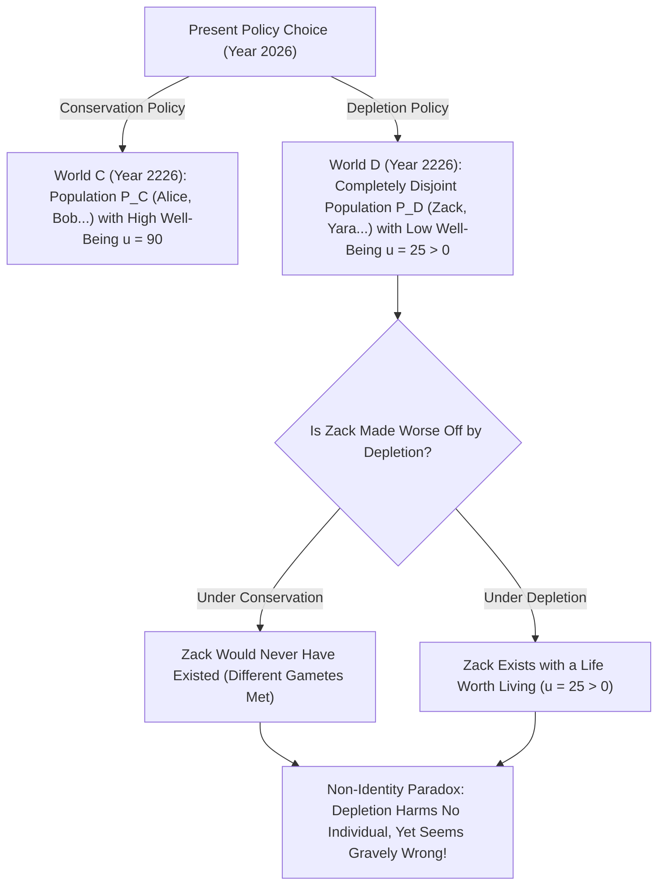
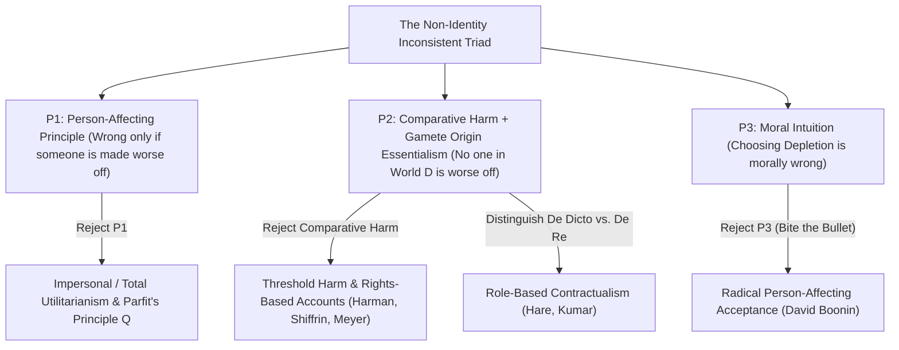

## 서론: 미래 세대에 대한 우리의 책임은 착각 위에 세워져 있는가?

우리 세대가 두 가지 전 지구적 에너지·기후 정책 중 하나를 선택해야 한다고 가정해 봅시다. 바로 <strong>‘보존 정책(Conservation)’</strong>과 <strong>‘고갈 정책(Depletion)’</strong>입니다. 만약 우리가 이기적으로 고갈 정책을 선택한다면, 앞으로 30년 동안 값싼 화석연료와 희소 자원을 마음껏 소비하며 조금 더 안락한 생활을 누릴 수 있습니다. 하지만 그 대가로 200년 뒤 지구 생태계는 심각하게 파괴되어 2226년에 살아가는 인류는 혹독한 기후와 자원 빈곤 속에서 훨씬 낮은 삶의 질을 견뎌야 합니다(그럼에도 그들의 삶 자체는 여전히 태어나지 않은 것보다는 나은, 즉 살아갈 가치가 있는 삶 $u > 0$이라고 합시다).

거의 모든 사람의 도덕적 직관은 주저 없이 ‘고갈 정책’을 규탄합니다. 이유는 명확해 보입니다. <strong>그 선택이 미래 세대에게 심각한 해악(harm)을 끼쳐 200년 뒤의 사람들을 원래 누릴 수 있었던 삶보다 더 나쁜 상태에 빠뜨리기 때문입니다!</strong>
그러나 옥스퍼드 대학교의 철학자 <strong>데릭 파핏(Derek Parfit, 1942–2017)</strong>은 1984년 불후의 명저 <strong>《이유와 인격》(*Reasons and Persons*)</strong> 제16장에서 윤리학계를 충격에 빠뜨린 날카로운 역설을 증명했습니다. 만약 우리가 고갈 정책 대신 보존 정책을 선택했더라면, 200년 뒤 ‘고갈된 세계’에서 우리를 원망하고 있는 수십억 명의 구체적인 개인들 중 <strong>단 한 명도 이 세상에 태어나지 못했을 것</strong>이라는 사실입니다! 고갈 정책이 바로 그들이 존재할 수 있었던 유일한 전제 조건이고 그들의 삶이 살아갈 가치가 있다면, 우리가 어떻게 고갈 정책을 선택함으로써 그들을 ‘해쳤다’고 말할 수 있을까요? 이것이 현대 규범윤리학과 인구윤리학 최대의 난제인 <strong>비동일성 문제(The Non-Identity Problem)</strong>입니다.

---

## 1. 시간 의존성 주장과 배우자 기원 본질주의: 왜 정책이 ‘누가 태어날지’를 바꾸는가?

거시적인 경제·환경 정책 하나가 왜 미래에 태어날 사람들의 정체성(identity)을 통째로 바꾸어 놓을까요? 그 답은 생식생물학과 솔 크립키(Saul Kripke)가 《이름과 필연》에서 제시한 <strong>기원 본질주의(Origin Essentialism / 배우자 본질주의)</strong>의 결합에 있습니다.
모든 구체적인 인간 개체는 특정한 <strong>정자 하나</strong>(한 번에 배출되는 $1	ext{억}	ext{–}3	ext{억}$ 개 중 하나)와 특정한 <strong>난자 하나</strong>의 수정으로부터 탄생합니다. 만약 부모가 아이를 임신하는 시점이 단 몇 분, 혹은 한 달만 달라져도 난자와 결합하는 정자는 완전히 다른 정자가 됩니다! 그렇게 태어난 아이는 당신과 유전자를 $50\%$ 공유하는 친형제자매일 뿐 <strong>결코 당신 자신이 아닙니다</strong>. 그 시간선에서 당신이라는 존재는 애초에 태어나지 않는 것입니다!

파핏은 이를 <strong>시간 의존성 주장(Time-Dependence Claim)</strong>으로 정식화했습니다. *“만약 어떤 특정한 사람이 실제로 잉태된 시점으로부터 한 달 이내에 잉태되지 않았더라면, 그 사람은 사실상 영원히 존재하지 않았을 것이다.”*
이제 보존 정책과 고갈 정책이 일으키는 나비효과를 추적해 봅시다. 에너지 정책이 바뀌면 당장 어떤 공장이 가동되고 어떤 기차 시간표가 편성되는지, 청년들이 어느 도시로 이주하고 어느 비 오는 저녁에 누구와 만나 결혼하는지가 바뀝니다. 불과 몇 년 만에 전 세계 부부들의 임신 시점이 미세하게 이동하며, 200년(약 7~8세대)이 흐른 뒤에는 고갈 세계 $w_D$에 존재하는 인구 집합 $P(w_D)$와 보존 세계 $w_C$에 존재하는 인구 집합 $P(w_C)$의 <strong>교집합은 정확히 공집합($0\%$ 일치)</strong>이 됩니다!

파핏은 <strong>‘14세 소녀의 출산’</strong>과 <strong>‘임신 전 검사 vs. 임신 중 치료 의료 프로그램’</strong> 사고실험으로 문제를 더욱 예리하게 다듬었습니다. 14세 소녀가 성인이 될 때까지 기다리지 않고 지금 당장 아들 빌리(Billy)를 낳기로 결정합니다. 그녀의 선택이 빌리를 더 나쁘게 만들었을까요? 아닙니다! 그녀가 24세까지 기다렸다면 전혀 다른 아이가 태어났을 것이며 빌리는 존재하지도 못했을 것입니다. 마찬가지로 ‘임신 전 풍진 검사(임신을 두 달 연기해 건강한 아이를 낳게 하는 프로그램)’를 취소하여 1,000명의 장애아가 태어났더라도, 그 1,000명 중 누구도 프로그램 취소로 인해 ‘더 나빠지지’ 않았습니다. 부모가 임신을 두 달 미루었더라면 그 1,000명의 아이들은 애초에 잉태되지 않았을 것이기 때문입니다!

$$
\text{Counterfactual Harm Condition:} \quad \text{Harm}(A, p) \iff u\big(p, w(A)\big) < u\big(p, w(\neg A)\big)
$$

$$
\text{Non-Identity Condition:} \quad P\big(w(\text{Depletion})\big) \cap P\big(w(\text{Conservation})\big) = \emptyset, \qquad \forall p \in P\big(w(\text{Depletion})\big),\; u(p) > 0
$$

---

## 2. 비동일성 문제의 형식적 구조: 양립 불가능한 삼중 명제(Inconsistent Triad)

비동일성 문제가 철학적으로 그토록 파괴적인 이유는 우리가 가장 굳게 믿는 세 가지 도덕적 전제가 서로 모순을 일으키는 <strong>양립 불가능한 삼중 명제(Inconsistent Triad)</strong>를 형성하기 때문입니다.
1. <strong>전제 P1: 인간 영향 원리(Person-Affecting Principle / 나브슨의 표어)</strong>: 얀 나브슨(Jan Narveson)의 유명한 말처럼 “도덕은 사람을 행복하게 만드는 것에 관심이 있지, 행복한 사람을 만들어 내는 것에 관심이 있지 않다.” 파핏의 표현을 빌리면 <strong>“나쁜 것은 반드시 누군가에게 나쁜 것이어야 한다(What is bad must be bad for someone).”</strong> 어떤 행위가 도덕적으로 그르려면 반드시 그 행위로 인해 더 나빠지거나 해를 입는 특정 개인 $p$가 존재해야 합니다.
2. <strong>전제 P2: 해악의 반사실적 비교 정의(Counterfactual Comparative Harm) + 비동일성 사실</strong>: 행위 $A$가 개인 $p$에게 해를 끼친다는 것은 $A$가 일어났을 때 $p$의 복지가 $A$가 일어나지 않았을 반사실적 세계에서의 $p$의 복지보다 낮다는 뜻입니다($u(p, w(A)) < u(p, w(
eg A))$). 그러나 고갈 정책 하에서 2226년에 태어난 어떤 개인 $p \in P(w_D)$에게도 유일한 반사실적 대안은 ‘비존재’뿐이며, 살아갈 가치가 있는 삶($u > 0$)은 비존재보다 나쁘지 않습니다. 따라서 <strong>고갈 정책으로 인해 해를 입거나 더 나빠진 개인은 단 한 명도 없습니다.</strong>
3. <strong>전제 P3: 고갈 정책의 도덕적 부당성(및 ‘무차별 견해’ No-Difference View)</strong>: 고갈 정책을 선택하는 것(또는 임신 전 검사 프로그램을 취소하는 것)은 도덕적으로 심각하게 그른 행위이며, 이미 잉태된 태아에게 직접 해를 끼치는 것과 도덕적으로 아무런 차이가 없습니다.

논리적으로 $P_1$과 $P_2$를 동시에 인정하면 필연적으로 $
eg P_3$가 도출됩니다! 미래 세대에 대한 책임을 구출하려면 세 전제 중 적어도 하나를 포기하거나 수정해야만 합니다.

---

## 3. 5대 철학적 탈출구와 기후 경제학·CRISPR 유전자 편집의 현실적 쟁점

지난 40년간 윤리학자들은 비동일성 문제를 해결하기 위해 다섯 가지 주요 전략을 발전시켰습니다.
1. <strong>전략 1(P1 포기): 비인격적 윤리학과 파핏의 ‘동수 질적 주장 $Q$(Principle Q)’</strong>: 파핏은 좁은 ‘인간 영향 원리’를 버려야 한다고 주장했습니다. 두 가능세계에서 살아가는 사람의 수가 같다면, 설령 구체적으로 누가 태어나는지가 달라지더라도 전반적인 삶의 질이 더 낮은 세계가 도덕적으로 더 나쁘다는 것입니다. 하지만 인구 규모가 달라지는 일반적 상황(파핏이 찾아 헤맨 ‘이론 X’)으로 확장하면 <strong>‘역겨운 결론(Repugnant Conclusion)’</strong>(제17편 참조)이라는 또 다른 늪에 빠집니다.
2. <strong>전략 2(P2a 수정): 임계치 해악(Threshold Harm)과 비비교적 권리 침해(Meyer, Harman, Shiffrin)</strong>: 루카스 마이어(Lukas Meyer)와 엘리자베스 하먼(Elizabeth Harman)은 해악이 반드시 반사실적 상태와의 비교를 요하지 않는다고 봅니다. 누군가를 <strong>인간 존엄성의 최소 임계치 $u_{	ext{thresh}}$ 이하</strong>의 고통스러운 상태로 태어나게 만들었다면 비록 다른 대안이 없었더라도 권리 침해이자 해악이라는 것입니다. 그러나 이 이론은 고갈 정책이 미래 세대의 삶을 ‘지극한 번영($u=95$)’에서 ‘임계치 이상의 그저 그런 삶($u=50 > u_{	ext{thresh}}$)’으로 떨어뜨리는 경우에는 아무런 잘못이 없다고 판정하는 한계를 안고 있습니다.
3. <strong>전략 3(P2b 수정): 대언적(De Dicto) 의무 vs. 대물적(De Re) 의무와 계약주의(Caspar Hare, Rahul Kumar)</strong>: 부모나 현세대의 도덕적 의무는 특정한 유전적 개체(*De Re*)에게 지는 것이 아니라, <strong>‘나의 자녀’ 혹은 ‘미래 시민’이라는 규범적 지위/역할(Office / *De Dicto*)</strong>에 대해 지는 것이라는 해법입니다.
4. <strong>전략 4: 덕 윤리학과 집단 중심 관점(Hursthouse)</strong>: 고갈 정책은 현세대의 탐욕과 무책임이라는 악덕을 드러내므로 그르다고 봅니다.
5. <strong>전략 5(P3 포기): 총알 깨물기(Biting the Bullet, 데이비드 부닌 David Boonin 2014)</strong>: 부닌은 위 모든 대안이 실패한다고 논증하며, 미래 세대의 삶이 살아갈 가치가 있는 한 고갈 정책이나 14세 출산은 도덕적으로 <strong>전혀 그르지 않다</strong>는 반직관적 결론을 받아들여야 한다고 주장합니다!

오늘날 비동일성 문제는 세 가지 현실 정책의 최전선에 서 있습니다. (1) <strong>기후변화 경제학의 사회적 할인율(Social Discount Rate $r = \delta + \eta g$)</strong>(노드하우스와 스턴 보고서 사이의 순수 시간선호율 $\delta$ 논쟁); (2) <strong>생식 생명윤리</strong>(단일 배아의 유전자를 교정하는 CRISPR는 동일 개체 치료인 반면, 착상 전 유전진단 PGD로 다른 배아를 선택하는 것은 비동일성 대체임); (3) <strong>역사적 부정의와 배상 책임</strong>(과거의 식민 지배나 노예제가 없었더라면 현재의 후손들이 태어나지 않았을지라도, 국가가 매 세대 태어난 시민들에게 정의로운 재분배 의무를 다하지 않은 것은 반사실적 비교와 무관한 현재진행형 불법행위임).

| 해결 전략 / 대표 학자 | 포기·수정하는 전제 | 핵심 이론적 메커니즘 | ‘임계치 이상의 고갈 정책’ 규탄 가능 여부 | 주요 이론적 대가 및 한계 |
| :--- | :--- | :--- | :--- | :--- |
| <strong>비인격적 원리 $Q$ / 공리주의 (Parfit 1984)</strong> | P1 포기 (인간 영향 원리) | 서로 다른 가능세계의 총체적 복지 수준 비교 | <strong>가능</strong> ($u=90 \succ u=50$) | 인구수가 변할 때 ‘역겨운 결론’으로 이어짐 |
| <strong>임계치 해악 및 권리론 (Meyer, Harman)</strong> | P2 수정 (반사실적 비교 해악) | 최소 존엄성 임계치 $u_{	ext{thresh}}$ 미달 시 해악 성립 | <strong>불가능</strong> ($u=50 > u_{	ext{thresh}}$이면 면책) | 높은 복지 구간 내에서의 환경 파괴 책임을 설명 못 함 |
| <strong>대언적(De Dicto) 계약주의 (Hare, Kumar)</strong> | P2 수정 (지시 대상의 성격) | 도덕적 의무는 ‘미래 시민/자녀’라는 역할(Office)에 귀속 | <strong>가능</strong> (역할에 대한 정당한 기대 침해) | 왜 도덕적 지위가 구체적 인간이 아닌 언어적 역할에 붙는가? |
| <strong>덕 윤리학 (Hursthouse)</strong> | P1 포기 (결과 중심주의) | 행위자의 성품(탐욕, 근시안 vs. 배려) 평가 | <strong>가능</strong> | 잘못의 초점이 미래 피해자가 아닌 ‘현세대의 인격’으로 이동 |
| <strong>급진적 수용론 (David Boonin 2014)</strong> | P3 포기 (도덕적 직관) | 고갈 정책과 임신 전 미검사가 도덕적으로 허용됨을 인정 | 해당 없음 (잘못임을 부정) | 기후 정의 및 공중보건에 관한 인류의 보편적 직관과 정면충돌 |

$$
\text{Social Discount Rate (Ramsey Formula):} \quad r = \delta + \eta g
$$

$$
W_{\text{impersonal}}(w) = \sum_{p \in P(w)} u(p), \qquad \text{De Dicto Duty:} \quad \text{Obligation}\big(\text{Office}(\text{Future Child})\big) \neq \text{Obligation}(p_{\text{specific}})
$$
