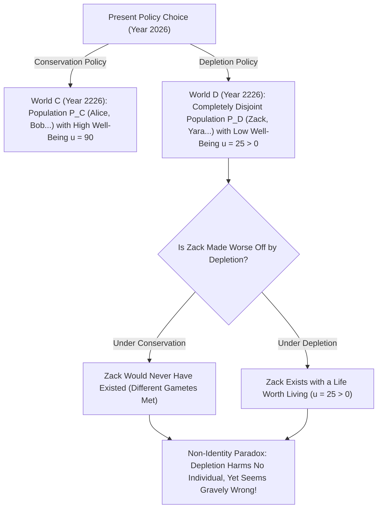
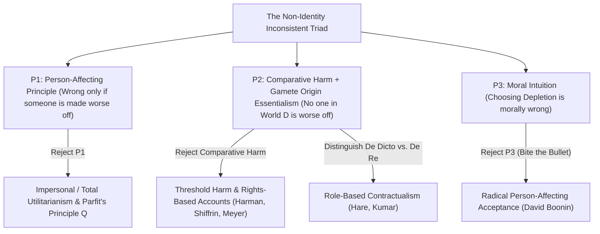

## Introdução: Nossa Responsabilidade para com as Gerações Futuras Repousa sobre uma Ilusão?

Suponhamos que nossa geração precise escolher entre duas políticas globais de energia e clima: <strong>“Conservação”</strong> e <strong>“Esgotamento (Depletion)”</strong>. Se escolhermos egoisticamente o Esgotamento, desfrutaremos durante trinta anos de um padrão de vida ligeiramente superior queimando combustíveis fósseis baratos; mas, daqui a duzentos anos, a biosfera estará gravemente degradada e os habitantes do ano 2226 sofrerão uma qualidade de vida muito menor (embora suas vidas ainda valham a pena ser vividas, isto é, $u > 0$).

Quase todo mundo compartilha a convicção moral de que escolher o Esgotamento é gravemente errado porque <strong>prejudica as gerações futuras</strong>. Contudo, no capítulo 16 de sua obra-prima <strong>*Reasons and Persons</strong>* (1984), o filósofo de Oxford <strong>Derek Parfit</strong> (1942–2017) provou que essa queixa aparentemente óbvia repousa sobre uma ilusão lógica e biológica: se tivéssemos escolhido a Conservação em vez do Esgotamento, <strong>nenhum dos indivíduos específicos que viverão no ano 2226 sob o Esgotamento teria jamais nascido</strong>! Se esses cidadãos devem sua própria existência à política de Esgotamento e suas vidas valem a pena, como essa política pode tê-los prejudicado ou deixado em situação pior? Esse é o famoso <strong>Problema da Não-Identidade (*The Non-Identity Problem*)</strong>.

---

## 1. A Dependência Temporal e o Essencialismo da Origem: Por Que a Política Muda Quem Existe

Por que uma decisão macroeconômica ou ambiental altera a própria identidade das pessoas futuras? A resposta está na combinação entre a biologia reprodutiva e o <strong>essencialismo da origem (*Gamete Origin Essentialism*)</strong> formulado por Saul Kripke em *O Nomear e a Necessidade* (1972).
Cada ser humano origina-se da fusão de <strong>um espermatozoide específico</strong> (dentre $100$ a $300	ext{ milhões}$) e <strong>um óvulo específico</strong>. Se um casal concebe um filho apenas alguns minutos ou um mês antes ou depois, um espermatozoide completamente diferente fecundará o óvulo. A criança resultante compartilharia no máximo $50\,\%$ do seu DNA — seria seu irmão ou irmã, mas <strong>jamais você mesmo</strong>!

Parfit formulou isso como a <strong>Tese da Dependência Temporal (*Time-Dependence Claim*)</strong>: *“Se qualquer pessoa específica não tivesse sido concebida dentro do mês em que de fato foi concebida, ela nunca teria existido.”*
Acompanhe agora o efeito borboleta de uma política energética global ao longo de dois séculos (sete a oito gerações) — mudanças de emprego, horários de transporte, mudanças de cidade e casamentos: o conjunto de pessoas vivas em 2226 sob o Esgotamento $P(w_D)$ e o conjunto de pessoas vivas sob a Conservação $P(w_C)$ têm uma <strong>interseção estritamente vazia ($P(w_D) \cap P(w_C) = \emptyset$)</strong>!

Parfit ilustrou esse paradoxo com outros dois casos famosos: quando uma <strong>menina de 14 anos</strong> decide ter um filho (Billy) agora em vez de esperar até os 24 anos, ela não piora a situação de *Billy*, pois aos 24 teria concebido outra criança totalmente diferente. Da mesma forma, se um <strong>programa médico de triagem pré-concepcional</strong> for cancelado (o qual aconselhava adiar a gravidez por dois meses diante de uma infecção temporária), nenhuma das $1.000$ crianças nascidas com deficiência fica “em situação pior” pelo cancelamento, já que esperar dois meses teria trazido ao mundo $1.000$ crianças completamente diferentes!

$$
\text{Counterfactual Harm Condition:} \quad \text{Harm}(A, p) \iff u\big(p, w(A)\big) < u\big(p, w(\neg A)\big)
$$

$$
\text{Non-Identity Condition:} \quad P\big(w(\text{Depletion})\big) \cap P\big(w(\text{Conservation})\big) = \emptyset, \qquad \forall p \in P\big(w(\text{Depletion})\big),\; u(p) > 0
$$

---

## 2. A Estrutura Lógica: O Trilema Inconsistente do Problema da Não-Identidade

O Problema da Não-Identidade prende três de nossas intuições morais mais profundas em um <strong>trilema inconsistente (*Inconsistent Triad*)</strong>:
1. <strong>Premissa P1: O Princípio Centrado na Pessoa (*Person-Affecting Principle*)</strong>: Segundo o lema de Jan Narveson e Derek Parfit, *“o que é mau deve ser mau para alguém”*. Uma ação só pode ser moralmente errada se existir algum indivíduo concreto $p$ que ela prejudique ou deixe em situação pior.
2. <strong>Premissa P2: Noção Comparativa Contrafactual de Dano + Não-Identidade</strong>: Um ato $A$ prejudica uma pessoa $p$ se e somente se o bem-estar de $p$ no mundo com $A$ for menor que seu bem-estar no mundo contrafactual sem $A$: $u(p, w(A)) < u(p, w(
eg A))$. Como nenhum habitante $p \in P(w_D)$ existe em $w_C$, e ter uma vida que vale a pena ($u > 0$) não é pior do que nunca existir, <strong>o Esgotamento não prejudica nem piora a situação de nenhum indivíduo</strong>.
3. <strong>Premissa P3: Imoralidade do Esgotamento (e a “Visão da Não-Diferença” / *No-Difference View*)</strong>: Escolher o Esgotamento (ou cancelar o programa pré-concepcional) é gravemente imoral.

Como $(P_1 \land P_2) \implies 
eg P_3$, toda teoria ética coerente deve rejeitar ou modificar pelo menos uma dessas três premissas!

---

## 3. Cinco Saídas Filosóficas e Seu Impacto na Economia Climática e no CRISPR

Foram desenvolvidas cinco grandes estratégias para resolver o Problema da Não-Identidade:
1. <strong>Saída 1 (Rejeição de P1): Ética Impessoal e o “Princípio Q” de Parfit</strong>: Parfit sustenta que, com igual número de pessoas, o mundo com menor qualidade de vida é moralmente pior mesmo que vivam indivíduos diferentes. Mas quando o tamanho da população varia (a busca pela “Teoria X”), esse enfoque leva diretamente à <strong>“Conclusão Repugnante (*Repugnant Conclusion*)”</strong> (veja o artigo #17).
2. <strong>Saída 2 (Modificação de P2a): Dano de Limiar (*Threshold Harm*) e Direitos (Meyer, Harman, Shiffrin)</strong>: Lukas Meyer e Elizabeth Harman sustentam que alguém é prejudicado quando passa a existir <strong>abaixo de um limiar normativo de dignidade $u_{	ext{thresh}}$</strong>. Fraqueza: se o Esgotamento apenas reduz o bem-estar futuro de “excelente ($u=95$)” para “razoável acima do limiar ($u=50 > u_{	ext{thresh}}$)”, a teoria do limiar o declara totalmente permissível!
3. <strong>Saída 3 (Modificação de P2b): Obrigações *De Dicto* vs. *De Re* e Contratualismo (Caspar Hare, Rahul Kumar)</strong>: Nossos deveres morais não são devidos a um indivíduo genético específico (*de re*), mas ao <strong>papel ou cargo normativo (*Office* / *de dicto*)</strong> de “meu futuro filho” ou “cidadão do século XXIII”.
4. <strong>Saída 4: Ética das Virtudes (Hursthouse)</strong>: O Esgotamento é errado porque expressa vícios como ganância e irresponsabilidade.
5. <strong>Saída 5 (Rejeição de P3): “Morder a Bala” (*Biting the Bullet*, David Boonin 2014)</strong>: Boonin argumenta que todas as tentativas de refutação falham e devemos aceitar que o Esgotamento <strong>não é moralmente errado</strong> desde que as vidas futuras valham a pena ser vividas!

Na prática, esse problema é decisivo em três debates atuais: (1) <strong>a taxa social de desconto na economia das mudanças climáticas ($r = \delta + \eta g$)</strong> (Nordhaus vs. Relatório Stern sobre $\delta = 0$); (2) <strong>a bioética reprodutiva</strong> (a edição genética CRISPR em um embrião existente beneficia *aquele* indivíduo, enquanto a seleção embrionária PGD substitui um indivíduo por *outro*); e (3) <strong>as reparações históricas</strong> (baseadas na injustiça distributiva contínua do Estado perante cada nova geração).

| Estratégia / Filósofo | Premissa Rejeitada | Mecanismo Central | Condena o Esgotamento Acima do Limiar? | Custo Teórico Principal |
| :--- | :--- | :--- | :--- | :--- |
| <strong>Princípio Impessoal $Q$ (Parfit 1984)</strong> | Rejeita P1 (centrado na pessoa) | Compara o bem-estar agregado entre mundos possíveis | <strong>Sim</strong> ($u=90 \succ u=50$) | Leva à *Conclusão Repugnante* com população variável |
| <strong>Dano de Limiar e Direitos (Meyer, Harman)</strong> | Modifica P2 (dano comparativo) | Dano = existir sob o limiar de dignidade $u_{	ext{thresh}}$ | <strong>Não</strong> (falha se $u=50 > u_{	ext{thresh}}$) | Permite grande degradação acima do limiar |
| <strong>Contratualismo *De Dicto* (Hare, Kumar)</strong> | Modifica P2 (objeto de referência) | Deveres para com *papéis/cargos* (“futuro cidadão”) | <strong>Sim</strong> (viola expectativas legítimas do papel) | Por que atribuir status moral a descrições linguísticas? |
| <strong>Ética das Virtudes (Hursthouse)</strong> | Rejeita P1 (consequencialismo) | Avalia o caráter do agente (egoísmo vs. cuidado) | <strong>Sim</strong> | Foca a falta na *alma do agente* e não nas vítimas |
| <strong>Aceitação Radical (David Boonin 2014)</strong> | Rejeita P3 (intuição moral) | Aceita que o Esgotamento e o caso B são permissíveis | N/A (nega o erro moral) | Choca-se frontalmente com o consenso sobre justiça climática |

$$
\text{Social Discount Rate (Ramsey Formula):} \quad r = \delta + \eta g
$$

$$
W_{\text{impersonal}}(w) = \sum_{p \in P(w)} u(p), \qquad \text{De Dicto Duty:} \quad \text{Obligation}\big(\text{Office}(\text{Future Child})\big) \neq \text{Obligation}(p_{\text{specific}})
$$
