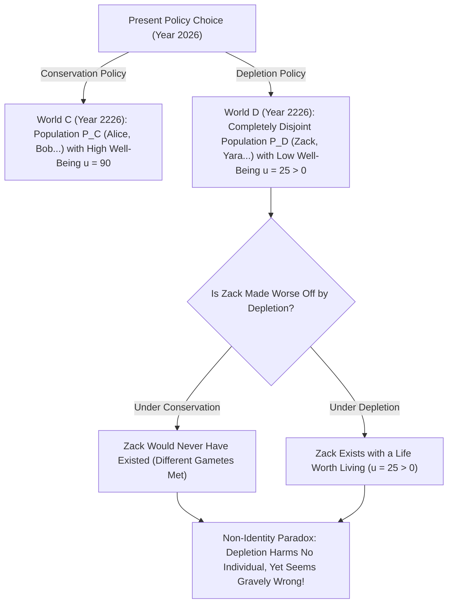
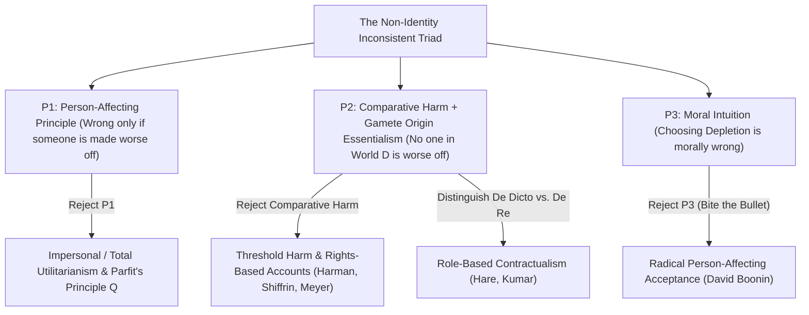

## Введение: Неужели наша ответственность перед будущими поколениями основана на иллюзии?

Предположим, наше поколение стоит перед выбором между двумя глобальными климатическими и ресурсным стратегиями: <strong>«Сохранение (Conservation)»</strong> и <strong>«Истощение (Depletion)»</strong>. Если мы эгоистично выберем Истощение, то в ближайшие тридцать лет будем жить чуть богаче за счёт дешёвого ископаемого топлива; но через двести лет биосфера Земли будет тяжело подорвана, и качество жизни людей в 2226 году окажется значительно ниже (хотя их жизнь всё равно останется достойной того, чтобы жить, то есть $u > 0$).

Почти каждый человек убеждён, что выбор Истощения — это тяжкое моральное преступление, поскольку он <strong>наносит вред будущим поколениям</strong>. Однако в главе 16 своего фундаментального труда <strong>*«Резоны и лица» (Reasons and Persons, 1984)</strong>* оксфордский философ <strong>Дерек Парфит (Derek Parfit, 1942–2017)</strong> доказал, что это интуитивное обвинение опирается на глубокую логическую и биологическую иллюзию: если бы мы выбрали Сохранение вместо Истощения, то в 2226 году <strong>ни один из конкретных людей, живущих в мире Истощения, вообще никогда бы не родился на свет</strong>! Если сами эти люди обязаны своим существованием политике Истощения и их жизнь стоит того, чтобы жить, то каким образом политика Истощения могла «навредить» им или ухудшить их положение? Это знаменитая <strong>проблема нетождественности (The Non-Identity Problem)</strong>.

---

## 1. Тезис о временной зависимости и эссенциализм происхождения: Почему политика меняет то, кто существует

Почему макроэкономическое или экологическое решение меняет саму личность (тождественность) будущих людей? Ответ лежит на стыке биологии репродукции и метафизики <strong>эссенциализма происхождения (*Gamete Origin Essentialism*)</strong> Сола Крипке (*«Именование и необходимость»*, 1972).
Каждый конкретный человек возникает из слияния <strong>одного конкретного сперматозоида</strong> (из $100	ext{–}300	ext{ миллионов}$) и <strong>одной конкретной яйцеклетки</strong>. Если зачатие происходит хотя бы на несколько минут или на месяц раньше или позже, яйцеклетку оплодотворит совершенно другой сперматозоид. Родившийся в результате ребёнок будет иметь с вами не более $50\,\%$ общих генов — это будет ваш брат или сестра, но <strong>никогда не вы сами</strong>!

Парфит сформулировал это как <strong>тезис о временной зависимости (*Time-Dependence Claim*)</strong>: *«Если бы любой конкретный человек не был зачат в пределах месяца от того времени, когда он фактически был зачат, он вообще никогда бы не существовал»*.
Проследим теперь эффект бабочки глобальной энергетической политики на протяжении двухсот лет (семи-восьми поколений) — иные рабочие места, расписания поездов, переезды и знакомства: множество людей, живущих в 2226 году при Истощении $P(w_D)$, и множество людей при Сохранении $P(w_C)$ <strong>не пересекаются вовсе ($P(w_D) \cap P(w_C) = \emptyset$)</strong>!

Парфит проиллюстрировал этот парадокс ещё двумя яркими примерами: когда <strong>14-летняя девочка</strong> решает родить ребёнка (Билли) сейчас, а не ждать до 24 лет, она не ухудшает положение *Билли* — ведь в 24 года она зачала бы совершенно другого ребёнка. Аналогично, если отменить <strong>программу преконцепционного скрининга</strong> (рекомендовавшую женщинам с временной инфекцией отложить зачатие на два месяца), ни один из $1\,000$ родившихся с инвалидностью детей не «пострадал» от отмены программы, так как через два месяца были бы зачаты $1\,000$ совершенно других детей!

$$
\text{Counterfactual Harm Condition:} \quad \text{Harm}(A, p) \iff u\big(p, w(A)\big) < u\big(p, w(\neg A)\big)
$$

$$
\text{Non-Identity Condition:} \quad P\big(w(\text{Depletion})\big) \cap P\big(w(\text{Conservation})\big) = \emptyset, \qquad \forall p \in P\big(w(\text{Depletion})\big),\; u(p) > 0
$$

---

## 2. Логическая структура: Несовместная триада проблемы нетождественности

Проблема нетождественности загоняет три наши базовые моральные интуиции в логически противоречивую <strong>несовместную триаду (*Inconsistent Triad*)</strong>:
1. <strong>Посылка P1: Принцип затрагивания личности (*Person-Affecting Principle*)</strong>: По формуле Яна Нарвесона и Дерека Парфита, *«то, что плохо, должно быть плохо для кого-то»*. Действие может быть морально неправильным только в том случае, если существует конкретный индивид $p$, которому оно наносит вред или ухудшает положение.
2. <strong>Посылка P2: Контрфактическое сравнительное понятие вреда + Нетождественность</strong>: Действие $A$ вредит индивиду $p$ тогда и только тогда, когда благополучие $p$ в мире с $A$ ниже, чем его благополучие в контрфактическом мире без $A$: $u(p, w(A)) < u(p, w(
eg A))$. Но ни один житель $p \in P(w_D)$ не существует в мире $w_C$, а жизнь, достойная прожития ($u > 0$), не хуже небытия. Следовательно, <strong>Истощение не вредит ни одному индивиду</strong>.
3. <strong>Посылка P3: Моральная недопустимость Истощения (и «взгляд об отсутствии разницы» / *No-Difference View*)</strong>: Выбор Истощения (или отмена преконцепционного скрининга) морально порочен.

Поскольку $(P_1 \land P_2) \implies 
eg P_3$, любая непротиворечивая этика обязана отвергнуть или пересмотреть хотя бы одну из трёх посылок!

---

## 3. Пять философских выходов и их значение для экономики климата и CRISPR

За последние сорок лет сформировались пять основных подходов к решению проблемы нетождественности:
1. <strong>Выход 1 (Отказ от P1): Безличная этика и «Принцип Q» Парфита</strong>: Парфит утверждает, что при равной численности населения мир с более низким качеством жизни морально хуже, даже если в нём живут другие люди. Однако при переменной численности населения (поиск «Теории X») безличный утилитаризм неизбежно ведёт к <strong>«Отвратительному выводу (*Repugnant Conclusion*)»</strong> (см. статью #17).
2. <strong>Выход 2 (Пересмотр P2a): Пороговый вред (*Threshold Harm*) и права (Мейер, Харман, Шиффрин)</strong>: Лукас Мейер и Элизабет Харман считают, что человеку наносится вред, если действие приводит к его существованию <strong>ниже нормативного порога достоинства $u_{	ext{thresh}}$</strong>. Слабое место: если Истощение снижает благополучие потомков с «блестящего ($u=95$)» до «умеренного выше порога ($u=50 > u_{	ext{thresh}}$)», пороговая теория объявляет это полностью допустимым!
3. <strong>Выход 3 (Пересмотр P2b): Обязанности *de dicto* против *de re* и контрактуализм (Каспар Хэйр, Рахул Кумар)</strong>: Наши моральные обязанности адресованы не конкретному генетическому индивиду (*de re*), а <strong>нормативной роли/позиции (*Office* / *de dicto*)</strong> «моего будущего ребёнка» или «гражданина XXIII века».
4. <strong>Выход 4: Этика добродетели (Хёрстхаус)</strong>: Истощение порочно, так как проявляет жадность и безответственность.
5. <strong>Выход 5 (Отказ от P3): «Прикусить пулю» (*Biting the Bullet*, Дэвид Бунин 2014)</strong>: Бунин доказывает, что все попытки опровержения несостоятельны, и мы должны признать: политика Истощения и рождение ребёнка в 14 лет <strong>морально допустимы</strong>, пока жизнь рождённых стоит того, чтобы жить!

На практике эта проблема стоит в центре трёх важнейших дискуссий: (1) <strong>социальная ставка дисконтирования в экономике климата ($r = \delta + \eta g$)</strong> (спор Нордхауса и доклада Стерна о $\delta = 0$); (2) <strong>репродуктивная биоэтика</strong> (редактирование генома эмбриона с помощью CRISPR лечит *этого* ребёнка, тогда как преимплантационная диагностика ПГД выбирает *другого* человека); и (3) <strong>историческая справедливость и репарации</strong> (основанные на длящемся нарушении обязанностей государства перед каждым новым поколением граждан).

| Подход / Философ | Отвергаемая посылка | Ключевой механизм | Осуждает Истощение выше порога? | Главная теоретическая издержка |
| :--- | :--- | :--- | :--- | :--- |
| <strong>Безличный принцип $Q$ (Parfit 1984)</strong> | Отвергает P1 (личностный принцип) | Сравнивает совокупное благополучие между мирами | <strong>Да</strong> ($u=90 \succ u=50$) | Ведёт к *Отвратительному выводу* при разной численности |
| <strong>Пороговый вред и права (Meyer, Harman)</strong> | Меняет P2 (сравнительный вред) | Вред = жизнь ниже порога достоинства $u_{	ext{thresh}}$ | <strong>Нет</strong> (пасует при $u=50 > u_{	ext{thresh}}$) | Допускает сильную деградацию выше порога |
| <strong>Контрактуализм *de dicto* (Hare, Kumar)</strong> | Меняет P2 (объект отсылки) | Обязанности перед *ролями/статусами* («будущий гражданин») | <strong>Да</strong> (нарушает ожидания роли) | Почему моральный статус привязан к абстрактной роли? |
| <strong>Этика добродетели (Hursthouse)</strong> | Отвергает P1 (консеквенциализм) | Оценивает пороки и добродетели агента | <strong>Да</strong> | Смещает фокус с жертв на *душу самого деятеля* |
| <strong>Радикальное принятие (David Boonin 2014)</strong> | Отвергает P3 (моральную интуицию) | Признаёт Истощение и случай B морально допустимыми | Н/Д (отрицает неправоту) | Разрушает базовый консенсус о климатической справедливости |

$$
\text{Social Discount Rate (Ramsey Formula):} \quad r = \delta + \eta g
$$

$$
W_{\text{impersonal}}(w) = \sum_{p \in P(w)} u(p), \qquad \text{De Dicto Duty:} \quad \text{Obligation}\big(\text{Office}(\text{Future Child})\big) \neq \text{Obligation}(p_{\text{specific}})
$$
