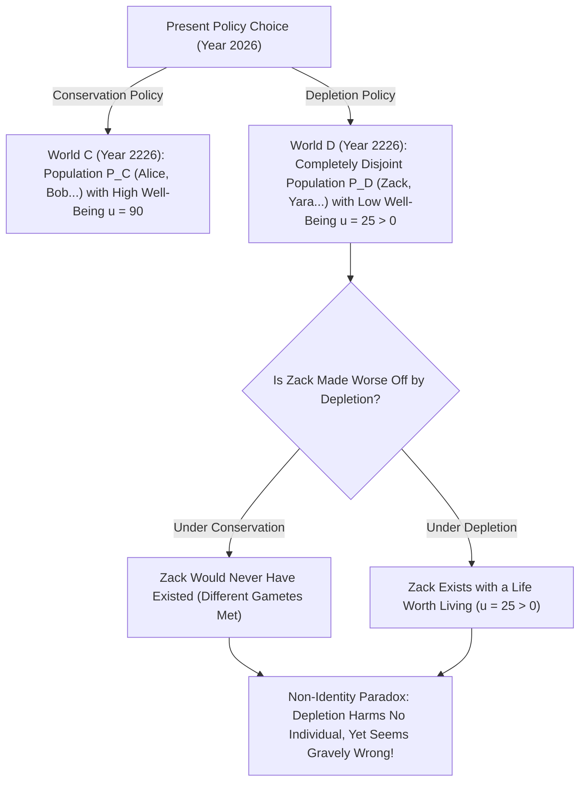
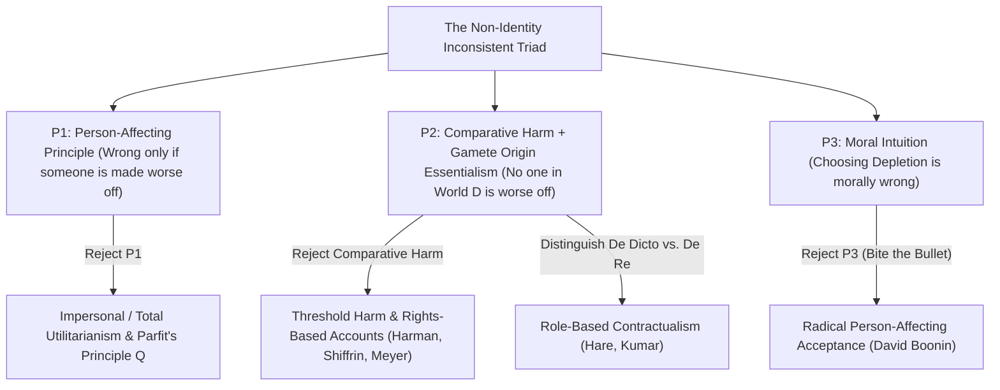

## 引言：我们对未来世代的责任建立在幻觉之上吗？

假设我们这一代人面临两项全球能源与气候政策的抉择：<strong>“保育政策（Conservation）”</strong>与<strong>“耗竭政策（Depletion）”</strong>。如果我们自私地选择耗竭政策，未来三十年内我们可以廉价地挥霍化石燃料与稀缺资源，享受略高一点的物质生活；但代价是两百年后地球生态严重恶化，生活在2226年的人类将承受恶劣的气候与匮乏的资源，生活质量大幅下降（尽管如此，他们的生命依然是值得活下去的，即幸福度 $u > 0$）。

几乎所有人的道德直觉都会毫不犹豫地谴责“耗竭政策”，理由很简单：<strong>它严重伤害了未来世代的人类，使两百年后的人过得比原本应有的生活更糟！</strong>
然而，牛津大学哲学家<strong>德里克·帕菲特（Derek Parfit, 1942–2017）</strong>在其1984年的旷世巨著<strong>《理与人》（*Reasons and Persons*）</strong>第16章中，揭示了一个令整个伦理学界毛骨悚然的逻辑悖论：如果我们当年选择了“保育政策”而不是“耗竭政策”，那么两百年后在“耗竭世界”里抱怨我们的那数十亿具体个人，<strong>连哪怕一个都不会出生在世界上！</strong>既然“耗竭政策”是他们得以存在的唯一前提，且他们的生命总体上值得活，我们怎么可能通过选择“耗竭政策”而“伤害”了他们呢？这就是现代规范伦理学与人口伦理学中最著名的<strong>非同一性问题（The Non-Identity Problem）</strong>。

---

## 1. 时间依赖性主张与配子起源本质主义：为什么政策会改变“谁会出生”？

为什么一项宏观经济或环境政策会彻底改变未来出生的人是谁？这源于生殖生物学与索尔·克里普克（Saul Kripke）在《命名与必然性》中提出的<strong>配子起源本质主义（Gamete Origin Essentialism）</strong>。
每一个具体的人，都诞生于特定的<strong>一颗精子</strong>（每次射精约有 $1	ext{–}3$ 亿颗精子竞争）与特定的<strong>一颗卵子</strong>的结合。如果一对父母受孕的时间哪怕仅仅推迟或提前了几分钟（更不用说几个月），与卵子结合的就会是另一颗完全不同的精子！那个由此诞生的孩子充其量只是你的亲兄弟姐妹（与你共享 $50\%$ 的基因），而<strong>绝对不是你本人</strong>——在那条时间线上，你根本从未存在过！

帕菲特将其总结为<strong>时间依赖性主张（Time-Dependence Claim）</strong>：*“如果任何一个特定的人没有在他实际被怀上的那一个月内受孕，那么他在事实上就永远不会存在。”*
现在思考“保育政策”与“耗竭政策”的蝴蝶效应：改变全球能源结构会立即改变哪些工厂开工、列车时刻表如何运行、年轻人在哪座城市工作以及人们在哪个雨夜相遇结婚。短短几年内，全球人类受孕的具体时间点就会发生全面偏移。两百年（约七到八代人）之后，在“耗竭世界” $w_D$ 中出生的人口集合 $P(w_D)$ 与在“保育世界” $w_C$ 中出生的人口集合 $P(w_C)$ 的<strong>交集严格为空集（$0\%$ 重叠）</strong>！

帕菲特还用<strong>“14岁少女生子”</strong>与<strong>“孕前筛查 vs. 孕期筛查医疗项目”</strong>进一步锐化了这一悖论：一位14岁少女执意现在生下儿子比利（Billy），而不是等到24岁成熟后再要孩子。她伤害了比利吗？没有！如果她等到24岁，生下的将是另一个孩子，比利根本不会存在。同理，取消“孕前风疹筛查（让孕妇推迟两个月怀孕以避免胎儿残疾）”导致的1,000名残疾儿童，没有任何一个因为该项目被取消而“变得更糟”，因为如果母亲推迟两个月怀孕，这1,000个孩子根本不会降生！

$$
\text{Counterfactual Harm Condition:} \quad \text{Harm}(A, p) \iff u\big(p, w(A)\big) < u\big(p, w(\neg A)\big)
$$

$$
\text{Non-Identity Condition:} \quad P\big(w(\text{Depletion})\big) \cap P\big(w(\text{Conservation})\big) = \emptyset, \qquad \forall p \in P\big(w(\text{Depletion})\big),\; u(p) > 0
$$

---

## 2. 非同一性问题的形式化结构：不相容三元组（Inconsistent Triad）

非同一性问题之所以具有毁灭性的哲学杀伤力，是因为它将我们最深层的三条道德直觉逼入了逻辑自相矛盾的<strong>不相容三元组（Inconsistent Triad）</strong>：
1. <strong>前提 P1：影响个体原则（Person-Affecting Principle / 纳维森格言）</strong>：正如简·纳维森（Jan Narveson）所言，“道德关心的是让现存的人变幸福，而不是制造幸福的人”。用帕菲特的话说：<strong>“一件坏事，必须对某个人来说是坏的（What is bad must be bad for someone）”</strong>。一个行为只有在使某个具体个人变得更糟（受到伤害）时，才可能是道德错误的。
2. <strong>前提 P2：伤害的反事实比较定义（Counterfactual Comparative Harm）+ 非同一性事实</strong>：行为 $A$ 伤害了个体 $p$，当且仅当 $p$ 在 $A$ 发生后的福祉低于 $A$ 不发生时 $p$ 的福祉：$u(p, w(A)) < u(p, w(
eg A))$。但在耗竭政策下，对于2226年的任何居民 $p \in P(w_D)$，唯一的替代选项是“从未存在过”，而拥有一段值得活的人生（$u > 0$）并不比虚无更糟。因此，<strong>没有任何个体因耗竭政策而变糟</strong>。
3. <strong>前提 P3：对耗竭政策的道德谴责（及“无差异观点” No-Difference View）</strong>：选择耗竭政策（或取消孕前筛查项目）在道德上是极其错误的，其错误程度与直接伤害已受孕胎儿的政策毫无区别。

在形式逻辑上，$P_1$ 与 $P_2$ 合取必然推出 $
eg P_3$！要拯救我们对未来世代的道德责任，必须至少放弃或修正其中一个前提。

---

## 3. 五大哲学破局路径与气候经济、CRISPR 基因编辑的现实交锋

过去四十年间，哲学家们围绕如何破解非同一性问题发展出了五条核心路径：
1. <strong>路径一（放弃 P1）：非个人主义伦理学与帕菲特的“同数质量原则 $Q$（Principle Q）”</strong>：帕菲特主张放弃狭隘的“影响个体原则”。只要两个可能世界的人口数量相同，即便具体是谁发生了改变，导致总体生活质量更低的世界在道德上就是更坏的（无差异观点）。然而，一旦两个世界的人口数量也不同（寻求终极“理论 X”），非个人总体功利主义就会直接滑向<strong>“令人厌恶的结论（Repugnant Conclusion）”</strong>（见第17篇）。
2. <strong>路径二（修正 P2a）：门槛伤害（Threshold Harm）与非比较性权利侵害（Meyer, Harman, Shiffrin）</strong>：卢卡斯·迈耶（Lukas Meyer）与伊丽莎白·哈曼（Elizabeth Harman）主张，伤害不一定需要与“反事实状态”做比较；只要你的行为导致某人出生在<strong>低于人类尊严与基本权利门槛 $u_{	ext{thresh}}$</strong> 的痛苦状态中，你就侵犯了他的权利。但这一方案的软肋在于：如果耗竭政策只是把未来人类的生活从“极度繁荣（$u=95$）”降级为“高于门槛的普通温饱（$u=50 > u_{	ext{thresh}}$）”，门槛理论竟会荒谬地认为这完全道德许可！
3. <strong>路径三（修正 P2b）：从言（De Dicto）义务 vs. 从事（De Re）义务与契约主义（Caspar Hare, Rahul Kumar）</strong>：拉胡尔·库马尔与卡斯帕·黑尔指出，父母和当代人对未来负有的道德义务，指向的不是某个特定基因配子的个体（*De Re*），而是<strong>“我的孩子”或“未来公民”这一规范性角色/职位（Office / *De Dicto*）</strong>。
4. <strong>路径四：美德伦理学与群体本位观（Hursthouse）</strong>：批评耗竭政策体现了当代人贪婪、短视的恶德。
5. <strong>路径五（放弃 P3）：硬吞苦果（Biting the Bullet，大卫·布宁 David Boonin 2014）</strong>：布宁在专著中论证，以上所有修正方案均告失败，因此我们必须承认反直觉的结论：只要未来世代的生活值得活，耗竭政策与14岁生子在道德上<strong>根本没有错</strong>！

在现实世界中，非同一性问题直接决定了三大前沿领域的政策走向：(1) <strong>气候变化经济学中的社会贴现率（Social Discount Rate $r = \delta + \eta g$）</strong>（诺德豪斯与斯特恩报告关于纯时间偏好率 $\delta$ 是否应为 $0$ 的世纪之争）；(2) <strong>生殖生物伦理</strong>（用 CRISPR 修复特定胚胎属于同一性治疗，而通过胚胎植入前遗传学诊断 PGD 挑选另一个健康胚胎则属于非同一性替代）；(3) <strong>历史不公与跨代赔偿</strong>（历史暴行虽然改变了后代的配子同一性，但国家对每一代新生公民持续未能履行正义分配，构成了无需依赖反事实受孕比较的当下侵权）。

| 解决方案 / 代表学者 | 放弃或修正的前提 | 核心理论机制 | 能否谴责“高于门槛的耗竭政策”？ | 主要理论代价 / 局限 |
| :--- | :--- | :--- | :--- | :--- |
| <strong>非个人原则 $Q$ / 功利主义（Parfit 1984）</strong> | 放弃 P1（影响个体原则） | 比较不同可能世界的总体福祉与生活质量 | <strong>能</strong>（$u=90 \succ u=50$） | 人口数量变化时导致“令人厌恶的结论” |
| <strong>门槛伤害与权利论（Meyer, Harman）</strong> | 修正 P2（反事实比较伤害） | 使人落入基本尊严门槛 $u_{	ext{thresh}}$ 以下即构成伤害 | <strong>不能</strong>（若 $u=50 > u_{	ext{thresh}}$ 则失效） | 无法解释高福祉区间内的生态退化责任 |
| <strong>从言（De Dicto）契约主义（Hare, Kumar）</strong> | 修正 P2（指称对象） | 道德义务指向“未来公民/子女”这一规范职位 | <strong>能</strong>（违背了职位角色正当期待） | 道德地位为何附着于抽象语言描述而非具体人？ |
| <strong>美德伦理学（Hursthouse）</strong> | 放弃 P1（后果本位） | 评价行动者的品格特征（短视、自私 vs. 关爱） | <strong>能</strong> | 将错误归结为“当代人的灵魂污点”而非受害者权利 |
| <strong>激进接受论（David Boonin 2014）</strong> | 放弃 P3（道德直觉） | 坦然承认耗竭政策与孕前不筛查完全道德许可 | 不适用（否认其为错误） | 严重违背人类关于气候正义与公共卫生的核心共识 |

$$
\text{Social Discount Rate (Ramsey Formula):} \quad r = \delta + \eta g
$$

$$
W_{\text{impersonal}}(w) = \sum_{p \in P(w)} u(p), \qquad \text{De Dicto Duty:} \quad \text{Obligation}\big(\text{Office}(\text{Future Child})\big) \neq \text{Obligation}(p_{\text{specific}})
$$
