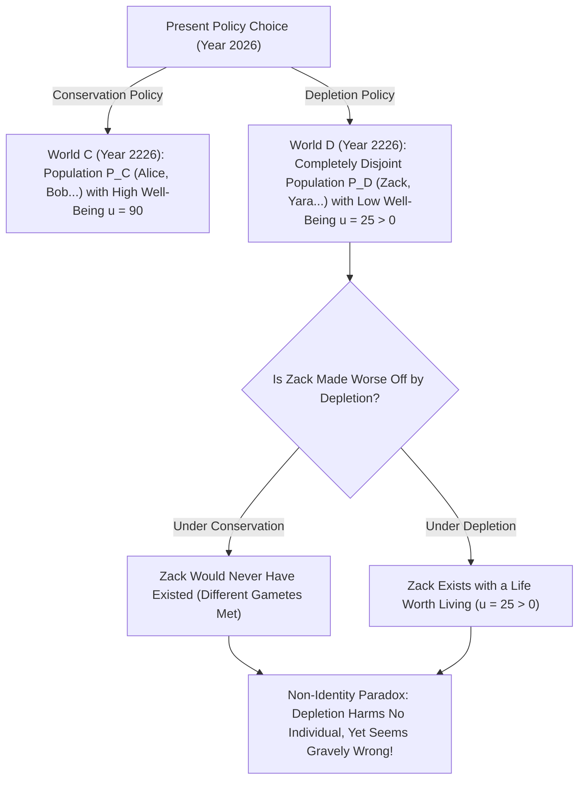
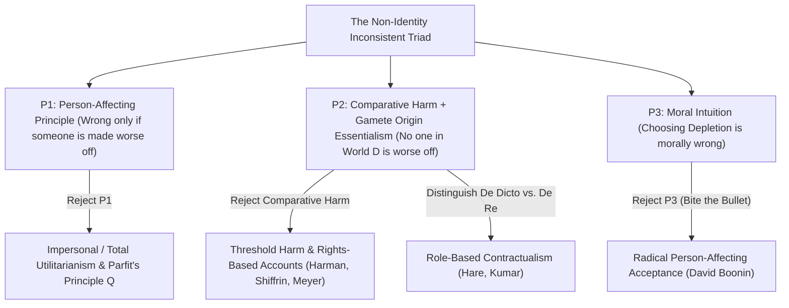

## 引言：我們對未來世代的責任建立在幻覺之上嗎？

假設我們這一代人面臨兩項全球能源與氣候政策的抉擇：<strong>「保育政策（Conservation）」</strong>與<strong>「耗竭政策（Depletion）」</strong>。如果我們自私地選擇耗竭政策，未來三十年內我們可以廉價地揮霍化石燃料與稀缺資源，享受略高一點的物質生活；但代價是兩百年後地球生態嚴重惡化，生活在2226年的人類將承受惡劣的氣候與匱乏的資源，生活品質大幅下降（儘管如此，他們的生命依然是值得活下去的，即幸福度 $u > 0$）。

幾乎所有人的道德直覺都會毫不猶豫地譴責「耗竭政策」，理由很簡單：<strong>它嚴重傷害了未來世代的人類，使兩百年後的人過得比原本應有的生活更糟！</strong>
然而，牛津大學哲學家<strong>德瑞克·帕菲特（Derek Parfit, 1942–2017）</strong>在其1984年的曠世巨著<strong>《理與人》（*Reasons and Persons*）</strong>第16章中，揭示了一個令整個倫理學界毛骨悚然的邏輯悖論：如果我們當年選擇了「保育政策」而不是「耗竭政策」，那麼兩百年後在「耗竭世界」裡抱怨我們的那數十億具體個人，<strong>連哪怕一個都不會出生在世界上！</strong>既然「耗竭政策」是他們得以存在的唯一前提，且他們的生命總體上值得活，我們怎麼可能透過選擇「耗竭政策」而「傷害」了他們呢？這就是現代規範倫理學與人口倫理學中最著名的<strong>非同一性問題（The Non-Identity Problem）</strong>。

---

## 1. 時間依賴性主張與配子起源本質主義：為什麼政策會改變「誰會出生」？

為什麼一項總體經濟或環境政策會徹底改變未來出生的人是誰？這源於生殖生物學與索爾·克里普克（Saul Kripke）在《命名與必然性》中提出的<strong>配子起源本質主義（Gamete Origin Essentialism）</strong>。
每一個具體的人，都誕生於特定的<strong>一顆精子</strong>（每次射精約有 $1	ext{–}3$ 億顆精子競爭）與特定的<strong>一顆卵子</strong>的結合。如果一對父母受孕的時間哪怕僅僅推遲或提前了幾分鐘（更不用說幾個月），與卵子結合的就會是另一顆完全不同的精子！那個由此誕生的孩子充其量只是你的親兄弟姊妹（與你共享 $50\%$ 的基因），而<strong>絕對不是你本人</strong>——在那條時間線上，你根本從未存在過！

帕菲特將其總結為<strong>時間依賴性主張（Time-Dependence Claim）</strong>：*「如果任何一個特定的人沒有在他實際被懷上的那一個月內受孕，那麼他在事實上就永遠不會存在。」*
現在思考「保育政策」與「耗竭政策」的蝴蝶效應：改變全球能源結構會立即改變哪些工廠開工、列車時刻表如何運行、年輕人在哪座城市工作以及人們在哪個雨夜相遇結婚。短短幾年內，全球人類受孕的具體時間點就會發生全面偏移。兩百年（約七到八代人）之後，在「耗竭世界」 $w_D$ 中出生的人口集合 $P(w_D)$ 與在「保育世界」 $w_C$ 中出生的人口集合 $P(w_C)$ 的<strong>交集嚴格為空集（$0\%$ 重疊）</strong>！

帕菲特還用<strong>「14歲少女生子」</strong>與<strong>「孕前篩檢 vs. 孕期篩檢醫療計畫」</strong>進一步銳化了這一悖論：一位14歲少女執意現在生下兒子比利（Billy），而不是等到24歲成熟後再要孩子。她傷害了比利嗎？沒有！如果她等到24歲，生下的將是另一個孩子，比利根本不會存在。同理，取消「孕前德國麻疹篩檢（讓孕婦推遲兩個月懷孕以避免胎兒殘疾）」導致的1,000名殘疾兒童，沒有任何一個因為該計畫被取消而「變得更糟」，因為如果母親推遲兩個月懷孕，這1,000個孩子根本不會降生！

$$
\text{Counterfactual Harm Condition:} \quad \text{Harm}(A, p) \iff u\big(p, w(A)\big) < u\big(p, w(\neg A)\big)
$$

$$
\text{Non-Identity Condition:} \quad P\big(w(\text{Depletion})\big) \cap P\big(w(\text{Conservation})\big) = \emptyset, \qquad \forall p \in P\big(w(\text{Depletion})\big),\; u(p) > 0
$$

---

## 2. 非同一性問題的形式化結構：不相容三元組（Inconsistent Triad）

非同一性問題之所以具有毀滅性的哲學殺傷力，是因為它將我們最深層的三條道德直覺逼入了邏輯自相矛盾的<strong>不相容三元組（Inconsistent Triad）</strong>：
1. <strong>前提 P1：影響個體原則（Person-Affecting Principle / 納維森格言）</strong>：正如簡·納維森（Jan Narveson）所言，「道德關心的是讓現存的人變幸福，而不是製造幸福的人」。用帕菲特的話說：<strong>「一件壞事，必須對某個人來說是壞的（What is bad must be bad for someone）」</strong>。一個行為只有在使某個具體個人變得更糟（受到傷害）時，才可能是道德錯誤的。
2. <strong>前提 P2：傷害的反事實比較定義（Counterfactual Comparative Harm）+ 非同一性事實</strong>：行為 $A$ 傷害了個體 $p$，當且僅當 $p$ 在 $A$ 發生後的福祉低於 $A$ 不發生時 $p$ 的福祉：$u(p, w(A)) < u(p, w(
eg A))$。但在耗竭政策下，對於2226年的任何居民 $p \in P(w_D)$，唯一的替代選項是「從未存在過」，而擁有一段值得活的人生（$u > 0$）並不比虛無更糟。因此，<strong>沒有任何個體因耗竭政策而變糟</strong>。
3. <strong>前提 P3：對耗竭政策的道德譴責（及「無差異觀點」 No-Difference View）</strong>：選擇耗竭政策（或取消孕前篩檢計畫）在道德上是極其錯誤的，其錯誤程度與直接傷害已受孕胎兒的政策毫無區別。

在形式邏輯上，$P_1$ 與 $P_2$ 合取必然推出 $
eg P_3$！要拯救我們對未來世代的道德責任，必須至少放棄或修正其中一個前提。

---

## 3. 五大哲學破局路徑與氣候經濟、CRISPR 基因編輯的現實交鋒

過去四十年間，哲學家們圍繞如何破解非同一性問題發展出了五條核心路徑：
1. <strong>路徑一（放棄 P1）：非個人主義倫理學與帕菲特的「同數品質原則 $Q$（Principle Q）」</strong>：帕菲特主張放棄狹隘的「影響個體原則」。只要兩個可能世界的人口數量相同，即便具體是誰發生了改變，導致總體生活品質更低的世界在道德上就是更壞的（無差異觀點）。然而，一旦兩個世界的人口數量也不同（尋求終極「理論 X」），非個人總體效益主義就會直接滑向<strong>「令人厭惡的結論（Repugnant Conclusion）」</strong>（見第17篇）。
2. <strong>路徑二（修正 P2a）：門檻傷害（Threshold Harm）與非比較性權利侵害（Meyer, Harman, Shiffrin）</strong>：盧卡斯·邁耶（Lukas Meyer）與伊麗莎白·哈曼（Elizabeth Harman）主張，傷害不一定需要與「反事實狀態」做比較；只要你的行為導致某人出生在<strong>低於人類尊嚴與基本權利門檻 $u_{	ext{thresh}}$</strong> 的痛苦狀態中，你就侵犯了他的權利。但這一方案的軟肋在於：如果耗竭政策只是把未來人類的生活從「極度繁榮（$u=95$）」降級為「高於門檻的普通溫飽（$u=50 > u_{	ext{thresh}}$）」，門檻理論竟會荒謬地認為這完全道德許可！
3. <strong>路徑三（修正 P2b）：從言（De Dicto）義務 vs. 從事（De Re）義務與契約主義（Caspar Hare, Rahul Kumar）</strong>：拉胡爾·庫馬爾與卡斯帕·黑爾指出，父母和當代人對未來負有的道德義務，指向的不是某個特定基因配子的個體（*De Re*），而是<strong>「我的孩子」或「未來公民」這一規範性角色/職位（Office / *De Dicto*）</strong>。
4. <strong>路徑四：德行倫理學與群體本位觀（Hursthouse）</strong>：批評耗竭政策體現了當代人貪婪、短視的惡德。
5. <strong>路徑五（放棄 P3）：硬吞苦果（Biting the Bullet，大衛·布寧 David Boonin 2014）</strong>：布寧在專著中論證，以上所有修正方案均告失敗，因此我們必須承認反直覺的結論：只要未來世代的生活值得活，耗竭政策與14歲生子在道德上<strong>根本沒有錯</strong>！

在現實世界中，非同一性問題直接決定了三大前沿領域的政策走向：(1) <strong>氣候變遷經濟學中的社會折現率（Social Discount Rate $r = \delta + \eta g$）</strong>（諾德豪斯與史턴報告關於純時間偏好率 $\delta$ 是否應為 $0$ 的世紀之爭）；(2) <strong>生殖生物倫理</strong>（用 CRISPR 修復特定胚胎屬於同一性治療，而透過著床前基因診斷 PGD 挑選另一個健康胚胎則屬於非同一性替代）；(3) <strong>歷史不公與跨代賠償</strong>（歷史暴行雖然改變了後代的配子同一性，但國家對每一代新生公民持續未能履行正義分配，構成了無需依賴反事實受孕比較的當下侵權）。

| 解決方案 / 代表學者 | 放棄或修正的前提 | 核心理論機制 | 能否譴責「高於門檻的耗竭政策」？ | 主要理論代價 / 局限 |
| :--- | :--- | :--- | :--- | :--- |
| <strong>非個人原則 $Q$ / 效益主義（Parfit 1984）</strong> | 放棄 P1（影響個體原則） | 比較不同可能世界的總體福祉與生活品質 | <strong>能</strong>（$u=90 \succ u=50$） | 人口數量變化時導致「令人厭惡的結論」 |
| <strong>門檻傷害與權利論（Meyer, Harman）</strong> | 修正 P2（反事實比較傷害） | 使人落入基本尊嚴門檻 $u_{	ext{thresh}}$ 以下即構成傷害 | <strong>不能</strong>（若 $u=50 > u_{	ext{thresh}}$ 則失效） | 無法解釋高福祉區間內的生態退化責任 |
| <strong>從言（De Dicto）契約主義（Hare, Kumar）</strong> | 修正 P2（指稱對象） | 道德義務指向「未來公民/子女」這一規範職位 | <strong>能</strong>（違背了職位角色正當期待） | 道德地位為何附著於抽象語言描述而非具體人？ |
| <strong>德行倫理學（Hursthouse）</strong> | 放棄 P1（後果本位） | 評價行動者的品格特徵（短視、自私 vs. 關愛） | <strong>能</strong> | 將錯誤歸結為「當代人的靈魂污點」而非受害者權利 |
| <strong>激進接受論（David Boonin 2014）</strong> | 放棄 P3（道德直覺） | 坦然承認耗竭政策與孕前不篩檢完全道德許可 | 不適用（否認其為錯誤） | 嚴重違背人類關於氣候正義與公共衛生的核心共識 |

$$
\text{Social Discount Rate (Ramsey Formula):} \quad r = \delta + \eta g
$$

$$
W_{\text{impersonal}}(w) = \sum_{p \in P(w)} u(p), \qquad \text{De Dicto Duty:} \quad \text{Obligation}\big(\text{Office}(\text{Future Child})\big) \neq \text{Obligation}(p_{\text{specific}})
$$
