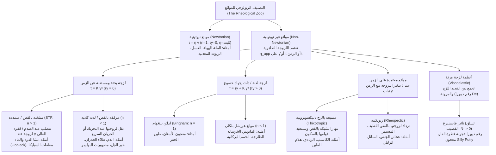
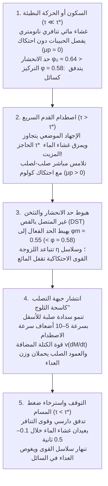

## مقدمة: مفارقة الجري فوق حوض من السائل

إنها واحدة من أكثر التجارب إثارة للدهشة في الفيزياء التجريبية: املأ حوض سباحة بمعلق كثيف من نشا الذرة (أو نشا البطاطس) الممزوج بالماء بنسبة حجمية تبلغ حوالي $55\%$ إلى $60\%$ من المادة الصلبة (ما يعادل $1.5$ إلى $2$ جزء من النشا لكل جزء واحد من الماء بالوزن). في الأدبيات العلمية يُعرف هذا المزيج الأبيض الحليبي باسم <strong>الأوبليك (Oobleck)</strong>، نسبةً إلى كتاب الأطفال الشهير للدكتور سوس عام 1949.

إذا اندفع شخص وركض بقوة وسرعة فوق سطح هذا الحوض "السائل"، يحدث أمر يبدو كالمعجزة: في اللحظة التي تصطدم فيها راحة القدم بالسطح، يتصلب المائع تحت النعل بصلابة تضاهي بلاطة من الخرسانة؛ فيعبر العداء الحوض بالكامل دون أن تغوص قدماه حتى إلى الكاحل. وإذا ضربت وعاءً من هذا المزيج بقبضة يدك بكل قوتك، فلن يتناثر السائل، بل سيرتد كجدار صلب. ولكن في اللحظة التي يتوقف فيها العداء ويقف ساكناً في منتصف الحوض، تذوب "الأرضية الصلبة" تحت قدميه في جزء من الثانية وتغوص ساقاه كما لو كان في رمال متحركة بلا قرار! والأدهى من ذلك أنه إذا أصابه الذعر وحاول سحب ساقه فجأة وبقوة، فإن المعلق يعود للتصلب فوراً ويمسك بقدمه كالمَلزَمة؛ والسبيل الوحيد للنجاة هو إرخاء العضلات وسحب القدم ببطء شديد.

يقسم حدسنا اليومي المادة إلى ثلاث حالات جامدة (صلبة، سائلة، غازية)، ويفترض أن "كثافة القوام" (اللزوجة) لأي سائل تظل ثابتة بغض النظر عن سرعة تحريكه. الموائع التي تخضع لهذه العلاقة الخطية التي صاغها السير إسحاق نيوتن في كتابه *الأصول الرياضية للفلسفة الطبيعية* (*Principia*, 1687) تُسمى <strong>الموائع النيوتونية (Newtonian fluids)</strong>. غير أن الأغلبية الساحقة من الموائع في الطبيعة والأحياء والصناعة — مثل معلقات النشا، والدم، والكاتشب، والمايونيز، وطلاء الجدران، ومعجون الأسنان، ومصهورات البوليمرات، بل وحتى وشاح الأرض — تتمرد على قانون نيوتن، وتُعرف باسم <strong>الموائع غير النيوتونية (Non-Newtonian fluids)</strong>.

تحت شعار الفيلسوف اليوناني هيراقليطس $\pi\alpha\nu\tau\alpha\ \rho\varepsilon\iota$ (*Panta rhei* — "كل شيء يجري")، يدرس <strong>علم الجريان أو الريولوجيا (Rheology)</strong> تشوه وتدفق المادة المعقدة. في هذا المقال سنحلل بعمق المعادلات التكوينية، والثورة الميكروسكوبية في التثخن بالقص (2012–2014)، وريولوجيا الدم، وتأثير فايسنبرغ، ورقم ديبورا، والتطبيقات الهندسية كالدروع السائلة الواقية من الرصاص.

---

## الفصل الأول: قانون نيوتن للزوجة ورقم بيكليه (Péclet Number)

### 1.1 جريان كويت المستوي وموتر الإجهاد

لنفترض وجود مائع محصور بين لوحين متوازيين تفصل بينهما مسافة $H$ $[\text{m}]$ (<strong>جريان كويت / Couette flow</strong>). اللوح السفلي ($y=0$) ثابت، بينما يُسحب اللوح العلوي ($y=H$، مساحته $A$) أفقياً بسرعة ثابتة $U$ $[\text{m}\cdot\text{s}^{-1}]$ بواسطة قوة مماسية $F$ $[\text{N}]$. نُعرّف <strong>إجهاد القص (Shear stress)</strong> بأنه القوة لكل وحدة مساحة $\tau \equiv \frac{F}{A}$ $[\text{Pa}]$، ونُعرّف <strong>معدل القص (Shear rate)</strong> بأنه تدرج السرعة العمودي $\dot{\gamma} \equiv \frac{\partial u}{\partial y} = \frac{U}{H}$ $[\text{s}^{-1}]$.

في المائع النيوتوني، يتناسب إجهاد القص طردياً مع معدل القص (<strong>قانون نيوتن للزوجة</strong>):

$$\tau = \eta \dot{\gamma} = \eta \frac{\partial u}{\partial y}$$

حيث $\eta$ $[\text{Pa}\cdot\text{s}]$ هي <strong>اللزوجة الديناميكية</strong>. وفي ميكانيكا الأوساط المتصلة ثلاثية الأبعاد، يُكتب موتر إجهاد كوشي للمائع غير القابل للانضغاط على الصورة $\boldsymbol{\sigma} = -p\mathbf{I} + 2\eta\mathbf{D}$، مما يقود إلى <strong>معادلة نافييه-ستوكس (Navier-Stokes equation)</strong>. عند ثبات درجة الحرارة $T$ والضغط $p$، تكون $\eta$ ثابتة تماماً للماء ($\approx 10^{-3}\,\text{Pa}\cdot\text{s}$) أو العسل ($\approx 2\text{–}10\,\text{Pa}\cdot\text{s}$).

### 1.2 لماذا تسلك الموائع المعقدة سلوكاً غير نيوتوني؟ فيزياء رقم بيكليه ($\text{Pe}$)

تخضع الجسيمات أو الجزيئات ذات نصف القطر $a$ في مذيب لزوجته $\eta_0$ عند درجة حرارة $T$ إلى <strong>حركة براونية</strong> حرارية بمعامل انتشار ستوكس-أينشتاين $D_0 = \frac{k_B T}{6\pi \eta_0 a}$. الزمن اللازم لكي ينتشر الجسيم مسافة تعادل نصف قطره $a$ ويعيد البنية الميكروسكوبية إلى توازنها المتناحي هو <strong>زمن الاسترخاء البراوني</strong> $\tau_B$:

$$\tau_B \equiv \frac{a^2}{D_0} = \frac{6\pi \eta_0 a^3}{k_B T}$$

لاحظ أن <strong>$\tau_B$ يتناسب طردياً مع مكعب نصف قطر الجسيم ($a^3$)</strong>! النسبة اللابعدية بين زمن الاسترخاء الحراري وزمن تشوه الجريان $\tau_{\text{flow}} \sim \dot{\gamma}^{-1}$ تُعرّف <strong>رقم بيكليه ($\text{Pe}$)</strong>:

$$\text{Pe} \equiv \dot{\gamma}\tau_B = \frac{6\pi \eta_0 a^3 \dot{\gamma}}{k_B T}$$

- <strong>السوائل ذات الجزيئات الصغيرة (مثل الماء، $a \sim 0.15\,\text{nm}$)</strong>: زمن الاسترخاء $\tau_B \sim 10^{-12}\,\text{s}$ (بيكو ثانية). حتى عند معدلات القص القصوى ($\dot{\gamma} \sim 10^5\,\text{s}^{-1}$)، يكون $\text{Pe} \sim 10^{-7} \ll 1$. تعيد الحركة الحرارية التوازن فوراً، فتبقى اللزوجة $\eta$ ثابتة.
- <strong>الموائع المعقدة / المادة اللينة (الغرويات والبوليمرات، $a \sim 0.1\text{–}10\,\mu\text{m}$)</strong>: حبيبة النشا أو خلية الدم الحمراء أكبر بـ $10^4$ مرة من جزيء الماء، لذا يقفز $\tau_B \propto a^3$ بمقدار <strong>$10^{12}$ مرة (تريليون ضعف)</strong> ليصل إلى $\tau_B \sim 1\text{–}100\,\text{s}$! وبذلك فإن مجرد التقليب اليدوي البسيط ($\dot{\gamma} \sim 1\,\text{s}^{-1}$) يدفع النظام إلى نطاق $\text{Pe} \gg 1$، حيث يغير الجريان البنية المجهرية ويجعل اللزوجة دالة غير خطية في $\dot{\gamma}$.

---

## الفصل الثاني: التصنيف الرياضي — قانون القوة ونموذج هيرشل-بلكلي

في الموائع غير النيوتونية نُعرّف <strong>اللزوجة الظاهرية</strong> بالعلاقة $\eta_{\text{app}}(\dot{\gamma}) \equiv \frac{\tau(\dot{\gamma})}{\dot{\gamma}}$. المعادلة التكوينية الأكثر شمولاً للموائع المستقلة عن الزمن هي <strong>نموذج هيرشل-بلكلي (Herschel-Bulkley, 1926)</strong> وحالته الخاصة عند انعدام إجهاد الخضوع ($\tau_y = 0$) المعروفة باسم <strong>قانون القوة لأوستفالد-دي فالي (Ostwald-de Waele)</strong>:

$$\tau(\dot{\gamma}) = \tau_y + K \dot{\gamma}^n \quad (\text{عندما } \tau \ge \tau_y \,؛ \text{ أما إذا كان } \tau < \tau_y \text{ فإن } \dot{\gamma} = 0)$$

$$\eta_{\text{app}}(\dot{\gamma}) = \frac{\tau_y}{\dot{\gamma}} + K \dot{\gamma}^{n-1}$$

حيث $\tau_y$ $[\text{Pa}]$ هو <strong>إجهاد الخضوع (Yield stress)</strong>، و$K$ $[\text{Pa}\cdot\text{s}^n]$ هو <strong>معامل القوام</strong>، و$n$ هو <strong>دليل سلوك الجريان</strong>. ولتمثيل الانتقال السلس بين هضبة اللزوجة الصفرية ($\eta_0$) وهضبة القص اللانهائي ($\eta_\infty$) دون نقاط تفرد، يُستخدم <strong>نموذج كارو-ياسودا (Carreau-Yasuda)</strong>:

$$\frac{\eta(\dot{\gamma}) - \eta_\infty}{\eta_0 - \eta_\infty} = \left[ 1 + (\lambda \dot{\gamma})^a \right]^{\frac{n-1}{a}}$$

| فئة المائع | المعادلة التكوينية | سلوك اللزوجة الظاهرية $\eta_{\text{app}}(\dot{\gamma})$ | الآلية المجهرية المهيمنة | أمثلة نموذجية |
| :--- | :--- | :--- | :--- | :--- |
| <strong>مائع نيوتوني</strong> | $\tau = \eta \dot{\gamma}$ ($n = 1, \tau_y = 0$) | ثابتة لجميع قيم $\dot{\gamma}$ ($\eta = \text{const.}$) | استرخاء حراري بالبيكو ثانية ($\tau_B \sim 10^{-12}\,\text{s}, \text{Pe} \ll 1$) يحفظ التناحي | الماء، الهواء، الإيثانول، الجليسرين، العسل، زيوت السيليكون |
| <strong>متثخن بالقص (STF)</strong> | $\tau = K \dot{\gamma}^n$ ($n > 1, \tau_y = 0$) | تزداد مع $\dot{\gamma}$؛ وتتباعد بشكل غير متصل (DST) فوق $\tau^*$ | عناقيد هيدروديناميكية $\to$ تمزق غشاء التزييت وسلاسل قوى احتكاكية صلبة | الأوبليك (نشا وماء)، معلقات $\text{SiO}_2$-PEG، رمل الشاطئ المبلل |
| <strong>مرقق بالقص (لدن كاذب)</strong> | $\tau = K \dot{\gamma}^n$ ($n < 1, \tau_y = 0$) | تتناقص تدريجياً مع زيادة $\dot{\gamma}$ ($\eta_0 \to \eta_\infty$) | تفكك التجمعات (أكوام كريات الدم الحمراء)، واصطفاف وفك تشابك سلاسل البوليمر | الدم الكامل، طلاء اللاتكس، الشامبو، حبر الجل، مصهورات البلاستيك |
| <strong>لزج لدن (إجهاد خضوع)</strong> | $\tau = \tau_y + K \dot{\gamma}^n$ ($\tau_y > 0$) | صلب تحت $\tau_y$؛ وجريان سدادي (Plug flow) فوق $\tau_y$ | شبكة ثلاثية الأبعاد متراصة تنهار عند تجاوز عتبة الإجهاد $\tau_y$ | معجون الأسنان، المايونيز، الكريمة المخفوقة، الخرسانة، الحمم |
| <strong>مائع ثيكسوتروبي</strong> | $\tau = \tau(\dot{\gamma}, t)$ (حلقة تخلّف) | تنخفض مع الزمن $t$ تحت القص الثابت وتتعافى بالسكون | تكسر متأخر وإعادة تخلل براوني للروابط الهيدروجينية وقوى فان دير فالس | الكاتشب، الزبادي، حمأة البنتونيت، مستحضرات التجميل |
| <strong>مائع لزج مرن</strong> | $\tau + \lambda \dot{\tau} = \eta \dot{\gamma}$ ($N_1 > 0$) | صلب مرن في الأزمنة القصيرة ($\text{De} \gg 1$)، وسائل في الطويلة ($\text{De} \ll 1$) | مرونة إنتروبية للجزيئات العملاقة تولد إجهادات طوقية (Hoop stress) | القار (البيتش)، Silly Putty، بياض البيض، عجين الخبز |

---

## الفصل الثالث: فيزياء الأوبليك — ثلاث ثورات علمية في الموائع المتثخنة بالقص (STF)

### 3.1 تمدد رينولدز (1885) ونظرية العناقيد الهيدروديناميكية (1985)

في عام 1885، فسر <strong>أوزبورن رينولدز (Osborne Reynolds)</strong> سبب جفاف وتصلب رمل الشاطئ المبلل عند الدوس عليه: فالحبيبات المتراصة بإحكام تضطر للتدحرج فوق بعضها عند تعرضها للقص، مما يفرض <strong>تمدداً حجمياً (Dilatancy, $\Delta V > 0$)</strong> يمتص الماء السطحي ويخلق ضغطاً مسامياً سالباً يربط الحبيبات بقوة.

وفي عام 1985، طور <strong>جون برادي وجورج بوسيس</strong> <strong>نظرية العناقيد الهيدروديناميكية (Hydrocluster theory)</strong>: عندما تقترب كرتان نصف قطرهما $a$ بسرعة نسبية $v_{\text{rel}}$ حتى فجوة دقيقة $h \ll a$ في مذيب لزوجته $\eta_0$، فإن عصر السائل من الفجوة يولد <strong>قوة تزييت هيدروديناميكية</strong> متباعدة:

$$F_{\text{lub}} \simeq \frac{6\pi \eta_0 a^2 v_{\text{rel}}}{h} \propto \frac{1}{h}$$

عند معدلات القص العالية ($\text{Pe} \gg 1$)، تقيد هذه القوة ($\propto 1/h$) الجسيمات في تجمعات مؤقتة (<strong>Hydroclusters</strong>). غير أن قوى التزييت الهيدروديناميكية وحدها لا تفسر سوى <strong>التثخن المستمر بالقص (CST)</strong> الطفيف، وتفشل تماماً في تفسير <strong>التثخن غير المتصل بالقص (DST)</strong> في الأوبليك المركز ($\phi \approx 55\%\text{–}60\%$) حيث تقفز اللزوجة آلاف المرات عمودياً!

### 3.2 تحول النموذج الحديث (2012–2014): التلامس الاحتكاكي (Wyart & Cates) وجبهات التصلب بالصدم (Waitukaitis & Jaeger)

1. <strong>تمزق غشاء التزييت النانومتري والانحشار الاحتكاكي (Wyart & Cates, 2014)</strong>:
   تمتلك حبيبات النشا أو السيليكا قوة تنافر كهروستاتيكية أو فراغية $F_{\text{rep}}$ تحدد إجهاداً عتبياً مميزاً $\tau^* \sim F_{\text{rep}}/a^2$.
   - <strong>عند الإجهاد المنخفض ($\tau \ll \tau^*$)</strong>: يبقى غشاء الماء النانومتري سليماً؛ فتنزلق الجسيمات <strong>دون احتكاك ($\mu_p \approx 0$)</strong> ولا تنحشر (Jamming) إلا عند حد التراص العشوائي الأقصى <strong>$\phi_0 \approx 0.64$</strong>.
   - <strong>عند الإجهاد العالي / الصدم ($\tau > \tau^*$)</strong>: يتغلب الضغط الموضعي على حاجز التنافر ويمزق غشاء الماء، فتدخل أسطح الحبيبات الخشنة في <strong>تلامس ميكانيكي مباشر صلب-لصلب مع احتكاك كولوم ($\mu_p > 0$)</strong>! يؤدي قفل الدوران إلى خفض الكسر الحجمي الحرج للانحشار إلى حد التراص الرخو <strong>$\phi_m \approx 0.55$</strong>.
   وباعتماد كسر التلامسات الاحتكاكية $f(\tau) = \exp(-\tau^*/\tau)$، فإن حد الانحشار الفعال $\phi_J(\tau)$ واللزوجة $\eta(\phi, \tau)$ يخضعان لمعادلة فايارت-كيتس:
   $$\phi_J(\tau) = f(\tau)\,\phi_m + \left[1 - f(\tau)\right]\phi_0, \qquad \eta(\phi, \tau) \propto \left[ \phi_J(\tau) - \phi \right]^{-2}$$
   عند تركيز نشا $\phi = 0.58$ ($\phi_m < \phi < \phi_0$)، يكون النظام في حالة السكون سائلاً لأن $\phi < \phi_0 = 0.64$. أما لحظة ضرب القدم للسطح ($\tau > \tau^*$)، فيهبط $\phi_J(\tau)$ إلى $0.55 < \phi = 0.58$: فتتباعد اللزوجة إلى ما لا نهاية (DST)، وتتشكل شبكة ثلاثية الأبعاد من <strong>سلاسل القوى الاحتكاكية</strong> التي تحول المائع إلى جسم صلب!
2. <strong>التصلب المحفز بالصدم وجبهة "كاسحة الثلوج" (Waitukaitis & Jaeger, *Nature* 2012)</strong>:
   باستخدام التصوير بالأشعة السينية فائق السرعة في جامعة شيكاغو، أثبت فايتوكايتيس وياغر أن اصطدام القدم بسرعة $v_0$ يُكوّن تحت النعل سدادة متصلبة تنتشر حدودها — <strong>جبهة التصلب (Solidification front)</strong> — نحو القاع بسرعة تفوق سرعة القدم بـ $5$ إلى $10$ أضعاف ($v_f = k v_0$)، تماماً مثل شفرة كاسحة الثلوج! هذا النمو المتسارع للكتلة المتصلبة $M(t)$ يولد <strong>قوة رد فعل للكتلة المضافة</strong> هائلة $F_{\text{impact}} = \frac{d}{dt}[M(t)v(t)] = M\dot{v} + v\dot{M}$ ويبني في أجزاء من الألف من الثانية عموداً صلباً يرتكز على قاع الحوض. وعند التوقف ($\tau < \tau^*$)، يعيد ارتشاح دارسي غشاء الماء خلال $0.1\text{–}0.5\,\text{s}$ فينهار العمود الصلب ويعود سائلاً.

---

## الفصل الرابع: اللدونة الكاذبة (الترقق بالقص)، والجريان السدادي، والثيكسوتروبيا

1. <strong>ريولوجيا الدم (Hemorheology)</strong>: يشكل الدم ($\approx 45\%$ كريات دم حمراء) عند القص المنخفض ($\dot{\gamma} < 1\,\text{s}^{-1}$) تجمعات تشبه أكوام العملات النقدية تُسمى <strong>النضائد (Rouleaux)</strong> ($\eta_0 \approx 50\text{–}100\,\text{mPa}\cdot\text{s}$). وفي الشرايين والشعيرات الدموية الدقيقة ($\dot{\gamma} \sim 100\text{–}1,000\,\text{s}^{-1}$)، تتفكك هذه الأكوام وتستطيل خلايا الدم الحمراء عديمة النواة مع دوران غشائها كجنزير الدبابة (<strong>Tank-treading motion</strong>)، مما يخفض اللزوجة إلى $\eta_\infty \approx 3\text{–}4\,\text{mPa}\cdot\text{s}$ ويحمي الشعيرات من الانسداد.
2. <strong>الطلاء وأقلام الجل</strong>: تحت فرشاة الطلاء أو كرة القلم ($\dot{\gamma} \sim 10^4\,\text{s}^{-1}$)، تهبط اللزوجة آلاف المرات لتسهيل الكتابة والدهان، ثم تستعيد إجهاد خضوعها فوراً عند السكون ($\tau < \tau_y$) لمنع التقطير أو التسرب.
3. <strong>الجريان السدادي لبينغهام (Plug Flow)</strong>: في أنبوب نصف قطره $R$ تحت فرق ضغط $\Delta P / L$، يتوزع الإجهاد خطياً $\tau(r) = \frac{\Delta P}{2L}r$. وفي القلب المركزي $r < r_p = \frac{2L\tau_y}{\Delta P}$ يكون $\tau(r) < \tau_y$ وبالتالي ينعدم تدرج السرعة $\frac{du}{dr} = 0$:
   $$u_{\text{Bingham}}(r) = \begin{cases} \dfrac{\Delta P}{4\eta_p L}(R - r_p)^2 = \text{const.} & (0 \le r < r_p : \text{قلب صلب يتحرك كسدادة متماسكة}) \\[8pt] \dfrac{\Delta P}{4\eta_p L}\left[ R^2 - r^2 - 2r_p(R - r) \right] & (r_p \le r \le R : \text{طبقة حلقية مقصوصة عند الجدار}) \end{cases}$$
   ولهذا السبب يخرج معجون الأسنان من الأنبوب كعمود أسطواني متماسك دون أن تختلط خطوطه الملونة.

---

## الفصل الخامس: اللزوجة المرنة، ورقم ديبورا، وتأثير فايسنبرغ

### 5.1 نموذج ماكسويل ورقم ديبورا ($\text{De}$)

ربط جيمس كليرك ماكسويل (1867) نابضاً مرناً لهوك (معامله $G$) ومخمداً لزجاً لنيوتن (لزوجته $\eta$) على التوالي، ليصوغ معادلة اللزوجة المرنة بزمن استرخاء $\lambda \equiv \eta / G$:

$$\tau + \lambda \frac{d\tau}{dt} = \eta \dot{\gamma}$$

وفي عام 1964، استلهم <strong>ماركوس راينر (Marcus Reiner)</strong> من ترنيمة النبية ديبورا في سفر القضاة (5: 5: <em>"تزلزلت الجبال (ذابت وسالت) من وجه الرب"</em>) تعريف <strong>رقم ديبورا ($\text{De}$)</strong> كنسبة بين زمن استرخاء المادة $t_{\text{relax}}$ وزمن المراقبة أو التأثير $t_{\text{obs}}$:

$$\text{De} \equiv \frac{t_{\text{relax}}}{t_{\text{obs}}}$$

عندما يكون $\text{De} \gg 1$ ($t_{\text{obs}} \ll t_{\text{relax}}$)، تسلك المادة سلوك الجسم الصلب المرن؛ وعندما يكون $\text{De} \ll 1$ ($t_{\text{obs}} \gg t_{\text{relax}}$)، تتدفق كسائل. ففي <strong>تجربة قطرة القار (Pitch Drop Experiment)</strong> المستمرة منذ عام 1927 في جامعة كوينزلاند، يتهشم القار ($\eta \approx 2.3 \times 10^8\,\text{Pa}\cdot\text{s}$) كالزجاج عند ضربه بمطرقة ($t_{\text{obs}} \sim 10^{-3}\,\text{s}, \text{De} \gg 1$)، لكنه يقطر قطرة واحدة كل 8 إلى 13 سنة تحت تأثير الجاذبية ($t_{\text{obs}} \sim 10^8\,\text{s}, \text{De} \ll 1$). وبالمثل يرتد معجون <strong>Silly Putty</strong> ككرة مطاطية عند رميه ($\text{De} \gg 1$) لكنه ينفرش كبركة سائلة عند تركه على الطاولة ($\text{De} \ll 1$).

### 5.2 تأثير فايسنبرغ (تسلق القضيب الدوار)

عند تدوير قضيب أسطواني داخل محلول بوليمري (أو بياض البيض)، يتسلق السائل القضيب إلى الأعلى عكس الجاذبية! فالسلاسل البوليمرية المتمددة على طول خطوط الجريان الدائرية تولد بفعل المرونة الإنتروبية <strong>فرق إجهاد عمودي أول</strong> موجباً:

$$N_1(\dot{\gamma}) \equiv \sigma_{xx} - \sigma_{yy} = \Psi_1(\dot{\gamma})\dot{\gamma}^2 > 0$$

هذا الإجهاد الطوقي (Hoop stress) يضغط المائع قطرياً نحو محور الدوران ويدفعه للصعود على طول القضيب.

---

## الفصل السادس: التطبيقات الهندسية المتقدمة — من الدروع السائلة إلى الطباعة الحيوية ثلاثية الأبعاد

1. <strong>الدروع السائلة الواقية من الرصاص (Liquid Body Armor) ومادة D3O</strong>: ألياف الكيفلار (Kevlar) المشبعة بمائع متثخن بالقص (جسيمات السيليكا النانوية $\text{SiO}_2$ في بولي إيثيلين جلايكول PEG) تظل مرنة كالقماش أثناء الحركة العادية ($\dot{\gamma} < 10\,\text{s}^{-1}, \tau < \tau^*$)، لكنها تتصلب في ميكروثانية عبر الانحشار الاحتكاكي (DST) لحظة اصطدام رصاصة أو نصل سكين ($\dot{\gamma} > 10^5\,\text{s}^{-1}, \tau \gg \tau^*$)، مما يقلل وزن السترة بنسبة $30\%\text{–}50\%$. كما تعتمد دروع الحماية البرتقالية <strong>D3O</strong> على تحول رقم ديبورا لتتصلب لحظياً عند الصدمات.
2. <strong>الطباعة الحيوية ثلاثية الأبعاد (3D Bioprinting Bio-inks)</strong>: تستغل الأحبار الحيوية المحملة بالخلايا الجذعية الحية الجريان السدادي لبينغهام والترقق الشديد بالقص ($n \ll 1$) لحماية الخلايا داخل الفوهات الدقيقة (بنسبة بقاء $>95\%$)، ثم تستعيد إجهاد خضوعها $\tau_y$ في أقل من $0.1\,\text{s}$ بعد البثق لتحافظ على البنية ثلاثية الأبعاد للأنسجة والأعضاء المطبوعة دون انهيار.
