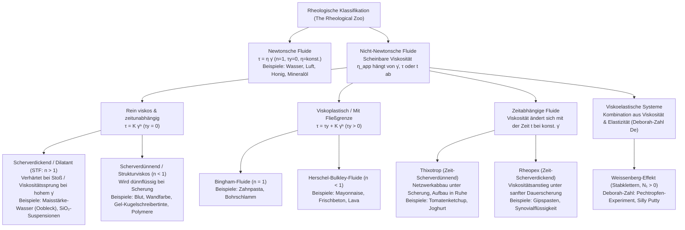
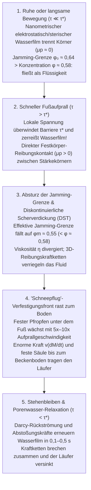

## Einleitung: Das Paradoxon des Sprints über ein Becken aus Flüssigkeit

Es ist eines der faszinierendsten Experimente der Physik: Man füllt ein Schwimmbecken mit einer dichten Suspension aus gewöhnlicher Maisstärke (oder Kartoffelstärke) und Wasser im Volumenverhältnis von etwa $55:45$ (Gewichtsverhältnis ca. $1{,}5:1$ bis $2:1$). Im englischsprachigen Raum wird dieses milchig-weiße Gemisch nach einem Kinderbuch von Dr. Seuss (1949) als <strong>Oobleck</strong> bezeichnet.

Nimmt eine Person Anlauf und sprintet kräftig über die Oberfläche dieses Beckens, geschieht etwas scheinbar Unmögliches: In der Millisekunde, in der die Fußsohle auf die Flüssigkeit trifft, erstarrt das Gemisch unter dem Fuß so hart wie eine Betonplatte. Ohne auch nur knöcheltief einzusinken, kann der Läufer das gesamte Becken überqueren. Schlägt man mit der Faust voller Wucht in eine Schüssel mit Stärkesuspension, spritzt nichts auf – stattdessen prallt die Faust wie an einer festen Wand ab.

Bleibt der Läufer jedoch in der Mitte des Beckens stehen, schmilzt der „feste Boden“ unter seinen Füßen innerhalb von Sekundenbruchteilen dahin, und er versinkt wie in bodenlosem Treibsand. Versucht er nun panisch, das Bein ruckartig herauszuziehen, verfestigt sich die Suspension sofort wieder und hält den Fuß wie in einem Schraubstock fest; nur durch extrem langsames, kraftloses Ziehen lässt sich das Bein befreien.

Unsere Alltagserfahrung teilt Materie in drei starre Aggregatzustände ein: fest, flüssig und gasförmig. Zudem setzen wir intuitiv voraus, dass eine Flüssigkeit wie Wasser oder Honig eine feste, unveränderliche Zähigkeit (<strong>Viskosität</strong>) besitzt, unabhängig davon, wie schnell wir sie umrühren. Fluide, die diesem von Sir Isaac Newton 1687 in seinen *Principia* formulierten linearen Gesetz gehorchen, heißen <strong>newtonsche Fluide (Newtonian fluids)</strong>. Doch die überwältigende Mehrheit der Fluide in Natur, Biologie und Technik – Stärkesuspensionen, Blut, Ketchup, Mayonnaise, Wandfarbe, Zahnpasta, Polymerschmelzen bis hin zum Erdmantel – widersetzt sich Newtons Gesetz: Es sind <strong>nicht-newtonsche Fluide (Non-Newtonian fluids)</strong>.

Die Wissenschaft, die unter dem Motto des griechischen Philosophen Heraklit – $\pi\alpha\nu\tau\alpha\ \rho\varepsilon\iota$ (*Panta rhei*, „alles fließt“) – das Fließ- und Deformationsverhalten von Materie erforscht, ist die <strong>Rheologie</strong>. Dieser Artikel beleuchtet die mathematischen Grundlagen, die mikroskopische Revolution der Scherverdickung (2012–2014), die Strukturviskosität von Blut, den Weissenberg-Effekt, die Deborah-Zahl sowie moderne Anwendungen wie flüssige kugelsichere Westen.

---

## Kapitel 1: Newtons Viskositätsgesetz und die Péclet-Zahl

### 1.1 Ebene Couette-Strömung und der Spannungstensor

Betrachten wir ein Fluid zwischen zwei parallelen Platten im Abstand $H$ $[\text{m}]$ (<strong>Couette-Strömung</strong>). Während die untere Platte ($y=0$) ruht, wird die obere Platte ($y=H$, Fläche $A$) mit einer Tangentialkraft $F$ $[\text{N}]$ und konstanter Geschwindigkeit $U$ $[\text{m}\cdot\text{s}^{-1}]$ in $x$-Richtung bewegt. Die <strong>Schubspannung (Shear stress)</strong> ist definiert als Kraft pro Fläche $\tau \equiv \frac{F}{A}$ $[\text{Pa}]$, und der Geschwindigkeitsgradient senkrecht zur Strömungsrichtung ist die <strong>Scherrate (Shear rate)</strong> $\dot{\gamma} \equiv \frac{\partial u}{\partial y} = \frac{U}{H}$ $[\text{s}^{-1}]$.

Für ein newtonsches Fluid gilt das <strong>newtonsche Viskositätsgesetz</strong>:

$$\tau = \eta \dot{\gamma} = \eta \frac{\partial u}{\partial y}$$

Der Proportionalitätsfaktor $\eta$ $[\text{Pa}\cdot\text{s}]$ ist die <strong>dynamische Viskosität</strong>. In der dreidimensionalen Kontinuumsmechanik lautet der Cauchy-Spannungstensor für inkompressible Fluide $\boldsymbol{\sigma} = -p\mathbf{I} + 2\eta\mathbf{D}$, was direkt auf die <strong>Navier-Stokes-Gleichung</strong> führt. Bei konstanter Temperatur $T$ und konstantem Druck $p$ ist $\eta$ für Wasser ($\approx 10^{-3}\,\text{Pa}\cdot\text{s}$) oder Honig ($\approx 2\text{–}10\,\text{Pa}\cdot\text{s}$) völlig unabhängig von $\dot{\gamma}$.

### 1.2 Warum verhalten sich komplexe Fluide nicht-newtonsch? Die Péclet-Zahl ($\text{Pe}$)

In einem Fluid unterliegen Teilchen mit Radius $a$ der thermischen <strong>Brownschen Bewegung</strong> mit dem Stokes-Einstein-Diffusionskoeffizienten $D_0 = \frac{k_B T}{6\pi \eta_0 a}$. Die Zeit, die ein Teilchen benötigt, um über eine Strecke seines eigenen Radius $a$ zu diffundieren und eine durch Strömung gestörte Mikrostruktur wieder in das isotrope Gleichgewicht zu bringen, ist die <strong>Brownsche Relaxationszeit</strong> $\tau_B$:

$$\tau_B \equiv \frac{a^2}{D_0} = \frac{6\pi \eta_0 a^3}{k_B T}$$

Entscheidend ist, dass <strong>$\tau_B$ mit der dritten Potenz des Teilchenradius ($a^3$) skaliert</strong>! Das Verhältnis dieser thermischen Relaxationszeit zur charakteristischen Deformationszeit der Strömung $\tau_{\text{flow}} \sim \dot{\gamma}^{-1}$ definiert die dimensionslose <strong>Péclet-Zahl ($\text{Pe}$)</strong>:

$$\text{Pe} \equiv \dot{\gamma}\tau_B = \frac{6\pi \eta_0 a^3 \dot{\gamma}}{k_B T}$$

- <strong>Niedermolekulare Flüssigkeiten (z. B. Wasser, $a \sim 0{,}15\,\text{nm}$)</strong>: Hier beträgt $\tau_B \sim 10^{-12}\,\text{s}$ (Pikosekunden). Selbst bei extremen technischen Scherraten ($\dot{\gamma} \sim 10^5\,\text{s}^{-1}$) gilt $\text{Pe} \sim 10^{-7} \ll 1$. Die thermische Bewegung stellt die Isotropie sofort wieder her; die Viskosität $\eta$ bleibt konstant.
- <strong>Komplexe Fluide / Weiche Materie (Kolloide, Polymere, $a \sim 0{,}1\text{–}10\,\mu\text{m}$)</strong>: Ein Stärkekorn oder ein rotes Blutkörperchen ist $10^4$-mal größer als ein Wassermolekül. Da $\tau_B \propto a^3$, wächst die Relaxationszeit um das <strong>$10^{12}$-Fache (eine Billion)</strong> auf $\tau_B \sim 1\text{–}100\,\text{s}$! Schon bei sanftem Umrühren ($\dot{\gamma} \sim 1\,\text{s}^{-1}$) wird $\text{Pe} \gg 1$ erreicht: Die Strömung dominiert über die Brownsche Bewegung, verändert die Mikrostruktur drastisch und macht die Viskosität zu einer nichtlinearen Funktion von $\dot{\gamma}$.

---

## Kapitel 2: Mathematische Klassifikation — Potenzgesetz und Herschel-Bulkley-Modell

Für nicht-newtonsche Fluide definiert man die <strong>scheinbare Viskosität (Apparent viscosity)</strong> als $\eta_{\text{app}}(\dot{\gamma}) \equiv \frac{\tau(\dot{\gamma})}{\dot{\gamma}}$. Das universelle phänomenologische Gesetz für zeitunabhängige Fluide ist das <strong>Herschel-Bulkley-Modell (1926)</strong> sowie sein Spezialfall für $\tau_y = 0$, das <strong>Ostwald-de-Waele-Potenzgesetz</strong>:

$$\tau(\dot{\gamma}) = \tau_y + K \dot{\gamma}^n \quad (\text{für } \tau \ge \tau_y; \text{ für } \tau < \tau_y \text{ gilt } \dot{\gamma} = 0)$$

$$\eta_{\text{app}}(\dot{\gamma}) = \frac{\tau_y}{\dot{\gamma}} + K \dot{\gamma}^{n-1}$$

Hierbei ist $\tau_y$ $[\text{Pa}]$ die <strong>Fließgrenze (Yield stress)</strong>, $K$ $[\text{Pa}\cdot\text{s}^n]$ der <strong>Konsistenzfaktor</strong> und $n$ der dimensionslose <strong>Fließindex</strong>. Um auch das erste und zweite newtonsche Plateau ($\eta_0$ für $\dot{\gamma} \to 0$ und $\eta_\infty$ für $\dot{\gamma} \to \infty$) singularitätsfrei abzubilden, nutzt man das <strong>Carreau-Yasuda-Modell</strong>:

$$\frac{\eta(\dot{\gamma}) - \eta_\infty}{\eta_0 - \eta_\infty} = \left[ 1 + (\lambda \dot{\gamma})^a \right]^{\frac{n-1}{a}}$$

| Fluidklasse | Konstitutive Gleichung | Verhalten von $\eta_{\text{app}}(\dot{\gamma})$ | Dominanter Mikro-Mechanismus | Typische Beispiele |
| :--- | :--- | :--- | :--- | :--- |
| <strong>Newtonsches Fluid</strong> | $\tau = \eta \dot{\gamma}$ ($n = 1, \tau_y = 0$) | Konstant über alle Scherraten ($\eta = \text{konst.}$) | Schnelle thermische Relaxation ($\tau_B \sim 10^{-12}\,\text{s}, \text{Pe} \ll 1$) erhält Isotropie | Wasser, Luft, Ethanol, Glycerin, Honig, Silikonöl |
| <strong>Scherverdickend (STF)</strong> | $\tau = K \dot{\gamma}^n$ ($n > 1, \tau_y = 0$) | Steigt mit $\dot{\gamma}$; divergiert diskontinuierlich (DST) oberhalb $\tau^*$ | Hydrocluster $\to$ Aufreißen des Schmierfilms & Festkörper-Reibungskraftketten | Oobleck (Maisstärke in Wasser), $\text{SiO}_2$-PEG-Dispersionen, nasser Strandsand |
| <strong>Scherverdünnend (Pseudoplastisch)</strong> | $\tau = K \dot{\gamma}^n$ ($n < 1, \tau_y = 0$) | Sinkt monoton mit steigendem $\dot{\gamma}$ ($\eta_0 \to \eta_\infty$) | Auflösung von Aggregaten (Geldrollen im Blut), Kettenausrichtung & Entschlaufung | Vollblut, Dispersionsfarbe, Shampoo, Gel-Tinte, Polymerschmelzen |
| <strong>Viskoplastisch (Fließgrenze)</strong> | $\tau = \tau_y + K \dot{\gamma}^n$ ($\tau_y > 0$) | Festkörper unterhalb $\tau_y$; Pfropfenströmung (Plug flow) oberhalb $\tau_y$ | Blockiertes 3D-Netzwerk aus Partikeln/Tröpfchen bricht ab Grenzspannung $\tau_y$ | Zahnpasta, Mayonnaise, Schlagsahne, Frischbeton, Lava |
| <strong>Thixotropes Fluid</strong> | $\tau = \tau(\dot{\gamma}, t)$ (Hystereseschleife) | Sinkt mit der Belastungsdauer $t$, regeneriert sich in Ruhe | Zeitverzögerter Abbau und Brownscher Wiederaufbau schwacher Wasserstoffbrücken | Tomatenketchup, Rührjoghurt, Bentonitschlämme, Kosmetiklotionen |
| <strong>Viskoelastisches Fluid</strong> | $\tau + \lambda \dot{\tau} = \eta \dot{\gamma}$ ($N_1 > 0$) | Elastischer Festkörper für $\text{De} \gg 1$, viskose Flüssigkeit für $\text{De} \ll 1$ | Entropieelastizität verschlaufter Makromoleküle erzeugt Ringspannungen (Hoop stress) | Pech (Bitumen), Silly Putty, Eiklar, Brotteig, Schleim |

---

## Kapitel 3: Die Physik von Oobleck — Drei Revolutionen bei scherverdickenden Fluiden (STF)

### 3.1 Klassische Reynolds-Dilatanz (1885) und Hydrocluster-Theorie (1985)

1885 erklärte <strong>Osborne Reynolds</strong>, warum nasser Strandsand unter dem Fuß trocken und steinhart wird: Dicht gepackte Körner müssen beim Scheren übereinander hinwegrollen, was eine <strong>Volumenausdehnung (Dilatanz, $\Delta V > 0$)</strong> erzwingt. Dadurch entsteht ein kapillarer Unterdruck im Porenwasser, der die Körner fest zusammenpresst.

1985 entwickelten <strong>John F. Brady und Georges Bossis</strong> mittels Stokesian-Dynamics-Simulationen die <strong>Hydrocluster-Theorie</strong>: Nähern sich zwei Kugeln (Radius $a$) in einer Flüssigkeit (Viskosität $\eta_0$) mit der Relativgeschwindigkeit $v_{\text{rel}}$ bis auf einen winzigen Spalt $h$ ($h \ll a$), erzeugt das Herausquetschen des Lösungsmittels eine divergierende <strong>hydrodynamische Schmierkraft (Lubrication squeezing force)</strong>:

$$F_{\text{lub}} \simeq \frac{6\pi \eta_0 a^2 v_{\text{rel}}}{h} \propto \frac{1}{h}$$

Bei hohen Scherraten ($\text{Pe} \gg 1$) koppeln diese $1/h$-Kräfte die Partikel zu transienten Ketten (<strong>Hydroclustern</strong>), was die Viskosität moderat erhöht.
<strong>Das Scheitern der Hydrocluster-Theorie</strong>: Reine Schmierkräfte erklären zwar die sanfte <strong>kontinuierliche Scherverdickung (CST)</strong>, versagen aber völlig bei der Erklärung der <strong>diskontinuierlichen Scherverdickung (DST)</strong> in dichtem Oobleck ($\phi \approx 55\%\text{–}60\%$), wo die Viskosität bei einer kritischen Scherrate um das Tausendfache senkrecht nach oben springt!

### 3.2 Der Paradigmenwechsel (2012–2014): Reibungskraftketten (Wyart & Cates) und Stoßverfestigungsfronten (Waitukaitis & Jaeger)

Zwischen 2012 und 2014 lösten zwei bahnbrechende Entdeckungen das Rätsel:

1. <strong>Aufbrechen des nanometrischen Schmierfilms und Reibungs-Jamming (Wyart & Cates, 2014)</strong>:
   Stärke- oder Silikapartikel besitzen in Wasser eine elektrostatische oder sterische Abstoßungskraft $F_{\text{rep}}$, die eine charakteristische Schwellenspannung $\tau^* \sim F_{\text{rep}}/a^2$ definiert.
   - <strong>Niedrige Spannung ($\tau \ll \tau^*$)</strong>: Der nanometrische Wasserfilm bleibt intakt; die Partikel gleiten <strong>reibungslos ($\mu_p \approx 0$)</strong> aneinander vorbei. Solche reibungslosen Kugeln blockieren (jammen) erst bei der dichtesten Zufallspackung <strong>$\phi_0 \approx 0{,}64$</strong>.
   - <strong>Hohe Spannung / Aufprall ($\tau > \tau^*$)</strong>: Die äußere Spannung durchbricht die Abstoßungsbarriere, der Wasserfilm reißt auf, und die rauen Stärkekörner treten in <strong>direkten Festkörper-Reibungskontakt (Coulomb-Reibung $\mu_p > 0$)</strong>! Durch die Rotationsblockade sinkt die kritische Jamming-Packungsdichte drastisch auf <strong>$\phi_m \approx 0{,}55$</strong>!
   Mit dem Anteil reibungsbehafteter Kontakte $f(\tau) = \exp(-\tau^*/\tau)$ verschiebt sich die effektive Jamming-Grenze $\phi_J(\tau)$ und die Viskosität divergiert gemäß:
   $$\phi_J(\tau) = f(\tau)\,\phi_m + \left[1 - f(\tau)\right]\phi_0, \qquad \eta(\phi, \tau) \propto \left[ \phi_J(\tau) - \phi \right]^{-2}$$
   Bei einer Stärkekonzentration von $\phi = 0{,}58$ ($\phi_m < \phi < \phi_0$) gilt in Ruhe $\phi < \phi_0 = 0{,}64$ (flüssig). Beim Auftreten ($\tau > \tau^*$) fällt $\phi_J(\tau)$ jedoch unter $0{,}58$ ($\phi \ge \phi_J(\tau)$): Die Viskosität divergiert gegen unendlich (DST), und 3D-<strong>Reibungskraftketten (Force chains)</strong> verriegeln das System zu einem Festkörper!
2. <strong>Stoßaktivierte Verfestigung und „Schneepflug“-Fronten (Waitukaitis & Jaeger, *Nature* 2012)</strong>:
   Mittels Hochgeschwindigkeits-Röntgenaufnahmen zeigten Waitukaitis und Jaeger an der University of Chicago, dass beim Aufprall eines Fußes (Geschwindigkeit $v_0$) direkt unter der Sohle ein fest verblockter Pfropfen entsteht, dessen Grenze – die <strong>Verfestigungsfront (Solidification front)</strong> – wie vor einem Schneepflug mit der $5$- bis $10$-fachen Geschwindigkeit ($v_f = k v_0$) zum Beckenboden rast! Die rasant wachsende Masse $M(t)$ erzeugt eine enorme <strong>Added-Mass-Reaktionskraft</strong> $F_{\text{impact}} = \frac{d}{dt}[M(t)v(t)] = M\dot{v} + v\dot{M}$ und bildet binnen Millisekunden eine durchgehende feste Säule bis zum Beckenboden. Beim Stehenbleiben ($\tau < \tau^*$) strömt Wasser in $0{,}1\text{–}0{,}5\,\text{s}$ in die Poren zurück, stellt den Schmierfilm wieder her, und die Säule schmilzt sofort.

---

## Kapitel 4: Strukturviskosität (Scherverdünnung), Pfropfenströmung und Thixotropie

1. <strong>Hämorheologie (Blut)</strong>: Menschliches Blut (ca. $45\%$ Erythrozyten) bildet bei niedrigen Scherraten ($\dot{\gamma} < 1\,\text{s}^{-1}$) münzrollenartige Aggregate (<strong>Geldrollenbildung / Rouleaux</strong>) mit hoher Viskosität ($\eta_0 \approx 50\text{–}100\,\text{mPa}\cdot\text{s}$). In Arterien und engen Kapillaren ($\dot{\gamma} \sim 100\text{–}1.000\,\text{s}^{-1}$) lösen sich die Aggregate auf, und die kernlosen, hochelastischen roten Blutkörperchen verformen sich stromlinienförmig unter kettenfahrzeugartiger Membranrotation (<strong>Tank-treading motion</strong>), wodurch die Viskosität auf $\eta_\infty \approx 3\text{–}4\,\text{mPa}\cdot\text{s}$ sinkt.
2. <strong>Wandfarbe & Gel-Kugelschreiber</strong>: Beim Streichen oder Schreiben ($\dot{\gamma} \sim 10^4\,\text{s}^{-1}$) sinkt die Viskosität drastisch für leichtes Auftragen; in Ruhe ($\tau < \tau_y$) verfestigt sich das Material sofort gegen Tropfen (Sagging) oder Auslaufen.
3. <strong>Bingham-Pfropfenströmung (Plug Flow)</strong>: In einem Rohr (Radius $R$, Druckabfall $\Delta P/L$) ist die Schubspannung $\tau(r) = \frac{\Delta P}{2L}r$. Im inneren Kern $r < r_p = \frac{2L\tau_y}{\Delta P}$ gilt $\tau(r) < \tau_y$ und somit $\frac{du}{dr} = 0$:
   $$u_{\text{Bingham}}(r) = \begin{cases} \dfrac{\Delta P}{4\eta_p L}(R - r_p)^2 = \text{konst.} & (0 \le r < r_p : \text{fester Pfropfenkern}) \\[8pt] \dfrac{\Delta P}{4\eta_p L}\left[ R^2 - r^2 - 2r_p(R - r) \right] & (r_p \le r \le R : \text{geschertes Wandgleitlager}) \end{cases}$$
   Deshalb kommt gestreifte Zahnpasta als unvermischter, fester Strang aus der Tube.

---

## Kapitel 5: Viskoelastizität, Deborah-Zahl und Weissenberg-Effekt

### 5.1 Maxwell-Modell und Deborah-Zahl ($\text{De}$)

James Clerk Maxwell (1867) kombinierte eine elastische Feder (Modul $G$) und einen viskosen Dämpfer (Viskosität $\eta$) in Reihe zur <strong>Maxwell-Gleichung</strong> mit der Relaxationszeit $\lambda \equiv \eta / G$:

$$\tau + \lambda \frac{d\tau}{dt} = \eta \dot{\gamma}$$

1964 definierte <strong>Marcus Reiner</strong> unter Berufung auf das Deboralied im Buch der Richter 5,5 (<em>„Die Berge ergossen sich vor dem Herrn“</em>) die <strong>Deborah-Zahl ($\text{De}$)</strong> als Verhältnis von Relaxationszeit $t_{\text{relax}}$ zu Beobachtungszeit $t_{\text{obs}}$:

$$\text{De} \equiv \frac{t_{\text{relax}}}{t_{\text{obs}}}$$

Für $\text{De} \gg 1$ ($t_{\text{obs}} \ll t_{\text{relax}}$) reagiert jedes Material wie ein elastischer Festkörper, für $\text{De} \ll 1$ ($t_{\text{obs}} \gg t_{\text{relax}}$) fließt es wie eine Flüssigkeit. Im seit 1927 laufenden <strong>Pechtropfen-Experiment (Pitch Drop Experiment)</strong> der University of Queensland zersplittert Pech ($\eta \approx 2{,}3 \times 10^8\,\text{Pa}\cdot\text{s}$) unter einem Hammerschlag ($t_{\text{obs}} \sim 10^{-3}\,\text{s}, \text{De} \gg 1$) wie Glas, tropft aber über Jahrzehnte ($t_{\text{obs}} \sim 10^8\,\text{s}, \text{De} \ll 1$) alle 8 bis 13 Jahre als Flüssigkeit herab. Ebenso springt <strong>Silly Putty</strong> beim Aufprall wie ein Gummiball ($\text{De} \gg 1$) und zerfließt auf dem Tisch zu einer Pfütze ($\text{De} \ll 1$).

### 5.2 Der Weissenberg-Effekt (Stabklettern)

Dreht sich ein Stab in einer Polymerlösung (oder Eiklar), klettert die Flüssigkeit entgegen der Schwerkraft und Zentrifugalkraft am Stab empor! Entlang der kreisförmigen Stromlinien gestreckte Polymerketten erzeugen durch Entropieelastizität eine positive <strong>erste Normalspannungsdifferenz</strong>:

$$N_1(\dot{\gamma}) \equiv \sigma_{xx} - \sigma_{yy} = \Psi_1(\dot{\gamma})\dot{\gamma}^2 > 0$$

Diese azimutale Ringspannung (Hoop stress) schnürt das Fluid wie gespannte Gummibänder radial nach innen ein und presst es am Stab nach oben.

---

## Kapitel 6: Moderne Ingenieuranwendungen — Flüssige Körperpanzerung und 3D-Bioprinting

1. <strong>Flüssige Körperpanzerung (Liquid Body Armor) & D3O</strong>: Kevlar-Gewebe, das mit einer STF aus Silika-Nanopartikeln ($\text{SiO}_2$) in Polyethylenglykol (PEG) getränkt ist, bleibt bei normalen Bewegungen ($\dot{\gamma} < 10\,\text{s}^{-1}, \tau < \tau^*$) flexibel wie Stoff. Beim Einschlag eines Projektils oder Messers ($\dot{\gamma} > 10^5\,\text{s}^{-1}, \tau \gg \tau^*$) erstarrt die STF binnen Mikrosekunden durch Reibungs-Jamming (DST), verriegelt die Aramidfasern und reduziert das Westengewicht um $30\%\text{–}50\%$. Auch <strong>D3O</strong>-Protektoren nutzen den Deborah-Zahl-Übergang von weich ($\text{De} \ll 1$) zu schlagfest ($\text{De} \gg 1$).
2. <strong>3D-Bioprinting (Bio-Inks)</strong>: Zellbeladene Hydrogele schützen lebende Stammzellen in feinen Druckdüsen durch Bingham-Pfropfenströmung und starke Scherverdünnung ($>95\%$ Überlebensrate) und gewinnen ihre Fließgrenze $\tau_y$ binnen $0{,}1\,\text{s}$ nach dem Austritt thixotrop zurück, um komplexe Gewebestrukturen selbsttragend zu stabilisieren.
