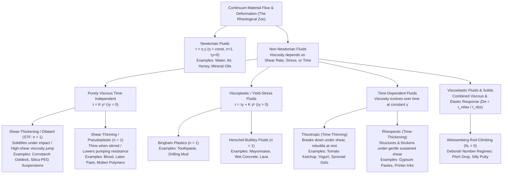
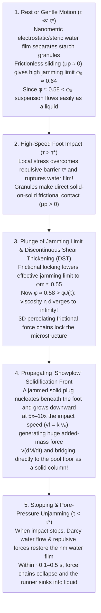

## Introduction: The Paradox of Sprinting Across a Pool of Liquid

It is one of the most visually arresting demonstrations in all of experimental physics. Fill a swimming pool with a dense suspension of ordinary kitchen cornstarch (or potato starch) mixed with water at a volume fraction of roughly $55\%$ to $60\%$ starch (approximately $1.5$ to $2$ parts starch to $1$ part water by weight). In the English-speaking world, this milky white suspension is affectionately known as <strong>Oobleck</strong>, named after the green, sticky substance falling from the sky in Dr. Seuss's 1949 children's classic, *Bartholomew and the Oobleck*.

If a person takes a running start and sprints vigorously across the surface of this liquid pool, something seemingly miraculous happens. The instant the runner's foot slams into the surface, the fluid beneath their sole locks up as rigidly as a slab of concrete. Without sinking even ankle-deep, the runner can dash all the way across the pool. Strike a bowl of Oobleck with full force using a clenched fist or a hammer, and instead of splashing, the surface recoils like a solid wall with enough resistance to sprain an unprepared wrist.

Yet the moment the runner hesitates and stands still in the middle of the pool, the "solid floor" beneath their feet vanishes. Within a fraction of a second, the rigid support melts away, and the runner sinks helplessly into a bottomless white quicksand. Worse still, if they panic and yank their leg upward with a sudden jerk, the suspension immediately re-solidifies around their calf, gripping their shoe with vise-like force; the only way to escape is to relax and pull the leg out with excruciating slowness. Scoop a handful of the mixture and roll it rapidly between your palms, and it forms a firm, bounceable solid ball; open your fingers and stop applying stress, and the ball instantaneously liquefies, oozing smoothly between your fingers like warm pancake batter.

From childhood, we are taught to partition matter into three neat, immutable boxes: solid, liquid, and gas. Moreover, our everyday intuition about liquids is shaped by water, cooking oil, and honey—fluids whose intrinsic "thickness" (viscosity) remains fixed regardless of how fast we stir them or how hard we strike them. Fluids that obey this classical linear relationship, first formulated by Sir Isaac Newton in Book II of his *Philosophiæ Naturalis Principia Mathematica* (1687), are known as <strong>Newtonian fluids</strong>.

However, the vast majority of fluids encountered in nature, biology, and modern industry—cornstarch suspensions, blood, ketchup, mayonnaise, architectural paint, toothpaste, molten polymers, wet concrete, drilling muds, and even the silicate mantle of the Earth—defy Newton's law. They are <strong>non-Newtonian fluids</strong>.

The scientific discipline dedicated to understanding how complex matter deforms and flows is <strong>rheology</strong> (from the Greek $\rho\varepsilon\omega$ / *rheo*, "to flow," inspired by Heraclitus's famous aphorism $\pi\alpha\nu\tau\alpha\ \rho\varepsilon\iota$ / *Panta rhei*, "everything flows"). In this comprehensive article, we will journey from the continuum mechanics of Newton's viscosity law and non-Newtonian constitutive equations to the dramatic 21st-century revolution in soft matter physics that finally solved the mystery of Oobleck. Along the way, we will examine why blood thins to keep us alive, why viscoelastic liquids climb up rotating rods against gravity, how the <strong>Deborah number</strong> proves that solid and liquid are merely matters of timing, and how engineers harness shear-thickening nanoparticles to build flexible <strong>liquid body armor</strong> capable of stopping bullets.

---

## Chapter 1: Isaac Newton's Law of Viscosity and Continuum Mechanics Foundations

To understand why non-Newtonian fluids behave so strangely, we must first establish a rigorous mathematical and physical baseline: what exactly is <strong>viscosity</strong> in a classical Newtonian fluid?

### 1.1 Simple Couette Shear Flow: Stress vs. Strain Rate

Consider a fluid confined between two large, parallel flat plates separated by a vertical distance $H$ $[\text{m}]$—a canonical geometry known in fluid mechanics as <strong>planar Couette flow</strong>. Suppose the bottom plate at $y = 0$ is held stationary, while the top plate at $y = H$ (of surface area $A$ $[\text{m}^2]$) is pulled horizontally in the $+x$-direction at a constant velocity $U$ $[\text{m}\cdot\text{s}^{-1}]$. To maintain this motion against the internal friction of the fluid, an external tangential force $F$ $[\text{N}]$ must be continuously applied to the top plate.

We define the <strong>shear stress</strong> $\tau$ (tau) acting on the fluid layers as the tangential force per unit area:

$$\tau \equiv \frac{F}{A} \quad [\text{Pa} = \text{N}\cdot\text{m}^{-2}]$$

Because of the no-slip boundary condition at solid-fluid interfaces, the fluid layer immediately adjacent to the bottom plate remains at rest ($u(0) = 0$), whereas the layer touching the top plate moves at velocity $u(H) = U$. In steady laminar flow, the horizontal fluid velocity $u(y)$ varies linearly with height: $u(y) = \frac{U}{H} y$. Adjacent laminae of fluid slide past one another like cards in a sheared deck. The spatial velocity gradient perpendicular to the direction of flow is defined as the <strong>shear rate</strong> (or rate of shear strain), denoted by $\dot{\gamma}$ (gamma-dot):

$$\dot{\gamma} \equiv \frac{\partial u}{\partial y} = \frac{U}{H} \quad [\text{s}^{-1}]$$

The overdot notation $\dot{\gamma} = \frac{d\gamma}{dt}$ reflects the geometric fact that during an infinitesimal time interval $dt$, a fluid element undergoes an angular shear strain $d\gamma = \frac{du \, dt}{dy}$, so the rate of deformation is $\frac{d\gamma}{dt} = \frac{\partial u}{\partial y}$. Notice that the physical dimension of shear rate is inverse time $[\text{s}^{-1}]$. For instance, sliding a $1\,\text{mm}$-thick film of fluid at a relative speed of $1\,\text{m}\cdot\text{s}^{-1}$ produces a shear rate of $\dot{\gamma} = \frac{1\,\text{m/s}}{10^{-3}\,\text{m}} = 1,000\,\text{s}^{-1}$.

### 1.2 Newton's Law of Viscosity and the Stress Tensor

In 1687, Isaac Newton postulated that for a simple fluid, the resistive shear stress $\tau$ is directly proportional to the rate of shear strain $\dot{\gamma}$. This linear constitutive relation is <strong>Newton's law of viscosity</strong>:

$$\tau = \eta \dot{\gamma} = \eta \frac{\partial u}{\partial y}$$

The constant of proportionality $\eta$ (eta, often written as $\mu$ in aerodynamic and hydraulic engineering) is the <strong>dynamic viscosity</strong> of the fluid, measured in Pascal-seconds $[\text{Pa}\cdot\text{s} = \text{kg}\cdot\text{m}^{-1}\cdot\text{s}^{-1}]$ (in CGS units, $1\,\text{Poise [P]} = 0.1\,\text{Pa}\cdot\text{s}$, and $1\,\text{centipoise [cP]} = 1\,\text{mPa}\cdot\text{s}$).

In full three-dimensional continuum mechanics, the Cauchy stress tensor $\boldsymbol{\sigma}$ inside an incompressible Newtonian fluid ($\nabla \cdot \mathbf{u} = 0$) splits into an isotropic hydrostatic pressure term $-p\mathbf{I}$ and a deviatoric viscous stress tensor $\boldsymbol{\tau}$:

$$\boldsymbol{\sigma} = -p\mathbf{I} + \boldsymbol{\tau}, \qquad \tau_{ij} = 2\eta D_{ij} = \eta \left( \frac{\partial u_i}{\partial x_j} + \frac{\partial u_j}{\partial x_i} \right)$$

where $D_{ij} \equiv \frac{1}{2}\left(\frac{\partial u_i}{\partial x_j} + \frac{\partial u_j}{\partial x_i}\right)$ is the rate-of-deformation (strain-rate) tensor. Substituting this linear constitutive law into Cauchy's momentum equation $\rho \frac{D\mathbf{u}}{Dt} = \nabla \cdot \boldsymbol{\sigma} + \rho\mathbf{g}$ yields the celebrated <strong>Navier-Stokes equation</strong>:

$$\rho \left( \frac{\partial \mathbf{u}}{\partial t} + (\mathbf{u} \cdot \nabla)\mathbf{u} \right) = -\nabla p + \eta \nabla^2 \mathbf{u} + \rho \mathbf{g}$$

The defining hallmark of a Newtonian fluid is that <strong>at a fixed temperature $T$ and pressure $p$, its viscosity $\eta$ is a true material constant, completely independent of the shear rate $\dot{\gamma}$ or the history of the flow</strong>. Typical dynamic viscosities at room temperature ($20^\circ\text{C}$) span many orders of magnitude:

- Air: $\eta \approx 1.8 \times 10^{-5}\,\text{Pa}\cdot\text{s}$
- Water: $\eta \approx 1.0 \times 10^{-3}\,\text{Pa}\cdot\text{s}$ ($1\,\text{mPa}\cdot\text{s}$)
- Olive Oil: $\eta \approx 8.0 \times 10^{-2}\,\text{Pa}\cdot\text{s}$
- Glycerol: $\eta \approx 1.5\,\text{Pa}\cdot\text{s}$ ($1,500\times$ water)
- Liquid Honey: $\eta \approx 2\text{–}10\,\text{Pa}\cdot\text{s}$ ($2,000\text{–}10,000\times$ water)

Although honey is thousands of times more viscous than water, both are strictly Newtonian: whether you stir honey gently with a spoon ($\dot{\gamma} \sim 1\,\text{s}^{-1}$) or shear it rapidly in a high-speed viscometer ($\dot{\gamma} \sim 10^3\,\text{s}^{-1}$, at constant temperature), the ratio $\tau / \dot{\gamma} = \eta$ remains invariant. On a plot of shear stress $\tau$ versus shear rate $\dot{\gamma}$ (a <strong>flow curve</strong>), a Newtonian fluid always traces a straight line passing through the origin with slope $\eta$.

### 1.3 Why Are Simple Liquids Newtonian While Complex Fluids Are Not? The Physics of the Péclet Number

Why do water, ethanol, benzene, and honey obey Newton's law, whereas cornstarch suspensions, blood, and polymer solutions violate it? The answer lies in the microscopic competition between <strong>thermal Brownian relaxation</strong> and <strong>hydrodynamic shear deformation</strong>.

Consider a fluid whose microstructural building blocks (molecules, colloidal particles, or polymer coils) have a characteristic radius $a$. Immersed in a thermal bath at absolute temperature $T$, each particle undergoes incessant <strong>Brownian motion</strong> driven by random thermal collisions with solvent molecules, diffusing with the Stokes-Einstein diffusivity $D_0 = \frac{k_B T}{6\pi \eta_0 a}$, where $k_B = 1.38 \times 10^{-23}\,\text{J}\cdot\text{K}^{-1}$ is Boltzmann's constant and $\eta_0$ is the solvent viscosity.

The characteristic time required for a particle to diffuse a distance comparable to its own radius $a$—and thereby erase any flow-induced anisotropy and restore an isotropic thermal equilibrium microstructure—is the <strong>Brownian relaxation time</strong> $\tau_B$:

$$\tau_B \equiv \frac{a^2}{D_0} = \frac{6\pi \eta_0 a^3}{k_B T}$$

Notice the crucial scaling law: <strong>$\tau_B$ scales with the cube of the particle radius ($a^3$)!</strong>
When the fluid is subjected to an external shear rate $\dot{\gamma}$, the flow deforms the microstructure on a convective timescale $\tau_{\text{flow}} \sim \dot{\gamma}^{-1}$. The dimensionless ratio of the thermal relaxation time to the flow deformation time is the <strong>Péclet number ($\text{Pe}$)</strong>:

$$\text{Pe} \equiv \frac{\tau_B}{\tau_{\text{flow}}} = \dot{\gamma} \tau_B = \frac{6\pi \eta_0 a^3 \dot{\gamma}}{k_B T}$$

Let us compare two regimes:

1. <strong>Small-Molecule Liquids (e.g., Water, $a \sim 0.15\,\text{nm}$)</strong>:
   At room temperature ($T = 300\,\text{K}$), the Brownian relaxation time of a water molecule is on the order of picoseconds: $\tau_B \sim 10^{-12}\,\text{s}$. Even under the most extreme mechanical shear rates achievable in engineering ($\dot{\gamma} \sim 10^5\,\text{s}^{-1}$), the Péclet number is minuscule: $\text{Pe} \sim 10^{-7} \ll 1$. Thermal agitation restores molecular isotropy millions of times faster than the flow can distort it. Consequently, the liquid's internal structure remains in quasi-equilibrium at all practical shear rates, and its viscosity $\eta$ stays strictly constant.
2. <strong>Complex Fluids / Soft Matter (Colloids, Suspensions, Polymers, $a \sim 0.1\text{–}10\,\mu\text{m}$)</strong>:
   A cornstarch granule in Oobleck ($2a \sim 10\text{–}20\,\mu\text{m}$) or a red blood cell ($2a \sim 8\,\mu\text{m}$) is roughly $10^4$ times larger than a water molecule. Because $\tau_B \propto a^3$, the Brownian relaxation time jumps by a factor of <strong>$(10^4)^3 = 10^{12}$ (one trillion)</strong>, reaching macroscopic timescales of $\tau_B \sim 1\text{–}100\,\text{s}$! Consequently, even gentle hand stirring ($\dot{\gamma} \sim 1\,\text{s}^{-1}$) easily drives the system into the high-Péclet-number regime ($\text{Pe} \gg 1$). Thermal motion can no longer relax the microstructure; instead, hydrodynamic forces dominate, aligning polymers, breaking up aggregates, or jamming particles together. Because the microstructure itself evolves dynamically with $\dot{\gamma}$, the macroscopic viscosity becomes a strong nonlinear function of shear rate.

---

## Chapter 2: Mathematical Classification of the Rheological Zoo — Power-Law and Herschel-Bulkley Models

Because the relationship between shear stress $\tau$ and shear rate $\dot{\gamma}$ in a non-Newtonian fluid is nonlinear, a single constant viscosity no longer exists. Instead, rheologists define the <strong>apparent viscosity</strong> $\eta_{\text{app}}(\dot{\gamma})$ at a given shear rate as the secant ratio of stress to shear rate, alongside the local <strong>differential viscosity</strong> $\eta_{\text{diff}}(\dot{\gamma})$:

$$\eta_{\text{app}}(\dot{\gamma}) \equiv \frac{\tau(\dot{\gamma})}{\dot{\gamma}}, \qquad \eta_{\text{diff}}(\dot{\gamma}) \equiv \frac{d\tau}{d\dot{\gamma}}$$

### 2.1 The Ostwald-de Waele Power-Law and Herschel-Bulkley Constitutive Equations

The most versatile empirical constitutive equation for time-independent non-Newtonian fluids was formulated in 1926 by Winslow H. Herschel and Ronald Bulkley. Known as the <strong>Herschel-Bulkley model</strong>, it unifies yield-stress behavior and power-law shear dependence into a single piecewise equation:

$$\begin{cases} \dot{\gamma} = 0 & (\text{for } \tau < \tau_y : \text{unyielded solid regime}) \\[6pt] \tau(\dot{\gamma}) = \tau_y + K \dot{\gamma}^n & (\text{for } \tau \ge \tau_y : \text{viscous flow regime}) \end{cases}$$

The three material parameters govern distinct physical aspects of the fluid:

- <strong>$\tau_y$ (Yield Stress) $[\text{Pa}]$</strong>: The critical threshold stress required to break the internal 3D microstructural network and initiate flow. Below $\tau_y$, the material deforms only elastically like a solid ($\dot{\gamma} = 0$).
- <strong>$K$ (Consistency Index) $[\text{Pa}\cdot\text{s}^n]$</strong>: A measure of the baseline viscous thickness of the fluid.
- <strong>$n$ (Flow Behavior Index) $[\text{dimensionless}]$</strong>: The exponent that dictates how the viscosity changes with shear rate.

Dividing by $\dot{\gamma}$ for $\tau > \tau_y$ yields the general expression for the <strong>apparent viscosity</strong>:

$$\eta_{\text{app}}(\dot{\gamma}) = \frac{\tau_y}{\dot{\gamma}} + K \dot{\gamma}^{n-1}$$

When the fluid has no yield stress ($\tau_y = 0$), the Herschel-Bulkley equation reduces to the classic <strong>Ostwald-de Waele power-law model</strong>:

$$\tau(\dot{\gamma}) = K \dot{\gamma}^n, \qquad \eta_{\text{app}}(\dot{\gamma}) = K \dot{\gamma}^{n-1}$$

By varying $\tau_y$ and $n$, we can systematically classify the entire "Rheological Zoo":

1. <strong>Newtonian Fluids ($n = 1, \tau_y = 0$)</strong>:
   $\tau = K\dot{\gamma}$ with $K = \eta$. The apparent viscosity $\eta_{\text{app}}(\dot{\gamma}) = K\dot{\gamma}^0 = \eta$ is independent of shear rate (water, air, honey, simple hydrocarbon oils).
2. <strong>Shear-Thickening / Dilatant Fluids (STF: $n > 1, \tau_y = 0$)</strong>:
   Because $n - 1 > 0$, the apparent viscosity $\eta_{\text{app}}(\dot{\gamma}) = K\dot{\gamma}^{n-1}$ <strong>increases</strong> monotonically with increasing shear rate $\dot{\gamma}$. At low shear rates the fluid flows easily, whereas under rapid shearing or impact ($\dot{\gamma} \gg 1$) its resistance skyrockets (dense cornstarch/water Oobleck, concentrated silica nanoparticle suspensions in polyethylene glycol, wet beach sand).
3. <strong>Shear-Thinning / Pseudoplastic Fluids ($n < 1, \tau_y = 0$)</strong>:
   Because $n - 1 < 0$, the apparent viscosity $\eta_{\text{app}}(\dot{\gamma}) = \frac{K}{\dot{\gamma}^{1-n}}$ <strong>decreases</strong> as the shear rate increases. The fluid is thick at rest or low flow speeds but thins dramatically when pumped, stirred, or brushed rapidly (human blood, latex wall paint, ballpoint pen gel ink, shampoo, molten polyethylene, biological mucus).
4. <strong>Bingham Plastics ($n = 1, \tau_y > 0$)</strong>:
   Introduced by Eugene C. Bingham in 1916, these materials behave as rigid solids below $\tau_y$, and flow linearly with a constant plastic viscosity $\eta_p = K$ once $\tau > \tau_y$: $\tau = \tau_y + \eta_p \dot{\gamma}$ (toothpaste, margarine, oil-well drilling muds, sewage sludge).
5. <strong>General Yield-Stress / Herschel-Bulkley Fluids ($n < 1, \tau_y > 0$)</strong>:
   Materials that require a finite yield stress $\tau_y$ to begin flowing and subsequently exhibit shear-thinning ($n < 1$) once flowing (mayonnaise, tomato paste, wet cement, skin creams, volcanic lava).

### 2.2 The Carreau-Yasuda and Cross Models: Capturing the Newtonian Plateaus

While the Ostwald-de Waele power law $\eta_{\text{app}} = K\dot{\gamma}^{n-1}$ is invaluable across intermediate shear rates, it exhibits unphysical mathematical singularities in the asymptotic limits: for a shear-thinning fluid ($n < 1$), it predicts $\eta_{\text{app}} \to \infty$ as $\dot{\gamma} \to 0$ and $\eta_{\text{app}} \to 0$ as $\dot{\gamma} \to \infty$. In real polymeric and colloidal fluids without a permanent yield stress, thermal Brownian motion dominates at very low shear rates ($\text{Pe} \ll 1$), producing a constant <strong>zero-shear viscosity plateau</strong> $\eta_0$. Conversely, at ultra-high shear rates ($\text{Pe} \gg 1$), once all polymer chains are fully aligned or all aggregates are dispersed, the viscosity levels off at a finite <strong>infinite-shear viscosity plateau</strong> $\eta_\infty$ (comparable to the solvent viscosity $\eta_s$).

The <strong>Carreau-Yasuda model</strong> smoothly bridges the zero-shear plateau, the power-law regime, and the infinite-shear plateau without singularities:

$$\frac{\eta(\dot{\gamma}) - \eta_\infty}{\eta_0 - \eta_\infty} = \left[ 1 + (\lambda \dot{\gamma})^a \right]^{\frac{n-1}{a}}$$

Here, $\lambda$ $[\text{s}]$ is the characteristic relaxation time of the fluid (marking the inverse crossover shear rate $\dot{\gamma}_c \sim \lambda^{-1}$ where shear thinning begins), $n$ is the power-law slope in the high-shear regime, and $a$ is a dimensionless Yasuda parameter governing the breadth of the transition ($a = 2$ recovers the original Carreau equation). For $\lambda\dot{\gamma} \ll 1$, $\eta(\dot{\gamma}) \to \eta_0$; for $\lambda\dot{\gamma} \gg 1$, $\eta(\dot{\gamma}) - \eta_\infty \approx (\eta_0 - \eta_\infty)\lambda^{n-1}\dot{\gamma}^{n-1}$, recovering power-law scaling.

| Fluid Class | Constitutive Equation | Apparent Viscosity $\eta_{\text{app}}(\dot{\gamma})$ Behavior | Dominant Microscopic Mechanism | Representative Examples |
| :--- | :--- | :--- | :--- | :--- |
| <strong>Newtonian Fluid</strong> | $\tau = \eta \dot{\gamma}$ ($n = 1, \tau_y = 0$) | Strictly constant across all $\dot{\gamma}$ ($\eta = \text{const.}$) | Picosecond molecular thermal relaxation ($\tau_B \sim 10^{-12}\,\text{s}, \text{Pe} \ll 1$) preserves isotropic structure | Water, air, ethanol, glycerol, honey, simple silicone oils |
| <strong>Shear-Thickening Fluid (STF)</strong> | $\tau = K \dot{\gamma}^n$ ($n > 1, \tau_y = 0$) | Increases with $\dot{\gamma}$; diverges discontinuously (DST) above critical stress $\tau^*$ | Hydrodynamic lubrication clusters $\to$ rupture of repulsive film & solid-on-solid frictional force chains | Oobleck (dense cornstarch in water), $\text{SiO}_2$-PEG suspensions, wet sand |
| <strong>Shear-Thinning (Pseudoplastic)</strong> | $\tau = K \dot{\gamma}^n$ ($n < 1, \tau_y = 0$) | Decreases monotonically with $\dot{\gamma}$ ($\eta_0 \to \eta_\infty$) | Breakup of aggregates (RBC rouleaux), streamline alignment & disentanglement of polymer chains | Whole blood, architectural latex paint, shampoo, ballpoint gel ink, polymer melts |
| <strong>Viscoplastic (Yield-Stress)</strong> | $\tau = \tau_y + K \dot{\gamma}^n$ ($\tau_y > 0, n \le 1$) | Solid below $\tau_y$ ($\eta_{\text{app}} \to \infty$); flows with central solid plug above $\tau_y$ | Jammed 3D network of droplets, particles, or gel fibers yields above threshold stress $\tau_y$ | Toothpaste, mayonnaise, whipped cream, fresh concrete, volcanic lava |
| <strong>Thixotropic Fluid</strong> | $\tau = \tau(\dot{\gamma}, t)$ (Hysteresis loop) | Decreases over time $t$ under constant shear; reversibly rebuilds at rest | Time-dependent rupture and Brownian percolation rebuilding of weak hydrogen/van der Waals bonds | Tomato ketchup, stirred yogurt, bentonite clay gels, cosmetic lotions |
| <strong>Viscoelastic Fluid</strong> | $\tau + \lambda \dot{\tau} = \eta \dot{\gamma}$ ($N_1 = \sigma_{xx} - \sigma_{yy} > 0$) | Elastic solid at short times ($\text{De} \gg 1$); viscous liquid at long times ($\text{De} \ll 1$) | Entropic elasticity of entangled long-chain macromolecules generating tensile hoop stresses | Pitch (bitumen), Silly Putty (borosiloxane), egg white, bread dough, mucus |

---

## Chapter 3: The Physics of Oobleck — Three Revolutions in Shear-Thickening Fluids (STF)

We now confront the central mystery of this article: <strong>Why does a dense suspension of cornstarch in water solidify under rapid impact, allowing a human to sprint across its surface?</strong>
Remarkably, the textbook explanations taught for decades turned out to be incomplete. Between 1885 and 2014, our microscopic understanding of shear thickening underwent three major scientific revolutions, culminating in a paradigm shift that unified colloid rheology with granular jamming physics.

### 3.1 Classical Reynolds Dilatancy (1885) and the Wet Beach Sand Paradox

The earliest scientific investigation into materials that stiffen under deformation was published in 1885 by the great British fluid dynamicist <strong>Osborne Reynolds</strong>.
Anyone who has walked barefoot along the shoreline of a wet sandy beach has witnessed Reynolds's phenomenon: each time your foot presses down firmly onto the saturated sand, the sand immediately surrounding your footprint turns pale and dry, while simultaneously becoming rock-hard beneath your sole. As soon as you lift your foot, water rushes back in and the surface regains its glossy, wet appearance.

Reynolds explained this through pure geometric packing. Wave action settles wet beach sand into a state of maximum density—a <strong>random close-packed (RCP) configuration</strong> with a solid volume fraction of $\phi \approx 0.64$, where the interstitial void space between rigid quartz grains is minimized. When your foot applies a shear stress to this close-packed bed, one layer of sand grains cannot slide past the underlying layer unless the grains roll up and over their neighbors. Doing so inevitably forces the entire granular bed to <strong>expand in total volume</strong>, increasing the interstitial void space between grains. Reynolds coined the term <strong>dilatancy</strong> to describe this <strong>shear-induced volume expansion</strong> ($\Delta V > 0$).

Because the void spaces between grains suddenly expand, the fixed volume of water present is no longer sufficient to fill the pores. Water is sucked inward from the free surface by capillary action (making the surface around your foot look white and dry), dropping the internal pore water pressure $p_{\text{pore}}$ below atmospheric pressure. This negative pore pressure (suction) pulls the sand grains tightly together, dramatically increasing intergranular normal forces and Coulomb friction, which locks the sand bed into a rigid solid.

> [!IMPORTANT]
> <strong>Terminological Precision: "Dilatancy" vs. "Shear Thickening"</strong>
> Although "dilatant fluid" is widely used as a synonym for "shear-thickening fluid," modern rheology draws a strict distinction between the two. <strong>Dilatancy</strong> specifically refers to an expansion in volume (or normal stress generation causing particle migration toward free boundaries) under shear, whereas <strong>shear thickening</strong> refers to an increase in shear viscosity with increasing shear rate ($d\eta_{\text{app}}/d\dot{\gamma} > 0$). While discontinuous shear thickening in dense suspensions is accompanied by normal stresses and dilatant pore-pressure effects, dilute or moderate shear thickening can occur at constant volume without dilatancy.

### 3.2 Order-to-Disorder Transition (1972) and Hydrocluster Theory (1985)

What about colloidal suspensions like cornstarch in water (granule diameter $2a \sim 5\text{–}20\,\mu\text{m}$) or sub-micron silica spheres?
In 1972, <strong>Richard L. Hoffman</strong> performed light-diffraction experiments on concentrated suspensions of monodisperse polymeric spheres and proposed the <strong>Order-to-Disorder Transition (ODT)</strong> theory. At low shear rates, monodisperse spheres organize into ordered two-dimensional hexagonal layers parallel to the flow plane, sliding smoothly past one another with minimal resistance. Above a critical shear rate, hydrodynamic instabilities disrupt these layers, triggering a transition into a disordered 3D state where particles collide and jam, causing the viscosity to jump.

However, subsequent experiments revealed that polydisperse suspensions (such as irregular cornstarch granules, which never form ordered crystalline layers in the first place) exhibit even stronger shear thickening. To explain shear thickening without crystalline order, <strong>John F. Brady and Georges Bossis</strong> pioneered <strong>Stokesian Dynamics</strong> simulations in 1985 and formulated the famous <strong>Hydrocluster Theory</strong>, which reigned as the consensus textbook explanation for nearly thirty years.

Consider two rigid spherical particles of radius $a$ suspended in a Newtonian solvent of viscosity $\eta_0$. When external shear drives the two spheres toward each other at a relative normal velocity $v_{\text{rel}} \sim \dot{\gamma} a$, the solvent trapped in the tiny surface-to-surface gap $h$ ($h \ll a$) must be squeezed out radially. According to Reynolds's hydrodynamic lubrication theory, squeezing a viscous fluid out of a narrowing gap generates a diverging repulsive <strong>lubrication squeezing force</strong> $F_{\text{lub}}$ (and conversely, an attractive suction force when the particles try to separate):

$$F_{\text{lub}} \simeq \frac{6\pi \eta_0 a^2 v_{\text{rel}}}{h}$$

Notice that <strong>$F_{\text{lub}}$ scales inversely with the surface separation gap ($\propto 1/h$)</strong>!
At low shear rates ($\text{Pe} \ll 1$), Brownian motion and weak repulsive forces keep particles well-separated ($h$ is large), so lubrication forces are modest. At high shear rates ($\text{Pe} \gg 1$), however, hydrodynamic compressive forces push particles into extremely close proximity ($h \to 0$). Because $F_{\text{lub}} \propto 1/h$ diverges as the gap shrinks, pairs and chains of particles become hydrodynamically locked together—unable to separate on the timescale of the flow—forming transient, rod-like aggregates called <strong>hydroclusters</strong>. These transient clusters span the flow field, increasing viscous energy dissipation and raising the apparent viscosity $\eta_{\text{app}}(\dot{\gamma})$.

<strong>Why Hydrocluster Theory Failed for Oobleck</strong>:
Hydrocluster theory successfully accounts for <strong>Continuous Shear Thickening (CST)</strong>, which occurs at moderate volume fractions ($\phi \approx 0.35\text{–}0.50$) and produces a mild, smooth viscosity increase of $20\%$ to $200\%$. However, in dense suspensions ($\phi \gtrsim 0.52\text{–}0.55$) like Oobleck, something vastly more violent occurs: at a critical shear rate $\dot{\gamma}_c$, the shear stress and apparent viscosity jump <strong>vertically by two to four orders of magnitude ($100\times$ to $10,000\times$)</strong>—a phenomenon called <strong>Discontinuous Shear Thickening (DST)</strong>. Mathematically and experimentally, pure hydrodynamic lubrication forces ($F_{\text{lub}} \propto \ln(a/h)$ in tangential shear and $1/h$ in normal motion) are far too weak to explain a thousand-fold discontinuous viscosity divergence or the immense normal stresses required to support a running human!

### 3.3 The Modern Paradigm Shift (2012–2014): Frictional Contact Networks (Wyart & Cates) and Impact-Activated Solidification Fronts (Waitukaitis & Jaeger)

Between 2012 and 2014, two landmark breakthroughs overturned the purely hydrodynamic picture and solved the riddle of Oobleck once and for all: the <strong>Frictional Contact / Shear-Jamming Theory</strong> developed by Matthieu Wyart, Michael E. Cates, Ryohei Seto, Romain Mari, and Morton M. Denn (2013–2014), and the <strong>Impact-Activated Solidification Front Theory</strong> discovered by Scott R. Waitukaitis and Heinrich M. Jaeger at the University of Chicago (*Nature*, 2012).

#### Pillar 1: Rupture of the Nanometric Lubrication Film and the Frictionless-to-Frictional Transition (Wyart & Cates, 2014)

Why did hydrocluster models fail? Because they assumed that particles remain separated by a thin film of liquid ($h > 0$) at all times and never make direct solid-on-solid contact.

In reality, colloidal particles (such as cornstarch granules or silica spheres in water) possess a short-range repulsive barrier $F_{\text{rep}}$ extending a few nanometers from their surfaces, arising from <strong>electrostatic double-layer repulsion</strong> (surface charges) or <strong>steric repulsion</strong> (hydrated polymer brushes grafted or adsorbed onto the particle surface). This repulsive force defines a characteristic microscopic <strong>threshold stress</strong> $\tau^*$:

$$\tau^* \sim \frac{F_{\text{rep}}}{a^2}$$

- <strong>Low-Stress Regime ($\tau \ll \tau^*$ — Frictionless Lubrication)</strong>:
  When the applied shear stress $\tau$ is much smaller than $\tau^*$, the compressive forces between colliding particles cannot overcome the repulsive barrier $F_{\text{rep}}$. A nanometric lubrication film of water remains intact between every pair of particles. Because the particles never touch directly, their effective interparticle friction coefficient is zero ($\mu_p \approx 0$). In granular physics, <strong>frictionless spheres</strong> can slide and rotate freely past one another until they reach the random close-packing limit:
  $$\phi_0 \approx 0.64 \quad (\text{Frictionless Jamming Limit})$$
- <strong>High-Stress Regime ($\tau > \tau^*$ — Frictional Solid Contact)</strong>:
  When a runner's foot strikes the suspension or a rheometer applies a high stress $\tau > \tau^*$, the local compressive force between particles overwhelms the repulsive barrier $F_{\text{rep}}$. The nanometric water film ruptures, driving rough starch granules into <strong>direct solid-on-solid mechanical contact</strong> governed by Coulomb static friction ($\left|F_{\text{tan}}\right| \le \mu_p F_{\text{norm}}$, with friction coefficient $\mu_p \approx 0.3\text{–}0.5$)!
  Crucially, once particles experience tangential friction, they can no longer freely rotate or roll past one another. Instead, they lock into load-bearing arches. Consequently, a system of <strong>frictional particles</strong> jams (solidifies) at a much lower critical volume fraction—the random loose-packing limit:
  $$\phi_m(\mu_p) \approx 0.54\text{–}0.56 \quad (\text{Frictional Jamming Limit})$$

Wyart and Cates formulated a brilliant two-state model in which the fraction of particle contacts that have ruptured their lubrication film and become frictional is a smooth increasing function of stress, $f(\tau) = \exp\left(-\tau^* / \tau\right) \in [0, 1]$. The effective jamming volume fraction $\phi_J(\tau)$ of the suspension interpolates linearly between the frictionless limit $\phi_0$ and the frictional limit $\phi_m$:

$$\phi_J(\tau) = f(\tau)\,\phi_m + \left[ 1 - f(\tau) \right]\phi_0$$

According to the Krieger-Dougherty divergence law, the suspension viscosity $\eta(\phi, \tau)$ diverges as a power law as the particle volume fraction $\phi$ approaches the active jamming point $\phi_J(\tau)$:

$$\eta(\phi, \tau) = \eta_0 \left[ 1 - \frac{\phi}{\phi_J(\tau)} \right]^{-2} \propto \left[ \phi_J(\tau) - \phi \right]^{-2}$$

This equation reveals the entire secret of Oobleck with breathtaking clarity!
Suppose we prepare our cornstarch suspension at a volume fraction $\phi = 0.58$, which lies squarely inside the magic window between $\phi_m \approx 0.55$ and $\phi_0 \approx 0.64$ ($\phi_m < \phi < \phi_0$):

1. <strong>At Rest or Under Gentle Motion ($\tau \ll \tau^*$)</strong>:
   Nearly all contacts are lubricated and frictionless ($f(\tau) \approx 0$), so the jamming limit is $\phi_J \approx \phi_0 = 0.64$. Because our actual concentration $\phi = 0.58$ is well below $0.64$ ($\phi < \phi_J$), the factor $\left[\phi_J - \phi\right]^{-2}$ is finite and small. The suspension flows smoothly like a liquid!
2. <strong>Under Sudden Impact or High Shear ($\tau > \tau^*$)</strong>:
   The lubrication films rupture ($f(\tau) \to 1$), and the jamming threshold $\phi_J(\tau)$ plummets from $0.64$ down toward $0.55$! Even though the actual concentration of cornstarch $\phi = 0.58$ has not changed at all, <strong>the jamming goalpost $\phi_J(\tau)$ drops below $\phi$ ($\phi \ge \phi_J(\tau)$)!</strong>
   As $\phi_J(\tau) \to \phi$, the denominator $\left[\phi_J(\tau) - \phi\right]$ hits zero, causing the viscosity $\eta(\phi, \tau)$ to <strong>diverge discontinuously to infinity (DST)</strong>! Percolating networks of solid-on-solid <strong>frictional force chains</strong> instantly span the suspension, locking it into a <strong>shear-jammed solid state</strong>!

#### Pillar 2: Impact-Activated Solidification and the Propagating "Snowplow" Front (Waitukaitis & Jaeger, *Nature* 2012)

While Wyart and Cates explained steady-state shear jamming, Scott Waitukaitis and Heinrich Jaeger at the University of Chicago answered the dynamic question: *How does a free-surface pool of Oobleck generate enough upward vertical force in milliseconds to support an adult human runner?*

Using high-speed X-ray radiography, laser vibrometry, and submerged pressure transducers, Waitukaitis and Jaeger tracked what happens beneath the surface when a rod (or a runner's foot) strikes Oobleck at impact velocity $v_0$.
They discovered that impact does not merely thicken the fluid locally through viscous shear. Instead, the moment the foot hits the surface at speed $v_0$, the local compression pushes the starch granules directly beneath the sole across the frictional jamming threshold ($\tau > \tau^*$), nucleating a rigid, fully jammed <strong>solidified plug</strong>. As this solid plug is pushed downward by a few millimeters, it acts like a snowplow blade pushing through fresh snow: it sweeps up and jams the surrounding liquid layers, launching a sharp <strong>solidification front</strong> (jamming front) that propagates downward and outward into the pool at a velocity $v_f$ that is <strong>$5$ to $10$ times faster than the impacting foot itself ($v_f = k v_0$, with $k \approx 5\text{–}10$)</strong>!

Because the mass of the solidified plug $M(t)$ grows explosively as the front advances, Newton's second law for a variable-mass system dictates an enormous <strong>added-mass reaction force</strong> (the "snowplow effect"):

$$F_{\text{impact}}(t) = \frac{d}{dt}\left[ M(t) v(t) \right] = M(t)\frac{dv}{dt} + v(t)\frac{dM}{dt}$$

Furthermore, in a pool of finite depth (say, $15\text{–}30\,\text{cm}$), this supersonic-like solidification front reaches the rigid bottom floor of the pool within a few milliseconds! Once the front hits the bottom, a continuous, load-bearing <strong>solid column of jammed starch granules</strong> connects the runner's sole directly to the floor of the pool, easily supporting compressive stresses of $\sigma \sim 50\text{–}100\,\text{kPa}$ (more than enough to hold up a sprinting human).

Why, then, does the runner sink the instant they stop moving? Once the dynamic impact ceases ($\tau < \tau^*$) or after a characteristic pore-relaxation time $t_{\text{relax}} \sim 0.1\text{–}0.5\,\text{s}$, water percolates back into the microscopic pores via Darcy flow, relieving the negative pore pressure, while the electrostatic/steric repulsive forces $F_{\text{rep}}$ push the starch granules back apart by a few nanometers. The frictional force chains dissolve, $\phi_J$ resets to $0.64 > \phi$, and the solid column melts instantaneously back into a liquid!

---

## Chapter 4: Pseudoplasticity (Shear-Thinning), Yield-Stress Fluids, and Thixotropy

While shear-thickening fluids like Oobleck capture public imagination through their dramatic solidification, over $90\%$ of non-Newtonian fluids in biology, food science, and chemical engineering behave in the exact opposite manner: they are <strong>shear-thinning (pseudoplastic, $n < 1$)</strong> and/or <strong>viscoplastic yield-stress fluids ($\tau_y > 0$)</strong> whose apparent viscosity drops precipitously when sheared.

### 4.1 Hemorheology: Why Human Blood Doesn't Jam in Capillaries

Human <strong>whole blood</strong> is a masterclass in evolutionary rheological engineering. Blood is a concentrated suspension consisting of roughly $40\%$ to $45\%$ by volume (the hematocrit) of red blood cells (erythrocytes—biconcave discs about $8\,\mu\text{m}$ in diameter and $2\,\mu\text{m}$ thick) suspended in blood plasma (a nearly Newtonian aqueous solution with $\eta_{\text{plasma}} \approx 1.2\,\text{mPa}\cdot\text{s}$ at $37^\circ\text{C}$).

Notice that a $45\%$ volume fraction of rigid particles is dangerously close to the jamming regime! If red blood cells behaved like rigid cornstarch granules, every heartbeat would trigger shear thickening in our arteries, causing instant, fatal circulatory arrest. Instead, blood exhibits profound <strong>shear-thinning behavior</strong> across three orders of magnitude in shear rate, driven by two distinct microscopic mechanisms:

1. <strong>Disaggregation of Rouleaux at Low Shear Rates ($\dot{\gamma} < 10\,\text{s}^{-1}$)</strong>:
   In stagnant blood or slow-flowing venules ($\dot{\gamma} \sim 0.1\text{–}1\,\text{s}^{-1}$), plasma proteins—principally fibrinogen and immunoglobulins—act as bridging macromolecules (or induce depletion attraction) that cause flat red blood cells to stack face-to-face like rolls of coins. These cylindrical stacks, called <strong>rouleaux</strong>, interconnect into a 3D space-filling network that resists flow, elevating the zero-shear viscosity of blood to $\eta_0 \approx 50\text{–}100\,\text{mPa}\cdot\text{s}$ ($50\text{–}100$ times that of water). As soon as blood velocity increases ($\dot{\gamma} > 10\,\text{s}^{-1}$), hydrodynamic shear stresses peel the rouleaux apart into individual dispersed cells, dropping the viscosity by an order of magnitude.
2. <strong>Erythrocyte Deformation and "Tank-Treading" at High Shear Rates ($\dot{\gamma} \sim 100\text{–}1,000\,\text{s}^{-1}$)</strong>:
   In major arteries and microscopic capillaries (whose diameters, $4\text{–}8\,\mu\text{m}$, are actually *smaller* than a resting red blood cell!), shear rates reach $\dot{\gamma} \sim 500\text{–}2,000\,\text{s}^{-1}$. Unlike rigid starch granules, mammalian red blood cells lack a cell nucleus and possess a hyper-elastic spectrin-actin cytoskeleton beneath a fluid lipid bilayer membrane. Under intense shear, each red blood cell elongates into a streamlined ellipsoid or parachute/slipper shape aligned with the flow, while its outer membrane circulates smoothly around the liquid hemoglobin interior like the tread of a military tank—a phenomenon known as <strong>tank-treading motion</strong>. Furthermore, deformable cells migrate away from vessel walls toward the centerline (the <strong>Fåhræus-Lindqvist effect</strong>), leaving a cell-free plasma lubrication layer along the capillary wall. Consequently, high-shear blood viscosity drops to just <strong>$\eta_\infty \approx 3\text{–}4\,\text{mPa}\cdot\text{s}$</strong>, allowing the human heart to perfuse $100,000\,\text{km}$ of blood vessels with minimal mechanical work!

### 4.2 Architectural Paint and Gel-Ink Ballpoint Pens: Solving the Coating Paradox

Consider the conflicting physical demands placed on architectural wall paint:
- If paint were a low-viscosity Newtonian fluid like water ($\eta \sim 10^{-3}\,\text{Pa}\cdot\text{s}$), it would be effortless to brush onto a wall, but gravity would immediately pull it downward in ugly curtains and drips (<strong>sagging</strong>), while pigment particles would rapidly settle to the bottom of the can during storage.
- Conversely, if paint were a high-viscosity Newtonian fluid like thick molasses ($\eta \sim 10^2\,\text{Pa}\cdot\text{s}$), it wouldn't sag or settle, but dragging a paintbrush through it would require exhausting force, and surface tension could never smooth out the deep brush marks (poor <strong>leveling</strong>).

Formulators solve this dilemma by engineering latex paints as highly <strong>shear-thinning ($n \approx 0.2\text{–}0.4$) and thixotropic fluids</strong>:
- <strong>During Brushing, Rolling, or Spraying ($\dot{\gamma} \sim 10^3\text{–}10^5\,\text{s}^{-1}$)</strong>:
  The intense shear rate between the brush bristles and the wall aligns polymer chains and breaks up associative pigment networks, slashing the apparent viscosity to $\eta_{\text{app}} \sim 0.05\text{–}0.2\,\text{Pa}\cdot\text{s}$ so the paint spreads effortlessly into a thin, uniform film.
- <strong>Immediately After Brushing ($\dot{\gamma} \sim 10^{-2}\text{–}10^{-1}\,\text{s}^{-1}$)</strong>:
  Once the brush leaves the wall, the only shear stress acting on a wet paint film of thickness $h \sim 100\,\mu\text{m}$ is gravity: $\tau_{\text{grav}} = \rho g h \approx 1\,\text{Pa}$. Over a brief window of a few seconds, the viscosity remains low enough for capillary forces to flatten out brush marks (leveling), and then rapidly recovers via thixotropy to $\eta_{\text{app}} > 100\,\text{Pa}\cdot\text{s}$ (with a yield stress $\tau_y > \tau_{\text{grav}}$), locking the wet film in place against gravity without a single drip!

Modern <strong>aqueous gel-ink ballpoint pens</strong> rely on the exact same rheological wizardry. Inside the open refill tube at rest ($\tau = 0 < \tau_y$), xanthan gum or carbomer polymer networks give the pigment ink a high yield stress and zero-shear viscosity, preventing leaks or drying out even without a cap. The instant you press the pen nib to paper and write, the tiny $0.5\,\text{mm}$ tungsten-carbide ball rotates at high speed, subjecting the ink film in the micron-scale clearance between the ball and socket to a massive shear rate of <strong>$\dot{\gamma} \sim 10^4\text{–}10^5\,\text{s}^{-1}$</strong>. The ink locally liquefies by three orders of magnitude, transfers cleanly onto the paper fibers, and instantaneously re-gels as soon as the ball passes, preventing feathering or bleed-through.

### 4.3 Polymer Melts and Reptation Dynamics

In molten plastics (such as polyethylene, polypropylene, or polystyrene in injection molding and 3D printing) and concentrated polymer solutions, shear thinning arises from <strong>macromolecular disentanglement</strong>.
As Pierre-Gilles de Gennes (1991 Nobel Laureate in Physics) and Masao Doi & Sam Edwards showed in their celebrated <strong>reptation (tube) theory</strong>, long flexible polymer chains in a melt are topologically entangled like a bowl of cooked spaghetti. Each chain is confined within a virtual "tube" formed by surrounding chains and can relax its conformation at rest only by slithering snake-like (reptating) along its contour over a long disengagement time $\tau_d \propto M^3$ (actually $M^{3.4}$ due to contour-length fluctuations, where $M$ is molecular weight).

When subjected to fast shear ($\dot{\gamma} > \tau_d^{-1}$), the flow convects and stretches the chains faster than they can re-entangle by Brownian reptation. The polymer chains align parallel to the streamlines, drastically reducing the density of entanglement knots per chain and causing the viscosity to drop according to a universal power law $\eta_{\text{app}}(\dot{\gamma}) \propto \dot{\gamma}^{-0.8}$.

### 4.4 Viscoplastic Pipe Flow and the Derivation of Bingham Plug Flow

Why does toothpaste emerge from its nozzle as a solid, cylindrical rod rather than spraying out or flattening immediately, and why do striped toothpastes keep their red and white stripes sharply separated all the way onto your toothbrush? The answer lies in the mechanics of <strong>plug flow</strong> in yield-stress fluids.

Consider steady, laminar, pressure-driven flow (Poiseuille flow) of a Bingham plastic ($\tau = \tau_y + \eta_p \dot{\gamma}$ for $\tau \ge \tau_y$) through a cylindrical tube of radius $R$ and length $L$ driven by an axial pressure drop $\Delta P$.
By balancing the axial pressure force $\Delta P (\pi r^2)$ against the resisting shear force $\tau(r)(2\pi r L)$ on a coaxial cylindrical fluid element of radius $r$ ($0 \le r \le R$), we find that the shear stress distribution across any circular pipe is universally linear, regardless of the fluid's rheology:

$$\tau(r) = \frac{\Delta P}{2L} r = \tau_w \frac{r}{R}$$

where $\tau_w \equiv \frac{\Delta P \cdot R}{2L}$ is the maximum shear stress at the pipe wall ($r = R$).

In a Newtonian fluid ($\tau_y = 0$), $\dot{\gamma} = -\frac{du}{dr} = \frac{\tau(r)}{\eta}$ everywhere, which integrates to the classic <strong>parabolic Hagen-Poiseuille velocity profile</strong>:

$$u_{\text{Newton}}(r) = \frac{\Delta P}{4\eta L}\left( R^2 - r^2 \right)$$

In a Bingham plastic ($\tau_y > 0$), however, notice what happens near the centerline of the pipe! Since $\tau(r)$ vanishes at $r = 0$ and grows linearly with $r$, there exists an inner core region $0 \le r < r_p$ where the local shear stress is strictly smaller than the yield stress ($\tau(r) < \tau_y$). The critical <strong>plug radius</strong> $r_p$ where $\tau(r_p) = \tau_y$ is:

$$r_p = \frac{2L \tau_y}{\Delta P} = R \frac{\tau_y}{\tau_w}$$

(Note that if the applied pressure drop is too weak so that $\tau_w \le \tau_y$, then $r_p \ge R$ and the fluid does not flow at all!).
When $\tau_w > \tau_y$, only the outer annular ring ($r_p \le r \le R$) experiences stresses above $\tau_y$ and shears like a liquid. Inside the central core ($0 \le r < r_p$), because $\tau(r) < \tau_y$, the velocity gradient is identically zero ($\frac{du}{dr} = 0$). <strong>The entire central core translates down the pipe as an undeformed, rigid solid plug at a uniform velocity $u_p$</strong>, lubricated by the sheared annular layer along the walls! Integrating $-\frac{du}{dr} = \frac{\tau(r) - \tau_y}{\eta_p}$ from $r$ to $R$ yields the exact <strong>Bingham plug-flow velocity profile</strong>:

$$u_{\text{Bingham}}(r) = \begin{cases} u_p = \dfrac{\Delta P}{4\eta_p L}(R - r_p)^2 = \text{const.} & (0 \le r < r_p : \text{unyielded solid plug core}) \\[10pt] \dfrac{\Delta P}{4\eta_p L}\left[ R^2 - r^2 - 2r_p(R - r) \right] & (r_p \le r \le R : \text{sheared annular boundary layer}) \end{cases}$$

### 4.5 Time-Dependent Rheology: Thixotropy vs. Rheopexy

In many multiphase fluids, the microstructural breakdown and rebuilding processes are not instantaneous; they require finite time $t$ even when the shear rate $\dot{\gamma}$ is held constant.

- <strong>Thixotropy (Time-Dependent Shear Thinning)</strong>:
  A thixotropic material exhibits a reversible decrease in apparent viscosity over time under constant shear rate, followed by a gradual recovery of structure when left at rest. The quintessential example is <strong>tomato ketchup</strong> in a glass bottle. At rest, pectin chains and cellulose microfibrils form a space-filling hydrogen-bonded gel network with a yield stress $\tau_y \approx 15\text{–}30\,\text{Pa}$—strong enough to stay stuck at the bottom of an inverted bottle. Vigorous shaking or slapping the bottle exceeds $\tau_y$ and ruptures the fibrous network. Because re-percolation of those fibers via Brownian motion takes minutes, the ketchup remains a low-viscosity liquid for a convenient window after shaking, pouring smoothly onto your plate before slowly re-gelling. On a cyclic rheometer test (ramping $\dot{\gamma}$ up from $0$ to $\dot{\gamma}_{\max}$ and immediately back down to $0$), the downward stress curve lies well below the upward curve, enclosing a <strong>thixotropic hysteresis loop</strong> whose area measures the energy per unit volume required to break down the internal structure.
- <strong>Rheopexy / Anti-Thixotropy (Time-Dependent Shear Thickening)</strong>:
  The much rarer inverse phenomenon, in which applying a sustained, gentle shear rate accelerates particle collisions and structural organization, causing the viscosity to increase over time at constant $\dot{\gamma}$ (observed in certain gypsum pastes, coal-water slurries, printer inks, and synovial fluid components).

---

## Chapter 5: Viscoelasticity, the Weissenberg Effect, and the Deborah Number

Thus far we have examined how viscosity changes with shear rate and time. Yet the deepest philosophical and physical revelation of rheology emerges when a material exhibits both <strong>viscous dissipation</strong> (like a liquid) and <strong>elastic energy storage</strong> (like a solid)—the realm of <strong>viscoelasticity</strong>.

### 5.1 Linear Viscoelasticity: The Maxwell and Kelvin-Voigt Models

In a classic 1867 paper on the dynamical theory of gases and fluids, <strong>James Clerk Maxwell</strong> proposed that even liquids possess short-time elasticity. He modeled a viscoelastic fluid by connecting a purely elastic Hookean spring (shear modulus $G$ $[\text{Pa}]$, where $\tau = G\gamma_E$) in <strong>series</strong> with a purely viscous Newtonian dashpot (viscosity $\eta$ $[\text{Pa}\cdot\text{s}]$, where $\dot{\gamma}_V = \tau / \eta$).

Because the spring and dashpot are in series, they experience the exact same stress $\tau$, while the total shear strain rate $\dot{\gamma}$ is the sum of the elastic strain rate $\dot{\gamma}_E = \frac{1}{G}\frac{d\tau}{dt}$ and the viscous strain rate $\dot{\gamma}_V = \frac{\tau}{\eta}$:

$$\dot{\gamma} = \frac{\tau}{\eta} + \frac{1}{G}\frac{d\tau}{dt}$$

Multiplying through by $\eta$ and defining the characteristic <strong>Maxwell relaxation time</strong> $\lambda \equiv \frac{\eta}{G}$ $[\text{s}]$, we obtain the fundamental <strong>Maxwell constitutive equation</strong>:

$$\tau + \lambda \frac{d\tau}{dt} = \eta \dot{\gamma}, \qquad \left( \lambda \equiv \frac{\eta}{G} \right)$$

Let us examine the profound implications of this differential equation across three fundamental scenarios:

1. <strong>Rapid Deformation / Impact ($t \ll \lambda$)</strong>:
   Over time intervals much shorter than the relaxation time $\lambda$, the rate of change term $\lambda \frac{d\tau}{dt}$ dominates over $\tau$. Neglecting $\tau$ gives $\frac{\eta}{G}\frac{d\tau}{dt} \approx \eta \frac{d\gamma}{dt}$, which integrates immediately to <strong>$\tau \approx G\gamma$ (Hooke's Law of an elastic solid)</strong>! The viscous dashpot has no time to slide; only the spring stretches.
2. <strong>Slow, Sustained Deformation ($t \gg \lambda$)</strong>:
   Over timescales much longer than $\lambda$ in steady flow, $\frac{d\tau}{dt} \to 0$, so the second term vanishes and we recover <strong>$\tau \approx \eta \dot{\gamma}$ (Newton's Law of a viscous liquid)</strong>!
3. <strong>Stress Relaxation after a Step Strain</strong>:
   If we instantaneously impose a fixed shear strain $\gamma_0$ at $t = 0$ and hold the boundaries stationary ($\dot{\gamma} = 0$ for $t > 0$), the ODE $\tau + \lambda \frac{d\tau}{dt} = 0$ yields exponential decay of the internal stress on the timescale $\lambda$:
   $$\tau(t) = G \gamma_0 \exp\left(-\frac{t}{\lambda}\right)$$
   (By contrast, connecting the spring and dashpot in <strong>parallel</strong> yields the <strong>Kelvin-Voigt model</strong>, $\tau = G\gamma + \eta\dot{\gamma}$, which describes viscoelastic solids that undergo delayed elastic <strong>creep</strong> $\gamma(t) = \frac{\tau_0}{G}\left[1 - \exp(-t/\lambda)\right]$ under constant stress $\tau_0$).

In <strong>Small-Amplitude Oscillatory Shear (SAOS)</strong> rheometry, applying a sinusoidal strain $\gamma(t) = \gamma_0 e^{i\omega t}$ at angular frequency $\omega$ $[\text{rad}\cdot\text{s}^{-1}]$ to a Maxwell fluid yields a complex shear modulus $G^*(\omega) \equiv \frac{\tau(t)}{\gamma(t)} = G'(\omega) + i G''(\omega)$, whose real and imaginary parts are the <strong>storage modulus $G'(\omega)$</strong> (elastic energy stored per cycle) and the <strong>loss modulus $G''(\omega)$</strong> (viscous energy dissipated as heat per cycle):

$$G'(\omega) = \frac{G (\omega\lambda)^2}{1 + (\omega\lambda)^2}, \qquad G''(\omega) = \frac{G (\omega\lambda)}{1 + (\omega\lambda)^2}$$

At low frequencies ($\omega\lambda \ll 1$), $G''(\omega) \propto \omega$ dominates over $G'(\omega) \propto \omega^2$, so the material flows like a liquid. At the crossover frequency $\omega_c = \lambda^{-1}$, $G' = G'' = G/2$. At high frequencies ($\omega\lambda \gg 1$), $G'(\omega) \to G$ while $G''(\omega) \to 0$, and the material responds as an elastic solid!

### 5.2 Marcus Reiner's Deborah Number ($\text{De}$) and the University of Queensland Pitch Drop Experiment

In 1964, the Israeli physicist and rheology pioneer <strong>Marcus Reiner</strong> distilled the essence of viscoelasticity into one of the most celebrated dimensionless numbers in all of science: the <strong>Deborah number ($\text{De}$)</strong>.

Reiner drew inspiration from the Song of Deborah in the Old Testament (Book of Judges 5:5): *"The mountains flowed before the Lord."* As Reiner famously remarked, Deborah knew two fundamental truths of rheology: first, that even solid mountains flow, as Heraclitus declared; and second, that they flow *before the Lord*, not before mortal humans, because God observes them over geological eternity whereas human life is fleeting!

Reiner defined the <strong>Deborah number</strong> as the ratio of a material's intrinsic <strong>relaxation time $t_{\text{relax}}$ ($= \lambda = \eta / G$)</strong> to the characteristic <strong>observation time (or process duration) $t_{\text{obs}}$</strong> of the experiment or deformation:

$$\text{De} \equiv \frac{t_{\text{relax}}}{t_{\text{obs}}}$$

- <strong>If $\text{De} \ll 1$ ($t_{\text{obs}} \gg t_{\text{relax}}$)</strong>: The observation time is much longer than the material's relaxation time. Internal stresses relax completely during the process, and the material flows as a <strong>viscous liquid</strong>.
- <strong>If $\text{De} \gg 1$ ($t_{\text{obs}} \ll t_{\text{relax}}$)</strong>: The deformation or observation is much faster than the material can relax. The microstructure remains frozen on that timescale, and the material behaves as an <strong>elastic solid</strong>.
- <strong>If $\text{De} \sim 1$ ($t_{\text{obs}} \sim t_{\text{relax}}$)</strong>: Both viscous flow and elastic recoil are prominent (classic <strong>viscoelastic</strong> regime).

Thus, <strong>whether a material is a "solid" or a "liquid" is not an absolute property of the substance alone—it depends on the timescale $t_{\text{obs}}$ on which we interact with it!</strong>
Even liquid water ($t_{\text{relax}} \sim 10^{-12}\,\text{s}$) behaves as a brittle glass ($\text{De} \gg 1$) when probed by sub-picosecond X-ray pulses or ultrasonic shockwaves at Terahertz frequencies. Conversely, solid glacial ice ($t_{\text{relax}} \sim 10^4\,\text{s}$) or the Earth's silicate mantle ($t_{\text{relax}} \sim 10^{10}\,\text{s} \approx 300\,\text{years}$) flows like a convective liquid ($\text{De} \ll 1$) over millennia and geological epochs ($t_{\text{obs}} \sim 10^{15}\,\text{s}$).

Nowhere is the Deborah number demonstrated more vividly than in the world's longest-running laboratory experiment: the <strong>University of Queensland Pitch Drop Experiment</strong>, initiated in 1927 by Professor Thomas Parnell in Brisbane, Australia.
Parnell heated a sample of coal-tar <strong>pitch</strong> (bitumen), poured it into a sealed glass funnel, allowed it to cool and settle for three years, and in October 1930 cut open the bottom stem of the funnel. At room temperature, pitch feels rock-hard to the touch. If you strike a piece of room-temperature pitch with a hammer, the impact duration is $t_{\text{obs}} \sim 10^{-3}\,\text{s}$. Because pitch has a relaxation time of $t_{\text{relax}} = \eta / G \approx \frac{2.3 \times 10^8\,\text{Pa}\cdot\text{s}}{10^9\,\text{Pa}} \sim 0.2\,\text{s}$, the hammer blow corresponds to $\text{De} \sim 200 \gg 1$: <strong>the pitch shatters into sharp fragments like brittle glass!</strong>

Yet when left undisturbed in the funnel under gravity over years and decades ($t_{\text{obs}} \sim 10^8\,\text{s} \implies \text{De} \sim 10^{-9} \ll 1$), the pitch flows unmistakably as a liquid, slowly forming a pendant drop that falls roughly <strong>once every 8 to 13 years</strong>! Only nine drops have fallen since 1930 (the ninth drop detached in April 2014), revealing a dynamic viscosity of $\eta \approx 2.3 \times 10^8\,\text{Pa}\cdot\text{s}$—roughly $230$ billion times the viscosity of water.

A tabletop cousin of the pitch drop is <strong>Silly Putty</strong>—a silicone polymer (polydimethylsiloxane, PDMS) transiently cross-linked by boric acid ($\text{B(OH)}_3$) bridges whose dynamic bond lifetime gives a relaxation time of $t_{\text{relax}} \approx 0.5\text{–}1\,\text{s}$. Roll Silly Putty into a sphere and throw it at the floor: the collision lasts $t_{\text{obs}} \sim 10^{-3}\,\text{s}$, giving $\text{De} \sim 10^3 \gg 1$, so the boron cross-links remain intact and the ball rebounds with an $80\%$ coefficient of restitution! Pull it apart with a sharp, fast snap ($t_{\text{obs}} \sim 10^{-2}\,\text{s}$), and it fractures cleanly like a brittle solid. Leave the exact same sphere sitting on a desk for an hour ($t_{\text{obs}} \sim 3,600\,\text{s} \implies \text{De} \sim 10^{-4} \ll 1$), and the temporary boron-oxygen bonds continuously break and reform, allowing the ball to slump under gravity into a flat liquid puddle.

### 5.3 The Weissenberg Rod-Climbing Effect and Normal Stress Differences ($N_1 > 0$)

In 1947, the Austrian physicist <strong>Karl Weissenberg</strong> demonstrated a nonlinear viscoelastic phenomenon that seems to violate gravity itself: the <strong>Weissenberg Effect (rod climbing)</strong>.

Insert a vertical cylindrical rod into a beaker of Newtonian liquid (such as water or motor oil) and spin the rod rapidly about its axis with a motor. Centrifugal force flings the liquid outward toward the walls of the beaker, depressing the free surface around the spinning rod into a concave vortex.
Now replace the water with a viscoelastic polymer solution—such as high-molecular-weight polyethylene oxide (PEO) or polyacrylamide in water, or everyday kitchen fluids like raw egg white (albumen), melted mozzarella cheese, or cake batter—and spin the rod. Instead of being flung outward, the viscoelastic fluid migrates *inward* against centrifugal force, wraps tightly around the spinning shaft, and <strong>climbs steadily up the rotating rod several centimeters into the air against gravity</strong>!

What drives a liquid to climb a spinning rod? The explanation lies in <strong>anisotropic normal stresses</strong> generated by stretched polymer chains.
In a simple shear flow with velocity along $x$ (the azimuthal streamline direction $\theta$ around the rod), velocity gradient along $y$ (the radial direction $r$), and vorticity along $z$ (the vertical axis), a Newtonian fluid has purely isotropic normal stresses ($\sigma_{xx} = \sigma_{yy} = \sigma_{zz} = -p$).
In a polymeric fluid, however, shear stretches the entangled polymer coils along the circular streamlines. Driven by <strong>entropic elasticity</strong> (the thermodynamic drive of a stretched polymer chain to maximize conformational entropy by recoiling into a random coil), each stretched macromolecule acts like a microscopic tensioned rubber band pulling along the streamline direction $x$ ($\theta$). This creates an extra tensile stress $\sigma_{xx}$ along the flow direction compared to the radial gradient direction $\sigma_{yy}$, defining a positive <strong>first normal stress difference $N_1$</strong> (and a smaller second normal stress difference $N_2$):

$$N_1(\dot{\gamma}) \equiv \sigma_{xx} - \sigma_{yy} = \Psi_1(\dot{\gamma})\dot{\gamma}^2 > 0, \qquad N_2(\dot{\gamma}) \equiv \sigma_{yy} - \sigma_{zz} = \Psi_2(\dot{\gamma})\dot{\gamma}^2$$

where $\Psi_1(\dot{\gamma}) > 0$ is the first normal stress coefficient.
In cylindrical coordinates around the rotating rod, the circular streamlines are closed loops. Picture wrapping hundreds of stretched rubber bands around a vertical pole: the azimuthal tension (<strong>hoop stress</strong> $\sigma_{\theta\theta} = \sigma_{xx} > 0$) squeezes inward radially toward the center! Mathematically, radial momentum balance in cylindrical coordinates shows that a positive hoop stress difference $N_1 = \sigma_{\theta\theta} - \sigma_{rr} > 0$ generates an inward radial pressure gradient:

$$\frac{\partial p}{\partial r} = \frac{\rho u_\theta^2}{r} - \frac{N_1}{r} - \frac{\partial \tau_{rr}}{\partial r}$$

When the inward viscoelastic hoop-stress stranglehold $\frac{N_1}{r}$ exceeds the outward centrifugal force $\frac{\rho u_\theta^2}{r}$, the fluid is squeezed radially inward against the spinning rod. Prevented from going downward by the bottom of the beaker, the pressurized fluid has nowhere to go but <strong>upward along the shaft</strong>!

The exact same normal stress difference $N_1 > 0$ explains the <strong>Barus Effect (extrudate die swell)</strong> in polymer processing: when molten plastic is forced through a narrow cylindrical nozzle (die), the polymer chains are stretched along the axial flow direction inside the tube. The moment the polymer exits the nozzle into free air, the axial tension $\sigma_{xx}$ relaxes, causing the polymer stream to contract axially and expand radially to $1.5\text{–}3$ times the diameter of the nozzle!

---

## Chapter 6: Frontier Engineering Applications — From Liquid Body Armor to 3D Bioprinting

Far from being mere kitchen curiosities, non-Newtonian constitutive laws power some of the most advanced protective, mechanical, and biomedical technologies of the 21st century.

### 6.1 Liquid Body Armor (STF-Impregnated Kevlar) and Rate-Sensitive D3O Protection

Returning to the discontinuous shear thickening (DST) of Oobleck, materials scientists asked a bold question: *Can we use a shear-thickening fluid to stop bullets and shrapnel while keeping a soldier's uniform soft and flexible?*

Conventional ballistic vests require $20$ to $40$ layers of tightly woven <strong>Kevlar</strong> (poly-paraphenylene terephthalamide) aramid fabric. While effective against handgun rounds, multi-layer Kevlar is heavy, stiff, and bulky, severely restricting mobility and leaving joints (neck, shoulders, elbows, knees, groin) vulnerable to fragments and improvised explosive devices (IEDs). Furthermore, sharp instruments like icepicks or knives can easily wedge apart individual Kevlar yarns ("windowing") and penetrate conventional ballistic cloth.

In the early 2000s, Professor <strong>Norman J. Wagner</strong> and colleagues at the University of Delaware, in collaboration with the U.S. Army Research Laboratory (ARL), engineered <strong>Liquid Body Armor</strong>. Instead of biodegradable cornstarch and volatile water, they formulated an industrial-grade <strong>Shear-Thickening Fluid (STF)</strong> consisting of hard, monodisperse <strong>silica ($\text{SiO}_2$) nanoparticles</strong> ($100\text{–}450\,\text{nm}$ in diameter) suspended at a high volume fraction ($\phi \approx 55\text{–}62\%$) in non-volatile, non-toxic <strong>polyethylene glycol (PEG-200)</strong>, and impregnated this colloidal suspension directly into the interstices of Kevlar fabric.

Its operation is a direct triumph of the Wyart-Cates frictional jamming mechanism:
1. <strong>During Normal Movement ($\dot{\gamma} < 10\,\text{s}^{-1}, \tau < \tau^*$)</strong>:
   As the wearer walks, bends, or reaches, the shear stresses in the fabric remain well below the electrostatic/steric threshold $\tau^*$. The silica nanoparticles slide past one another on lubricated PEG films, so the STF-Kevlar composite bends and drapes as effortlessly as ordinary heavy cloth.
2. <strong>Upon Ballistic or Stabbing Impact ($\dot{\gamma} > 10^5\,\text{s}^{-1}, \tau \gg \tau^*$)</strong>:
   When a bullet (traveling at $300\text{–}900\,\text{m}\cdot\text{s}^{-1}$) or a knife tip strikes the fabric, the local shear stress exceeds $\tau^*$ by orders of magnitude. Within microseconds ($10^{-6}\,\text{s}$), the PEG lubrication films rupture, driving the silica nanoparticles into percolating frictional force chains (DST and shear jamming). The solidified STF rigidly locks the crossover points of the Kevlar weave, preventing yarn slippage (windowing) and coupling hundreds of adjacent aramid fibers together to absorb and disperse the kinetic energy over a much wider area. As a result, STF-Kevlar achieves equivalent or superior ballistic and stab protection with <strong>$30\%$ to $50\%$ fewer Kevlar layers</strong>, drastically reducing weight and thickness!

A parallel technology based on viscoelastic Deborah-number switching is <strong>D3O</strong>, the bright orange impact-protection material invented by British engineer Richard Palmer in 1999 and now ubiquitous in motorcycle armor, Alpine ski racing suits, military helmet liners, and rugged smartphone cases. D3O blends a polyurethane elastomer matrix with a polyborodimethylsiloxane dilatant gel (chemically related to Silly Putty). Under slow motion ($\text{De} \ll 1$), the transient boron-oxygen hydrogen bonds continuously relax, leaving the pad soft and conformable. Under a high-speed crash impact ($t_{\text{obs}} \sim 10^{-3}\,\text{s} \implies \text{De} \gg 1$), the dynamic network locks instantaneously, raising the storage modulus $G'$ by an order of magnitude to spread the peak impact force and dissipate shock energy as heat before immediately returning to its flexible state.

### 6.2 Automotive Viscous Couplings and Seismic STF Dampers

In mechanical and structural engineering, non-Newtonian fluids act as passive, self-regulating "smart" actuators that require no external sensors, computers, or power supplies:

- <strong>Automotive Viscous Couplings and Limited-Slip Differentials</strong>:
  In all-wheel-drive (AWD) vehicles, a viscous coupling houses dozens of closely spaced, perforated steel plates alternately splined to the front and rear driveshafts inside a sealed drum filled with a high-viscosity dilatant silicone fluid. During normal driving, both axles rotate at nearly the same speed ($\dot{\gamma} \approx 0$), allowing smooth cornering. If the front wheels hit ice and spin wildly relative to the rear wheels, the high shear rate between the interleaved plates triggers shear thickening and thermal expansion, locking the plates hydrodynamically and automatically transferring engine torque to the axle with traction.
- <strong>Adaptive Seismic and Vibration Dampers</strong>:
  Skyscrapers and long-span bridges in earthquake-prone regions increasingly utilize STF-filled hydraulic dampers. Under gentle daily wind sway or thermal expansion (low $\dot{\gamma}$), the damper moves with minimal resistance. When struck by the high-velocity ground pulse of a near-field earthquake (high $\dot{\gamma}$), the STF undergoes discontinuous shear thickening within milliseconds, transforming the cylinder into a high-damping shock absorber that dissipates destructive seismic energy.

### 6.3 3D Bioprinting Bio-Inks and Regenerative Medicine

Perhaps the most delicate application of non-Newtonian rheology lies in <strong>extrusion 3D bioprinting</strong>, where hydrogels laden with living human stem cells, chondrocytes, or endothelial cells (<strong>bio-inks</strong>) are extruded through fine micron-scale nozzles ($100\text{–}250\,\mu\text{m}$ diameter) to fabricate living tissues and organ scaffolds.

A successful bio-ink must satisfy two seemingly contradictory rheological requirements:
1. <strong>Cell Survival via Bingham Plug Flow and Extreme Shear Thinning ($n \ll 1$)</strong>:
   Living mammalian cell membranes rupture and die (necrosis) if exposed to excessive hydrodynamic shear stresses ($\tau \gtrsim 100\text{–}500\,\text{Pa}$). If the bio-ink were Newtonian, extruding it through a $150\,\mu\text{m}$ needle would subject cells across the entire cross-section to lethal parabolic shear gradients. By formulating the bio-ink (using alginate, gelatin methacryloyl [GelMA], hyaluronic acid, and Laponite nanoclays) with a distinct yield stress $\tau_y$ and strong shear thinning ($n \approx 0.15$), flow inside the nozzle forms a <strong>Bingham plug flow</strong> (Section 4.4). Only a razor-thin lubrication layer right against the nozzle wall experiences high shear and thins to water-like viscosity, while <strong>over $85\%$ of the nozzle cross-section translates as an unyielded, zero-shear solid plug ($\dot{\gamma} = 0$), shielding the encapsulated cells from mechanical damage and achieving $>95\%$ cell viability!</strong>
2. <strong>Sub-Second Thixotropic Recovery for Structural Fidelity</strong>:
   The instant the bio-ink exits the nozzle onto the build stage ($\tau \to 0$), a Newtonian liquid would puddle and collapse before ultraviolet (UV) or ionic cross-linking could cure it. Engineered bio-inks recover their yield stress $\tau_y > \rho g H$ within $< 0.1\,\text{s}$ via rapid electrostatic nanoclay/polymer re-percolation, allowing multi-layered vascular networks and complex anatomical overhangs to stand self-supported immediately upon deposition.

---

## Conclusion: The Deep Soft-Matter Physics Hidden in Everyday Kitchens

When you stir cornstarch and water in a kitchen bowl, slap the bottom of a ketchup bottle, glide a gel-ink pen across a page, or simply sit quietly while your heart pumps five liters of shear-thinning blood per minute through miles of microscopic capillaries, you are witnessing a physical universe far richer than the constant-viscosity world envisioned by Isaac Newton in 1687.

The ability of a human to sprint across a pool of Oobleck is neither a parlor trick nor a freak anomaly. It is a profound macroscopic manifestation of a microscopic phase transition: when applied stress $\tau$ overwhelms the nanometric repulsive barrier $\tau^*$ between colloidal particles, lubricating water films rupture, solid-on-solid frictional force chains percolate across the fluid, the jamming volume fraction $\phi_J(\tau)$ drops below the suspension's concentration $\phi$, and an impact-activated solidification front races to the floor of the pool.

Above all, as Marcus Reiner taught us through the Deborah number $\text{De} = t_{\text{relax}} / t_{\text{obs}}$, "solid" and "liquid" are not static nouns stamped onto materials for eternity. They are dynamic relationships between the internal relaxation clock of matter and the timescale of our interaction with it. The next time you hold a handful of cornstarch and water, squeeze it into a solid ball, and watch it melt between your fingers, remember: you are feeling the living boundary where continuum fluid mechanics, statistical physics, and granular jamming meet in the palm of your hand.
