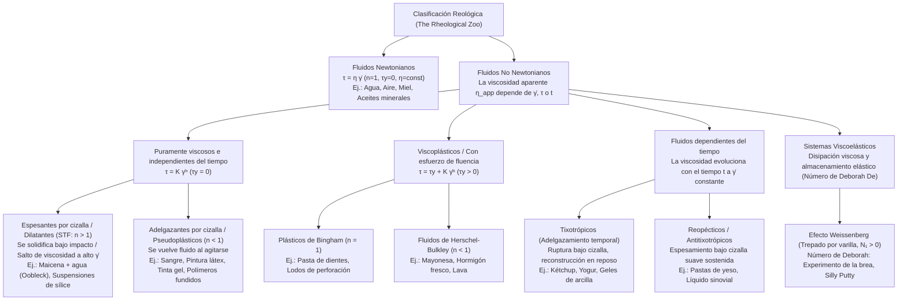
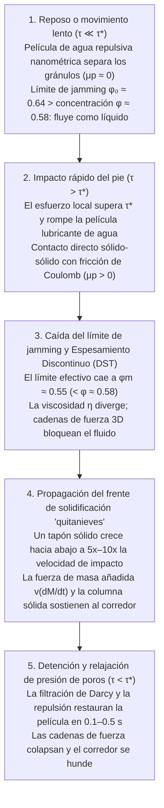

## Introducción: La paradoja de correr sobre una piscina de líquido

Es una de las demostraciones más asombrosas de la física experimental: llene una piscina con una suspensión densa de almidón de maíz (maicena) o fécula de patata mezclada con agua en una fracción de volumen de aproximadamente $55\%$ a $60\%$ de sólido (alrededor de $1.5$ a $2$ partes de maicena por $1$ de agua en peso). En el mundo anglosajón, esta mezcla blanca lechosa se conoce como <strong>Oobleck</strong>, en honor al libro infantil de 1949 del Dr. Seuss.

Si una persona toma impulso y corre con fuerza sobre la superficie de esta piscina "líquida", ocurre algo aparentemente milagroso: en el instante en que la planta del pie golpea la superficie, el fluido bajo la suela se endurece como una losa de hormigón. Sin hundirse siquiera hasta los tobillos, el corredor puede cruzar toda la piscina. Si se golpea un cuenco de maicena y agua con el puño cerrado, lejos de salpicar, la superficie rebota como un muro sólido. Sin embargo, en el momento en que el corredor se detiene en medio de la piscina, el "suelo sólido" bajo sus pies se derrite en una fracción de segundo y sus piernas se hunden como en arenas movedizas. Peor aún: si intenta sacar la pierna de un tirón brusco, la suspensión vuelve a bloquearse alrededor de su pantorrilla con una fuerza de tenaza; la única forma de escapar es relajar el músculo y extraer el pie con extrema lentitud.

Nuestra intuición cotidiana divide la materia en tres estados rígidos (sólido, líquido y gas) y asume que la "espesura" (viscosidad) de un líquido es invariable sin importar cuán rápido lo agitemos. Los fluidos que obedecen esta relación lineal formulada por Sir Isaac Newton en sus *Principia* (1687) se denominan <strong>fluidos newtonianos (Newtonian fluids)</strong>. No obstante, la inmensa mayoría de los fluidos en la naturaleza, la biología y la industria —suspensiones de almidón, sangre, kétchup, mayonesa, pintura, pasta de dientes, polímeros fundidos y el manto terrestre— desafían la ley de Newton: son <strong>fluidos no newtonianos (Non-Newtonian fluids)</strong>.

Inspirada en el aforismo de Heráclito $\pi\alpha\nu\tau\alpha\ \rho\varepsilon\iota$ (*Panta rhei*, "todo fluye"), la ciencia que estudia la deformación y el flujo de la materia compleja es la <strong>reología (Rheology)</strong>. En este artículo analizaremos rigurosamente desde las ecuaciones constitutivas hasta la revolución microscópica del espesamiento por cizalla (2012–2014), la reología de la sangre, el efecto Weissenberg, el número de Deborah y los chalecos antibalas líquidos.

---

## Capítulo 1: La ley de viscosidad de Newton y el número de Péclet

### 1.1 Flujo de Couette plano y tensor de esfuerzos

Consideremos un fluido confinado entre dos placas planas paralelas separadas por una distancia $H$ $[\text{m}]$ (<strong>flujo de Couette</strong>). La placa inferior ($y=0$) permanece fija mientras la superior ($y=H$, de área $A$) se desplaza horizontalmente a velocidad constante $U$ $[\text{m}\cdot\text{s}^{-1}]$ impulsada por una fuerza tangencial $F$ $[\text{N}]$. Definimos el <strong>esfuerzo cortante o de cizalla (Shear stress)</strong> como $\tau \equiv \frac{F}{A}$ $[\text{Pa}]$ y la <strong>velocidad de cizalla o tasa de deformación (Shear rate)</strong> como el gradiente espacial de velocidad $\dot{\gamma} \equiv \frac{\partial u}{\partial y} = \frac{U}{H}$ $[\text{s}^{-1}]$.

Para un fluido newtoniano, el esfuerzo cortante es directamente proporcional a la velocidad de cizalla (<strong>ley de viscosidad de Newton</strong>):

$$\tau = \eta \dot{\gamma} = \eta \frac{\partial u}{\partial y}$$

donde $\eta$ $[\text{Pa}\cdot\text{s}]$ es la <strong>viscosidad dinámica</strong>. En mecánica de medios continuos tridimensional, el tensor de esfuerzos de Cauchy para un fluido incompresible se expresa como $\boldsymbol{\sigma} = -p\mathbf{I} + 2\eta\mathbf{D}$, lo que conduce a la <strong>ecuación de Navier-Stokes</strong>. A temperatura y presión constantes, $\eta$ es una constante material estricta para el agua ($\approx 10^{-3}\,\text{Pa}\cdot\text{s}$) o la miel ($\approx 2\text{–}10\,\text{Pa}\cdot\text{s}$).

### 1.2 ¿Por qué los fluidos complejos son no newtonianos? El número de Péclet ($\text{Pe}$)

Una partícula o molécula de radio $a$ sumergida en un solvente de viscosidad $\eta_0$ a temperatura $T$ experimenta <strong>movimiento browniano</strong> con difusividad de Stokes-Einstein $D_0 = \frac{k_B T}{6\pi \eta_0 a}$. El tiempo requerido para que la partícula difunda una distancia equivalente a su propio radio $a$ y restaure la isotropía termodinámica es el <strong>tiempo de relajación browniano</strong> $\tau_B$:

$$\tau_B \equiv \frac{a^2}{D_0} = \frac{6\pi \eta_0 a^3}{k_B T}$$

¡Obsérvese que <strong>$\tau_B$ escala con el cubo del radio de la partícula ($a^3$)</strong>! La razón adimensional entre este tiempo de relajación térmica y el tiempo característico de deformación del flujo $\tau_{\text{flow}} \sim \dot{\gamma}^{-1}$ define el <strong>número de Péclet ($\text{Pe}$)</strong>:

$$\text{Pe} \equiv \dot{\gamma}\tau_B = \frac{6\pi \eta_0 a^3 \dot{\gamma}}{k_B T}$$

- <strong>Líquidos de moléculas pequeñas (ej. agua, $a \sim 0.15\,\text{nm}$)</strong>: $\tau_B \sim 10^{-12}\,\text{s}$ (picosegundos). Incluso a tasas de cizalla extremas ($\dot{\gamma} \sim 10^5\,\text{s}^{-1}$), $\text{Pe} \sim 10^{-7} \ll 1$. La agitación térmica mantiene el equilibrio isótropo instantáneamente y $\eta$ permanece constante.
- <strong>Fluidos complejos / Materia blanda (coloides, polímeros, $a \sim 0.1\text{–}10\,\mu\text{m}$)</strong>: Un gránulo de almidón o un glóbulo rojo es $10^4$ veces mayor que una molécula de agua, por lo que $\tau_B \propto a^3$ aumenta en un factor de <strong>$10^{12}$ (un billón)</strong>, alcanzando $\tau_B \sim 1\text{–}100\,\text{s}$. Así, basta una agitación suave ($\dot{\gamma} \sim 1\,\text{s}^{-1}$) para entrar en el régimen $\text{Pe} \gg 1$, donde el flujo reorganiza drásticamente la microestructura y vuelve la viscosidad altamente no lineal.

---

## Capítulo 2: Clasificación matemática — Ley de potencia y modelo de Herschel-Bulkley

En fluidos no newtonianos definimos la <strong>viscosidad aparente</strong> como $\eta_{\text{app}}(\dot{\gamma}) \equiv \frac{\tau(\dot{\gamma})}{\dot{\gamma}}$. La ecuación constitutiva general para fluidos independientes del tiempo es el <strong>modelo de Herschel-Bulkley (1926)</strong> y su caso particular sin esfuerzo de fluencia ($\tau_y = 0$), la <strong>ley de potencia de Ostwald-de Waele</strong>:

$$\tau(\dot{\gamma}) = \tau_y + K \dot{\gamma}^n \quad (\text{para } \tau \ge \tau_y \,; \text{ si } \tau < \tau_y \text{ entonces } \dot{\gamma} = 0)$$

$$\eta_{\text{app}}(\dot{\gamma}) = \frac{\tau_y}{\dot{\gamma}} + K \dot{\gamma}^{n-1}$$

donde $\tau_y$ $[\text{Pa}]$ es el <strong>esfuerzo de fluencia o umbral (Yield stress)</strong>, $K$ $[\text{Pa}\cdot\text{s}^n]$ el <strong>índice de consistencia</strong> y $n$ el <strong>índice de comportamiento de flujo</strong>. Para describir sin singularidades la transición entre las mesetas newtonianas de baja cizalla ($\eta_0$) y alta cizalla ($\eta_\infty$), se emplea el <strong>modelo de Carreau-Yasuda</strong>:

$$\frac{\eta(\dot{\gamma}) - \eta_\infty}{\eta_0 - \eta_\infty} = \left[ 1 + (\lambda \dot{\gamma})^a \right]^{\frac{n-1}{a}}$$

| Clase de fluido | Ecuación constitutiva | Comportamiento de $\eta_{\text{app}}(\dot{\gamma})$ | Mecanismo microscópico dominante | Ejemplos representativos |
| :--- | :--- | :--- | :--- | :--- |
| <strong>Fluido newtoniano</strong> | $\tau = \eta \dot{\gamma}$ ($n = 1, \tau_y = 0$) | Constante para todo $\dot{\gamma}$ ($\eta = \text{const.}$) | Relajación térmica de picosegundos ($\tau_B \sim 10^{-12}\,\text{s}, \text{Pe} \ll 1$) preserva isotropía | Agua, aire, etanol, glicerina, miel, aceites de silicona |
| <strong>Espesante por cizalla (STF)</strong> | $\tau = K \dot{\gamma}^n$ ($n > 1, \tau_y = 0$) | Crece con $\dot{\gamma}$; diverge discontinuamente (DST) sobre $\tau^*$ | Hidroclusters $\to$ ruptura de película lubricante y cadenas de fuerza friccionales sólido-sólido | Oobleck (maicena en agua), dispersiones $\text{SiO}_2$-PEG, arena húmeda |
| <strong>Adelgazante (Pseudoplástico)</strong> | $\tau = K \dot{\gamma}^n$ ($n < 1, \tau_y = 0$) | Disminuye monótonamente con $\dot{\gamma}$ ($\eta_0 \to \eta_\infty$) | Desagregación (pilas de monedas de eritrocitos), alineación y desenredo polimérico | Sangre entera, pintura de pared, champú, tinta gel, polímeros fundidos |
| <strong>Viscoplástico (Con fluencia)</strong> | $\tau = \tau_y + K \dot{\gamma}^n$ ($\tau_y > 0$) | Sólido bajo $\tau_y$; flujo tapón (Plug flow) por encima de $\tau_y$ | Red 3D atascada de partículas o gotas que cede al superar el umbral $\tau_y$ | Pasta dental, mayonesa, crema batida, hormigón fresco, lava |
| <strong>Fluido tixotrópico</strong> | $\tau = \tau(\dot{\gamma}, t)$ (Lazo de histéresis) | Disminuye con el tiempo $t$ bajo cizalla constante; se recupera en reposo | Ruptura temporal y repercolación browniana de enlaces de hidrógeno/van der Waals | Kétchup, yogur batido, lodos de bentonita, lociones cosméticas |
| <strong>Fluido viscoelástico</strong> | $\tau + \lambda \dot{\tau} = \eta \dot{\gamma}$ ($N_1 > 0$) | Sólido elástico a tiempos cortos ($\text{De} \gg 1$), líquido a tiempos largos ($\text{De} \ll 1$) | Elasticidad entrópica de macromoléculas enredadas que genera tensión circunferencial (Hoop stress) | Brea (bitumen), Silly Putty, clara de huevo, masa de pan, moco |

---

## Capítulo 3: La física del Oobleck — Tres revoluciones en los fluidos espesantes por cizalla (STF)

### 3.1 Dilatancia de Reynolds (1885) y teoría de hidroclusters (1985)

En 1885, <strong>Osborne Reynolds</strong> explicó por qué la arena húmeda de la playa se blanquea y endurece al pisarla: los granos en empaquetamiento compacto deben rodar unos sobre otros al ser cizallados, provocando una <strong>expansión volumétrica (Dilatancia, $\Delta V > 0$)</strong> que succiona el agua superficial y genera una presión intersticial negativa que bloquea los granos.

En 1985, <strong>John F. Brady y Georges Bossis</strong> formularon la <strong>teoría de hidroclusters</strong>: cuando dos esferas de radio $a$ se aproximan a velocidad relativa $v_{\text{rel}}$ hasta una separación mínima $h \ll a$ en un solvente de viscosidad $\eta_0$, exprimir el líquido de la hendidura genera una <strong>fuerza de lubricación hidrodinámica</strong> divergente:

$$F_{\text{lub}} \simeq \frac{6\pi \eta_0 a^2 v_{\text{rel}}}{h} \propto \frac{1}{h}$$

A altas tasas de cizalla ($\text{Pe} \gg 1$), esta resistencia $\propto 1/h$ agrupa temporalmente las partículas en racimos (<strong>hidroclusters</strong>). Sin embargo, las fuerzas puramente hidrodinámicas solo explican el <strong>espesamiento continuo (CST)</strong> moderado y fracasan al explicar el <strong>espesamiento discontinuo por cizalla (DST)</strong> del Oobleck ($\phi \approx 55\%\text{–}60\%$), donde la viscosidad salta miles de veces de forma vertical.

### 3.2 El cambio de paradigma (2012–2014): Contactos friccionales (Wyart & Cates) y frentes de solidificación (Waitukaitis & Jaeger)

1. <strong>Ruptura de la película lubricante nanométrica y atasco friccional (Wyart & Cates, 2014)</strong>:
   Los gránulos de almidón o sílice poseen una repulsión electrostática o estérica $F_{\text{rep}}$ que define un esfuerzo umbral $\tau^* \sim F_{\text{rep}}/a^2$.
   - <strong>Bajo esfuerzo ($\tau \ll \tau^*$)</strong>: La película nanométrica de agua permanece intacta; las partículas deslizan <strong>sin fricción ($\mu_p \approx 0$)</strong> y solo se atascan (jamming) en el empaquetamiento compacto aleatorio <strong>$\phi_0 \approx 0.64$</strong>.
   - <strong>Alto esfuerzo / Impacto ($\tau > \tau^*$)</strong>: El esfuerzo supera la barrera repulsiva, rompe la película de agua y los gránulos rugosos entran en <strong>contacto directo sólido-sólido con fricción de Coulomb ($\mu_p > 0$)</strong>. El bloqueo rotacional reduce la fracción crítica de atasco al empaquetamiento suelto <strong>$\phi_m \approx 0.55$</strong>.
   Con una fracción de contactos friccionales $f(\tau) = \exp(-\tau^*/\tau)$, el umbral de atasco efectivo $\phi_J(\tau)$ y la viscosidad $\eta(\phi, \tau)$ obedecen:
   $$\phi_J(\tau) = f(\tau)\,\phi_m + \left[1 - f(\tau)\right]\phi_0, \qquad \eta(\phi, \tau) \propto \left[ \phi_J(\tau) - \phi \right]^{-2}$$
   Para $\phi = 0.58$ ($\phi_m < \phi < \phi_0$), en reposo se cumple $\phi < \phi_0 = 0.64$ (líquido). Al pisar con fuerza ($\tau > \tau^*$), $\phi_J(\tau)$ cae hasta $0.55 < \phi = 0.58$: ¡la viscosidad diverge al infinito (DST) y una red 3D de <strong>cadenas de fuerza friccionales</strong> solidifica el fluido!
2. <strong>Solidificación activada por impacto y frente "quitanieves" (Waitukaitis & Jaeger, *Nature* 2012)</strong>:
   Mediante radiografía de rayos X de alta velocidad en la Universidad de Chicago, Waitukaitis y Jaeger descubrieron que el impacto de un pie a velocidad $v_0$ nuclea bajo la suela un tapón sólido cuya frontera —el <strong>frente de solidificación</strong>— se propaga hacia el fondo a $5\text{–}10$ veces la velocidad del pie ($v_f = k v_0$), como la pala de un quitanieves. La masa solidificada en rápida expansión $M(t)$ genera una enorme <strong>fuerza de masa añadida</strong> $F_{\text{impact}} = \frac{d}{dt}[M(t)v(t)] = M\dot{v} + v\dot{M}$ y crea en milisegundos una columna sólida hasta el fondo de la piscina. Al detenerse ($\tau < \tau^*$), el flujo de Darcy restaura la película de agua en $0.1\text{–}0.5\,\text{s}$ y la columna se funde.

---

## Capítulo 4: Pseudoplasticidad (Adelgazamiento por cizalla), flujo tapón y tixotropía

1. <strong>Hemorreología (Sangre)</strong>: La sangre ($\approx 45\%$ de eritrocitos) forma a baja cizalla ($\dot{\gamma} < 1\,\text{s}^{-1}$) pilas de monedas llamadas <strong>rouleaux</strong> ($\eta_0 \approx 50\text{–}100\,\text{mPa}\cdot\text{s}$). En arterias y capilares ($\dot{\gamma} \sim 100\text{–}1,000\,\text{s}^{-1}$), los agregados se separan y los glóbulos rojos se deforman con rotación de membrana tipo oruga de tanque (<strong>tank-treading motion</strong>), reduciendo la viscosidad a $\eta_\infty \approx 3\text{–}4\,\text{mPa}\cdot\text{s}$.
2. <strong>Pinturas y bolígrafos de gel</strong>: Bajo la brocha o la esfera del bolígrafo ($\dot{\gamma} \sim 10^4\,\text{s}^{-1}$), la viscosidad cae miles de veces para fluir suavemente, pero al cesar el esfuerzo ($\tau < \tau_y$) recupera su estructura al instante, evitando el goteo (sagging).
3. <strong>Flujo tapón de Bingham (Plug Flow)</strong>: En un tubo de radio $R$ bajo gradiente de presión $\Delta P / L$, el esfuerzo es $\tau(r) = \frac{\Delta P}{2L}r$. En el núcleo central $r < r_p = \frac{2L\tau_y}{\Delta P}$, se cumple $\tau(r) < \tau_y$ y $\frac{du}{dr} = 0$:
   $$u_{\text{Bingham}}(r) = \begin{cases} \dfrac{\Delta P}{4\eta_p L}(R - r_p)^2 = \text{const.} & (0 \le r < r_p : \text{núcleo sólido en flujo tapón}) \\[8pt] \dfrac{\Delta P}{4\eta_p L}\left[ R^2 - r^2 - 2r_p(R - r) \right] & (r_p \le r \le R : \text{capa anular cizallada}) \end{cases}$$
   Por ello la pasta de dientes sale de la boquilla como una barra cilíndrica sólida sin que se mezclen sus rayas.

---

## Capítulo 5: Viscoelasticidad, número de Deborah y efecto Weissenberg

### 5.1 Modelo de Maxwell y número de Deborah ($\text{De}$)

James Clerk Maxwell (1867) conectó en serie un resorte elástico de Hooke (módulo $G$) y un amortiguador viscoso de Newton (viscosidad $\eta$), obteniendo la ecuación viscoelástica con tiempo de relajación $\lambda \equiv \eta / G$:

$$\tau + \lambda \frac{d\tau}{dt} = \eta \dot{\gamma}$$

En 1964, <strong>Marcus Reiner</strong> se inspiró en el Cántico de Débora (Jueces 5:5: <em>"Los montes se derritieron delante de Jehová"</em>) para definir el <strong>número de Deborah ($\text{De}$)</strong> como la razón entre el tiempo de relajación $t_{\text{relax}}$ y el tiempo de observación $t_{\text{obs}}$:

$$\text{De} \equiv \frac{t_{\text{relax}}}{t_{\text{obs}}}$$

Si $\text{De} \gg 1$ ($t_{\text{obs}} \ll t_{\text{relax}}$), el material responde como un sólido elástico; si $\text{De} \ll 1$ ($t_{\text{obs}} \gg t_{\text{relax}}$), fluye como un líquido. En el <strong>experimento de la gota de brea (Pitch Drop Experiment)</strong> iniciado en 1927 en la Universidad de Queensland, la brea ($\eta \approx 2.3 \times 10^8\,\text{Pa}\cdot\text{s}$) se rompe como vidrio bajo un martillazo ($t_{\text{obs}} \sim 10^{-3}\,\text{s}, \text{De} \gg 1$), pero gotea una vez cada 8 a 13 años bajo la gravedad ($t_{\text{obs}} \sim 10^8\,\text{s}, \text{De} \ll 1$). Igualmente, el <strong>Silly Putty</strong> rebota como una pelota de goma ($\text{De} \gg 1$) pero se extiende como un charco en reposo ($\text{De} \ll 1$).

### 5.2 El efecto Weissenberg (Trepado por varilla)

Al girar una varilla en una solución polimérica (o clara de huevo), el líquido trepa por la varilla contra la gravedad. Las cadenas poliméricas estiradas a lo largo de las líneas de corriente circulares generan por elasticidad entrópica una <strong>primera diferencia de esfuerzos normales</strong> positiva:

$$N_1(\dot{\gamma}) \equiv \sigma_{xx} - \sigma_{yy} = \Psi_1(\dot{\gamma})\dot{\gamma}^2 > 0$$

Esta tensión circunferencial (esfuerzo de aro / Hoop stress) comprime radialmente el fluido hacia el eje y lo empuja hacia arriba.

---

## Capítulo 6: Aplicaciones de ingeniería — Del blindaje líquido a la bioimpresión 3D

1. <strong>Blindaje corporal líquido (Liquid Body Armor) y D3O</strong>: Los tejidos de Kevlar impregnados con un STF de nanopartículas de sílice ($\text{SiO}_2$) en polietilenglicol (PEG) son flexibles durante el movimiento normal ($\dot{\gamma} < 10\,\text{s}^{-1}, \tau < \tau^*$), pero ante el impacto de una bala o cuchillo ($\dot{\gamma} > 10^5\,\text{s}^{-1}, \tau \gg \tau^*$) se solidifican en microsegundos por atasco friccional (DST), reduciendo el peso del chaleco en un $30\%\text{–}50\%$. Asimismo, las protecciones naranjas <strong>D3O</strong> emplean la transición del número de Deborah para endurecerse instantáneamente ante un choque.
2. <strong>Bioimpresión 3D (Bio-inks)</strong>: Las biotintas con células madre vivas aprovechan el flujo tapón de Bingham y un fuerte adelgazamiento por cizalla ($n \ll 1$) para proteger las células dentro de la boquilla ($>95\%$ de viabilidad) y recuperan su esfuerzo de fluencia $\tau_y$ en $<0.1\,\text{s}$ tras la extrusión para sostener estructuras 3D de órganos sin colapsar.
