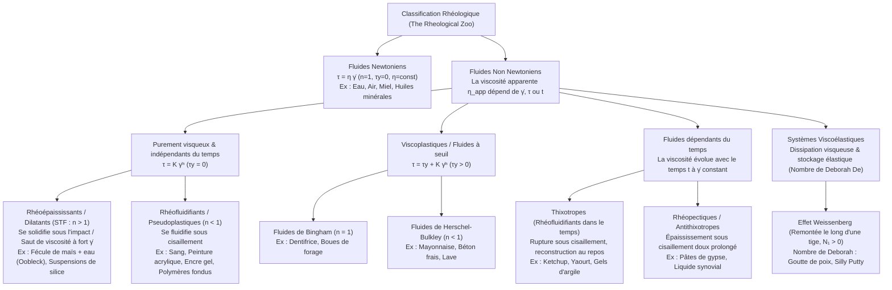
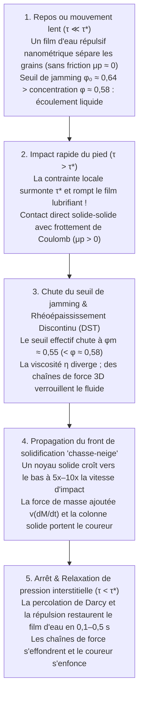

## Introduction : Le paradoxe de la course sur une piscine de liquide

C'est l'une des expériences les plus spectaculaires de la physique de la matière molle : remplissez une piscine d'une suspension concentrée de fécule de maïs (Maïzena) ou de fécule de pomme de terre dans de l'eau, avec une fraction volumique d'environ $55\%$ à $60\%$ de solide (environ $1{,}5$ à $2$ parts de fécule pour $1$ part d'eau en masse). Dans le monde anglophone, ce fluide blanc laiteux est surnommé <strong>Oobleck</strong>, en référence au livre pour enfants de Dr. Seuss publié en 1949.

Lorsqu'une personne prend son élan et sprinte vigoureusement à la surface de ce bassin, un phénomène saisissant se produit : à l'instant précis où la plante du pied percute la surface, le liquide se fige sous la semelle avec la rigidité d'une dalle de béton. Sans même s'enfoncer jusqu'à la cheville, le coureur traverse toute la piscine. Si l'on frappe violemment la surface avec le poing, le fluide ne gicle pas mais oppose une résistance solide redoutable. En revanche, dès que le coureur s'arrête au milieu du bassin, le « sol solide » sous ses pieds fond en une fraction de seconde et l'engloutit comme des sables mouvants. S'il tente alors de retirer sa jambe d'un coup sec, le mélange se resolidifie instantanément et emprisonne son pied ; la seule issue consiste à relâcher toute force et à extraire la jambe avec une extrême lenteur.

Notre intuition quotidienne classe la matière en trois états immuables (solide, liquide, gaz) et suppose que la « viscosité » d'un liquide reste constante quelle que soit la vitesse à laquelle on l'agite. Les fluides qui obéissent à cette loi linéaire, formulée par Sir Isaac Newton en 1687 dans ses *Principia*, sont appelés <strong>fluides newtoniens (Newtonian fluids)</strong>. Or, l'immense majorité des fluides naturels, biologiques et industriels — suspensions d'amidon, sang, ketchup, mayonnaise, peinture, dentifrice, polymères fondus, béton frais et manteau terrestre — violent la loi de Newton : ce sont des <strong>fluides non newtoniens (Non-Newtonian fluids)</strong>.

Fondée sous la devise d'Héraclite $\pi\alpha\nu\tau\alpha\ \rho\varepsilon\iota$ (*Panta rhei*, « tout s'écoule »), la <strong>rhéologie</strong> étudie la déformation et l'écoulement de la matière complexe. Cet article explore les équations constitutives, la révolution microscopique du rhéoépaississement (2012–2014), la rhéologie sanguine, l'effet Weissenberg, le nombre de Deborah et les armures liquides.

---

## Chapitre 1 : Loi de viscosité de Newton et nombre de Péclet

### 1.1 Écoulement de Couette plan et tenseur des contraintes

Considérons un fluide confiné entre deux plaques parallèles séparées par une distance $H$ $[\text{m}]$ (<strong>écoulement de Couette</strong>). La plaque inférieure ($y=0$) est fixe tandis que la plaque supérieure ($y=H$, d'aire $A$) est entraînée horizontalement à vitesse constante $U$ $[\text{m}\cdot\text{s}^{-1}]$ par une force tangentielle $F$ $[\text{N}]$. On définit la <strong>contrainte de cisaillement (Shear stress)</strong> par $\tau \equiv \frac{F}{A}$ $[\text{Pa}]$ et le <strong>taux de cisaillement (Shear rate)</strong> par le gradient de vitesse $\dot{\gamma} \equiv \frac{\partial u}{\partial y} = \frac{U}{H}$ $[\text{s}^{-1}]$.

Pour un fluide newtonien, la contrainte est directement proportionnelle au taux de cisaillement (<strong>loi de Newton</strong>) :

$$\tau = \eta \dot{\gamma} = \eta \frac{\partial u}{\partial y}$$

où $\eta$ $[\text{Pa}\cdot\text{s}]$ est la <strong>viscosité dynamique</strong>. En mécanique des milieux continus tridimensionnelle, le tenseur des contraintes de Cauchy d'un fluide incompressible s'écrit $\boldsymbol{\sigma} = -p\mathbf{I} + 2\eta\mathbf{D}$, ce qui conduit à l'<strong>équation de Navier-Stokes</strong>. À température et pression constantes, $\eta$ est une constante stricte pour l'eau ($\approx 10^{-3}\,\text{Pa}\cdot\text{s}$) ou le miel ($\approx 2\text{–}10\,\text{Pa}\cdot\text{s}$).

### 1.2 Pourquoi les fluides complexes sont-ils non newtoniens ? Le nombre de Péclet ($\text{Pe}$)

Dans un fluide, une particule ou molécule de rayon $a$ subit le <strong>mouvement brownien</strong> thermique avec un coefficient de diffusion de Stokes-Einstein $D_0 = \frac{k_B T}{6\pi \eta_0 a}$. Le temps caractéristique nécessaire pour diffuser sur une distance égale à son propre rayon $a$ et restaurer l'isotropie d'équilibre est le <strong>temps de relaxation brownien</strong> $\tau_B$ :

$$\tau_B \equiv \frac{a^2}{D_0} = \frac{6\pi \eta_0 a^3}{k_B T}$$

Notons que <strong>$\tau_B$ varie comme le cube du rayon des particules ($a^3$)</strong> ! Le rapport sans dimension entre ce temps de relaxation thermique et le temps de déformation hydrodynamique $\tau_{\text{flow}} \sim \dot{\gamma}^{-1}$ définit le <strong>nombre de Péclet ($\text{Pe}$)</strong> :

$$\text{Pe} \equiv \dot{\gamma}\tau_B = \frac{6\pi \eta_0 a^3 \dot{\gamma}}{k_B T}$$

- <strong>Liquides moléculaires simples (ex. eau, $a \sim 0{,}15\,\text{nm}$)</strong> : $\tau_B \sim 10^{-12}\,\text{s}$ (picoseconde). Même sous fort cisaillement ($\dot{\gamma} \sim 10^5\,\text{s}^{-1}$), $\text{Pe} \sim 10^{-7} \ll 1$. L'agitation thermique efface instantanément toute anisotropie et maintient $\eta$ constant.
- <strong>Fluides complexes / Matière molle (colloïdes, polymères, $a \sim 0{,}1\text{–}10\,\mu\text{m}$)</strong> : Un grain d'amidon ou un globule rouge étant $10^4$ fois plus grand qu'une molécule d'eau, $\tau_B \propto a^3$ augmente d'un facteur <strong>$10^{12}$ (mille milliards)</strong> pour atteindre $\tau_B \sim 1\text{–}100\,\text{s}$ ! Dès lors, un simple brassage manuel ($\dot{\gamma} \sim 1\,\text{s}^{-1}$) suffit pour entrer dans le régime $\text{Pe} \gg 1$ où l'écoulement réorganise la microstructure et rend la viscosité fortement non linéaire.

---

## Chapitre 2 : Classification mathématique — Loi de puissance et modèle de Herschel-Bulkley

Pour un fluide non newtonien, on définit la <strong>viscosité apparente</strong> $\eta_{\text{app}}(\dot{\gamma}) \equiv \frac{\tau(\dot{\gamma})}{\dot{\gamma}}$. L'équation constitutive générale des fluides indépendants du temps est le <strong>modèle de Herschel-Bulkley (1926)</strong> et son cas particulier sans seuil ($\tau_y = 0$), la <strong>loi de puissance d'Ostwald-de Waele</strong> :

$$\tau(\dot{\gamma}) = \tau_y + K \dot{\gamma}^n \quad (\text{pour } \tau \ge \tau_y \,; \text{ si } \tau < \tau_y \text{ alors } \dot{\gamma} = 0)$$

$$\eta_{\text{app}}(\dot{\gamma}) = \frac{\tau_y}{\dot{\gamma}} + K \dot{\gamma}^{n-1}$$

où $\tau_y$ $[\text{Pa}]$ est la <strong>contrainte seuil d'écoulement (Yield stress)</strong>, $K$ $[\text{Pa}\cdot\text{s}^n]$ l'<strong>indice de consistance</strong> et $n$ l'<strong>indice de comportement</strong>. Pour décrire continûment la transition entre les plateaux newtoniens à bas cisaillement ($\eta_0$) et haut cisaillement ($\eta_\infty$), on utilise le <strong>modèle de Carreau-Yasuda</strong> :

$$\frac{\eta(\dot{\gamma}) - \eta_\infty}{\eta_0 - \eta_\infty} = \left[ 1 + (\lambda \dot{\gamma})^a \right]^{\frac{n-1}{a}}$$

| Classe de fluide | Équation constitutive | Comportement de $\eta_{\text{app}}(\dot{\gamma})$ | Mécanisme microscopique dominant | Exemples représentatifs |
| :--- | :--- | :--- | :--- | :--- |
| <strong>Fluide newtonien</strong> | $\tau = \eta \dot{\gamma}$ ($n = 1, \tau_y = 0$) | Constante pour tout $\dot{\gamma}$ ($\eta = \text{const.}$) | Relaxation thermique picoseconde ($\tau_B \sim 10^{-12}\,\text{s}, \text{Pe} \ll 1$) préservant l'isotropie | Eau, air, éthanol, glycérol, miel, huiles de silicone |
| <strong>Rhéoépaississant (STF)</strong> | $\tau = K \dot{\gamma}^n$ ($n > 1, \tau_y = 0$) | Croît avec $\dot{\gamma}$ ; diverge discontinûment (DST) au-delà de $\tau^*$ | Hydroclusters $\to$ rupture du film lubrifiant et chaînes de force frictionnelles solide-solide | Oobleck (fécule de maïs + eau), suspensions $\text{SiO}_2$-PEG, sable mouillé |
| <strong>Rhéofluidifiant (Pseudoplastique)</strong> | $\tau = K \dot{\gamma}^n$ ($n < 1, \tau_y = 0$) | Décroît de façon monotone avec $\dot{\gamma}$ ($\eta_0 \to \eta_\infty$) | Désagrégation (rouleaux d'hématies), alignement et désenchevêtrement des chaînes polymères | Sang total, peinture murale, shampoing, encre gel, polymères fondus |
| <strong>Viscoplastique (À seuil)</strong> | $\tau = \tau_y + K \dot{\gamma}^n$ ($\tau_y > 0$) | Solide sous $\tau_y$ ; écoulement bouchon (Plug flow) au-dessus de $\tau_y$ | Réseau 3D bloqué de particules ou gouttelettes cédant au-delà du seuil $\tau_y$ | Dentifrice, mayonnaise, crème fouettée, béton frais, lave |
| <strong>Fluide thixotrope</strong> | $\tau = \tau(\dot{\gamma}, t)$ (Boucle d'hystérésis) | Diminue dans le temps $t$ sous cisaillement constant ; se reconstruit au repos | Destruction différée et re-percolation brownienne des liaisons hydrogène/van der Waals | Ketchup, yaourt brassé, boues de bentonite, crèmes cosmétiques |
| <strong>Fluide viscoélastique</strong> | $\tau + \lambda \dot{\tau} = \eta \dot{\gamma}$ ($N_1 > 0$) | Solide élastique aux temps courts ($\text{De} \gg 1$), liquide aux temps longs ($\text{De} \ll 1$) | Élasticité entropique des macromolécules enchevêtrées générant des contraintes d'arceau (Hoop stress) | Poix (bitume), Silly Putty, blanc d'œuf, pâte à pain, mucus |

---

## Chapitre 3 : La physique de l'Oobleck — Trois révolutions dans les fluides rhéoépaississants (STF)

### 3.1 Dilatance de Reynolds (1885) et théorie des hydroclusters (1985)

En 1885, <strong>Osborne Reynolds</strong> expliqua pourquoi le sable mouillé d'une plage blanchit et durcit sous le pied : un empilement compact de grains rigides soumis à un cisaillement doit voir ses grains rouler les uns par-dessus les autres, ce qui impose une <strong>dilatation volumique (Dilatancy, $\Delta V > 0$)</strong>. L'aspiration capillaire de l'eau crée une dépression interstitielle qui plaque les grains les uns contre les autres.

En 1985, <strong>John F. Brady et Georges Bossis</strong> ont proposé la <strong>théorie des hydroclusters</strong> : lorsque deux sphères de rayon $a$ s'approchent à vitesse relative $v_{\text{rel}}$ jusqu'à un interstice $h \ll a$ dans un solvant de viscosité $\eta_0$, l'expulsion du film liquide engendre une <strong>force de lubrification hydrodynamique</strong> divergente :

$$F_{\text{lub}} \simeq \frac{6\pi \eta_0 a^2 v_{\text{rel}}}{h} \propto \frac{1}{h}$$

À fort cisaillement ($\text{Pe} \gg 1$), cette force en $1/h$ lie temporairement les particules en amas (<strong>hydroclusters</strong>), augmentant modérément la viscosité.
<strong>Limites des hydroclusters</strong> : Si la lubrification hydrodynamique explique le <strong>rhéoépaississement continu (CST)</strong>, elle est incapable d'expliquer le <strong>rhéoépaississement discontinu (DST)</strong> de l'Oobleck concentré ($\phi \approx 55\%\text{–}60\%$), où la viscosité bondit verticalement de plusieurs ordres de grandeur !

### 3.2 Le changement de paradigme (2012–2014) : Contacts frictionnels (Wyart & Cates) et fronts de solidification par impact (Waitukaitis & Jaeger)

Deux avancées majeures entre 2012 et 2014 ont résolu l'énigme :

1. <strong>Rupture du film lubrifiant nanométrique et transition frictionnelle (Wyart & Cates, 2014)</strong> :
   Les grains d'amidon ou de silice exercent à courte portée une répulsion électrostatique ou stérique $F_{\text{rep}}$, définissant une contrainte seuil caractéristique $\tau^* \sim F_{\text{rep}}/a^2$.
   - <strong>Basse contrainte ($\tau \ll \tau^*$)</strong> : Le film d'eau nanométrique reste intact ; les grains glissent <strong>sans frottement ($\mu_p \approx 0$)</strong> et ne se bloquent (jamming) qu'à la fraction volumique d'empilement compact aléatoire <strong>$\phi_0 \approx 0{,}64$</strong>.
   - <strong>Haute contrainte / Impact ($\tau > \tau^*$)</strong> : La pression locale brise la barrière répulsive et rompt le film d'eau ; les surfaces rugueuses entrent en <strong>contact mécanique direct solide-solide avec frottement de Coulomb ($\mu_p > 0$)</strong> ! Le blocage des rotations abaisse la fraction critique de blocage à l'empilement lâche aléatoire <strong>$\phi_m \approx 0{,}55$</strong> !
   Avec une fraction de contacts frictionnels $f(\tau) = \exp(-\tau^*/\tau)$, le seuil de blocage effectif $\phi_J(\tau)$ et la viscosité $\eta(\phi, \tau)$ suivent la loi de Wyart-Cates :
   $$\phi_J(\tau) = f(\tau)\,\phi_m + \left[1 - f(\tau)\right]\phi_0, \qquad \eta(\phi, \tau) \propto \left[ \phi_J(\tau) - \phi \right]^{-2}$$
   Pour une suspension à $\phi = 0{,}58$ ($\phi_m < \phi < \phi_0$), on a au repos $\phi < \phi_0 = 0{,}64$ (liquide). Mais sous l'impact du pied ($\tau > \tau^*$), $\phi_J(\tau)$ chute vers $0{,}55$ et passe sous $\phi = 0{,}58$ : la viscosité diverge vers l'infini (DST) et un réseau percolant de <strong>chaînes de force frictionnelles</strong> verrouille le matériau en un solide !
2. <strong>Solidification activée par l'impact et front « chasse-neige » (Waitukaitis & Jaeger, *Nature* 2012)</strong> :
   Par radiographie X ultrarapide à l'Université de Chicago, Waitukaitis et Jaeger ont démontré que l'impact d'un pied à vitesse $v_0$ crée sous la semelle un bouchon solidifié dont la frontière — le <strong>front de solidification (Solidification front)</strong> — se propage vers le fond à une vitesse $5$ à $10$ fois supérieure à $v_0$ ($v_f = k v_0$), tel un chasse-neige compactant la neige fraîche ! La croissance rapide de la masse solidifiée $M(t)$ engendre une immense <strong>force de masse ajoutée</strong> $F_{\text{impact}} = \frac{d}{dt}[M(t)v(t)] = M\dot{v} + v\dot{M}$ et forme en quelques millisecondes une colonne solide reliant le pied au fond du bassin. À l'arrêt ($\tau < \tau^*$), la réinfiltration de Darcy restaure le film d'eau en $0{,}1\text{–}0{,}5\,\text{s}$ et la colonne se liquéfie.

---

## Chapitre 4 : Rhéofluidification (Pseudoplasticité), écoulement bouchon et thixotropie

1. <strong>Hémorhéologie (Sang humain)</strong> : Le sang ($\approx 45\%$ d'hématies) forme à bas cisaillement ($\dot{\gamma} < 1\,\text{s}^{-1}$) des empilements en <strong>rouleaux</strong> via le fibrinogène ($\eta_0 \approx 50\text{–}100\,\text{mPa}\cdot\text{s}$). Dans les artères et capillaires ($\dot{\gamma} \sim 100\text{–}1\,000\,\text{s}^{-1}$), les rouleaux se dispersent et les globules rouges anucléés s'allongent avec une rotation membranaire en chenille de char (<strong>tank-treading motion</strong>), abaissant la viscosité à $\eta_\infty \approx 3\text{–}4\,\text{mPa}\cdot\text{s}$.
2. <strong>Peintures et stylos à encre gel</strong> : Sous le pinceau ou la bille ($\dot{\gamma} \sim 10^4\,\text{s}^{-1}$), la viscosité chute pour une application fluide, puis remonte instantanément au repos ($\tau < \tau_y$) pour empêcher toute coulure (sagging) ou fuite.
3. <strong>Écoulement bouchon de Bingham (Plug Flow)</strong> : Dans une conduite de rayon $R$ sous un gradient de pression $\Delta P / L$, la contrainte vaut $\tau(r) = \frac{\Delta P}{2L}r$. Au cœur du tube ($r < r_p = \frac{2L\tau_y}{\Delta P}$), on a $\tau(r) < \tau_y$ et donc $\frac{du}{dr} = 0$ :
   $$u_{\text{Bingham}}(r) = \begin{cases} \dfrac{\Delta P}{4\eta_p L}(R - r_p)^2 = \text{const.} & (0 \le r < r_p : \text{cœur solide en écoulement bouchon}) \\[8pt] \dfrac{\Delta P}{4\eta_p L}\left[ R^2 - r^2 - 2r_p(R - r) \right] & (r_p \le r \le R : \text{couche annulaire cisaillée}) \end{cases}$$
   C'est pourquoi le dentifrice sort du tube sous forme d'un cylindre solide intact.

---

## Chapitre 5 : Viscoélasticité, nombre de Deborah et effet Weissenberg

### 5.1 Modèle de Maxwell et nombre de Deborah ($\text{De}$)

En associant en série un ressort élastique de Hooke (module $G$) et un amortisseur visqueux de Newton (viscosité $\eta$), James Clerk Maxwell (1867) a établi l'équation viscoélastique de temps de relaxation $\lambda \equiv \eta / G$ :

$$\tau + \lambda \frac{d\tau}{dt} = \eta \dot{\gamma}$$

En 1964, <strong>Marcus Reiner</strong> s'est inspiré du Cantique de Débora (Juges 5:5 : <em>« Les montagnes ruisselèrent devant l'Éternel »</em>) pour définir le <strong>nombre de Deborah ($\text{De}$)</strong> comme le rapport du temps de relaxation $t_{\text{relax}}$ au temps d'observation $t_{\text{obs}}$ :

$$\text{De} \equiv \frac{t_{\text{relax}}}{t_{\text{obs}}}$$

Pour $\text{De} \gg 1$ ($t_{\text{obs}} \ll t_{\text{relax}}$), le matériau réagit comme un solide élastique ; pour $\text{De} \ll 1$ ($t_{\text{obs}} \gg t_{\text{relax}}$), il s'écoule comme un liquide. Dans l'<strong>expérience de la goutte de poix (Pitch Drop Experiment)</strong> menée depuis 1927 à l'Université du Queensland, la poix ($\eta \approx 2{,}3 \times 10^8\,\text{Pa}\cdot\text{s}$) se brise comme du verre sous un coup de marteau ($t_{\text{obs}} \sim 10^{-3}\,\text{s}, \text{De} \gg 1$), mais laisse tomber une goutte tous les 8 à 13 ans sous l'effet de la gravité ($t_{\text{obs}} \sim 10^8\,\text{s}, \text{De} \ll 1$). De même, la pâte <strong>Silly Putty</strong> rebondit comme une balle en caoutchouc ($\text{De} \gg 1$) mais s'étale en flaque au repos ($\text{De} \ll 1$).

### 5.2 L'effet Weissenberg (Remontée le long d'une tige)

Lorsqu'une tige tourne dans une solution de polymères (ou du blanc d'œuf), le liquide grimpe le long de la tige contre la gravité ! L'étirement des chaînes macromoléculaires le long des lignes de courant circulaires engendre par élasticité entropique une <strong>première différence de contraintes normales</strong> positive :

$$N_1(\dot{\gamma}) \equiv \sigma_{xx} - \sigma_{yy} = \Psi_1(\dot{\gamma})\dot{\gamma}^2 > 0$$

Cette tension circonférentielle (contrainte d'arceau / Hoop stress) étrangle radialement le fluide vers l'axe et le propulse vers le haut.

---

## Chapitre 6 : Applications d'ingénierie — Du gilet pare-balles liquide à la bio-impression 3D

1. <strong>Gilet pare-balles liquide (Liquid Body Armor) et D3O</strong> : Des tissus de Kevlar imprégnés d'un fluide rhéoépaississant (nanoparticules de silice $\text{SiO}_2$ dans du polyéthylène glycol PEG) restent souples lors des mouvements normaux ($\dot{\gamma} < 10\,\text{s}^{-1}, \tau < \tau^*$), mais se solidifient en quelques microsecondes par blocage frictionnel (DST) lors de l'impact d'une balle ou d'une lame ($\dot{\gamma} > 10^5\,\text{s}^{-1}, \tau \gg \tau^*$), réduisant le poids de l'armure de $30\%$ à $50\%$. Le matériau orange <strong>D3O</strong> utilise pareillement la transition du nombre de Deborah pour durcir instantanément lors d'un choc.
2. <strong>Bio-impression 3D (Bio-inks)</strong> : Les bio-encres chargées de cellules souches vivantes utilisent l'écoulement bouchon de Bingham et une forte rhéofluidification ($n \ll 1$) pour protéger les cellules du cisaillement dans la buse ($>95\%$ de survie), puis restaurent leur contrainte seuil $\tau_y$ en moins de $0{,}1\,\text{s}$ par thixotropie afin de maintenir l'architecture 3D des tissus imprimés.
