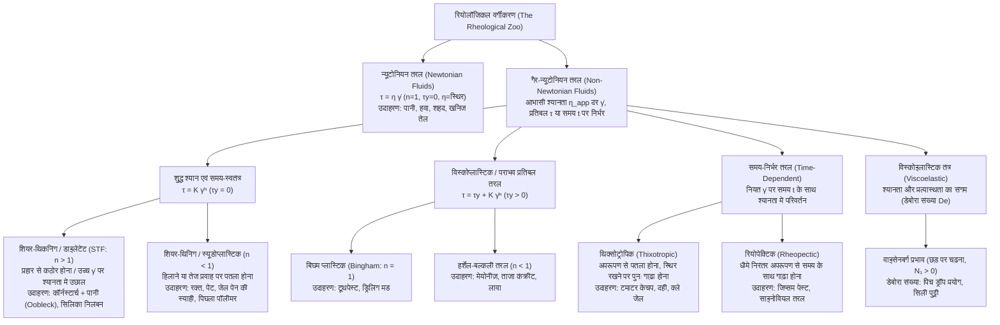
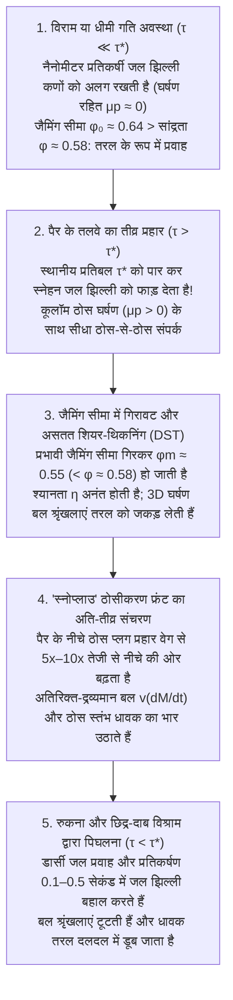

## प्रस्तावना: तरल पदार्थ के पूल पर दौड़ने का भौतिक विरोधाभास

प्रायोगिक भौतिकी के सबसे रोमांचक प्रदर्शनों में से एक दृश्य की कल्पना कीजिए: एक विशाल स्विमिंग पूल को साधारण कॉर्नस्टार्च (मक्के का स्टार्च) या आलू के स्टार्च और पानी के गाढ़े निलंबन (suspension) से भर दिया जाता है, जिसमें ठोस स्टार्च का आयतन अंश लगभग $55\%$ से $60\%$ होता है (भार के अनुसार लगभग $1.5$ से $2$ भाग स्टार्च और $1$ भाग पानी)। अंग्रेजी वैज्ञानिक जगत में इस दूधिया सफेद घोल को डॉ. स्यूस की 1949 की प्रसिद्ध बाल पुस्तक के नाम पर <strong>ऊब्लेक (Oobleck)</strong> कहा जाता है।

जब कोई व्यक्ति दौड़ते हुए पूरी ताकत से इस 'तरल' पूल की सतह पर कदम रखता है, तो एक चमत्कारिक घटना घटती है: जिस मिलीसेकंड में पैर का तलवा सतह से टकराता है, तलवे के ठीक नीचे का तरल पदार्थ कंक्रीट के फर्श की तरह कठोर हो जाता है। टखने तक डूबे बिना भी धावक आसानी से पूरे पूल को पार कर लेता है। यदि आप कटोरे में रखे इस घोल पर मुक्के से प्रहार करें, तो छींटे उड़ने के बजाय यह किसी ठोस दीवार की तरह प्रतिरोध करता है। किंतु जैसे ही धावक पूल के बीच में दौड़ना बंद करके खड़ा होता है, उसके पैरों के नीचे की 'ठोस जमीन' पल भर में पिघल जाती है और वह दलदल की तरह भीतर धंसने लगता है! यदि वह घबराकर पैर को झटके से बाहर खींचने की कोशिश करता है, तो तरल पुनः लॉक होकर जूते को जकड़ लेता है; बाहर निकलने का एकमात्र उपाय मांसपेशियों को ढीला छोड़कर अत्यंत धीमी गति से पैर को ऊपर खींचना है।

हमारा सामान्य अनुभव पदार्थ को तीन निश्चित अवस्थाओं (ठोस, द्रव और गैस) में बांटता है और यह मानता है कि किसी द्रव का 'गाढ़ापन' (श्यानता / Viscosity) हमेशा स्थिर रहता है, चाहे हम उसे कितनी ही तेजी से क्यों न हिलाएं। सर आइजैक न्यूटन द्वारा 1687 में अपनी पुस्तक *प्रिंसिपिया (Principia)* में सूत्रबद्ध इस रैखिक नियम का पालन करने वाले तरल पदार्थों को <strong>न्यूटोनियन तरल (Newtonian fluids)</strong> कहा जाता है। परंतु प्रकृति, जीव विज्ञान और उद्योग में पाए जाने वाले अधिकांश तरल—स्टार्च का घोल, मानव रक्त, टमाटर केचप, मेयोनीज़, दीवार का पेंट, टूथपेस्ट, पिघला हुआ प्लास्टिक और पृथ्वी का मेंटल—न्यूटन के नियम का उल्लंघन करते हैं; इन्हें <strong>गैर-न्यूटोनियन तरल (Non-Newtonian fluids)</strong> कहा जाता है।

प्राचीन यूनानी दार्शनिक हेराक्लिटस के सूत्रवाक्य $\pi\alpha\nu\tau\alpha\ \rho\varepsilon\iota$ (*Panta rhei* — "सब कुछ बहता है") से प्रेरित होकर पदार्थ के विरूपण और प्रवाह का अध्ययन करने वाले विज्ञान को <strong>रियोलॉजी (Rheology / प्रवाहिकी)</strong> कहते हैं। इस लेख में हम संवैधानिक समीकरणों, शियर-थिकनिंग के सूक्ष्मदर्शी क्रांति (2012–2014), रक्त के प्रवाह, वाइसेनबर्ग प्रभाव, डेबोरा संख्या और लिक्विड बुलेटप्रूफ जैकेट का विस्तृत विश्लेषण करेंगे।

---

## अध्याय 1: न्यूटन का श्यानता नियम और पेकलेट संख्या (Péclet Number)

### 1.1 समतल कुएट प्रवाह (Couette Flow) और प्रतिबल टेंसर

मान लीजिए कि कोई तरल $H$ $[\text{m}]$ दूरी पर स्थित दो समानांतर समतल प्लेटों के बीच भरा है (<strong>कुएट प्रवाह</strong>)। निचली प्लेट ($y=0$) स्थिर है, जबकि ऊपरी प्लेट ($y=H$, क्षेत्रफल $A$) को स्पर्शरेखीय बल $F$ $[\text{N}]$ द्वारा नियत वेग $U$ $[\text{m}\cdot\text{s}^{-1}]$ से खींचा जाता है। प्रति इकाई क्षेत्रफल पर लगने वाले स्पर्शरेखीय बल को <strong>अपरूपण प्रतिबल (Shear stress)</strong> $\tau \equiv \frac{F}{A}$ $[\text{Pa}]$ और वेग की स्थानिक प्रवणता को <strong>अपरूपण दर (Shear rate)</strong> $\dot{\gamma} \equiv \frac{\partial u}{\partial y} = \frac{U}{H}$ $[\text{s}^{-1}]$ परिभाषित किया जाता है।

न्यूटोनियन तरल के लिए अपरूपण प्रतिबल अपरूपण दर के समानुपाती होता है (<strong>न्यूटन का श्यानता नियम</strong>):

$$\tau = \eta \dot{\gamma} = \eta \frac{\partial u}{\partial y}$$

जहाँ $\eta$ $[\text{Pa}\cdot\text{s}]$ <strong>गतिक श्यानता (Dynamic viscosity)</strong> है। त्रि-आयामी सातत्य यांत्रिकी में असंपीड्य तरल का कॉची प्रतिबल टेंसर $\boldsymbol{\sigma} = -p\mathbf{I} + 2\eta\mathbf{D}$ होता है, जिससे <strong>नेवियर-स्टोक्स समीकरण (Navier-Stokes equation)</strong> प्राप्त होता है। नियत ताप $T$ और दाब $p$ पर पानी ($\approx 10^{-3}\,\text{Pa}\cdot\text{s}$) या शहद ($\approx 2\text{–}10\,\text{Pa}\cdot\text{s}$) के लिए $\eta$ पूर्णतः स्थिर रहता है।

### 1.2 जटिल तरल गैर-न्यूटोनियन क्यों होते हैं? पेकलेट संख्या ($\text{Pe}$) का भौतिकी

तापमान $T$ और विलायक श्यानता $\eta_0$ में $a$ त्रिज्या का कण स्टोक्स-आइंस्टीन विसरण गुणांक $D_0 = \frac{k_B T}{6\pi \eta_0 a}$ के साथ तापीय <strong>ब्राउनियन गति (Brownian motion)</strong> करता है। कण को अपनी त्रिज्या $a$ के बराबर दूरी तक विसरित होकर प्रवाह-जनित विषमता को मिटाने और तापीय संतुलन बहाल करने में लगने वाला समय <strong>ब्राउनियन विश्राम काल (Brownian relaxation time)</strong> $\tau_B$ है:

$$\tau_B \equiv \frac{a^2}{D_0} = \frac{6\pi \eta_0 a^3}{k_B T}$$

ध्यान दें कि <strong>$\tau_B$ कण की त्रिज्या के घन ($a^3$) के समानुपाती होता है</strong>! इस तापीय विश्राम काल और प्रवाह विरूपण काल $\tau_{\text{flow}} \sim \dot{\gamma}^{-1}$ के अनुपात को <strong>पेकलेट संख्या ($\text{Pe}$)</strong> कहते हैं:

$$\text{Pe} \equiv \dot{\gamma}\tau_B = \frac{6\pi \eta_0 a^3 \dot{\gamma}}{k_B T}$$

- <strong>छोटे अणुओं वाले द्रव (जैसे पानी, $a \sim 0.15\,\text{nm}$)</strong>: $\tau_B \sim 10^{-12}\,\text{s}$ (पिकोसेकंड)। अत्यधिक अपरूपण दर ($\dot{\gamma} \sim 10^5\,\text{s}^{-1}$) पर भी $\text{Pe} \sim 10^{-7} \ll 1$ होता है। तापीय गति तुरंत समदैशिक संतुलन बहाल कर देती है, इसलिए श्यानता $\eta$ स्थिर रहती है।
- <strong>जटिल तरल / सॉफ्ट मैटर (कोलाइड, पॉलीमर, $a \sim 0.1\text{–}10\,\mu\text{m}$)</strong>: स्टार्च का कण या लाल रक्त कोशिका पानी के अणु से $10^4$ गुना बड़ी होती है, जिससे $\tau_B \propto a^3$ में <strong>$10^{12}$ गुना (एक ट्रिलियन गुना)</strong> वृद्धि होती है और यह $\tau_B \sim 1\text{–}100\,\text{s}$ तक पहुँच जाता है! परिणामस्वरूप, हाथ से धीरे-धीरे हिलाने पर भी ($\dot{\gamma} \sim 1\,\text{s}^{-1}$) आसानी से $\text{Pe} \gg 1$ हो जाता है, जहाँ प्रवाह सूक्ष्म संरचना को बदल देता है और श्यानता $\dot{\gamma}$ का अरैखिक फलन बन जाती है।

---

## अध्याय 2: गणितीय वर्गीकरण — घात-नियम और हर्शेल-बल्कली मॉडल

गैर-न्यूटोनियन तरल के लिए हम <strong>आभासी श्यानता (Apparent viscosity)</strong> को $\eta_{\text{app}}(\dot{\gamma}) \equiv \frac{\tau(\dot{\gamma})}{\dot{\gamma}}$ के रूप में परिभाषित करते हैं। समय-स्वतंत्र गैर-न्यूटोनियन तरल पदार्थों के लिए सबसे व्यापक समीकरण <strong>हर्शेल-बल्कली मॉडल (Herschel-Bulkley model, 1926)</strong> और शून्य पराभव प्रतिबल ($\tau_y = 0$) पर इसका विशेष रूप <strong>ओस्टवाल्ड-डी वेले घात-नियम (Ostwald-de Waele power-law)</strong> है:

$$\tau(\dot{\gamma}) = \tau_y + K \dot{\gamma}^n \quad (\text{जब } \tau \ge \tau_y \,; \text{ यदि } \tau < \tau_y \text{ तो } \dot{\gamma} = 0)$$

$$\eta_{\text{app}}(\dot{\gamma}) = \frac{\tau_y}{\dot{\gamma}} + K \dot{\gamma}^{n-1}$$

जहाँ $\tau_y$ $[\text{Pa}]$ <strong>पराभव प्रतिबल (Yield stress)</strong> है, $K$ $[\text{Pa}\cdot\text{s}^n]$ <strong>गाढ़ापन सूचकांक (Consistency index)</strong> है, और $n$ <strong>प्रवाह व्यवहार सूचकांक (Flow behavior index)</strong> है। निम्न और उच्च अपरूपण न्यूटोनियन पठारों ($\eta_0$ और $\eta_\infty$) के बीच सुगम संक्रमण को दर्शाने के लिए <strong>कारो-यासुदा मॉडल (Carreau-Yasuda model)</strong> का उपयोग किया जाता है:

$$\frac{\eta(\dot{\gamma}) - \eta_\infty}{\eta_0 - \eta_\infty} = \left[ 1 + (\lambda \dot{\gamma})^a \right]^{\frac{n-1}{a}}$$

| तरल वर्ग | संवैधानिक समीकरण | $\eta_{\text{app}}(\dot{\gamma})$ का व्यवहार | प्रमुख सूक्ष्म भौतिक तंत्र | प्रतिनिधि उदाहरण |
| :--- | :--- | :--- | :--- | :--- |
| <strong>न्यूटोनियन तरल</strong> | $\tau = \eta \dot{\gamma}$ ($n = 1, \tau_y = 0$) | सभी $\dot{\gamma}$ पर अपरिवर्तित ($\eta = \text{const.}$) | पिकोसेकंड तापीय विश्राम ($\tau_B \sim 10^{-12}\,\text{s}, \text{Pe} \ll 1$) समदैशिकता बनाए रखता है | पानी, वायु, इथेनॉल, ग्लिसरॉल, शहद, सिलिकॉन तेल |
| <strong>शियर-थिकनिंग (STF)</strong> | $\tau = K \dot{\gamma}^n$ ($n > 1, \tau_y = 0$) | $\dot{\gamma}$ के साथ वृद्धि; क्रांतिक प्रतिबल $\tau^*$ के ऊपर असतत विचलन (DST) | हाइड्रोक्लस्टर $\to$ स्नेहन झिल्ली का टूटना और ठोस-ठोस घर्षण बल श्रृंखला (Force chains) | ऊब्लेक (कॉर्नस्टार्च + पानी), $\text{SiO}_2$-PEG घोल, गीली रेत |
| <strong>शियर-थिनिंग (स्यूडोप्लास्टिक)</strong> | $\tau = K \dot{\gamma}^n$ ($n < 1, \tau_y = 0$) | $\dot{\gamma}$ बढ़ने पर निरंतर कमी ($\eta_0 \to \eta_\infty$) | समूहों का विखंडन (लाल रक्त कोशिकाओं के रूलो), पॉलीमर श्रृंखलाओं का संरेखण व सुलझना | संपूर्ण रक्त, लेटेक्स पेंट, शैम्पू, जेल स्याही, पॉलीमर मेल्ट |
| <strong>विस्कोप्लास्टिक (पराभव प्रतिबल)</strong> | $\tau = \tau_y + K \dot{\gamma}^n$ ($\tau_y > 0$) | $\tau_y$ के नीचे ठोस; $\tau_y$ के ऊपर प्लग प्रवाह (Plug flow) | कणों या बूंदों का 3D जैम नेटवर्क $\tau_y$ से अधिक प्रतिबल पर टूटता है | टूथपेस्ट, मेयोनीज़, क्रीम, ताजा कंक्रीट, ज्वालामुखी लावा |
| <strong>थिक्सोट्रोपिक तरल</strong> | $\tau = \tau(\dot{\gamma}, t)$ (हिस्टैरिसीस लूप) | नियत अपरूपण में समय $t$ के साथ कमी; विराम में क्रमिक सुधार | हाइड्रोजन/वान डेर वाल्स बंधनों का समय-निर्भर टूटना और ब्राउनियन पुनर्निर्माण | टमाटर केचप, दही, बेंटोनाइट कीचड़, कॉस्मेटिक लोशन |
| <strong>विस्कोइलास्टिक तरल</strong> | $\tau + \lambda \dot{\tau} = \eta \dot{\gamma}$ ($N_1 > 0$) | अल्प समय ($\text{De} \gg 1$) में प्रत्यास्थ ठोस, दीर्घ समय ($\text{De} \ll 1$) में श्यान द्रव | उलझे हुए दीर्घ अणुओं की एन्ट्रॉपी प्रत्यास्थता से उत्पन्न हूप प्रतिबल (Hoop stress) | पिच (बिटुमेन), सिली पुट्टी (Silly Putty), अंडे की सफेदी, गुंथा आटा |

---

## अध्याय 3: ऊब्लेक का भौतिकी — शियर-थिकनिंग तरल (STF) में तीन वैज्ञानिक क्रांतियाँ

### 3.1 रेनॉल्ड्स डाइलेटेंसी (1885) और हाइड्रोक्लस्टर सिद्धांत (1985)

1885 में <strong>ओसबोर्न रेनॉल्ड्स (Osborne Reynolds)</strong> ने समझाया कि समुद्र तट की गीली रेत पर कदम रखने से वह सफेद और कठोर क्यों हो जाती है: सघन रूप से पैक किए गए कठोर कणों को अपरूपण के दौरान एक-दूसरे के ऊपर से लुढ़कना पड़ता है, जिससे <strong>आयतन में प्रसार (Dilatancy, $\Delta V > 0$)</strong> होता है। इससे सतह का पानी केशिका क्रिया द्वारा भीतर खिंचता है और ऋणात्मक छिद्र दाब रेत के कणों को आपस में जकड़ लेता है।

1985 में <strong>जॉन ब्रैडी और जॉर्जेस बोसिस</strong> ने स्टोक्सियन डायनामिक्स सिमुलेशन द्वारा <strong>हाइड्रोक्लस्टर सिद्धांत (Hydrocluster theory)</strong> प्रस्तुत किया: जब $a$ त्रिज्या के दो गोले $\eta_0$ श्यानता वाले द्रव में $v_{\text{rel}}$ सापेक्ष वेग से अत्यंत सूक्ष्म अंतराल $h \ll a$ तक निकट आते हैं, तो दरार से पानी बाहर निकालने में विशाल <strong>द्रवगतिकीय स्नेहन बल (Lubrication squeezing force)</strong> उत्पन्न होता है:

$$F_{\text{lub}} \simeq \frac{6\pi \eta_0 a^2 v_{\text{rel}}}{h} \propto \frac{1}{h}$$

उच्च अपरूपण ($\text{Pe} \gg 1$) पर यह $\propto 1/h$ बल कणों को अस्थायी समूहों (<strong>हाइड्रोक्लस्टर</strong>) में बांध देता है। किंतु केवल द्रवगतिकीय स्नेहन बल <strong>सतत शियर-थिकनिंग (CST)</strong> की मामूली वृद्धि को ही समझा सकता है; यह गाढ़े कॉर्नस्टार्च ($\phi \approx 55\%\text{–}60\%$) में श्यानता के हजारों गुना ऊर्ध्वाधर उछाल — <strong>असतत शियर-थिकनिंग (Discontinuous Shear Thickening, DST)</strong> — को समझाने में पूरी तरह विफल रहा!

### 3.2 आधुनिक प्रतिमान बदलाव (2012–2014): घर्षण संपर्क (Wyart & Cates) और प्रहार-प्रेरित ठोसीकरण (Waitukaitis & Jaeger)

1. <strong>नैनोमीटर स्नेहन झिल्ली का टूटना और घर्षण जैमिंग (Wyart & Cates, 2014)</strong>:
   स्टार्च या सिलिका कणों की सतह पर स्थिरवैद्युत या स्टेरिक प्रतिकर्षण बल $F_{\text{rep}}$ कार्य करता है, जो एक क्रांतिक देहली प्रतिबल $\tau^* \sim F_{\text{rep}}/a^2$ निर्धारित करता है।
   - <strong>निम्न प्रतिबल ($\tau \ll \tau^*$)</strong>: नैनोमीटर जल झिल्ली सुरक्षित रहती है; कण <strong>बिना घर्षण ($\mu_p \approx 0$)</strong> के फिसलते हैं और केवल यादृच्छिक सघन पैकिंग सीमा <strong>$\phi_0 \approx 0.64$</strong> पर ही जाम (Jamming) होते हैं।
   - <strong>उच्च प्रतिबल / प्रहार ($\tau > \tau^*$)</strong>: स्थानीय दबाव प्रतिकर्षण बाधा को तोड़कर जल झिल्ली को फाड़ देता है और खुरदरे स्टार्च कण <strong>सीधे ठोस-से-ठोस कूलॉम घर्षण संपर्क ($\mu_p > 0$)</strong> में आ जाते हैं! घूर्णन लॉक होने से जैमिंग का क्रांतिक आयतन अंश घटकर ढीली पैकिंग सीमा <strong>$\phi_m \approx 0.55$</strong> पर आ जाता है!
   घर्षण संपर्कों के अंश $f(\tau) = \exp(-\tau^*/\tau)$ के साथ प्रभावी जैमिंग सीमा $\phi_J(\tau)$ और श्यानता $\eta(\phi, \tau)$ वायार्ट-केट्स समीकरण का पालन करते हैं:
   $$\phi_J(\tau) = f(\tau)\,\phi_m + \left[1 - f(\tau)\right]\phi_0, \qquad \eta(\phi, \tau) \propto \left[ \phi_J(\tau) - \phi \right]^{-2}$$
   $\phi = 0.58$ ($\phi_m < \phi < \phi_0$) सांद्रता वाले कॉर्नस्टार्च के लिए शांत अवस्था में $\phi < \phi_0 = 0.64$ है (तरल)। परंतु पैर पटकने पर ($\tau > \tau^*$), $\phi_J(\tau)$ गिरकर $0.55 < \phi = 0.58$ हो जाता है: हर (denominator) शून्य होते ही श्यानता अनंत की ओर प्रवृत्त होती है (DST) और 3D <strong>घर्षण बल श्रृंखलाएं (Frictional force chains)</strong> तरल को ठोस में लॉक कर देती हैं!
2. <strong>प्रहार-प्रेरित ठोसीकरण और 'स्नोप्लाउ' (बर्फ हटाने की मशीन) फ्रंट (Waitukaitis & Jaeger, *Nature* 2012)</strong>:
   शिकागो विश्वविद्यालय में हाई-स्पीड एक्स-रे रेडियोग्राफी का उपयोग करते हुए वेटुकाइटिस और येगर ने दिखाया कि जब पैर $v_0$ वेग से सतह से टकराता है, तो तलवे के नीचे एक ठोस प्लग बनता है जिसकी सीमा — <strong>ठोसीकरण फ्रंट (Solidification front)</strong> — पैर के वेग से $5$ से $10$ गुना तेज गति ($v_f = k v_0$) से पूल के तल की ओर बढ़ती है! तेजी से बढ़ते ठोस द्रव्यमान $M(t)$ के कारण विशाल <strong>अतिरिक्त-द्रव्यमान प्रतिक्रिया बल</strong> $F_{\text{impact}} = \frac{d}{dt}[M(t)v(t)] = M\dot{v} + v\dot{M}$ उत्पन्न होता है और कुछ मिलीसेकंड में पूल के तल तक एक ठोस स्तंभ बन जाता है जो धावक का पूरा भार संभाल लेता है। रुकने पर ($\tau < \tau^*$), डार्सी प्रवाह $0.1\text{–}0.5\,\text{s}$ में जल झिल्ली को बहाल कर देता है और स्तंभ पिघल जाता है।

---

## अध्याय 4: स्यूडोप्लास्टिसिटी (शियर-थिनिंग), प्लग प्रवाह और थिक्सोट्रोपी

1. <strong>हीमोरियोलॉजी (मानव रक्त)</strong>: रक्त ($\approx 45\%$ लाल रक्त कोशिकाएं) निम्न अपरूपण ($\dot{\gamma} < 1\,\text{s}^{-1}$) पर सिक्कों के ढेर जैसी संरचना <strong>रूलो (Rouleaux)</strong> बनाता है ($\eta_0 \approx 50\text{–}100\,\text{mPa}\cdot\text{s}$)। धमनियों और सूक्ष्म केशिकाओं में उच्च अपरूपण ($\dot{\gamma} \sim 100\text{–}1,000\,\text{s}^{-1}$) पर रूलो टूट जाते हैं और केंद्रक-रहित लचीली लाल रक्त कोशिकाएं पैराशूट के आकार में ढलकर टैंक की चेन जैसी झिल्ली घूर्णन (<strong>Tank-treading motion</strong>) करती हैं, जिससे श्यानता घटकर केवल $\eta_\infty \approx 3\text{–}4\,\text{mPa}\cdot\text{s}$ रह जाती है।
2. <strong>दीवार का पेंट और जेल पेन की स्याही</strong>: ब्रश या पेन की बॉल के नीचे ($\dot{\gamma} \sim 10^4\,\text{s}^{-1}$) श्यानता हजारों गुना घटकर सुगम लेपन देती है, किंतु बल हटते ही ($\tau < \tau_y$) तुरंत ठोस जेल बनकर टपकने (sagging) या रिसाव को रोकती है।
3. <strong>बिंघम प्लग प्रवाह (Bingham Plug Flow)</strong>: $R$ त्रिज्या के पाइप में $\Delta P / L$ दाब प्रवणता के अंतर्गत अपरूपण प्रतिबल $\tau(r) = \frac{\Delta P}{2L}r$ होता है। केंद्रीय कोर $r < r_p = \frac{2L\tau_y}{\Delta P}$ में $\tau(r) < \tau_y$ होने के कारण वेग प्रवणता शून्य ($\frac{du}{dr} = 0$) होती है:
   $$u_{\text{Bingham}}(r) = \begin{cases} \dfrac{\Delta P}{4\eta_p L}(R - r_p)^2 = \text{const.} & (0 \le r < r_p : \text{ठोस प्लग के रूप में गतिशील केंद्रीय कोर}) \\[8pt] \dfrac{\Delta P}{4\eta_p L}\left[ R^2 - r^2 - 2r_p(R - r) \right] & (r_p \le r \le R : \text{दीवार के पास अपरूपित स्नेहन परत}) \end{cases}$$
   इसी कारण टूथपेस्ट ट्यूब से बाहर निकलते समय बिना धारियां मिले एक ठोस बेलनाकार छड़ की तरह निकलता है।

---

## अध्याय 5: विस्कोइलास्टिसिटी (श्यान-प्रत्यास्थता), डेबोरा संख्या और वाइसेनबर्ग प्रभाव

### 5.1 मैक्सवेल मॉडल और डेबोरा संख्या ($\text{De}$)

जेम्स क्लर्क मैक्सवेल (1867) ने हुक की प्रत्यास्थ स्प्रिंग (मापांक $G$) और न्यूटन के श्यान डैशपॉट (श्यानता $\eta$) को श्रेणीक्रम में जोड़कर विश्राम काल $\lambda \equiv \eta / G$ वाला विस्कोइलास्टिक समीकरण दिया:

$$\tau + \lambda \frac{d\tau}{dt} = \eta \dot{\gamma}$$

1964 में <strong>मार्कस रेनर (Marcus Reiner)</strong> ने बाइबिल के न्यायियों की पुस्तक (5:5: <em>"प्रभु के सामने पहाड़ भी पिघलकर बह गए"</em>) से प्रेरित होकर पदार्थ के विश्राम काल $t_{\text{relax}}$ और प्रेक्षण समय $t_{\text{obs}}$ के अनुपात के रूप में <strong>डेबोरा संख्या ($\text{De}$)</strong> को परिभाषित किया:

$$\text{De} \equiv \frac{t_{\text{relax}}}{t_{\text{obs}}}$$

यदि $\text{De} \gg 1$ ($t_{\text{obs}} \ll t_{\text{relax}}$) हो तो पदार्थ प्रत्यास्थ ठोस जैसा व्यवहार करता है, और यदि $\text{De} \ll 1$ ($t_{\text{obs}} \gg t_{\text{relax}}$) हो तो वह द्रव की भांति बहता है। क्वींसलैंड विश्वविद्यालय में 1927 से चल रहे <strong>पिच ड्रॉप प्रयोग (Pitch Drop Experiment)</strong> में डामर/पिच ($\eta \approx 2.3 \times 10^8\,\text{Pa}\cdot\text{s}$) हथौड़े की चोट ($t_{\text{obs}} \sim 10^{-3}\,\text{s}, \text{De} \gg 1$) से कांच की तरह टूट जाता है, किंतु गुरुत्वाकर्षण के अधीन दशकों में ($t_{\text{obs}} \sim 10^8\,\text{s}, \text{De} \ll 1$) हर 8 से 13 वर्ष में एक बूंद टपकता है! इसी प्रकार <strong>Silly Putty</strong> फर्श पर पटकने पर रबर की गेंद की तरह उछलती है ($\text{De} \gg 1$), पर मेज पर छोड़ देने पर द्रव की तरह फैल जाती है ($\text{De} \ll 1$)।

### 5.2 वाइसेनबर्ग प्रभाव (घूमती छड़ पर द्रव का चढ़ना)

जब किसी पॉलीमर घोल (या अंडे की सफेदी) में एक बेलनाकार छड़ को तेजी से घुमाया जाता है, तो द्रव गुरुत्वाकर्षण के विरुद्ध छड़ के सहारे ऊपर चढ़ता है! वृत्ताकार धारा-रेखाओं के अनुदिश खिंची हुई पॉलीमर श्रृंखलाएं एन्ट्रॉपी प्रत्यास्थता के कारण धनात्मक <strong>प्रथम अभिलंब प्रतिबल अंतर (First normal stress difference)</strong> उत्पन्न करती हैं:

$$N_1(\dot{\gamma}) \equiv \sigma_{xx} - \sigma_{yy} = \Psi_1(\dot{\gamma})\dot{\gamma}^2 > 0$$

यह परिधीय हूप प्रतिबल (Hoop stress) रबर बैंड की तरह तरल को अक्ष की ओर दबाता है और उसे छड़ के सहारे ऊपर की ओर धकेलता है।

---

## अध्याय 6: अत्याधुनिक इंजीनियरिंग अनुप्रयोग — लिक्विड बॉडी आर्मर से 3D बायोप्रिंटिंग तक

1. <strong>लिक्विड बॉडी आर्मर (Liquid Body Armor) और D3O कवच</strong>: पॉलीइथाइलीन ग्लाइकोल (PEG) में सिलिका ($\text{SiO}_2$) नैनोकणों के गाढ़े STF घोल से उपचारित केवलर (Kevlar) कपड़ा सामान्य चलने-फिरने ($\dot{\gamma} < 10\,\text{s}^{-1}, \tau < \tau^*$) में साधारण कपड़े जैसा लचीला रहता है, लेकिन गोली या चाकू के तीव्र प्रहार ($\dot{\gamma} > 10^5\,\text{s}^{-1}, \tau \gg \tau^*$) के क्षण में माइक्रोसेकंड के भीतर घर्षण जैमिंग (DST) द्वारा कठोर हो जाता है, जिससे बुलेटप्रूफ जैकेट का भार $30\%\text{–}50\%$ कम हो जाता है। इसी तरह नारंगी रंग का <strong>D3O</strong> आर्मर डेबोरा संख्या संक्रमण का उपयोग करके प्रहार के समय तुरंत लॉक हो जाता है।
2. <strong>3D बायोप्रिंटिंग (Bio-inks)</strong>: जीवित स्टेम कोशिकाओं से युक्त बायो-इंक सूक्ष्म नोजल से निकलते समय बिंघम प्लग प्रवाह और तीव्र शियर-थिनिंग ($n \ll 1$) द्वारा कोशिकाओं को अपरूपण क्षति से बचाती है ($>95\%$ उत्तरजीविता), और नोजल से बाहर आते ही $<0.1\,\text{s}$ में पराभव प्रतिबल $\tau_y$ को पुनः प्राप्त कर 3D अंग संरचनाओं को बिना ढहे स्थिर रखती है।
