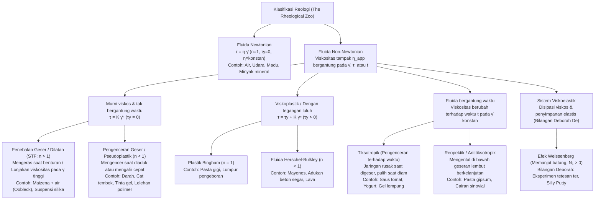
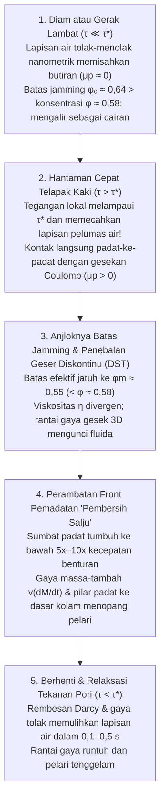

## Pendahuluan: Paradoks Berlari di Atas Kolam Cairan

Ini adalah salah satu demonstrasi paling memukau dalam fisika eksperimental: isilah sebuah kolam dengan suspensi pekat tepung jagung (maizena) atau tepung tapioka/kentang yang dicampur air dengan fraksi volume padat sekitar $55\%$ hingga $60\%$ (sekitar $1{,}5$ hingga $2$ bagian tepung berbanding $1$ bagian air berdasarkan berat). Dalam literatur berbahasa Inggris, cairan putih susu ini dikenal sebagai <strong>Oobleck</strong>, diambil dari buku anak-anak karya Dr. Seuss tahun 1949.

Jika seseorang mengambil ancang-ancang dan berlari cepat di atas permukaan kolam "cair" ini, keajaiban terjadi: tepat pada milidetik ketika telapak kaki menghantam permukaan, fluida di bawah kaki mengeras sekokoh lantai beton. Tanpa tenggelam sedikit pun, pelari dapat menyeberangi seluruh kolam. Jika Anda memukul semangkuk Oobleck dengan kepalan tangan sekuat tenaga, cairan itu tidak muncrat melainkan memantulkan pukulan seperti dinding padat. Namun, begitu pelari berhenti dan berdiri diam di tengah kolam, "lantai padat" di bawah kakinya meleleh dalam sekejap dan kedua kakinya langsung terhisap bagaikan di pasir hisap. Lebih buruk lagi, jika ia panik dan menarik kakinya secara tiba-tiba, suspensi tersebut langsung mengunci kembali di sekitar betisnya; satu-satunya cara untuk lolos adalah melemaskan otot dan menarik kaki keluar dengan sangat perlahan.

Intuisi sehari-hari kita membagi materi menjadi tiga wujud kaku (padat, cair, gas) dan mengasumsikan bahwa "kekentalan" (viskositas) suatu cairan selalu tetap, tak peduli seberapa cepat kita mengaduknya. Fluida yang mematuhi hubungan linier yang dirumuskan oleh Sir Isaac Newton dalam *Principia* (1687) ini disebut <strong>fluida Newtonian (Newtonian fluids)</strong>. Akan tetapi, mayoritas fluida di alam, tubuh manusia, dan industri modern — suspensi tepung, darah, saus tomat, mayones, cat tembok, pasta gigi, lelehan polimer, hingga mantel Bumi — melanggar hukum Newton: mereka adalah <strong>fluida non-Newtonian (Non-Newtonian fluids)</strong>.

Terinspirasi oleh semboyan Herakleitos $\pi\alpha\nu\tau\alpha\ \rho\varepsilon\iota$ (*Panta rhei*, "segalanya mengalir"), cabang fisika yang mempelajari deformasi dan aliran materi kompleks disebut <strong>reologi (Rheology)</strong>. Artikel ini mengupas tuntas mulai dari persamaan konstitutif, revolusi mikroskopis penebalan geser (2012–2014), reologi darah, efek Weissenberg, bilangan Deborah, hingga rompi antipeluru cair.

---

## Bab 1: Hukum Viskositas Newton dan Bilangan Péclet

### 1.1 Aliran Couette Datar dan Tensor Tegangan

Tinjuau fluida yang berada di antara dua pelat datar sejajar yang terpisah sejauh $H$ $[\text{m}]$ (<strong>aliran Couette</strong>). Pelat bawah ($y=0$) diam, sedangkan pelat atas ($y=H$, luas $A$) ditarik secara horizontal dengan kecepatan konstan $U$ $[\text{m}\cdot\text{s}^{-1}]$ oleh gaya tangensial $F$ $[\text{N}]$. Kita mendefinisikan <strong>tegangan geser (Shear stress)</strong> sebagai $\tau \equiv \frac{F}{A}$ $[\text{Pa}]$ dan <strong>laju geser (Shear rate)</strong> sebagai gradien kecepatan $\dot{\gamma} \equiv \frac{\partial u}{\partial y} = \frac{U}{H}$ $[\text{s}^{-1}]$.

Untuk fluida Newtonian, tegangan geser berbanding lurus dengan laju geser (<strong>hukum viskositas Newton</strong>):

$$\tau = \eta \dot{\gamma} = \eta \frac{\partial u}{\partial y}$$

di mana $\eta$ $[\text{Pa}\cdot\text{s}]$ adalah <strong>viskositasचक्र dinamis</strong>. Dalam mekanika kontinuum tiga dimensi, tensor tegangan Cauchy untuk fluida tak-termampatkan ditulis sebagai $\boldsymbol{\sigma} = -p\mathbf{I} + 2\eta\mathbf{D}$, yang menghasilkan <strong>persamaan Navier-Stokes</strong>. Pada suhu $T$ dan tekanan $p$ konstan, $\eta$ bernilai tetap untuk air ($\approx 10^{-3}\,\text{Pa}\cdot\text{s}$) maupun madu ($\approx 2\text{–}10\,\text{Pa}\cdot\text{s}$).

### 1.2 Mengapa Fluida Kompleks Bersifat Non-Newtonian? Bilangan Péclet ($\text{Pe}$)

Partikel berjari-jari $a$ dalam pelarut berviskositas $\eta_0$ pada suhu $T$ mengalami <strong>gerak Brown</strong> termal dengan koefisien difusi Stokes-Einstein $D_0 = \frac{k_B T}{6\pi \eta_0 a}$. Waktu yang dibutuhkan partikel untuk berdifusi sejauh jari-jarinya sendiri $a$ guna memulihkan isotropi kesetimbangan adalah <strong>waktu relaksasi Brown</strong> $\tau_B$:

$$\tau_B \equiv \frac{a^2}{D_0} = \frac{6\pi \eta_0 a^3}{k_B T}$$

Perhatikan bahwa <strong>$\tau_B$ sebanding dengan pangkat tiga jari-jari partikel ($a^3$)</strong>! Rasio tak berdimensi antara waktu relaksasi termal ini terhadap waktu deformasi aliran $\tau_{\text{flow}} \sim \dot{\gamma}^{-1}$ mendefinisikan <strong>bilangan Péclet ($\text{Pe}$)</strong>:

$$\text{Pe} \equiv \dot{\gamma}\tau_B = \frac{6\pi \eta_0 a^3 \dot{\gamma}}{k_B T}$$

- <strong>Cairan molekul kecil (misal air, $a \sim 0{,}15\,\text{nm}$)</strong>: $\tau_B \sim 10^{-12}\,\text{s}$ (pikodetik). Bahkan pada laju geser ekstrem ($\dot{\gamma} \sim 10^5\,\text{s}^{-1}$), $\text{Pe} \sim 10^{-7} \ll 1$. Agitasi termal memulihkan isotropi seketika sehingga $\eta$ konstan.
- <strong>Fluida kompleks / Materi lunak (koloid, polimer, $a \sim 0{,}1\text{–}10\,\mu\text{m}$)</strong>: Butiran maizena atau sel darah merah $10^4$ kali lebih besar daripada molekul air, sehingga $\tau_B \propto a^3$ melonjak sebesar <strong>$10^{12}$ kali (satu triliun kali)</strong> mencapai $\tau_B \sim 1\text{–}100\,\text{s}$! Akibatnya, adukan tangan ringan ($\dot{\gamma} \sim 1\,\text{s}^{-1}$) sudah cukup untuk mencapai $\text{Pe} \gg 1$, di mana aliran merombak mikrostruktur dan membuat viskositas sangat nonlinier.

---

## Bab 2: Klasifikasi Matematis — Hukum Pangkat dan Model Herschel-Bulkley

Untuk fluida non-Newtonian, kita mendefinisikan <strong>viskositas tampak (Apparent viscosity)</strong> sebagai $\eta_{\text{app}}(\dot{\gamma}) \equiv \frac{\tau(\dot{\gamma})}{\dot{\gamma}}$. Persamaan konstitutif umum untuk fluida tak-bergantung waktu adalah <strong>model Herschel-Bulkley (1926)</strong> dan kasus khususnya tanpa tegangan luluh ($\tau_y = 0$), yaitu <strong>hukum pangkat Ostwald-de Waele</strong>:

$$\tau(\dot{\gamma}) = \tau_y + K \dot{\gamma}^n \quad (\text{untuk } \tau \ge \tau_y \,; \text{ jika } \tau < \tau_y \text{ maka } \dot{\gamma} = 0)$$

$$\eta_{\text{app}}(\dot{\gamma}) = \frac{\tau_y}{\dot{\gamma}} + K \dot{\gamma}^{n-1}$$

di mana $\tau_y$ $[\text{Pa}]$ adalah <strong>tegangan luluh (Yield stress)</strong>, $K$ $[\text{Pa}\cdot\text{s}^n]$ adalah <strong>indeks konsistensi</strong>, dan $n$ adalah <strong>indeks perilaku aliran</strong>. Untuk menggambarkan transisi mulus antara plato Newtonian geser-rendah ($\eta_0$) dan geser-tinggi ($\eta_\infty$), digunakan <strong>model Carreau-Yasuda</strong>:

$$\frac{\eta(\dot{\gamma}) - \eta_\infty}{\eta_0 - \eta_\infty} = \left[ 1 + (\lambda \dot{\gamma})^a \right]^{\frac{n-1}{a}}$$

| Kelas Fluida | Persamaan Konstitutif | Perilaku $\eta_{\text{app}}(\dot{\gamma})$ | Mekanisme Mikroskopis Dominan | Contoh Representatif |
| :--- | :--- | :--- | :--- | :--- |
| <strong>Fluida Newtonian</strong> | $\tau = \eta \dot{\gamma}$ ($n = 1, \tau_y = 0$) | Konstan pada semua $\dot{\gamma}$ ($\eta = \text{konst.}$) | Relaksasi termal pikodetik ($\tau_B \sim 10^{-12}\,\text{s}, \text{Pe} \ll 1$) menjaga isotropi | Air, udara, etanol, gliserol, madu, minyak silikon |
| <strong>Penebalan Geser (STF)</strong> | $\tau = K \dot{\gamma}^n$ ($n > 1, \tau_y = 0$) | Naik bersama $\dot{\gamma}$; divergen tak-kontinu (DST) di atas $\tau^*$ | Hidrokluster $\to$ pecahnya lapisan pelumas & rantai gaya gesek padat-ke-padat | Oobleck (maizena + air), dispersi $\text{SiO}_2$-PEG, pasir pantai basah |
| <strong>Pengenceran Geser (Pseudoplastik)</strong> | $\tau = K \dot{\gamma}^n$ ($n < 1, \tau_y = 0$) | Turun monotonik dengan $\dot{\gamma}$ ($\eta_0 \to \eta_\infty$) | Disagregasi (tumpukan rouleaux eritrosit), penjajaran & penguraian rantai polimer | Darah utuh, cat tembok lateks, sampo, tinta pena gel, lelehan plastik |
| <strong>Viskoplastik (Tegangan Luluh)</strong> | $\tau = \tau_y + K \dot{\gamma}^n$ ($\tau_y > 0$) | Padat di bawah $\tau_y$; aliran sumbat (Plug flow) di atas $\tau_y$ | Jaringan 3D partikel/tetesan yang terkunci luluh di atas ambang $\tau_y$ | Pasta gigi, mayones, krim kocok, beton segar, lava |
| <strong>Fluida Tiksotropik</strong> | $\tau = \tau(\dot{\gamma}, t)$ (Loop histeresis) | Turun seiring waktu $t$ saat digeser; pulih saat diam | Pemutusan tertunda dan reperkolasi Brown pada ikatan hidrogen/van der Waals | Saus tomat, yogurt aduk, lumpur bentonit, losion kosmetik |
| <strong>Fluida Viskoelastik</strong> | $\tau + \lambda \dot{\tau} = \eta \dot{\gamma}$ ($N_1 > 0$) | Padatan elastis pada waktu singkat ($\text{De} \gg 1$), cairan pada waktu lama ($\text{De} \ll 1$) | Elastisitas entropik makromolekul terbelit yang menghasilkan tegangan cincin (Hoop stress) | Ter (aspal/pitch), Silly Putty, putih telur, adonan roti, lendir |

---

## Bab 3: Fisika Oobleck — Tiga Revolusi dalam Fluida Penebalan Geser (STF)

### 3.1 Dilatansi Reynolds (1885) dan Teori Hidrokluster (1985)

Pada tahun 1885, <strong>Osborne Reynolds</strong> menjelaskan mengapa pasir pantai basah memutih dan mengeras saat diinjak: butiran pasir yang padat harus menggelinding melewati tetangganya saat mengalami geseran, memicu <strong>ekspansi volume (Dilatansi, $\Delta V > 0$)</strong> yang menghisap air permukaan dan menciptakan tekanan pori negatif yang mengunci butiran pasir.

Pada tahun 1985, <strong>John F. Brady dan Georges Bossis</strong> merumuskan <strong>teori hidrokluster</strong>: saat dua bola berjari-jari $a$ mendekat dengan kecepatan relatif $v_{\text{rel}}$ hingga celah sempit $h \ll a$ dalam pelarut berviskositas $\eta_0$, memeras cairan keluar dari celah menghasilkan <strong>gaya pelumasan hidrodinamis</strong> yang divergen:

$$F_{\text{lub}} \simeq \frac{6\pi \eta_0 a^2 v_{\text{rel}}}{h} \propto \frac{1}{h}$$

Pada laju geser tinggi ($\text{Pe} \gg 1$), hambatan $\propto 1/h$ ini mengikat partikel sementara menjadi gugus (<strong>hidrokluster</strong>). Namun, gaya hidrodinamis murni hanya mampu menjelaskan <strong>penebalan geser kontinu (CST)</strong> yang ringan dan gagal menjelaskan <strong>penebalan geser diskontinu (DST)</strong> pada Oobleck ($\phi \approx 55\%\text{–}60\%$), di mana viskositas melonjak ribuan kali secara vertikal!

### 3.2 Pergeseran Paradigma (2012–2014): Kontak Gesek (Wyart & Cates) dan Front Pemadatan (Waitukaitis & Jaeger)

1. <strong>Pecahnya Lapisan Pelumas Nanometrik dan Jamming Gesek (Wyart & Cates, 2014)</strong>:
   Butiran pati atau silika memiliki gaya tolak elektrostatik atau sterik $F_{\text{rep}}$ yang menentukan tegangan ambang $\tau^* \sim F_{\text{rep}}/a^2$.
   - <strong>Tegangan rendah ($\tau \ll \tau^*$)</strong>: Lapisan air nanometrik tetap utuh; partikel meluncur <strong>tanpa gesekan ($\mu_p \approx 0$)</strong> dan baru mengalami kemacetan (jamming) pada fraksi kepadatan acak maksimum <strong>$\phi_0 \approx 0{,}64$</strong>.
   - <strong>Tegangan tinggi / Benturan ($\tau > \tau^*$)</strong>: Tekanan lokal melampaui penghalang tolak-menolak, memecahkan lapisan air sehingga permukaan butiran yang kasar mengalami <strong>kontak langsung padat-ke-padat dengan gesekan Coulomb ($\mu_p > 0$)</strong>! Penguncian rotasi menurunkan batas kritis jamming secara drastis ke <strong>$\phi_m \approx 0{,}55$</strong>.
   Dengan fraksi kontak gesek $f(\tau) = \exp(-\tau^*/\tau)$, batas jamming efektif $\phi_J(\tau)$ dan viskositas $\eta(\phi, \tau)$ memenuhi persamaan Wyart-Cates:
   $$\phi_J(\tau) = f(\tau)\,\phi_m + \left[1 - f(\tau)\right]\phi_0, \qquad \eta(\phi, \tau) \propto \left[ \phi_J(\tau) - \phi \right]^{-2}$$
   Untuk $\phi = 0{,}58$ ($\phi_m < \phi < \phi_0$), saat diam berlaku $\phi < \phi_0 = 0{,}64$ (cair). Saat diinjak keras ($\tau > \tau^*$), $\phi_J(\tau)$ anjlok ke $0{,}55 < \phi = 0{,}58$: viskositas divergen menuju tak hingga (DST) dan jaringan 3D <strong>rantai gaya gesek (frictional force chains)</strong> memadatkan fluida seketika!
2. <strong>Pemadatan Teraktivasi Benturan dan Front "Pembersih Salju" (Waitukaitis & Jaeger, *Nature* 2012)</strong>:
   Melalui radiografi sinar-X kecepatan tinggi di Universitas Chicago, Waitukaitis dan Jaeger menemukan bahwa benturan kaki dengan kecepatan $v_0$ membentuk sumbat padat di bawah telapak kaki yang batasnya — <strong>front pemadatan (solidification front)</strong> — merambat ke dasar kolam dengan kecepatan $5\text{–}10$ kali lipat kecepatan kaki ($v_f = k v_0$), bagaikan bilah truk pembersih salju! Massa padat yang tumbuh pesat $M(t)$ menghasilkan <strong>gaya reaksi massa-tambah</strong> yang luar biasa besar $F_{\text{impact}} = \frac{d}{dt}[M(t)v(t)] = M\dot{v} + v\dot{M}$ dan membentuk pilar padat hingga ke dasar kolam dalam hitungan milidetik. Saat berhenti ($\tau < \tau^*$), aliran Darcy memulihkan lapisan air dalam $0{,}1\text{–}0{,}5\,\text{s}$ dan pilar padat itu kembali mencair.

---

## Bab 4: Pseudoplastisitas, Aliran Sumbat (Plug Flow), dan Tiksotropi

1. <strong>Hemoreologi (Darah Manusia)</strong>: Darah ($\approx 45\%$ sel darah merah) pada geseran rendah ($\dot{\gamma} < 1\,\text{s}^{-1}$) membentuk tumpukan koin <strong>rouleaux</strong> ($\eta_0 \approx 50\text{–}100\,\text{mPa}\cdot\text{s}$). Di arteri dan kapiler sempit ($\dot{\gamma} \sim 100\text{–}1.000\,\text{s}^{-1}$), agregat terurai dan eritrosit без-inti berubah bentuk menjadi ramping disertai rotasi membran mirip roda rantai tank (<strong>tank-treading motion</strong>), menurunkan viskositas hingga $\eta_\infty \approx 3\text{–}4\,\text{mPa}\cdot\text{s}$.
2. <strong>Cat Tembok & Pena Gel</strong>: Di bawah kuas atau bola pena ($\dot{\gamma} \sim 10^4\,\text{s}^{-1}$), viskositas turun ribuan kali agar mudah dioleskan, namun saat gaya berhenti ($\tau < \tau_y$) viskositas langsung pulih guna mencegah tetesan (sagging).
3. <strong>Aliran Sumbat Bingham (Plug Flow)</strong>: Dalam pipa berjari-jari $R$ dengan penurunan tekanan $\Delta P / L$, tegangan geser adalah $\tau(r) = \frac{\Delta P}{2L}r$. Di inti pusat $r < r_p = \frac{2L\tau_y}{\Delta P}$, berlaku $\tau(r) < \tau_y$ dan $\frac{du}{dr} = 0$:
   $$u_{\text{Bingham}}(r) = \begin{cases} \dfrac{\Delta P}{4\eta_p L}(R - r_p)^2 = \text{konst.} & (0 \le r < r_p : \text{inti padat aliran sumbat}) \\[8pt] \dfrac{\Delta P}{4\eta_p L}\left[ R^2 - r^2 - 2r_p(R - r) \right] & (r_p \le r \le R : \text{lapisan cincin tergeser}) \end{cases}$$
   Itulah sebabnya pasta gigi keluar dari odol sebagai batang silinder utuh tanpa mencampurkan garis-garis warnanya.

---

## Bab 5: Viskoelastisitas, Bilangan Deborah, dan Efek Weissenberg

### 5.1 Model Maxwell dan Bilangan Deborah ($\text{De}$)

James Clerk Maxwell (1867) menghubungkan pegas elastis Hooke (modulus $G$) dan peredam viskos Newton (viskositas $\eta$) secara seri, menghasilkan persamaan viskoelastik dengan waktu relaksasi $\lambda \equiv \eta / G$:

$$\tau + \lambda \frac{d\tau}{dt} = \eta \dot{\gamma}$$

Pada tahun 1964, <strong>Marcus Reiner</strong> mengutip Nyanyian Debora (Hakim-hakim 5:5: <em>"Gunung-gunung гуgup/mencair di hadapan Tuhan"</em>) untuk mendefinisikan <strong>bilangan Deborah ($\text{De}$)</strong> sebagai rasio waktu relaksasi material $t_{\text{relax}}$ terhadap waktu pengamatan $t_{\text{obs}}$:

$$\text{De} \equiv \frac{t_{\text{relax}}}{t_{\text{obs}}}$$

Jika $\text{De} \gg 1$ ($t_{\text{obs}} \ll t_{\text{relax}}$), material merespons sebagai padatan elastis; jika $\text{De} \ll 1$ ($t_{\text{obs}} \gg t_{\text{relax}}$), ia mengalir sebagai cairan. Dalam <strong>Eksperimen Tetesan Ter (Pitch Drop Experiment)</strong> sejak 1927 di Universitas Queensland, ter/aspal ($\eta \approx 2{,}3 \times 10^8\,\text{Pa}\cdot\text{s}$) pecah berkeping-keping seperti kaca saat dipukul palu ($t_{\text{obs}} \sim 10^{-3}\,\text{s}, \text{De} \gg 1$), tetapi menetes satu kali setiap 8 hingga 13 tahun di bawah gravitasi ($t_{\text{obs}} \sim 10^8\,\text{s}, \text{De} \ll 1$). Demikian pula <strong>Silly Putty</strong> memantul seperti bola karet ($\text{De} \gg 1$) namun meleleh menjadi genangan saat didiamkan di meja ($\text{De} \ll 1$).

### 5.2 Efek Weissenberg (Memanjat Batang)

Saat batang diputar dalam larutan polimer (atau putih telur), cairan memanjat naik ke atas batang melawan gravitasi! Rantai polimer yang teregang sepanjang garis arus melingkar menghasilkan <strong>selisih tegangan normal pertama</strong> yang positif akibat elastisitas entropik:

$$N_1(\dot{\gamma}) \equiv \sigma_{xx} - \sigma_{yy} = \Psi_1(\dot{\gamma})\dot{\gamma}^2 > 0$$

Tegangan melingkar (Hoop stress) ini menekan fluida secara radial ke arah poros dan mendorongnya naik ke atas batang.

---

## Bab 6: Aplikasi Rekayasa Mutakhir — Dari Rompi Antipeluru Cair hingga Bioprinting 3D

1. <strong>Rompi Antipeluru Cair (Liquid Body Armor) & D3O</strong>: Kain Kevlar yang diresapi STF dari nanopartikel silika ($\text{SiO}_2$) dalam polietilen glikol (PEG) tetap lentur saat bergerak normal ($\dot{\gamma} < 10\,\text{s}^{-1}, \tau < \tau^*$), namun saat dihantam peluru atau pisau ($\dot{\gamma} > 10^5\,\text{s}^{-1}, \tau \gg \tau^*$) langsung mengeras dalam mikrodetik melalui jamming gesek (DST), mengurangi bobot rompi sebesar $30\%\text{–}50\%$. Pelindung oranye <strong>D3O</strong> juga memanfaatkan transisi bilangan Deborah untuk mengeras seketika saat benturan.
2. <strong>Bioprinting 3D (Bio-inks)</strong>: Biotinta berisi sel punca hidup memanfaatkan aliran sumbat Bingham dan pengenceran geser kuat ($n \ll 1$) untuk melindungi sel di dalam nosel sempit ($>95\%$ kelangsungan hidup) serta memulihkan tegangan luluh $\tau_y$ dalam $<0{,}1\,\text{s}$ setelah ekstrusi guna menopang struktur 3D jaringan organ tanpa runtuh.
