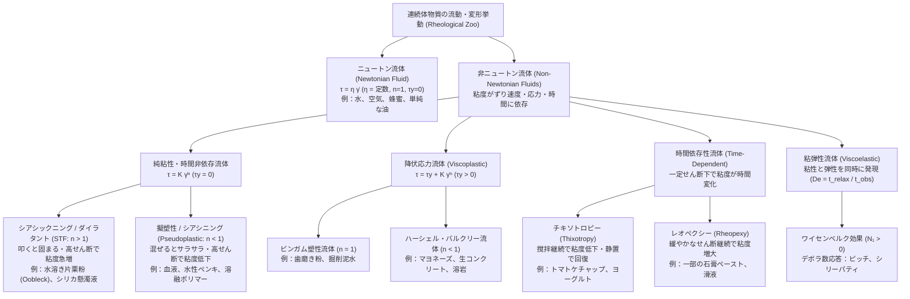
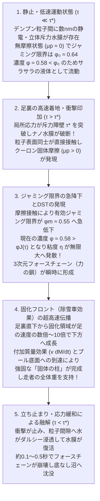

## はじめに：プールに満たされた「水溶き片栗粉」の上を疾走するパラドックス

科学実験ショーや動画サイトで、一度は目にしたことがあるはずの奇妙な光景がある。巨大なプールに大量の片栗粉（馬鈴薯デンプン）やコーンスターチ（トウモロコシデンプン）と水を、体積比でおよそ $55:45$（重量比で約 $1.5:1$ から $2:1$）の割合で混ぜ合わせた白濁した懸濁液を満たす。英語圏では、児童文学作家ドクター・スース（Dr. Seuss）の1949年の絵本『バーソロミューとウーブレック（*Bartholomew and the Oobleck*）』に登場する緑色の奇妙な粘液にちなんで、この流体を<strong>ウーブレック（Oobleck）</strong>と呼ぶ。

この白濁した「液体」のプールに向かって人間が全力で駆け出し、水面を力強く踏みつけながら疾走すると何が起きるか。驚くべきことに、足裏が水面に衝突した瞬間、液体であるはずのプールがあたかもコンクリートの床であるかのように硬直し、走者は足首すら沈み込ませることなく向こう岸まで軽々と走り抜けることができるのである。あるいは、ボウルに入れた水溶き片栗粉の表面を拳で思い切り殴りつければ、しぶきが飛び散るどころか、手首を痛めるほどの剛体的な反発力が返ってくる。

ところが、走者がプールの真ん中で走るのをやめ、その場に立ち止まった瞬間に悪夢が始まる。さっきまで全体重を支えていた足元の「固体の床」は忽ちのうちに融解し、ずぶずぶと底なし沼のように両足を飲み込んでいくのだ。さらに奇妙なことに、一度深く沈み込んだ足を焦って素早く引き抜こうとすると、周囲の流体が再びロックして強烈な抵抗を生み出し、靴が脱げるほど足を拘束してしまう。抜け出す唯一の方法は、力を抜いて極めてゆっくりと足を動かすことだけである。手ですくい上げて手のひらの上で素早く転がせば硬い団子のように丸まるのに、指の力を抜いた途端に、指の隙間からドロドロの白い液体となって滑らかに滴り落ちる。

私たちは学校教育や日常の経験から、物質は「気体・液体・固体」という明確に区分された三態（三相）のいずれかに属していると信じ込んでいる。そして液体については、「ゆっくりかき混ぜようが、激しくかき混ぜようが、水は水としてのサラサラ度（粘度）を保ち、蜂蜜は蜂蜜としてのドロドロ度（粘度）を保つ」という直感を無意識の前提としている。1687年、アイザック・ニュートン（Isaac Newton）が古典力学の金字塔『自然哲学の数学的諸原理（プリンキピア）』第2巻において定式化したこの理想的な流体を<strong>ニュートン流体（Newtonian fluid）</strong>と呼ぶ。

しかし、自然界や私たちの身の回り、さらには人体や産業プロセスに存在する流体の圧倒的多数——水溶き片栗粉、トマトケチャップ、マヨネーズ、血液、ペンキ、歯磨き粉、生コンクリート、溶融プラスチック、さらには地球深部のマントルや溶岩に至るまで——は、ニュートンの法則に公然と反逆する<strong>非ニュートン流体（Non-Newtonian fluids）</strong>なのである。

古代ギリシャの哲学者ヘラクレイトスが遺した「万物は流転する（$\pi\alpha\nu\tau\alpha\ \rho\varepsilon\iota$ / *Panta rhei*：すべては流れる）」という言葉を学問のモットーに掲げ、物質の変形と流動のすべてを統一的に解明しようとする現代物理学の一分野を<strong>レオロジー（Rheology：流動学）</strong>と呼ぶ。本稿では、このレオロジーとソフトマター物理学（Soft Matter Physics）の最前線の知見に基づき、「なぜ水溶き片栗粉の上を走れるのか」という長年の謎に対する現代物理学の決定的な解答から、血液やケチャップが示す逆方向の粘性変化、液体が重力に逆らって棒を登るワイセンベルク効果、固体と液体の境界を破壊する「デボラ数」、そして銃弾を受け止める「液体防弾チョッキ」の工学応用までを、数理モデルとミクロ構造の両面から徹底的に解き明かしていく。

---

## 第1章：ニュートンの粘性法則と連続体力学の基礎——「粘度」とは何か？

非ニュートン流体の異常な振る舞いを理解するためには、まず基準となる「正常な流体」、すなわちニュートン流体における<strong>粘性（Viscosity）</strong>の物理的・数学的定義を明確にしておく必要がある。

### 1.1 クエット流（単純せん断流）における応力と速度勾配

今、距離 $H$ $[\text{m}]$ だけ離れた2枚の広い平行平板の間に流体が満たされている状況（<strong>クエット流 / Couette flow</strong>）を考えよう。下側の平板（$y = 0$）を静止させ、上側の平板（$y = H$、面積 $A$ $[\text{m}^2]$）を水平方向（$x$ 方向）に一定の速さ $U$ $[\text{m}\cdot\text{s}^{-1}]$ で平行移動させるためには、流体の内部摩擦に打ち勝つための接線方向の力 $F$ $[\text{N}]$ を加え続けなければならない。

このとき、単位面積あたりに作用する接線方向の力を<strong>せん断応力（Shear stress、またはずり応力）</strong>$\tau$ と定義する：

$$\tau \equiv \frac{F}{A} \quad [\text{Pa} = \text{N}\cdot\text{m}^{-2}]$$

一方、流体の内部では、下板に接する流体層は速度 $u(0) = 0$ で静止し、上板に接する流体層は速度 $u(H) = U$ で動く（すべりなし境界条件）。定常状態では、高さ $y$ における流体の水平速度 $u(y)$ は直線的な分布 $u(y) = \frac{U}{H} y$ を描き、隣接する流体層の間でトランプの束を横にずらすような変形（せん断変形 / ずり変形）が連続的に生じる。この速度の空間勾配を<strong>せん断速度（Shear rate、またはずり速度）</strong>$\dot{\gamma}$（ガンマ・ドット）と定義する：

$$\dot{\gamma} \equiv \frac{\partial u}{\partial y} = \frac{U}{H} \quad [\text{s}^{-1}]$$

なぜ文字 $\dot{\gamma}$ を使うのかといえば、微小時間 $dt$ の間に流体要素が傾く角度（せん断ひずみ $\gamma = \frac{dx}{dy}$）の時間変化率 $\frac{d\gamma}{dt} = \frac{\partial}{\partial y}\left(\frac{dx}{dt}\right) = \frac{\partial u}{\partial y}$ に他ならないからである。単位が時間の逆数 $[\text{s}^{-1}]$（毎秒）であることに注目してほしい。たとえば $1\,\text{mm}$ の隙間に挟まれた流体を秒速 $1\,\text{m}$ で擦り合わせるとき、せん断速度は $\dot{\gamma} = \frac{1\,\text{m/s}}{10^{-3}\,\text{m}} = 1,000\,\text{s}^{-1}$ となる。

### 1.2 ニュートンの粘性法則とテンソル表現

アイザック・ニュートンは、多くの一般的な流体において、発生するせん断応力 $\tau$ がせん断速度 $\dot{\gamma}$ に厳密に正比例することを見出した。これが<strong>ニュートンの粘性法則（Newton's law of viscosity）</strong>である：

$$\tau = \eta \dot{\gamma} = \eta \frac{\partial u}{\partial y}$$

この比例定数 $\eta$（イータ、流体力学では $\mu$ と書くことも多い）を<strong>粘性率（Dynamic viscosity / 動的粘度）</strong>、あるいは単に<strong>粘度</strong>と呼ぶ。単位はパスカル秒 $[\text{Pa}\cdot\text{s} = \text{kg}\cdot\text{m}^{-1}\cdot\text{s}^{-1}]$（旧単位ではポアズ $\text{P}$ やセンチポアズ $\text{cP}$ が使われ、$1\,\text{mPa}\cdot\text{s} = 1\,\text{cP}$ である）。

より一般の3次元連続体力学において、非圧縮性ニュートン流体（$\nabla \cdot \mathbf{u} = 0$）の全応力テンソル $\boldsymbol{\sigma}$ は、等方的な静水圧 $p\mathbf{I}$ と偏差応力（粘性応力）テンソル $\boldsymbol{\tau}$ の和として次のように書ける：

$$\boldsymbol{\sigma} = -p\mathbf{I} + \boldsymbol{\tau}, \qquad \tau_{ij} = 2\eta D_{ij} = \eta \left( \frac{\partial u_i}{\partial x_j} + \frac{\partial u_j}{\partial x_i} \right)$$

ここで $D_{ij} \equiv \frac{1}{2}\left(\frac{\partial u_i}{\partial x_j} + \frac{\partial u_j}{\partial x_i}\right)$ は変形速度テンソル（ひずみ速度テンソル）である。この構成方程式を運動量保存則 $\rho \frac{D\mathbf{u}}{Dt} = \nabla \cdot \boldsymbol{\sigma} + \rho\mathbf{g}$ に代入したものが、流体力学の支配方程式である<strong>ナビエ・ストークス方程式（Navier-Stokes equation）</strong>に他ならない：

$$\rho \left( \frac{\partial \mathbf{u}}{\partial t} + (\mathbf{u} \cdot \nabla)\mathbf{u} \right) = -\nabla p + \eta \nabla^2 \mathbf{u} + \rho \mathbf{g}$$

ニュートン流体の決定的な特徴は、<strong>温度 $T$ と圧力 $p$ が一定である限り、粘度 $\eta$ がせん断速度 $\dot{\gamma}$ に一切依存しない物質固有の定数である</strong>という点にある。室温（$20^\circ\text{C}$）における代表的なニュートン流体の粘度を挙げると以下のようになる：

- 空気：$\eta \approx 1.8 \times 10^{-5}\,\text{Pa}\cdot\text{s}$
- 水：$\eta \approx 1.0 \times 10^{-3}\,\text{Pa}\cdot\text{s}$（$= 1\,\text{mPa}\cdot\text{s}$）
- オリーブオイル：$\eta \approx 8.0 \times 10^{-2}\,\text{Pa}\cdot\text{s}$
- グリセリン：$\eta \approx 1.5\,\text{Pa}\cdot\text{s}$（水の約1,500倍）
- 蜂蜜：$\eta \approx 2 \sim 10\,\text{Pa}\cdot\text{s}$（水の数千倍）

蜂蜜は水よりも数千倍ドロドロしているが、スプーンでゆっくり動かそうが、高速ミキサーでかき混ぜようが（温度上昇を除外すれば）、その粘度 $\eta$ は変わらない。したがって、横軸にせん断速度 $\dot{\gamma}$、縦軸にせん断応力 $\tau$ をとったグラフ（<strong>流動曲線 / Flow curve</strong>）を描くと、ニュートン流体は必ず<strong>原点を通る直線</strong>となり、その傾きが粘度 $\eta$ を表す。

### 1.3 なぜ低分子液体はニュートン流体で、複雑流体は非ニュートン流体なのか？——ペクレ数の物理学

では、なぜ水や蜂蜜、アルコール、シリコーンオイルといった純粋な低分子液体はニュートン流体の法則に従い、水溶き片栗粉や血液、ポリマー溶液は従わないのか？その答えは、流体内部の<strong>ミクロ構造の熱緩和時間</strong>と<strong>流れによる変形時間</strong>の競合にある。

流体中の構成要素（分子やコロイド粒子）のサイズ（半径）を $a$ としよう。絶対温度 $T$ の熱浴中で、この粒子は周囲の溶媒分子からのランダムな熱衝突によって<strong>ブラウン運動（Brownian motion）</strong>を行っており、ストークス・アインシュタインの拡散係数 $D_0 = \frac{k_B T}{6\pi \eta_0 a}$ で拡散している（$k_B$ はボルツマン定数、$\eta_0$ は溶媒の粘度）。この粒子が自身のサイズ $a$ 程度の距離を熱拡散によって移動し、流れによって乱された配置を元の等方的な熱平衡配置へとリセットするのに要する特性時間（<strong>ブラウン緩和時間</strong> $\tau_B$）は次式で与えられる：

$$\tau_B \equiv \frac{a^2}{D_0} = \frac{6\pi \eta_0 a^3}{k_B T}$$

ここで注目すべきは、緩和時間 $\tau_B$ が<strong>粒子サイズ $a$ の3乗（$a^3$）に比例する</strong>という事実である！
一方、外部からせん断速度 $\dot{\gamma}$ の流れを与えたとき、流れがミクロ構造を変形させる時間スケールは $\tau_{\text{flow}} \sim \dot{\gamma}^{-1}$ である。この2つの時間スケールの比を表す無次元数が<strong>ペクレ数（Péclet number, $\text{Pe}$）</strong>である：

$$\text{Pe} \equiv \frac{\tau_B}{\tau_{\text{flow}}} = \dot{\gamma} \tau_B = \frac{6\pi \eta_0 a^3 \dot{\gamma}}{k_B T}$$

1. <strong>水のような低分子液体の場合（$a \sim 0.15\,\text{nm}$）</strong>：
   室温（$T = 300\,\text{K}$）において、水分子の熱緩和時間は $\tau_B \sim 10^{-12}\,\text{s}$（1ピコ秒）という途方もない短さである。人間や通常の機械装置が生み出せるせん断速度はせいぜい $\dot{\gamma} \sim 10^{-2} \sim 10^5\,\text{s}^{-1}$ の範囲であるから、ペクレ数は $\text{Pe} = \dot{\gamma}\tau_B \sim 10^{-14} \sim 10^{-7} \ll 1$ となる。つまり、私たちがどれほど激しく水をかき混ぜても、水分子の熱運動はそれより何百万倍も速く分子配置をランダムにリセットし続けるため、水分子の配向やミクロ構造は一切変化せず、粘度 $\eta$ は完全に一定（ニュートン流体）に保たれるのである。
2. <strong>コロイド懸濁液や高分子などの複雑流体（ソフトマター）の場合（$a \sim 0.1 \sim 10\,\mu\text{m}$）</strong>：
   水溶き片栗粉に含まれるデンプン粒子（粒径 $2a \sim 10 \sim 20\,\mu\text{m}$）や血液中の赤血球（直径約 $8\,\mu\text{m}$）は、水分子に比べてサイズがおよそ $10^4$ 倍大きい。すると $a^3$ に比例するブラウン緩和時間 $\tau_B$ は実に <strong>$10^{12}$ 倍（1兆倍）</strong> にも跳ね上がり、$\tau_B \sim 1 \sim 100\,\text{s}$（数秒〜数百秒）というマクロな時間スケールに達する！その結果、手で軽くかき混ぜる程度の日常的なせん断速度（$\dot{\gamma} \sim 1 \sim 10\,\text{s}^{-1}$）で容易に $\text{Pe} \gtrsim 1$ となり、熱運動による構造修復が流れによる変形に追いつかなくなる。流れ場そのものが粒子や高分子の空間配置・配向・接触状態を劇的に組み替えてしまうため、粘度がせん断速度 $\dot{\gamma}$ の強い非線形関数となる。これこそが非ニュートン流体が生まれる根源的な物理的理由である。

---

## 第2章：非ニュートン流体の数学的分類——べき乗則とハーシェル・バルクリーモデル

非ニュートン流体では、せん断応力 $\tau$ とせん断速度 $\dot{\gamma}$ の関係が非線形になるため、単一の定数としての「粘度」は存在しない。そこで、ある特定のせん断速度 $\dot{\gamma}$ における応力とせん断速度の比として<strong>見かけ粘度（Apparent viscosity）</strong>$\eta_{\text{app}}(\dot{\gamma})$ を定義する：

$$\eta_{\text{app}}(\dot{\gamma}) \equiv \frac{\tau(\dot{\gamma})}{\dot{\gamma}}$$

（また、流動曲線の局所的な接線の傾き $\eta_{\text{diff}}(\dot{\gamma}) \equiv \frac{d\tau}{d\dot{\gamma}}$ を微分粘度と呼ぶ）。

### 2.1 オストワルド・ド・ワーレのべき乗則とハーシェル・バルクリー構成方程式

レオロジーにおいて、時間依存性を持たない広範な非ニュートン流体の流動曲線を統一的に記述する最も重要な構成方程式が、1926年にウィンズロー・ハーシェル（Winslow H. Herschel）とロナルド・バルクリー（Ronald Bulkley）によって提唱された<strong>ハーシェル・バルクリーモデル（Herschel-Bulkley model）</strong>である：

$$\begin{cases} \dot{\gamma} = 0 & (\tau < \tau_y \text{ のとき：未降伏・固体状態}) \\ \tau(\dot{\gamma}) = \tau_y + K \dot{\gamma}^n & (\tau \ge \tau_y \text{ のとき：流動状態}) \end{cases}$$

ここで登場する3つの物質パラメータは以下の物理的意味を持つ：

- <strong>$\tau_y$（降伏応力 / Yield stress）</strong>$[\text{Pa}]$：流体が流れ始めるために必要な最小の限界応力。加えられた応力が $\tau < \tau_y$ の範囲にあるとき、物質は一切流動せず（$\dot{\gamma} = 0$）、弾性固体として変形するにとどまる。$\tau \ge \tau_y$ となって初めて内部のミクロ構造ネットワークが降伏（破壊）し、流体として流れ始める。
- <strong>$K$（コンシステンシー係数 / Consistency index）</strong>$[\text{Pa}\cdot\text{s}^n]$：流体の基準的な粘稠度（ドロドロ感のスケール）を表す比例係数。
- <strong>$n$（流動挙動指数 / Flow behavior index）</strong>$[\text{無次元}]$：ニュートン性からの乖離の向きと強さを決定する最も重要な指数。

流動状態（$\tau > \tau_y$）における見かけ粘度 $\eta_{\text{app}}(\dot{\gamma})$ は、上式を $\dot{\gamma}$ で割ることで直ちに得られる：

$$\eta_{\text{app}}(\dot{\gamma}) = \frac{\tau_y}{\dot{\gamma}} + K \dot{\gamma}^{n-1}$$

特に、降伏応力を持たない流体（$\tau_y = 0$）においては、この式は<strong>オストワルド・ド・ワーレのべき乗則モデル（Ostwald-de Waele power-law model）</strong>へと帰着する：

$$\tau(\dot{\gamma}) = K \dot{\gamma}^n, \qquad \eta_{\text{app}}(\dot{\gamma}) = K \dot{\gamma}^{n-1}$$

この指数 $n$ と降伏応力 $\tau_y$ の組み合わせによって、流体の「レオロジー動物園（Rheological Zoo）」は以下のように明快に分類される。

1. <strong>ニュートン流体（Newtonian Fluid：$n = 1, \tau_y = 0$）</strong>
   $\tau = K\dot{\gamma}$ となり、$K = \eta$（一定）。見かけ粘度は $\eta_{\text{app}}(\dot{\gamma}) = K \dot{\gamma}^0 = \eta$ でせん断速度に依存しない（水、空気、蜂蜜、単純な油）。
2. <strong>シアシックニング流体 / ダイラタント流体（Shear-Thickening Fluid [STF]：$n > 1, \tau_y = 0$）</strong>
   指数が $n > 1$（すなわち $n - 1 > 0$）であるため、せん断速度 $\dot{\gamma}$ が大きくなるほど、見かけ粘度 $\eta_{\text{app}}(\dot{\gamma}) = K \dot{\gamma}^{n-1}$ が<strong>べき乗で増大</strong>する。ゆっくり動かせばサラサラ流れる（$\dot{\gamma} \to 0$ で $\eta_{\text{app}} \to 0$）が、素早くかき混ぜたり強い衝撃を与えたりする（$\dot{\gamma} \gg 1$）と急激に粘度が増して固化する（水溶き片栗粉／コーンスターチ濃厚懸濁液、高濃度シリカナノ粒子分散液、濡れた砂）。
3. <strong>擬塑性流体 / シアシニング流体（Shear-Thinning / Pseudoplastic Fluid：$n < 1, \tau_y = 0$）</strong>
   指数が $n < 1$（すなわち $n - 1 < 0$）であるため、せん断速度 $\dot{\gamma}$ が大きくなるほど、見かけ粘度 $\eta_{\text{app}}(\dot{\gamma}) = K \dot{\gamma}^{n-1} = \frac{K}{\dot{\gamma}^{1-n}}$ が<strong>反比例的に減少</strong>する。静止時やゆっくり動くときは粘度が高いが、激しくかき混ぜたり狭い管を高速で流れたりするとサラサラになる（血液、水性ペンキ、ボールペンインク、シャンプー、溶融ポリマー、生クリーム）。
4. <strong>ビンガム塑性流体（Bingham Plastic：$n = 1, \tau_y > 0$）</strong>
   1916年にユージン・ビンガム（Eugene C. Bingham）が定式化したモデル。降伏応力 $\tau_y$ を超えるまでは固体として振る舞い、$\tau > \tau_y$ を超えると一定の塑性粘度 $\eta_p = K$ でニュートン流体のように線形に流れる：$\tau = \tau_y + \eta_p \dot{\gamma}$。見かけ粘度は $\eta_{\text{app}}(\dot{\gamma}) = \frac{\tau_y}{\dot{\gamma}} + \eta_p$ となり、せん断速度の増大とともに $\eta_p$ へ漸近する（歯磨き粉、マーガリン、掘削泥水、下水汚泥）。
5. <strong>一般の降伏応力流体（Herschel-Bulkley Fluid：$n < 1, \tau_y > 0$）</strong>
   降伏応力 $\tau_y$ を持ち、かつ流動開始後にシアシニング（$n < 1$）を示す流体。実用上のペーストやゲルの大半は厳密にはビンガム流体ではなくこのクラスに属する（マヨネーズ、トマトピューレ、ハンドクリーム、フレッシュコンクリート、溶岩）。

### 2.2 カロー・ヤスダモデル（Carreau-Yasuda Model）：全せん断速度域の記述

べき乗則モデル $\eta_{\text{app}} = K\dot{\gamma}^{n-1}$ は数学的に簡潔で強力だが、$n < 1$ のときに $\dot{\gamma} \to 0$ の極限で見かけ粘度が無限大（$\eta_{\text{app}} \to \infty$）に発散し、$\dot{\gamma} \to \infty$ の極限でゼロ（$\eta_{\text{app}} \to 0$）になってしまうという非物理的な特異性を持つ。実際のポリマー溶液や血液などの擬塑性流体では、極めて遅いせん断速度領域（$\text{Pe} \ll 1$）ではブラウン運動が支配的となるため一定の<strong>ゼロせん断粘度（Zero-shear viscosity）</strong>$\eta_0$ に収束し（第1ニュートンプラトー）、逆に極めて高いせん断速度領域では構造の配向や解離が飽和して一定の<strong>無限大せん断粘度（Infinite-shear viscosity）</strong>$\eta_\infty$（溶媒粘度に準ずる値）に収束する（第2ニュートンプラトー）。

この3つの領域（低せん断ニュートン域 $\to$ 中間べき乗則域 $\to$ 高せん断ニュートン域）を単一の滑らかな関数で完璧に記述するのが<strong>カロー・ヤスダモデル（Carreau-Yasuda model）</strong>である：

$$\frac{\eta(\dot{\gamma}) - \eta_\infty}{\eta_0 - \eta_\infty} = \left[ 1 + (\lambda \dot{\gamma})^a \right]^{\frac{n-1}{a}}$$

ここで $\lambda$ $[\text{s}]$ は流体の内部構造の緩和時間（$\dot{\gamma} \sim \lambda^{-1}$ でニュートン挙動からべき乗則挙動への遷移が起きる）、$a$ は遷移領域の曲率を決める無次元パラメータ（標準的な Carreau モデルでは $a = 2$）である。$\lambda\dot{\gamma} \ll 1$ では $\eta(\dot{\gamma}) \to \eta_0$ となり、$\lambda\dot{\gamma} \gg 1$ では $\eta(\dot{\gamma}) - \eta_\infty \approx (\eta_0 - \eta_\infty)\lambda^{n-1}\dot{\gamma}^{n-1}$ となってオストワルド・ド・ワーレのべき乗則を自然に再現する。

| 流体クラス | 構成方程式の特徴 | 見かけ粘度 $\eta_{\text{app}}(\dot{\gamma})$ の挙動 | 支配的なミクロ物理機構 | 代表的な物質例 |
| :--- | :--- | :--- | :--- | :--- |
| <strong>ニュートン流体</strong> | $\tau = \eta \dot{\gamma}$ ($n = 1, \tau_y = 0$) | せん断速度 $\dot{\gamma}$ によらず常に一定（$\eta = \text{const.}$） | 分子の熱緩和時間 $\tau_B \sim 10^{-12}\,\text{s}$ が極小（$\text{Pe} \ll 1$）で構造不変 | 水、空気、エタノール、グリセリン、蜂蜜、鉱物油 |
| <strong>シアシックニング流体 (STF)</strong> | $\tau = K \dot{\gamma}^n$ ($n > 1, \tau_y = 0$) | $\dot{\gamma}$ の増加とともに増大。臨界応力 $\tau^*$ 超えで不連続発散（DST） | 流体力学的ハイドロクラスター形成 $\to$ 潤滑水膜破断と粒子間固体摩擦鎖（フォースチェーン）形成 | 水溶き片栗粉（コーンスターチ懸濁液）、高濃度シリカ分散液、濡れた砂浜 |
| <strong>シアシニング（擬塑性）流体</strong> | $\tau = K \dot{\gamma}^n$ ($n < 1, \tau_y = 0$) | $\dot{\gamma}$ の増加とともに単調減少（$\eta_0 \to \eta_\infty$） | 凝集塊の解離（赤血球の連銭解消・変形）、高分子鎖の流れ方向への配向と絡み合い減少 | 血液、ラテックス塗料（ペンキ）、シャンプー、ボールペンインク、溶融プラスチック |
| <strong>降伏応力（粘塑性）流体</strong> | $\tau = \tau_y + K \dot{\gamma}^n$ ($\tau_y > 0, n \le 1$) | $\tau < \tau_y$ では流動せず固体（$\eta_{\text{app}} \to \infty$）。$\tau > \tau_y$ で流動開始・栓流（プラグ流）形成 | 粒子・液滴の3次元ジャミング網目構造が限界応力 $\tau_y$ で座屈・破断 | 歯磨き粉、マヨネーズ、生クリーム、生コンクリート、溶岩、泥流 |
| <strong>チキソトロピー流体</strong> | $\tau = \tau(\dot{\gamma}, t)$ （ヒステリシスループ） | 一定せん断の継続時間 $t$ とともに粘度が低下し、静置すると時間をかけて回復 | 弱い分子間力（水素結合・ファンデルワールス力）によるゲル網目の時間遅れ破壊と再構築 | トマトケチャップ、ヨーグルト、ペンキ、化粧品ゲル、粘土懸濁液 |
| <strong>粘弾性流体</strong> | $\tau + \lambda \dot{\tau} = \eta \dot{\gamma}$ （$N_1 = \sigma_{xx} - \sigma_{yy} > 0$） | 観察時間 $t_{\text{obs}}$ と緩和時間 $\lambda$ の比（デボラ数 $\text{De}$）で固体にも液体にもなる | 長鎖高分子のエントロピー弾性・絡み合い網目の伸長とフープ応力発生 | ピッチ（歴青）、シリーパティ、スライム、卵白、パン生地、生体粘液 |

---

## 第3章：水溶き片栗粉の物理学——ダイラタンシーとシアシックニング（STF）のミクロ機構革命

いよいよ本稿の中心命題である「なぜ水溶き片栗粉（ウーブレック）は叩くと固まり、その上を走ることができるのか？」という問題に踏み込もう。
実はこの現象のミクロな物理メカニズムは、長らく教科書や一般向け解説で語られてきた古典的な説明では不十分であることが判明しており、2012年から2014年にかけてソフトマター物理学において<strong>歴史的なパラダイムシフト（革命）</strong>が起きたばかりなのである。その進化の軌跡を3つの段階に分けて詳しく見ていこう。

### 3.1 古典的ダイラタンシー（Reynolds Dilatancy, 1885）と「濡れた砂浜」の現象

「叩くと固まる」現象の歴史的出発点は、レイノルズ数で知られるイギリスの物理学者オズボーン・レイノルズ（Osborne Reynolds）が1885年に発表した論文にある。
波打ち際の「濡れた砂浜」の上を歩いたときのことを思い出してほしい。砂浜に足を強く踏み込んだ瞬間、足の周囲の濡れた砂がサッと白く乾いたように見え、同時に足元がガチッと固くなる。そして足を離すと、再び周囲から水が染み出して元の濡れた砂に戻る。

レイノルズはこの現象を純粋な幾何学と体積変化から説明した。波に洗われて落ち着いた砂浜の砂粒は、粒子同士の隙間（空隙率）が最小になる「最密充填状態（Close-packed state）」に近い配置で詰まっている。この最密充填された剛体粒子群に外部からせん断変形（足を踏み込む力）を加えると、ある層の砂粒がすぐ下の層の砂粒を乗り越えて移動しなければならない。そのためには、粒子群全体が必ず<strong>体積膨張（Volume expansion）</strong>を起こし、粒子間の隙間（空隙）を広げる必要がある。レイノルズはこの「せん断変形に伴う粉体層の体積膨張」を<strong>ダイラタンシー（Dilatancy：膨張性）</strong>と名付けた。

粒子間の隙間が急激に広がると、今まで隙間を満たしていた水だけでは体積が足りなくなり、表面の水が毛細管現象によって砂の内部へと急速に吸い込まれる（そのため表面が白く乾いて見える）。このとき粒子間の細孔水圧（Pore pressure）が負圧（吸引圧）となって砂粒同士を強く押し付け合い、粒子間の摩擦力が増大して砂浜が固くなるのである。

> [!IMPORTANT]
> <strong>用語の厳密な区別：「ダイラタンシー」と「シアシックニング」</strong>
> 日本の一般的な理科解説では、水溶き片栗粉の硬化現象を総称して「ダイラタンシー現象」と呼ぶ習慣が定着しているが、現代のレオロジーおよび流体力学の国際標準では、<strong>ダイラタンシー（Dilatancy）とは「せん断による体積膨張（$\Delta V > 0$）」</strong>を指し、<strong>シアシックニング（Shear thickening）とは「せん断速度（またはせん断応力）の増大による粘度の増大（$d\eta/d\dot{\gamma} > 0$）」</strong>を指す。両者は密接に関連しているものの、物理的には異なる概念として厳密に区別される。

### 3.2 秩序・無秩序転移（1972）とハイドロクラスター理論（1985）

では、砂粒よりもはるかに小さなマイクロメートルサイズのデンプン粒子やシリカ粒子が水中に高濃度（体積率 $\phi \approx 50 \sim 60\%$）で浮遊するコロイド懸濁液では何が起きているのか？

1972年、リチャード・ホフマン（Richard L. Hoffman）は、粒径が揃った（単分散）ポリマー微粒子の濃厚懸濁液に光を当てながらせん断を与える実験を行い、<strong>秩序・無秩序転移（Order-to-Disorder Transition: ODT）</strong>説を提唱した。低いせん断速度では、粒子が流れ方向に沿って2次元の六方格子状のシート（層）を自然に形成し、トランプのカードが重なって滑るように層同士がほとんど抵抗なくすれ違う（秩序状態）。しかし、ある臨界せん断速度を超えると、流体力学的な不安定性によってこの整然とした層状配列が崩壊し、粒子がランダムに衝突し合う「無秩序状態」へと転移するため、粘度が急激に跳ね上がるという説明である。

しかしその後、粒径が不揃いな（多分散）コーンスターチ粒子など、最初から結晶的な層状秩序を持たない懸濁液でも強烈なシアシックニングが起きることが確認された。これを説明するために1985年、ジョン・ブレイディ（John F. Brady）とジョルジュ・ボシス（Georges Bossis）がストークス動力学（Stokesian Dynamics）の数値シミュレーションによって打ち立てたのが、2000年代まで約30年間にわたり標準理論として君臨した<strong>ハイドロクラスター理論（Hydrocluster theory）</strong>である。

粘度 $\eta_0$ の液体（水）の中で、半径 $a$ の2つの球状粒子が表面間の最短距離 $h$（$h \ll a$）まで接近し、相対速度 $v_{\text{rel}}$ で近づいたり離れたりする状況を考えよう。粒子同士が極めて接近すると、その狭い隙間 $h$ から水分子を絞り出す（あるいは離れるときに隙間へ水を吸い込む）ために、レイノルズの潤滑理論（Lubrication theory）に従う巨大な流体力学的抵抗力——<strong>潤滑スクイーズ力（Lubrication squeezing force）</strong>$F_{\text{lub}}$——が発生する：

$$F_{\text{lub}} \simeq \frac{6\pi \eta_0 a^2 v_{\text{rel}}}{h}$$

注目すべきは、この潤滑力 $F_{\text{lub}}$ が<strong>粒子間隙間の厚さ $h$ に反比例（$\propto 1/h$）して発散的に増大する</strong>という点である！
せん断速度 $\dot{\gamma}$ が大きく（ペクレ数 $\text{Pe} \gg 1$ に）なると、流れによって粒子同士が激しく押し付けられ、表面間距離 $h$ が極限まで小さくなる。すると $1/h$ に比例する流体力学的潤滑力が足枷となって粒子同士が互いに離れられなくなり、一時的に運命を共にする鎖状の粒子集団——<strong>ハイドロクラスター（Hydroclusters：流体力学的クラスター）</strong>——が流体内部に次々と形成される。このハイドロクラスターが流路を塞ぐことでエネルギー散逸が増大し、粘度 $\eta_{\text{app}}(\dot{\gamma})$ が上昇するという理論である。

<strong>ハイドロクラスター理論の致命的な限界</strong>：
ハイドロクラスター理論は、粘度が緩やかに数倍程度上昇する<strong>連続的シアシックニング（Continuous Shear Thickening: CST）</strong>を見事に説明した。ところが、粒子体積率 $\phi$ が約 $55\%$ を超える濃厚な水溶き片栗粉において観測される現象——ある臨界せん断速度 $\dot{\gamma}_c$ に達した瞬間に、粘度が数倍どころか<strong>数百倍〜数千倍へと垂直に不連続ジャンプし、液体が瞬時に固体化する現象（不連続シアシックニング / Discontinuous Shear Thickening: DST）</strong>——を、純粋な流体力学的潤滑力（$F_{\text{lub}}$）のモデルではどうしても再現できなかったのである。理論計算上、粒子間に水膜が介在する流体力学的相互作用だけでは、人間がプールの上を走れるほどの巨大な反発応力（数万パスカル以上）は決して生まれないことが明らかになったのだ。

### 3.3 現代のパラダイムシフト（2012–2014）：潤滑水膜の破断・固体間摩擦接触と衝撃誘起固化フロント

この30年来の矛盾を打ち破り、水溶き片栗粉の真の姿を暴き出したのが、2012年から2014年にかけて発表された2つの画期的な研究——マチュー・ワイアート（Matthieu Wyart）とマイケル・ケイツ（Michael E. Cates）らによる<strong>摩擦接触遷移理論（Frictional contact theory, 2014）</strong>と、スコット・ワイトゥカイティス（Scott R. Waitukaitis）とハインリッヒ・イェーガー（Heinrich M. Jaeger）による<strong>衝撃誘起固化フロント理論（Impact-activated solidification theory, *Nature* 2012）</strong>である。

#### 第1の核心：ナノメートル斥力障壁の突破と「無摩擦から摩擦接触へ」の相転移（Wyart & Cates 2014）

なぜハイドロクラスター理論は破綻したのか？それは「粒子同士はどれほど近づいても薄い水膜（$h > 0$）に隔てられており、粒子表面が直接触れ合うことはない」と仮定していたからである。

現実のデンプン粒子やシリカ粒子の表面には、水中で電離した電荷による<strong>静電斥力（電気二重層斥力）</strong>や、表面に付着した分子鎖による<strong>立体斥力（Steric repulsion）</strong>というミクロな反発力 $F_{\text{rep}}$ が働いている。そのため、外から加えるせん断応力 $\tau$ が小さいとき、この斥力 $F_{\text{rep}}$ がクッションとなって粒子間に数ナノメートルの水膜（潤滑層）を維持し、粒子同士は直接触れ合うことなく<strong>実質的に摩擦ゼロ（Frictionless, 摩擦係数 $\mu_p \approx 0$）</strong>でツルツルと滑り合うことができる。

この斥力障壁を打ち破るのに必要な特徴的応力（臨界応力）を $\tau^*$ としよう：

$$\tau^* \sim \frac{F_{\text{rep}}}{a^2}$$

今、手で強く叩いたり足で踏み込んだりして、局所的なせん断応力 $\tau$ がこの閾値 $\tau^*$ を超えると（$\tau > \tau^*$）何が起きるか？
粒子を押し付ける外力がナノメートルの静電・立体斥力障壁を力づくで突破し、粒子間の水膜（潤滑膜）が破断して、<strong>ザラザラしたデンプン粒子の固体表面同士が直接ゴツゴツと接触（Solid-on-solid frictional contact）し、強いクーロン固体摩擦（摩擦係数 $\mu_p > 0$）が働く状態へと劇的に転移する</strong>のである！

粉体物理学において、粒子が全く動けなくなる（粘度が無限大に発散する）限界の体積濃度を<strong>ジャミング体積率（Jamming volume fraction）</strong>$\phi_J$ と呼ぶ。ここが決定的に重要なポイントなのだが、<strong>粒子間に摩擦があるかないかで、ジャミング限界濃度 $\phi_J$ の値が大きく異なる</strong>のである：

- <strong>摩擦がない球状粒子（$\mu_p = 0$、低応力 $\tau \ll \tau^*$）</strong>：粒子は自由に回転・スライドして最も密な配置まで詰まることができるため、ランダム最密充填率である <strong>$\phi_0 \approx 0.64$（$64\%$）</strong> になるまでジャミング（固化）しない。
- <strong>強い固体摩擦がある粒子（$\mu_p > 0$、高応力 $\tau \gg \tau^*$）</strong>：接触点で粒子同士の回転がロックされ、アーチ状の構造（フォースチェーン）を作って支え合うため、はるかにスカスカなランダム緩充填率 <strong>$\phi_m \approx 0.55$（$55\%$）</strong> で早くもジャミング（固化）してしまう！

ワイアートとケイツは、応力 $\tau$ の増大に伴って摩擦接触する粒子ペアの割合 $f(\tau) \in [0, 1]$（たとえば $f(\tau) = \exp(-\tau^*/\tau)$）が増加するとき、懸濁液全体の有効ジャミング限界濃度 $\phi_J(\tau)$ が $\phi_0$ から $\phi_m$ へと滑らかに移動すると定式化した：

$$\phi_J(\tau) = f(\tau)\,\phi_m + \left[ 1 - f(\tau) \right]\phi_0$$

そして、体積濃度 $\phi$ の懸濁液の粘度 $\eta(\phi, \tau)$ は、有効ジャミング濃度 $\phi_J(\tau)$ との差の $-2$ 乗に比例して発散する（クリーガー・ドハティ／ワイアート・ケイツのスケーリング則）：

$$\eta(\phi, \tau) = \eta_0 \left[ 1 - \frac{\phi}{\phi_J(\tau)} \right]^{-2} \propto \left[ \phi_J(\tau) - \phi \right]^{-2}$$

この式を見れば、水溶き片栗粉の魔法が数学的に一目で氷解する！
私たちが水溶き片栗粉を作るとき、デンプンの体積濃度 $\phi$ を <strong>$\phi_m \approx 0.55$ と $\phi_0 \approx 0.64$ のちょうど中間の領域（たとえば $\phi = 0.58$）</strong> に調整したとする。

1. <strong>放置しているとき・ゆっくり動かすとき（$\tau \ll \tau^*$）</strong>：
   粒子間は水膜で潤滑されており $f(\tau) \approx 0$ であるから、ジャミング限界は $\phi_J \approx \phi_0 = 0.64$ である。現在の濃度 $\phi = 0.58$ は限界 $\phi_0 = 0.64$ よりも十分に低いため（$\phi < \phi_J$）、デンプン粒子は自由に動け、懸濁液はサラサラの<strong>液体</strong>として流れる。
2. <strong>強く叩いたとき・足を踏み込んだとき（$\tau > \tau^*$）</strong>：
   潤滑水膜が破断して粒子同士が摩擦接触を開始し（$f(\tau) \to 1$）、ジャミング限界 $\phi_J(\tau)$ が $0.64$ から $0.55$ に向かって急降下する！すると、水溶き片栗粉の濃度 $\phi = 0.58$ は一切変わっていないにもかかわらず、<strong>「ゴールポスト（限界濃度 $\phi_J$）の方が手前に動いてくる」</strong>ことで、ある瞬間に $\phi_J(\tau)$ が現在の濃度 $0.58$ を下回ってしまう（$\phi \ge \phi_J(\tau)$）！
   分母の $\phi_J(\tau) - \phi$ がゼロに到達した瞬間、粘度 $\eta$ は数学的に<strong>無限大へと発散</strong>し（<strong>不連続シアシックニング：DST</strong>）、無数のデンプン粒子が固体摩擦によって直結した3次元の<strong>フォースチェーン（力の鎖 / Frictional force chains）</strong>のネットワークを形成して、流体は完全に<strong>せん断ジャミング（Shear-jammed solid：固体状態）</strong>へとロックされるのである！

#### 第2の核心：衝撃誘起固化と「除雪車（スノープロウ）フロント」の高速伝播（Waitukaitis & Jaeger 2012）

さらにシカゴ大学のワイトゥカイティスとイェーガーは、水溶き片栗粉の表面に物体（や人間の足）が衝突したミリ秒単位の過渡現象を、高速度X線透視イメージングと加速度センサーを用いて世界で初めて直接可視化した。

従来は「足が着地した部分の流体が局所的に高粘度化するだけ」と思われていたが、実際のX線映像が映し出したのは驚くべき現象だった。足（または金属ロッド）が速度 $v_0$ で水面に衝突した瞬間、足裏の直下のコーンスターチ粒子群が微小に圧縮されて摩擦ジャミングを起こし、<strong>完全に固化した「固体の栓（Solidified plug）」</strong>が生まれる。そして足がわずか数ミリメートル沈み込む間に、その固化領域と周囲の液体領域の境界線——<strong>固化フロント（Solidification front）</strong>——が、足の移動速度 $v_0$ の実に <strong>$5 \sim 10$ 倍もの超高速 $v_f = k v_0$</strong> でプールの底や横方向へと雪崩のように伝播・成長していくのである！

これはちょうど、除雪車（Snowplow）が新雪を前に押し進めるとき、除雪車のブレードの前にどんどん圧縮された巨大な雪の塊が成長していく現象（流体力学における<strong>付加質量効果 / Added-mass effect</strong>）と全く同じである。時刻 $t$ における固化領域の質量を $M(t)$、速度を $v(t)$ とすると、運動量保存則から足裏が受ける反発力 $F(t)$ には、急激に増大する質量変化率 $\frac{dM}{dt}$ の項が加わる：

$$F_{\text{impact}}(t) = \frac{d}{dt}\left[ M(t) v(t) \right] = M(t)\frac{dv}{dt} + v(t)\frac{dM}{dt}$$

この巨大な成長フロントの反作用力 $v(t)\frac{dM}{dt}$ が着地初期の衝撃を受け止め、さらにわずか数ミリ秒後に固化フロントがプールの底面に到達すると、<strong>走者の足裏とプールの底面を直接つなぐ「固体の柱」</strong>が完成し、人間1人分の体重（足裏の圧力にして $\tau \sim 50 \sim 100\,\text{kPa} \gg \tau^*$）をビクともせずに支え切るのである！

では、なぜ立ち止まると沈むのか？走者が足を止めて衝撃応力が維持されなくなると、あるいは一定時間（約 $0.1 \sim 0.5$ 秒）が経過すると、周囲の液体領域から粒子間のミクロな隙間へと水が毛細管浸透（ダルシー浸透流）して細孔水圧の差を解消し、同時にナノメートルの静電・立体斥力 $F_{\text{rep}}$ が再びデンプン粒子同士を押し広げて潤滑水膜を復活させる（$\tau < \tau^*$）。するとフォースチェーンの鎖が一斉に外れ、「固体の柱」は一瞬にして元の液体へと融解（アンジャミング / Unjamming）し、走者はプールの中へと沈み込むのである。

---

## 第4章：擬塑性（シアシニング）と降伏応力流体——血液、ペンキ、ケチャップの巧妙なレオロジー

水溶き片栗粉（シアシックニング流体）は劇的で派手なため注目を集めるが、自然界・生命界および工業製品の90%以上を占める非ニュートン流体は、実はその正反対——<strong>力を加えてかき混ぜるほど粘度が下がってサラサラになる「擬塑性流体（シアシニング流体 / Shear-thinning fluid：$n < 1$）」</strong>と<strong>「降伏応力流体（$\tau_y > 0$）」</strong>である。もしこの性質が存在しなければ、私たちの生命維持も現代の塗装・印刷・食品工業も成り立たない。

### 4.1 血液のレオロジー（Hemorheology）：なぜ極細の毛細血管で血が詰まらないのか？

私たちの体内を巡る<strong>血液（Blood）</strong>は、最も精巧に設計された非ニュートン（シアシニング）流体である。血液は、ほぼニュートン流体である血漿（粘度 $\eta_{\text{plasma}} \approx 1.2\,\text{mPa}\cdot\text{s}$）の中に、体積率（ヘマトクリット値）にして約 $40 \sim 45\%$ もの赤血球（直径約 $8\,\mu\text{m}$、厚さ約 $2\,\mu\text{m}$ の両凹円盤状細胞）が高密度に浮遊する濃厚懸濁液である。

もし血液がニュートン流体、あるいは水溶き片栗粉のようなシアシックニング流体であったなら、心臓が強く拍動して血流が速くなった途端に血管内で血液がロックして固まり、人間は即座に死に至るだろう。実際の血液は、せん断速度 $\dot{\gamma}$ の変化に応じて2段階のミクロ機構で劇的に粘度を低下させる：

1. <strong>低せん断領域（$\dot{\gamma} < 1\,\text{s}^{-1}$）における「連銭形成（Rouleaux）」とその解離</strong>：
   血流が非常に遅い太い静脈内や静止状態では、赤血球は血漿中のフィブリノゲンやグロブリンといったタンパク質を接着剤として、コインを何十枚も積み重ねたような円柱状の凝集塊——<strong>連銭（Rouleaux）</strong>——を自発的に形成する。この巨大な連銭ネットワークが流れを強く阻害するため、静止に近い状態での血液の見かけ粘度 $\eta_0$ は水の50倍〜100倍（$\eta_0 \approx 50 \sim 100\,\text{mPa}\cdot\text{s}$）にも達する。しかし、血流が少しでも速くなると（$\dot{\gamma} \sim 1 \sim 10\,\text{s}^{-1}$）、流体力学的せん断力によってこの連銭がバラバラの個々の赤血球へと解離し、粘度が急激に低下する。
2. <strong>高せん断領域（$\dot{\gamma} \sim 100 \sim 1,000\,\text{s}^{-1}$）における赤血球の流線型変形とタンクトレッディング運動</strong>：
   さらに動脈や直径わずか $5 \sim 10\,\mu\text{m}$ の毛細血管に入ると、せん断速度は $\dot{\gamma} > 500\,\text{s}^{-1}$ に達する。デンプン粒子のような剛体粒子であればここでジャミングを起こすが、赤血球は細胞核を持たず、極めて柔軟で弾力性に富む脂質二重膜（細胞膜）でできている。そのため高せん断下では、赤血球自体が流れ方向に沿って細長い楕円体やパラシュート型（弾丸型）へと変形して整列し、さらに細胞膜が戦車のキャタピラのように内部のヘモグロビン溶液の周りをくるくると回転する<strong>タンクトレッディング運動（Tank-treading motion）</strong>を行う！これにより流体抵抗が極限まで低減され、高せん断時の血液粘度はわずか <strong>$\eta_\infty \approx 3 \sim 4\,\text{mPa}\cdot\text{s}$（水のわずか3〜4倍）</strong> にまで下がるのである。この驚異的なシアシニング特性のおかげで、心臓は最小限のポンプ仕事で全身の毛細血管の隅々まで酸素を送り届けることができる。

### 4.2 塗料（ペンキ）と水性ゲルインクボールペン：相反する要求の完全な両立

壁にペンキを塗る作業を想像してみよう。もしペンキが水のような低粘度のニュートン流体だったら、刷毛で塗り広げるのは簡単だが、塗った直後に重力で壁をダラダラと流れ落ちて（液だれ / Sagging）、床がペンキまみれになってしまう。逆に、もしペンキが水飴のような高粘度のニュートン流体だったら、壁から垂れ落ちはしないものの、重すぎて刷毛が動かず、表面にひどい刷毛跡（凹凸）が残ってしまう。

現代の塗料工学は、ペンキを<strong>強いシアシニング流体（かつチキソトロピー・降伏応力流体）</strong>として設計することでこのジレンマを完璧に解決している：

- <strong>刷毛やローラーで塗る瞬間（高せん断速度：$\dot{\gamma} \sim 10^3 \sim 10^4\,\text{s}^{-1}$）</strong>：
  ペンキ内部の顔料微粒子と会合性ポリマーのネットワークが高速せん断によって瞬時に解きほぐされ、見かけ粘度 $\eta_{\text{app}}$ が数千分の一（$\sim 0.1\,\text{Pa}\cdot\text{s}$）へと急降下する。そのため軽い力で驚くほど滑らかに薄く塗り広げることができる。
- <strong>塗り終えて刷毛を離した瞬間（極低せん断速度：$\dot{\gamma} \sim 10^{-2} \sim 10^{-1}\,\text{s}^{-1}$）</strong>：
  壁に付着した塗膜（厚さ $h \sim 100\,\mu\text{m}$）に働く重力によるせん断応力は $\tau_{\text{grav}} = \rho g h \approx 1\,\text{Pa}$ 程度と極めて小さい。するとペンキの粘度は瞬時に数百〜数千 $\text{Pa}\cdot\text{s}$ へと回復（あるいは降伏応力 $\tau_y > \tau_{\text{grav}}$ となって固体化）し、垂直な壁面上でピタリと静止して1ミリも垂れ落ちないのである。

私たちが毎日使う<strong>水性ゲルインクボールペン</strong>も全く同じ物理原理の傑作である。ペンが筆箱に入っているとき（$\tau = 0 < \tau_y$）、インクは高粘度のゲル（固体状態）としてチューブ内に留まっており、ペン先に蓋をしなくても絶対にインク漏れしない。しかし紙の上でペンを走らせた瞬間、直径 $0.5\,\text{mm}$ のタングステンカーバイド製ボールが高速回転し、ボールとチップの間のわずか数マイクロメートルの隙間でインクに <strong>$\dot{\gamma} \sim 10^4 \sim 10^5\,\text{s}^{-1}$</strong> という猛烈なせん断速度が加わる。するとその極微小空間のインクだけが瞬時に水のように液化（シアシニング）して紙面へ転写され、紙に付着した瞬間にせん断が消えて再びゲル化するため、裏抜けも滲みも起きないのである。

### 4.3 降伏応力流体の管内流動と「プラグ流（栓流）」——なぜ歯磨き粉は棒のまま出てくるのか？

ハーシェル・バルクリー流体やビンガム流体（$\tau = \tau_y + \eta_p \dot{\gamma}$）が半径 $R$、長さ $L$ の円管（歯磨き粉のチューブや血管、パイプライン）の中を圧力差 $\Delta P$ で押し出される定常流（ポアズイユ流）を解いてみよう。

円管の中心軸からの距離（半径方向座標）を $r$ $(0 \le r \le R)$ とすると、微小円柱要素の力のつり合いから、流体に働くせん断応力 $\tau(r)$ は流体の種類（構成方程式）に一切よらず、中心軸でゼロ、管壁（$r = R$）で最大値 $\tau_w = \frac{\Delta P \cdot R}{2L}$ となる直線分布に従う：

$$\tau(r) = \frac{\Delta P}{2L} r$$

ニュートン流体（$\tau_y = 0$）であれば、管内のあらゆる場所で $\tau(r) = \eta \left(-\frac{du}{dr}\right)$ が成り立つため、これを積分すると有名な<strong>放物線型の速度分布（ハーゲン・ポアズイユ流）</strong>が得られる：

$$u_{\text{Newton}}(r) = \frac{\Delta P}{4\eta L}\left( R^2 - r^2 \right)$$

ところが、降伏応力 $\tau_y > 0$ を持つビンガム流体では決定的な違いが生じる！
管の中心軸付近の領域、すなわち $\tau(r) = \frac{\Delta P}{2L} r < \tau_y$ となる半径 $r < r_p$ のコuka（核）領域では、<strong>作用するせん断応力が降伏応力 $\tau_y$ に達していないため、流体は一切せん断変形を起こすことができず（$\frac{du}{dr} = 0$）、固体の塊のまま一様な速度 $u_p$ で平行移動する</strong>のである！この固体コアの半径（プラグ半径 $r_p$）は次式で与えられる：

$$r_p = \frac{2L \tau_y}{\Delta P} = R \frac{\tau_y}{\tau_w}$$

管壁に近い外側領域（$r_p \le r \le R$）の流体だけが降伏して液化し、潤滑油のようにせん断変形しながら中心の固体コアを滑らせる。その結果、管内の速度分布 $u_{\text{Bingham}}(r)$ は頭が平らに潰れた台形のようなプロファイル——<strong>プラグ流（Plug flow / 栓流）</strong>——となる：

$$u_{\text{Bingham}}(r) = \begin{cases} \dfrac{\Delta P}{4\eta_p L}(R - r_p)^2 = \text{const.} & (0 \le r < r_p \text{：固体の栓として移動するプラグ領域}) \\[10pt] \dfrac{\Delta P}{4\eta_p L}\left[ R^2 - r^2 - 2r_p(R - r) \right] & (r_p \le r \le R \text{：液化して滑るせん断領域}) \end{cases}$$

私たちが歯磨き粉や赤白2色のストライプ入り歯磨き粉をチューブから押し出すとき、模様が混ざり合うことなく綺麗な円柱状の「太い棒」のままニュッと出てきて、歯ブラシの上で形を保ち続けるのは、まさにこの<strong>降伏応力 $\tau_y$ によるプラグ流</strong>の直接の帰結なのである。

### 4.4 チキソトロピー（Thixotropy）とケチャップの物理学

さらに、粘度が現在のせん断速度 $\dot{\gamma}$ だけでなく、<strong>「過去から現在までにどれだけせん断を受け続けたか（せん断履歴・時間 $t$）」</strong>に依存して変化する性質を<strong>時間依存性レオロジー</strong>と呼ぶ。その代表格が<strong>チキソトロピー（Thixotropy：揺変性）</strong>である。

ガラス瓶に入ったトマトケチャップを逆さにしても、最初は瓶の底に固まってびくともしない。そこで瓶の底をポンポンと叩くか激しく振ると、一度崩れたケチャップは急にサラサラになってドバッと流れ出し、その後しばらくの間は軽い傾きだけで滑らかに注ぐことができる。そして食卓に数分間放置しておくと、再び元の固いゲル状態へと戻ってしまう。

これは、トマトの細胞壁繊維（ペクチンやセルロース微繊維）が静止中に弱い水素結合やファンデルワールス力によって3次元の網目構造（パーコレーション・ネットワーク）を時間をかけて構築するためである。外部からせん断を与えるとこのネットワークが徐々に引きちぎられて粘度が時間とともに減少し、せん断を止めるとブラウン運動によって再びネットワークがゆっくりと再構築（エイジング / Rejuvenation）される。したがって、せん断速度 $\dot{\gamma}$ を $0 \to \dot{\gamma}_{\max}$ へ連続的に上げていくときの流動曲線（上昇曲線）よりも、$\dot{\gamma}_{\max} \to 0$ へ下げていくときの流動曲線（下降曲線）の方が常に応力が低くなり、グラフ上に<strong>チキソトロピー・ヒステリシスループ</strong>が描かれる（ループの面積が単位体積あたりの構造破壊エネルギーに相当する）。

---

## 第5章：粘弾性（Viscoelasticity）とデボラ数——固体と液体を分かつ「時間の相対性」

非ニュートン流体の世界をさらに深く探求すると、「粘度が変わる」という段階を超えて、<strong>「そもそもこの物質は固体なのか、それとも液体なのか？」</strong>という根源的な問いに突き当たる。弾性固体（バネ）の性質と粘性流体（ダッシュポット）の性質を同一の物質内に併せ持つ性質を<strong>粘弾性（Viscoelasticity）</strong>と呼ぶ。

### 5.1 マクスウェルモデル（Maxwell Model）と緩和時間 $\lambda$

1867年、電磁気学の完成者として知られるジェームズ・クラーク・マクスウェル（James Clerk Maxwell）は、気体や流体の粘性が実は「極めて短い時間で減衰する弾性」として理解できるのではないかと考え、弾性率（剛性率）$G$ $[\text{Pa}]$ のフックのバネ（$\tau = G\gamma_{\text{elastic}}$）と、粘度 $\eta$ $[\text{Pa}\cdot\text{s}]$ のニュートンのダッシュポット（$\dot{\gamma}_{\text{viscous}} = \tau / \eta$）を<strong>直列に接続</strong>した力学モデルを考案した。

直列接続であるため、バネとダッシュポットには同じ応力 $\tau$ がかかり、全体のひずみ速度 $\dot{\gamma}$ はバネのひずみ速度 $\dot{\gamma}_{\text{elastic}} = \frac{1}{G}\frac{d\tau}{dt}$ とダッシュポットのひずみ速度 $\dot{\gamma}_{\text{viscous}} = \frac{\tau}{\eta}$ の和になる：

$$\dot{\gamma} = \frac{\tau}{\eta} + \frac{1}{G}\frac{d\tau}{dt}$$

両辺に $\eta$ を掛け、物質固有の時間定数である<strong>緩和時間（Relaxation time）</strong>$\lambda \equiv \frac{\eta}{G}$ $[\text{s}]$ を導入すると、線形粘弾性の基本方程式である<strong>マクスウェル構成方程式</strong>が得られる：

$$\tau + \lambda \frac{d\tau}{dt} = \eta \dot{\gamma}, \qquad \left( \lambda \equiv \frac{\eta}{G} \right)$$

この方程式が意味するところは極めて劇的である：

1. <strong>瞬間的な変形（短時間スケール：$t \ll \lambda$）</strong>：
   時間微分項 $\lambda \frac{d\tau}{dt}$ が $\tau$ よりも圧倒的に大きくなるため、第1項 $\tau$ を無視すると $\frac{\eta}{G}\frac{d\tau}{dt} \approx \eta \frac{d\gamma}{dt}$、すなわち <strong>$\tau \approx G\gamma$（フックの弾性法則）</strong> となる！つまり、ダッシュポットが動く暇がないほど一瞬の衝撃に対しては、バネだけが伸び縮みし、物質は<strong>完全な弾性固体</strong>として振る舞う。
2. <strong>ゆっくりとした定常変形（長時間スケール：$t \gg \lambda$）</strong>：
   応力の時間変化 $\frac{d\tau}{dt} \to 0$ となるため、第2項が消えて <strong>$\tau \approx \eta \dot{\gamma}$（ニュートンの粘性法則）</strong> となる！つまり、緩和時間 $\lambda$ よりはるかに長い時間をかけて力を加え続けると、ダッシュポットがずるずると滑り続け、物質は<strong>完全な粘性液体</strong>として流れる。
3. <strong>応力緩和（Stress relaxation）</strong>：
   時刻 $t = 0$ で一定のひずみ $\gamma_0$ を瞬時に与えてそのまま固定すると（$t > 0$ で $\dot{\gamma} = 0$）、方程式は $\tau + \lambda \frac{d\tau}{dt} = 0$ となり、初期の弾性応力 $G\gamma_0$ は緩和時間 $\lambda$ で指数関数的に消滅する：
   $$\tau(t) = G \gamma_0 \exp\left(-\frac{t}{\lambda}\right)$$

また、角周波数 $\omega$ $[\text{rad}\cdot\text{s}^{-1}]$ の正弦波ひずみ $\gamma(t) = \gamma_0 \sin(\omega t)$ を与えたときの動的粘弾性応答は、弾性（エネルギー貯蔵）を表す<strong>貯蔵弾性率（Storage modulus）</strong>$G'(\omega)$ と、粘性（エネルギー散逸）を表す<strong>損失弾性率（Loss modulus）</strong>$G''(\omega)$ によって次のように表される：

$$G'(\omega) = \frac{G (\omega\lambda)^2}{1 + (\omega\lambda)^2}, \qquad G''(\omega) = \frac{G (\omega\lambda)}{1 + (\omega\lambda)^2}$$

$\omega\lambda < 1$ の低周波（ゆっくりした変形）では $G'' > G'$ で液体優位となり、$\omega = \lambda^{-1}$ で $G' = G''$ の交差（クロスオーバー）を起こし、$\omega\lambda > 1$ の高周波（素早い変形）では $G' > G''$ となって固体優位へと逆転する。

### 5.2 マーカス・ライナーの「デボラ数（Deborah Number）」と世界最長のピッチドロップ実験

1964年、レオロジーの創始者の一人であるイスラエルの物理学者マーカス・ライナー（Marcus Reiner）は、このマクスウェルモデルの洞察を宇宙のあらゆる物質へと拡張し、物理学史上最も詩的で深遠な無次元数を提唱した。それが<strong>デボラ数（Deborah number, $\text{De}$）</strong>である。

ライナーは、旧約聖書『士師記』第5章5節に記された女預言者デボラの勝利の歌の一節——<strong>「山々は主（神）の御前に流れ出し（The mountains flowed before the Lord）」</strong>——を引用してこう述べた。「デボラは知っていたのだ。第1に、ヘラクレイトスが言ったように山々でさえ流れるということを。そして第2に、山々が流れるのは人間の前ではなく、永遠の時間スケールを持つ『主（神）の御前』においてであるということを」。

デボラ数 $\text{De}$ は、物質固有の<strong>緩和時間 $t_{\text{relax}}$（$= \lambda = \eta / G$）</strong>と、人間がその現象を観察（または変形を印加）する<strong>観察時間（プロセス時間）$t_{\text{obs}}$</strong> の比として定義される：

$$\text{De} \equiv \frac{t_{\text{relax}}}{t_{\text{obs}}}$$

- <strong>$\text{De} \ll 1$（$t_{\text{obs}} \gg t_{\text{relax}}$：観察時間が緩和時間よりはるかに長いとき）</strong>：物質は容易に緩和して<strong>「液体」</strong>として流れる。
- <strong>$\text{De} \gg 1$（$t_{\text{obs}} \ll t_{\text{relax}}$：観察・作用時間が緩和時間よりはるかに短いとき）</strong>：物質は緩和する暇がなく<strong>「固体」</strong>として振る舞う。
- <strong>$\text{De} \sim 1$（$t_{\text{obs}} \sim t_{\text{relax}}$）</strong>：粘性と弾性が拮抗する典型的な<strong>「粘弾性体」</strong>として振る舞う。

このデボラ数の概念をこれ以上ないほど劇的に証明しているのが、オーストラリアのクイーンズランド大学で1927年から現在まで約100年間にわたって続けられているギネス世界記録の実験——<strong>ピッチドロップ実験（Pitch Drop Experiment）</strong>である。

実験を開始したトーマス・パーネル（Thomas Parnell）教授は、かつて船底の防水塗装などに使われていた石炭タール由来の黒い樹脂<strong>ピッチ（Pitch / 歴青）</strong>を温めてガラスの漏斗に注ぎ込み、3年間かけて完全に冷やし固めた後、1930年に漏斗の先端を封じていたガラス管を切り落とした。
室温におけるこのピッチは、指で触ってもカチカチに硬く、<strong>ハンマーで思い切り叩くと（衝撃時間 $t_{\text{obs}} \sim 10^{-3}\,\text{s}$）、ガラスや黒曜石のように鋭利な貝殻状の破断面を作って粉々に砕け散る完全な脆性固体（$\text{De} \gg 1$）</strong>である。

ところが、漏斗に入ったピッチを何年も何十年も放置して観察し続けると（観察時間 $t_{\text{obs}} \sim 10^8\,\text{s} \approx \text{数年}$）、ピッチは自重によってゆっくりと漏斗の下から伸び出し、<strong>およそ8年から13年に1滴という気の遠くなるようなペースでポタリと滴り落ち続けている（$\text{De} \ll 1$ の液体）</strong>のである！1930年の実験開始以来、これまでに落下した雫はわずか9滴（第9滴は2014年4月）にすぎず、その実測粘度は水の約2,300億倍（$\eta \approx 2.3 \times 10^8\,\text{Pa}\cdot\text{s}$）と算出されている。

私たちの身近にある玩具<strong>シリーパティ（Silly Putty / バウンスパテ）</strong>やホウ砂で作るスライムも、緩和時間がちょうど人間の日常時間スケール（$\lambda \sim 0.1 \sim 1\,\text{s}$）にある粘弾性ポリマー（ホウ素で一時的に動的架橋されたポリジメチルシロキサン PDMS やポリビニルアルコール PVA）である。丸めて床に叩きつければ（接触時間 $t_{\text{obs}} \sim 10^{-3}\,\text{s} \implies \text{De} \gg 1$）、架橋点が外れる暇がないためゴムボールのように80%以上の反発係数で高く跳ね返る。素早く両手で引きちぎれば（$t_{\text{obs}} \sim 10^{-2}\,\text{s}$）、固体のようにパ킨と割れる。しかし机の上に置いて30分放置すれば（$t_{\text{obs}} \sim 10^3\,\text{s} \implies \text{De} \ll 1$）、動的結合が次々と組み替わって重力に従い、平らな水たまりのようにドロリと広がるのである。

### 5.3 ワイセンベルク効果（Weissenberg Effect：ロッドクライミング現象）と第一法線応力差 $N_1$

粘弾性流体が示すもう一つの衝撃的な非線形現象が、1947年にオーストリアの物理学者カール・ワイセンベルク（Karl Weissenberg）が解明した<strong>ワイセンベルク効果（Weissenberg effect / ロッドクライミング現象）</strong>である。

水の入ったビーカーの中心に円柱状のガラス棒（ロッド）を垂直に立て、モーターで高速回転させるとどうなるか？ニュートン流体である水には回転による遠心力が働くため、水はビーカーの外壁に向かって押しやられ、中心のガラス棒の周りの水面は渦を作って深く凹む。これは誰もが知る日常の光景だ。

ところが、ビーカーに高分子溶液（ポリエチレンオキシド水溶液やポリアクリルアミド溶液、あるいは身近な例では卵白、溶かしたモッツァレラチーズ、ホットケーキの生地など）を満たして同じように中心のガラス棒を回転させると、信じがたい光景が展開する。液体が遠心力に逆らって中心のガラス棒へと集まり、<strong>重力に逆らって回転するガラス棒の周囲に巻き付きながらスルスルと上へ登っていく</strong>のである！

なぜ粘弾性流体は棒を登るのか？その秘密は、3次元応力テンソルにおける<strong>第一法線応力差（First normal stress difference）</strong>$N_1$ にある。
流れ方向（円周方向 $\theta$ または $x$）の垂直応力を $\sigma_{xx}$、速度勾配方向（半径方向 $r$ または $y$）の垂直応力を $\sigma_{yy}$、渦軸方向（鉛直方向 $z$）の垂直応力を $\sigma_{zz}$ としよう。ニュートン流体では、単純せん断流において垂直応力はすべて等しく（$\sigma_{xx} = \sigma_{yy} = \sigma_{zz} = -p$）、法線応力差は完全にゼロである。

しかし高分子溶液では、ガラス棒の回転によって生じた円周方向のせん断流に沿って、糸まり状だった長鎖高分子が引き伸ばされる（伸長変形）。引き伸ばされた高分子鎖は、エントロピー弾性（元の丸まったランダムコイル状態に戻ろうとする熱力学的復元力）によって、<strong>流線方向（円周方向）に強い張力（引張応力 $\sigma_{\theta\theta} = \sigma_{xx} > 0$）</strong>を発生させる。その結果、流れ方向の応力 $\sigma_{xx}$ が半径方向の応力 $\sigma_{yy}$ よりも大きくなり、せん断速度の2乗に比例する正の<strong>第一法線応力差 $N_1$</strong> が生まれる：

$$N_1(\dot{\gamma}) \equiv \sigma_{xx} - \sigma_{yy} = \Psi_1(\dot{\gamma})\dot{\gamma}^2 > 0$$

（ここで $\Psi_1$ は第一法線応力係数）。
回転するガラス棒の周りに、流線に沿って何百本もの「目に見えない輪ゴム」が巻き付けられ、強い力で引き伸ばされている様子を想像してほしい。引き伸ばされた輪ゴムは、円周方向の張力（<strong>フープ応力 / Hoop stress</strong> $\sigma_{\theta\theta}$）によって、内側のシリンダー（ガラス棒）をあらゆる方向から中心に向かって強く締め付ける（ストラングレーション効果：半径方向の圧力勾配 $\frac{\partial p}{\partial r} \sim -\frac{N_1}{r}$）。中心のガラス棒に向かって全方向から押し寄せ、締め付けられた流体は、下にはビーカーの底があるため行き場を失い、唯一の逃げ道である<strong>上方向（ガラス棒の表面に沿った鉛直上向き）へとせり上がっていく</strong>のである！

同様に、プラスチック工場で溶融ポリマーを細いノズル（ダイ）から押し出したとき、ノズルから出た瞬間にポリマーの太さがノズル径の $1.5 \sim 2$ 倍にもぷっくりと膨れ上がる<strong>バラス効果（Barus effect / ダイスウェル：Die swell）</strong>も、管内で引き伸ばされていた高分子鎖がノズル出口で解放され、第一法線応力差 $N_1 > 0$ が緩和して流れ方向に収縮・半径方向に膨張するために起こる粘弾性特有の現象である。

---

## 第6章：非ニュートン流体の最先端工学応用——液体防弾チョッキから3Dバイオプリンティングまで

これまで見てきた非ニュートン流体と粘弾性の物理法則は、単なる実験室の奇術にとどまらず、現代の防衛技術・自動車工学・医療工学に革命的なブレークスルーをもたらしている。

### 6.1 液体防弾チョッキ（Liquid Body Armor：STF含浸ケブラー）と衝撃吸収材 D3O

水溶き片栗粉が示した「普段は液体として柔らかく曲がり、高速の衝撃を受けた瞬間だけ固体の盾と化す」という不連続シアシックニング（DST）の性質は、防弾チョッキ（ボディアーマー）の設計者にとってまさに夢の特性である。

従来の防弾チョッキは、高強度アラミド繊維である<strong>ケブラー（Kevlar）</strong>の織物を20層から40層も分厚く重ねて作られていた。これだけでも重く蒸れるうえに、関節を曲げることができないため、兵士や警察官の手足・首回り（最も負傷しやすい部位）を防護することが困難であり、さらにアイスピックやナイフのような鋭利な刃物が繊維の網目を押し広げて貫通してしまう（スパイク貫通）という弱点があった。

2000年代初頭、アメリカ陸軍研究所（ARL）とデラウェア大学のノーマン・ワグナー（Norman J. Wagner）教授らの研究チームは、水溶き片栗粉のデンプン粒子の代わりに、粒径約 $200 \sim 500\,\text{nm}$ の<strong>硬質シリカ（二酸化ケイ素 $\text{SiO}_2$）ナノ粒子</strong>を、蒸発しない液体ポリマーである<strong>ポリエチレングリコール（PEG、分子量約200）</strong>の中に体積率 $\phi \approx 55 \sim 62\%$ で高濃度分散させたハイテク・シアシックニング流体（STF）を開発し、これをケブラー繊維の束に含浸させた<strong>「液体防弾チョッキ（Liquid Body Armor）」</strong>を実用化した。

その作動メカニズムは第3章で解説した物理そのものである：

1. <strong>日常の着用・歩行時（$\dot{\gamma} \sim 0.1 \sim 10\,\text{s}^{-1}, \tau < \tau^*$）</strong>：
   シリカナノ粒子はPEG溶媒の潤滑膜に守られて無摩擦で滑るため、STFは低粘度の液体として振る舞う。装着者は普通の厚手の布を着ているかのように自由に肘や膝を曲げることができる。
2. <strong>銃弾（秒速 $300 \sim 900\,\text{m/s}$）やナイフの着弾瞬間（$\dot{\gamma} > 10^5\,\text{s}^{-1}, \tau \gg \tau^*$）</strong>：
   着弾の衝撃応力が臨界応力 $\tau^*$ をはるかに超えるため、数マイクロ秒（$10^{-6}\,\text{s}$）以内にPEG潤滑膜が破断し、シリカナノ粒子同士が固体摩擦接触による強固なフォースチェーンを組んで瞬時に<strong>剪断ジャミング（固体化）</strong>を起こす！
   固化したSTFがケブラー繊維同士をガッチリと接着・ロックするため、銃弾や刃先が繊維の隙間を押し広げてすり抜ける（Windowing）のを完全に阻止し、1点に集中した運動エネルギーを周囲の広い面積のケブラー繊維へと瞬時に分散させる。その結果、従来のケブラー単体に比べて<strong>積層枚数と重量を $30 \sim 50\%$ 削減しながら、同等以上の防弾性能と圧倒的な防刃・耐スパイク性能、そして関節の柔軟性</strong>を同時に実現したのである。

また、オートバイ用のプロテクターやスキー・スノーボード選手のレーシングスーツ、スマートフォンの耐衝撃ケース、さらには米軍のヘルメット内部パッドなどに広く採用されている鮮やかなオレンジ色の衝撃吸収素材<strong>「D3O（ディースリーオー）」</strong>も、1999年にイギリスのリチャード・パーマー（Richard Palmer）が開発した非ニュートン粘弾性エラストマーである。ポリウレタン母材の中にホウ素系架橋剤を含む粘弾性流体（シリーパティの親戚にあたるボロシロキサン系動的ポリマー）が組み込まれており、通常時（$\text{De} \ll 1$）は粘土やスポンジのように柔らかく身体の曲面になじむが、転倒や衝突の瞬間（$t_{\text{obs}} \sim 10^{-3}\,\text{s}, \text{De} \gg 1$）には動的ホウ素架橋が瞬時にロックして弾性率が数十倍に跳ね上がり、衝撃波のエネルギーを熱エネルギーとして散逸させた後、再び元の柔らかい状態へと瞬時に復帰する。

### 6.2 自動車のビスカスカップリング（Viscous Coupling）と免震・制震ダンパー

自動車工学や建築工学においても、非ニュートン流体は機械的な電子制御なしに自律的に作動するスマートデバイスとして活躍している。
たとえば四輪駆動車（4WD）のセンターデフなどに使われてきた<strong>ビスカスカップリング（Viscous Coupling）</strong>や、最新の<strong>STFダンパー</strong>では、密閉されたハウジングの中に交互に重なり合う多数のスリット入り金属プレート（前輪側と後輪側）が収められ、その隙間に高粘度シリコーンオイルやシアシックニング流体が封入されている。

通常の舗装路を走っているときは前後輪の回転差が小さいため（低せん断速度）、流体は低い抵抗で滑り、カーブでのスムーズな差動を許容する。しかし、片輪がぬかるみや氷の上で空転して前後輪の間に激しい回転差（高せん断速度）が生じた瞬間、流体内部のせん断応力が急増してプレート同士を流体力学的にロックし、自動的にグリップしている側の車輪へと駆動トルクを伝達するのである。同様に、高層ビルや橋梁の免震・制震ダンパーにSTFを封入することで、日常の風揺れには滑らかに追随しつつ、直下型地震の激しいパルス的衝撃速度に対してのみ瞬時に巨大な減衰力を発生させて構造物の倒壊を防ぐシステムが開発されている。

### 6.3 3Dバイオプリンティング（Bio-inks）と再生医療のレオロジー設計

さらに最先端の医療工学である<strong>3Dバイオプリンティング（人工臓器・組織造形）</strong>では、患者由来の生きた細胞（幹細胞など）を懸濁させたハイドロゲル——<strong>バイオインク（Bio-ink）</strong>——を、直径 $100 \sim 200\,\mu\text{m}$ の極細ノズルから押し出して3次元構造を積層していく。このとき、バイオインクには一見矛盾する3つの厳格なレオロジー特性が要求される：

1. <strong>細胞保護のためのプラグ流と強いシアシニング（$n \ll 1$）</strong>：
   もしインクがニュートン流体であれば、細いノズルから押し出す際に高い圧力が必要となり、管壁から中心に至る広い領域で強いせん断応力がかかって、内部の生きた細胞の細胞膜が引き裂かれて死滅してしまう。そのためバイオインクは、降伏応力 $\tau_y$ と極端なシアシニング（$n \approx 0.1 \sim 0.2$）を持つように設計される。するとノズル内部では第4章で学んだ<strong>プラグ流（栓流）</strong>が形成され、ノズル壁面のごく薄い境界層だけがシアシニングで水のように低粘度化して滑り、<strong>中心部の $80 \sim 90\%$ を占めるコア領域の細胞たちはせん断変形を一切受けない「無傷のプラグ」として安全に運ばれる</strong>のである！
2. <strong>吐出直後の超高速チキソトロピー回復と降伏応力による自己支持（Self-supporting）</strong>：
   ノズルから出た瞬間（せん断速度 $\dot{\gamma} \to 0$）、もしインクが液体のままであれば、積層した血管や耳・軟骨の3次元形状が自重でドロドロに崩れ落ちてしまう。そのため、ノズルを出た後 $0.1$ 秒以内にナノクレイ（Laponite）やアルギン酸・ゼラチン網目が瞬時に再構築されて降伏応力 $\tau_y$ を回復し、光架橋（UV硬化）が完了するまでの間、空中で立体形状をピタリと維持する高度なチキソトロピー設計が施されている。

---

## おわりに：日常の台所に潜むソフトマター物理学の深淵

台所のボウルの中で片栗粉と水を混ぜ合わせるとき、ガラス瓶に入ったトマトケチャップの底を叩くとき、ボールペンでノートに文字を書きつけるとき、そして今この瞬間も私たちの心臓が1分間に約5リットルの血液を拍出し、全長のべ10万キロメートルに及ぶ血管網へと送り出しているとき——そこでは、アイザック・ニュートンが340年前に描いた「粘度は一定である」という古典的な流体像をはるかに超えた、<strong>ソフトマター物理学と非平衡レオロジーの精妙なドラマ</strong>が休むことなく繰り広げられている。

水溶き片栗粉の上を人間が走れる理由は、単なる手品でも奇抜な例外現象でもない。ナノメートルの水膜を隔てて反発し合うコロイド粒子が、臨界応力 $\tau^*$ を超えた瞬間に水膜を突き破って固体摩擦のネットワーク（フォースチェーン）を結び、ジャミング限界濃度 $\phi_J(\tau)$ を急降下させて「液体から固体への動的相転移」を引き起こすという、普遍的な多体系の物理法則の帰結なのである。

そしてマーカス・ライナーがデボラ数 $\text{De} = t_{\text{relax}} / t_{\text{obs}}$ によって喝破したように、この宇宙において「固体」と「液体」とは、物質に貼られた固定的なラベルではない。それは物質内部のミクロな緩和時間と、私たちがその物質と関わる時間・力のスケールとの対話によって立ち現れる<strong>「動的な関係性（プロセス）」</strong>そのものなのである。次に台所で片栗粉を手にしたときは、ぜひ指先でその不思議な感触を確かめてみてほしい。あなたの手のひらの中で、流体力学と統計力学の最前線が文字通り「固まったり流れたり」しているのを感じることができるはずだ。
