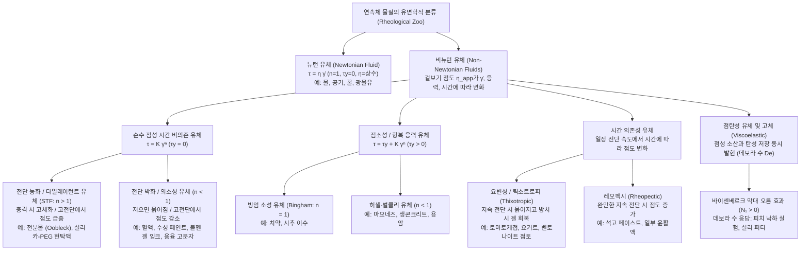
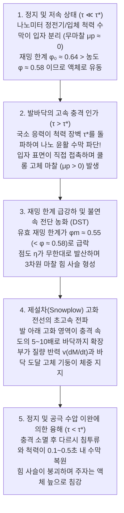

## 머리말: 전분물 수영장 위를 질주하는 물리학적 역설

과학 실험 쇼나 영상에서 한 번쯤 보았을 법한 기묘한 광경이 있다. 거대한 수영장에 옥수수 전분(또는 감자 전분)과 물을 부피비 약 $55:45$(무게비 약 $1.5:1 \sim 2:1$)로 섞은 불투명한 현탁액을 가득 채운다. 영어권에서는 닥터 수스(Dr. Seuss)의 1949년 동화책 『바솔로뮤와 우블렉(*Bartholomew and the Oobleck*)』에 등장하는 끈적한 물질의 이름을 따서 이 유체를 <strong>우블렉(Oobleck)</strong>이라 부른다.

이 하얀 '액체' 수영장 위를 사람이 전속력으로 내달리면 놀라운 일이 벌어진다. 발바닥이 수면을 강하게 내딛는 순간, 액체여야 할 전분물이 마치 콘크리트 바닥처럼 단단하게 굳어져 발목조차 빠지지 않고 반대편까지 달려갈 수 있다. 그릇에 담긴 전분물을 주먹으로 세게 내려치면 물방울이 튀기는커녕 손목이 아플 정도의 강한 반발력이 되돌아온다. 그러나 수영장 한가운데서 달리기를 멈추고 가만히 서는 순간, 발밑의 '고체 바닥'은 순식간에 녹아내려 끝없는 늪처럼 두 다리를 집어삼킨다. 당황해서 다리를 급하게 빼려고 힘을 주면 주변 유체가 다시 단단히 잠기며 신발이 벗겨질 듯 발을 붙잡는다. 빠져나오는 유일한 방법은 힘을 빼고 아주 천천히 다리를 움직이는 것뿐이다.

우리는 흔히 물질을 '기체·액체·고체'라는 고정된 세 가지 상태로 나누고, 액체의 끈적거림(점도)은 저어주는 속도와 무관하게 일정하다고 생각한다. 1687년 아이작 뉴턴(Isaac Newton)이 『프린키피아』에서 정식화한 이 고전적 법칙을 따르는 유체를 <strong>뉴턴 유체(Newtonian fluid)</strong>라고 한다. 하지만 자연계와 생명체, 현대 산업에 존재하는 대다수의 유체—전분물, 혈액, 토마토케첩, 마요네즈, 페인트, 치약, 용융 플라스틱, 심지어 지구 맨틀과 용암까지—는 뉴턴의 법칙을 거부하는 <strong>비뉴턴 유체(Non-Newtonian fluids)</strong>다.

고대 그리스 철학자 헤라클레이토스의 격언 "만물은 유전한다($\pi\alpha\nu\tau\alpha\ \rho\varepsilon\iota$ / *Panta rhei*)"를 모토로 삼아 물질의 변형과 흐름을 연구하는 현대 물리학 분야를 <strong>유변학(Rheology)</strong>이라 한다. 이 글에서는 유변학과 연성 물질 물리학(Soft Matter Physics)의 최신 성과를 바탕으로 비뉴턴 유체의 미시적 메커니즘과 공학적 응용을 깊이 있게 파헤친다.

---

## 제1장: 뉴턴의 점성 법칙과 페클레 수 — 왜 단순 액체는 뉴턴 유체이고 복합 유체는 비뉴턴 유체인가?

### 1.1 쿠에트 단순 전단 유동과 뉴턴 점성 법칙

거리 $H$ $[\text{m}]$만큼 떨어진 두 평행 평판 사이에 채워진 유체(<strong>쿠에트 유동 / Couette flow</strong>)를 생각하자. 아래 판($y=0$)을 고정하고 면적 $A$인 위 판($y=H$)에 접선 방향 힘 $F$ $[\text{N}]$를 가해 일정한 속도 $U$ $[\text{m}\cdot\text{s}^{-1}]$로 움직일 때, 단위 면적당 접선력을 <strong>전단 응력(Shear stress)</strong> $\tau \equiv \frac{F}{A}$ $[\text{Pa}]$라 정의하고, 수직 방향 속도 구배를 <strong>전단 속도(Shear rate, 또는 변형률 속도)</strong> $\dot{\gamma} \equiv \frac{\partial u}{\partial y} = \frac{U}{H}$ $[\text{s}^{-1}]$라 정의한다.

뉴턴 유체에서는 전단 응력과 전단 속도가 엄밀하게 정비례한다(<strong>뉴턴의 점성 법칙</strong>):

$$\tau = \eta \dot{\gamma} = \eta \frac{\partial u}{\partial y}$$

비례 상수 $\eta$ $[\text{Pa}\cdot\text{s}]$는 <strong>동점성 계수(Dynamic viscosity, 점도)</strong>이다. 3차원 비압축성 연속체 역학에서 코시 응력 텐서는 $\boldsymbol{\sigma} = -p\mathbf{I} + 2\eta\mathbf{D}$로 표현되며, 이를 운동량 보존식에 대입하면 <strong>나비에-스토크스 방정식(Navier-Stokes equation)</strong>이 도출된다. 물($20^\circ\text{C}$에서 $\eta \approx 10^{-3}\,\text{Pa}\cdot\text{s}$)이나 꿀($\eta \approx 2\text{–}10\,\text{Pa}\cdot\text{s}$) 같은 뉴턴 유체는 온도와 압력이 일정하면 전단 속도 $\dot{\gamma}$가 아무리 변해도 점도 $\eta$가 항상 일정하다.

### 1.2 브라운 이완 시간과 페클레 수(Péclet Number)의 물리학

왜 물은 뉴턴 유체이고 전분물이나 혈액은 비뉴턴 유체일까? 유체 내부 입자(반지름 $a$)가 열적 브라운 운동(확산 계수 $D_0 = \frac{k_B T}{6\pi \eta_0 a}$)을 통해 자신의 크기 $a$만큼 이동하여 흐름에 의해 흐트러진 배열을 원래의 등방적 열평형 상태로 되돌리는 데 걸리는 <strong>브라운 이완 시간(Brownian relaxation time)</strong> $\tau_B$는 다음과 같다:

$$\tau_B \equiv \frac{a^2}{D_0} = \frac{6\pi \eta_0 a^3}{k_B T}$$

여기서 핵심은 <strong>$\tau_B$가 입자 반지름의 세제곱($a^3$)에 비례한다</strong>는 사실이다! 이완 시간 $\tau_B$와 유동 변형 시간 $\tau_{\text{flow}} \sim \dot{\gamma}^{-1}$의 무차원 비율이 바로 <strong>페클레 수(Péclet number, $\text{Pe}$)</strong>다:

$$\text{Pe} \equiv \dot{\gamma}\tau_B = \frac{6\pi \eta_0 a^3 \dot{\gamma}}{k_B T}$$

- <strong>물 같은 저분자 액체($a \sim 0.15\,\text{nm}$)</strong>: $\tau_B \sim 10^{-12}\,\text{s}$(1피코초)로 극히 짧아 일상적인 전단 속도에서 항상 $\text{Pe} \ll 1$이다. 열운동이 순식간에 분자 배치를 초기화하므로 점도 $\eta$가 일정하게 유지된다.
- <strong>콜로이드 현탁액 및 고분자 복합 유체($a \sim 0.1\text{–}10\,\mu\text{m}$)</strong>: 전분 입자나 적혈구는 물 분자보다 $10^4$배 크므로, $a^3$에 비례하는 $\tau_B$는 무려 <strong>$10^{12}$배(1조 배)</strong> 증가하여 $\tau_B \sim 1\text{–}100\,\text{s}$에 달한다! 따라서 손으로 가볍게 젓는 전단 속도($\dot{\gamma} \sim 1\,\text{s}^{-1}$)에서도 쉽게 $\text{Pe} \gg 1$이 되어 유동장 자체가 미시 구조를 재편성하며, 점도가 $\dot{\gamma}$의 비선형 함수가 된다.

---

## 제2장: 비뉴턴 유체의 수학적 분류 — 거듭제곱 법칙과 허셸-벌클리 모델

비뉴턴 유체의 특정 전단 속도에서의 점도를 <strong>겉보기 점도(Apparent viscosity)</strong> $\eta_{\text{app}}(\dot{\gamma}) \equiv \frac{\tau(\dot{\gamma})}{\dot{\gamma}}$라 정의한다. 시간 비의존성 비뉴턴 유체를 통합적으로 기술하는 가장 중요한 구성 방정식은 1926년 제안된 <strong>허셸-벌클리 모델(Herschel-Bulkley model)</strong>과 그 특수 형태인 <strong>오스트발트-드 발레 거듭제곱 법칙(Ostwald-de Waele power-law model)</strong>이다:

$$\tau(\dot{\gamma}) = \tau_y + K \dot{\gamma}^n \quad (\tau \ge \tau_y \text{일 때; } \tau < \tau_y \text{이면 } \dot{\gamma} = 0)$$

$$\eta_{\text{app}}(\dot{\gamma}) = \frac{\tau_y}{\dot{\gamma}} + K \dot{\gamma}^{n-1}$$

여기서 $\tau_y$ $[\text{Pa}]$는 <strong>항복 응력(Yield stress)</strong>, $K$ $[\text{Pa}\cdot\text{s}^n]$는 <strong>점조도 지수(Consistency index)</strong>, $n$은 무차원 <strong>유동 거동 지수(Flow behavior index)</strong>이다. 또한 전단 속도의 전 영역(영전단 점도 $\eta_0$에서 무한전단 점도 $\eta_\infty$까지)을 특이점 없이 기술하기 위해 <strong>카로-야스다 모델(Carreau-Yasuda model)</strong>이 사용된다:

$$\frac{\eta(\dot{\gamma}) - \eta_\infty}{\eta_0 - \eta_\infty} = \left[ 1 + (\lambda \dot{\gamma})^a \right]^{\frac{n-1}{a}}$$

| 유체 클래스 | 구성 방정식 특징 | 겉보기 점도 $\eta_{\text{app}}(\dot{\gamma})$ 거동 | 핵심 미시적 물리 메커니즘 | 대표적인 물질 예 |
| :--- | :--- | :--- | :--- | :--- |
| <strong>뉴턴 유체</strong> | $\tau = \eta \dot{\gamma}$ ($n = 1, \tau_y = 0$) | $\dot{\gamma}$에 무관하게 항상 일정 ($\eta = \text{const.}$) | 피코초 수준의 분자 브라운 이완($\tau_B \sim 10^{-12}\,\text{s}, \text{Pe} \ll 1$)으로 등방성 유지 | 물, 공기, 에탄올, 글리세린, 꿀, 실리콘 오일 |
| <strong>전단 농화 유체 (STF)</strong> | $\tau = K \dot{\gamma}^n$ ($n > 1, \tau_y = 0$) | $\dot{\gamma}$ 증가 시 상승; 임계 응력 $\tau^*$ 초과 시 불연속 발산 (DST) | 유체역학적 하이드로클러스터 $\to$ 나노 수막 파단 및 고체 마찰 힘 사슬(Force chains) 형성 | 전분물(우블렉), 고농도 $\text{SiO}_2$-PEG 현탁액, 젖은 모래사장 |
| <strong>전단 박화 (의소성)</strong> | $\tau = K \dot{\gamma}^n$ ($n < 1, \tau_y = 0$) | $\dot{\gamma}$ 증가 시 단조 감소 ($\eta_0 \to \eta_\infty$) | 응집체 해리(적혈구 연전 현상 해소 및 변형), 고분자 사슬의 유선 방향 배향 및 얽힘 감소 | 혈액, 라텍스 페인트, 샴푸, 중성펜 겔 잉크, 용융 플라스틱 |
| <strong>항복 응력 (점소성)</strong> | $\tau = \tau_y + K \dot{\gamma}^n$ ($\tau_y > 0$) | $\tau < \tau_y$에서 고체; $\tau > \tau_y$에서 유동 및 관내 플러그 유동 형성 | 입자·액적의 3차원 재밍 네트워크가 임계 응력 $\tau_y$에서 항복·파괴 | 치약, 마요네즈, 생크림, 생콘크리트, 화산 용암 |
| <strong>요변성 (틱소트로피)</strong> | $\tau = \tau(\dot{\gamma}, t)$ (이력 루프) | 일정 전단 지속 시간 $t$에 따라 점도 감소, 정치 시 서서히 회복 | 수소결합·반데르발스 섬유 네트워크의 시간 지연 파괴 및 브라운 재구축 | 토마토케첩, 요거트, 화장품 크림, 인쇄 잉크 |
| <strong>점탄성 유체</strong> | $\tau + \lambda \dot{\tau} = \eta \dot{\gamma}$ ($N_1 > 0$) | 단시간($\text{De} \gg 1$)에는 탄성 고체, 장시간($\text{De} \ll 1$)에는 점성 액체 | 사슬 고분자의 엔트로피 탄성과 유선 방향 후프 장력(Hoop stress) 발생 | 피치(역청), 실리 퍼티(Silly Putty), 달걀흰자, 빵 반죽 |

---

## 제3장: 전분물(Oobleck)의 물리학 혁명 — 하이드로클러스터에서 마찰 접촉과 충격 고화 전선까지

왜 전분물은 충격을 받으면 순식간에 고체로 변해 사람의 체중을 지탱할까? 이 문제는 지난 100여 년 동안 세 차례의 극적인 패러다임 전환을 거쳐 마침내 규명되었다.

### 3.1 고전적 레이놀즈 다일레이턴시(1885)와 하이드로클러스터 이론(1985)

1885년 오스본 레이놀즈(Osborne Reynolds)는 젖은 해변 모래를 밟을 때 발 주변 모래가 하얗게 마르며 단단해지는 현상을 연구하여, 조밀하게 채워진 강체 입자들이 전단 변형을 받을 때 이웃 입자를 타고 넘기 위해 전체 <strong>부피가 팽창하는 현상(다일레이턴시 / Dilatancy, $\Delta V > 0$)</strong>을 규명했다. 넓어진 공극으로 물이 모세관 현상에 의해 빨려 들어가며 발생하는 부압(음압)이 모래알들을 강하게 밀착시켜 고체화한다.

1985년 John F. Brady와 Georges Bossis는 스토크스 동역학 시뮬레이션을 통해 약 30년간 정설로 군림한 <strong>하이드로클러스터 이론(Hydrocluster theory)</strong>을 제시했다. 점도 $\eta_0$인 용매 속에서 반지름 $a$인 두 구형 입자가 상대 속도 $v_{\text{rel}}$로 매우 좁은 표면 간격 $h$($h \ll a$)까지 접근할 때, 틈새의 물을 짜내기 위해 거대한 <strong>유체역학적 윤활 스퀴즈 힘(Lubrication squeezing force)</strong>이 작용한다:

$$F_{\text{lub}} \simeq \frac{6\pi \eta_0 a^2 v_{\text{rel}}}{h} \propto \frac{1}{h}$$

고전단($\text{Pe} \gg 1$)에서 $1/h$에 비례해 발산하는 윤활 저항 때문에 입자들이 일시적으로 분리되지 못하고 사슬 모양의 <strong>하이드로클러스터(Hydroclusters)</strong>를 형성해 점도가 상승한다는 이론이다.
<strong>그러나 하이드로클러스터 이론의 한계</strong>: 순수한 유체역학적 윤활력만으로는 점도가 기껏해야 수 배 증가하는 <strong>연속 전단 농화(CST)</strong>만 설명할 수 있을 뿐, 고농도 전분물($\phi \approx 55\%\text{–}60\%$)에서 점도가 수백~수천 배로 수직 발산하는 <strong>불연속 전단 농화(Discontinuous Shear Thickening, DST)</strong>와 성인이 위를 달릴 수 있는 거대한 수직 반력을 설명하는 데 완전히 실패했다!

### 3.2 현대의 패러다임 전환(2012–2014): 윤활 수막 파단·마찰 힘 사슬과 충격 고화 전선

2012년부터 2014년 사이, 두 가지 혁신적 연구가 100년의 수수께끼를 완전히 해결했다:

1. <strong>나노미터 척력 장벽 돌파와 무마찰-마찰 접촉 상전이(Wyart & Cates, 2014)</strong>:
   전분이나 실리카 입자 표면에는 정전기적 이중층 척력이나 입체 척력(Steric repulsion) $F_{\text{rep}}$가 작용하며, 이는 임계 응력 $\tau^* \sim F_{\text{rep}}/a^2$를 정의한다.
   - 낮은 응력($\tau \ll \tau^*$)에서는 나노미터 두께의 수막이 유지되어 입자 간 마찰이 없는 <strong>무마찰 상태($\mu_p \approx 0$)</strong>로 미끄러지며, 이때 입자들이 꽉 막히는 재밍(Jamming) 한계 부피 분율은 무작위 조밀 충진 한계인 <strong>$\phi_0 \approx 0.64$</strong>이다.
   - 그러나 발로 강하게 밟아 국소 응력이 임계치를 넘으면($\tau > \tau^*$), 나노 수막이 파단되면서 거친 전분 입자 표면들이 <strong>직접 접촉하여 쿨롱 고체 마찰($\mu_p > 0$)</strong>이 작동한다! 입자 간 회전이 마찰로 잠기면 재밍 한계 부피 분율은 느슨한 충진 한계인 <strong>$\phi_m \approx 0.55$</strong>로 급격히 떨어진다!
   마찰 접촉 비율을 $f(\tau) = \exp(-\tau^*/\tau)$라 할 때, 유효 재밍 한계 $\phi_J(\tau)$와 점도 $\eta(\phi, \tau)$는 다음 식을 따른다:
   $$\phi_J(\tau) = f(\tau)\,\phi_m + \left[1 - f(\tau)\right]\phi_0, \qquad \eta(\phi, \tau) \propto \left[ \phi_J(\tau) - \phi \right]^{-2}$$
   부피 농도 $\phi = 0.58$($\phi_m < \phi < \phi_0$)인 전분물은 평소에는 $\phi < \phi_0 = 0.64$이므로 액체로 흐르지만, 충격을 가해 $\tau > \tau^*$가 되는 순간 $\phi_J(\tau)$가 $0.55$로 급강하하여 $\phi > \phi_J(\tau)$가 된다! 분모가 0이 되면서 점도가 무한대로 발산(DST)하고, 3차원 <strong>마찰 힘 사슬(Frictional force chains)</strong>이 유체 전체를 고체로 잠근다.
2. <strong>충격 유도 고화와 '제설차(Snowplow)' 성장 전선(Waitukaitis & Jaeger, *Nature* 2012)</strong>:
   시카고 대학의 Waitukaitis와 Jaeger는 고속 X선 투시 촬영을 통해, 발이 속도 $v_0$로 수면에 충돌하는 순간 발바닥 바로 아래에 고밀도로 재밍된 <strong>고화 플러그(Solidified plug)</strong>가 형성되고, 그 경계면인 <strong>고화 전선(Solidification front)</strong>이 발의 침투 속도보다 <strong>$5\sim 10$배 빠른 속도($v_f = k v_0$)</strong>로 수영장 바닥을 향해 전파됨을 입증했다. 마치 제설차가 눈을 밀며 거대한 눈덩이를 키우듯 급증하는 고화 질량 $M(t)$가 거대한 <strong>부가 질량 반작용력</strong> $F_{\text{impact}} = \frac{d}{dt}[M(t)v(t)] = M\dot{v} + v\dot{M}$를 생성하며, 수 밀리초 내에 고화 전선이 바닥에 닿아 발바닥과 수영장 바닥을 잇는 튼튼한 '고체 기둥'을 완성한다. 멈춰 서서 응력이 사라지면($\tau < \tau^*$) 약 $0.1\sim 0.5\,\text{s}$ 만에 공극으로 물이 침투해 수막이 복원되고 고체 기둥은 순식간에 액체로 녹아내린다.

---

## 제4장: 전단 박화(의소성), 항복 응력 플러그 유동과 요변성(Thixotropy)

1. <strong>혈액 유변학(Hemorheology)</strong>: 부피의 약 $45\%$가 적혈구인 혈액은 정맥의 저전단($\dot{\gamma} < 1\,\text{s}^{-1}$)에서는 적혈구들이 동전 꾸러미처럼 쌓이는 <strong>연전 현상(Rouleaux formation)</strong>을 일으켜 점도가 $\eta_0 \approx 50\text{–}100\,\text{mPa}\cdot\text{s}$에 달한다. 그러나 동맥과 모세혈관의 고전단($\dot{\gamma} \sim 100\text{–}1,000\,\text{s}^{-1}$)에서는 연전이 해체되고 적혈구가 유선형 낙하산 모양으로 변형되며 세포막이 궤도처럼 회전하는 <strong>탱크 트레딩 운동(Tank-treading motion)</strong>을 통해 점도를 $\eta_\infty \approx 3\text{–}4\,\text{mPa}\cdot\text{s}$까지 낮춰 모세혈관 막힘을 방지한다.
2. <strong>페인트와 중성펜 겔 잉크</strong>: 붓질이나 필기 시의 고전단($\dot{\gamma} \sim 10^4\,\text{s}^{-1}$)에서는 점도가 수백 분의 일로 낮아져 부드럽게 발리고, 붓이나 펜을 떼는 순간($\tau < \tau_y$) 즉시 고점도 겔로 돌아와 벽면 흘러내림(Sagging)과 잉크 누출을 막는다.
3. <strong>빙엄 유체의 관내 플러그 유동(Plug Flow)</strong>: 치약 같은 항복 응력 유체($\tau = \tau_y + \eta_p\dot{\gamma}$)가 반지름 $R$인 원관을 흐를 때, 중심부 $r < r_p = \frac{2L\tau_y}{\Delta P}$ 영역에서는 전단 응력이 항복 응력보다 작아($\tau(r) < \tau_y$) 속도 구배가 0이 된다:
   $$u_{\text{Bingham}}(r) = \begin{cases} \dfrac{\Delta P}{4\eta_p L}(R - r_p)^2 = \text{const.} & (0 \le r < r_p : \text{미항복 고체 플러그 코어}) \\[8pt] \dfrac{\Delta P}{4\eta_p L}\left[ R^2 - r^2 - 2r_p(R - r) \right] & (r_p \le r \le R : \text{관벽 전단 윤활층}) \end{cases}$$
   이 때문에 치약은 튜브에서 줄무늬가 섞이지 않고 굵은 막대 모양 그대로 밀려 나온다.

---

## 제5장: 점탄성(Viscoelasticity), 데보라 수와 바이센베르크 효과

### 5.1 맥스웰 모델과 데보라 수(Deborah Number)

맥스웰(James Clerk Maxwell, 1867)은 탄성 스프링(탄성률 $G$)과 점성 대시포트(점도 $\eta$)를 직렬 연결하여 이완 시간 $\lambda \equiv \eta / G$를 갖는 선형 점탄성 방정식을 세웠다:

$$\tau + \lambda \frac{d\tau}{dt} = \eta \dot{\gamma}$$

1964년 마커스 라이너(Marcus Reiner)는 구약성경 사사기 5장 5절의 <strong>"산들이 주 앞에서 흘렀도다(The mountains flowed before the Lord)"</strong>라는 구절에서 영감을 받아 물질의 이완 시간 $t_{\text{relax}}$와 관찰(작용) 시간 $t_{\text{obs}}$의 비인 <strong>데보라 수(Deborah number, $\text{De}$)</strong>를 정의했다:

$$\text{De} \equiv \frac{t_{\text{relax}}}{t_{\text{obs}}}$$

$\text{De} \gg 1$($t_{\text{obs}} \ll t_{\text{relax}}$)이면 고체처럼 거동하고, $\text{De} \ll 1$($t_{\text{obs}} \gg t_{\text{relax}}$)이면 액체처럼 흐른다. 1927년부터 진행 중인 호주 퀸즐랜드 대학의 <strong>피치 낙하 실험(Pitch Drop Experiment)</strong>에서 역청(Pitch, $\eta \approx 2.3 \times 10^8\,\text{Pa}\cdot\text{s}$)은 망치로 치면($t_{\text{obs}} \sim 10^{-3}\,\text{s}, \text{De} \gg 1$) 유리처럼 산산조각 나지만, 수십 년간 방치하면($t_{\text{obs}} \sim 10^8\,\text{s}, \text{De} \ll 1$) 8~13년에 한 방울씩 떨어지는 액체다. 장난감 <strong>실리 퍼티(Silly Putty)</strong> 역시 바닥에 던지면 고무공처럼 튀어 오르지만($\text{De} \gg 1$), 책상 위에 두면 액체처럼 퍼진다($\text{De} \ll 1$).

### 5.2 바이센베르크 막대 오름 효과(Weissenberg Effect)

고분자 용액이나 달걀흰자에 회전하는 막대를 넣으면 액체가 원심력을 거슬러 막대를 타고 위로 기어오른다. 원형 유선을 따라 늘어난 고분자 사슬의 엔트로피 탄성이 유선 방향 인장 응력 $\sigma_{xx}$를 발생시켜 양의 <strong>제1법선 응력차(First normal stress difference)</strong>를 만들기 때문이다:

$$N_1(\dot{\gamma}) \equiv \sigma_{xx} - \sigma_{yy} = \Psi_1(\dot{\gamma})\dot{\gamma}^2 > 0$$

이 원주 방향의 후프 응력(Hoop stress)이 고무줄처럼 유체를 회전축 중심 쪽으로 죄어 밀어 올린다.

---

## 제6장: 최첨단 공학 응용 — 액체 방탄복부터 3D 바이오프린팅까지

1. <strong>액체 방탄복(Liquid Body Armor)과 D3O 충격 보호대</strong>: 폴리에틸렌글리콜(PEG)에 실리카($\text{SiO}_2$) 나노입자를 고농도로 분산시킨 전단 농화 유체(STF)를 케블라(Kevlar) 섬유에 함침시키면, 평상시($\dot{\gamma} < 10\,\text{s}^{-1}, \tau < \tau^*$)에는 일반 옷감처럼 유연하지만 총알이나 칼날이 충돌하는 순간($\dot{\gamma} > 10^5\,\text{s}^{-1}, \tau \gg \tau^*$) 마이크로초 내에 불연속 전단 농화(DST)로 경화되어 섬유를 잠그고 충격 에너지를 분산시킨다. 이를 통해 케블라 두께와 무게를 $30\%\text{–}50\%$ 줄이면서도 방탄·방검 성능을 극대화했다. 오토바이 보호대와 군용 헬멧에 쓰이는 <strong>D3O</strong> 소재 또한 데보라 수 전이를 이용해 평소엔 부드럽고 충격 시에만 단단하게 잠긴다.
2. <strong>3D 바이오프린팅(Bio-inks)</strong>: 살아있는 세포를 담은 바이오잉크는 미세 노즐 통과 시 빙엄 플러그 유동과 강한 전단 박화($n \ll 1$)를 통해 중심부 세포들을 전단 응력으로부터 보호(생존율 $>95\%$)하고, 토출 직후($\tau \to 0$) $0.1\,\text{s}$ 이내에 항복 응력 $\tau_y$를 요변성으로 회복하여 3차원 인공 장기 구조가 무너지지 않게 지지한다.
