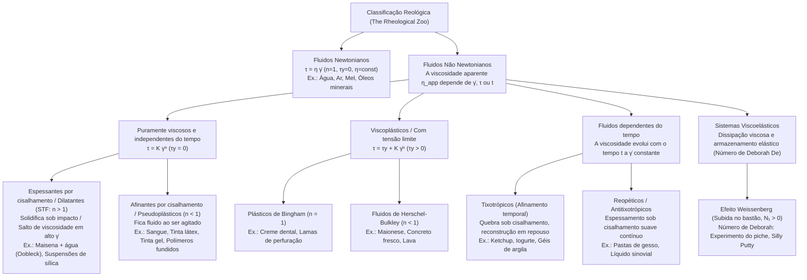
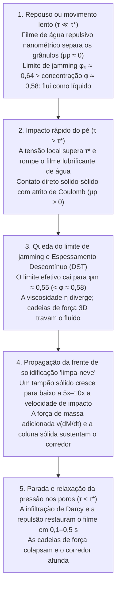

## Introdução: O paradoxo de correr sobre uma piscina de líquido

É uma das demonstrações mais impressionantes da física experimental: encha uma piscina com uma suspensão densa de amido de milho (maisena) ou fécula de batata misturada com água numa fração volumétrica de cerca de $55\%$ a $60\%$ de sólido (aproximadamente $1{,}5$ a $2$ partes de amido para $1$ parte de água em massa). No mundo anglófono, essa mistura branca leitosa é conhecida como <strong>Oobleck</strong>, em referência ao livro infantil de 1949 do Dr. Seuss.

Se uma pessoa tomar impulso e correr vigorosamente sobre a superfície dessa piscina "líquida", algo aparentemente milagroso acontece: no exato milissegundo em que a sola do pé atinge a superfície, o fluido sob o pé trava com a rigidez de uma laje de concreto. Sem afundar sequer até os tornozelos, o corredor atravessa toda a piscina. Se você golpear uma tigela de maisena e água com o punho fechado, em vez de espirrar, a superfície rebate como uma parede sólida. Contudo, no instante em que o corredor para no meio da piscina, o "chão sólido" sob seus pés derrete em uma fração de segundo e suas pernas afundam como em areia movediça. Pior ainda: se tentar puxar a perna de repente, a suspensão volta a se solidificar ao redor da panturrilha com força de torno; a única maneira de escapar é relaxar e retirar o pé com extrema lentidão.

Nossa intuição cotidiana divide a matéria em três estados fixos (sólido, líquido e gás) e pressupõe que a "espessura" (viscosidade) de um líquido seja invariável, independentemente da rapidez com que o agitamos. Os fluidos que obedecem a essa relação linear formulada por Sir Isaac Newton em seus *Principia* (1687) são chamados de <strong>fluidos newtonianos (Newtonian fluids)</strong>. Entretanto, a imensa maioria dos fluidos na natureza, na biologia e na indústria — suspensões de amido, sangue, ketchup, maionese, tinta de parede, creme dental, polímeros fundidos e o manto terrestre — desafia a lei de Newton: são <strong>fluidos não newtonianos (Non-Newtonian fluids)</strong>.

Inspirada no aforismo de Heráclito $\pi\alpha\nu\tau\alpha\ \rho\varepsilon\iota$ (*Panta rhei*, "tudo flui"), a ciência que estuda a deformação e o escoamento da matéria complexa é a <strong>reologia (Rheology)</strong>. Neste artigo, analisaremos desde as equações constitutivas até a revolução microscópica do espessamento por cisalhamento (2012–2014), a reologia sanguínea, o efeito Weissenberg, o número de Deborah e as armaduras líquidas.

---

## Capítulo 1: A lei da viscosidade de Newton e o número de Péclet

### 1.1 Escoamento de Couette plano e tensor de tensões

Considere um fluido confinado entre duas placas planas paralelas separadas por uma distância $H$ $[\text{m}]$ (<strong>escoamento de Couette</strong>). A placa inferior ($y=0$) permanece fixa enquanto a placa superior ($y=H$, de área $A$) move-se horizontalmente com velocidade constante $U$ $[\text{m}\cdot\text{s}^{-1}]$ sob uma força tangencial $F$ $[\text{N}]$. Definimos a <strong>tensão de cisalhamento (Shear stress)</strong> como $\tau \equiv \frac{F}{A}$ $[\text{Pa}]$ e a <strong>taxa de cisalhamento (Shear rate)</strong> como o gradiente espacial de velocidade $\dot{\gamma} \equiv \frac{\partial u}{\partial y} = \frac{U}{H}$ $[\text{s}^{-1}]$.

Para um fluido newtoniano, a tensão de cisalhamento é diretamente proporcional à taxa de cisalhamento (<strong>lei da viscosidade de Newton</strong>):

$$\tau = \eta \dot{\gamma} = \eta \frac{\partial u}{\partial y}$$

onde $\eta$ $[\text{Pa}\cdot\text{s}]$ é a <strong>viscosidade dinâmica</strong>. Na mecânica do contínuo tridimensional, o tensor de tensões de Cauchy para um fluido incompressível escreve-se $\boldsymbol{\sigma} = -p\mathbf{I} + 2\eta\mathbf{D}$, conduzindo à <strong>equação de Navier-Stokes</strong>. À temperatura e pressão constantes, $\eta$ é uma constante estrita para a água ($\approx 10^{-3}\,\text{Pa}\cdot\text{s}$) ou o mel ($\approx 2\text{–}10\,\text{Pa}\cdot\text{s}$).

### 1.2 Por que fluidos complexos são não newtonianos? O número de Péclet ($\text{Pe}$)

Uma partícula ou molécula de raio $a$ imersa num solvente de viscosidade $\eta_0$ à temperatura $T$ sofre <strong>movimento browniano</strong> com difusividade de Stokes-Einstein $D_0 = \frac{k_B T}{6\pi \eta_0 a}$. O tempo necessário para a partícula difundir uma distância igual ao seu próprio raio $a$ e restaurar a isotropia termodinâmica é o <strong>tempo de relaxação browniano</strong> $\tau_B$:

$$\tau_B \equiv \frac{a^2}{D_0} = \frac{6\pi \eta_0 a^3}{k_B T}$$

Note que <strong>$\tau_B$ escala com o cubo do raio da partícula ($a^3$)</strong>! A razão adimensional entre esse tempo de relaxação térmica e o tempo característico de deformação do escoamento $\tau_{\text{flow}} \sim \dot{\gamma}^{-1}$ define o <strong>número de Péclet ($\text{Pe}$)</strong>:

$$\text{Pe} \equiv \dot{\gamma}\tau_B = \frac{6\pi \eta_0 a^3 \dot{\gamma}}{k_B T}$$

- <strong>Líquidos de pequenas moléculas (ex.: água, $a \sim 0{,}15\,\text{nm}$)</strong>: $\tau_B \sim 10^{-12}\,\text{s}$ (picossegundos). Mesmo sob taxas de cisalhamento extremas ($\dot{\gamma} \sim 10^5\,\text{s}^{-1}$), $\text{Pe} \sim 10^{-7} \ll 1$. A agitação térmica restaura o equilíbrio isótropo instantaneamente e $\eta$ permanece constante.
- <strong>Fluidos complexos / Matéria mole (coloides, polímeros, $a \sim 0{,}1\text{–}10\,\mu\text{m}$)</strong>: Um grânulo de amido ou um glóbulo vermelho é $10^4$ vezes maior que uma molécula de água, fazendo $\tau_B \propto a^3$ saltar por um fator de <strong>$10^{12}$ (um trilhão)</strong>, atingindo $\tau_B \sim 1\text{–}100\,\text{s}$! Assim, uma leve agitação manual ($\dot{\gamma} \sim 1\,\text{s}^{-1}$) leva facilmente ao regime $\text{Pe} \gg 1$, onde o escoamento reorganiza a microestrutura e torna a viscosidade fortemente não linear.

---

## Capítulo 2: Classificação matemática — Lei da potência e modelo de Herschel-Bulkley

Nos fluidos não newtonianos definimos a <strong>viscosidade aparente</strong> como $\eta_{\text{app}}(\dot{\gamma}) \equiv \frac{\tau(\dot{\gamma})}{\dot{\gamma}}$. A equação constitutiva geral para fluidos independentes do tempo é o <strong>modelo de Herschel-Bulkley (1926)</strong> e seu caso particular sem tensão de escoamento ($\tau_y = 0$), a <strong>lei da potência de Ostwald-de Waele</strong>:

$$\tau(\dot{\gamma}) = \tau_y + K \dot{\gamma}^n \quad (\text{para } \tau \ge \tau_y \,; \text{ se } \tau < \tau_y \text{ então } \dot{\gamma} = 0)$$

$$\eta_{\text{app}}(\dot{\gamma}) = \frac{\tau_y}{\dot{\gamma}} + K \dot{\gamma}^{n-1}$$

onde $\tau_y$ $[\text{Pa}]$ é a <strong>tensão limite de escoamento (Yield stress)</strong>, $K$ $[\text{Pa}\cdot\text{s}^n]$ o <strong>índice de consistência</strong> e $n$ o <strong>índice de comportamento de escoamento</strong>. Para descrever sem singularidades a transição entre os platôs newtonianos de baixo cisalhamento ($\eta_0$) e alto cisalhamento ($\eta_\infty$), utiliza-se o <strong>modelo de Carreau-Yasuda</strong>:

$$\frac{\eta(\dot{\gamma}) - \eta_\infty}{\eta_0 - \eta_\infty} = \left[ 1 + (\lambda \dot{\gamma})^a \right]^{\frac{n-1}{a}}$$

| Classe de fluido | Equação constitutiva | Comportamento de $\eta_{\text{app}}(\dot{\gamma})$ | Mecanismo microscópico dominante | Exemplos representativos |
| :--- | :--- | :--- | :--- | :--- |
| <strong>Fluido newtoniano</strong> | $\tau = \eta \dot{\gamma}$ ($n = 1, \tau_y = 0$) | Constante para todo $\dot{\gamma}$ ($\eta = \text{const.}$) | Relaxação térmica em picossegundos ($\tau_B \sim 10^{-12}\,\text{s}, \text{Pe} \ll 1$) preserva isotropia | Água, ar, etanol, glicerol, mel, óleos de silicone |
| <strong>Espessante por cisalhamento (STF)</strong> | $\tau = K \dot{\gamma}^n$ ($n > 1, \tau_y = 0$) | Cresce com $\dot{\gamma}$; diverge descontinuamente (DST) acima de $\tau^*$ | Hidroclusters $\to$ ruptura do filme lubrificante e cadeias de força friccionais sólido-sólido | Oobleck (maisena em água), dispersões $\text{SiO}_2$-PEG, areia molhada |
| <strong>Pseudoplástico (Shear-Thinning)</strong> | $\tau = K \dot{\gamma}^n$ ($n < 1, \tau_y = 0$) | Diminui monotonicamente com $\dot{\gamma}$ ($\eta_0 \to \eta_\infty$) | Desagregação (rouleaux de hemácias), alinhamento e desemaranhamento polimérico | Sangue total, tinta acrílica, xampu, tinta gel, polímeros fundidos |
| <strong>Viscoplástico (Com tensão limite)</strong> | $\tau = \tau_y + K \dot{\gamma}^n$ ($\tau_y > 0$) | Sólido abaixo de $\tau_y$; escoamento pistonado (Plug flow) acima de $\tau_y$ | Rede 3D bloqueada de partículas ou gotas que cede acima do limiar $\tau_y$ | Creme dental, maionese, chantilly, concreto fresco, lava |
| <strong>Fluido tixotrópico</strong> | $\tau = \tau(\dot{\gamma}, t)$ (Laço de histerese) | Diminui com o tempo $t$ sob cisalhamento constante; recupera em repouso | Ruptura temporal e repercolação browniana de ligações de hidrogênio/van der Waals | Ketchup, iogurte batido, lamas de bentonita, loções cosméticas |
| <strong>Fluido viscoelástico</strong> | $\tau + \lambda \dot{\tau} = \eta \dot{\gamma}$ ($N_1 > 0$) | Sólido elástico em tempos curtos ($\text{De} \gg 1$), líquido em tempos longos ($\text{De} \ll 1$) | Elasticidade entrópica de macromoléculas emaranhadas gerando tensão circunferencial (Hoop stress) | Piche (betume), Silly Putty, clara de ovo, massa de pão, muco |

---

## Capítulo 3: A física do Oobleck — Três revoluções nos fluidos espessantes por cisalhamento (STF)

### 3.1 Dilatância de Reynolds (1885) e teoria de hidroclusters (1985)

Em 1885, <strong>Osborne Reynolds</strong> explicou por que a areia molhada da praia embranquece e endurece sob os pés: grãos compactados precisam rolar uns sobre os outros ao sofrerem cisalhamento, causando uma <strong>expansão volumétrica (Dilatância, $\Delta V > 0$)</strong> que suga a água superficial e gera pressão intersticial negativa que trava os grãos.

Em 1985, <strong>John F. Brady e Georges Bossis</strong> formularam a <strong>teoria de hidroclusters</strong>: quando duas esferas de raio $a$ aproximam-se com velocidade relativa $v_{\text{rel}}$ até uma fenda mínima $h \ll a$ num solvente de viscosidade $\eta_0$, expulsar o líquido gera uma <strong>força de lubrificação hidrodinâmica</strong> divergente:

$$F_{\text{lub}} \simeq \frac{6\pi \eta_0 a^2 v_{\text{rel}}}{h} \propto \frac{1}{h}$$

Em alto cisalhamento ($\text{Pe} \gg 1$), essa resistência $\propto 1/h$ agrupa temporariamente as partículas em aglomerados (<strong>hidroclusters</strong>). Contudo, forças puramente hidrodinâmicas explicam apenas o <strong>espessamento contínuo (CST)</strong> moderado e falham em explicar o <strong>espessamento descontínuo por cisalhamento (DST)</strong> do Oobleck ($\phi \approx 55\%\text{–}60\%$), onde a viscosidade salta milhares de vezes verticalmente.

### 3.2 A mudança de paradigma (2012–2014): Contatos friccionais (Wyart & Cates) e frentes de solidificação (Waitukaitis & Jaeger)

1. <strong>Ruptura do filme lubrificante nanométrico e bloqueio friccional (Wyart & Cates, 2014)</strong>:
   Grânulos de amido ou sílica possuem repulsão eletrostática ou estérica $F_{\text{rep}}$ que define uma tensão limiar $\tau^* \sim F_{\text{rep}}/a^2$.
   - <strong>Baixa tensão ($\tau \ll \tau^*$)</strong>: O filme nanométrico de água permanece intacto; as partículas deslizam <strong>sem atrito ($\mu_p \approx 0$)</strong> e só travam (jamming) no empacotamento compacto aleatório <strong>$\phi_0 \approx 0{,}64$</strong>.
   - <strong>Alta tensão / Impacto ($\tau > \tau^*$)</strong>: A tensão supera a barreira repulsiva, rompe o filme de água e os grânulos rugosos entram em <strong>contato direto sólido-sólido com atrito de Coulomb ($\mu_p > 0$)</strong>! O bloqueio rotacional reduz a fração crítica de travamento para o empacotamento frouxo <strong>$\phi_m \approx 0{,}55$</strong>.
   Com fração de contatos friccionais $f(\tau) = \exp(-\tau^*/\tau)$, o limiar efetivo de jamming $\phi_J(\tau)$ e a viscosidade $\eta(\phi, \tau)$ obedecem:
   $$\phi_J(\tau) = f(\tau)\,\phi_m + \left[1 - f(\tau)\right]\phi_0, \qquad \eta(\phi, \tau) \propto \left[ \phi_J(\tau) - \phi \right]^{-2}$$
   Para $\phi = 0{,}58$ ($\phi_m < \phi < \phi_0$), em repouso temos $\phi < \phi_0 = 0{,}64$ (líquido). Ao pisar forte ($\tau > \tau^*$), $\phi_J(\tau)$ cai para $0{,}55 < \phi = 0{,}58$: a viscosidade diverge ao infinito (DST) e uma rede 3D de <strong>cadeias de força friccionais</strong> solidifica o fluido!
2. <strong>Solidificação ativada por impacto e frente "limpa-neve" (Waitukaitis & Jaeger, *Nature* 2012)</strong>:
   Usando radiografia de raios X de alta velocidade na Universidade de Chicago, Waitukaitis e Jaeger descobriram que o impacto de um pé com velocidade $v_0$ nucleia sob a sola um tampão sólido cuja fronteira — a <strong>frente de solidificação</strong> — propaga-se rumo ao fundo a $5\text{–}10$ vezes a velocidade do pé ($v_f = k v_0$), como a lâmina de um limpa-neve. A massa solidificada em rápida expansão $M(t)$ gera uma enorme <strong>força de massa adicionada</strong> $F_{\text{impact}} = \frac{d}{dt}[M(t)v(t)] = M\dot{v} + v\dot{M}$ e cria em milissegundos uma coluna sólida até o fundo da piscina. Ao parar ($\tau < \tau^*$), a infiltração de Darcy restaura o filme de água em $0{,}1\text{–}0{,}5\,\text{s}$ e a coluna derrete.

---

## Capítulo 4: Pseudoplasticidade, escoamento pistonado (Plug Flow) e tixotropia

1. <strong>Hemorreologia (Sangue)</strong>: O sangue ($\approx 45\%$ de hemácias) forma em baixo cisalhamento ($\dot{\gamma} < 1\,\text{s}^{-1}$) pilhas de moedas chamadas <strong>rouleaux</strong> ($\eta_0 \approx 50\text{–}100\,\text{mPa}\cdot\text{s}$). Em artérias e capilares ($\dot{\gamma} \sim 100\text{–}1.000\,\text{s}^{-1}$), os agregados se separam e as hemácias se deformam com rotação de membrana tipo lagarta de tanque (<strong>tank-treading motion</strong>), reduzindo a viscosidade para $\eta_\infty \approx 3\text{–}4\,\text{mPa}\cdot\text{s}$.
2. <strong>Tintas e canetas em gel</strong>: Sob o pincel ou a esfera da caneta ($\dot{\gamma} \sim 10^4\,\text{s}^{-1}$), a viscosidade cai milhares de vezes para fluir suavemente, mas ao cessar a força ($\tau < \tau_y$) recupera sua estrutura instantaneamente, evitando escorrimento (sagging).
3. <strong>Escoamento pistonado de Bingham (Plug Flow)</strong>: Num tubo de raio $R$ sob gradiente de pressão $\Delta P / L$, a tensão é $\tau(r) = \frac{\Delta P}{2L}r$. No núcleo central $r < r_p = \frac{2L\tau_y}{\Delta P}$, vale $\tau(r) < \tau_y$ e $\frac{du}{dr} = 0$:
   $$u_{\text{Bingham}}(r) = \begin{cases} \dfrac{\Delta P}{4\eta_p L}(R - r_p)^2 = \text{const.} & (0 \le r < r_p : \text{núcleo sólido em escoamento pistonado}) \\[8pt] \dfrac{\Delta P}{4\eta_p L}\left[ R^2 - r^2 - 2r_p(R - r) \right] & (r_p \le r \le R : \text{camada anular cisalhada}) \end{cases}$$
   Por isso o creme dental sai do tubo como um cilindro sólido intacto sem misturar suas listras.

---

## Capítulo 5: Viscoelasticidade, número de Deborah e efeito Weissenberg

### 5.1 Modelo de Maxwell e número de Deborah ($\text{De}$)

James Clerk Maxwell (1867) conectou em série uma mola elástica de Hooke (módulo $G$) e um amortecedor viscoso de Newton (viscosidade $\eta$), obtendo a equação viscoelástica com tempo de relaxação $\lambda \equiv \eta / G$:

$$\tau + \lambda \frac{d\tau}{dt} = \eta \dot{\gamma}$$

Em 1964, <strong>Marcus Reiner</strong> inspirou-se no Cântico de Débora (Juízes 5:5: <em>"Os montes se derreteram diante do Senhor"</em>) para definir o <strong>número de Deborah ($\text{De}$)</strong> como a razão entre o tempo de relaxação $t_{\text{relax}}$ e o tempo de observação $t_{\text{obs}}$:

$$\text{De} \equiv \frac{t_{\text{relax}}}{t_{\text{obs}}}$$

Se $\text{De} \gg 1$ ($t_{\text{obs}} \ll t_{\text{relax}}$), o material responde como sólido elástico; se $\text{De} \ll 1$ ($t_{\text{obs}} \gg t_{\text{relax}}$), flui como líquido. No <strong>experimento da gota de piche (Pitch Drop Experiment)</strong> iniciado em 1927 na Universidade de Queensland, o piche ($\eta \approx 2{,}3 \times 10^8\,\text{Pa}\cdot\text{s}$) estilhaça como vidro sob uma martelada ($t_{\text{obs}} \sim 10^{-3}\,\text{s}, \text{De} \gg 1$), mas pinga uma gota a cada 8 a 13 anos sob a gravidade ($t_{\text{obs}} \sim 10^8\,\text{s}, \text{De} \ll 1$). Da mesma forma, o <strong>Silly Putty</strong> quica como bola de borracha ($\text{De} \gg 1$), mas se espalha como poça em repouso ($\text{De} \ll 1$).

### 5.2 O efeito Weissenberg (Subida no bastão)

Ao girar uma haste numa solução polimérica (ou clara de ovo), o líquido sobe pela haste contra a gravidade! As cadeias poliméricas esticadas ao longo das linhas de corrente circulares geram por elasticidade entrópica uma <strong>primeira diferença de tensões normais</strong> positiva:

$$N_1(\dot{\gamma}) \equiv \sigma_{xx} - \sigma_{yy} = \Psi_1(\dot{\gamma})\dot{\gamma}^2 > 0$$

Essa tensão circunferencial (tensão de arco / Hoop stress) aperta radialmente o fluido em direção ao eixo e o impulsiona para cima.

---

## Capítulo 6: Aplicações de engenharia — Da armadura líquida à bioimpressão 3D

1. <strong>Armadura corporal líquida (Liquid Body Armor) e D3O</strong>: Tecidos de Kevlar impregnados com um STF de nanopartículas de sílica ($\text{SiO}_2$) em polietilenoglicol (PEG) permanecem flexíveis no movimento normal ($\dot{\gamma} < 10\,\text{s}^{-1}, \tau < \tau^*$), mas diante do impacto de um projétil ou faca ($\dot{\gamma} > 10^5\,\text{s}^{-1}, \tau \gg \tau^*$) solidificam-se em microssegundos por travamento friccional (DST), reduzindo o peso do colete em $30\%\text{–}50\%$. Igualmente, os protetores laranjas <strong>D3O</strong> usam a transição do número de Deborah para endurecer instantaneamente sob impacto.
2. <strong>Bioimpressão 3D (Bio-inks)</strong>: Biotintas contendo células-tronco vivas utilizam o escoamento pistonado de Bingham e forte afinamento por cisalhamento ($n \ll 1$) para proteger as células dentro do bico extrusor ($>95\%$ de viabilidade) e recuperam sua tensão limite $\tau_y$ em $<0{,}1\,\text{s}$ após a extrusão para sustentar estruturas 3D de órgãos sem colapsar.
