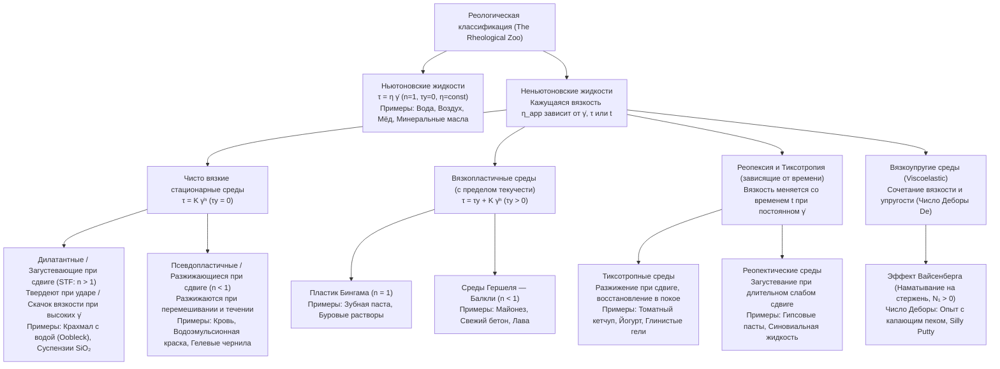
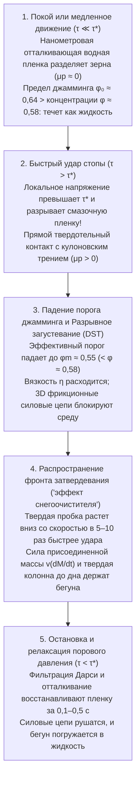

## Введение: парадокс бега по бассейну с жидкостью

Это один из самых зрелищных экспериментов в физике мягкой материи: наполните бассейн концентрированной суспензией обычного кукурузного или картофельного крахмала в воде с объемной долей твердой фазы около $55\text{–}60\%$ (примерно $1{,}5\text{–}2$ части крахмала на $1$ часть воды по массе). В англоязычной литературе эту молочно-белую смесь называют <strong>ооблек (Oobleck)</strong> — в честь детской книги доктора Сьюза 1949 года.

Если человек разбежится и начнет энергично бежать по поверхности этого «жидкого» бассейна, произойдет нечто поразительное: в ту миллисекунду, когда подошва ударяет по воде, суспензия под ногой каменеет подобно бетонной плите. Не погружаясь даже по щиколотку, бегун легко пересекает весь бассейн. Если со всей силы ударить кулаком по миске с крахмальной смесью, брызг не будет — рука встретит жесткое сопротивление твердой стены. Однако стоит бегуну остановиться посреди бассейна, как «твердый пол» под ногами мгновенно плавится, и ноги увязают, словно в бездонном зыбучем песке. Более того, при попытке резко выдернуть ногу жидкость снова мгновенно блокируется и намертво зажимает стопу; освободиться можно, лишь полностью расслабив мышцы и вытягивая ногу предельно медленно.

Наша повседневная интуиция делит вещества на три неизменных агрегатных состояния (твердое, жидкое, газообразное) и предполагает, что «густота» (вязкость) жидкости не зависит от скорости перемешивания. Жидкости, подчиняющиеся этому линейному закону, сформулированному Исааком Ньютоном в его «Математических началах натуральной философии» (1687), называются <strong>ньютоновскими жидкостями (Newtonian fluids)</strong>. Но подавляющее большинство текучих сред в природе, биологии и технике — суспензии крахмала, кровь, кетчуп, майонез, краска, зубная паста, расплавы полимеров и мантия Земли — нарушают закон Ньютона: это <strong>неньютоновские жидкости (Non-Newtonian fluids)</strong>.

Наука о деформации и течении вещества, девизом которой стало изречение Гераклита $\pi\alpha\nu\tau\alpha\ \rho\varepsilon\iota$ (*Panta rhei* — «всё течёт»), называется <strong>реологией (Rheology)</strong>. В этой статье мы подробно разберем математические модели, революцию в понимании дилатантного загустевания (2012–2014), реологию крови, эффект Вайсенберга, число Деборы и жидкие бронежилеты.

---

## Глава 1: Закон вязкости Ньютона и число Пекле

### 1.1 Плоское течение Куэтта и тензор напряжений

Рассмотрим жидкость между двумя параллельными пластинами на расстоянии $H$ $[\text{m}]$ (<strong>течение Куэтта</strong>). Нижняя пластина ($y=0$) неподвижна, а верхняя ($y=H$, площади $A$) движется горизонтально с постоянной скоростью $U$ $[\text{m}\cdot\text{s}^{-1}]$ под действием касательной силы $F$ $[\text{N}]$. <strong>Касательное напряжение сдвига (Shear stress)</strong> определяется как $\tau \equiv \frac{F}{A}$ $[\text{Pa}]$, а поперечный градиент скорости называется <strong>скоростью сдвига (Shear rate)</strong> $\dot{\gamma} \equiv \frac{\partial u}{\partial y} = \frac{U}{H}$ $[\text{s}^{-1}]$.

Для ньютоновской жидкости напряжение сдвига прямо пропорционально скорости сдвига (<strong>закон вязкости Ньютона</strong>):

$$\tau = \eta \dot{\gamma} = \eta \frac{\partial u}{\partial y}$$

где $\eta$ $[\text{Pa}\cdot\text{s}]$ — <strong>динамическая вязкость</strong>. В трехмерной механике сплошных сред тензор напряжений Коши для несжимаемой жидкости имеет вид $\boldsymbol{\sigma} = -p\mathbf{I} + 2\eta\mathbf{D}$, что приводит к <strong>уравнению Навье — Стокса</strong>. При постоянных температуре $T$ и давлении $p$ вязкость $\eta$ воды ($\approx 10^{-3}\,\text{Pa}\cdot\text{s}$) или мёда ($\approx 2\text{–}10\,\text{Pa}\cdot\text{s}$) строго постоянна.

### 1.2 Почему сложные жидкости неньютоновские? Число Пекле ($\text{Pe}$)

Частица радиуса $a$ в растворителе с вязкостью $\eta_0$ при температуре $T$ совершает тепловое <strong>броуновское движение</strong> с коэффициентом диффузии Стокса — Эйнштейна $D_0 = \frac{k_B T}{6\pi \eta_0 a}$. Характерное время диффузии частицы на расстояние собственного радиуса $a$ для восстановления изотропного равновесия — это <strong>броуновское время релаксации</strong> $\tau_B$:

$$\tau_B \equiv \frac{a^2}{D_0} = \frac{6\pi \eta_0 a^3}{k_B T}$$

Обратите внимание: <strong>$\tau_B$ пропорционально кубу радиуса частицы ($a^3$)</strong>! Безразмерное отношение времени тепловой релаксации ко времени гидродинамической деформации $\tau_{\text{flow}} \sim \dot{\gamma}^{-1}$ определяет <strong>число Пекле ($\text{Pe}$)</strong>:

$$\text{Pe} \equiv \dot{\gamma}\tau_B = \frac{6\pi \eta_0 a^3 \dot{\gamma}}{k_B T}$$

- <strong>Низкомолекулярные жидкости (например, вода, $a \sim 0{,}15\,\text{nm}$)</strong>: $\tau_B \sim 10^{-12}\,\text{s}$ (пикосекунды). Даже при огромных скоростях сдвига ($\dot{\gamma} \sim 10^5\,\text{s}^{-1}$) имеем $\text{Pe} \sim 10^{-7} \ll 1$. Тепловое движение мгновенно восстанавливает изотропию, и $\eta = \text{const}$.
- <strong>Сложные жидкости / Мягкая материя (коллоиды, полимеры, $a \sim 0{,}1\text{–}10\,\mu\text{m}$)</strong>: Зерно крахмала или эритроцит в $10^4$ раз крупнее молекулы воды, поэтому $\tau_B \propto a^3$ возрастает в <strong>$10^{12}$ раз (триллион раз)</strong>, достигая $\tau_B \sim 1\text{–}100\,\text{s}$! Уже при легком помешивании ($\dot{\gamma} \sim 1\,\text{s}^{-1}$) достигается режим $\text{Pe} \gg 1$: поток перестраивает микроструктуру быстрее тепловой релаксации, делая вязкость нелинейной функцией $\dot{\gamma}$.

---

## Глава 2: Математическая классификация — степенной закон и модель Гершеля — Балкли

Для неньютоновских сред вводится <strong>кажущаяся (эффективная) вязкость</strong> $\eta_{\text{app}}(\dot{\gamma}) \equiv \frac{\tau(\dot{\gamma})}{\dot{\gamma}}$. Универсальным определяющим соотношением для независящих от времени сред является <strong>модель Гершеля — Балкли (1926)</strong> и её частный случай при $\tau_y = 0$ — <strong>степенной закон Оствальда — де Ваале</strong>:

$$\tau(\dot{\gamma}) = \tau_y + K \dot{\gamma}^n \quad (\text{при } \tau \ge \tau_y \,; \text{ если } \tau < \tau_y, \text{ то } \dot{\gamma} = 0)$$

$$\eta_{\text{app}}(\dot{\gamma}) = \frac{\tau_y}{\dot{\gamma}} + K \dot{\gamma}^{n-1}$$

где $\tau_y$ $[\text{Pa}]$ — <strong>предел текучести (Yield stress)</strong>, $K$ $[\text{Pa}\cdot\text{s}^n]$ — <strong>коэффициент консистенции</strong>, а $n$ — <strong>индекс течения</strong>. Для гладкого описания перехода между первым ($\eta_0$) и вторым ($\eta_\infty$) ньютоновскими плато применяется <strong>модель Карро — Ясуды (Carreau-Yasuda)</strong>:

$$\frac{\eta(\dot{\gamma}) - \eta_\infty}{\eta_0 - \eta_\infty} = \left[ 1 + (\lambda \dot{\gamma})^a \right]^{\frac{n-1}{a}}$$

| Класс среды | Определяющее уравнение | Поведение $\eta_{\text{app}}(\dot{\gamma})$ | Доминирующий микромеханизм | Типичные примеры |
| :--- | :--- | :--- | :--- | :--- |
| <strong>Ньютоновская жидкость</strong> | $\tau = \eta \dot{\gamma}$ ($n = 1, \tau_y = 0$) | Постоянна при любых $\dot{\gamma}$ ($\eta = \text{const.}$) | Пикосекундная тепловая релаксация ($\tau_B \sim 10^{-12}\,\text{s}, \text{Pe} \ll 1$) сохраняет изотропию | Вода, воздух, этанол, глицерин, мёд, силиконовые масла |
| <strong>Дилатантная / STF</strong> | $\tau = K \dot{\gamma}^n$ ($n > 1, \tau_y = 0$) | Растет с $\dot{\gamma}$; разрывно расходится (DST) выше $\tau^*$ | Гидрокластеры $\to$ прорыв смазочной пленки и твердотельные фрикционные силовые цепи | Ооблек (крахмал в воде), суспензии $\text{SiO}_2$-ПЭГ, мокрый песок |
| <strong>Псевдопластичная</strong> | $\tau = K \dot{\gamma}^n$ ($n < 1, \tau_y = 0$) | Монотонно падает с ростом $\dot{\gamma}$ ($\eta_0 \to \eta_\infty$) | Распад агрегатов («монетных столбиков» эритроцитов), ориентация и распутывание полимеров | Цельная кровь, краска, шампунь, гелевые чернила, расплавы полимеров |
| <strong>Вязкопластичная</strong> | $\tau = \tau_y + K \dot{\gamma}^n$ ($\tau_y > 0$) | Твердое тело ниже $\tau_y$; пробковое течение (Plug flow) выше $\tau_y$ | Заблокированный 3D-каркас частиц или капель разрушается при превышении $\tau_y$ | Зубная паста, майонез, взбитые сливки, бетонная смесь, лава |
| <strong>Тиксотропная жидкость</strong> | $\tau = \tau(\dot{\gamma}, t)$ (Петля гистерезиса) | Падает со временем $t$ при сдвиге; восстанавливается в покое | Запаздывающий разрыв и броуновская реперколяция водородных/ван-дер-ваальсовых связей | Кетчуп, йогурт, бентонитовые суспензии, косметические кремы |
| <strong>Вязкоупругая среда</strong> | $\tau + \lambda \dot{\tau} = \eta \dot{\gamma}$ ($N_1 > 0$) | Упругое тело на малых временах ($\text{De} \gg 1$), жидкость на больших ($\text{De} \ll 1$) | Энтропийная упругость макромолекул, создающая кольцевые напряжения (Hoop stress) | Пек (битум), жвачка для рук (Silly Putty), яичный белок, тесто |

---

## Глава 3: Физика ооблека — три революции в теории дилатантных жидкостей (STF)

### 3.1 Дилатансия Рейнольдса (1885) и теория гидрокластеров (1985)

В 1885 году <strong>Осборн Рейнольдс</strong> объяснил, почему мокрый пляжный песок белеет и твердеет под стопой: плотно упакованные зерна при сдвиге вынуждены перекатываться друг через друга, вызывая <strong>объемное расширение (дилатансию, $\Delta V > 0$)</strong>. Вода втягивается внутрь пор, а возникающее разрежение стягивает зерна.

В 1985 году <strong>Джон Брэди и Жорж Боссис</strong> с помощью стоксовой динамики сформулировали <strong>теорию гидрокластеров</strong>: при сближении двух сфер радиуса $a$ со скоростью $v_{\text{rel}}$ до малого зазора $h \ll a$ в жидкости вязкости $\eta_0$ выдавливание прослойки рождает расходящуюся <strong>гидродинамическую силу смазки (Lubrication squeezing force)</strong>:

$$F_{\text{lub}} \simeq \frac{6\pi \eta_0 a^2 v_{\text{rel}}}{h} \propto \frac{1}{h}$$

При больших $\text{Pe} \gg 1$ силы $\propto 1/h$ связывают частицы во временные <strong>гидрокластеры</strong>. Однако чисто гидродинамическая смазка объясняет лишь плавное <strong>непрерывное загустевание (CST)</strong> и не способна объяснить <strong>разрывное загустевание при сдвиге (DST)</strong> в крахмале ($\phi \approx 55\%\text{–}60\%$), где вязкость скачком вырастает в тысячи раз!

### 3.2 Смена парадигмы (2012–2014): Фрикционные контакты (Wyart & Cates) и фронты затвердевания (Waitukaitis & Jaeger)

1. <strong>Прорыв нанометровой смазочной пленки и фрикционный джамминг (Wyart & Cates, 2014)</strong>:
   Зерна крахмала или кремнезема обладают электростатическим или стерическим отталкиванием $F_{\text{rep}}$, задающим пороговое напряжение $\tau^* \sim F_{\text{rep}}/a^2$.
   - <strong>Малые напряжения ($\tau \ll \tau^*$)</strong>: Нанометровая водная пленка цела; частицы скользят <strong>без трения ($\mu_p \approx 0$)</strong> и заклинивают (jamming) лишь при случайной плотной упаковке <strong>$\phi_0 \approx 0{,}64$</strong>.
   - <strong>Высокие напряжения / Удар ($\tau > \tau^*$)</strong>: Давление преодолевает барьер отталкивания, водная пленка рвется, и шероховатые зерна вступают в <strong>прямой твердотельный контакт с кулоновским трением ($\mu_p > 0$)</strong>! Блокировка вращения снижает критическую долю заклинивания до рыхлой упаковки <strong>$\phi_m \approx 0{,}55$</strong>.
   Если доля фрикционных контактов равна $f(\tau) = \exp(-\tau^*/\tau)$, то эффективная точка джамминга $\phi_J(\tau)$ и вязкость $\eta(\phi, \tau)$ подчиняются уравнениям Вайарта — Кейтса:
   $$\phi_J(\tau) = f(\tau)\,\phi_m + \left[1 - f(\tau)\right]\phi_0, \qquad \eta(\phi, \tau) \propto \left[ \phi_J(\tau) - \phi \right]^{-2}$$
   При концентрации крахмала $\phi = 0{,}58$ ($\phi_m < \phi < \phi_0$) в покое $\phi < \phi_0 = 0{,}64$ (жидкость). Но при ударе ногой ($\tau > \tau^*$) порог $\phi_J(\tau)$ падает до $0{,}55 < \phi = 0{,}58$: вязкость расходится в бесконечность (DST), и трехмерная сеть <strong>фрикционных силовых цепей</strong> превращает суспензию в твердое тело!
2. <strong>Ударное затвердевание и фронт «снегоочистителя» (Waitukaitis & Jaeger, *Nature* 2012)</strong>:
   С помощью скоростной рентгенографии в Чикагском университете Уайтукайтис и Йегер показали, что при ударе стопы со скоростью $v_0$ под подошвой зарождается твердая пробка, граница которой — <strong>фронт затвердевания</strong> — бежит ко дну бассейна со скоростью, в $5\text{–}10$ раз превышающей $v_0$ ($v_f = k v_0$), подобно снежному кому перед ковшом снегоочистителя! Быстрый рост массы $M(t)$ создает огромную <strong>реактивную силу присоединенной массы</strong> $F_{\text{impact}} = \frac{d}{dt}[M(t)v(t)] = M\dot{v} + v\dot{M}$ и за миллисекунды выстраивает твердую колонну до самого дна. При остановке ($\tau < \tau^*$) фильтрация Дарси за $0{,}1\text{–}0{,}5\,\text{s}$ восстанавливает водную пленку, и колонна тает.

---

## Глава 4: Псевдопластичность, пробковое течение и тиксотропия

1. <strong>Гемореология (Кровь)</strong>: Кровь ($\approx 45\%$ эритроцитов) при малых сдвигах ($\dot{\gamma} < 1\,\text{s}^{-1}$) образует «монетные столбики» — <strong>руло (rouleaux)</strong> ($\eta_0 \approx 50\text{–}100\,\text{mPa}\cdot\text{s}$). В артериях и капиллярах ($\dot{\gamma} \sim 100\text{–}1000\,\text{s}^{-1}$) агрегаты распадаются, а безъядерные эритроциты вытягиваются с гусеничным вращением мембраны (<strong>tank-treading motion</strong>), снижая вязкость до $\eta_\infty \approx 3\text{–}4\,\text{mPa}\cdot\text{s}$.
2. <strong>Краски и гелевые ручки</strong>: Под кистью или шариком пера ($\dot{\gamma} \sim 10^4\,\text{s}^{-1}$) вязкость падает в тысячи раз для легкого нанесения, а в покое ($\tau < \tau_y$) мгновенно восстанавливается, предотвращая потеки (sagging).
3. <strong>Пробковое течение Бингама (Plug Flow)</strong>: В трубе радиуса $R$ при перепаде давления $\Delta P / L$ напряжение равно $\tau(r) = \frac{\Delta P}{2L}r$. В центральной зоне $r < r_p = \frac{2L\tau_y}{\Delta P}$ выполняется $\tau(r) < \tau_y$ и $\frac{du}{dr} = 0$:
   $$u_{\text{Bingham}}(r) = \begin{cases} \dfrac{\Delta P}{4\eta_p L}(R - r_p)^2 = \text{const.} & (0 \le r < r_p : \text{твердое ядро пробкового течения}) \\[8pt] \dfrac{\Delta P}{4\eta_p L}\left[ R^2 - r^2 - 2r_p(R - r) \right] & (r_p \le r \le R : \text{кольцевой сдвиговый слой}) \end{cases}$$
   Поэтому зубная паста выходит из тюбика цельным стержнем без перемешивания полосок.

---

## Глава 5: Вязкоупругость, число Деборы и эффект Вайсенберга

### 5.1 Модель Максвелла и число Деборы ($\text{De}$)

Джеймс Клерк Максвелл (1867) соединил последовательно упругую пружину Гука (модуль $G$) и вязкий поршень Ньютона (вязкость $\eta$), получив уравнение с временем релаксации $\lambda \equiv \eta / G$:

$$\tau + \lambda \frac{d\tau}{dt} = \eta \dot{\gamma}$$

В 1964 году <strong>Маркус Райнер</strong>, вдохновившись Песнью Деворы (Книга Судей 5:5: <em>«Горы таяли от лица Господня»</em>), определил <strong>число Деборы ($\text{De}$)</strong> как отношение времени релаксации материала $t_{\text{relax}}$ ко времени наблюдения $t_{\text{obs}}$:

$$\text{De} \equiv \frac{t_{\text{relax}}}{t_{\text{obs}}}$$

При $\text{De} \gg 1$ ($t_{\text{obs}} \ll t_{\text{relax}}$) вещество ведет себя как упругое твердое тело, а при $\text{De} \ll 1$ ($t_{\text{obs}} \gg t_{\text{relax}}$) течет как жидкость. В <strong>опыте с капающим пеком (Pitch Drop Experiment)</strong>, идущем с 1927 года в Университете Квинсленда, пек ($\eta \approx 2{,}3 \times 10^8\,\text{Pa}\cdot\text{s}$) раскалывается как стекло от удара молотком ($t_{\text{obs}} \sim 10^{-3}\,\text{s}, \text{De} \gg 1$), но капает раз в 8–13 лет под действием тяжести ($t_{\text{obs}} \sim 10^8\,\text{s}, \text{De} \ll 1$). Аналогично <strong>Silly Putty</strong> отскакивает от пола как мяч ($\text{De} \gg 1$), но растекается в лужицу на столе ($\text{De} \ll 1$).

### 5.2 Эффект Вайсенберга (наматывание на стержень)

При вращении стержня в растворе полимера (или яичном белке) жидкость ползет вверх по стержню против силы тяжести! Растянутые вдоль круговых линий тока макромолекулы за счет энтропийной упругости создают положительную <strong>первую разность нормальных напряжений</strong>:

$$N_1(\dot{\gamma}) \equiv \sigma_{xx} - \sigma_{yy} = \Psi_1(\dot{\gamma})\dot{\gamma}^2 > 0$$

Это кольцевое напряжение (Hoop stress) сжимает жидкость радиально к оси вращения и выдавливает её вверх по стержню.

---

## Глава 6: Инженерные применения — от жидкой брони до 3D-биопечати

1. <strong>Жидкая броня (Liquid Body Armor) и D3O</strong>: Ткань Кевлар (Kevlar), пропитанная суспензией наночастиц кремнезема ($\text{SiO}_2$) в полиэтиленгликоле (ПЭГ), остается гибкой при ходьбе ($\dot{\gamma} < 10\,\text{s}^{-1}, \tau < \tau^*$), но при ударе пули или ножа ($\dot{\gamma} > 10^5\,\text{s}^{-1}, \tau \gg \tau^*$) за микросекунды каменеет за счет фрикционного джамминга (DST), снижая массу бронежилета на $30\%\text{–}50\%$. Защитные вставки <strong>D3O</strong> также используют переход по числу Деборы, мгновенно твердея при ударе.
2. <strong>3D-биопечать (Bio-inks)</strong>: Биочернила с живыми стволовыми клетками используют пробковое течение Бингама и сильное сдвиговое разжижение ($n \ll 1$) для защиты клеток в микросопле ($>95\%$ выживаемости) и за $<0{,}1\,\text{s}$ после выхода восстанавливают предел текучести $\tau_y$, удерживая 3D-форму печатаемых тканей и органов.
