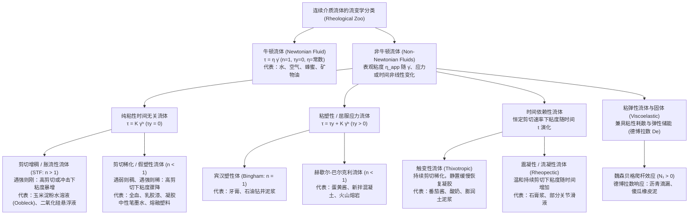
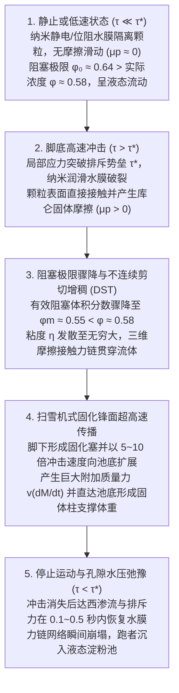

## 引言：在淀粉水池上奔跑的物理学悖论

在科普实验秀与视频中，有一个令人叹为观止的经典场景：将大量玉米淀粉（或马铃薯淀粉、木薯粉）与水按体积比约 $55:45$（重量比约 $1.5:1$ 至 $2:1$）混合，注满一个巨大的泳池。在英语世界中，这种乳白色的浓密悬浮液被称为<strong>欧不裂（Oobleck）</strong>，得名于苏斯博士（Dr. Seuss）1949年的童话绘本《巴塞洛缪与欧不裂》。

当实验者助跑并用力踏上这池“液体”表面疾驰时，奇迹发生了：脚底撞击液面的瞬间，原本呈液态的淀粉糊仿佛瞬间变成了坚硬的混凝土地板，奔跑者甚至不会没过脚踝就能轻松跑过整个泳池；若用拳头猛击碗中的淀粉糊，它不仅不会飞溅，反而会像固体墙壁一样给你一记足以震痛手腕的反作用力。然而，一旦奔跑者在泳池中央停下脚步，脚下的“固体地板”在零点几秒内便彻底融化，双腿如同陷入无底流沙般迅速下沉。如果此时惊慌地猛然向上拔腿，周围的流体又会瞬间锁死并死死咬住鞋子；唯一脱困的方法是彻底放松，极其缓慢地将腿抽出。

在日常直觉中，我们习惯将物质严格划分为“固体、液体、气体”三态，并默认液体的“粘稠度”（粘度）是一个固定不变的常数。艾萨克·牛顿（Isaac Newton）在1687年出版的《自然哲学的数学原理》第二卷中首次建立了这种理想流体的数学法则，遵循该法则的流体被称为<strong>牛顿流体（Newtonian fluid）</strong>。然而，自然界、生命体与工业生产中绝大多数复杂流体——玉米淀粉悬浮液、血液、番茄酱、蛋黄酱、建筑油漆、牙膏、熔融塑料乃至地球深处的地幔——都公然违背牛顿定律，统称为<strong>非牛顿流体（Non-Newtonian fluids）</strong>。

以古希腊哲学家赫拉克利特的名言“万物皆流（$\pi\alpha\nu\tau\alpha\ \rho\varepsilon\iota$ / *Panta rhei*）”为座右铭，研究物质变形与流动规律的现代物理学科被称为<strong>流变学（Rheology）</strong>。本文将从连续介质力学、软物质物理（Soft Matter Physics）与颗粒阻塞（Jamming）理论的最新突破出发，彻底揭开非牛顿流体的微观机制与工程奇迹。

---

## 第一章：牛顿粘性定律与佩克莱特数——为什么简单液体服从牛顿，而复杂流体叛逆？

### 1.1 库埃特简单剪切流与牛顿粘性本构方程

考虑夹在两块相距为 $H$ $[\text{m}]$ 的平行平板之间的流体（<strong>库埃特流 / Couette flow</strong>）。下板固定不动（$y=0, u=0$），面积为 $A$ 的上板（$y=H$）在水平切向力 $F$ $[\text{N}]$ 的驱动下以恒定速度 $U$ $[\text{m}\cdot\text{s}^{-1}]$ 平移。单位面积上的切向内摩擦力定义为<strong>剪切应力（Shear stress）</strong>$\tau \equiv \frac{F}{A}$ $[\text{Pa}]$；流体水平速度随垂直高度的变化梯度定义为<strong>剪切速率（Shear rate，或应变率）</strong>$\dot{\gamma} \equiv \frac{\partial u}{\partial y} = \frac{U}{H}$ $[\text{s}^{-1}]$。

牛顿指出，对于水、空气、酒精、甘油、蜂蜜等简单流体，剪切应力与剪切速率严格成正比，即<strong>牛顿粘性定律（Newton's law of viscosity）</strong>：

$$\tau = \eta \dot{\gamma} = \eta \frac{\partial u}{\partial y}$$

比例常数 $\eta$ $[\text{Pa}\cdot\text{s}]$ 即为<strong>动力粘度（Dynamic viscosity）</strong>。在三维不可压缩连续介质力学中，全应力张量写作 $\boldsymbol{\sigma} = -p\mathbf{I} + 2\eta\mathbf{D}$，代入动量守恒方程即得到著名的<strong>纳维-斯托克斯方程（Navier-Stokes equation）</strong>。牛顿流体的核心特征在于：只要温度 $T$ 和压力 $p$ 恒定，无论搅拌多慢（$\dot{\gamma} \to 0$）或多快（$\dot{\gamma} \gg 1$），粘度 $\eta$ 始终是一个与剪切速率无关的常数（例如 $20^\circ\text{C}$ 时水为 $10^{-3}\,\text{Pa}\cdot\text{s}$，蜂蜜约为 $2\text{–}10\,\text{Pa}\cdot\text{s}$）。

### 1.2 微观时间尺度的较量：布朗弛豫时间与佩克莱特数（Péclet Number）

为什么水分子构成的液体是牛顿流体，而悬浮了微米级颗粒或长链高分子的液体却是非牛顿流体？答案在于<strong>热布朗运动恢复平衡的弛豫时间 $\tau_B$</strong> 与<strong>宏观剪切流变形时间 $\tau_{\text{flow}} \sim \dot{\gamma}^{-1}$</strong> 之间的竞争。

设流体中微观结构单元（分子或胶体颗粒）的半径为 $a$。在温度为 $T$ 的溶剂（粘度 $\eta_0$）中，颗粒的斯托克斯-爱因斯坦热扩散系数为 $D_0 = \frac{k_B T}{6\pi \eta_0 a}$。颗粒通过热运动扩散自身半径 $a$ 的距离、从而抹平流动造成的空间各向异性所需的<strong>布朗弛豫时间（Brownian relaxation time）</strong>为：

$$\tau_B \equiv \frac{a^2}{D_0} = \frac{6\pi \eta_0 a^3}{k_B T}$$

请注意：<strong>$\tau_B$ 与颗粒半径 $a$ 的三次方（$a^3$）成正比！</strong> 这两个时间尺度的无量纲比值即为<strong>佩克莱特数（Péclet number, $\text{Pe}$）</strong>：

$$\text{Pe} \equiv \dot{\gamma}\tau_B = \frac{6\pi \eta_0 a^3 \dot{\gamma}}{k_B T}$$

- 对于<strong>水等小分子液体（$a \sim 0.15\,\text{nm}$）</strong>：$\tau_B \sim 10^{-12}\,\text{s}$（皮秒级）。即便在极高剪切速率（$\dot{\gamma} \sim 10^5\,\text{s}^{-1}$）下，$\text{Pe} \sim 10^{-7} \ll 1$。热运动瞬间就能将分子排布重置为各向同性平衡态，因此粘度 $\eta$ 恒定不变。
- 对于<strong>胶体悬浮液与高分子复杂流体（$a \sim 0.1\text{–}10\,\mu\text{m}$）</strong>：玉米淀粉颗粒或红细胞的尺寸比水分子大 $10^4$ 倍，导致 $\tau_B \propto a^3$ 暴增 <strong>$10^{12}$ 倍（一万亿倍）</strong>，达到秒级（$\tau_B \sim 1\text{–}100\,\text{s}$）！因此在日常缓慢搅拌（$\dot{\gamma} \sim 1\,\text{s}^{-1}$）下就会轻易进入 $\text{Pe} \gg 1$ 区域。此时热运动来不及恢复平衡，流场直接改变颗粒排布、聚集或高分子取向，使宏观粘度随 $\dot{\gamma}$ 发生剧烈的非线性变化。

---

## 第二章：流变学动物园的数学分类——幂律模型与赫歇尔-巴尔克利方程

对于非牛顿流体，我们定义特定剪切速率下的<strong>表观粘度（Apparent viscosity）</strong>为 $\eta_{\text{app}}(\dot{\gamma}) \equiv \frac{\tau(\dot{\gamma})}{\dot{\gamma}}$。描述非牛顿流体最通用的本构方程是1926年提出的<strong>赫歇尔-巴尔克利模型（Herschel-Bulkley model）</strong>及其无屈服应力特例<strong>奥斯特瓦尔德-德瓦勒幂律模型（Ostwald-de Waele power-law model）</strong>：

$$\tau(\dot{\gamma}) = \tau_y + K \dot{\gamma}^n \quad (\text{当 } \tau \ge \tau_y \text{ 时；若 } \tau < \tau_y \text{ 则 } \dot{\gamma} = 0)$$

$$\eta_{\text{app}}(\dot{\gamma}) = \frac{\tau_y}{\dot{\gamma}} + K \dot{\gamma}^{n-1}$$

其中 $\tau_y$ $[\text{Pa}]$ 为<strong>屈服应力（Yield stress）</strong>，$K$ $[\text{Pa}\cdot\text{s}^n]$ 为<strong>稠度系数（Consistency index）</strong>，$n$ 为无量纲<strong>流动行为指数（Flow behavior index）</strong>。此外，为了消除幂律模型在 $\dot{\gamma} \to 0$ 和 $\dot{\gamma} \to \infty$ 处的奇异性，工程上广泛采用<strong>卡罗-安田模型（Carreau-Yasuda model）</strong>：

$$\frac{\eta(\dot{\gamma}) - \eta_\infty}{\eta_0 - \eta_\infty} = \left[ 1 + (\lambda \dot{\gamma})^a \right]^{\frac{n-1}{a}}$$

| 流体类别 | 本构方程特征 | 表观粘度 $\eta_{\text{app}}(\dot{\gamma})$ 行为 | 核心微观物理机制 | 典型物质代表 |
| :--- | :--- | :--- | :--- | :--- |
| <strong>牛顿流体</strong> | $\tau = \eta \dot{\gamma}$ ($n = 1, \tau_y = 0$) | 不随 $\dot{\gamma}$ 变化，恒为常数 $\eta$ | 分子布朗弛豫极快（$\tau_B \sim 10^{-12}\,\text{s}, \text{Pe} \ll 1$），结构保持各向同性 | 水、空气、乙醇、甘油、蜂蜜、简单硅油 |
| <strong>剪切增稠流体 (STF)</strong> | $\tau = K \dot{\gamma}^n$ ($n > 1, \tau_y = 0$) | 随 $\dot{\gamma}$ 增大而升高；超临界应力 $\tau^*$ 时发生不连续发散 (DST) | 水动力润滑团簇 $\to$ 纳米排斥水膜破裂与颗粒间固体摩擦力链（Force chains）形成 | 水溶玉米淀粉（欧不裂）、高浓度 $\text{SiO}_2$-PEG 悬浮液、湿海滩沙 |
| <strong>剪切稀化（假塑性）</strong> | $\tau = K \dot{\gamma}^n$ ($n < 1, \tau_y = 0$) | 随 $\dot{\gamma}$ 增大单调下降（$\eta_0 \to \eta_\infty$） | 聚集体解聚（红细胞缗钱状解离与变形）、高分子链沿流线取向并解缠结 | 人类全血、建筑乳胶漆、洗发水、中性笔凝胶墨水、聚合物熔体 |
| <strong>屈服应力（粘塑性）</strong> | $\tau = \tau_y + K \dot{\gamma}^n$ ($\tau_y > 0$) | $\tau < \tau_y$ 时为弹性固体；$\tau > \tau_y$ 时流动并在管中心形成柱塞流 | 颗粒或液滴的三维阻塞网络在突破阈值应力 $\tau_y$ 后发生屈服破坏 | 牙膏、蛋黄酱、奶油、新拌水泥砂浆、火山熔岩 |
| <strong>触变性流体</strong> | $\tau = \tau(\dot{\gamma}, t)$（滞后环） | 恒定剪切下随时间 $t$ 稀化，静置后通过布朗运动缓慢重建恢复 | 氢键或范德华力微纤维三维渗流网络的时滞性破坏与重联 | 番茄酱、搅拌型酸奶、化妆品乳霜、油墨 |
| <strong>粘弹性流体</strong> | $\tau + \lambda \dot{\tau} = \eta \dot{\gamma}$ ($N_1 > 0$) | 短时间（$\text{De} \gg 1$）表现为弹性固体，长时间（$\text{De} \ll 1$）表现为粘性液体 | 缠结长链大分子的构象熵弹性及流线方向环向拉伸应力（Hoop stress） | 沥青（Pitch）、傻瓜橡皮泥（Silly Putty）、生鸡蛋清、面团 |

---

## 第三章：水溶淀粉（Oobleck）的物理学革命——从水动力团簇到摩擦阻塞与冲击固化锋面

为什么水溶淀粉在冲击下能瞬间变成固体支撑人体奔跑？这一问题在过去一个多世纪里经历了三次重大的科学范式转移。

### 3.1 经典雷诺剪胀性（Reynolds Dilatancy, 1885）与早期水动力团簇理论（1985）

1885年，奥斯本·雷诺（Osborne Reynolds）研究了踩踏湿海滩沙时脚印周围变白变硬的现象，指出紧密堆积的刚性颗粒在受剪切时必须翻越邻近颗粒，从而引发整体<strong>体积膨胀（即剪胀性 / Dilatancy，$\Delta V > 0$）</strong>。孔隙体积膨胀导致表面水被毛细管负压吸入内部，孔隙水压降低将沙粒紧紧压合锁死。

到了1985年，John F. Brady 与 Georges Bossis 通过斯托克斯动力学模拟提出了统治教科书近三十年的<strong>水动力团簇理论（Hydrocluster theory）</strong>：当两个半径为 $a$ 的颗粒在粘度为 $\eta_0$ 的流体中以相对速度 $v_{\text{rel}}$ 靠近至微小表面间距 $h$（$h \ll a$）时，将缝隙中的水挤出需要克服巨大的<strong>流体动力润滑挤压阻力（Lubrication squeezing force）</strong>：

$$F_{\text{lub}} \simeq \frac{6\pi \eta_0 a^2 v_{\text{rel}}}{h} \propto \frac{1}{h}$$

在高剪切速率（$\text{Pe} \gg 1$）下，$F_{\text{lub}} \propto 1/h$ 使得相互靠近的颗粒来不及分离，从而在流体内部形成瞬态链状聚集体——<strong>水动力团簇（Hydroclusters）</strong>，导致粘度温和上升。
<strong>然而水动力团簇理论存在致命局限</strong>：纯流体动力润滑力只能解释粘度平缓增加数倍的<strong>连续剪切增稠（CST）</strong>，却完全无法解释浓玉米淀粉糊（体积分数 $\phi \approx 55\%\text{–}60\%$）中粘度在临界剪切率下垂直飙升数千倍的<strong>不连续剪切增稠（Discontinuous Shear Thickening, DST）</strong>，更无法提供支撑成年人体重的巨大法向应力！

### 3.2 现代范式革命（2012–2014）：纳米润滑膜破裂、固体摩擦接触力链与“扫雪机”固化锋面

2012年至2014年间，两组里程碑式的研究彻底解开了谜团：

1. <strong>突破纳米排斥势垒与摩擦阻塞相变（Wyart & Cates, 2014）</strong>：
   淀粉或二氧化硅颗粒表面带有静电双电层排斥力或聚合物空间位阻排斥力 $F_{\text{rep}}$，对应一个特征阈值应力 $\tau^* \sim F_{\text{rep}}/a^2$。
   - 当外加应力很小时（$\tau \ll \tau^*$），纳米级水膜完好无损，颗粒间为<strong>无摩擦滑动（$\mu_p \approx 0$）</strong>，其随机最密堆积的阻塞（Jamming）极限体积分数高达 <strong>$\phi_0 \approx 0.64$</strong>。
   - 当重拳或脚踏施加高应力超过阈值（$\tau > \tau^*$）时，颗粒间的纳米润滑水膜被强行挤破，粗糙的淀粉颗粒表面发生<strong>直接的固体-固体库仑摩擦接触（摩擦系数 $\mu_p > 0$）</strong>！一旦引入切向摩擦，颗粒旋转被锁死，发生阻塞所需的临界体积分数骤降至随机松散堆积极限 <strong>$\phi_m \approx 0.55$</strong>！
   设摩擦接触占比为 $f(\tau) = \exp(-\tau^*/\tau)$，则系统的有效阻塞体积分数 $\phi_J(\tau)$ 与粘度 $\eta(\phi, \tau)$ 遵循 Wyart-Cates 方程：
   $$\phi_J(\tau) = f(\tau)\,\phi_m + \left[1 - f(\tau)\right]\phi_0, \qquad \eta(\phi, \tau) \propto \left[ \phi_J(\tau) - \phi \right]^{-2}$$
   当我们配制体积分数 $\phi = 0.58$（处于 $\phi_m = 0.55$ 与 $\phi_0 = 0.64$ 之间）的淀粉糊时：静置时 $\phi = 0.58 < \phi_0 = 0.64$，体系是自由流动的液体；踏击瞬间 $\tau > \tau^*$，阻塞极限 $\phi_J(\tau)$ 骤降至 $0.55$ 以下，导致 $\phi > \phi_J(\tau)$，分母归零，粘度向无穷大发散（DST），三维<strong>摩擦接触力链（Frictional force chains）</strong>瞬间锁死整个流体！
2. <strong>冲击诱导固化与传播的“扫雪机”锋面（Waitukaitis & Jaeger, *Nature* 2012）</strong>：
   芝加哥大学的 Waitukaitis 和 Jaeger 利用高速X射线透视发现，当脚以速度 $v_0$ 撞击液面时，脚底正下方的淀粉颗粒被微幅压缩并触发摩擦阻塞，形成一个坚硬的<strong>固化塞（Solidified plug）</strong>。该固化区域的边界——<strong>固化锋面（Solidification front）</strong>——像扫雪机推雪一样，以脚部下陷速度 $5\text{–}10$ 倍的超高速（$v_f = k v_0$）向池底传播！快速增长的固化质量 $M(t)$ 产生巨大的<strong>附加质量反作用力</strong> $F_{\text{impact}} = \frac{d}{dt}[M(t)v(t)] = M\dot{v} + v\dot{M}$，且固化柱在数毫秒内直达池底，形成支撑跑者全部体重的“固体桥墩”。一旦停下脚步（$\tau < \tau^*$），孔隙水回流并在约 $0.1\text{–}0.5\,\text{s}$ 内恢复纳米水膜，固体桥墩瞬间瓦解为液态流沙。

---

## 第四章：剪切稀化（假塑性）、屈服应力柱塞流与触变性

与玉米淀粉相反，生命与工业中绝大多数流体被设计为<strong>剪切稀化（$n < 1$）</strong>与<strong>屈服应力流体（$\tau_y > 0$）</strong>：

1. <strong>血液流变学（Hemorheology）</strong>：人体全血含有约 $45\%$ 体积分数的红细胞。在静脉低剪切速率（$\dot{\gamma} < 1\,\text{s}^{-1}$）下，红细胞通过纤维蛋白原堆叠成硬币串般的<strong>缗钱状聚集体（Rouleaux）</strong>，使血液零剪切粘度高达 $\eta_0 \approx 50\text{–}100\,\text{mPa}\cdot\text{s}$。而在动脉和微血管的高剪切速率（$\dot{\gamma} \sim 100\text{–}1,000\,\text{s}^{-1}$）下，缗钱状结构彻底解聚，且无核、高弹性的红细胞顺着流线变形为流线型降落伞状，细胞膜发生<strong>坦克履带式旋转（Tank-treading motion）</strong>，使血液粘度骤降至 $\eta_\infty \approx 3\text{–}4\,\text{mPa}\cdot\text{s}$，从而保障微循环畅通并大幅减轻心脏负担。
2. <strong>建筑油漆与中性笔凝胶墨水</strong>：刷漆或书写时，刷毛与滚珠在微米缝隙内产生极高剪切率（$\dot{\gamma} \sim 10^4\,\text{s}^{-1}$），油漆和墨水瞬间稀化数百倍以便顺滑涂布；一旦停止剪切，在重力微弱应力（$\dot{\gamma} \sim 10^{-1}\,\text{s}^{-1}, \tau < \tau_y$）下粘度瞬间恢复并固化，彻底防止墙面流挂（Sagging）或笔尖漏墨。
3. <strong>宾汉流体管内柱塞流（Plug Flow）</strong>：当牙膏等屈服应力流体（$\tau = \tau_y + \eta_p\dot{\gamma}$）在半径为 $R$、压降为 $\Delta P / L$ 的圆管中流动时，截面剪切应力线性分布为 $\tau(r) = \frac{\Delta P}{2L}r$。在中心半径 $r < r_p = \frac{2L\tau_y}{\Delta P}$ 的区域内，由于 $\tau(r) < \tau_y$，速度梯度恒为零（$\frac{du}{dr} = 0$）：
   $$u_{\text{Bingham}}(r) = \begin{cases} \dfrac{\Delta P}{4\eta_p L}(R - r_p)^2 = \text{const.} & (0 \le r < r_p : \text{未屈服固体柱塞核}) \\[8pt] \dfrac{\Delta P}{4\eta_p L}\left[ R^2 - r^2 - 2r_p(R - r) \right] & (r_p \le r \le R : \text{管壁剪切润滑层}) \end{cases}$$
   因此牙膏总是像一整根固体圆柱（柱塞）一样被完整挤出，双色条纹牙膏也不会在管内混合。

---

## 第五章：粘弹性（Viscoelasticity）、德博拉数与魏森贝格爬杆效应

### 5.1 麦克斯韦模型与德博拉数（Deborah Number）

1867年，麦克斯韦（James Clerk Maxwell）将胡克弹性弹簧（模量 $G$）与牛顿粘性阻尼器（粘度 $\eta$）串联，建立了线性粘弹性本构方程（弛豫时间 $\lambda \equiv \eta / G$）：

$$\tau + \lambda \frac{d\tau}{dt} = \eta \dot{\gamma}$$

1964年，流变学先驱马库斯·雷纳（Marcus Reiner）引用《圣经·士师记》第5章第5节女先知德博拉之歌——<strong>“群山在耶和华面前流动（The mountains flowed before the Lord）”</strong>——定义了著名的无量纲数<strong>德博拉数（Deborah number, $\text{De}$）</strong>：

$$\text{De} \equiv \frac{t_{\text{relax}}}{t_{\text{obs}}}$$

其中 $t_{\text{relax}} = \lambda$ 是材料内禀弛豫时间，$t_{\text{obs}}$ 是人类观察或加载的时间尺度。当 $\text{De} \gg 1$（作用极快，$t_{\text{obs}} \ll t_{\text{relax}}$）时，任何流体都表现为弹性固体；当 $\text{De} \ll 1$（观察极久，$t_{\text{obs}} \gg t_{\text{relax}}$）时，即便岩石和群山也会像液体一样流动！
澳大利亚昆士兰大学自1927年持续至今的<strong>沥青滴漏实验（Pitch Drop Experiment）</strong>完美印证了这一点：室温下的沥青粘度约为水的2300亿倍（$\eta \approx 2.3 \times 10^8\,\text{Pa}\cdot\text{s}$）。若用铁锤猛击（$t_{\text{obs}} \sim 10^{-3}\,\text{s}, \text{De} \gg 1$），沥青会像脆性玻璃一样碎裂；但在重力下静置观察数十年（$t_{\text{obs}} \sim 10^8\,\text{s}, \text{De} \ll 1$），它却以每8至13年滴落一滴的速度缓慢流动。同理，硼硅氧烷玩具<strong>傻瓜橡皮泥（Silly Putty，$\lambda \sim 1\,\text{s}$）</strong>摔在地上像高弹橡胶球一样弹起（$\text{De} \gg 1$），静置在桌面上却会摊成一滩液体（$\text{De} \ll 1$）。

### 5.2 魏森贝格效应（Weissenberg Rod-Climbing Effect）

当旋转圆棒插入牛顿流体时，离心力使液面在棒周围凹陷；但插入高分子溶液（或生鸡蛋清）时，液体却逆着离心力向内聚集并<strong>顺着旋转棒向上攀爬</strong>！这是因为高分子链沿环形流线被拉伸时产生熵弹性张力，导致流线方向正应力 $\sigma_{xx}$ 远大于径向正应力 $\sigma_{yy}$，产生正的<strong>第一法向应力差（First normal stress difference）</strong>：

$$N_1(\dot{\gamma}) \equiv \sigma_{xx} - \sigma_{yy} = \Psi_1(\dot{\gamma})\dot{\gamma}^2 > 0$$

环形流线上的拉伸张力（环向箍应力 / Hoop stress）像无数根紧绷的橡皮筋一样向圆心方向挤压流体，迫使流体沿转轴逆重力向上爬升。

---

## 第六章：前沿工程应用——从液体防弹衣到3D生物打印

1. <strong>液体防弹衣（Liquid Body Armor）与 D3O 抗冲击装甲</strong>：美国陆军研究实验室与特拉华大学将高浓度纳米二氧化硅（$\text{SiO}_2$）分散于聚乙二醇（PEG）中制成剪切增稠液（STF），浸渍到凯夫拉（Kevlar）芳纶纤维中。士兵日常活动时（$\dot{\gamma} < 10\,\text{s}^{-1}, \tau < \tau^*$），STF 呈液态，衣物柔软贴身；当子弹或匕首以数百米每秒高速撞击瞬间（$\dot{\gamma} > 10^5\,\text{s}^{-1}, \tau \gg \tau^*$），STF 在微秒内发生不连续剪切增稠与摩擦阻塞固化，死死锁住纤维网格并将冲击能分散至大面积区域，使防弹衣减重 $30\%\text{–}50\%$ 的同时大幅提升防刺与机动性能。同理，运动护具与军用头盔中的橙色材料 <strong>D3O</strong> 利用动态硼键的德博拉数转换（低速柔软 $\text{De} \ll 1$、高速冲击锁死 $\text{De} \gg 1$）实现智能抗冲击保护。
2. <strong>3D生物打印（3D Bioprinting Bio-inks）</strong>：含有活体干细胞的生物墨水通过微米喷嘴挤出时，利用高屈服应力 $\tau_y$ 与强剪切稀化（$n \ll 1$）形成<strong>宾汉柱塞流</strong>，使喷嘴中心 $85\%$ 以上的细胞处于零剪切区域免受撕裂损伤（存活率 $>95\%$）；挤出离开喷嘴瞬间（$\tau \to 0$），纳米粘土与水凝胶网络在 $0.1\,\text{s}$ 内快速触变恢复屈服应力，支撑复杂的人造血管与器官支架不下榻。

从厨房碗里的水溶淀粉到血管中奔流的血液，非牛顿流体力学向我们昭示：“固体”与“液体”并非永恒不变的物质标签，而是微观粒子相互作用与宏观力、时间尺度交织而成的动态交响曲。
