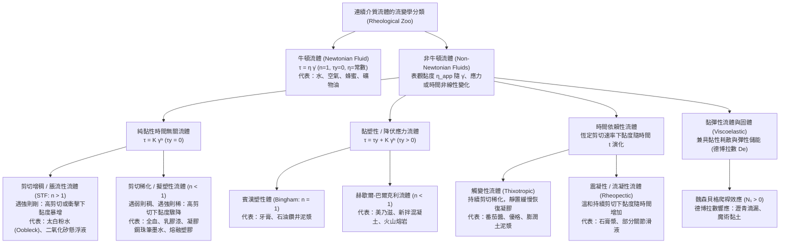
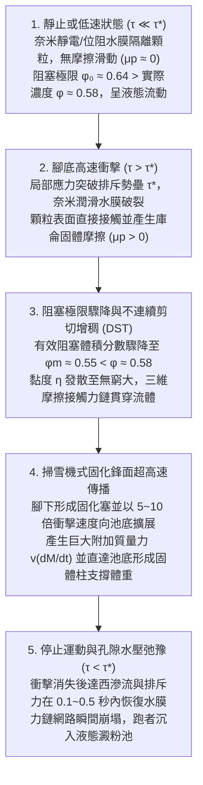

## 引言：在太白粉水池上奔跑的物理學悖論

在科學演示與實驗影片中，有一個令人嘆為觀止的經典場景：將大量玉米澱粉或太白粉（馬鈴薯澱粉、樹薯粉）與水按體積比約 $55:45$（重量比約 $1.5:1$ 至 $2:1$）混合，注滿一個巨大的泳池。在英語世界中，這種乳白色的濃密懸浮液被稱為<strong>歐不裂（Oobleck）</strong>，得名於蘇斯博士（Dr. Seuss）1949年的童書《巴塞洛繆與歐不裂》。

當實驗者助跑並用力踏上這池「液體」表面疾馳時，奇蹟發生了：腳底撞擊液面的瞬間，原本呈液態的澱粉糊彷彿瞬間變成了堅硬的混凝土地板，奔跑者甚至不會沒過腳踝就能輕鬆跑過整個泳池；若用拳頭猛擊碗中的太白粉水，它不僅不會飛濺，反而會像固體牆壁一樣給你一記足以震痛手腕的反作用力。然而，一旦奔跑者在泳池中央停下腳步，腳下的「固體地板」在零點幾秒內便徹底融化，雙腿如同陷入無底流沙般迅速下沉。如果此時驚慌地猛然向上拔腿，周圍的流體又會瞬間鎖死並死死咬住鞋子；唯一脫困的方法是徹底放鬆，極其緩慢地將腿抽出。

在日常直覺中，我們習慣將物質嚴格劃分為「固體、液體、氣體」三態，並預設液體的「黏稠度」（黏度）是一個固定不變的常數。艾薩克·牛頓（Isaac Newton）在1687年出版的《自然哲學的數學原理》第二卷中首次建立了這種理想流體的數學法則，遵循該法則的流體被稱為<strong>牛頓流體（Newtonian fluid）</strong>。然而，自然界、生命體與工業生產中絕大多數複雜流體——太白粉水懸浮液、血液、番茄醬、美乃滋、建築油漆、牙膏、熔融塑膠乃至地球深處的地函——都公然違背牛頓定律，統稱為<strong>非牛頓流體（Non-Newtonian fluids）</strong>。

以古希臘哲學家赫拉克利特的名言「萬物皆流（$\pi\alpha\nu\tau\alpha\ \rho\varepsilon\iota$ / *Panta rhei*）」為座右銘，研究物質變形與流動規律的現代物理學科被稱為<strong>流變學（Rheology）</strong>。本文將從連續介質力學、軟物質物理（Soft Matter Physics）與顆粒阻塞（Jamming）理論的最新突破出發，徹底揭開非牛頓流體的微觀機制與工程奇蹟。

---

## 第一章：牛頓黏性定律與佩克萊特數——為什麼簡單液體服從牛頓，而複雜流體叛逆？

### 1.1 庫埃特簡單剪切流與牛頓黏性本構方程

考慮夾在兩塊相距為 $H$ $[\text{m}]$ 的平行平板之間的流體（<strong>庫埃特流 / Couette flow</strong>）。下板固定不動（$y=0, u=0$），面積為 $A$ 的上板（$y=H$）在水平切向力 $F$ $[\text{N}]$ 的驅動下以恆定速度 $U$ $[\text{m}\cdot\text{s}^{-1}]$ 平移。單位面積上的切向內摩擦力定義為<strong>剪切應力（Shear stress）</strong>$\tau \equiv \frac{F}{A}$ $[\text{Pa}]$；流體水平速度隨垂直高度的變化梯度定義為<strong>剪切速率（Shear rate，或應變率）</strong>$\dot{\gamma} \equiv \frac{\partial u}{\partial y} = \frac{U}{H}$ $[\text{s}^{-1}]$。

牛頓指出，對於水、空氣、酒精、甘油、蜂蜜等簡單流體，剪切應力與剪切速率嚴格成正比，即<strong>牛頓黏性定律（Newton's law of viscosity）</strong>：

$$\tau = \eta \dot{\gamma} = \eta \frac{\partial u}{\partial y}$$

比例常數 $\eta$ $[\text{Pa}\cdot\text{s}]$ 即為<strong>動力黏度（Dynamic viscosity）</strong>。在三維不可壓縮連續介質力學中，全應力張量寫作 $\boldsymbol{\sigma} = -p\mathbf{I} + 2\eta\mathbf{D}$，代入動量守恆方程即得到著名的<strong>納維-斯托克斯方程（Navier-Stokes equation）</strong>。牛頓流體的核心特徵在於：只要溫度 $T$ 和壓力 $p$ 恆定，無論攪拌多慢（$\dot{\gamma} \to 0$）或多快（$\dot{\gamma} \gg 1$），黏度 $\eta$ 始終是一個與剪切速率無關的常數（例如 $20^\circ\text{C}$ 時水為 $10^{-3}\,\text{Pa}\cdot\text{s}$，蜂蜜約為 $2\text{–}10\,\text{Pa}\cdot\text{s}$）。

### 1.2 微觀時間尺度的較量：布朗弛豫時間與佩克萊特數（Péclet Number）

為什麼水分子構成的液體是牛頓流體，而懸浮了微米級顆粒或長鏈高分子的液體卻是非牛頓流體？答案在於<strong>熱布朗運動恢復平衡的弛豫時間 $\tau_B$</strong> 與<strong>宏觀剪切流變形時間 $\tau_{\text{flow}} \sim \dot{\gamma}^{-1}$</strong> 之間的競爭。

設流體中微觀結構單元（分子或膠體顆粒）的半徑為 $a$。在溫度為 $T$ 的溶劑（黏度 $\eta_0$）中，顆粒的斯托克斯-愛因斯坦熱擴散係數為 $D_0 = \frac{k_B T}{6\pi \eta_0 a}$。顆粒透過熱運動擴散自身半徑 $a$ 的距離、從而抹平流動造成的空間各向異性所需的<strong>布朗弛豫時間（Brownian relaxation time）</strong>為：

$$\tau_B \equiv \frac{a^2}{D_0} = \frac{6\pi \eta_0 a^3}{k_B T}$$

請注意：<strong>$\tau_B$ 與顆粒半徑 $a$ 的三次方（$a^3$）成正比！</strong> 這兩個時間尺度的無因次比值即為<strong>佩克萊特數（Péclet number, $\text{Pe}$）</strong>：

$$\text{Pe} \equiv \dot{\gamma}\tau_B = \frac{6\pi \eta_0 a^3 \dot{\gamma}}{k_B T}$$

- 對於<strong>水等小分子液體（$a \sim 0.15\,\text{nm}$）</strong>：$\tau_B \sim 10^{-12}\,\text{s}$（皮秒級）。即便在極高剪切速率（$\dot{\gamma} \sim 10^5\,\text{s}^{-1}$）下，$\text{Pe} \sim 10^{-7} \ll 1$。熱運動瞬間就能將分子排布重置為各向同性平衡態，因此黏度 $\eta$ 恆定不變。
- 對於<strong>膠體懸浮液與高分子複雜流體（$a \sim 0.1\text{–}10\,\mu\text{m}$）</strong>：澱粉顆粒或紅血球的尺寸比水分子大 $10^4$ 倍，導致 $\tau_B \propto a^3$ 暴增 <strong>$10^{12}$ 倍（一兆倍）</strong>，達到秒級（$\tau_B \sim 1\text{–}100\,\text{s}$）！因此在日常緩慢攪拌（$\dot{\gamma} \sim 1\,\text{s}^{-1}$）下就會輕易進入 $\text{Pe} \gg 1$ 區域。此時熱運動來不及恢復平衡，流場直接改變顆粒排布、聚集或高分子取向，使宏觀黏度隨 $\dot{\gamma}$ 發生劇烈的非線性變化。

---

## 第二章：流變學動物園的數學分類——冪律模型與赫歇爾-巴爾克利方程

對於非牛頓流體，我們定義特定剪切速率下的<strong>表觀黏度（Apparent viscosity）</strong>為 $\eta_{\text{app}}(\dot{\gamma}) \equiv \frac{\tau(\dot{\gamma})}{\dot{\gamma}}$。描述非牛頓流體最通用的本構方程是1926年提出的<strong>赫歇爾-巴爾克利模型（Herschel-Bulkley model）</strong>及其無降伏應力特例<strong>奧斯特瓦爾德-德瓦勒冪律模型（Ostwald-de Waele power-law model）</strong>：

$$\tau(\dot{\gamma}) = \tau_y + K \dot{\gamma}^n \quad (\text{當 } \tau \ge \tau_y \text{ 時；若 } \tau < \tau_y \text{ 則 } \dot{\gamma} = 0)$$

$$\eta_{\text{app}}(\dot{\gamma}) = \frac{\tau_y}{\dot{\gamma}} + K \dot{\gamma}^{n-1}$$

其中 $\tau_y$ $[\text{Pa}]$ 為<strong>降伏應力（Yield stress）</strong>，$K$ $[\text{Pa}\cdot\text{s}^n]$ 為<strong>稠度係數（Consistency index）</strong>，$n$ 為無因次<strong>流動行為指數（Flow behavior index）</strong>。此外，為了消除冪律模型在 $\dot{\gamma} \to 0$ 和 $\dot{\gamma} \to \infty$ 處的奇異性，工程上廣泛採用<strong>卡羅-安田模型（Carreau-Yasuda model）</strong>：

$$\frac{\eta(\dot{\gamma}) - \eta_\infty}{\eta_0 - \eta_\infty} = \left[ 1 + (\lambda \dot{\gamma})^a \right]^{\frac{n-1}{a}}$$

| 流體類別 | 本構方程特徵 | 表觀黏度 $\eta_{\text{app}}(\dot{\gamma})$ 行為 | 核心微觀物理機制 | 典型物質代表 |
| :--- | :--- | :--- | :--- | :--- |
| <strong>牛頓流體</strong> | $\tau = \eta \dot{\gamma}$ ($n = 1, \tau_y = 0$) | 不隨 $\dot{\gamma}$ 變化，恆為常數 $\eta$ | 分子布朗弛豫極快（$\tau_B \sim 10^{-12}\,\text{s}, \text{Pe} \ll 1$），結構保持各向同性 | 水、空氣、乙醇、甘油、蜂蜜、簡單矽油 |
| <strong>剪切增稠流體 (STF)</strong> | $\tau = K \dot{\gamma}^n$ ($n > 1, \tau_y = 0$) | 隨 $\dot{\gamma}$ 增大而升高；超臨界應力 $\tau^*$ 時發生不連續發散 (DST) | 水動力潤滑團簇 $\to$ 奈米排斥水膜破裂與顆粒間固體摩擦力鏈（Force chains）形成 | 太白粉水／玉米澱粉液（歐不裂）、高濃度 $\text{SiO}_2$-PEG 懸浮液、濕沙灘 |
| <strong>剪切稀化（擬塑性）</strong> | $\tau = K \dot{\gamma}^n$ ($n < 1, \tau_y = 0$) | 隨 $\dot{\gamma}$ 增大單調下降（$\eta_0 \to \eta_\infty$） | 聚集體解聚（紅血球缗錢狀解離與變形）、高分子鏈沿流線取向並解纏結 | 人類全血、建築乳膠漆、洗髮精、鋼珠筆凝膠墨水、聚合物熔體 |
| <strong>降伏應力（黏塑性）</strong> | $\tau = \tau_y + K \dot{\gamma}^n$ ($\tau_y > 0$) | $\tau < \tau_y$ 時為彈性固體；$\tau > \tau_y$ 時流動並在管中心形成柱塞流 | 顆粒或液滴的三維阻塞網路在突破閾值應力 $\tau_y$ 後發生降伏破壞 | 牙膏、美乃滋、鮮奶油、新拌水泥砂漿、火山熔岩 |
| <strong>觸變性流體</strong> | $\tau = \tau(\dot{\gamma}, t)$（遲滯環） | 恆定剪切下隨時間 $t$ 稀化，靜置後透過布朗運動緩慢重建恢復 | 氫鍵或凡得瓦力微纖維三維滲流網路的時滯性破壞與重聯 | 番茄醬、優格、化妝品乳霜、油墨 |
| <strong>黏彈性流體</strong> | $\tau + \lambda \dot{\tau} = \eta \dot{\gamma}$ ($N_1 > 0$) | 短時間（$\text{De} \gg 1$）表現為彈性固體，長時間（$\text{De} \ll 1$）表現為黏性液體 | 纏結長鏈大分子的構象熵彈性及流線方向環向拉伸應力（Hoop stress） | 瀝青（Pitch）、魔術黏土（Silly Putty）、生蛋白、麵團 |

---

## 第三章：太白粉水（Oobleck）的物理學革命——從水動力團簇到摩擦阻塞與衝擊固化鋒面

為什麼太白粉水或玉米澱粉液在衝擊下能瞬間變成固體支撐人體奔跑？這一問題在過去一個多世紀裡經歷了三次重大的科學典範轉移。

### 3.1 經典雷諾剪脹性（Reynolds Dilatancy, 1885）與早期水動力團簇理論（1985）

1885年，奧斯本·雷諾（Osborne Reynolds）研究了踩踏濕海灘沙時腳印周圍變白變硬的現象，指出緊密堆積的剛性顆粒在受剪切時必須翻越鄰近顆粒，從而引發整體<strong>體積膨脹（即剪脹性 / Dilatancy，$\Delta V > 0$）</strong>。孔隙體積膨脹導致表面水被毛細管負壓吸入內部，孔隙水壓降低將沙粒緊緊壓合鎖死。

到了1985年，John F. Brady 與 Georges Bossis 透過斯托克斯動力學模擬提出了統治教科書近三十年的<strong>水動力團簇理論（Hydrocluster theory）</strong>：當兩個半徑為 $a$ 的顆粒在黏度為 $\eta_0$ 的流體中以相對速度 $v_{\text{rel}}$ 靠近至微小表面間距 $h$（$h \ll a$）時，將縫隙中的水擠出需要克服巨大的<strong>流體動力潤滑擠壓阻力（Lubrication squeezing force）</strong>：

$$F_{\text{lub}} \simeq \frac{6\pi \eta_0 a^2 v_{\text{rel}}}{h} \propto \frac{1}{h}$$

在高剪切速率（$\text{Pe} \gg 1$）下，$F_{\text{lub}} \propto 1/h$ 使得相互靠近的顆粒來不及分離，從而在流體內部形成瞬態鏈狀聚集體——<strong>水動力團簇（Hydroclusters）</strong>，導致黏度溫和上升。
<strong>然而水動力團簇理論存在致命局限</strong>：純流體動力潤滑力只能解釋黏度平緩增加數倍的<strong>連續剪切增稠（CST）</strong>，卻完全無法解釋濃澱粉糊（體積枚數 $\phi \approx 55\%\text{–}60\%$）中黏度在臨界剪切率下垂直飆升數千倍的<strong>不連續剪切增稠（Discontinuous Shear Thickening, DST）</strong>，更無法提供支撐成年人體重的巨大法向應力！

### 3.2 現代典範革命（2012–2014）：奈米潤滑膜破裂、固體摩擦接觸力鏈與「掃雪機」固化鋒面

2012年至2014年間，兩組里程碑式的研究徹底解開了謎團：

1. <strong>突破奈米排斥勢壘與摩擦阻塞相變（Wyart & Cates, 2014）</strong>：
   澱粉或二氧化矽顆粒表面帶有靜電雙電層排斥力或聚合物空間位阻排斥力 $F_{\text{rep}}$，對應一個特徵閾值應力 $\tau^* \sim F_{\text{rep}}/a^2$。
   - 當外加應力很小時（$\tau \ll \tau^*$），奈米級水膜完好無損，顆粒間為<strong>無摩擦滑動（$\mu_p \approx 0$）</strong>，其隨機最密堆積的阻塞（Jamming）極限體積分數高達 <strong>$\phi_0 \approx 0.64$</strong>。
   - 當重拳或腳踏施加高應力超過閾值（$\tau > \tau^*$）時，顆粒間的奈米潤滑水膜被強行擠破，粗糙的澱粉顆粒表面發生<strong>直接的固體-固體庫侖摩擦接觸（摩擦係數 $\mu_p > 0$）</strong>！一旦引入切向摩擦，顆粒旋轉被鎖死，發生阻塞所需的臨界體積分數驟降至隨機鬆散堆積極限 <strong>$\phi_m \approx 0.55$</strong>！
   設摩擦接觸佔比為 $f(\tau) = \exp(-\tau^*/\tau)$，則系統的有效阻塞體積分數 $\phi_J(\tau)$ 與黏度 $\eta(\phi, \tau)$ 遵循 Wyart-Cates 方程：
   $$\phi_J(\tau) = f(\tau)\,\phi_m + \left[1 - f(\tau)\right]\phi_0, \qquad \eta(\phi, \tau) \propto \left[ \phi_J(\tau) - \phi \right]^{-2}$$
   當我們配製體積分數 $\phi = 0.58$（處於 $\phi_m = 0.55$ 與 $\phi_0 = 0.64$ 之間）的澱粉糊時：靜置時 $\phi = 0.58 < \phi_0 = 0.64$，體系是自由流動的液體；踏擊瞬間 $\tau > \tau^*$，阻塞極限 $\phi_J(\tau)$ 驟降至 $0.55$ 以下，導致 $\phi > \phi_J(\tau)$，分母歸零，黏度向無窮大發散（DST），三維<strong>摩擦接觸力鏈（Frictional force chains）</strong>瞬間鎖死整個流體！
2. <strong>衝擊誘導固化與傳播的「掃雪機」鋒面（Waitukaitis & Jaeger, *Nature* 2012）</strong>：
   芝加哥大學的 Waitukaitis 和 Jaeger 利用高速X光透視發現，當腳以速度 $v_0$ 撞擊液面時，腳底正下方的澱粉顆粒被微幅壓縮並觸發摩擦阻塞，形成一個堅硬的<strong>固化塞（Solidified plug）</strong>。該固化區域的邊界——<strong>固化鋒面（Solidification front）</strong>——像掃雪機推雪一樣，以腳部下陷速度 $5\text{–}10$ 倍的超高速（$v_f = k v_0$）向池底傳播！快速增長的固化質量 $M(t)$ 產生巨大的<strong>附加質量反作用力</strong> $F_{\text{impact}} = \frac{d}{dt}[M(t)v(t)] = M\dot{v} + v\dot{M}$，且固化柱在數毫秒內直達池底，形成支撐跑者全部體重的「固體橋墩」。一旦停下腳步（$\tau < \tau^*$），孔隙水回流並在約 $0.1\text{–}0.5\,\text{s}$ 內恢復奈米水膜，固體橋墩瞬間瓦解為液態流沙。

---

## 第四章：剪切稀化（擬塑性）、降伏應力柱塞流與觸變性

與太白粉水相反，生命與工業中絕大多數流體被設計為<strong>剪切稀化（$n < 1$）</strong>與<strong>降伏應力流體（$\tau_y > 0$）</strong>：

1. <strong>血液流變學（Hemorheology）</strong>：人體全血含有約 $45\%$ 體積分數的紅血球。在靜脈低剪切速率（$\dot{\gamma} < 1\,\text{s}^{-1}$）下，紅血球透過纖維蛋白原堆疊成硬幣串般的<strong>缗錢狀聚集體（Rouleaux）</strong>，使血液零剪切黏度高達 $\eta_0 \approx 50\text{–}100\,\text{mPa}\cdot\text{s}$。而在動脈和微血管的高剪切速率（$\dot{\gamma} \sim 100\text{–}1,000\,\text{s}^{-1}$）下，缗錢狀結構徹底解聚，且無核、高彈性的紅血球順著流線變形為流線型降落傘狀，細胞膜發生<strong>坦克履帶式旋轉（Tank-treading motion）</strong>，使血液黏度驟降至 $\eta_\infty \approx 3\text{–}4\,\text{mPa}\cdot\text{s}$，從而保障微循環暢通並大幅減輕心臟負擔。
2. <strong>建築油漆與鋼珠筆凝膠墨水</strong>：刷漆或書寫時，刷毛與滾珠在微米縫隙內產生極高剪切率（$\dot{\gamma} \sim 10^4\,\text{s}^{-1}$），油漆和墨水瞬間稀化數百倍以便順滑塗布；一旦停止剪切，在重力微弱應力（$\dot{\gamma} \sim 10^{-1}\,\text{s}^{-1}, \tau < \tau_y$）下黏度瞬間恢復並固化，徹底防止牆面流掛（Sagging）或筆尖漏墨。
3. <strong>賓漢流體管內柱塞流（Plug Flow）</strong>：當牙膏等降伏應力流體（$\tau = \tau_y + \eta_p\dot{\gamma}$）在半徑為 $R$、壓降為 $\Delta P / L$ 的圓管中流動時，截面剪切應力線性分布為 $\tau(r) = \frac{\Delta P}{2L}r$。在中心半徑 $r < r_p = \frac{2L\tau_y}{\Delta P}$ 的區域內，由於 $\tau(r) < \tau_y$，速度梯度恆為零（$\frac{du}{dr} = 0$）：
   $$u_{\text{Bingham}}(r) = \begin{cases} \dfrac{\Delta P}{4\eta_p L}(R - r_p)^2 = \text{const.} & (0 \le r < r_p : \text{未降伏固體柱塞核}) \\[8pt] \dfrac{\Delta P}{4\eta_p L}\left[ R^2 - r^2 - 2r_p(R - r) \right] & (r_p \le r \le R : \text{管壁剪切潤滑層}) \end{cases}$$
   因此牙膏總是像一整根固體圓柱（柱塞）一樣被完整擠出，雙色條紋牙膏也不會在管內混合。

---

## 第五章：黏彈性（Viscoelasticity）、德博拉數與魏森貝格爬桿效應

### 5.1 馬克士威模型與德博拉數（Deborah Number）

1867年，馬克士威（James Clerk Maxwell）將虎克彈性彈簧（模量 $G$）與牛頓黏性阻尼器（黏度 $\eta$）串聯，建立了線性黏彈性本構方程（弛豫時間 $\lambda \equiv \eta / G$）：

$$\tau + \lambda \frac{d\tau}{dt} = \eta \dot{\gamma}$$

1964年，流變學先驅馬庫斯·雷納（Marcus Reiner）引用《聖經·士師記》第5章第5節女先知德博拉之歌——<strong>「群山在耶和華面前流動（The mountains flowed before the Lord）」</strong>——定義了著名的無因次數<strong>德博拉數（Deborah number, $\text{De}$）</strong>：

$$\text{De} \equiv \frac{t_{\text{relax}}}{t_{\text{obs}}}$$

其中 $t_{\text{relax}} = \lambda$ 是材料內稟弛豫時間，$t_{\text{obs}}$ 是人類觀察或加載的時間尺度。當 $\text{De} \gg 1$（作用極快，$t_{\text{obs}} \ll t_{\text{relax}}$）時，任何流體都表現為彈性固體；當 $\text{De} \ll 1$（觀察極久，$t_{\text{obs}} \gg t_{\text{relax}}$）時，即便岩石和群山也會像液體一樣流動！
澳洲昆士蘭大學自1927年持續至今的<strong>瀝青滴漏實驗（Pitch Drop Experiment）</strong>完美印證了這一點：室溫下的瀝青黏度約為水的2300億倍（$\eta \approx 2.3 \times 10^8\,\text{Pa}\cdot\text{s}$）。若用鐵鎚猛擊（$t_{\text{obs}} \sim 10^{-3}\,\text{s}, \text{De} \gg 1$），瀝青會像脆性玻璃一樣碎裂；但在重力下靜置觀察數十年（$t_{\text{obs}} \sim 10^8\,\text{s}, \text{De} \ll 1$），它卻以每8至13年滴落一滴的速度緩慢流動。同理，硼矽氧烷玩具<strong>魔術黏土（Silly Putty，$\lambda \sim 1\,\text{s}$）</strong>摔在地上像高彈橡膠球一樣彈起（$\text{De} \gg 1$），靜置在桌面上卻會攤成一灘液體（$\text{De} \ll 1$）。

### 5.2 魏森貝格效應（Weissenberg Rod-Climbing Effect）

當旋轉圓棒插入牛頓流體時，離心力使液面在棒周圍凹陷；但插入高分子溶液（或生蛋白）時，液體卻逆著離心力向內聚集並<strong>順著旋轉棒向上攀爬</strong>！這是因為高分子鏈沿環形流線被拉伸時產生熵彈性張力，導致流線方向正應力 $\sigma_{xx}$ 遠大於徑向正應力 $\sigma_{yy}$，產生正的<strong>第一法向應力差（First normal stress difference）</strong>：

$$N_1(\dot{\gamma}) \equiv \sigma_{xx} - \sigma_{yy} = \Psi_1(\dot{\gamma})\dot{\gamma}^2 > 0$$

環形流線上的拉伸張力（環向箍應力 / Hoop stress）像無數根緊繃的橡皮筋一樣向圓心方向擠壓流體，迫使流體沿轉軸逆重力向上爬升。

---

## 第六章：前沿工程應用——從液體防彈衣到3D生物列印

1. <strong>液體防彈衣（Liquid Body Armor）與 D3O 抗衝擊裝甲</strong>：美國陸軍研究實驗室與德拉瓦大學將高濃度奈米二氧化矽（$\text{SiO}_2$）分散於聚乙二醇（PEG）中製成剪切增稠液（STF），浸漬到克維拉（Kevlar）芳綸纖維中。士兵日常活動時（$\dot{\gamma} < 10\,\text{s}^{-1}, \tau < \tau^*$），STF 呈液態，衣物柔軟貼身；當子彈或匕首以數百公尺每秒高速撞擊瞬間（$\dot{\gamma} > 10^5\,\text{s}^{-1}, \tau \gg \tau^*$），STF 在微秒內發生不連續剪切增稠與摩擦阻塞固化，死死鎖住纖維網格並將衝擊能分散至大面積區域，使防彈衣減重 $30\%\text{–}50\%$ 的同時大幅提升防刺與機動性能。同理，運動護具與軍用頭盔中的橘色材料 <strong>D3O</strong> 利用動態硼鍵的德博拉數轉換（低速柔軟 $\text{De} \ll 1$、高速衝擊鎖死 $\text{De} \gg 1$）實現智慧抗衝擊保護。
2. <strong>3D生物列印（3D Bioprinting Bio-inks）</strong>：含有活體幹細胞的生物墨水透過微米噴嘴擠出時，利用高降伏應力 $\tau_y$ 與強剪切稀化（$n \ll 1$）形成<strong>賓漢柱塞流</strong>，使噴嘴中心 $85\%$ 以上的細胞處於零剪切區域免受撕裂損傷（存活率 $>95\%$）；擠出離開噴嘴瞬間（$\tau \to 0$），奈米黏土與水凝膠網路在 $0.1\,\text{s}$ 內快速觸變恢復降伏應力，支撐複雜的人造血管與器官支架不下榻。

從廚房碗裡的太白粉水到血管中奔流的血液，非牛頓流體力學向我們昭示：「固體」與「液體」並非永恆不變的物質標籤，而是微觀粒子交互作用與宏觀力、時間尺度交織而成的動態交響曲。
