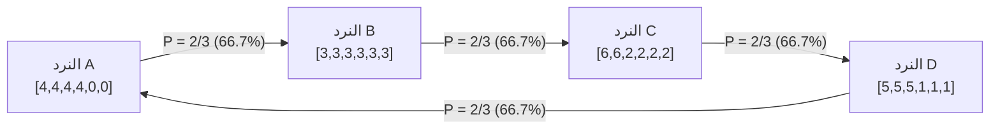

في المنطق البشري اليومي والاستدلال العقلاني البديهي، تُعتبر <strong>خاصية التعدي (Transitivity)</strong> حقيقة بدهية لا تقبل الشك أو الجدال: إذا كان الكيان أو المتسابق $A$ أفضل من $B$، وكان المتسابق $B$ أفضل من $C$، فإن الحدس الإنساني يستنتج حتماً أن $A$ يجب أن يتفوق على $C$. هذه الخاصية هي حجر الزاوية الذي تستند عليه المقارنات في خط الأعداد الحقيقية ($\mathbb{R}, <$)، وقياسات الكتلة والمسافة والزمن، وحتى تقييمات الأسعار والثروات الاقتصادية في الأسواق المالية.

رياضياً وبشكل رسمي دقيق، يُقال عن علاقة ثنائية $\succ$ معرّفة على مجموعة $S$ إنها علاقة متعدية إذا وفقط إذا تحقق الشرط التالي:

$$
\forall x, y, z \in S, \quad (x \succ y) \land (y \succ z) \implies (x \succ z)
$$

لكن بمجرد أن تتداخل الاحتمالات العشوائية مع المتغيرات المستقلة والتقييمات المتعددة الأبعاد، ينهار هذا البناء المنطقي البسيط بشكل مذهل.

المثال الأوضح والأقرب للأذهان هو لعبة *حجر-ورقة-مقص* الشهيرة: الحجر يكسر المقص، والمقص يقطع الورقة، والورقة تغلف الحجر وتنتصر عليه. لا يوجد هنا خيار مطلق أو سيد للعبة، بل تشكل العلاقات حلقة مغلقة غير متعدية. قد يظن الكثيرون أن هذا مجرد اصطلاح رمزي وقواعد كيفية لا تنطبق على الأرقام. ولكن علماء الرياضيات أثبتوا أنه عبر توزيع محسوب للأرقام على أوجه نرد حقيقي، يمكن بناء <strong>نرد غير متعدٍ (Nontransitive Dice)</strong>: النرد $A$ يهزم $B$ باحتمال فوز مرتفع، و$B$ يهزم $C$، و$C$ يهزم $D$، في حين أن $D$ يعود ليلحق هزيمة ساحقة بالنرد $A$ بنسبة الثلثين ($66.7\%$)!

والأكثر إثارة للذهول: إذا رمى كل لاعب <strong>نردين متطابقين</strong> من نوعه وجمع نتيجتيهما (نرد غرايم)، فإن اتجاه حلقة الهيمنة بالكامل ينعكس عكسياً في ظاهرة مفارقة فريدة!

---

## 1. فخ القيمة المتوقعة وخطية المتوسطات

لماذا تخطئ عقولنا في تقدير هذه الألعاب؟ يرجع السبب الأساسي إلى خلطنا المستمر بين احتمالية الفوز في مواجهة فردية وبين <strong>القيمة المتوقعة (Expected Value, $E[X]$)</strong>.
تتميز القيمة المتوقعة بخاصية الخطية الصارمة:

$$
E[X - Y] = E[X] - E[Y]
$$

إذا قارنا النرد وفق القيمة المتوقعة، فإن الترتيب سيكون دائماً متعدياً بلا أي تناقض، لأن القيم المتوقعة مجرد أعداد حقيقية. لكن في النزالات الفردية المباشرة (Head-to-Head Duels)، الفائز لا يتحدد بفارق النقاط وإنما بالدالة الدلالية غير الخطية (Indicator Function) التي تحسم الفوز كقيمة ثنائية:

$$
P(X > Y) = \iint_{\mathbb{R}^2} \mathbf{1}_{\{x > y\}} \, dF_X(x) \, dF_Y(y)
$$

الفوز بفارق $+3$ نقاط أو بفارق $+1$ نقطة يُسجل تماماً كنتصار واحد. هذا القطع الحسابي يُنشئ دوامة احتمالية (Stochastic Curl) تسمح بظهور مسارات مغلقة غير متعدية تتحدى الترتيب الخطي.

---

## 2. نرد إيفرون: التحليل الرياضي الشامل للنظام الرباعي

صمم عالم الإحصاء الشهير في جامعة ستانفورد برادلي إيفرون أربعة نرد مكعبة متزنة بستة أوجه مرقمة على النحو التالي:

| النرد | أرقام الأوجه الستة | التوزيع الاحتمالي | القيمة المتوقعة $E[\cdot]$ |
| :---: | :---: | :---: | :---: |
| <strong>النرد $A$</strong> | $4, 4, 4, 4, 0, 0$ | أربعة 4، واثنان 0 | $E[A] = 16/6 \approx 2.667$ |
| <strong>النرد $B$</strong> | $3, 3, 3, 3, 3, 3$ | ستة أوجه تحمل 3 | $E[B] = 18/6 = 3.000$ |
| <strong>النرد $C$</strong> | $6, 6, 2, 2, 2, 2$ | وجهان 6، وأربعة 2 | $E[C] = 20/6 \approx 3.333$ |
| <strong>النرد $D$</strong> | $5, 5, 5, 1, 1, 1$ | ثلاثة 5، وثلاثة 1 | $E[D] = 18/6 = 3.000$ |

القيم المتوقعة تتبع الترتيب: $E[C] > E[B] = E[D] > E[A]$.
لكن عند حساب فضاء العينة المكون من $6 \times 6 = 36$ نتيجة متكافئة لكل ثنائي:

- <strong>$A$ ضد $B$</strong>: يظهر النرد $A$ الرقم 4 باحتمال $4/6 = 2/3$ فيهزم 3 للنرد $B$. نسبة الفوز: $P(A > B) = 2/3 \approx 66.7\%$.
- <strong>$B$ ضد $C$</strong>: يظهر النرد $C$ الرقم 2 باحتمال $4/6 = 2/3$ فيخسر أمام 3 للنرد $B$. نسبة الفوز: $P(B > C) = 2/3 \approx 66.7\%$.
- <strong>$C$ ضد $D$</strong>: النرد $C$ يفوز بـ 24 حالة من أصل 36 حالة. نسبة الفوز: $P(C > D) = 24/36 = 2/3 \approx 66.7\%$.
- <strong>$D$ ضد $A$ (إغلاق الدائرة)</strong>: النرد $D$ يفوز بـ 24 حالة من أصل 36 حالة. نسبة الفوز: $P(D > A) = 24/36 = 2/3 \approx 66.7\%$!

### أفضلية اللاعب الثاني المطلقة
في رهان يُعرض فيه على الخصم أن يختار نرده أولاً، يتمتع اللاعب الثاني بميزة رياضية حاسمة تضمن له الفوز بنسبة $66.7\%$ باختيار النرد الكاسح لنرد الخصم.

---

## 3. نرد غرايم: الانعكاس المذهل بمضاعفة النرد

اكتشف عالم الرياضيات جيمس غرايم (James Grime) في عام 2009 مجموعة من 5 نرد ملونة (أحمر، أزرق، زيتي، أصفر، بنفسجي).
في الرمية الفردية بنرد واحد لكل طرف، تدور السيطرة باتجاه عقارب الساعة:
$$
\text{أحمر} \succ \text{أزرق} \succ \text{زيتي} \succ \text{أصفر} \succ \text{بنفسجي} \succ \text{أحمر}
$$
ولكن عندما يُطلب من كل لاعب رمي <strong>نردين متماثلين معاً وجمع نتيجتيهما</strong>، يؤدي الالتفاف الاحتمالي المتقطع (Discrete Convolution) إلى عكس اتجاه الهيمنة كاملاً ليصبح عكس عقارب الساعة! تتغير كتل الاحتمالات حول القيم المتوسطة، فتتحول الاستراتيجية الفائزة في الجولات المفردة إلى استراتيجية خاسرة عند التكرار المزدوج.

---

## 4. الروابط مع نظرية الخيار الاجتماعي وعلم التطور

### 4.1 مفارقة كوندورسيه ومبرهنة أرو
تتطابق هذه الظاهرة مع مفارقة كوندورسيه في الانتخابات الديمقراطية: حتى لو امتلك كل ناخب تفضيلات متعدية ومنطقية تماماً، فإن تصويت الأغلبية الثنائي قد يقود إلى حلقة مفرغة جماعية لا يوجد فيها فائز متفق عليه. وتؤكد مبرهنة أرو لاستحالة الديمقراطية المثالية استحالة التخلص من هذا التعارض في فضاء الاختيارات المتعددة.

### 4.2 استراتيجيات التزاوج في الطبيعة: سحلية البقع الجانبية
في جبال كاليفورنيا، تمتلك ذكور سحلية *Uta stansburiana* ثلاثة ألوان للحنجرة ترتبط بثلاث استراتيجيات تكاثرية تشكل حلقة حجر-ورقة-مقص:
- الذكور ذات الحنجرة البرتقالية (العدوانية ذات المناطق الشاسعة) تهزم الذكور الزرقاء.
- الذكور الزرقاء (الحراس الحريصون) تكتشف الذكور الصفراء المتسللة وتطردها.
- الذكور الصفراء (المتسللة الخفية) تستغل اتساع مناطق البرتقالي للتسلل والتزاوج مع إناثه.
هذه الدورة المستمرة منذ آلاف السنين هي الضمانة الطبيعية للحفاظ على التنوع الجيني وتفادي انقراض أي نمط وراثي.

---

## 5. خاتمة فلسفية ورياضية

تثبت الاحتمالات غير المتعدية أن الترتيب الخطي المطلق ليس سوى تبسيط وهمي؛ فالأفضلية ليست صفة جوهرية معزولة لأي كيان، بل هي علاقة مشروطة بالسياق وبطبيعة الخصم المقابل في فضاء الاحتمالات المتشابك.
