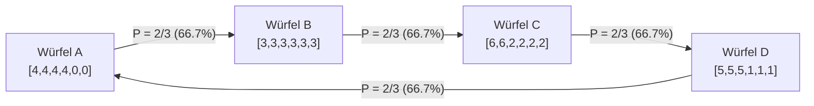

In der alltäglichen Logik und Intuition ist die <strong>Transitivität</strong> ein unerschütterliches Dogma: Wenn Sportler $A$ besser ist als Sportler $B$, und Sportler $B$ besser ist als $C$, dann muss $A$ zwingend auch besser sein als $C$. Diese Eigenschaft bildet das Fundament der reellen Zahlen ($\mathbb{R}, <$), physikalischer Messgrößen und wirtschaftlicher Bewertungen.

Formal bedeutet Transitivität einer binären Relation $\succ$ auf einer Menge $S$:

$$
\forall x, y, z \in S, \quad (x \succ y) \land (y \succ z) \implies (x \succ z)
$$

Doch sobald Wahrscheinlichkeiten und mehrdimensionale Bewertungen ins Spiel kommen, bricht diese intuitive Ordnung spektakulär zusammen.

Das bekannteste intuitive Beispiel ist das Spiel *Schere, Stein, Papier*: Stein schlägt Schere, Schere schlägt Papier, und Papier schlägt Stein. Viele glauben jedoch, dass dies nur für symbolische Regelsysteme gilt und dass Würfel mit echten Zahlenwerten zwingend eine transitive Ordnung erzwingen müssten.

Das ist ein folgenschwerer Irrtum. Mathematiker haben bewiesen, dass man durch geschickte Wahl der Augenzahlen physikalische Würfel konstruieren kann, bei denen <strong>Würfel $A$ gegen $B$ gewinnt, $B$ gegen $C$ gewinnt, $C$ gegen $D$ gewinnt und $D$ wiederum gegen $A$ gewinnt</strong> – jeweils mit einer signifikanten Mehrheit von zwei Dritteln! Man nennt diese Kuriositäten <strong>nicht-transitive Würfel (Nontransitive Dice)</strong>.

Noch verblüffender: Wirft jeder Spieler <strong>zwei</strong> identische Würfel und addiert die Augen, kehrt sich die gesamte Dominanzhierarchie in ihr genaues Gegenteil um!

---

## 1. Die Linearitätsfalle: Erwartungswert vs. paarweiser Vergleich

Warum verlangt unsere Intuition nach Transitivität? Weil wir instinktiv an den <strong>Erwartungswert</strong> $E[X]$ denken. Der Erwartungswert-Operator ist streng linear:

$$
E[X - Y] = E[X] - E[Y]
$$

Da der Erwartungswert jedem Würfel eine reelle Zahl zuordnet, ist ein Vergleich nach Erwartungswerten stets transitiv:
$$
E[A] > E[B] \land E[B] > E[C] \implies E[A] > E[C]
$$

In einem direkten Duell gewinnt jedoch nicht der höhere Erwartungswert, sondern das Ereignis $X > Y$, bestimmt durch die Indikatorfunktion $\mathbf{1}_{\{x > y\}}$:

$$
P(X > Y) = \iint_{\mathbb{R}^2} \mathbf{1}_{\{x > y\}} \, dF_X(x) \, dF_Y(y)
$$

Diese Indikatorfunktion ist extrem nicht-linear. Sie zählt einen knappen Sieg genauso als 1 wie einen haushohen Triumph. Durch diese Projektion auf binäre Siege entsteht im Wahrscheinlichkeitsraum eine "zyklische Strömung" (Wirbel), die geschlossene Zyklen ermöglicht.

---

## 2. Efrons Würfel: Das klassische Vierer-System

Der Stanford-Statistiker Bradley Efron konstruierte den elegantesten Satz von vier sechsseitigen Würfeln:

| Würfel | Augenzahlen der 6 Seiten | Verteilung | Erwartungswert $E[\cdot]$ |
| :---: | :---: | :---: | :---: |
| <strong>Würfel $A$</strong> | $4, 4, 4, 4, 0, 0$ | Vier 4er, zwei 0er | $E[A] = 16/6 = 8/3 \approx 2.667$ |
| <strong>Würfel $B$</strong> | $3, 3, 3, 3, 3, 3$ | Sechs 3er | $E[B] = 18/6 = 3.000$ |
| <strong>Würfel $C$</strong> | $6, 6, 2, 2, 2, 2$ | Zwei 6er, vier 2er | $E[C] = 20/6 = 10/3 \approx 3.333$ |
| <strong>Würfel $D$</strong> | $5, 5, 5, 1, 1, 1$ | Drei 5er, drei 1er | $E[D] = 18/6 = 3.000$ |

Hier gilt für die Erwartungswerte: $E[C] > E[B] = E[D] > E[A]$.

### Die Paar-Wahrscheinlichkeiten (36 Elementarereignisse):

1. <strong>$A$ gegen $B$</strong>: $B$ zeigt immer 3. $A$ zeigt mit $4/6 = 2/3$ eine 4. $P(A > B) = 2/3 \approx 66.7\%$.
2. <strong>$B$ gegen $C$</strong>: $B$ zeigt immer 3. $C$ zeigt mit $4/6 = 2/3$ eine 2. $P(B > C) = 2/3 \approx 66.7\%$.
3. <strong>$C$ gegen $D$</strong>: $C$ gewinnt bei $C=6$ (12 Fälle) oder $C=2, D=1$ (12 Fälle). $P(C > D) = 24/36 = 2/3 \approx 66.7\%$.
4. <strong>$D$ gegen $A$ (Zyklus geschlossen)</strong>: $D$ gewinnt bei $D=5$ (18 Fälle) oder $D=1, A=0$ (6 Fälle). $P(D > A) = 24/36 = 2/3 \approx 66.7\%$!

### Der Vorteil des zweiten Spielers
Lässt man einen Herausforderer zuerst einen beliebigen Würfel wählen, kann der Gastgeber stets einen Würfel wählen, der den ersten mit einer Gewinnchance von $66.7\%$ vernichtend schlägt. Wer zuerst wählt, verliert mathematisch garantiert.

---

## 3. Grime-Würfel: Die paradoxe Umkehrung bei zwei Würfeln

Der Mathematiker James Grime entdeckte 2009 einen Satz aus 5 Würfeln (Rot $R$, Blau $B$, Oliv $O$, Gelb $Y$, Magenta $M$):
- Bei einem Würfel: $R \succ B \succ O \succ Y \succ M \succ R$ (jeweils mit ca. 55–58 % Gewinnwahrscheinlichkeit).
- Werfen jedoch beide Spieler <strong>zwei Würfel</strong> derselben Farbe und addieren die Werte, <strong>kehrt sich die Richtung vollständig um</strong>:
  $$
  R \prec B \prec O \prec Y \prec M \prec R
  $$
Grund dafür ist die Faltung (Diskret-Faltung) der Wahrscheinlichkeitsverteilungen: Bei zwei Würfeln konzentriert sich die Wahrscheinlichkeitsmasse um andere Summenwerte, wodurch ehemals seltene Höchstwerte an Bedeutung verlieren.

---

## 4. Relevanz in Politik und Natur

### 4.1 Condorcet-Paradoxon und Arrow-Theorem
Nicht-transitive Würfel sind mathematisch isomorph zu Condorcets Wahlparadoxon in der Sozialwahltheorie: Selbst wenn jeder einzelne Wähler transitive Präferenzen besitzt, kann eine paarweise Mehrheitsentscheidung in einen zyklischen Kreisverkehr münden. Kenneth Arrows Unmöglichkeitssatz beweist, dass kein Wahlsystem dieses Dilemma ohne Diktatur oder Willkür auflösen kann.

### 4.2 Evolutionäre Spieltheorie: Die Seitenfleckleguane
In Kalifornien besitzen männliche Seitenfleckleguane (*Uta stansburiana*) drei Kehlfarben mit zyklischen Paarungsstrategien:
- <strong>Orange (aggressiv)</strong> verdrängt Blau.
- <strong>Blau (monogam verteidigend)</strong> verdrängt Gelb.
- <strong>Gelb (tarnende Schwindler)</strong> verdrängt Orange.
Dieser unendliche Kreisverkehr schützt die genetische Vielfalt davor, dass eine einzige Variante die Art monopolisiert.

---

## 5. Fazit

Nicht-transitive Würfel demonstrieren eindrucksvoll, dass relative Stärke kontextabhängig ist. Im mehrdimensionalen Raum der Wahrscheinlichkeiten gibt es keine absolute Spitze – die Suche nach dem universell "Besten" ist eine mathematische Illusion.
