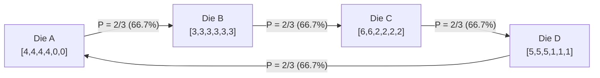
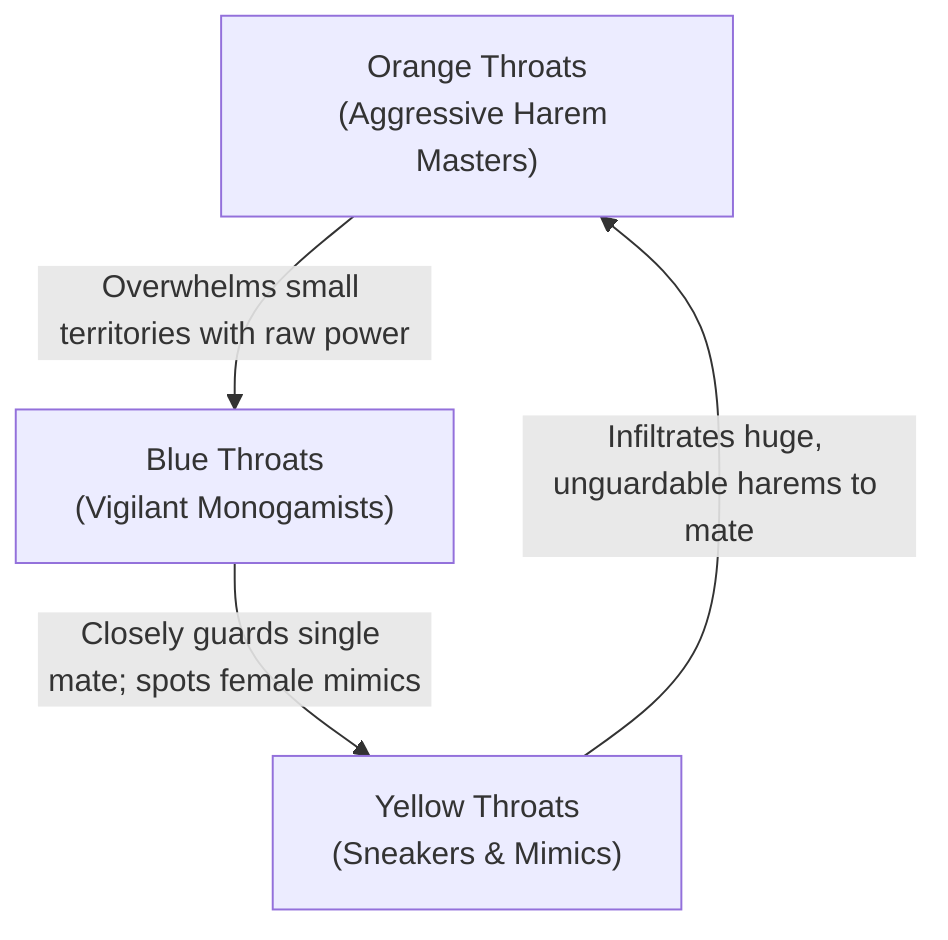

In human intuition and daily reasoning, few principles feel as self-evident and unassailable as the principle of <strong>transitivity</strong>. If athlete $A$ consistently outruns athlete $B$, and athlete $B$ consistently outruns athlete $C$, we find it impossible to doubt that athlete $A$ will outrun athlete $C$. If commodity $X$ weighs more than commodity $Y$, and $Y$ weighs more than $Z$, then $X$ must inevitably weigh more than $Z$. 

In the language of formal mathematical logic, a binary relation $\succ$ on a set $S$ is termed <strong>transitive</strong> if:

$$
\forall x, y, z \in S, \quad (x \succ y) \land (y \succ z) \implies (x \succ z)
$$

This property forms the bedrock of the real number line $(\mathbb{R}, <)$, order theory, economic measurement, and our intuitive understanding of hierarchies, rankings, and physical magnitudes.

Yet, the moment probability, stochastic processes, and multi-dimensional comparisons enter the arena, this foundational axiom collapses into dust.

Consider the universally familiar game of Rock-Paper-Scissors. Rock crushes Scissors, Scissors cuts Paper, and Paper covers Rock. There is no supreme, all-powerful choice. Instead, the relations form a closed, cyclic loop:

$$
\text{Rock} \succ \text{Scissors} \succ \text{Paper} \succ \text{Rock}
$$

A skeptic might shrug and say: *"That is merely a symbolic game of categorical rules. If we replace arbitrary symbols with objective numbers—such as the pips on dice—and declare that the higher number wins, the laws of arithmetic must enforce transitivity."*

Remarkably, that conclusion is false. By carefully numbering the faces of ordinary six-sided dice, one can construct sets of physical dice where <strong>Die $A$ beats Die $B$ with high probability, Die $B$ beats Die $C$ with high probability, Die $C$ beats Die $D$ with high probability, and yet Die $D$ beats Die $A$ with high probability</strong>.

These objects are known in mathematics as <strong>Non-Transitive Dice</strong> (or intransitive dice).

Even more disorienting, certain sets of non-transitive dice (such as Grime Dice) exhibit a staggering reversal phenomenon: if each player rolls <strong>two</strong> identical dice instead of one and sums the outcomes, <strong>the entire chain of dominance flips into reverse</strong>! The die that was dominant in single combat becomes systematically inferior in double combat.

This article delivers a rigorous, exhaustive, and mathematically profound exploration of non-transitive probability. We will deconstruct Efron's dice through the lens of joint probability measures and sample spaces, examine why expected value ($E[X]$) and pairwise stochastic dominance ($P(X > Y) > 1/2$) fundamentally part ways, uncover the convolution mechanics behind the double-die reversal paradox, and trace how this exact mathematical pathology governs Condorcet voting paradoxes, Arrow's Impossibility Theorem, evolutionary biology, and the foundations of rational choice theory.

---

## 1. The Trap of Linearity: Why Our Minds Demand Transitivity

### 1.1 The Dominance of the Real Number Line

From early childhood, human cognitive development is shaped by the properties of real numbers. The real number system $(\mathbb{R}, \le)$ is a <strong>totally ordered field</strong>. It obeys three fundamental order axioms:
1. <strong>Totality (Completeness)</strong>: For any $a, b \in \mathbb{R}$, either $a \le b$ or $b \le a$.
2. <strong>Antisymmetry</strong>: If $a \le b$ and $b \le a$, then $a = b$.
3. <strong>Transitivity</strong>: If $a \le b$ and $b \le c$, then $a \le c$.

Because real numbers represent physical quantities like distance, mass, temperature, price, and test scores, we develop an overwhelming heuristic bias: whenever two entities are compared, we seek to reduce each entity to a single real scalar $f(x) \in \mathbb{R}$. Once entities are mapped to scalars, transitivity is automatically guaranteed:

$$
f(A) > f(B) \quad \text{and} \quad f(B) > f(C) \implies f(A) > f(C)
$$

### 1.2 The Deceptive Linearity of Expected Value

When dealing with uncertain or probabilistic outcomes, decision-makers instinctively turn to the <strong>Expected Value</strong> ($E[X]$). If $X$ is a discrete random variable representing the outcome of rolling die $X$, its expected value is:

$$
E[X] = \sum_{k} k \cdot P(X = k)
$$

The expectation operator $E[\cdot]$ is strictly <strong>linear</strong>:

$$
E[X - Y] = E[X] - E[Y]
$$

Because $E[X]$ assigns an unambiguous real number to each die, any comparison based strictly on expected values must obey transitivity:

$$
E[A] > E[B] \quad \text{and} \quad E[B] > E[C] \implies E[A] > E[C]
$$

This leads directly to the cognitive trap. In everyday parlance, people say "Die $A$ is better than Die $B$" and mistakenly equate this statement with "$E[A] > E[B]$".

However, in a direct, head-to-head competitive duel—whether in a casino game, an election, or an evolutionary struggle—the payoff does not scale continuously with the numerical difference $(X - Y)$. Rather, the victor is decided purely by the binary condition $X > Y$.

The probability that die $X$ defeats die $Y$ is given by the integral of the indicator function $\mathbf{1}_{\{x > y\}}$ over the product measure:

$$
P(X > Y) = \iint_{\mathbb{R}^2} \mathbf{1}_{\{x > y\}} \, dF_X(x) \, dF_Y(y)
$$

The indicator function $\mathbf{1}_{\{x > y\}}$ is intensely <strong>non-linear</strong>. It registers a value of $1$ whether $X$ surpasses $Y$ by $0.001$ or by $1,000,000$, and drops discontinuously to $0$ when $X \le Y$.

Because pairwise probability $P(X > Y)$ cannot be decomposed into the difference of a univariate scalar function $g(X) - g(Y)$, the mathematical mechanism that guarantees transitivity on the real line ceases to exist. A topological twist is born in probability space.

---

## 2. Efron's Dice: The Canonical Four-Die System

The most celebrated and elegant demonstration of non-transitive dice was discovered by the renowned Stanford University statistician <strong>Bradley Efron</strong> (celebrated for inventing the bootstrap resampling technique).

### 2.1 Configuration and Face Values

Efron's set consists of four distinct six-sided dice, labeled $A, B, C,$ and $D$. Each die is physically balanced, meaning each face appears with equal probability $1/6$. Their face values are non-standard integers arranged as follows:

| Die | Face Configuration | Distribution Summary | Expected Value $E[\cdot]$ |
| :---: | :---: | :---: | :---: |
| <strong>Die $A$</strong> | $4, 4, 4, 4, 0, 0$ | Four $4$s, Two $0$s | $E[A] = \frac{4 \times 4 + 0 \times 2}{6} = \frac{16}{6} = \frac{8}{3} \approx 2.667$ |
| <strong>Die $B$</strong> | $3, 3, 3, 3, 3, 3$ | Six $3$s | $E[B] = \frac{3 \times 6}{6} = 3.000$ |
| <strong>Die $C$</strong> | $6, 6, 2, 2, 2, 2$ | Two $6$s, Four $2$s | $E[C] = \frac{6 \times 2 + 2 \times 4}{6} = \frac{20}{6} = \frac{10}{3} \approx 3.333$ |
| <strong>Die $D$</strong> | $5, 5, 5, 1, 1, 1$ | Three $5$s, Three $1$s | $E[D] = \frac{5 \times 3 + 1 \times 3}{6} = \frac{18}{6} = 3.000$ |

Inspect their expected values carefully:

$$
E[C] = 3.333 > E[B] = 3.000 = E[D] = 3.000 > E[A] = 2.667
$$

If players chose dice based on expected values, Die $C$ would be the undisputed champion, while Die $A$ would be the worst choice.

Now let us examine pairwise head-to-head rolls. When two dice are rolled independently, the joint sample space contains $6 \times 6 = 36$ equally likely elementary outcomes.



### 2.2 Complete Mathematical Derivation of All Matchups

#### Matchup 1: Die $A$ vs Die $B$
- Die $B$ produces a constant value of $3$ with probability $1$.
- Die $A$ rolls $4$ with probability $4/6 = 2/3$, and rolls $0$ with probability $2/6 = 1/3$.
- If $A = 4$, $A$ wins ($4 > 3$).
- If $A = 0$, $B$ wins ($0 < 3$).

Therefore:
$$
P(A > B) = \frac{4}{6} = \frac{2}{3} \approx 66.67\%
$$
<strong>Die $A$ soundly defeats Die $B$ in $2$ out of every $3$ rolls.</strong>

---

#### Matchup 2: Die $B$ vs Die $C$
- Die $B$ produces a constant value of $3$.
- Die $C$ rolls $6$ with probability $2/6 = 1/3$, and rolls $2$ with probability $4/6 = 2/3$.
- If $C = 6$, $C$ wins ($6 > 3$).
- If $C = 2$, $B$ wins ($3 > 2$).

Therefore:
$$
P(B > C) = \frac{4}{6} = \frac{2}{3} \approx 66.67\%
$$
<strong>Die $B$ soundly defeats Die $C$ in $2$ out of every $3$ rolls.</strong>

At this stage, an observer accustomed to transitivity would infer:
*"Since $A$ beats $B$ ($66.7\%$), and $B$ beats $C$ ($66.7\%$), Die $A$ must thoroughly dominate Die $C$!"*

Let us test that inference.

---

#### Matchup 3: Die $C$ vs Die $D$
We construct the $6 \times 6$ grid of $36$ outcomes:

| $C \backslash D$ | 5 (3 faces) | 1 (3 faces) |
| :---: | :---: | :---: |
| <strong>6 (2 faces)</strong> | $C$ wins ($2 \times 3 = 6$) | $C$ wins ($2 \times 3 = 6$) |
| <strong>2 (4 faces)</strong> | $D$ wins ($4 \times 3 = 12$) | $C$ wins ($4 \times 3 = 12$) |

Evaluating wins:
- $C$ wins whenever $C = 6$ ($12$ outcomes) or when $C = 2$ and $D = 1$ ($12$ outcomes). Total wins for $C = 12 + 12 = 24$.
- $D$ wins only when $C = 2$ and $D = 5$ ($12$ outcomes).

Thus:
$$
P(C > D) = \frac{24}{36} = \frac{2}{3} \approx 66.67\%
$$
<strong>Die $C$ soundly defeats Die $D$ in $2$ out of every $3$ rolls.</strong>

---

#### Matchup 4: Die $D$ vs Die $A$ (Closing the Cycle)
Now for the crucial confrontation: Die $D$ against Die $A$.
Does Die $A$ stand supreme at the top of the chain?

| $D \backslash A$ | 4 (4 faces) | 0 (2 faces) |
| :---: | :---: | :---: |
| <strong>5 (3 faces)</strong> | $D$ wins ($3 \times 4 = 12$) | $D$ wins ($3 \times 2 = 6$) |
| <strong>1 (3 faces)</strong> | $A$ wins ($3 \times 4 = 12$) | $D$ wins ($3 \times 2 = 6$) |

Evaluating wins:
- $D$ wins whenever $D = 5$ ($18$ outcomes) or when $D = 1$ and $A = 0$ ($6$ outcomes). Total wins for $D = 18 + 6 = 24$.
- $A$ wins only when $D = 1$ and $A = 4$ ($12$ outcomes).

Thus:
$$
P(D > A) = \frac{24}{36} = \frac{2}{3} \approx 66.67\%
$$

<strong>Die $D$ defeats Die $A$ with exactly $2/3$ probability!</strong>

### 2.3 The Hustler's Asymmetric Game

The four probabilities form a symmetric directed cycle of uniform magnitude:

$$
P(A > B) = P(B > C) = P(C > D) = P(D > A) = \frac{2}{3}
$$

Imagine a game proposed in a tavern or an investment parlor:
1. Four dice ($A, B, C, D$) are placed on the table with their faces openly visible.
2. The challenger is generously invited to <strong>choose first</strong> and pick any die they desire.
3. The host then selects one of the remaining three dice.
4. Both roll their chosen die. Highest roll wins the pot.

To an unsuspecting player, picking first seems like an undeniable advantage. They can analyze the dice, pick the die with the highest expected value ($C$), or the die with four $4$s ($A$).

In reality, <strong>the first player is mathematically doomed</strong>. No matter which die the challenger chooses, the host can always pick a die that holds a devastating <strong>$66.7\%$ winning edge</strong>:
- If player picks $A$, host picks $D$ (Host wins $66.7\%$ of the time).
- If player picks $B$, host picks $A$ (Host wins $66.7\%$ of the time).
- If player picks $C$, host picks $B$ (Host wins $66.7\%$ of the time).
- If player picks $D$, host picks $C$ (Host wins $66.7\%$ of the time).

There is no maximum element in the poset. The game possesses a structural <strong>second-mover advantage</strong> that is absolute and invariant.

---

## 3. Dissecting the Mechanism: Margin vs. Frequency

To internalize why this paradox is mathematically coherent, we must isolate the fundamental distinction between <strong>margin of victory</strong> and <strong>frequency of victory</strong>.

Consider the matchup between Die $B$ (constant $3$) and Die $C$ ($6$ on two faces, $2$ on four faces).
- When $C$ wins (rolls $6$), it wins by a substantial margin of $+3$.
- When $C$ loses (rolls $2$), it loses by a slender margin of $-1$.

Computing the expectation of the difference:
$$
E[C - B] = \frac{1}{3}(+3) + \frac{2}{3}(-1) = +1 - \frac{2}{3} = +\frac{1}{3}
$$

On average, Die $C$ generates more points per roll than Die $B$. In a cooperative game where scores are summed together over hundreds of rounds, $C$ would outscore $B$.

However, pairwise competitive gaming applies the signum step function:
$$
\text{Score} = \text{sgn}(X - Y)
$$
In this binary scoring regime, winning by $+3$ counts as exactly one win, whereas losing by $-1$ counts as exactly one loss. Die $C$'s massive point surplus on its rare winning rolls is entirely squandered. Die $B$ wins small, but it wins often.

This demonstrates a profound statistical truth: <strong>Pairwise dominance reflects the median of differences, not the mean of differences.</strong> When distributions are skewed or multimodal, the median and mean can point in diametrically opposite directions.

---

## 4. The Grime Dice Paradox: The Double-Die Reversal

While Efron's dice expose the failure of transitivity, an even more bewildering discovery was made in 2009 by British mathematician <strong>Dr. James Grime</strong>.

Grime designed a set of five non-transitive dice whose properties seem to defy the very laws of cause and effect: <strong>When you roll two of each die instead of one, the entire hierarchy of dominance reverses its direction!</strong>

### 4.1 The Five Grime Dice

The set consists of five colored dice: Red ($R$), Blue ($B$), Olive ($O$), Yellow ($Y$), and Magenta ($M$).

| Die Color | Notation | Face Values | Expected Value $E[\cdot]$ |
| :---: | :---: | :---: | :---: |
| <strong>Red</strong> | $R$ | $4, 4, 4, 4, 4, 9$ (Five $4$s, One $9$) | $E[R] = 29/6 \approx 4.833$ |
| <strong>Blue</strong> | $B$ | $2, 2, 2, 7, 7, 7$ (Three $2$s, Three $7$s) | $E[B] = 27/6 = 4.500$ |
| <strong>Olive</strong> | $O$ | $0, 5, 5, 5, 5, 5$ (One $0$, Five $5$s) | $E[O] = 25/6 \approx 4.167$ |
| <strong>Yellow</strong> | $Y$ | $3, 3, 3, 3, 8, 8$ (Four $3$s, Two $8$s) | $E[Y] = 28/6 \approx 4.667$ |
| <strong>Magenta</strong> | $M$ | $1, 1, 6, 6, 6, 6$ (Two $1$s, Four $6$s) | $E[M] = 26/6 \approx 4.333$ |

### 4.2 Single-Die Duel: The Clockwise Pentagonal Cycle

When rolled as single dice, Grime dice form a non-transitive cycle of five elements:

```mermaid
flowchart TD
    subgraph Single_Die_Duel_Clockwise
        R1[Red R] -->|58.3%| B1[Blue B]
        B1 -->|58.3%| O1[Olive O]
        O1 -->|55.6%| Y1[Yellow Y]
        Y1 -->|55.6%| M1[Magenta M]
        M1 -->|55.6%| R1
    end
    subgraph Two_Dice_Duel_Counter_Clockwise
        R2[Red R] <--|59.0%| B2[Blue B]
        B2 <--|54.2%| O2[Olive O]
        O2 <--|56.6%| Y2[Yellow Y]
        Y2 <--|56.2%| M2[Magenta M]
        M2 <--|51.7%| R2
    end
```

Let us calculate the exact probabilities for single combat:

1. <strong>Red vs. Blue ($R$ vs $B$)</strong>:
   - $R$ has $4$ (5 faces), $9$ (1 face).
   - $B$ has $2$ (3 faces), $7$ (3 faces).
   - If $R = 9$, $R$ wins regardless of $B$ ($1 \times 6 = 6$ outcomes).
   - If $R = 4$, $R$ beats $B$ when $B = 2$ ($5 \times 3 = 15$ outcomes).
   - Total wins for $R$: $6 + 15 = 21$.
   - $P(R > B) = 21/36 = 7/12 \approx 58.33\%$.
   - <strong>$R \succ B$</strong>

2. <strong>Blue vs. Olive ($B$ vs $O$)</strong>:
   - $B$ has $2$ (3 faces), $7$ (3 faces).
   - $O$ has $0$ (1 face), $5$ (5 faces).
   - If $B = 7$, $B$ wins always ($3 \times 6 = 18$ outcomes).
   - If $B = 2$, $B$ beats $O$ when $O = 0$ ($3 \times 1 = 3$ outcomes).
   - Total wins for $B$: $18 + 3 = 21$.
   - $P(B > O) = 21/36 = 7/12 \approx 58.33\%$.
   - <strong>$B \succ O$</strong>

3. <strong>Olive vs. Yellow ($O$ vs $Y$)</strong>:
   - $O$ has $0$ (1 face), $5$ (5 faces).
   - $Y$ has $3$ (4 faces), $8$ (2 faces).
   - $O$ wins only when $O = 5$ and $Y = 3$ ($5 \times 4 = 20$ outcomes).
   - $P(O > Y) = 20/36 = 5/9 \approx 55.56\%$.
   - <strong>$O \succ Y$</strong>

4. <strong>Yellow vs. Magenta ($Y$ vs $M$)</strong>:
   - $Y$ has $3$ (4 faces), $8$ (2 faces).
   - $M$ has $1$ (2 faces), $6$ (4 faces).
   - If $Y = 8$, $Y$ wins always ($2 \times 6 = 12$ outcomes).
   - If $Y = 3$, $Y$ beats $M$ when $M = 1$ ($4 \times 2 = 8$ outcomes).
   - Total wins for $Y$: $12 + 8 = 20$.
   - $P(Y > M) = 20/36 = 5/9 \approx 55.56\%$.
   - <strong>$Y \succ M$</strong>

5. <strong>Magenta vs. Red ($M$ vs $R$)</strong>:
   - $M$ has $1$ (2 faces), $6$ (4 faces).
   - $R$ has $4$ (5 faces), $9$ (1 face).
   - $M$ wins only when $M = 6$ and $R = 4$ ($4 \times 5 = 20$ outcomes).
   - $P(M > R) = 20/36 = 5/9 \approx 55.56\%$.
   - <strong>$M \succ R$</strong>

Thus, in single combat, dominance runs in a strict clockwise loop:
$$
R \xrightarrow{58.3\%} B \xrightarrow{58.3\%} O \xrightarrow{55.6\%} Y \xrightarrow{55.6\%} M \xrightarrow{55.6\%} R
$$

### 4.3 The Two-Die Revolution: Convolution and Inversion

Now suppose the players decide to roll <strong>two identical dice</strong> each and sum their scores.
Player 1 rolls $R_1 + R_2$, while Player 2 rolls $B_1 + B_2$. The sample space expands to $6^4 = 1,296$ equally likely outcomes.

Let us compute the sum distributions:

<strong>Red Pair Sum ($2R = R_1 + R_2$):</strong>
- $4 + 4 = 8$ with probability $(5/6) \times (5/6) = 25/36$
- $4 + 9 = 13$ with probability $2 \times (5/6) \times (1/6) = 10/36$
- $9 + 9 = 18$ with probability $(1/6) \times (1/6) = 1/36$

<strong>Blue Pair Sum ($2B = B_1 + B_2$):</strong>
- $2 + 2 = 4$ with probability $(3/6) \times (3/6) = 9/36$
- $2 + 7 = 9$ with probability $2 \times (3/6) \times (3/6) = 18/36$
- $7 + 7 = 14$ with probability $(3/6) \times (3/6) = 9/36$

Let us evaluate the $1,296$ combinations for $2B$ vs $2R$:
- If $2B = 14$ (prob $9/36$): $B$ defeats $2R$ if $2R$ equals $8$ (prob $25/36$) or $13$ (prob $10/36$). That yields $9 \times (25 + 10) = 315$ winning combinations.
- If $2B = 9$ (prob $18/36$): $B$ defeats $2R$ if $2R$ equals $8$ (prob $25/36$). That yields $18 \times 25 = 450$ winning combinations.
- If $2B = 4$ (prob $9/36$): $B$ cannot defeat any possible sum of $2R$ ($0$ combinations).

Summing the winning outcomes for Blue:
$$
315 + 450 = 765 \text{ outcomes out of } 1,296
$$

Thus, the probability that Blue defeats Red when rolling two dice is:
$$
P(2B > 2R) = \frac{765}{1296} = \frac{85}{144} \approx 59.03\%
$$

<strong>In single rolls, Red defeats Blue with $58.33\%$ probability. In double rolls, Blue defeats Red with $59.03\%$ probability!</strong>

The same reversal occurs across every single adjacent pair in the pentagon:
- $P(2O > 2B) = 702/1296 = 54.17\%$ (Reversed from $B \succ O$)
- $P(2Y > 2O) = 734/1296 \approx 56.64\%$ (Reversed from $O \succ Y$)
- $P(2M > 2Y) = 728/1296 \approx 56.17\%$ (Reversed from $Y \succ M$)
- $P(2R > 2M) = 670/1296 \approx 51.70\%$ (Reversed from $M \succ R$)

The entire cycle flips into reverse:
$$
R \xleftarrow{59.0\%} B \xleftarrow{54.2\%} O \xleftarrow{56.6\%} Y \xleftarrow{56.2\%} M \xleftarrow{51.7\%} R
$$

### 4.4 The Analytical Root: Why Convolution Inverts Dominance

Why does convolution reverse stochastic dominance?

When a random variable $X$ is added to an independent copy of itself ($S_2 = X_1 + X_2$), the probability mass function of the sum is the discrete convolution:

$$
P(S_2 = s) = (P_X * P_X)(s) = \sum_{k} P(X = k) P(X = s - k)
$$

In a single roll, Red's solitary $9$ served as an "anti-aircraft missile," knocking down Blue's $7$s. But Red's baseline roll is $4$ with a crushing probability of $5/6$. When two Red dice are rolled, the probability of getting two $4$s is $(5/6)^2 = 25/36 \approx 69.4\%$. Red becomes trapped at a modest sum of $8$.

Blue, on the other hand, rolls a $7$ with probability $1/2$. When two Blue dice are rolled, the probability of rolling at least one $7$ is:
$$
1 - \left(\frac{1}{2}\right)^2 = 1 - \frac{1}{4} = 75\%
$$
Thus, $75\%$ of the time, Blue's sum is at least $9$, effortlessly clearing Red's dominant $8$.

This mathematical mechanism offers an unforgettable lesson for strategy and risk management: <strong>A strategy that excels in isolated, individual transactions can become catastrophically unviable when repeated or aggregated in batches.</strong>

---

## 5. The Social Choice Connection: Condorcet and Arrow

Non-transitive dice are not an isolated novelty. They share an identical formal topology with one of the most profound dilemmas of democratic political philosophy: <strong>Social Choice Theory</strong>.

### 5.1 The Condorcet Voting Paradox

In 1785, the French mathematician and political philosopher <strong>Marquis de Condorcet</strong> uncovered a fundamental flaw in majority rule. 

Suppose three rational voters (Voter 1, Voter 2, Voter 3) rank three political candidates ($A, B, C$):

| Voter | Preference Order (Descending) |
| :---: | :---: |
| <strong>Voter 1</strong> | $A \succ B \succ C$ |
| <strong>Voter 2</strong> | $B \succ C \succ A$ |
| <strong>Voter 3</strong> | $C \succ A \succ B$ |

Every single voter possesses completely transitive, rational preferences.
Now let the electorate vote in pairwise head-to-head elections:
- <strong>$A$ vs $B$</strong>: Voter 1 prefers $A$; Voter 3 prefers $A$; Voter 2 prefers $B$. <strong>$A$ beats $B$ by 2 to 1.</strong>
- <strong>$B$ vs $C$</strong>: Voter 1 prefers $B$; Voter 2 prefers $B$; Voter 3 prefers $C$. <strong>$B$ beats $C$ by 2 to 1.</strong>
- <strong>$C$ vs $A$</strong>: Voter 2 prefers $C$; Voter 3 prefers $C$; Voter 1 prefers $A$. <strong>$C$ beats $A$ by 2 to 1.</strong>

The democratic aggregate preference is:
$$
A \succ B \succ C \succ A
$$

A cyclic, non-transitive loop! No candidate can claim democratic legitimacy as the "will of the people." For any winner selected, an overwhelming supermajority ($66.7\%$) would have preferred someone else.

### 5.2 Formal Isomorphism with Efron's Dice

The isomorphism between Condorcet's paradox and non-transitive dice is mathematically exact:
- Each <strong>die</strong> corresponds to a <strong>political candidate</strong>.
- Each <strong>face of the die</strong> corresponds to a <strong>voter</strong> (or state of nature in a uniform probability space).
- The <strong>number on the face</strong> corresponds to the <strong>utility score</strong> assigned to that candidate by that voter.
- The condition $P(X > Y) > 1/2$ corresponds to <strong>winning a pairwise majority vote</strong>.

In 1953, mathematician <strong>David C. McGarvey</strong> proved a landmark theorem:
> <strong>McGarvey's Theorem</strong>: For *any* arbitrary directed tournament graph $T = (V, E)$ (no matter how complex or tangled its non-transitive cycles), there exists a finite profile of voters with transitive rankings whose pairwise majority elections precisely reproduce $T$.

Transitivity at the micro-level does not survive aggregation into pairwise majority comparisons at the macro-level. Non-transitive dice are simply physical, tactile realizations of McGarvey's theorem.

### 5.3 Arrow's Impossibility Theorem

In 1951, <strong>Kenneth Arrow</strong> proved that this pathology cannot be cured by tweaking voting rules. Arrow's Impossibility Theorem proved that any social welfare function that attempts to aggregate individual transitive preferences into a collective ranking must violate at least one of four fundamental democratic conditions:
1. <strong>Unrestricted Domain</strong>: All possible voter preferences can be accommodated.
2. <strong>Non-Dictatorship</strong>: No single individual dictates the collective outcome.
3. <strong>Pareto Efficiency</strong>: If everyone prefers $X$ to $Y$, the group prefers $X$ to $Y$.
4. <strong>Independence of Irrelevant Alternatives (IIA)</strong>: The collective ranking between $X$ and $Y$ depends solely on individual preferences between $X$ and $Y$, untouched by the introduction of a third candidate $Z$.

Non-transitive dice provide the clearest physical proof of why IIA and transitivity clash: the pairwise comparison of two random variables depends entirely on the structure of their joint probability space, which cannot be reduced to independent global scalars.

---

## 6. Non-Transitivity in Nature: Evolutionary Game Theory

Does nature obey transitivity, or does natural selection exploit non-transitive cycles to maintain ecological stability?

Field studies in evolutionary biology demonstrate that non-transitive dynamics are essential for preserving biodiversity.

### 6.1 The Side-Blotched Lizard (*Uta stansburiana*)

In the coastal ranges of California, evolutionary biologist <strong>Barry Sinervo</strong> and Donald Lively discovered an extraordinary real-world Rock-Paper-Scissors cycle governing the mating strategies of male side-blotched lizards (*Uta stansburiana*).

The males exhibit three genetically determined throat colors, each tied to a distinct morphological and behavioral strategy:

| Morph | Throat Color | Strategy | Biological Profile |
| :---: | :---: | :---: | :---: |
| <strong>Ultra-Dominant</strong> | <strong>Orange</strong> | Polygynous territorial takeover | High testosterone, large body size, commands huge territories containing multiple females. Vulnerable to sneaking due to territory size. |
| <strong>Guardian</strong> | <strong>Blue</strong> | Monogamous defense | Moderate body size, fiercely defends a small territory with a single female. Cooperates with neighboring blue males to deter invaders. |
| <strong>Sneaker</strong> | <strong>Yellow</strong> | Female mimicry and infiltration | Small body size, lacks territory, mimics female behavior and morphology to sneak into unguarded harems. |

These three strategies form a non-transitive evolutionary cycle:



1. <strong>Orange beats Blue</strong>: The aggressive, physically dominant Orange males overpower Blue males and seize their territories.
2. <strong>Blue beats Yellow</strong>: Blue males guard their single mate at close quarters and cooperate with adjacent blue males, easily detecting and driving away Yellow sneakers.
3. <strong>Yellow beats Orange</strong>: Orange males hold territories too expansive to patrol continuously. Yellow sneakers slip unnoticed into Orange harems and fertilize the females.

Over a six-year field study, Sinervo documented an endless six-year cycle of gene frequencies. When Orange was abundant, Yellow proliferated. As Yellow peaked, Blue surged. When Blue became dominant, Orange returned to power.

If any one strategy had been universally "fittest," the other two would have been driven to extinction. <strong>The non-transitive loop is the very mechanism that sustains genetic diversity.</strong>

### 6.2 Microbial Warfare: Colicin-Producing *E. coli*

A parallel non-transitive triad governs competition in bacterial communities:
1. <strong>Producer Strain ($C$)</strong>: Synthesizes colicin, an antimicrobial toxin, and produces an immunity protein. The production costs heavy cellular energy.
2. <strong>Resistant Strain ($R$)</strong>: Mutations alter membrane receptors, conferring immunity to colicin without producing the toxin. Lacks toxin synthesis costs, but suffers slight nutrient transport penalties.
3. <strong>Sensitive Strain ($S$)</strong>: Has neither colicin production nor resistance. Incurs zero metabolic overhead and reproduces at maximum velocity.

In spatial environments (such as agar plates):
- <strong>$C$ wipes out $S$</strong>: The lethal colicin toxin diffuses and destroys sensitive cells.
- <strong>$S$ outcompetes $R$</strong>: Free from toxin exposure, $S$'s superior growth rate outpaces $R$ and consumes available nutrients.
- <strong>$R$ displaces $C$</strong>: Immune to colicin, $R$ capitalizes on $C$'s metabolic handicap (the cost of toxin synthesis) and outgrows $C$.

Spatial segregation creates localized patches where the three strains chase each other across the petri dish in perpetuity.

---

## 7. Decision Theory and the Fallacy of Scalar Rationality

### 7.1 The Money Pump Argument

In normative economics and decision theory (formulated by John von Neumann and Oskar Morgenstern), transitivity is treated as a non-negotiable axiom of rationality.

The classical justification is the <strong>Money Pump Argument</strong>:
Suppose an economic agent holds non-transitive preferences over three goods: $A \succ B \succ C \succ A$.
1. The agent currently holds $C$.
2. Because the agent prefers $B$ to $C$, an arbitrageur offers to trade $B$ for $C$ plus a nominal fee of $\$1$. The agent gladly pays $\$1$ and accepts $B$.
3. Because the agent prefers $A$ to $B$, the arbitrageur trades $A$ for $B$ plus $\$1$. The agent pays $\$1$ and accepts $A$.
4. Because the agent prefers $C$ to $A$, the arbitrageur trades $C$ for $A$ plus $\$1$. The agent pays $\$1$ and returns to state $C$.

The agent is right back where they started with good $C$, but has lost $\$3$. Repeating this cycle drains the agent of infinite wealth until bankruptcy occurs. Economists therefore concluded that non-transitive preferences are pathological and cannot persist in competitive markets.

### 7.2 Amos Tversky's Lexicographic Semiorders

In his groundbreaking 1969 paper *"Intransitivity of Preferences"*, cognitive psychologist <strong>Amos Tversky</strong> proved that perfectly rational, real-world human decision algorithms routinely and systematically generate non-transitive preferences.

Humans evaluate complex alternatives across multiple attributes (e.g., job offers with salary, commute time, and intellectual fulfillment). When comparing two alternatives, people frequently use <strong>threshold-based heuristic rules</strong>:

> *"If the difference in attribute $X$ between two candidates is smaller than threshold $\epsilon$, I consider them indistinguishable on attribute $X$ and decide based on attribute $Y$."*

Suppose an applicant evaluates five job offers ($J_1$ to $J_5$) based on salary and commute:

- $J_1$: Salary $\$100{,}000$, Commute 10 minutes.
- $J_2$: Salary $\$105{,}000$, Commute 20 minutes.
- $J_3$: Salary $\$110{,}000$, Commute 30 minutes.
- $J_4$: Salary $\$115{,}000$, Commute 40 minutes.
- $J_5$: Salary $\$120{,}000$, Commute 50 minutes.

If the decision-maker considers a $\$5{,}000$ salary difference negligible and focuses on shorter commute time:
$$
J_1 \succ J_2 \succ J_3 \succ J_4 \succ J_5
$$
Yet, when confronted directly with $J_1$ and $J_5$, the salary difference is $\$20{,}000$—far too massive to ignore. The salary attribute triggers, and the decision-maker chooses $J_5 \succ J_1$.

Non-transitive behavior does not indicate insanity or irrationality. It is the inevitable mathematical outcome of <strong>bounded rationality aggregating multi-dimensional vectors under finite cognitive constraints.</strong>

---

## 8. Algorithmic Applications: Tournaments, Graphs, and Optimization

The study of non-transitive dice illuminates critical challenges across computer science and operations research.

### 8.1 Tournament Graphs and Markov Chains

A complete directed graph wherein every pair of vertices has exactly one directed edge between them is called a <strong>Tournament</strong>. 

When a tournament contains directed cycles (non-transitive tournaments), finding a global ranking requires probabilistic graph theory. If we define a Markov chain on a non-transitive tournament where the transition probability from state $i$ to state $j$ reflects $P(X_j > X_i)$, the stationary distribution $\pi$ provides a canonical measure of <strong>global centrality</strong>.

This exact formulation underpins:
- <strong>Pairwise Learning to Rank</strong>: Machine learning algorithms (e.g., RankNet, LambdaMART) trained on search engine click logs where user preferences contain cycles.
- <strong>Skill Rating Systems</strong>: Generalizations of the Elo and Glicko rating systems designed to handle asymmetric player advantages (such as character matchups in fighting games or chess openings with circular counters).

### 8.2 The Multi-Objective Pareto Trap

In genetic algorithms and evolutionary optimization, algorithms seek to optimize multiple conflicting objective functions $f_1(x), f_2(x), \dots, f_m(x)$.

If a selection operator uses pairwise tournament selection based on majority dominance across objectives, the optimization algorithm can become trapped in <strong>non-transitive limit cycles</strong>. Instead of converging toward the true Pareto-optimal front, the population wanders endlessly through a circular loop of mutually dominating candidate solutions. Understanding the mathematics of non-transitive dice enables researchers to design fitness assignment algorithms that suppress spurious cycles and ensure convergence.

---

## 9. Conclusion: The Wisdom of the Incomplete Hierarchy

Non-transitive dice shatter one of the deepest cognitive illusions of the human mind: the unexamined conviction that all things can be assigned an absolute, universal, one-dimensional rank.

From the clean algebraic symmetry of Efron's dice to the dizzying reversal of Grime dice under convolution, probability demonstrates that comparison is intrinsically relational. A die is not "strong" in isolation; its strength exists only in relation to the specific opponent it faces and the structural rules of the engagement.

In economics, politics, evolutionary biology, and artificial intelligence, the search for a singular, supreme "number one" is often a fool's errand. The world is not a scalar ladder ascending to a single peak; it is a multi-dimensional, dynamic landscape laced with circular currents and unexpected reversals.

When you discover that a winning die can always be beaten by another, and that die by another, you are not witnessing a flaw in logic. You are witnessing the boundless, magnificent depth of mathematical reality.
