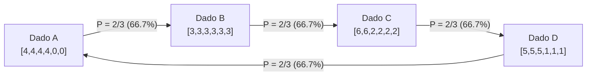

En la vida cotidiana, la <strong>transitividad</strong> parece un principio indiscutible: si $A$ supera a $B$, y $B$ supera a $C$, entonces lógicamente $A$ debe superar a $C$. Esta regla gobierna la recta real ($\mathbb{R}, <$), las dimensiones físicas y el valor económico.

Formalmente, una relación binaria $\succ$ es transitiva si:

$$
\forall x, y, z \in S, \quad (x \succ y) \land (y \succ z) \implies (x \succ z)
$$

Sin embargo, cuando la probabilidad y las comparaciones multidimensionales entran en juego, esta intuición se desploma de forma rotunda.

El ejemplo clásico es *Piedra, Papel o Tijera*. Solemos creer que esto ocurre solo en juegos cualitativos. No obstante, al numerar inteligentemente dados físicos convencionales de seis caras, se obtienen los fascinantes <strong>dados no transitivos</strong>: el dado $A$ vence a $B$, $B$ vence a $C$, $C$ vence a $D$, y paradójicamente $D$ vence a $A$, ¡todos con un $66.7\%$ de probabilidad!

Y lo más asombroso: si cada jugador lanza <strong>dos dados</strong> y suma sus puntuaciones (los dados de Grime), <strong>¡la jerarquía de dominancia se invierte por completo!</strong>

---

## 1. La falacia del valor esperado

Nuestra intuición falla porque confunde la probabilidad de ganar con el <strong>valor esperado</strong> $E[X]$, que es un operador estrictamente lineal:

$$
E[X - Y] = E[X] - E[Y]
$$

El orden de los valores esperados es siempre transitivo. Sin embargo, en un duelo individual, la victoria la decide la función escalón discontinua $\mathbf{1}_{\{x > y\}}$:

$$
P(X > Y) = \iint_{\mathbb{R}^2} \mathbf{1}_{\{x > y\}} \, dF_X(x) \, dF_Y(y)
$$

Ganar por una diferencia de $+3$ o de $+1$ cuenta exactamente igual: una sola victoria. Esta no-linealidad intrínseca genera un remolino probabilístico que habilita ciclos cerrados de dominancia.

---

## 2. Los dados de Efron: El ciclo perfecto de cuatro dados

Diseñados por el célebre estadístico de Stanford Bradley Efron, estos dados poseen las siguientes caras:

| Dado | Caras del dado | Distribución | Valor Esperado $E[\cdot]$ |
| :---: | :---: | :---: | :---: |
| <strong>Dado $A$</strong> | $4, 4, 4, 4, 0, 0$ | Cuatro 4, dos 0 | $E[A] = 16/6 \approx 2.667$ |
| <strong>Dado $B$</strong> | $3, 3, 3, 3, 3, 3$ | Seis 3 | $E[B] = 18/6 = 3.000$ |
| <strong>Dado $C$</strong> | $6, 6, 2, 2, 2, 2$ | Dos 6, cuatro 2 | $E[C] = 20/6 \approx 3.333$ |
| <strong>Dado $D$</strong> | $5, 5, 5, 1, 1, 1$ | Tres 5, tres 1 | $E[D] = 18/6 = 3.000$ |

Analizando los 36 resultados elementales del espacio muestral:

- $P(A > B) = 4/6 = 2/3 \approx 66.7\%$
- $P(B > C) = 4/6 = 2/3 \approx 66.7\%$
- $P(C > D) = 24/36 = 2/3 \approx 66.7\%$
- $P(D > A) = 24/36 = 2/3 \approx 66.7\%$

En una apuesta donde el primer jugador elige su dado primero, el segundo jugador siempre tiene ventaja matemática absoluta, pues puede elegir un dado que triunfe dos de cada tres veces.

---

## 3. Dados de Grime y la inversión por convolución

Creados por James Grime en 2009, cinco dados (Rojo $R$, Azul $B$, Oliva $O$, Amarillo $Y$, Magenta $M$) forman el ciclo $R \succ B \succ O \succ Y \succ M \succ R$ con un solo dado.

Al tirar <strong>dos dados</strong> idénticos por participante, la convolución discreta de las distribuciones altera las frecuencias centrales, invirtiendo la dirección de todo el ciclo:
$$
R \prec B \prec O \prec Y \prec M \prec R
$$

---

## 4. Votación democrática y evolución biológica

### 4.1 Paradoja de Condorcet y Teorema de Arrow
Los dados no transitivos son formalmente idénticos a la paradoja de Condorcet en la teoría de la elección social: las mayorías agregadas pueden ser cíclicas aunque los individuos sean racionales. El Teorema de Imposibilidad de Arrow confirma la inevitabilidad de este conflicto en sistemas de votación.

### 4.2 La lagartija de manchas laterales (*Uta stansburiana*)
En California, los machos exhiben tres colores de garganta con estrategias cíclicas: naranja vence a azul, azul vence a amarillo, y amarillo vence a naranja. Esta no-transitividad es el motor natural que preserva la diversidad genética.

---

## 5. Conclusión

Los dados no transitivos desarticulan la ilusión de una jerarquía escalar universal. La superioridad siempre es relativa a la estructura del juego y al rival en contienda.
