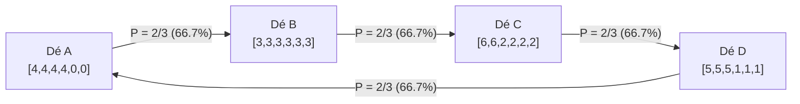

Dans le raisonnement humain quotidien, la <strong>transitivité</strong> est perçue comme un principe universel et indiscutable : si $A$ est supérieur à $B$ et que $B$ est supérieur à $C$, alors $A$ doit nécessairement surpasser $C$. Ce principe régit la droite des nombres réels ($\mathbb{R}$), les grandeurs physiques et la valeur économique.

Formellement, une relation binaire $\succ$ sur un ensemble $S$ est dite transitive si :

$$
\forall x, y, z \in S, \quad (x \succ y) \land (y \succ z) \implies (x \succ z)
$$

Pourtant, dès que les probabilités et les comparaisons multidimensionnelles entrent en jeu, cet axiome s'effondre totalement.

L'exemple populaire le plus frappant est le jeu *Pierre-Feuille-Ciseaux* : la Pierre bat les Ciseaux, les Ciseaux battent la Feuille, et la Feuille bat la Pierre. Beaucoup supposent qu'il ne s'agit là que d'une convention ludique et que des dés marqués de nombres réels devraient nécessairement obéir à la transitivité arithmétique.

Il n'en est rien. Les mathématiciens ont démontré qu'en choisissant soigneusement les faces de dés cubiques équilibrés, on peut fabriquer de véritables <strong>dés non transitifs</strong> : le dé $A$ bat $B$, $B$ bat $C$, $C$ bat $D$, et pourtant le dé $D$ bat $A$ avec une probabilité écrasante de deux tiers !

Mieux encore : en lançant <strong>deux dés</strong> identiques de chaque sorte et en sommant les scores (les dés de Grime), la chaîne de supériorité s'inverse complètement !

---

## 1. Le piège de l'espérance mathématique

Pourquoi notre intuition nous trompe-t-elle ? Parce que nous confondons la victoire probabiliste avec l'<strong>espérance mathématique</strong> $E[X]$, qui est une fonction strictement linéaire :

$$
E[X - Y] = E[X] - E[Y]
$$

Si nous classons les dés par leur espérance, la transitivité est inévitable. Mais dans un duel direct où le plus grand score l'emporte, le gain dépend de la fonction indicatrice non linéaire $\mathbf{1}_{\{x > y\}}$ :

$$
P(X > Y) = \iint_{\mathbb{R}^2} \mathbf{1}_{\{x > y\}} \, dF_X(x) \, dF_Y(y)
$$

Gagner de $+3$ points ou de $+1$ point compte de manière identique comme une seule victoire. Cette non-linéarité engendre un tourbillon probabiliste permettant l'apparition de cycles orientés fermés.

---

## 2. Les dés d'Efron : Le cycle parfait à quatre dés

Conçus par le statisticien de Stanford Bradley Efron, ces quatre dés à six faces présentent les configurations suivantes :

| Dé | Faces du dé | Description | Espérance $E[\cdot]$ |
| :---: | :---: | :---: | :---: |
| <strong>Dé $A$</strong> | $4, 4, 4, 4, 0, 0$ | Quatre 4, deux 0 | $E[A] = 16/6 \approx 2.667$ |
| <strong>Dé $B$</strong> | $3, 3, 3, 3, 3, 3$ | Six 3 | $E[B] = 18/6 = 3.000$ |
| <strong>Dé $C$</strong> | $6, 6, 2, 2, 2, 2$ | Deux 6, quatre 2 | $E[C] = 20/6 \approx 3.333$ |
| <strong>Dé $D$</strong> | $5, 5, 5, 1, 1, 1$ | Trois 5, trois 1 | $E[D] = 18/6 = 3.000$ |

Bien que $E[C] > E[B] = E[D] > E[A]$, les duels face-à-face sur les 36 issues possibles révèlent un cycle invariant :

- $P(A > B) = 4/6 = 2/3 \approx 66.7\%$
- $P(B > C) = 4/6 = 2/3 \approx 66.7\%$
- $P(C > D) = 24/36 = 2/3 \approx 66.7\%$
- $P(D > A) = 24/36 = 2/3 \approx 66.7\%$

Dans un pari où le premier joueur choisit son dé en premier, le second joueur est mathématiquement garanti de pouvoir choisir un dé qui l'emportera deux fois sur trois.

---

## 3. Les dés de Grime et le renversement par convolution

Découverts en 2009 par James Grime, cinq dés colorés (Rouge $R$, Bleu $B$, Olive $O$, Jaune $Y$, Magenta $M$) forment une boucle $R \succ B \succ O \succ Y \succ M \succ R$ en combat singulier (un dé chacun).

Mais lorsque chaque joueur lance <strong>deux dés identiques</strong> et additionne les résultats, la convolution des distributions discrètes inverse totalement l'ordre :
$$
R \prec B \prec O \prec Y \prec M \prec R
$$
Ce phénomène prouve qu'une stratégie dominante au niveau individuel peut devenir sous-optimale lorsqu'elle est répétée ou agrégée.

---

## 4. Connexions avec le vote et la biologie évolutive

### 4.1 Paradoxe de Condorcet et Théorème d'Arrow
Ces dés sont isomorphes au paradoxe de Condorcet dans la théorie du choix social : même si chaque électeur est rationnel et transitif, le vote majoritaire direct peut être cyclique. Le théorème d'impossibilité d'Arrow montre qu'aucun système électoral parfait ne peut éliminer cette pathologie structurelle.

### 4.2 La sélection naturelle chez le lézard à flancs tachetés
Chez le lézard californien *Uta stansburiana*, trois stratégies mâles coexistent :
- Les mâles à <strong>gorge orange</strong> (ultradominants) battent les bleus.
- Les mâles à <strong>gorge bleue</strong> (monogames coopératifs) battent les jaunes.
- Les mâles à <strong>gorge jaune</strong> (infiltrateurs mimétiques) battent les oranges.
Ce cycle perpétuel non transitif est la clé qui garantit la préservation de la diversité génétique au fil des millénaires.

---

## 5. Conclusion

Les dés non transitifs nous rappellent qu'aucun classement unidimensionnel ne peut résumer la complexité du monde stochastique. L'avantage est toujours relatif au contexte et à l'adversaire rencontré.
