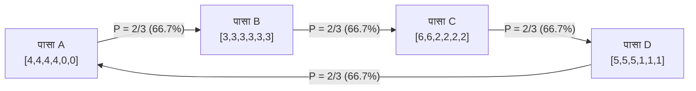

मानव तर्क और सहज ज्ञान में <strong>संक्रामकता (Transitivity)</strong> को एक अटल सत्य माना जाता है: यदि $A$ का प्रदर्शन $B$ से बेहतर है, और $B$ का $C$ से बेहतर है, तो $A$ को स्वाभाविक रूप से $C$ से बेहतर होना चाहिए। यह नियम वास्तविक संख्याओं ($\mathbb{R}, <$), भौतिक माप और वित्तीय मूल्यांकन का मूल आधार है।

गणितीय रूप से, किसी समुच्चय $S$ पर संबंध $\succ$ संक्रामक कहलाता है यदि:

$$
\forall x, y, z \in S, \quad (x \succ y) \land (y \succ z) \implies (x \succ z)
$$

परंतु जब प्रायिकता और बहुआयामी तुलना का संगम होता है, तो यह सहज ज्ञान पूरी तरह बिखर जाता है।

इसका सबसे प्रसिद्ध उदाहरण *पत्थर-कागज़-कैंची* का खेल है। लोग सोचते हैं कि यह केवल प्रतीकात्मक नियमों का खेल है, लेकिन गणितज्ञों ने साबित किया है कि भौतिक पासों के फलकों पर संख्याओं को चतुराई से व्यवस्थित करके <strong>गैर-संक्रामक पासे (Nontransitive Dice)</strong> बनाए जा सकते हैं: पासा $A$ पासे $B$ को हराता है, $B$ पासे $C$ को हराता है, $C$ पासे $D$ को हराता है, और $D$ पासे $A$ को दो-तिहाई ($66.7\%$) प्रायिकता से हरा देता है!

इससे भी अधिक आश्चर्यजनक रूप से, जब प्रत्येक खिलाड़ी <strong>दो पासे</strong> एक साथ फेंककर योग की तुलना करता है (ग्राइम के पासे), तो जीतने का पूरा क्रम उल्टी दिशा में बदल जाता है!

---

## 1. प्रत्याशित मान (Expected Value) का भ्रम

हमारा अंतर्ज्ञान इसलिए धोखा खाता है क्योंकि हम जीत की संभावना को <strong>प्रत्याशित मान</strong> $E[X]$ के साथ भ्रमित कर देते हैं, जो कि रैखिक होता है:

$$
E[X - Y] = E[X] - E[Y]
$$

प्रत्याशित मान का क्रम हमेशा संक्रामक होता है। लेकिन आमने-सामने के द्वंद्व में, जीत गैर-रैखिक संकेतक फलन $\mathbf{1}_{\{x > y\}}$ द्वारा निर्धारित होती है:

$$
P(X > Y) = \iint_{\mathbb{R}^2} \mathbf{1}_{\{x > y\}} \, dF_X(x) \, dF_Y(y)
$$

$+3$ के अंतर से जीतना या $+1$ के अंतर से जीतना, दोनों एक ही जीत गिने जाते हैं। यह गैर-रैखिकता प्रायिकता अंतरिक्ष में एक भंवर बनाती है जो बंद चक्रों को जन्म देती है।

---

## 2. एफ्रॉन के पासे: चार पासों का शास्त्रीय चक्र

स्टैनफोर्ड के सांख्यिकीविद् ब्रैडली एफ्रॉन द्वारा रचित चार पासे इस प्रकार हैं:

| पासा | फलक की संख्याएँ | विवरण | प्रत्याशित मान $E[\cdot]$ |
| :---: | :---: | :---: | :---: |
| <strong>पासा $A$</strong> | $4, 4, 4, 4, 0, 0$ | चार 4, दो 0 | $E[A] = 16/6 \approx 2.667$ |
| <strong>पासा $B$</strong> | $3, 3, 3, 3, 3, 3$ | छह 3 | $E[B] = 18/6 = 3.000$ |
| <strong>पासा $C$</strong> | $6, 6, 2, 2, 2, 2$ | दो 6, चार 2 | $E[C] = 20/6 \approx 3.333$ |
| <strong>पासा $D$</strong> | $5, 5, 5, 1, 1, 1$ | तीन 5, तीन 1 | $E[D] = 18/6 = 3.000$ |

प्रत्येक जोड़ी के 36 परिणामों की गणना:

- $P(A > B) = 4/6 = 2/3 \approx 66.7\%$
- $P(B > C) = 4/6 = 2/3 \approx 66.7\%$
- $P(C > D) = 24/36 = 2/3 \approx 66.7\%$
- $P(D > A) = 24/36 = 2/3 \approx 66.7\%$

जिस दांव में पहला खिलाड़ी पहले पासा चुनता है, दूसरे खिलाड़ी के पास हमेशा $66.7\%$ जीत की संभावना वाला विजयी पासा चुनने का पूर्ण लाभ होता है।

---

## 3. ग्राइम के पासे और दो पासों का उलटफेर

2009 में जेम्स ग्राइम द्वारा खोजे गए 5 रंगीन पासे एकल फेंक में चक्रीय क्रम बनाते हैं। लेकिन जब दोनों खिलाड़ी <strong>दो पासे</strong> फेंकते हैं, तो प्रायिकता संवलन (Convolution) इस पूरे चक्र को विपरीत दिशा में पलट देता है:
$$
R \prec B \prec O \prec Y \prec M \prec R
$$

---

## 4. कोंडोसैट विरोधाभास और विकासात्मक जीव विज्ञान

### 4.1 सामाजिक चयन सिद्धांत
गैर-संक्रामक पासे मतदान में कोंडोसैट विरोधाभास और एरो की असंभवता प्रमेय के समान हैं: व्यक्तिगत प्राथमिकताएं तार्किक होने पर भी सामूहिक बहुमत चक्र में फंस सकता है।

### 4.2 साइड-ब्लोच्ड छिपकली (*Uta stansburiana*)
प्रकृति में, इस छिपकली के नर तीन चक्रीय संभोग रणनीतियों (नारंगी नीले को, नीला पीले को, और पीला नारंगी को हराता है) का पालन करते हैं, जो आनुवंशिक विविधता को सुरक्षित रखती हैं।

---

## 5. निष्कर्ष

गैर-संक्रामक पासे साबित करते हैं कि प्रायिकता की दुनिया में कोई भी सार्वभौमिक रूप से "सर्वश्रेष्ठ" नहीं होता; श्रेष्ठता हमेशा संदर्भ और प्रतिद्वंद्वी पर निर्भर करती है।
