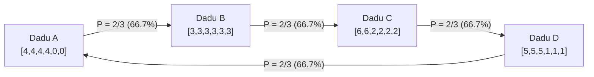

Dalam logika sehari-hari, <strong>transitivitas</strong> dianggap sebagai hukum mutlak: jika $A$ lebih unggul dari $B$, dan $B$ lebih unggul dari $C$, maka secara wajar $A$ pasti mengalahkan $C$. Sifat ini menopang garis bilangan real ($\mathbb{R}, <$), pengukuran berat, panjang, dan uang.

Secara formal, relasi biner $\succ$ pada himpunan $S$ disebut transitif jika:

$$
\forall x, y, z \in S, \quad (x \succ y) \land (y \succ z) \implies (x \succ z)
$$

Namun, ketika probabilitas dan perbandingan multidimensi digabungkan, intuisi ini runtuh total.

Contoh intuitif yang paling terkenal adalah permainan *Batu-Gunting-Kertas*: Batu mengalahkan Gunting, Gunting mengalahkan Kertas, dan Kertas mengalahkan Batu. Banyak yang mengira ini hanyalah aturan buatan manusia. Tetapi para matematikawan telah membuktikan bahwa dengan mendesain angka pada permukaan dadu fisik biasa, kita dapat menciptakan <strong>dadu non-transitif (Nontransitive Dice)</strong>: dadu $A$ mengalahkan $B$, $B$ mengalahkan $C$, $C$ mengalahkan $D$, dan anehnya $D$ mengalahkan $A$ — masing-masing dengan peluang kemenangan $2/3$ ($66,7\%$)!

Bahkan lebih mengejutkan, jika setiap pemain melempar <strong>dua dadu</strong> identik dan menjumlahkannya (dadu Grime), <strong>arah dominasi berbalik seratus delapan puluh derajat</strong>!

---

## 1. Jebakan Nilai Harapan (Expected Value)

Intuisi kita tertipu karena menyamakan kemenangan dengan <strong>nilai harapan</strong> $E[X]$, yang memiliki sifat linear:

$$
E[X - Y] = E[X] - E[Y]
$$

Urutan nilai harapan selalu transitif. Namun, dalam duel langsung, kemenangan ditentukan oleh fungsi tangga non-linear $\mathbf{1}_{\{x > y\}}$:

$$
P(X > Y) = \iint_{\mathbb{R}^2} \mathbf{1}_{\{x > y\}} \, dF_X(x) \, dF_Y(y)
$$

Menang dengan selisih $+3$ poin atau $+1$ poin sama-sama dihitung sebagai tepat satu kemenangan. Non-linearitas ini menciptakan pusaran stokastik yang memungkinkan terbentuknya siklus tertutup.

---

## 2. Dadu Efron: Siklus Empat Dadu Klasik

Statistikawan Stanford Bradley Efron mendesain empat dadu dengan konfigurasi berikut:

| Dadu | Angka Permukaan | Distribusi | Nilai Harapan $E[\cdot]$ |
| :---: | :---: | :---: | :---: |
| <strong>Dadu $A$</strong> | $4, 4, 4, 4, 0, 0$ | Empat 4, dua 0 | $E[A] = 16/6 \approx 2,667$ |
| <strong>Dadu $B$</strong> | $3, 3, 3, 3, 3, 3$ | Enam 3 | $E[B] = 18/6 = 3,000$ |
| <strong>Dadu $C$</strong> | $6, 6, 2, 2, 2, 2$ | Dua 6, empat 2 | $E[C] = 20/6 \approx 3,333$ |
| <strong>Dadu $D$</strong> | $5, 5, 5, 1, 1, 1$ | Tiga 5, tiga 1 | $E[D] = 18/6 = 3,000$ |

Peluang kemenangan dihitung dari ruang sampel 36 kombinasi:

- $P(A > B) = 4/6 = 2/3 \approx 66,7\%$
- $P(B > C) = 4/6 = 2/3 \approx 66,7\%$
- $P(C > D) = 24/36 = 2/3 \approx 66,7\%$
- $P(D > A) = 24/36 = 2/3 \approx 66,7\%$

Dalam permainan taruhan di mana pemain pertama memilih dadunya terlebih dahulu, pemain kedua memiliki keunggulan mutlak karena selalu dapat memilih dadu yang memiliki peluang menang $66,7\%$.

---

## 3. Dadu Grime dan Pembalikan dengan Dua Dadu

Ditemukan oleh James Grime pada tahun 2009, lima dadu berwarna membentuk siklus $R \succ B \succ O \succ Y \succ M \succ R$ pada lemparan tunggal. Namun saat masing-masing pemain melempar <strong>dua dadu</strong>, konvolusi peluang membalikkan seluruh siklus:
$$
R \prec B \prec O \prec Y \prec M \prec R
$$

---

## 4. Relevansi Sosial dan Biologis

### 4.1 Paradoks Condorcet dan Teorema Arrow
Dadu non-transitif secara matematis serupa dengan Paradoks Condorcet dalam pemungutan suara: preferensi agregat mayoritas bisa berputar membentuk siklus meskipun preferensi individu rasional. Teorema Ketidakmungkinan Arrow membuktikan bahwa tidak ada sistem pemilu sempurna yang bebas dari masalah ini.

### 4.2 Kadal Bintik Samping (*Uta stansburiana*)
Di alam liar California, jantan spesies kadal ini memiliki tiga strategi reproduksi (oranye mengalahkan biru, biru mengalahkan kuning, kuning mengalahkan oranye). Siklus non-transitif alami ini menjaga keanekaragaman genetik selama ribuan generasi.

---

## 5. Kesimpulan

Dadu non-transitif membongkar mitos peringkat mutlak satu dimensi. Dalam dunia probabilitas yang dinamis, keunggulan selalu bergantung pada konteks dan lawan yang dihadapi.
