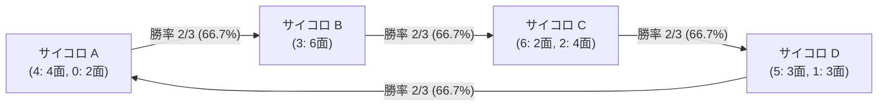
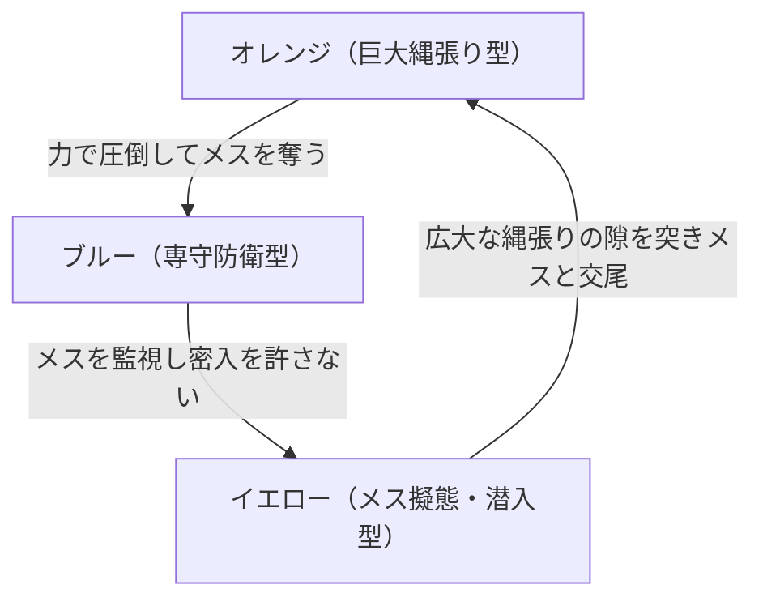

日常の感覚において、「勝敗」や「優劣」には自然な順序関係が存在すると私たちは無意識に信じ込んでいます。もし競技者 $A$ が競技者 $B$ より強く、競技者 $B$ が競技者 $C$ より強いのであれば、競技者 $A$ は当然ながら競技者 $C$ よりも強いはずである——。このような関係性は、数学において「推移律（Transitivity）」と呼ばれ、実数の大小関係（$a > b$ かつ $b > c$ ならば $a > c$）や、物の重さ、長さ、金額の多寡など、私たちが日常的に触れるあらゆる計量概念の根底を支える公理となっています。

しかし、この強固に見える論理的直感は、「確率（Probability）」と「多次元の比較」が絡み合った瞬間に、音を立てて崩壊します。

じゃんけんを思い浮かべてみてください。「グー」は「チョキ」に勝ち、「チョキ」は「パー」に勝ちます。推移律が成り立つなら「グー」は「パー」にも勝たなければならないはずですが、実際には「パー」が「グー」を包み込んで打ち負かします。グー・チョキ・パーの間には、絶対的な勝者が存在せず、三つ巴の循環関係（Cycle）が形成されています。

「それはじゃんけんが記号的な相性ゲームだからであり、数字が刻まれたサイコロのような客観的な数値の勝負であれば推移律が成立するはずだ」と考えるかもしれません。ところが、出目の数字を巧妙に設計した複数個のサイコロを用いると、全く同じ現象——すなわち「サイコロ $A$ はサイコロ $B$ に高確率で勝ち、$B$ は $C$ に高確率で勝ち、$C$ は $D$ に高確率で勝ち、そして $D$ は最初の $A$ に高確率で勝つ」という奇妙なサイコロ群——を現実に創り出すことができます。

これを数学では<strong>「非推移的サイコロ（Nontransitive Dice）」</strong>と呼びます。

さらに驚くべきことに、これらのサイコロを「2個ずつ同時に振って合計値で勝負する」と、勝率の優劣順序が完全に逆回転し始めるという、人間の直観の限界を軽々と超える怪奇なパラドックス（グライムのサイコロ）すら存在します。

本稿では、非推移的確率の数学的構造、エフロンのサイコロの詳細な確率空間分析、期待値（Expected Value）と確率的優位性（Stochastic Dominance）の決定的な乖離、2個振りの逆転現象、そしてこの現象が投票のパラドックス（コンドルセの逆理、アローの不可能性定理）や生物進化（トカゲの交尾戦略や細菌の競合）、さらには現代の意思決定理論に投げかける深遠な示唆について、15,000字を超える圧倒的な密度で徹底的に解剖・探求していきます。

---

## 1. 推移律という直感の檻：なぜ人間は順序関係を信じてしまうのか

### 1.1 実数直線が刷り込む「全順序」の心地よさ

人間が推移性を自然の摂理のように感じてしまう最大の理由は、私たちが幼少期から「実数（Real Numbers, $\mathbb{R}$）」という完璧な順序構造の中で思考を訓練されているからです。

数学的に定義すると、集合 $S$ 上の二項関係 $\succ$ が「推移的（Transitive）」であるとは、以下の条件を満たすことを意味します：

$$
\forall x, y, z \in S, \quad (x \succ y) \land (y \succ z) \implies (x \succ z)
$$

実数の大小関係（$>$）は、以下の3つの公理を満たす「全順序関係（Total Order）」です：
1. <strong>完全性（Completeness / Trichotomy）</strong>: 任意の $x, y \in \mathbb{R}$ について、$x > y$、$x = y$、$x < y$ のいずれか1つのみが厳密に成立する。
2. <strong>非反射性（Irreflexivity）</strong>: いかなる $x$ に対しても $x > x$ は偽である。
3. <strong>推移性（Transitivity）</strong>: $x > y$ かつ $y > z$ ならば $x > z$ である。

私たちは、テストの点数、銀行の預金残高、陸上競技のタイム、商品の価格など、身の回りのあらゆる評価を1つの実数直線（1次元スカラー値）へと還元して比較することに慣れ親しんでいます。スカラ値で表現できる世界では、推移律が破綻することは原理的にあり得ません。100円より200円が多く、200円より300円が多いならば、100円が300円より多くなることは絶対にないからです。

### 1.2 期待値の罠：$E[X - Y] = E[X] - E[Y]$ という線形性の錯覚

確率変数を扱う際にも、多くの人が無意識に推移性を前提としてしまいます。その主犯が「期待値（Expected Value）」です。

いま、2つの独立な確率変数 $X$ と $Y$ があるとします。それぞれのサイコロの出目を表す確率変数を $X, Y$ とし、出目が大きい方を勝ちと定義するゲームを考えます。

期待値作用素 $E[\cdot]$ は完全な<strong>線形性（Linearity）</strong>を持っています：

$$
E[X - Y] = E[X] - E[Y]
$$

もし「サイコロの強さ」をその出目の期待値 $E[X]$ で定義するならば、期待値は単なる実数ですから、強さの比較は自明に推移律を満たします：

$$
E[A] > E[B] \quad \text{かつ} \quad E[B] > E[C] \implies E[A] > E[C]
$$

日常的なゲームやギャンブル、投資の文脈において、「期待値が高い方を選ぶ」という行動指針が叩き込まれているため、私たちは「サイコロ $A$ がサイコロ $B$ に勝つ確率が高い」という言明を、「サイコロ $A$ の方がサイコロ $B$ よりも期待値が高い」ことと無批判に混同してしまいます。

しかし、実際の勝負において勝敗を決めるのは、出目の差の期待値 $E[X - Y]$ ではなく、<strong>「$X > Y$ となる確率 $P(X > Y)$ が $1/2$ を超えているかどうか」</strong>です。

数学的に表現すれば、勝敗判定関数はヘビサイドの階段関数（指示関数） $\mathbf{1}_{\{x > y\}}$ であり、勝率は以下のような結合確率測度上の積分となります：

$$
P(X > Y) = \iint_{\mathbb{R}^2} \mathbf{1}_{\{x > y\}} \, dF_X(x) \, dF_Y(y)
$$

指示関数 $\mathbf{1}_{\{x > y\}}$ は強烈な<strong>非線形関数</strong>です。どれほど僅差（たとえば $4$ 対 $3$）で勝っても $1$ であり、どれほど大差（たとえば $100$ 対 $0$）で勝っても同じ $1$ としてカウントされます。

この「期待値の線形性」と「確率判定の非線形性」の断絶こそが、推移律を粉々に破壊し、非推移的サイコロという驚異の空間を生み出す根本原因なのです。

---

## 2. エフロンのサイコロ：最も洗練された4つのサイコロ

非推移的サイコロの代表例として世界で最も広く知られているのが、スタンフォード大学の統計学者ブラッドリー・エフロン（Bradley Efron, ブートストラップ法の考案者としても高名）が考案した<strong>「エフロンのサイコロ（Efron's Dice）」</strong>です。

### 2.1 4つのサイコロの出目構成

エフロンのサイコロは、通常の6面体サイコロ4個（$A, B, C, D$）で構成されます。それぞれの面には、一般的な $1 \sim 6$ の数字ではなく、以下のような特殊な数字が刻まれています。

| サイコロ | 6面の構成 | 出目の内訳 | 期待値 $E[\cdot]$ |
| :---: | :---: | :---: | :---: |
| <strong>サイコロ $A$</strong> | $4, 4, 4, 4, 0, 0$ | $4$ が4面、$0$ が2面 | $\frac{4 \times 4 + 0 \times 2}{6} = \frac{16}{6} = \frac{8}{3} \approx 2.667$ |
| <strong>サイコロ $B$</strong> | $3, 3, 3, 3, 3, 3$ | $3$ が6面すべて | $\frac{3 \times 6}{6} = 3.000$ |
| <strong>サイコロ $C$</strong> | $6, 6, 2, 2, 2, 2$ | $6$ が2面、$2$ が4面 | $\frac{6 \times 2 + 2 \times 4}{6} = \frac{20}{6} = \frac{10}{3} \approx 3.333$ |
| <strong>サイコロ $D$</strong> | $5, 5, 5, 1, 1, 1$ | $5$ が3面、$1$ が3面 | $\frac{5 \times 3 + 1 \times 3}{6} = \frac{18}{6} = 3.000$ |

それぞれのサイコロはすべて公平な正六面体であり、各面が出る確率は等しく $1/6$ です。

まず注目すべきは期待値です：
$$
E[C] = 3.333 > E[B] = 3.000 = E[D] = 3.000 > E[A] = 2.667
$$
期待値だけを見れば、サイコロ $C$ が最強であり、サイコロ $A$ が最弱に見えます。

しかし、2つのサイコロを選んで1対1の対決（出目が大きい方の勝ち）を行うと、驚くべき結果が得られます。

### 2.2 厳密な勝率計算（全36事象の格子展開）

2つの6面体サイコロを独立に振る場合、標本空間は $6 \times 6 = 36$ 通りの等確率な素事象から構成されます。それぞれの対戦カードを個別に検証してみましょう。



#### 対決 1: サイコロ $A$ vs サイコロ $B$
- サイコロ $B$ は常に「$3$」を出します（確率 $1$）。
- サイコロ $A$ は、確率 $4/6 = 2/3$ で「$4$」を出し、確率 $2/6 = 1/3$ で「$0$」を出します。
- $A = 4$ のとき $A$ の勝ち（$4 > 3$）。
- $A = 0$ のとき $B$ の勝ち（$0 < 3$）。

したがって、勝率は以下の通りです：
$$
P(A > B) = \frac{4}{6} = \frac{2}{3} \approx 66.67\%
$$
$$
P(B > A) = \frac{2}{6} = \frac{1}{3} \approx 33.33\%
$$
<strong>サイコロ $A$ がサイコロ $B$ に $2/3$ の確率で圧勝します。</strong>

---

#### 対決 2: サイコロ $B$ vs サイコロ $C$
- サイコロ $B$ は常に「$3$」を出します。
- サイコロ $C$ は、確率 $2/6 = 1/3$ で「$6$」を出し、確率 $4/6 = 2/3$ で「$2$」を出します。
- $C = 6$ のとき $C$ の勝ち（$6 > 3$）。
- $C = 2$ のとき $B$ の勝ち（$3 > 2$）。

したがって、勝率は：
$$
P(B > C) = \frac{4}{6} = \frac{2}{3} \approx 66.67\%
$$
$$
P(C > B) = \frac{2}{6} = \frac{1}{3} \approx 33.33\%
$$
<strong>サイコロ $B$ がサイコロ $C$ に $2/3$ の確率で圧勝します。</strong>

ここまでで「$A$ は $B$ に勝ち（勝率 $2/3$）、$B$ は $C$ に勝つ（勝率 $2/3$）」という連鎖が成立しました。常識的な推移律に従えば、サイコロ $A$ はサイコロ $C$ よりも圧倒的に強いはずです。

---

#### 対決 3: サイコロ $C$ vs サイコロ $D$
$36$ 通りの組み合わせ表（格子）を作成して計算します。

| $C \backslash D$ | 5 (3面) | 1 (3面) |
| :---: | :---: | :---: |
| <strong>6 (2面)</strong> | $C$ 勝利 (6通り) | $C$ 勝利 (6通り) |
| <strong>2 (4面)</strong> | $D$ 勝利 (12通り) | $C$ 勝利 (12通り) |

- $C$ の勝ち：
  - $C = 6$ の場合：相手が何を出そうと勝ち（$2 \times 6 = 12$ 通り）
  - $C = 2$ かつ $D = 1$ の場合：$4 \times 3 = 12$ 通り
  - 合計 $12 + 12 = 24$ 通り
- $D$ の勝ち：
  - $C = 2$ かつ $D = 5$ の場合：$4 \times 3 = 12$ 通り

勝率は：
$$
P(C > D) = \frac{24}{36} = \frac{2}{3} \approx 66.67\%
$$
$$
P(D > C) = \frac{12}{36} = \frac{1}{3} \approx 33.33\%
$$
<strong>サイコロ $C$ がサイコロ $D$ に $2/3$ の確率で圧勝します。</strong>

---

#### 対決 4: サイコロ $D$ vs サイコロ $A$（循環の完成）
では、最後の対決、$D$ と $A$ を戦わせるとどうなるでしょうか？

| $D \backslash A$ | 4 (4面) | 0 (2面) |
| :---: | :---: | :---: |
| <strong>5 (3面)</strong> | $D$ 勝利 (12通り) | $D$ 勝利 (6通り) |
| <strong>1 (3面)</strong> | $A$ 勝利 (12通り) | $D$ 勝利 (6通り) |

- $D$ の勝ち：
  - $D = 5$ の場合：相手が何を出そうと勝ち（$3 \times 6 = 18$ 通り）
  - $D = 1$ かつ $A = 0$ の場合：$3 \times 2 = 6$ 通り
  - 合計 $18 + 6 = 24$ 通り
- $A$ の勝ち：
  - $D = 1$ かつ $A = 4$ の場合：$3 \times 4 = 12$ 通り

勝率は：
$$
P(D > A) = \frac{24}{36} = \frac{2}{3} \approx 66.67\%
$$
$$
P(A > D) = \frac{12}{36} = \frac{1}{3} \approx 33.33\%
$$

なんと、<strong>サイコロ $D$ がサイコロ $A$ に $2/3$ の確率で圧勝します！</strong>

### 2.3 エフロンの輪が暴く「後出し絶対有利」のゲーム

以上の計算結果をまとめると、驚くべき環状の強弱関係（有向閉路）が立ち現れます：

$$
P(A > B) = P(B > C) = P(C > D) = P(D > A) = \frac{2}{3}
$$

このサイコロ群を使って、カジノや縁日で次のようなゲームを提案されたとしましょう。

> <strong>「エフロンのサイコロ・ゲーム」のルール</strong>
> 1. テーブルの上には 4 個のサイコロ $A, B, C, D$ が置かれている。
> 2. あなた（挑戦者）は、好きなサイコロを 1 個選んでよい。
> 3. その後、胴元（出題者）が残りの 3 個から好きなサイコロを 1 個選ぶ。
> 4. 互いに自分のサイコロを 1 回振り、出目が大きい方が勝ち。賭け金総取り。

初心者は「自分に最初の選択権があるのだから有利に決まっている」と考えます。表の数字を吟味し、期待値最大の $C$（期待値 3.33）を選んだり、安定して 4 を出す $A$ を選んだりするでしょう。

しかし、このゲームは<strong>「先に選んだ側が数学的に確実にカモにされる」完全な後出し有利ゲーム</strong>です。

- 挑戦者が $A$ を選んだら、胴元は $D$ を選ぶ（胴元の勝率 $66.7\%$）。
- 挑戦者が $B$ を選んだら、胴元は $A$ を選ぶ（胴元の勝率 $66.7\%$）。
- 挑戦者が $C$ を選んだら、胴元は $B$ を選ぶ（胴元の勝率 $66.7\%$）。
- 挑戦者が $D$ を選んだら、胴元は $C$ を選ぶ（胴元の勝率 $66.7\%$）。

どのサイコロを選ぼうとも、相手はそのサイコロに対して勝率 $2/3$（約 $67\%$）を持つサイコロを必ず提示できるのです。どれほどサイコロを詳しく観察しても「最強のサイコロ」は存在せず、選択肢の集合には極大元が存在しません。

---

## 3. なぜこのような逆理が生じるのか？ 確率幾何と測度の深層

### 3.1 期待値と中央値・勝率の乖離

なぜ期待値の順序（$C > B = D > A$）と、1対1の勝率順序（$A \to B \to C \to D \to A$）はこれほど乖離するのでしょうか？

その理由は、期待値が<strong>「値の大きさとその頻度の積の合計」</strong>であるのに対し、勝率は<strong>「値の差の大きさ（マグニチュード）を完全に捨て去り、符号（正か負か）の頻度だけを積分する操作」</strong>だからです。

サイコロ $C$（出目 $6$ が2面、$2$ が4面）を例にとりましょう。
サイコロ $B$（常に $3$）と対戦するとき：
- $C$ が勝つときは、$6$ を出して $3$ に勝ちます。このとき差額は $+3$ という大きなマージンを持ちます。
- $C$ が負けるときは、$2$ を出して $3$ に負けます。このとき差額は $-1$ という僅かなマージンです。

出目の差 $C - B$ の期待値をとると：
$$
E[C - B] = \frac{1}{3}(+3) + \frac{2}{3}(-1) = 1 - \frac{2}{3} = +\frac{1}{3} > 0
$$
平均的にはサイコロ $C$ の方が $1/3$ だけ大きい値を出しています。しかし、その「勝ちの大きさ（$+3$）」は勝率には一切反映されません。勝負の判定においては「$+3$ の勝ち」も「$+1$ の勝ち」も等しく「1勝」としてカウントされるため、頻度において勝るサイコロ $B$ が $2/3$ の確率で勝利するのです。

これは、金融市場における投資戦略や、選挙における得票構造と全く同じ力学です。
ある投資信託が「ごく稀に超巨大な利益を出し、普段は小さな損失を積み重ねる」場合、平均リターン（期待値）はプラスであっても、日々の勝率（利益が出る日数の割合）は 30% を割り込むことがあります。逆に「普段はコツコツ勝ち、稀に破滅的な大損をする」戦略は勝率 90% を誇ります。どちらが「優れている」かは、評価関数が期待値最大化なのか、勝率最大化（相手を上回る確率の最大化）なのかによって根本から異なるのです。

### 3.2 多次元超立方体と分離超平面の非線形配置

非推移性を幾何学的に理解するために、各サイコロの確率分布を多次元空間上の測度として捉えてみましょう。

2つのサイコロ $X, Y$ の勝率 $P(X > Y)$ は、直積測度空間 $(\Omega_X \times \Omega_Y, \mathcal{F}_X \otimes \mathcal{F}_Y, P_X \otimes P_Y)$ において、対角線集合 $\Delta = \{(x, y) \mid x > y\}$ の測度を測ることに対応します。

もし比較関係が線形汎関数（たとえば $E[X]$）によって媒介されるのであれば、関数 $f: \mathcal{P}(\mathbb{R}) \to \mathbb{R}$ が存在し、
$$
X \succ Y \iff f(X) > f(Y)
$$
と表現できます。実数直線上の大小関係は推移的であるため、どのような測度の族であっても $f$ による像は必ず推移的になります。

しかし、勝率判定作用素 $T(X, Y) = P(X > Y) - 1/2$ は、<strong>歪対称な双線形（または二項）汎関数</strong>であり、単一の1変数関数 $f$ の差 $f(X) - f(Y)$ に分解することが原理的に不可能です。

$$
T(X, Y) \neq f(X) - f(Y)
$$

2変数の結合関係が1変数のポテンシャル関数の差として表せないとき、その系には本質的な<strong>「回転（Curl / Vorticity）」</strong>が生じます。物理学において保存力場（ポテンシャルを持つ場）の線積分が閉曲線上で 0 になるのに対し、渦度を持つ非保存力場では閉曲線を一周したときの仕事が 0 にならないのと全く同様に、非推移的サイコロの空間には「確率的な渦（Curl）」が渦巻いているのです。

---

## 4. 狂気の逆転現象：グライムのサイコロと2個振りのパラドックス

エフロンのサイコロだけでも人間の直観を粉砕するには十分ですが、数学者ジェームズ・グライム（James Grime）が2009年に発表した<strong>「グライムのサイコロ（Grime Dice）」</strong>は、さらに常軌を逸した挙動を示します。

なんと、<strong>「1個ずつ振ったときの勝率の順序」が、「2個ずつ振ったときの勝率の順序」において正反対に反転する</strong>のです。

### 4.1 グライムの5つのサイコロ

グライムのサイコロは、赤（Red, $R$）、青（Blue, $B$）、オリーブ（Olive, $O$）、黄（Yellow, $Y$）、マゼンタ（Magenta, $M$）の 5 色のサイコロから成ります。

| 色 | 記号 | 6面の構成 | 期待値 $E$ |
| :---: | :---: | :---: | :---: |
| <strong>赤 (Red)</strong> | $R$ | $4, 4, 4, 4, 4, 9$ （4が5面、9が1面） | $\frac{4 \times 5 + 9}{6} = \frac{29}{6} \approx 4.833$ |
| <strong>青 (Blue)</strong> | $B$ | $2, 2, 2, 7, 7, 7$ （2が3面、7が3面） | $\frac{2 \times 3 + 7 \times 3}{6} = \frac{27}{6} = 4.500$ |
| <strong>オリーブ (Olive)</strong> | $O$ | $0, 5, 5, 5, 5, 5$ （0が1面、5が5面） | $\frac{0 + 5 \times 5}{6} = \frac{25}{6} \approx 4.167$ |
| <strong>黄 (Yellow)</strong> | $Y$ | $3, 3, 3, 3, 8, 8$ （3が4面、8が2面） | $\frac{3 \times 4 + 8 \times 2}{6} = \frac{28}{6} \approx 4.667$ |
| <strong>マゼンタ (Magenta)</strong> | $M$ | $1, 1, 6, 6, 6, 6$ （1が2面、6が4面） | $\frac{1 \times 2 + 6 \times 4}{6} = \frac{26}{6} \approx 4.333$ |

### 4.2 1個勝負（Single Die）における強弱循環

まず、各プレイヤーがサイコロを1個ずつ振って勝負する場合の勝率を計算します。引き分けが生じないように数字が設計されています。

1. <strong>赤 ($R$) vs 青 ($B$)</strong>:
   - $R$ は 4 (5面), 9 (1面)。$B$ は 2 (3面), 7 (3面)。
   - $R$ が 9 を出せば無条件で勝利（$1 \times 6 = 6$ 通り）。
   - $R$ が 4 を出した場合、$B$ が 2 を出せば勝ち（$5 \times 3 = 15$ 通り）。$B$ が 7 を出せば負け。
   - $R$ の勝利数: $6 + 15 = 21$ 通り。
   - 勝率: $P(R > B) = 21/36 = 7/12 \approx 58.33\%$
   - <strong>$R \succ B$</strong>

2. <strong>青 ($B$) vs オリーブ ($O$)</strong>:
   - $B$ は 2 (3面), 7 (3面)。$O$ は 0 (1面), 5 (5面)。
   - $B$ が 7 を出せば無条件で勝利（$3 \times 6 = 18$ 通り）。
   - $B$ が 2 を出した場合、$O$ が 0 を出せば勝ち（$3 \times 1 = 3$ 通り）。
   - $B$ の勝利数: $18 + 3 = 21$ 通り。
   - 勝率: $P(B > O) = 21/36 = 7/12 \approx 58.33\%$
   - <strong>$B \succ O$</strong>

3. <strong>オリーブ ($O$) vs 黄 ($Y$)</strong>:
   - $O$ は 0 (1面), 5 (5面)。$Y$ は 3 (4面), 8 (2面)。
   - $O$ が 5 を出した場合（5面）、$Y$ が 3 を出せば勝ち（$5 \times 4 = 20$ 通り）。
   - $O$ が 0 を出した場合、$Y$ には勝てない。$Y$ が 8 を出した場合も $O$ は勝てない。
   - $O$ の勝利数: $20$ 通り。
   - 勝率: $P(O > Y) = 20/36 = 5/9 \approx 55.56\%$
   - <strong>$O \succ Y$</strong>

4. <strong>黄 ($Y$) vs マゼンタ ($M$)</strong>:
   - $Y$ は 3 (4面), 8 (2面)。$M$ は 1 (2面), 6 (4面)。
   - $Y$ が 8 を出せば無条件で勝ち（$2 \times 6 = 12$ 通り）。
   - $Y$ が 3 を出した場合、$M$ が 1 を出せば勝ち（$4 \times 2 = 8$ 通り）。
   - $Y$ の勝利数: $12 + 8 = 20$ 通り。
   - 勝率: $P(Y > M) = 20/36 = 5/9 \approx 55.56\%$
   - <strong>$Y \succ M$</strong>

5. <strong>マゼンタ ($M$) vs 赤 ($R$)</strong>:
   - $M$ は 1 (2面), 6 (4面)。$R$ は 4 (5面), 9 (1面)。
   - $M$ が 6 を出した場合（4面）、$R$ が 4 を出せば勝ち（$4 \times 5 = 20$ 通り）。
   - $M$ が 1 を出した場合、勝てない。$R$ が 9 を出しても勝てない。
   - $M$ の勝利数: $20$ 通り。
   - 勝率: $P(M > R) = 20/36 = 5/9 \approx 55.56\%$
   - <strong>$M \succ R$</strong>

このように、1個ずつの勝負では、以下の明快な 5 すくみの循環が成り立ちます：

$$
R \xrightarrow{58.3\%} B \xrightarrow{58.3\%} O \xrightarrow{55.6\%} Y \xrightarrow{55.6\%} M \xrightarrow{55.6\%} R
$$

### 4.3 2個勝負（Two Dice）における完全反転の衝撃

ここで、ゲームのルールを少しだけ変更します。
「1個では運の要素が強すぎるので、各自同じサイコロを<strong>2個同時に振って、出目の合計値</strong>が大きい方を勝ちとしましょう」

直感的には、同じ性質を持つサイコロを2個振っても、大数の法則により強いサイコロの優位性がさらに固定化されるか、少なくとも勝敗の方向性は維持されるはずだと予想されます。

しかし、実際に2個振りの出目合計（標本空間 $6^4 = 1,296$ 通り）の確率分布を畳み込み（Convolution）により計算すると、背筋が凍るような事態が発生します。

```mermaid
flowchart TD
    subgraph 1個振り_時計回り
        R1[赤 R] --> B1[青 B] --> O1[オリーブ O] --> Y1[黄 Y] --> M1[マゼンタ M] --> R1
    end
    subgraph 2個振り_反時計回り_完全逆転
        R2[赤 R] <-- B2[青 B] <-- O2[オリーブ O] <-- Y2[黄 Y] <-- M2[マゼンタ M] <-- R2
    end
```

#### 例証：赤2個 ($2R$) vs 青2個 ($2B$)
- サイコロ $R$ を2個振ったときの合計値の分布：
  - $4+4 = 8$ : 確率 $(5/6) \times (5/6) = 25/36$
  - $4+9 = 13$ : 確率 $2 \times (5/6) \times (1/6) = 10/36$
  - $9+9 = 18$ : 確率 $(1/6) \times (1/6) = 1/36$
- サイコロ $B$ を2個振ったときの合計値の分布：
  - $2+2 = 4$ : 確率 $(3/6) \times (3/6) = 9/36$
  - $2+7 = 9$ : 確率 $2 \times (3/6) \times (3/6) = 18/36$
  - $7+7 = 14$ : 確率 $(3/6) \times (3/6) = 9/36$

全 $36 \times 36 = 1,296$ 通りにおける勝敗を判定します：
- $B$ の合計が $14$ のとき（確率 $9/36$）：
  - $R$ の合計が $8$（確率 $25/36$）または $13$（確率 $10/36$）なら $B$ の勝ち！
  - この組み合わせ数: $9 \times (25 + 10) = 9 \times 35 = 315$ 通り
- $B$ の合計が $9$ のとき（確率 $18/36$）：
  - $R$ の合計が $8$（確率 $25/36$）なら $B$ の勝ち！
  - この組み合わせ数: $18 \times 25 = 450$ 通り
- $B$ の合計が $4$ のとき（確率 $9/36$）：
  - $R$ の最小合計は $8$ であるため、$B$ は勝てない（0通り）。

$B$ の総勝利数：
$$
315 + 450 = 765 \text{ 通り}
$$

したがって、青（$B$）が赤（$R$）に勝つ確率は：
$$
P(2B > 2R) = \frac{765}{1296} = \frac{85}{144} \approx 59.03\%
$$

1個振りのときは赤（$R$）が青（$B$）に $58.33\%$ の勝率で勝っていたにもかかわらず、<strong>2個振った瞬間に、青（$B$）が赤（$R$）に $59.03\%$ の勝率で勝つように完全に逆転してしまった</strong>のです！

同様の計算をすべての組み合わせについて実行すると、驚くべきことに、すべての矢印が完全に逆向きになります：

$$
R \xleftarrow{59.0\%} B \xleftarrow{54.2\%} O \xleftarrow{56.6\%} Y \xleftarrow{56.2\%} M \xleftarrow{51.7\%} R
$$

### 4.4 なぜ畳み込みで順序が反転するのか？

この奇妙な現象の数学的根拠は、独立な確率変数の和の分布が<strong>「畳み込み積分（Convolution）」</strong>によって生成されることにあります。

確率変数 $X$ と $Y$ の和 $S_2 = X_1 + X_2$（ただし $X_1, X_2$ は $X$ と独立同分布）の確率密度関数 $f_{S_2}$ は：

$$
f_{S_2}(s) = (f_X * f_X)(s) = \int_{-\infty}^{\infty} f_X(t) f_X(s - t) \, dt
$$

1個のサイコロでは、分布の「極値（外れ値）」の存在が勝率を大きく左右します。たとえば赤（$R$）は $9$ という突出した値が $1/6$ の確率で出るため、青（$B$）の $7$ に対してキラーカードとして機能していました。

しかし、2個のサイコロを振ると、中央値付近の確率質量が急激に濃縮されます。赤サイコロの最大の弱点は「$4$ が $5/6$ という圧倒的な確率で出現する」点にあります。2個振ると、赤は $(5/6)^2 \approx 69.4\%$ という極めて高い確率で「合計 $8$」という平凡な値に拘束されてしまいます。
一方、青サイコロは $7$ が出る確率が $1/2$ もあるため、2個振ると $1 - (1/2)^2 = 75\%$ の確率で「少なくとも1個は $7$ が出る（合計 $9$ 以上になる）」ことになります。

その結果、1個振りのときには赤の「稀に出る $9$」に屈していた青が、2個振りの世界では「極めて安定して $9$ 以上を叩き出す集団」へと変貌し、赤の「ほとんど常に $8$ に留まる性質」を蹂躙するのです。

この現象は、<strong>「局所的な優位性が、集約・スケールアップによって逆転する」</strong>という普遍的な教訓を与えてくれます。個人と個人の勝負で勝てる戦略が、チーム戦（合算勝負）になった瞬間に最悪の戦略へと転落するリスクを、純粋なサイコロの確率論が見事に証明しているのです。

---

## 5. コンドルセの逆理とアローの不可能性定理：民主主義の数理的限界

非推移的サイコロが提示する数学的パラドックスは、単なるパズルやギャンブルのトリックにとどまりません。それは、社会科学・政治哲学における最大の難問である<strong>「投票理論（Social Choice Theory）」</strong>の核心と完全に同型（Isomorphic）です。

### 5.1 コンドルセのパラドックス（投票の逆理）

18世紀フランスの数学者・哲学者・政治家であるコンドルセ侯爵（Marquis de Condorcet）は、多数決による民主的な意思決定が、個人の選好が完全に合理的（推移的）であっても、集団全体としては非推移的な循環に陥ることを証明しました。

いま、3人の有権者（有権者1, 有権者2, 有権者3）が、3人の候補者（$A, B, C$）に対して以下のような選好順序を持っているとします：

| 有権者 | 選好順序（左ほど好き） |
| :---: | :---: |
| <strong>有権者 1</strong> | $A \succ B \succ C$ |
| <strong>有権者 2</strong> | $B \succ C \succ A$ |
| <strong>有権者 3</strong> | $C \succ A \succ B$ |

各個人は完全に理性的であり、その選好は推移律を満たしています（有権者1は $A > B$ かつ $B > C$ なので $A > C$ です）。

ここで、2人ずつの候補者をペアにして多数決（一騎打ち）を行ってみましょう。

1. <strong>$A$ vs $B$ の多数決</strong>:
   - 有権者1: $A$ を支持
   - 有権者2: $B$ を支持
   - 有権者3: $A$ を支持（$C \succ A \succ B$ なので $A$ の方が上）
   - <strong>結果: $2$ 対 $1$ で $A$ の勝利！ ($A \succ B$)</strong>

2. <strong>$B$ vs $C$ の多数決</strong>:
   - 有権者1: $B$ を支持（$A \succ B \succ C$ なので $B$ の方が上）
   - 有権者2: $B$ を支持
   - 有権者3: $C$ を支持
   - <strong>結果: $2$ 対 $1$ で $B$ の勝利！ ($B \succ C$)</strong>

3. <strong>$C$ vs $A$ の多数決</strong>:
   - 有権者1: $A$ を支持
   - 有権者2: $C$ を支持（$B \succ C \succ A$ なので $C$ の方が上）
   - 有権者3: $C$ を支持
   - <strong>結果: $2$ 対 $1$ で $C$ の勝利！ ($C \succ A$)</strong>

なんと、集団の多数決結果は：
$$
A \succ B \succ C \succ A
$$
という、じゃんけんと同じ三つ巴の循環に陥ってしまいます。誰が当選しても、過半数（$2/3$）の国民は「別の候補者の方が良かった」と不満を抱くことになります。

### 5.2 エフロンのサイコロとの数学的同型性

このコンドルセの逆理とエフロンのサイコロは、数学的に全く同じ構造を持っています。

サイコロの「面」を有権者（確率測度空間の元）と見なし、出目の数値を各候補者の「評価スコア」と見なせば、サイコロ同士の勝率計算は、まさに<strong>「全事象空間における多数決」</strong>そのものです。

エフロンのサイコロで $P(A > B) = 2/3$ であることは、36人の有権者のうち 24 人が候補者 $A$ を候補者 $B$ よりも高く評価していることに対応します。各サイコロが単独で振られる出目の世界は、完全に推移的な実数値の世界であるにもかかわらず、「ペアごとの多数決比較」という射影操作を行った瞬間に、空間のトポロジーがねじれ、循環が発生するのです。

### 5.3 アローの不可能性定理：完璧な選挙制度は存在しない

ケネス・アロー（Kenneth Arrow）は、このコンドルセの逆理を極限まで一般化し、1951年にノーベル経済学賞の対象となる<strong>「一般不可能性定理（Arrow's Impossibility Theorem）」</strong>を打ち立てました。

アローは、望ましい社会的意思決定ルールが満たすべき以下の4つの極めて控えめで常識的な公理を提示しました：
1. <strong>無制限の定義域（Universal Domain）</strong>: あらゆる個人の合理的な選好順序を受け入れられること。
2. <strong>パレート効率性（Pareto Efficiency）</strong>: 全員が $A \succ B$ と望んでいるなら、社会も $A \succ B$ と判定すること。
3. <strong>無関係な選択肢からの独立性（Independence of Irrelevant Alternatives, IIA）</strong>: $A$ と $B$ の社会的な優劣順序は、無関係な第3の選択肢 $C$ の存在や評価によって左右されてはならない。
4. <strong>非独裁性（Non-Dictatorship）</strong>: 特定の1人の個人の選好がそのまま社会の決定になる「独裁者」が存在しないこと。

そしてアローが導き出した衝撃の結論は、<strong>「選択肢が3つ以上ある場合、これら4つの公理をすべて満たす社会選択ルール（集約関数）は数学的に存在し得ない」</strong>というものでした。

非推移的サイコロが示す通り、多次元の評価をペアごとの二項比較で集約しようとする限り、非推移的な循環（または他選択肢への依存性）を排除することは数学的に不可能なのです。

---

## 6. 自然界における非推移性：進化生物学のゲーム理論

非推移的な循環は、抽象的な数学や人間社会の選挙制度だけでなく、過酷な自然界の生存競争（進化生物学）の中にも厳然として組み込まれています。

### 6.1 マダライグアナの三つ巴の配偶戦略

カリフォルニア州などに生息する<strong>マダライグアナ（Side-blotched Lizard, *Uta stansburiana*）</strong>のオスには、喉の色彩と繁殖行動が全く異なる3つのタイプが存在することが、進化生物学者バリー・シネルボ（Barry Sinervo）らによって発見されました。

| オスのタイプ | 喉の色 | 行動戦略 | 生態的特徴 |
| :---: | :---: | :---: | :---: |
| <strong>ウルトラ・ドミナント</strong> | <strong>オレンジ</strong> | 巨大な縄張りを持ち、多数のメスを力づくで囲い込む | 好戦的でテストステロン値が高い。維持エネルギーが極めて大きい。 |
| <strong>ガーディアン</strong> | <strong>ブルー</strong> | 狭い縄張りを持ち、1匹のメスを徹底して守り抜く | 協力行動をとり、隣接するブルー同士で連携してオレンジに対抗する。 |
| <strong>スニーカー（潜入者）</strong> | <strong>イエロー</strong> | 縄張りを持たず、メスに擬態して他者の縄張りに忍び込む | 交尾の機会を盗み見る「スニーキング（Sneaking）」に特化。 |

この3つの戦略の間には、完璧な非推移的関係（じゃんけんの輪）が成立しています：



1. <strong>オレンジはブルーに勝つ</strong>: オレンジは圧倒的な体格と攻撃力で、ブルーの小さな縄張りを蹂躙し、メスを強奪します。
2. <strong>ブルーはイエローに勝つ</strong>: ブルーは1匹のメスを常に至近距離で見張っているため、メスに擬態したイエローの侵入を即座に見破り、撃退します。
3. <strong>イエローはオレンジに勝つ</strong>: オレンジの縄張りは広大すぎるため、すべてのメスを監視することができません。イエローはオレンジが巡回している隙を突いてメスと密かに交尾し、遺伝子を残します。

その結果、特定の「最強の遺伝子」が環境を支配することは決してありません。
オレンジが増えるとイエローが増殖し、イエローが増えるとブルーが勢力を伸ばし、ブルーが増えると再びオレンジが台頭する——。マダライグアナの個体群動態は、何百万年もの間、非推移的サイコロのように永遠に循環し続けています。

生物の多様性が維持される根本メカニズムの一つが、まさにこの「推移律の不在」にあるのです。

### 6.2 大腸菌の毒素生産と耐性コストの三つ巴

微生物の世界でも、抗生物質（コリシン）を生産する大腸菌の実験系において同様の非推移性が観察されています。

1. <strong>コリシン生産株（Killer, $C$）</strong>: コリシンという毒素を分泌し、毒素耐性遺伝子も持つ。毒素合成に多大な代謝エネルギーを消費する。
2. <strong>耐性株（Resistant, $R$）</strong>: コリシンに対する耐性変異を持つが、自身は毒素を作らない。受容体変異のために栄養吸収効率がやや劣る。
3. <strong>感受性株（Sensitive, $S$）</strong>: 毒素を作らず、耐性も持たない。無駄な防御コストを一切払わないため、最も増殖速度が速い。

この3者の競合関係をペトリ皿（静的空間）上で培養すると：
- <strong>生産株 $C$ は感受性株 $S$ を殺戮する</strong>（毒素によって $S$ が死滅する）。
- <strong>感受性株 $S$ は耐性株 $R$ に勝つ</strong>（毒素がない環境では、$S$ の増殖速度が $R$ を圧倒して資源を枯渇させる）。
- <strong>耐性株 $R$ は生産株 $C$ に勝つ</strong>（$R$ は $C$ の毒素で死なず、かつ $C$ のような重い毒素生産コストを払っていないため、増殖速度で $C$ を駆逐する）。

ここでも $C \succ S \succ R \succ C$ という非推移的な閉路が成立し、3つの株が空間的にパッチ状に共存し続けることがカオス力学・格子モデルによって証明されています。

---

## 7. 意思決定論と効用理論への衝撃：合理性とは何か？

近代経済学や意思決定理論は、ジョン・フォン・ノイマン（John von Neumann）とオスカー・モルゲンシュテルン（Oskar Morgenstern）が定式化した<strong>「期待効用仮説（Expected Utility Theory）」</strong>の上に築かれています。

### 7.1 フォン・ノイマン＝モルゲンシュテルンの推移性公理

期待効用理論において、個人の合理的な選好関係 $\succsim$ は、以下の「推移性公理」を満たすことが絶対的な前提条件とされています：

$$
A \succsim B \quad \text{かつ} \quad B \succsim C \implies A \succsim C
$$

もし推移性を満たさない選好を持つエージェントが存在した場合、そのエージェントは<strong>「マネー・パンプ（Money Pump, 金銭ポンプ）」</strong>の餌食となり、瞬く間に全財産を巻き上げられて破滅すると論じられます。

> <strong>マネー・パンプの思考実験</strong>
> ある人が $A \succ B \succ C \succ A$ という非推移的な選好を持っているとする。
> 1. この人は現在、財 $C$ を持っている。
> 2. 彼は $B$ の方を $C$ より好むので、「微小な手数料 10 円を払えば $C$ を $B$ に交換してあげる」と言われると、喜んで 10 円払って $B$ を手に入れる。
> 3. 次に彼は $A$ の方を $B$ より好むので、「10 円払えば $B$ を $A$ に交換する」と言われ、再び 10 円払って $A$ を手に入れる。
> 4. 最後に彼は $C$ の方を $A$ より好むので、「10 円払えば $A$ を $C$ に交換する」と言われ、10 円払って最初の状態 $C$ に戻る。
> 5. 持ち物は最初の $C$ のままで、手元の現金だけが 30 円消失した。これを無限に繰り返せば、資産は無限に吸い取られる。

したがって、経済学において非推移的選好は「非合理的」「狂気」「論外」として長らく切り捨てられてきました。

### 7.2 エイモス・トベルスキーの多属性意思決定モデル

しかし、認知心理学者エイモス・トベルスキー（Amos Tversky, ダニエル・カーネマンの共同研究者）は、人間の極めて自然で合理的な意思決定プロセスそのものが、構造的に非推移性を生み出すことを実験によって示しました（Tversky, 1969, "Intransitivity of Preferences"）。

人間が車を選ぶとき、あるいは求人を選ぶとき、私たちは単一の指標ではなく<strong>「複数の属性（Multi-attribute）」</strong>を比較します。
例えば、中古車を選ぶ際に「燃費」と「安全性」と「価格」という3つの属性があるとします。

ある人が「2つの車の燃費の差がごく僅か（例えばリッター 0.5 km 差）であれば、その差は無視して価格が安い方を選ぶが、燃費の差が圧倒的に大きい場合は燃費を最優先する」という、極めて現実的な評価ルールを採用しているとします。

このとき、燃費が少しずつ良くなり価格が少しずつ高くなる車の列 $A_1, A_2, A_3, A_4, A_5$ を並べると：
- 隣接する比較（$A_1$ vs $A_2$、$A_2$ vs $A_3$ など）では、燃費の差が小さいため「価格の安い方」が選ばれ、$A_1 \succ A_2 \succ A_3 \succ A_4 \succ A_5$ となります。
- しかし、両端の $A_1$ と $A_5$ を直接比較すると、燃費の差が閾値を超えて巨大になるため、評価ルールが切り替わり「燃費の圧倒的に良い $A_5$」が選ばれ、$A_5 \succ A_1$ となります。

結果として、局所的な無差別判断の連鎖が、大域的な非推移的循環を引き起こします。
非推移性は、人間の愚かさや認知の欠陥から生じるのではなく、<strong>「多次元の情報を有限な認知リソースで比較・要約しようとする合理的な適応戦略の副産物」</strong>として必然的に発生するのです。

---

## 8. 非推移性の数理的応用：アルゴリズムと暗号への展望

非推移的サイコロの持つ特異な代数構造は、純粋な数学的知見にとどまらず、近年のコンピュータサイエンスや情報工学においても新たな応用を見出しています。

### 8.1 トーナメントグラフとランダムウォーク

$n$ 個の要素からなる集合において、任意の2要素間に勝敗の向きが付与された完全有向グラフを<strong>「トーナメント（Tournament）」</strong>と呼びます。

通常の推移的トーナメント（非輪状トーナメント）には、トポロジカルソートが存在し、すべての頂点を一列に順序付けることができます。しかし、非推移的サイコロが生成するトーナメントは多数の有向閉路（Directed Cycles）を含んでおり、強連結成分（Strongly Connected Components）を形成します。

このようなトーナメントグラフ上でのランダムウォーク（マルコフ連鎖）を考えると、定常分布 $\pi$ は各選択肢の「大域的な強さ」を表す指標となり、GoogleのPageRankアルゴリズムや、チェスのレーティングシステム（Glickoレーティング）、機械学習におけるペアワイズランキング学習（Learning to Rank）の堅牢性評価に応用されています。

### 8.2 多目的最適化におけるパレート解の非推移的選択

機械学習や工学設計において、複数の目的関数 $f_1(x), f_2(x), \dots, f_k(x)$ を同時に最適化する「多目的最適化（Multi-objective Optimization）」は日常茶飯事です。

解 $A$ が解 $B$ よりも優れているかどうかを、各目的関数での優位度に基づく多数決投票（または確率的優位性）で判定しようとすると、アルゴリズムの探索過程が非推移的サイクルに捕らわれ、無限ループに陥る現象が知られています。遺伝的アルゴリズム（GA）における選択オペレータにおいて、非推移的サイコロ現象をいかに検知し、回避するかは、現代の進化計算における重要な研究テーマとなっています。

---

## 9. まとめ：絶対的な「最善」が存在しない世界を生きる知性

エフロンのサイコロからグライムのサイコロ、そしてコンドルセの逆理や生態系の三つ巴に至るまで、私たちが探求してきた非推移的確率の世界は、ある一つの深遠な真理を指し示しています。

<strong>「万物を一列に並べる絶対的な優劣の尺度など、最初から存在しない」</strong>

私たちの脳は、複雑な現実世界を単純化するために、あらゆる物事に「ランキング」をつけたがります。世界大学ランキング、企業の時価総額ランキング、最強のスポーツチーム、最良のプログラミング言語、最も優れた投資先——。しかし、比較の対象が複数の次元を持ち、確率的な揺らぎを伴う瞬間、空間には「確率の渦（非推移的サイクル）」が発生し、絶対的な第1位という概念そのものが数学的に蒸発します。

どのようなサイコロを選んでも、それを確実に打ち負かすサイコロが用意できる。
2個振れば、今度はその強弱関係がまるごと裏返る。

この一見不条理で眩暈を覚えるような確率の風景は、数学が私たちの浅はかな直感を打ち砕き、世界の多層的な豊かさを教えてくれる最高の贈り物と言えるでしょう。勝つサイコロに、さらに勝つサイコロがある——その終わりのない美しい円環の中にこそ、確率論とゲーム理論の真髄が宿っているのです。
