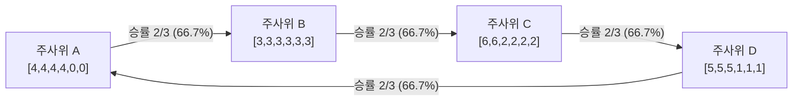

인간의 직관과 일상적 논리에서 '이행성(Transitivity)'은 결코 흔들리지 않는 절대적 공리로 여겨집니다. 만약 선수 $A$가 선수 $B$보다 강하고, 선수 $B$가 선수 $C$보다 강하다면, 당연히 선수 $A$는 선수 $C$보다 강해야 합니다. 이러한 관계는 실수 직선($a > b$이고 $b > c$이면 $a > c$)이나 물체의 무게, 길이, 자산의 크기 등 우리가 세상을 측정하는 모든 척도의 기초입니다.

수학적으로 어떤 집합 $S$ 위의 이항 관계 $\succ$가 이행적이라는 것은 다음을 의미합니다:

$$
\forall x, y, z \in S, \quad (x \succ y) \land (y \succ z) \implies (x \succ z)
$$

그러나 확률과 다차원 평가가 결합되는 순간, 이 명백해 보이는 공리는 완전히 무너집니다.

가장 대표적인 직관적 반례는 가위바위보입니다. 가위는 보를 이기고, 보는 바위를 이기며, 바위는 가위를 이깁니다. 여기에는 절대적 승자가 존재하지 않고 닫힌 순환 구조(Cycle)가 형성됩니다. 사람들은 이것이 상징적인 규칙 기반의 게임이기 때문이며, 명확한 숫자가 적힌 주사위의 눈을 비교하는 수학적 대결에서는 당연히 이행성이 성립할 것이라고 생각합니다.

그러나 통계학자들은 정육면체 주사위의 눈을 정교하게 설계함으로써 <strong>'주사위 $A$는 $B$를 높은 확률로 이기고, $B$는 $C$를 이기며, $C$는 $D$를 이기는데, $D$는 다시 최초의 $A$를 압도적으로 이기는'</strong> 기묘한 주사위 세트를 현실에 구현했습니다. 이를 <strong>비이행성 주사위(Nontransitive Dice)</strong>라고 부릅니다.

더욱 충격적인 사실은, 플레이어가 이 주사위를 <strong>각각 2개씩 동시에 굴려 합계를 비교하면, 승패의 순환 방향이 정반대로 완전히 역전</strong>되는 기괴한 현상(그라임의 주사위)까지 존재한다는 점입니다.

본 글에서는 비이행성 주사위의 수학적 메커니즘, 에프론 주사위의 표본 공간 분석, 기댓값과 승률의 근본적 괴리, 합성곱(Convolution)에 의한 2개 굴리기 역전 현상, 그리고 콩도르세 투표 역설과 진화 생물학에 미치는 심오한 통찰을 철저히 분석합니다.

---

## 1. 이행성의 덫: 기댓값 선형성과 승률의 비선형성

인간이 주사위 대결에서 이행성을 기대하는 이유는 <strong>기댓값(Expected Value, $E[X]$)</strong>의 선형성 때문입니다.

$$
E[X - Y] = E[X] - E[Y]
$$

기댓값은 단일한 실수(Scalar)이므로, 각 주사위의 강도를 기댓값으로 정의한다면 승패 관계는 항상 완벽한 이행성을 만족합니다:

$$
E[A] > E[B] \land E[B] > E[C] \implies E[A] > E[C]
$$

그러나 1대1 주사위 대결에서 승부를 가르는 것은 눈의 차이의 평균값이 아니라, <strong>"$X > Y$가 될 확률 $P(X > Y)$가 $1/2$을 초과하는가"</strong>입니다:

$$
P(X > Y) = \iint_{\mathbb{R}^2} \mathbf{1}_{\{x > y\}} \, dF_X(x) \, dF_Y(y)
$$

지시 함수 $\mathbf{1}_{\{x > y\}}$는 극단적인 비선형 계단 함수입니다. 아무리 큰 차이로 이기든, 단 1 차이로 아슬아슬하게 이기든 동일하게 1승으로 기록됩니다. 승률 판정은 두 변수의 결합 확률 측도 위에서의 적분이므로, 1차원 스칼라 함수로 분해될 수 없습니다. 이로 인해 확률 공간에 본질적인 '회전(Curl)'이 발생하여 비이행적 순환이 탄생합니다.

---

## 2. 에프론의 주사위: 4개의 완벽한 순환 고리

스탠퍼드 대학교의 통계학자 브래들리 에프론(Bradley Efron)이 고안한 4개의 정육면체 주사위는 가장 우아한 비이행성 모델입니다.

| 주사위 | 6면의 눈 구성 | 눈의 분포 | 기댓값 $E[\cdot]$ |
| :---: | :---: | :---: | :---: |
| <strong>주사위 $A$</strong> | $4, 4, 4, 4, 0, 0$ | 4가 4면, 0이 2면 | $E[A] = \frac{16}{6} = \frac{8}{3} \approx 2.667$ |
| <strong>주사위 $B$</strong> | $3, 3, 3, 3, 3, 3$ | 3이 6면 전부 | $E[B] = \frac{18}{6} = 3.000$ |
| <strong>주사위 $C$</strong> | $6, 6, 2, 2, 2, 2$ | 6이 2면, 2가 4면 | $E[C] = \frac{20}{6} = \frac{10}{3} \approx 3.333$ |
| <strong>주사위 $D$</strong> | $5, 5, 5, 1, 1, 1$ | 5가 3면, 1이 3면 | $E[D] = \frac{18}{6} = 3.000$ |

기댓값 순서: $E[C] = 3.333 > E[B] = E[D] = 3.000 > E[A] = 2.667$.

### 36개 표본 공간을 통한 대결별 승률 계산:

1. <strong>$A$ vs $B$</strong>: $B$는 항상 3을 냅니다. $A$가 4를 낼 확률은 $4/6 = 2/3$입니다.
   - $P(A > B) = 4/6 = 2/3 \approx 66.67\%$. ($A$ 압승)
2. <strong>$B$ vs $C$</strong>: $B$는 항상 3을 냅니다. $C$가 2를 낼 확률은 $4/6 = 2/3$입니다.
   - $P(B > C) = 4/6 = 2/3 \approx 66.67\%$. ($B$ 압승)
3. <strong>$C$ vs $D$</strong>:
   - $C=6$ (2면)이면 $D$에 무조건 승리 (12가지).
   - $C=2$ (4면)이고 $D=1$ (3면)이면 승리 (12가지).
   - $P(C > D) = 24/36 = 2/3 \approx 66.67\%$. ($C$ 압승)
4. <strong>$D$ vs $A$ (순환 완성)</strong>:
   - $D=5$ (3면)이면 $A$에 무조건 승리 (18가지).
   - $D=1$ (3면)이고 $A=0$ (2면)이면 승리 (6가지).
   - $P(D > A) = (18 + 6)/36 = 24/36 = 2/3 \approx 66.67\%$!

모든 대결에서 $2/3$의 승률로 순환 고리가 닫힙니다:
$$
P(A > B) = P(B > C) = P(C > D) = P(D > A) = \frac{2}{3}
$$

### 후수 필승의 내기 게임
이 주사위 세트로 내기를 할 때, 상대방에게 먼저 주사위를 고르게 하면 출제자는 언제나 $66.7\%$의 확률로 상대를 이기는 주사위를 선택할 수 있습니다. 먼저 고르는 쪽이 반드시 패배하는 후수 절대 유리 게임입니다.

---

## 3. 그라임의 주사위: 2개 굴리기의 대반전

제임스 그라임(James Grime)이 발견한 5개의 색깔 주사위(빨강 $R$, 파랑 $B$, 올리브 $O$, 노랑 $Y$, 자주 $M$)는 더욱 기이한 성질을 지닙니다.

1개씩 굴릴 때의 우열 관계는 다음과 같습니다:
- $R \succ B$ ($58.3\%$)
- $B \succ O$ ($58.3\%$)
- $O \succ Y$ ($55.6\%$)
- $Y \succ M$ ($55.6\%$)
- $M \succ R$ ($55.6\%$)

그러나 각 플레이어가 동일한 주사위를 <strong>2개씩 굴려 합계를 비교</strong>하면, 독립확률변수의 이산 합성곱(Convolution)에 의해 순서가 완전히 뒤집힙니다:
- $2B \succ 2R$ ($59.0\%$)
- $2O \succ 2B$ ($54.2\%$)
- $2Y \succ 2O$ ($56.6\%$)
- $2M \succ 2Y$ ($56.2\%$)
- $2R \succ 2M$ ($51.7\%$)

1개 굴리기에서 이기던 주사위가, 2개를 굴리면 패배자로 전락합니다. 이는 개별 대결에서의 극단값 효과가 대수의 법칙과 합성곱에 의해 평균 부근으로 수렴하면서 전체 지형이 재편되기 때문입니다.

---

## 4. 사회선택이론과 자연계의 비이행성

### 4.1 콩도르세의 역설과 애로의 불가능성 정리
비이행성 주사위는 정치학의 다수결 투표 역설(콩도르세 역설)과 완벽히 동형입니다. 각 면을 유권자로, 눈의 크기를 후보자에 대한 선호도로 치환하면, 주사위의 비이행성은 "개인이 모두 합리적이어도 사회적 다수결은 순환에 빠진다"는 애로의 불가능성 정리와 직결됩니다.

### 4.2 얼룩점도마뱀의 가위바위보 진화 전략
캘리포니아에 서식하는 얼룩점도마뱀(*Uta stansburiana*)의 수컷은 3가지 목 색깔(주황, 파랑, 노랑)에 따라 번식 전략이 다릅니다:
- 주황(초공격형)은 파랑(방어형)을 제압합니다.
- 파랑(방어형)은 노랑(위장 침투형)을 적발해 격퇴합니다.
- 노랑(위장 침투형)은 주황의 넓은 영역에 몰래 침입해 짝짓기에 성공합니다.

이 삼자대면의 비이행적 순환 덕분에 특정 유전자형이 독점하지 않고 수백만 년간 생물학적 다양성이 보존되고 있습니다.

---

## 5. 결론: 절대적 서열이 없는 다차원 세계의 지혜

비이행성 주사위는 세상의 모든 대상을 1차원 순위로 줄 세우려는 인간의 단순한 본능에 경종을 울립니다. 확률과 다차원 평가가 지배하는 복잡계에서 절대적 1등이란 존재하지 않으며, 강함이란 마주하는 상대와 구조적 맥락 속에서만 규정됩니다. 이 아름다운 순환 고리야말로 확률론과 게임 이론이 전하는 가장 깊은 철학적 교훈입니다.
