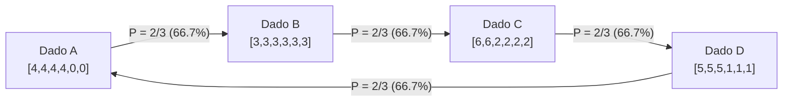

No raciocínio lógico comum, a <strong>transitividade</strong> é tida como uma verdade autoevidente: se $A$ é superior a $B$ e $B$ é superior a $C$, então $A$ deve necessariamente superar $C$. Esse princípio fundamenta a reta real ($\mathbb{R}, <$), medidas físicas e noções econômicas de valor.

Formalmente, uma relação binária $\succ$ em um conjunto $S$ é transitiva se:

$$
\forall x, y, z \in S, \quad (x \succ y) \land (y \succ z) \implies (x \succ z)
$$

Entretanto, quando probabilidades e comparações multidimensionais se encontram, essa intuição desmorona por completo.

O exemplo intuitivo clássico é o *Pedra, Papel e Tesoura*. Muitos imaginam que isso ocorre apenas em convenções simbólicas. No entanto, ao distribuir estrategicamente os números em dados cúbicos comuns, surgem os fascinantes <strong>dados não transitivos</strong>: o dado $A$ vence $B$, $B$ vence $C$, $C$ vence $D$, e $D$ vence $A$, todos com uma probabilidade exata de $2/3$ ($66,7\%$)!

Mais impressionante ainda: ao lançar <strong>dois dados</strong> de cada tipo e somar os valores (os dados de Grime), a ordem cíclica de dominância se inverte completamente!

---

## 1. A armadilha do valor esperado

Nossa mente se confunde ao tentar aproximar a probabilidade de vitória pelo <strong>valor esperado</strong> $E[X]$, que possui propriedade linear:

$$
E[X - Y] = E[X] - E[Y]
$$

O valor esperado é transitivo. Porém, num duelo direto entre dois dados independentes, a vitória é decidida pela função indicadora $\mathbf{1}_{\{x > y\}}$:

$$
P(X > Y) = \iint_{\mathbb{R}^2} \mathbf{1}_{\{x > y\}} \, dF_X(x) \, dF_Y(y)
$$

Essa função de degrau é altamente não linear: vencer por $+3$ pontos ou por $+1$ ponto pontua identicamente como uma vitória. Essa não-linearidade gera uma torção probabilística, permitindo ciclos fechados de dominância.

---

## 2. Os dados de Efron: O ciclo de quatro dados

Desenvolvidos pelo estatístico Bradley Efron, os quatro dados possuem a seguinte configuração:

| Dado | Faces do dado | Distribuição | Valor Esperado $E[\cdot]$ |
| :---: | :---: | :---: | :---: |
| <strong>Dado $A$</strong> | $4, 4, 4, 4, 0, 0$ | Quatro 4, dois 0 | $E[A] = 16/6 \approx 2,667$ |
| <strong>Dado $B$</strong> | $3, 3, 3, 3, 3, 3$ | Seis 3 | $E[B] = 18/6 = 3,000$ |
| <strong>Dado $C$</strong> | $6, 6, 2, 2, 2, 2$ | Dois 6, quatro 2 | $E[C] = 20/6 \approx 3,333$ |
| <strong>Dado $D$</strong> | $5, 5, 5, 1, 1, 1$ | Três 5, três 1 | $E[D] = 18/6 = 3,000$ |

Análise do espaço amostral de 36 pares:

- $P(A > B) = 4/6 = 2/3 \approx 66,7\%$
- $P(B > C) = 4/6 = 2/3 \approx 66,7\%$
- $P(C > D) = 24/36 = 2/3 \approx 66,7\%$
- $P(D > A) = 24/36 = 2/3 \approx 66,7\%$

Em qualquer desafio onde o adversário escolhe o dado primeiro, o jogador que escolhe por segundo possui uma vantagem matemática intransponível de $66,7\%$ de vitória.

---

## 3. Dados de Grime e a inversão por dois dados

Criados por James Grime em 2009, 5 dados coloridos formam o ciclo $R \succ B \succ O \succ Y \succ M \succ R$ em partidas simples. Quando cada competidor joga <strong>dois dados</strong> e soma os resultados, a convolução das probabilidades inverte totalmente a relação de forças:
$$
R \prec B \prec O \prec Y \prec M \prec R
$$

---

## 4. Teoria da escolha social e biologia

### 4.1 Paradoxo de Condorcet e Teorema de Arrow
Os dados não transitivos são idênticos ao Paradoxo de Condorcet em sistemas eleitorais: o voto majoritário pode gerar ciclos contraditórios mesmo com eleitores perfeitamente racionais. O Teorema da Impossibilidade de Arrow formaliza essa inevitabilidade.

### 4.2 O lagarto de manchas laterais (*Uta stansburiana*)
Na natureza, machos de três cores de garganta mantêm uma disputa cíclica perpétua (laranja vence azul, azul vence amarelo, amarelo vence laranja), sustentando a diversidade genética da espécie.

---

## 5. Conclusão

Dados não transitivos quebram a ilusão de rankings unidimensionais perfeitos. A superioridade é sempre relativa ao contexto e ao adversário.
