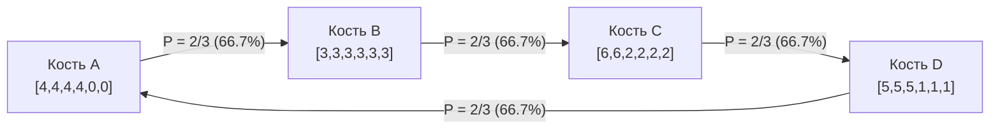

В человеческой логике и обыденном мышлении <strong>транзитивность</strong> считается незыблемой истиной: если $A$ превосходит $B$, а $B$ превосходит $C$, то по законам здравого смысла $A$ непременно должно превосходить $C$. Это свойство определяет порядок на вещественной прямой ($\mathbb{R}, <$), физические измерения и экономические оценки.

Формально отношение $\succ$ на множестве $S$ называется транзитивным, если:

$$
\forall x, y, z \in S, \quad (x \succ y) \land (y \succ z) \implies (x \succ z)
$$

Однако при переходе к случайным величинам и многомерным распределениям эта интуиция терпит крах.

Всем известна игра *«Камень, ножницы, бумага»*, где нет абсолютного победителя. Часто считается, что этот феномен возможен лишь в качественных играх с условными правилами. Но математики доказали: тщательно подобрав числа на гранях обычных игральных костей, можно создать <strong>нетранзитивные игральные кости (Nontransitive Dice)</strong>. В них кость $A$ побеждает $B$, $B$ побеждает $C$, $C$ побеждает $D$, а $D$ побеждает $A$ — каждый раз с вероятностью в две трети ($66.7\%$)!

Более того, если бросать <strong>по две одинаковые кости</strong> и сравнивать сумму очков (кости Грайма), порядок доминирования меняется на строго противоположный!

---

## 1. Ловушка математического ожидания

Наша интуиция ошибочно ориентируется на <strong>математическое ожидание</strong> $E[X]$, которое строго линейно:

$$
E[X - Y] = E[X] - E[Y]
$$

Сравнение по математическому ожиданию всегда транзитивно. Но в парном состязании исход определяет индикаторная функция $\mathbf{1}_{\{x > y\}}$:

$$
P(X > Y) = \iint_{\mathbb{R}^2} \mathbf{1}_{\{x > y\}} \, dF_X(x) \, dF_Y(y)
$$

Она крайне нелинейна: победа с отрывом в $+3$ очка ценится так же, как победа с отрывом в $+1$ очко — ровно в одну победу. Это нелинейное усечение формирует стохастический вихрь, порождающий замкнутые циклы.

---

## 2. Кости Эфрона: Каноническая система четырех костей

Стэнфордский статистик Брэдли Эфрон предложил систему четырех костей:

| Кость | Числа на гранях | Описание | Ожидание $E[\cdot]$ |
| :---: | :---: | :---: | :---: |
| <strong>Кость $A$</strong> | $4, 4, 4, 4, 0, 0$ | Четыре 4, две 0 | $E[A] = 16/6 \approx 2.667$ |
| <strong>Кость $B$</strong> | $3, 3, 3, 3, 3, 3$ | Шесть 3 | $E[B] = 18/6 = 3.000$ |
| <strong>Кость $C$</strong> | $6, 6, 2, 2, 2, 2$ | Две 6, четыре 2 | $E[C] = 20/6 \approx 3.333$ |
| <strong>Кость $D$</strong> | $5, 5, 5, 1, 1, 1$ | Три 5, три 1 | $E[D] = 18/6 = 3.000$ |

При расчете всех 36 исходов для каждой пары:

- $P(A > B) = 4/6 = 2/3 \approx 66.7\%$
- $P(B > C) = 4/6 = 2/3 \approx 66.7\%$
- $P(C > D) = 24/36 = 2/3 \approx 66.7\%$
- $P(D > A) = 24/36 = 2/3 \approx 66.7\%$

В пари, где соперник выбирает кость первым, второй игрок обладает гарантированным математическим преимуществом в $66.7\%$.

---

## 3. Кости Грайма и парадокс двух костей

В 2009 году Джеймс Грайм открыл набор из пяти цветных костей ($R \succ B \succ O \succ Y \succ M \succ R$). Когда соперники бросают <strong>по две кости</strong> и суммируют очки, дискретная свертка вероятностей полностью обращает цикл вспять:
$$
R \prec B \prec O \prec Y \prec M \prec R
$$

---

## 4. Парадокс Кондорсе и эволюция видов

### 4.1 Парадокс Кондорсе и теорема Эрроу
Нетранзитивные кости математически изоморфны парадоксу Кондорсе в теории общественного выбора: индивидуальные транзитивные предпочтения избирателей при мажоритарном голосовании могут сформировать нетранзитивный общественный выбор. Теорема Эрроу подтверждает неустранимость этой коллизии.

### 4.2 Пятнистая глухая ящерица (*Uta stansburiana*)
В природе самцы этого вида ящериц делятся на три стратегии: агрессивные оранжевые побеждают синих, синие защитники побеждают желтых маскировщиков, а желтые прокрадываются к самкам оранжевых. Этот природный цикл «камень-ножницы-бумага» веками сохраняет генетическое разнообразие.

---

## 5. Заключение

Нетранзитивные кости учат нас тому, что в стохастическом и многомерном мире не существует абсолютного первого места: преимущество всегда контекстуально и относительно.
