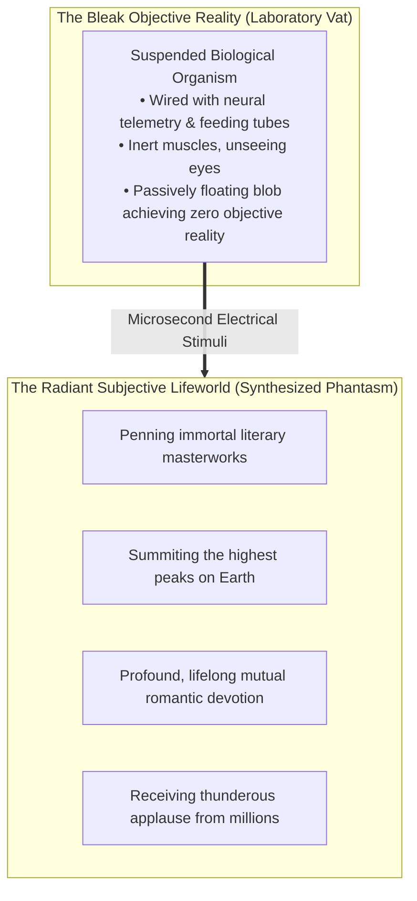
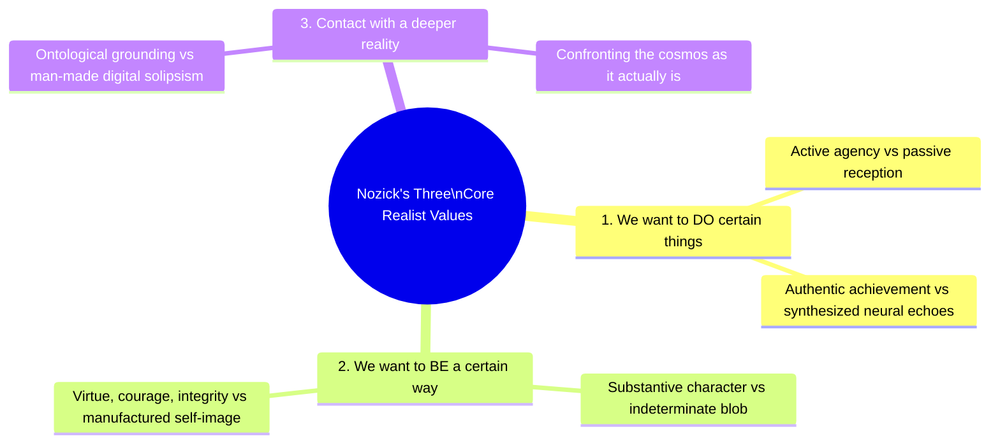
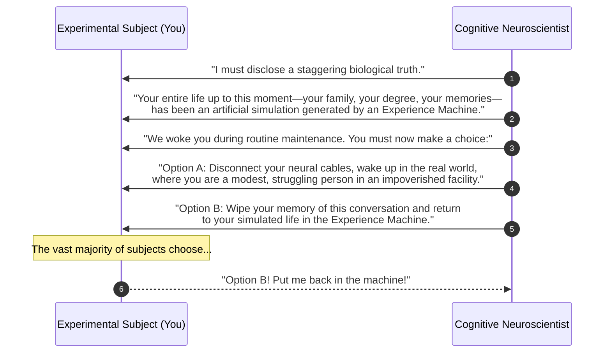
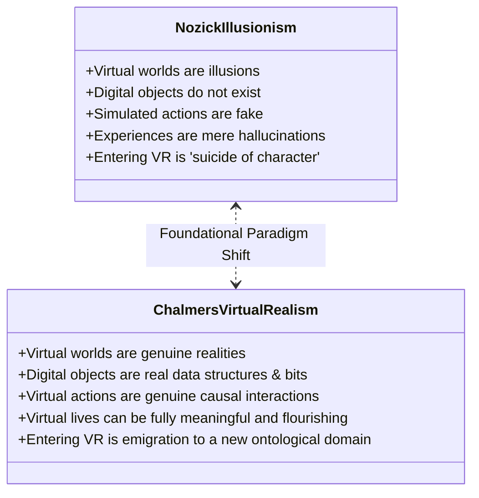
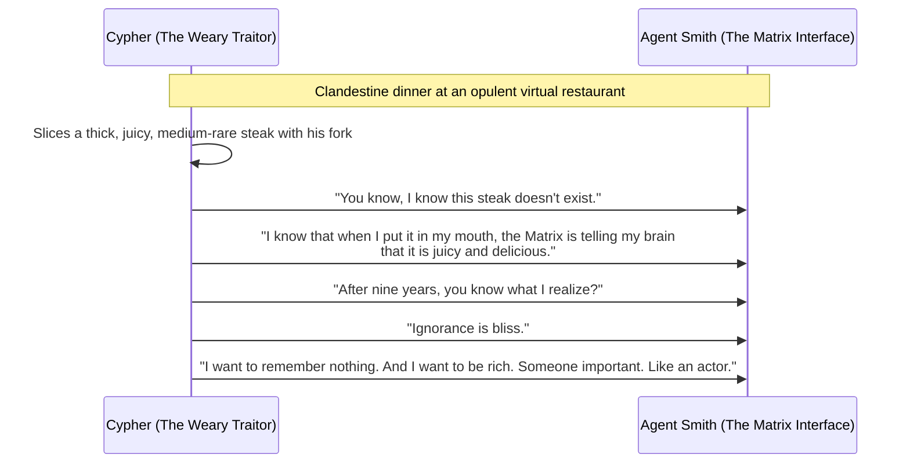

## Introduction: The Seduction of the Optimal Happiness Pod

Imagine a monumental technological breakthrough at the intersection of computational neuroscience, bioengineering, and immersive virtual reality: <strong>The Experience Machine</strong>.

The operational specifications of this apparatus are defined with crystalline clarity:
- You lie suspended in an ergonomically temperature-controlled chamber filled with nutrient-rich amniotic fluid. Non-invasive, hyper-precise microelectrodes interface seamlessly with your cerebral cortex, thalamus, and limbic system.
- Supercomputers simulate any and every conceivable experience with absolute, indistinguishable subjective verisimilitude.
- You can live the life of a Nobel-laureate novelist drafting sublime prose, an intrepid mountaineer summiting K2 at dawn, a devoted partner sharing decades of soul-stirring intimacy, or a beloved humanitarian transforming global health.
- <strong>Critically: while inside the tank, you suffer from total retrograde amnesia regarding the machine itself.</strong> You are completely unaware that you are floating in an artificial vat. To your conscious mind, the experiences are one hundred percent real, tangible, and authentic. Pain, catastrophic despair, and chronic boredom are engineered out of the simulation; continuous ecstasy, intellectual flow, accomplishment, and profound joy are guaranteed.
- Every two years, you are brought out of the simulation for ten minutes to program your desires and narrative arcs for the subsequent two-year cycle.

Now, the neuroscientists present you with the ultimate existential proposition:

> <strong>"Will you plug into the Experience Machine for the remainder of your natural biological life?"</strong>

If you enthusiastically reply *"Yes, plug me in immediately!"*, you are a committed <strong>Hedonist</strong>.
Yet, when confronted with this offer, the overwhelming majority of human beings recoil in profound hesitation, ultimately declaring: <strong>"No. I would not plug in. I want to live in the real world, no matter how painful, flawed, or tragic it may be."</strong>

Why do we refuse a lifetime of guaranteed bliss?
If our internal subjective experiences are indistinguishable from reality, what possible non-instrumental value does "objective reality" possess?

This seminal thought experiment, formulated by American philosopher <strong>Robert Nozick</strong> in his 1974 masterwork *Anarchy, State, and Utopia*, struck a devastating, epochal blow against the foundations of ethical hedonism and mental state theories of well-being.

This treatise provides a thorough examination of Nozick's Experience Machine. We explore the intellectual lineage of philosophical hedonism from Epicurus to Bentham and Mill; dissect the formal logical mechanics of Nozick's refutation; analyze the <strong>Three Realist Values</strong> humans desire beyond mere subjective pleasure; assess modern counter-critiques from experimental philosophy concerning <strong>Status Quo Bias</strong>; examine pop-cultural instantiations from *The Matrix* (Cypher's choice); and investigate David Chalmers's contemporary paradigm of <strong>Virtual Realism</strong> in the era of artificial intelligence, brain-computer interfaces, and the spatial computing metaverse.

---

## 1. Historical Foundations: The Dogma of Philosophical Hedonism

### 1.1 From Classical Epicureanism to Classical Utilitarianism
The proposition that pleasure constitutes the supreme and exclusive good has anchored philosophical discourse since antiquity. 

Epicurus taught that the highest human good consists in the absence of bodily pain (*aponia*) and the absence of mental turmoil (*ataraxia*). Two millennia later, this ancient insight was codified into the foundational bedrock of modern social and legal reform through the <strong>Classical Utilitarianism</strong> of Jeremy Bentham and John Stuart Mill.

In the inaugural passage of his 1789 treatise, *An Introduction to the Principles of Morals and Legislation*, Jeremy Bentham articulated the hedonist axiom with uncompromising clarity:

> *"Nature has placed mankind under the governance of two sovereign masters, <strong>pain</strong> and <strong>pleasure</strong>. It is for them alone to point out what we ought to do, as well as to determine what we shall do."*

Bentham's <strong>Quantitative Hedonism</strong> posited that all pleasures are commensurable along uniform dimensions: intensity, duration, certainty, and propinquity. In his famous aphorism, *"Prejudice apart, the game of push-pin is of equal value with the arts and sciences of music and poetry, if the game of push-pin furnishes more pleasure."*

While John Stuart Mill recognized the intuitive vulgarity of pure quantitative hedonism—famously arguing in *Utilitarianism* (1861) that *"It is better to be a human being dissatisfied than a pig satisfied; better to be Socrates dissatisfied than a fool satisfied"*—he nevertheless maintained the fundamental ontological premise: <strong>well-being is exhaustively determined by the qualitative character of conscious mental states</strong>.

### 1.2 The Core Axioms of Mental State Hedonism
Contemporary value theory formalizes philosophical hedonism through two foundational premises:

$$\begin{aligned}
\mathbf{Axiom\; 1\; (Exclusivity\; of\; Pleasure):} & \quad \text{Pleasure is the only intrinsic good; pain is the only intrinsic evil.} \\
\mathbf{Axiom\; 2\; (The\; Mental\; State\; Requirement):} & \quad \text{Nothing can affect an individual's well-being unless it enters} \\
& \quad \text{or alters the experiential content of their conscious mental states.}
\end{aligned}$$

Under the Mental State Requirement, if two individuals experience phenomenologically identical streams of consciousness—identical sensations of love, pride, joy, and peace—<strong>their levels of well-being are strictly, mathematically identical</strong>, regardless of whether one individual is an actual statesman surrounded by loving friends or a brain in a jar stimulated by an eccentric scientist.

Nozick designed the Experience Machine to demonstrate that this premise is monstrously, demonstrably false.

---

## 2. The Architecture of Nozick's Thought Experiment

### 2.1 The Methodological Design
To isolate the core variable of conscious experience from incidental objections, Nozick crafted the hypothetical scenario with rigorous precision:
1. <strong>Unassailable Technical Perfection</strong>: The machine never malfunctions, suffers brownouts, or degrades neural tissue.
2. <strong>Superiority of Experience</strong>: The experiential repertoire available in the machine vastly eclipses anything achievable in the stubborn, friction-laden physical world.
3. <strong>Absence of Altruistic Guilt</strong>: Nozick explicitly stipulates that one's loved ones can also plug into their own machines, or are otherwise perfectly cared for. You are not abandoning dependent children or aging parents.
4. <strong>Complete Epistemic Insulation</strong>: You will not experience the nagging suspicion that your life is a digital sham; you will be blissfully unaware of your true physical condition.

### 2.2 Formal Reductio ad Absurdum
The logical refutation of hedonism via the Experience Machine proceeds as a classical proof by contradiction:

$$\begin{aligned}
\mathbf{Premise\; 1\; (Hedonist\; Axiom):} & \quad \text{An agent's well-being is determined entirely by the pleasurable quality of their conscious mental states.} \\
\mathbf{Premise\; 2\; (Technological\; Reality):} & \quad \text{The Experience Machine provides a lifetime of vastly greater, uninterrupted net pleasure than actual life.} \\
\mathbf{Logical\; Entailment:} & \quad \text{Every rational agent seeking their own well-being ought unambiguously to plug into the Experience Machine.} \\
\mathbf{Empirical\; / \; Intuitive\; Fact:} & \quad \text{The overwhelming majority of human beings adamantly refuse to plug in.} \\
\mathbf{Conclusion:} & \quad \text{Premise 1 is false. Well-being involves values that transcend subjective conscious states.}
\end{aligned}$$

By showing that we care about things other than our experiential states, Nozick fundamentally discredited mental state monism.

---

## 3. The Three Non-Hedonistic Values: What Matters Beyond Experience

Why does the prospect of plugging in repulse us? Nozick systematically isolated <strong>three fundamental reasons</strong> why human beings choose reality over simulation:

### 3.1 First: We Want to DO Certain Things, Not Merely Experience Doing Them
> *"First, we want to <strong>do</strong> certain things, and not just have the experience of doing them. In the case of certain experiences, it is only because we first want to do the actions that we want the experiences of doing them or thinking we've done them."*

Consider writing a magnum opus or climbing Mount Everest. The pleasure of standing on the summit is not an isolated sensory good like eating a chocolate truffle; it is an affective reward contingent upon the prior physical act of climbing.
In the Experience Machine, an individual does not write a novel; they do not scale an icy cliff. They simply float in warm broth while a server rack flickers down the hall. 

We desire <strong>authentic agency</strong>—to be the causal source of changes in the objective universe. The machine reduces human beings from active agents to passive consumers of manufactured neural echoes.

### 3.2 Second: We Want to BE a Certain Way, to Be a Certain Sort of Person
> *"A second reason for not plugging in is that we want to <strong>be</strong> a certain way, to be a certain sort of person. Someone floating in a tank is an indeterminate blob. There is no answer to the question of what a person is like who has long been in the tank. Is he courageous? Kind? Intelligent? Witty? Loving? He's not merely none of these things; there's no way he is. Plugging into the machine is a kind of suicide."*

Character is not a subjective sensation; it is a dispositional reality manifested through courageous choices under pressure, sacrifices made for others, and resilience in the crucible of adversity. 
The inhabitant of the machine possesses no character. He has traded his personhood for dopamine loops. To enter the machine is to extinguish the substantive self, leaving behind merely an organic sponge soaking in digital hallucinations.

### 3.3 Third: We Want Contact with a Deeper Reality
> *"Thirdly, plugging into an experience machine limits us to a man-made reality, to a world no deeper or more important than that which people can construct. There is no actual contact with any deeper reality, though the experience of it can be simulated."*

Human beings possess an innate ontological longing for <strong>contact with reality</strong> (*contact with the world as it is*). We want our beliefs to correspond to actual facts, our friendships to be reciprocal connections with autonomous external minds, and our love to touch another living soul.
Living in an artificial matrix traps the consciousness inside a closed narcissistic loop of human design. We prefer the raw, indifferent, sometimes tragic grandeur of the objective cosmos to the gilded cage of our own engineered fantasies.

---

## 4. Experimental Philosophy and the "Status Quo Bias" Critique

For decades, Nozick's argument stood virtually unchallenged in analytic philosophy. However, with the rise of <strong>Experimental Philosophy (x-phi)</strong> in the early 2000s, empirical researchers began testing whether ordinary people actually reject the Experience Machine for the reasons Nozick supposed.

### 4.1 Felipe De Brigard's Reversal Experiment
In a seminal 2010 study published in *Philosophical Psychology*, philosopher Felipe De Brigard designed a series of ingenious thought experiments that inverted Nozick's baseline assumptions.

The empirical findings were shocking:
- In Nozick's standard scenario (Moving from Reality $\to$ Machine), approximately <strong>84% of subjects refused</strong> to plug in.
- In De Brigard's inverted scenario (Discovering you are in a Machine and deciding whether to Unplug $\to$ Reality), <strong>55% to 60% of subjects refused to unplug</strong>, choosing to remain in the virtual simulation.

### 4.2 The Psychological Culprit: Status Quo Bias and Loss Aversion
De Brigard, along with Joshua Greene and Adam Feltz, argued that Nozick's classic intuition does not reflect a principled philosophical commitment to "objective reality" or "non-hedonistic values." Rather, it reflects a basic cognitive heuristic identified by behavioral economists Daniel Kahneman and Amos Tversky: <strong>Status Quo Bias</strong> powered by <strong>Loss Aversion</strong>.

When presented with Nozick's original prompt:
- The Status Quo is reality. Leaving it entails abandoning existing friends, projects, and identity. Subjects perceive plugging in as an unacceptable loss.
When presented with the inverted prompt:
- The Status Quo is the simulation. Leaving it entails abandoning the life and relationships one has cultivated. Subjects perceive unplugging as an unacceptable loss.

If our rejection of the Experience Machine is merely an artifact of irrational status quo bias, then Nozick's triumphant refutation of hedonism loses much of its normative authority.

---

## 5. David Chalmers and "Virtual Realism": Beyond the Illusionism of Nozick

In his groundbreaking work *Reality+: Virtual Worlds and the Problems of Philosophy* (2022), philosopher of mind <strong>David J. Chalmers</strong> launched a profound re-evaluation of Nozick's thought experiment from the perspective of modern digital ontology.

Chalmers directly challenges Nozick's core premise: that virtual reality is inherently an illusion, a fake, or a second-class shadow of the physical world.

### 5.1 The Tenets of Virtual Realism
Chalmers articulates two revolutionary theses:
1. <strong>Virtual Reality is Genuine Reality</strong>: Virtual worlds are not illusions. When you interact with a digital object in a fully realized virtual world, that object is real—it is made of bits and digital information structures, just as physical objects are made of quarks and electrons.
2. <strong>Virtual Life Can Be a Meaningful Life</strong>: You can lead a life of profound flourishing, authentic social bonding, artistic creation, and moral heroism within a virtual world.

### 5.2 Why Nozick's Machine Was Defective: Passivity versus Interactivity
Chalmers observes that Nozick's thought experiment conflated two entirely distinct concepts:
- <strong>A Pre-Programmed Passive Movie</strong>: Nozick's machine was essentially a solitary, non-interactive script where the user is an isolated brain fed predetermined phantasms.
- <strong>An Interactive Virtual World</strong>: A multi-user, open-ended virtual universe populated by millions of other real, autonomous conscious beings.

If an Experience Machine is an interactive world—where your choices have real consequences for other conscious avatars, where you can fail, build businesses, create communities, and fall in love—then plugging in is not a retreat into solipsistic delusion. It is <strong>emigration to an alternate digital reality</strong>. In such a world, you *do* things, you *are* a specific person, and you *have* contact with real minds.

---

## 6. Cultural Resonances: Cypher's Choice in *The Matrix*

No philosophical text captured the existential dilemma of the Experience Machine in modern myth more powerfully than the Wachowskis' 1999 cinematic milestone, *The Matrix*.

The protagonist Neo chooses the <strong>Red Pill</strong>, embracing cold, gritty, impoverished reality over the digital comfort of the Matrix. Neo embodies Nozick's noble preference for authentic truth.

Yet the film's philosophical antagonist is not Agent Smith, but <strong>Cypher</strong>—the rebel crew member who betrays humanity in exchange for reinserion into the machine.

Cypher's monologue cuts straight to the raw nerve of Nozick's thought experiment. 
After years of freezing in cold metallic tunnels, eating repulsive protein sludge, and facing constant terror, Cypher asks the brutal question: <strong>What good is "truth" if it yields only unrelenting misery?</strong>

Cypher represents the tragic reality of human exhaustion. When the cost of authenticity becomes unbearable, the allure of the Experience Machine ceases to be a philosophical abstraction and transforms into an overwhelming existential temptation.

---

## 7. The Taxonomy of Well-Being: Hedonism, Desires, and Objective Goods

In contemporary axiology and normative ethics, Nozick's thought experiment catalyzed the formal demarcation of the three dominant theories of human well-being:

| Theory of Well-Being | The Nature of the Good | Verdict on the Experience Machine |
|---|---|---|
| <strong>1. Hedonistic Theories</strong> (Bentham, Mill, Feldman) | Maximize balance of subjective pleasure over pain. | <strong>Plug in.</strong> The machine mathematically dominates reality in net hedonic yield. |
| <strong>2. Desire-Satisfaction Theories</strong> (Railton, Harsanyi) | The fulfillment of an agent's actual (or idealized) desires. | <strong>Refuse.</strong> Most agents possess deep desires that their lives be *genuinely* real, which the machine frustrates. |
| <strong>3. Objective List Theories</strong> (Parfit, Nussbaum, Hurka) | Realizing objective goods: truth, virtue, knowledge, authentic friendship, autonomy. | <strong>Refuse adamantly.</strong> The machine strips the agent of autonomy and veridical epistemic contact. |

Nozick's machine proved decisively that neither psychological hedonism nor mental state desire-satisfaction could account for the full spectrum of human normative commitments.

---

## 8. Mathematical Formalization: The Authenticity Metric in Decision Theory

Let us construct a formal decision-theoretic model illustrating why rational agents with realist preferences reject the Experience Machine.

Let the global state of an agent's life be modeled as a pair:

$$(\mathbf{e}, \mathbf{w}) \in \mathcal{E} \times \mathcal{W}$$

where:
- $\mathbf{e} \in \mathcal{E}$ represents the trajectory of the agent's subjective conscious experiences over time.
- $\mathbf{w} \in \mathcal{W}$ represents the actual, objective state of the physical and social world.

Let $h: \mathcal{E} \to \mathbb{R}$ denote the pure hedonic value function (pleasure minus pain).
Let $\Phi: \mathcal{E} \times \mathcal{W} \to [0, 1]$ be an <strong>Authenticity / Veridicality Metric</strong>, measuring the correspondence between the agent's subjective beliefs and the objective state of the world:

$$\Phi(\mathbf{e}, \mathbf{w}) = 1 - \frac{\|\mathbf{e} - \pi(\mathbf{w})\|}{\max_{\mathbf{e}'}\|\mathbf{e}' - \pi(\mathbf{w})\|}$$

(where $\pi: \mathcal{W} \to \mathcal{E}$ is the true projection mapping the objective world into sensory experience).

Furthermore, let $\mathcal{A}(\mathbf{w}) \ge 0$ denote the measure of <strong>Active Causal Agency</strong> exerted by the agent in the external world.

### 8.1 The Pure Hedonist Utility Function
Under classical hedonism, utility depends strictly on $h(\mathbf{e})$:

$$U_{\text{Hed}}(\mathbf{e}, \mathbf{w}) = h(\mathbf{e})$$

Because the machine is engineered such that $h(\mathbf{e}_{\text{mach}}) \gg h(\mathbf{e}_{\text{real}})$, the decision is trivially deterministic:

$$U_{\text{Hed}}(\mathbf{e}_{\text{mach}}, \mathbf{w}_{\text{vat}}) > U_{\text{Hed}}(\mathbf{e}_{\text{real}}, \mathbf{w}_{\text{real}}) \implies \text{Choice} = \text{Plug In}$$

### 8.2 The Nozickian Multi-Attribute Utility Function
In contrast, a realist agent evaluates utility via a weighted multi-attribute formulation:

$$U_{\text{Realist}}(\mathbf{e}, \mathbf{w}) = h(\mathbf{e}) + \alpha \cdot \Phi(\mathbf{e}, \mathbf{w}) + \beta \cdot \mathcal{A}(\mathbf{w})$$

where $\alpha > 0$ is the weight of veridical authenticity, and $\beta > 0$ is the weight of objective agency.

Now calculate the values for both choices:
1. <strong>For the Experience Machine</strong>:
   - $h(\mathbf{e}_{\text{mach}}) = H_{\text{max}}$ (Very high)
   - $\Phi(\mathbf{e}_{\text{mach}}, \mathbf{w}_{\text{vat}}) \to 0$ (Subjective beliefs are completely decoupled from the vat)
   - $\mathcal{A}(\mathbf{w}_{\text{vat}}) = 0$ (Zero external causal agency)
   - Total Utility: $U_{\text{Realist}}(\text{Machine}) = H_{\text{max}} + 0 + 0 = H_{\text{max}}$

2. <strong>For the Actual World</strong>:
   - $h(\mathbf{e}_{\text{real}}) = H_{\text{real}}$ ($H_{\text{real}} < H_{\text{max}}$)
   - $\Phi(\mathbf{e}_{\text{real}}, \mathbf{w}_{\text{real}}) \approx 1$ (High veridical correspondence)
   - $\mathcal{A}(\mathbf{w}_{\text{real}}) > 0$ (Genuine causal impact on friends, work, community)
   - Total Utility: $U_{\text{Realist}}(\text{Reality}) = H_{\text{real}} + \alpha + \beta \mathcal{A}(\mathbf{w}_{\text{real}})$

A rational agent will refuse to plug in whenever:

$$\alpha + \beta \mathcal{A}(\mathbf{w}_{\text{real}}) > H_{\text{max}} - H_{\text{real}}$$

This mathematical condition illustrates the exact trade-off: <strong>Whenever the value an agent places on truth and agency exceeds the hedonic surplus of the virtual paradise, the rational decision is to reject the machine.</strong>

---

## 9. Meaning in Life versus Happiness: Susan Wolf and Narrative Identity

The legacy of the Experience Machine led philosopher Susan Wolf to articulate her influential dual-aspect definition of <strong>Meaning in Life</strong>:

$$\text{Meaning in Life} = \text{Subjective Attraction} + \text{Objective Attractiveness}$$

According to Wolf, meaning arises only when subjective passion is directed toward projects that possess objective, mind-independent value. The occupant of the Experience Machine possesses subjective attraction in abundance, but objective attractiveness is zero. His life is an empty vessel.

Furthermore, as J. David Velleman has argued, human well-being possesses a <strong>narrative structure</strong>. A life that begins in struggle and culminates in genuine triumph is vastly superior to a life with the exact same sum of daily pleasure distributed randomly or earned through digital illusion. We care about the *story* of our lives, and stories require real obstacles, real stakes, and real triumphs.

---

## 10. Conclusion: Why Reality Matters

Fifty years after Robert Nozick conceived the Experience Machine in Harvard Yard, his thought experiment has transitioned from speculative philosophy to an urgent civilizational challenge. As neural interfaces, synthetic media, and generative reality converge, humanity stands on the precipice of engineering Nozick's pod.

Reality is frequently arduous, exhausting, and heartbreaking. It offers no guarantees of joy, no algorithmic safety nets, and no immortality.

Yet we cling to this broken world because <strong>living well is fundamentally distinct from merely feeling good</strong>.

We cherish the calloused hand that built the house, the unsimulated tear shed in shared grief, the hard-won insight born of catastrophic failure, and the fragile miracle of being loved by another sovereign, autonomous mind.

To refuse the Experience Machine is to affirm our humanity. It is the noble declaration that we choose to be authors rather than spectators—that we would rather bleed in the authentic light of the sun than reign as passive gods in a dream of our own making.
