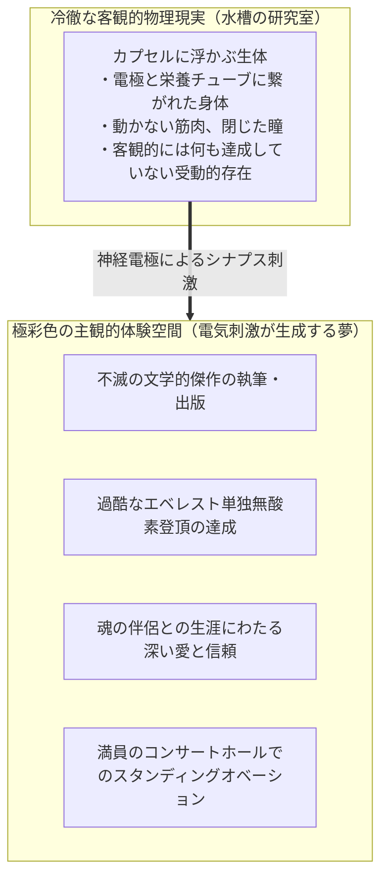
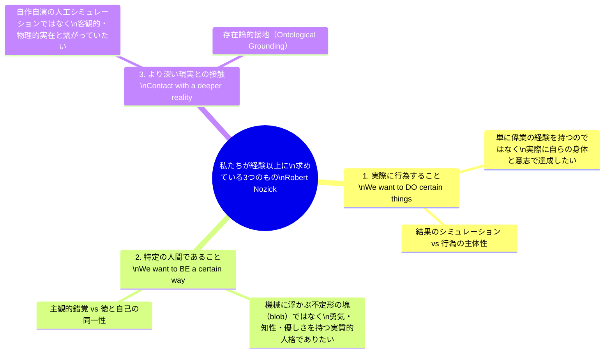
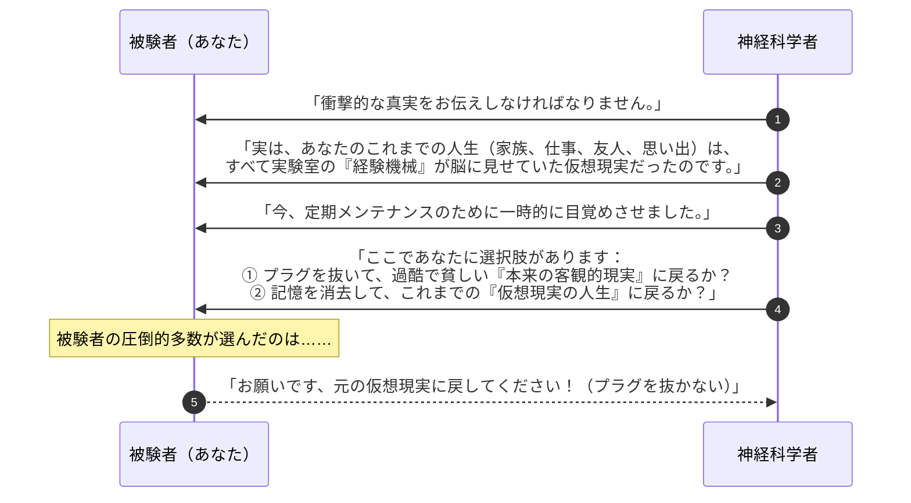
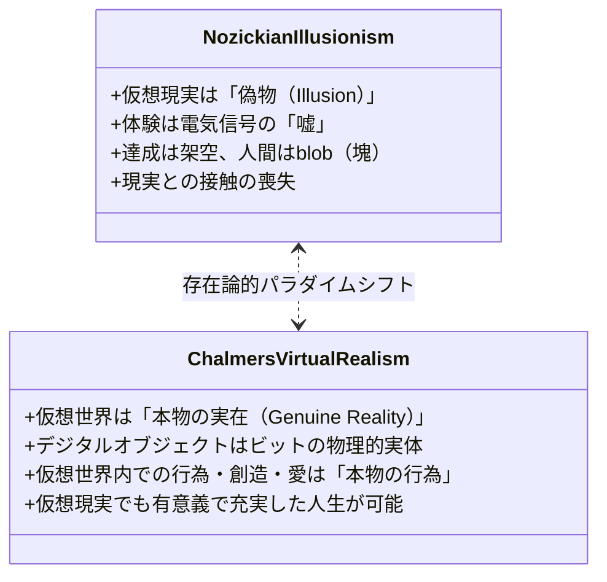
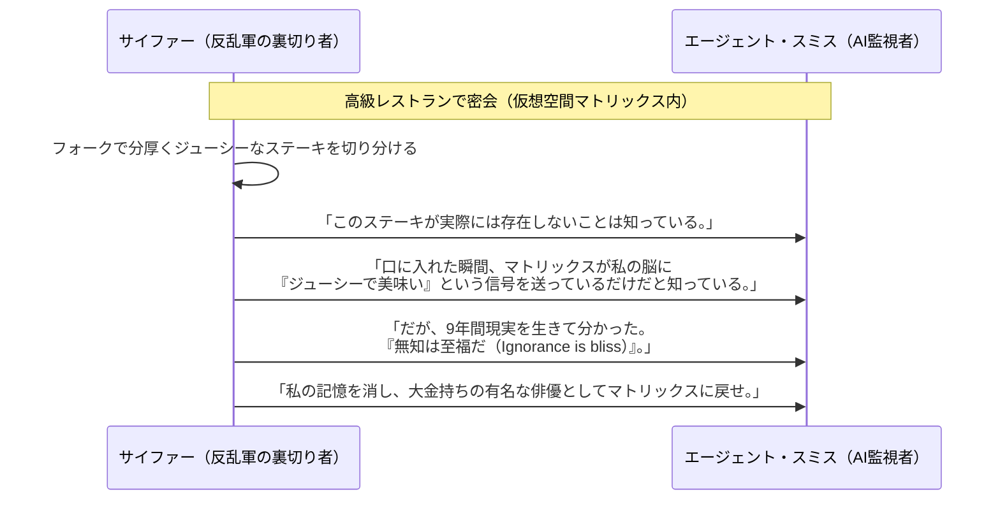
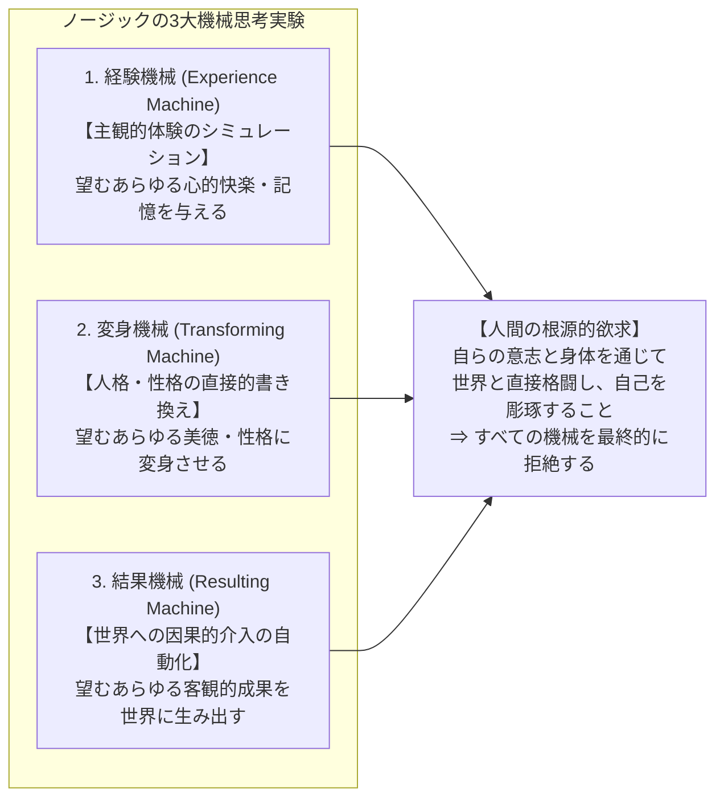

## 序論：至高の幸福カプセルという誘惑

想像してみてください。最先端の神経科学と生体工学を結集した究極の装置、<strong>『経験機械（The Experience Machine）』</strong>が開発されたとします。

この機械の仕様は以下の通りです：
- あなたは温かい培養液で満たされた透明なタンクに横たわり、脳のシナプスには無痛の超微細電極が接続されます。
- コンピュータはあなたの脳を直接刺激し、あなたが望む「あらゆる経験」を完璧な主観的リアリティを伴って生成します。
- あなたは世界的な大文豪になって不朽の傑作小説を書き上げることも、エベレストの登頂に成功して頂上から神々しい朝日を眺めることも、生涯の理想の伴侶と深い愛情に満ちた家庭を築くことも、大観衆の拍手喝采を浴びるロックスターになることもできます。
- <strong>最も重要な点として、機械に接続されている間、あなたは自分が機械の中にいることを完全に忘れています。</strong> あなたにとって、その経験は100%「紛れもない本物の現実」として体験されます。苦痛や絶望は事前に排除され、生涯にわたって最高純度の幸福感、達成感、歓喜が約束されています。
- 定期的に（例えば2年ごとに）10分間だけ浮上し、次の2年間に体験したい新しい人生のプログラムを選定する機会が与えられます。

そして、研究者はあなたにこう問いかけます：

> <strong>「あなたは、この機械にプラグを差し込み、一生をその中で過ごしたいですか？」</strong>

もしあなたが「はい、絶対に繋がれたい」と即答するなら、あなたは純粋な<strong>快楽主義（Hedonism）</strong>の持ち主です。
しかし、ほとんどの人々は、この魅力的な提案を前にして激しい躊躇を覚え、最終的には<strong>「いや、私は接続したくない。どんなに辛くても現実を生きたい」</strong>と首を振るのではないでしょうか。

なぜ私たちは、生涯にわたる完璧な幸福を拒絶するのでしょうか？
客観的な「現実（Reality）」が主観的な「幸福感」と乖離しているとき、現実にどのような独自の価値があるというのでしょうか？

この問いを1974年の主著『アナーキー・国家・ユートピア（Anarchy, State, and Utopia）』で提示し、倫理学における快楽主義のドグマを根底から打ち砕いたのが、哲学者<strong>ロバート・ノージック（Robert Nozick）</strong>です。

本稿では、ノージックの「経験機械」思考実験の論理構造から、功利主義・快楽主義への反証、私たちが主観的快楽以上に渇望している「3つの実在的価値」、実験哲学による「現状維持バイアス」批判、映画『マトリックス』や現代のメタバース・VR技術との接点、そしてデイヴィッド・チャルマーズの「仮想実在論（Virtual Realism）」に至るまで、人間の幸福とリアリティの本質を徹底的に解体・考察します。

---

## 1. 思想史的文脈：快楽主義（Hedonism）のドグマ

### 1.1 古代エピクロスから近代功利主義へ
幸福とは何かという問いに対して、人類の思想史において最も古く、最も直感的に強力だった回答が<strong>「快楽主義（Hedonism）」</strong>でした。

古代ギリシャのエピクロス（Epicurus）は、肉体的苦痛の不在（アポニア）と魂の平穏（アタラクシア）こそが人生の最高善であると説きました。そして近代において、この快楽主義を社会制度の基礎倫理へと押し上げたのが、ジェレミー・ベンサム（Jeremy Bentham）とジョン・スチュアート・ミル（John Stuart Mill）の<strong>功利主義（Utilitarianism）</strong>です。

ベンサムは1789年の『道徳および立法の諸原理序説』の冒頭で次のように宣言しました：

> 「自然は人類を<strong>苦痛（Pain）</strong>と<strong>快楽（Pleasure）</strong>という二人の主権者の支配下に置いた。私たちが何をしなければならないかを指示し、私たちが何をするであろうかを決定するのは、ただこれら二つのみである。」

ベンサムの「量的快楽主義（Quantitative Hedonism）」において、快楽の価値はその強度、持続時間、確実性、遠近性などの数量的計算（快楽計算）によってのみ評価され、ピン跳ね遊び（プッシュピン）の快楽も詩の読書の快楽も、量が同じであれば同等に善であるとされました。

ミルの「質的快楽主義（Qualitative Hedonism）」は、「満足した豚よりも不満足な人間であるほうがよく、満足した愚者よりも不満足なソクラテスであるほうがよい」として快楽の質的差異（知的・道徳的快楽の優位性）を導入しましたが、<strong>「幸福を構成する究極の価値は、主観的な意識体験の質（心的状態）に尽きる」</strong>という前提自体は共有していました。

### 1.2 快楽主義の核心テーゼ
快楽主義の存在論的・倫理的コミットメントは、以下の2つの命題に要約されます：

$$\begin{aligned}
\text{命題 1 (快楽の唯一性):} & \quad \text{人間にとって内在的に善（Intrinsically good）である唯一のものは「快楽」である。} \\
\text{命題 2 (心的状態主義):} & \quad \text{何かが人の幸福（Well-being）にとって善であるか否かは、} \\
& \quad \text{その人の「主観的意識体験（Mental state）」のあり方によってのみ決定される。}
\end{aligned}$$

この立場（心的状態説: Mental State Theory of Well-being）に従えば、2人の人間が全く同一の主観的意識体験（同じ喜び、同じ満足感、同じ安らぎ）を経験しているならば、<strong>彼らの客観的境遇がどれほど異なっていようとも、2人の人生の幸福度は完全に同等でなければなりません。</strong>

ノージックの「経験機械」は、まさにこの心的状態説の論理的帰結を極限まで押し進めたときに生じる、グロテスクな背理を暴き出すために考案されたのです。

---

## 2. ノージックの『経験機械』思考実験の構造

### 2.1 思考実験の論理的セットアップ
ノージックが1974年に提示したテキストは、極めて簡潔でありながら緻密に設計されています。

ノージックは読者に、快楽主義者が想定し得るあらゆる留保や言い訳を先回りして封じる完璧な条件を提示しました：
1. <strong>信頼性と完璧性</strong>: 機械の故障や停電のリスクは完全にゼロ。世界最高の神経科学者が管理している。
2. <strong>完全なシミュレーション</strong>: 現実世界で経験し得る最高の体験よりも、機械の提供する体験のほうが主観的質において圧倒的に豊かで、多様で、快楽に満ちている。
3. <strong>他者への責任の排除</strong>: 「自分が機械に入ったら、残された家族や友人が悲しむのではないか」という利他主義的懸念に対して、ノージックは「誰もが自分の経験機械に接続できる世界」を仮定します。あなたが誰かの犠牲になる必要はありません。
4. <strong>無自覚性</strong>: 機械の中にいる間、それが機械であることを微塵も疑わない。

### 2.2 快楽主義の三段論法とノージックの反証
この思考実験の論理構造は、以下の形式的背理法（Reductio ad absurdum）として定式化できます：

$$\begin{aligned}
\mathbf{前提 1 (快楽主義):} & \quad \text{人生において究極的に重要なのは、主観的な快楽体験のみである。} \\
\mathbf{前提 2 (経験機械の性質):} & \quad \text{経験機械は、現実世界のいかなる人生よりも} \\
& \quad \text{はるかに大量かつ高純度の主観的快楽体験を生涯にわたって提供する。} \\
\mathbf{演繹的帰結:} & \quad \text{すべての合理的な人間は、現実を捨てて経験機械に接続することを選ぶはずである。} \\
\mathbf{直観的事実:} & \quad \text{圧倒的多数の人々は、経験機械への接続を拒絶する。} \\
\mathbf{結論:} & \quad \text{前提 1（快楽主義・心的状態説）は誤りである。}
\end{aligned}$$

もし私たちが経験機械への接続を拒絶するならば、それは私たちが<strong>「主観的にどのように感じられるか（経験）」を超えた、別の何かを決定的に重要視している</strong>という紛れもない証拠です。

---

## 3. 私たちが「快楽」以上に欲している3つの実在的価値

ノージックは、人々が経験機械を拒絶する理由を鋭く分析し、私たちが幸福な意識体験以上に本質的なものとして求めている<strong>「3つの価値」</strong>を特定しました。

### 3.1 第1の理由：私たちは、実際に何かを「行いたい（Do）」
私たちは、単に「偉大な小説を書いたという経験」を持ちたいだけではありません。私たちは<strong>実際に自分の手で、インクと汗と試行錯誤を通じて、現実の小説を書き上げたい（We want to do them）</strong>のです。

経験機械の中で小説を書く人は、客観的には何の文学的創造も行っていません。彼は単に脳細胞に微弱な電流を流され、「書いた気になっている」受動的な消費者に過ぎません。
私たちが望んでいるのは、行為の「心的反響（Mental echo）」ではなく、<strong>現実世界に対して因果的影響を及ぼす行為の「主体（Actor/Agent）」そのものであること</strong>です。

### 3.2 第2の理由：私たちは、特定の人間で「ありたい（Be）」
ノージックは問いかけます。「経験機械に生涯浮かんでいる人は、一体いかなる人間だろうか？」

> 「彼にはいかなる性格も存在しない。彼は勇気ある人間だろうか？ 機知に富んだ人間だろうか？ 優しい人間だろうか？ 愛情深い人間だろうか？ 彼はそのどれでもない。<strong>彼はいかなる性格も持たない、タンクに浮かぶただの不定形の塊（an indeterminate blob）に過ぎない。</strong>」

私たちは、自分が「勇気ある人間」「誠実な人間」「知的な人間」であるという主観的幻想に浸りたいだけではありません。現実に困難に直面したとき、恐怖に抗って立ち向かい、友を裏切らないという<strong>実質的な徳（Virtue）を備えた人間そのものでありたい（We want to be a certain way）</strong>と望んでいます。経験機械に入ることは、一種の「人格の自殺（Suicide of character）」に等しいのです。

### 3.3 第3の理由：私たちは、「より深い現実（Deeper reality）」と接触していたい
経験機械は、人間が事前に設計した人工的なプログラムの範囲内に私たちを閉じ込めます。そこには、真の意味での未知、真の驚異、そして私たちを超越した客観的実在はありません。

ノージックは指摘します：
> 「私たちは、自らが人工的に作り上げた現実よりも<strong>『より深い現実』と直接接触（Contact with a deeper reality）していたい</strong>と願っている。」

たとえ現実世界が不条理で、悲劇に満ち、痛みに満ちていたとしても、それが「本物の世界」であるという事実そのものが、人工の楽園には決して持ち得ない計り知れない重みを持っています。私たちは、偽りの黄金郷よりも、ざらざらとした本物の土の感触を求めているのです。

ノージックはさらに思考実験を拡張し、自分の性格を自由に変えられる「変身機械（Transforming Machine）」や、世界に影響を与える「結果機械（Resulting Machine）」を導入してもなお、私たちがそれらを拒絶することを示し、<strong>「人間にとって生きることの本質は、あらかじめ配給された幸福を消費することではない」</strong>と結論づけました。

---

## 4. 現代の実験哲学による批判：「現状維持バイアス」の罠

ノージックの経験機械は、長年にわたり快楽主義を論破した決定打として称賛されてきました。しかし2000年代以降、<strong>実験哲学（Experimental Philosophy: x-phi）</strong>の台頭によって、この思考実験に対する極めて強力な心理学的反論が提起されました。

### 4.1 フェリペ・デ・ブリガードの「逆転された経験機械」
哲学者フェリペ・デ・ブリガード（Felipe De Brigard）は2010年、思考実験の前提を逆転させた画期的な実験を行いました。

デブリガードは被験者に以下のようなシナリオを提示しました：

この実験の結果、驚くべき事実が判明しました。
- ノージックの原版（現実から機械へ入るか？）では、大多数（約85%）が<strong>「入りたくない（拒絶）」</strong>と答えました。
- しかしデブリガードの逆転版（機械から現実へ出るか？）では、被験者の過半数（約55〜60%）が<strong>「出たくない（仮想現実に留まる）」</strong>と答えたのです。

### 4.2 現状維持バイアス（Status Quo Bias）の影
デブリガードやジョシュア・グリーン（Joshua Greene）らは、ノージックの思考実験が測定していたのは「現実への愛」や「非快楽主義的価値」などではなく、単なる行動経済学的な<strong>「現状維持バイアス（Status Quo Bias）」</strong>に過ぎなかったのではないかと批判しました。

人間は、自分がすでに慣れ親しんでいる生活様式（Status Quo）を失うことに対して激しい<strong>損失回避（Loss Aversion）</strong>の心理を抱きます。
- 原版のノージックの問いでは、「現在の現実生活」が現状（Status Quo）であるため、それを捨てることを嫌がる。
- 逆転版の問いでは、「現在の仮想生活」が現状であるため、それを捨てることを嫌がる。

もし人々の拒絶が単なる現状維持バイアスに起因するならば、「直感的に経験機械を拒絶するからといって、快楽主義が間違っているとは論証できていない」という強力な再反論が成立することになります。

---

## 5. デイヴィッド・チャルマーズの「仮想実在論」とメタバース

21世紀に入り、VRヘッドセット（Apple Vision Pro, Meta Quest）、生成AI、脳コンピュータインターフェース（Neuralink）の急速な進化により、「経験機械」は純粋な思考実験から<strong>工学的ロードマップ</strong>へと変貌しつつあります。

このテクノロジーの最前線において、心の哲学の泰斗<strong>デイヴィッド・チャルマーズ（David J. Chalmers）</strong>は、2022年の大著『リアリティ＋（Reality+: Virtual Worlds and the Problems of Philosophy）』において、ノージックの議論を根底から再定義する<strong>「仮想実在論（Virtual Realism）」</strong>を提唱しました。

### 5.1 チャルマーズの仮想実在論の基本テーゼ
チャルマーズは、ノージックが前提としていた「仮想世界 ＝ 偽物（Illusion/Fake）」という二項対立を真っ向から否定します。

1. <strong>仮想現実（Virtual Reality）は幻想ではない</strong>: 仮想世界にある物体（デジタルな剣、家、机）は、錯覚や嘘ではなく、コンピュータ上のデータ構造やビット列として物理的に実在している。
2. <strong>仮想世界での体験は本物である</strong>: 仮想世界で友人と語り合い、チェスで勝ち、苦難を共にして愛を育むことは、現実世界のそれと等しく「本物の相互作用」である。
3. <strong>仮想世界でも有意義な人生を送ることができる</strong>: 人間が求める「行為すること」「特定の人間であること」「他者と繋がること」は、完全な没入型仮想現実の中であっても100%実現可能である。

チャルマーズの視点に立てば、ノージックの経験機械の最大の問題は「あらかじめ決められた受動的な映画を見せられること（受動性）」にありました。
もし経験機械が、自律的な他者たちとリアルタイムで相互作用し、自分の選択によって世界が変化するオープンエンドな<strong>「インタラクティブ・メタバース（仮想宇宙）」</strong>であったなら、そこに飛び込むことは「現実の放棄」ではなく、<strong>「新たな実在領域（Reality+）への移住」</strong>に他ならないというのです。

---

## 6. ポップカルチャーにおける変奏：『マトリックス』のサイファーの選択

経験機械のジレンマを最も鮮烈に大衆文化へと定着させたのが、ウォシャウスキー姉妹による1999年の映画『マトリックス（The Matrix）』です。

主人公ネオは、真実の現実（荒廃し、太陽を失い、冷たいオートミールを食べる過酷なシェルターの生活）を生きる<strong>「赤い薬（Red Pill）」</strong>を選択します。これは典型的なノージック的英雄主義です。

しかし、この映画で最も哲学的に深い影を落とすのは、裏切り者<strong>サイファー（Cypher）</strong>の存在です。

サイファーの独白は、ノージックに対する最も血の通った反駁です。
「客観的現実」の過酷さと貧困に打ちのめされた人間にとって、「実在との接触」という哲学的高潔さは、腹を満たしてくれるステーキのジューシーな電気刺激に勝てるのか？
サイファーの選択を単なる「道徳的堕落」として切り捨てることは容易ですが、それは人間が抱える実存的な弱さと、快楽の根源的な誘惑を直視していない証拠でもあります。

---

## 7. 現代幸福論における「客観的リスト説」と自律性

現代の規範倫理学と価値論（Axiology）において、人間の幸福（Well-being）に関する学説は大きく3つに分類されます。ノージックの経験機械は、この分類地図を決定づけた分水嶺となりました。

| 幸福論の類型 | 幸福の定義 | 経験機械に対する判定 |
|---|---|---|
| <strong>1. 快楽説 (Hedonism)</strong> | 快楽の最大化と苦痛の最小化（主観的心的状態）。 | <strong>接続すべき（機械のほうが幸福）。</strong> |
| <strong>2. 欲求充足説 (Desire-Satisfaction)</strong> | 自らの合理的欲求が「現実に成就すること」。 | <strong>拒絶すべき（「本物の世界を生きたい」という欲求が挫折するため）。</strong> |
| <strong>3. 客観的リスト説 (Objective List)</strong> | 人間にとって本質的に善い客観的価値（真理、徳、友情、自律性、現実との接触）の実現。 | <strong>断固拒絶（実在性や自律性という客観的善が欠落しているため）。</strong> |

### 7.1 自律性（Autonomy）という不可欠な構成要素
ノージックが炙り出した最も重要な価値は、<strong>自律性（Autonomy）</strong>です。
人間は、単に環境から与えられた刺激を受動的に享受する「幸福の器」ではありません。自らの意志で選択し、リスクを冒し、時に失敗して傷つきながらも、自らの人生の物語を紡ぎ出す<strong>「著者（Author of one's own life）」</strong>でありたいと願っています。

経験機械は、幸福という見返りと引き換えに、人間の自律性と主体性を完全に奪い去ります。自律性のない幸福は、家畜の安寧やオピオイドの陶酔と構造的に同一であり、それゆえに人間としての尊厳を損なうのです。

---

## 8. 数理的・形式的定式化：効用関数の存在論的分離

経験機械が提起するパラドックスを、意思決定理論と効用関数の観点から数理的に定式化してみましょう。

### 8.1 主観的状態と客観的実在の直交性
世界の状態を $(\mathbf{e}, \mathbf{w}) \in \mathcal{E} \times \mathcal{W}$ の直積空間として定義します。
- $\mathbf{e} \in \mathcal{E}$: 個人の主観的意識体験（Mental state / Experience stream）
- $\mathbf{w} \in \mathcal{W}$: 客観的な物理的・社会的実在の状態（External world state）

個人の選好を表現するフォン・ノイマン＝モルゲンシュテルン効用関数を $U(\mathbf{e}, \mathbf{w})$ とします。

#### 1. 快楽主義的効用関数（Pure Mental State Utility）
快楽主義者にとって、客観的実在 $\mathbf{w}$ は効用に一切寄与せず、効用は純粋に主観的体験 $\mathbf{e}$ の関数となります：

$$U_{\text{Hedonist}}(\mathbf{e}, \mathbf{w}) = h(\mathbf{e})$$

ここで、経験機械が生成する主観的体験を $\mathbf{e}_{\text{mach}}$、現実世界での最善の主観的体験を $\mathbf{e}_{\text{real}}$ とすると、機械の設計仕様より：

$$h(\mathbf{e}_{\text{mach}}) \gg h(\mathbf{e}_{\text{real}})$$

したがって、快楽主義的期待効用最大化の最適解は自明に「機械への接続（Connect）」となります：

$$\arg\max_{c \in \{\text{Connect}, \text{Refuse}\}} \mathbb{E}[U_{\text{Hedonist}}] = \text{Connect}$$

#### 2. ノージック的実在整合効用関数（Authenticity-Weighted Utility）
ノージックが提示した人間の真の選好構造は、主観的体験 $\mathbf{e}$ と客観的実在 $\mathbf{w}$ のあいだの<strong>「写像の整合性（Authenticity / Veridicality）」</strong>を評価する項を含んでいます。

主観的認識と客観的事実の一致度を測る写像整合関数を $\Phi(\mathbf{e}, \mathbf{w}) \in [0, 1]$ とし、自律的行為の寄与度を $\mathcal{A}(\mathbf{w})$ とするとき：

$$U_{\text{Nozick}}(\mathbf{e}, \mathbf{w}) = h(\mathbf{e}) + \alpha \Phi(\mathbf{e}, \mathbf{w}) + \beta \mathcal{A}(\mathbf{w})$$

ここで：
- 経験機械においては、体験 $\mathbf{e}_{\text{mach}}$ は客観的実在 $\mathbf{w}_{\text{vat}}$（タンクの中の身体）と完全に乖離しているため、$\Phi(\mathbf{e}_{\text{mach}}, \mathbf{w}_{\text{vat}}) \to 0$。また客観的行為も行われないため $\mathcal{A}(\mathbf{w}_{\text{vat}}) = 0$。
- 現実世界においては、主観と客観が因果的に結びついているため、$\Phi(\mathbf{e}_{\text{real}}, \mathbf{w}_{\text{real}}) \approx 1$、かつ $\mathcal{A}(\mathbf{w}_{\text{real}}) > 0$。

重みパラメータ $\alpha, \beta$ が十分に大きいとき：

$$U_{\text{Nozick}}(\mathbf{e}_{\text{real}}, \mathbf{w}_{\text{real}}) > U_{\text{Nozick}}(\mathbf{e}_{\text{mach}}, \mathbf{w}_{\text{vat}})$$

となり、合理的な接続拒絶（Refuse）が数学的にも導出されます。
私たちが経験機械を拒絶する強さは、私たちの効用関数における実在性重み $\alpha$ と行為的主体性重み $\beta$ の大きさに他なりません。

---

## 9. 結論：現実はなぜ必要なのか？

ロバート・ノージックが『経験機械』という問いを投げかけてから半世紀。AIが完璧な幻影をリアルタイムで紡ぎ出し、仮想空間が私たちの生活時間を侵食しつつある現代において、この思考実験の切実さはかつてない高みに達しています。

現実は、しばしば残酷です。
不条理な事故、報われない努力、避けられない病気、そして愛する人との死別。
主観的快楽の計算書だけを見るならば、現実世界はあまりにも欠陥だらけの不完全なシステムに見えます。

それでもなお、私たちが傷だらけの現実を手放そうとしないのはなぜか。

それは、私たちが求めている幸福が、<strong>「幸福感（Feeling happy）」という孤立した脳内神経パルスではなく、「幸福に生きる（Living happily）」という世界との誠実な格闘のプロセスそのものだから</strong>です。

悲しみがあるからこそ、喜びの輪郭が際立つ。
失敗のリスクがあるからこそ、達成の歓喜が魂を震わせる。
他者が自分の思い通りにならない自律した存在であるからこそ、その他者と心が通い合った瞬間の愛が奇跡となる。

経験機械のプラグを拒絶すること――それは、人間が安易な家畜の平穏を拒み、不完全で傷つきやすい存在として、この広大で謎に満ちた客観的宇宙と直接対峙することを選び取る、<strong>人間の気高い実存的覚悟の表明</strong>なのです。
---

## 10. ノージックの補遺：『変身機械』と『結果機械』の思考実験

ノージックは『アナーキー・国家・ユートピア』の中で、経験機械の議論を補強するために、さらに2つの仮想的な機械を相次いで提示しています。これらは現代の読者に見落とされがちですが、人間存在の本質を照らし出す極めて重要な思考実験です。

### 10.1 変身機械（The Transforming Machine）
「経験機械に入ると自分自身が何者でもなくなってしまう（blobになる）」という批判に対し、もし<strong>「あなたが望む通りの人格や性格に自分を直接作り変えてくれる機械」</strong>があったらどうでしょうか？
- ボタンを押すだけで、怠惰な自分が「意志強固で勤勉な人間」に変身する。
- 臆病な自分が「真の勇気を持つ高潔な人間」に変身する。

ノージックは、私たちがこの変身機械に対しても強い抵抗感を覚えると指摘します。私たちが望んでいるのは、単に「美徳を備えた状態にあること」だけではなく、<strong>「自らの努力、葛藤、反省、試行錯誤を通じて、自己を徳の高い人間へと変容させていくプロセスそのもの」</strong>だからです。チートコードで手に入れた美徳は、人間としての真の達成感を伴いません。

### 10.2 結果機械（The Resulting Machine）
さらに進んで、「経験機械は現実世界に何の影響も与えない」という不満を解消するために、タンクに繋がりながらスイッチを押すだけで<strong>「現実世界に直接影響を与え、飢餓を救い、病を治し、平和をもたらす機械」</strong>があったらどうでしょうか？

ノージックはこれに対しても、私たちが人生のすべてをその機械に委ねることを躊躇すると論じます。なぜなら、もしすべての結果が機械の自動化されたアルゴリズムによって達成されるなら、<strong>「私たちが生きていることの固有の能動的意味（Agency）」が完全に奪われてしまうから</strong>です。

---

## 11. 幸福（Happiness）と意味（Meaning）：スーザン・ウルフとナラティブ・アイデンティティ

経験機械が提起した問題は、現代の倫理学において<strong>「主観的幸福（Happiness）」と「人生の意味（Meaning in Life）」の概念的峻別</strong>を促す決定打となりました。

哲学者スーザン・ウルフ（Susan Wolf）は、著書『人生の意味（Meaning in Life and Why It Matters）』において、人生の意味に関する著名なテーゼを提示しました：

$$\text{人生の意味} = \text{主観的熱中 (Subjective attraction)} + \text{客観的価値 (Objective attractiveness)}$$

ウルフによれば、人生の意味とは、個人が主観的に情熱や喜びを感じているだけでなく、その対象が<strong>「客観的な価値を持つ実在的な何か（何か実在する他者、芸術、真理、社会）」と積極的に結びついている（fittingly connected）</strong>ときにのみ生じます。

経験機械の中の人物は、主観的な熱中や幸福感を極限まで持っていますが、客観的な実在と一切結びついていないため、<strong>彼の人生の意味の総量はゼロ</strong>です。
人間が経験機械を拒絶するのは、人間が単に「幸福（気持ちよさ）」を最大化したい動物ではなく、<strong>「意味のある人生（客観的価値と結びついた人生）」を生きたいと願う実存的存在であるから</strong>に他なりません。
### 11.1 物語としての自己と実在性
さらにデイヴィッド・ヴィレマン（J. David Velleman）が指摘するように、人間の幸福は時点ごとの快楽の単純な総和（積分）ではなく、時間の経過とともに困難を克服し、成長し、真実を発見していくという「物語的構造（Narrative Structure）」を持っています。あらかじめ用意された完璧な快楽のプログラムには、この苦闘を通じた自己変革のドラマが存在し得ないのです。
